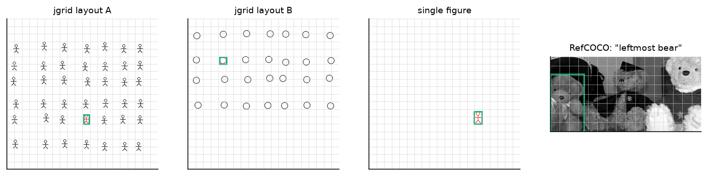
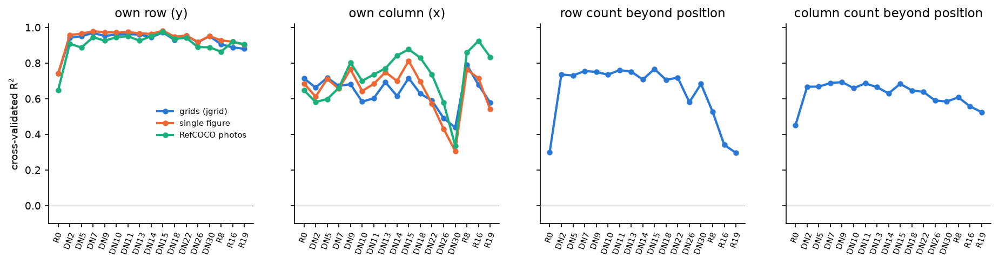
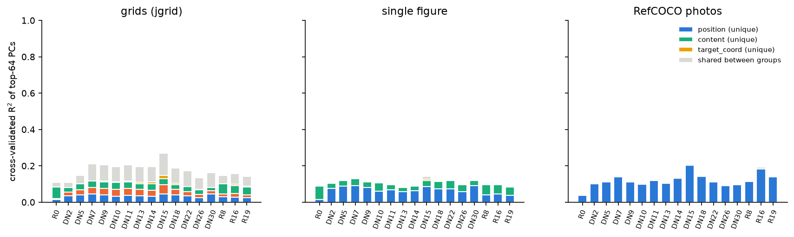
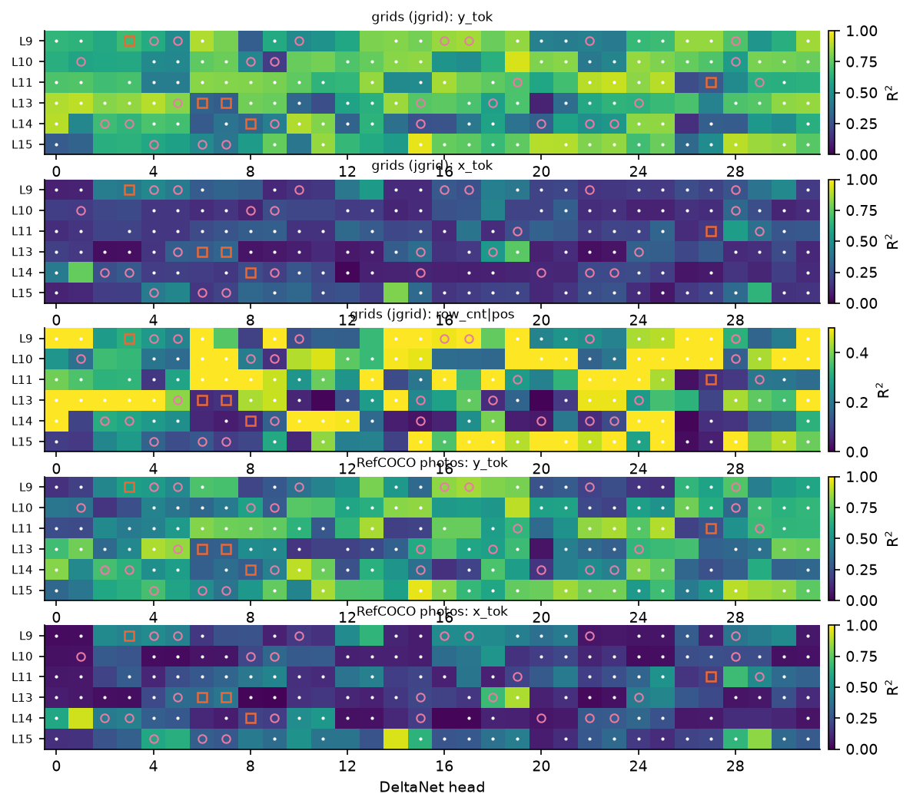
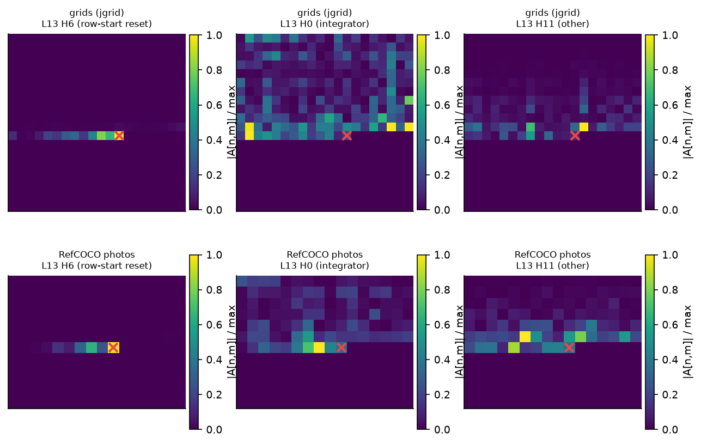
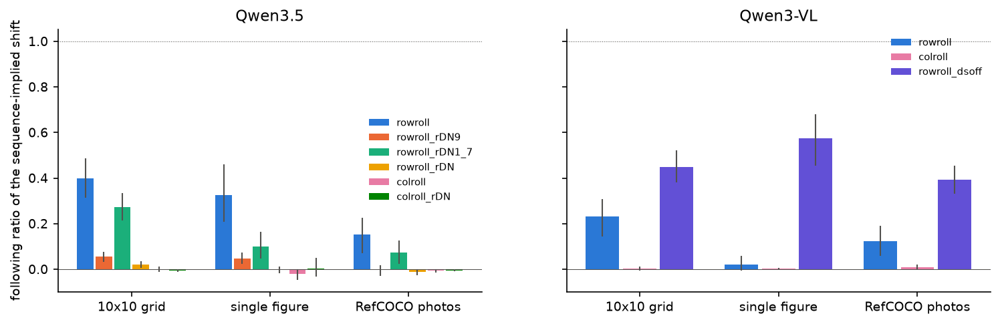
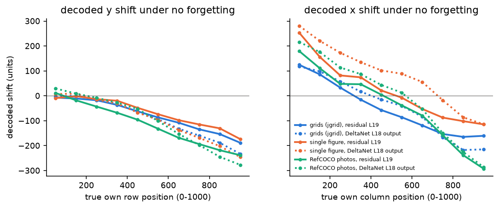
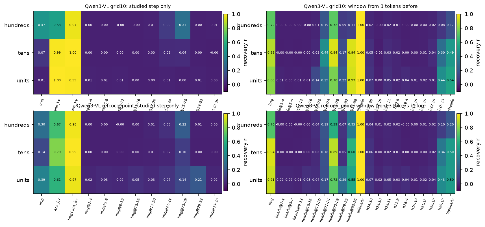
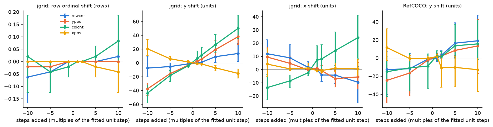
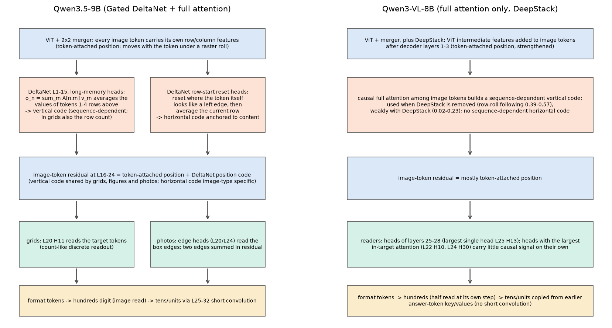

# 位置信息的来源：DeltaNet 状态、ViT 特征与两种模型的比较

实验日期：2026-11-11 至 2026-11-12。本文属于[位置读取](plan.md)研究，编号为实验 3.15 第三轮。模型为 Qwen3.5-9B（24 个 Gated DeltaNet 层与 8 个 full attention 层）与 Qwen3-VL-8B-Instruct（36 个 full attention 层，带 DeepStack），两者均使用 bfloat16、SDPA、greedy decoding 与 thinking off，问题为只输出答案的直接作答格式。本文只比较两个模型的内部机制，不比较任务正确率。前置结果：[坐标数值的读出机理](results_2026-11-05_coordinate_mechanism_natural.md)（3.15 第二轮）、[行列序号与坐标数值](results_2026-11-03_ordinal_vs_coordinate.md)（3.15 第一轮）、[行列序号机制](results_2026-10-20_rowcol_mechanism.md)（3.10）、[序列顺序的位置作用第二轮](results_2026-10-16_sequence_order_r2.md)（3.8）、[行列载体的形成原理](results_2026-11-03_causal_vs_linear_r2.md)（3.14 第二轮）、[行方向 attention](results_2026-11-05_row_attention.md)（3.14 第三轮）与[边缘读取 head 第二轮](results_2026-11-05_edge_heads_r2.md)（3.11 第四轮）。

## 0. 通俗讲述

模型要写出“目标在图像中的坐标”，必须先在某处得到每个位置“在哪里”的信息。对 Qwen3.5 来说，图像先被 ViT 切成 32×32 pixels 的小块，每块变成一个向量，这些向量按“从左到右、一行接一行”的光栅顺序排成一列送进语言模型。ViT 在计算时知道每块的二维位置，因此每个图像 token 的向量里天然带有它自己所在行列的特征；本文把这种跟着 token 走的位置信息称为**随 token 携带的位置**。语言模型里还有第二个可能的来源：Gated DeltaNet 层按光栅顺序逐个读入 token，用一个固定大小的状态矩阵概括“到目前为止读过的内容”，这种按读入顺序累积出来的信息称为**由序列顺序产生的位置**。本文要回答的问题是：坐标读取时用的位置信息来自哪一个来源，DeltaNet 的状态里到底存了什么，以及纵向与横向为什么不同。

先说 DeltaNet 的状态。DeltaNet 的一个 head 在位置 $n$ 的输出，可以精确地写成此前每个 token 写入的向量的加权和，权重由写入强度、中间经过的全部遗忘系数和键查询匹配决定，本文称之为读出权重。把实际激活代入这个分解后可以看到三类 head 的分工。第一类在每一行开头清空状态，读出权重只落在本行、当前 token 左侧的几个 token 上；第二类几乎不遗忘，读出权重铺在上方 1–4 行的大量 token 上；第三类介于两者之间。被加权的向量本身带有各自 token 的位置特征，因此每个 head 的输出相当于“它所覆盖的那片区域的平均位置”。几乎不遗忘的 head 覆盖的是当前 token 上方的若干行，它们的平均行号随当前行单调变化，于是输出中出现一个干净的**纵向位置编码**；它们覆盖的列横跨整幅图，平均列号接近图像中线，所以给不出横坐标。横向的位置只能由行首清空的 head 给出，而这类 head 何时清空，由当前 token 自己是否“看起来位于左边缘”决定，这个判断又来自 ViT 特征。这就是纵横不对称的来源：在光栅顺序中，行号随读入顺序单调增加，可以靠累积得到；列号每一行都从头开始，必须依赖由图像内容触发的清空。

那么状态里存的是计数、位置还是坐标？答案是三者中前两者共存、第三者几乎不存在。在任何图像上，DeltaNet 输出中都能读出 token 自身的行号，照片、空白画布上的单个图形和网格用的是同一组 head、同一个编码方向：在网格上训练的纵向读出器，直接用到单个图形上仍然有效。在由可数图形组成的网格上，同一批长记忆 head 的输出里还多出一部分只与“上方已经出现了几行图形”有关、与自身位置无关的成分，这就是行计数；照片上没有可数实体，这部分不存在。至于“目标的坐标数值”，它在图像 token 的 DeltaNet 状态里几乎没有：照片中的目标由图像之后的文字指定，图像 token 读入时根本不知道哪个物体是目标。

“能读出”不等于“被使用”，因此本文又直接改写 DeltaNet 的输出来检验两种成分各被哪个答案使用。做法是在第 9–15 层 DeltaNet 写回 residual 的向量上，对全部图像 token 加上一个方向：一个方向代表“同一位置上多出一行图形”（计数方向），另一个代表“同样的计数下下移一个 token 行”（位置方向），两者都由回归模型从网格激活中拟合。结果出现了清楚的分离：沿位置方向加减，网格上的纵坐标答案随加入量成比例地上下移动，照片上方向相同；行序号答案在两个方向、直至十倍单位步长的改写下都几乎不变。也就是说，坐标读取对 DeltaNet 写入的位置成分作连续的、逐渐变化的读取，行序号读取不对这些线性方向作出反应，它依赖的是 DeltaNet 递推本身（整行平移与关闭遗忘都会改变行序号），而不是输出中某个可以线性平移的计数量。计数方向本身对两个答案的作用都很小，网格上“可读出的计数”目前没有找到被线性使用的证据。

位置信息的来源由一个直接的操作检验。把图像 token 在序列中的顺序整行循环平移，每个 token 保留自己的 ViT 向量与位置编号，只改变它们被读入的先后。如果坐标完全来自随 token 携带的位置，答案不应改变；如果坐标来自序列顺序，答案应跟着平移。结果是：横坐标在两个模型、三类图像上都完全不随列方向的平移改变；纵坐标在 Qwen3.5 上部分跟随行方向的平移，网格上约四成、单个图形约三成、照片约一成半，其余部分跟随 token 自身。只要把第 9–15 层 DeltaNet 在图像 token 上的输出恢复为未平移时的值，这部分跟随就几乎完全消失，说明序列顺序对纵坐标的贡献全部经由 DeltaNet。Qwen3-VL 没有 DeltaNet：带 DeepStack 时纵坐标的跟随较小（单个图形几乎为零），关闭 DeepStack 后跟随升到四到六成。也就是说，纯 full attention 的因果模型同样能从读入顺序中算出纵向位置，而 DeepStack 在前三层反复注入 ViT 特征，让 Qwen3-VL 主要使用随 token 携带的位置。

把这些合起来，一次坐标读取的过程如下。ViT 给每个图像 token 写入自身位置；Qwen3.5 第 1–15 层的 DeltaNet 再把“上方若干行的平均位置”叠加到每个 token 上，形成一个跨图像类型共享的纵向编码，并在网格上附带行计数；行首清空的 head 给出依赖图像内容的横向编码。到第 16–24 层，图像 token 的 residual 中已经同时含有随 token 携带的位置与 DeltaNet 写入的位置。生成坐标数字时，网格上由 L20 H11 读取目标 token，照片上由边缘读取 head 读取物体边缘，读到的就是这些 token 上的位置混合；百位数字在数值之前的格式 token 和百位本步读取图像，十位与个位经第 25–32 层的短卷积从前一个 token 接力。Qwen3-VL 的位置几乎全部随 token 携带，由第 25–28 层的多个 head 读取，十位与个位从此前答案 token 的 key/value 中复制，因为它没有短卷积。关闭第 9–15 层的遗忘之所以只稳定地把纵坐标向上推，是因为原本只看上方一两行的 head 变成了从图像顶端起的全程平均，平均行号整体上移；横坐标在关闭遗忘后只向中线收缩，在单个图形上平均不移动。

## 1. 问题与主要结论

### 1.1 问题

1. **Q1**：DeltaNet 的状态（及其输出）中，随 token 自身行列变化的成分、随此前实体数量变化的成分、随目标坐标变化的成分各有多少？三者是否共存？
2. **Q2**：为什么关闭第 9–15 层遗忘主要改变纵坐标？纵横不对称的机理是什么？
3. **Q3**：自然图像与合成图像上坐标读取所用的位置信息分别来自哪里（随 token 携带的 ViT 特征、DeltaNet 由序列顺序累积的编码），各占多少？DeltaNet 在照片上存的是什么？
4. **Q4**：Qwen3-VL 的坐标读取机制在读取 head、读取时序与位置来源上与 Qwen3.5 有何不同？

### 1.2 主要结论

1. **DeltaNet 输出中存在跨图像类型共享的自身纵向位置编码。** 第 2–30 层 DeltaNet 原始输出对 token 自身行号的交叉验证 $R^2$ 在网格、单个图形与照片上都为 0.89–0.98，而 decoder 输入只有 0.65–0.74（第 5.1 节，图 3）。在一类图像上拟合的纵向读出器用于另一类图像时，第 15 层的 $R^2$ 为 0.68–0.97，横向读出器只有 −0.64 至 0.79。这说明纵向编码是 DeltaNet 为所有图像写入的同一种量，横向编码则依赖图像类型。
2. **网格上，行计数与自身位置共存于同一批长记忆 head 中；目标坐标数值几乎不存在。** 去掉自身位置可解释的部分后，行计数在 DeltaNet 输出中仍可读出（$R^2$ 0.58–0.77，在训练时未见过的 6–7 行网格上 0.86–0.89），单个 head 中 L15 H15 对自身行号为 0.96、对“超出位置的行计数”为 0.77。方差分解中，位置与计数各自独有的份额相近（第 15 层为 0.047 与 0.049），“目标坐标”独有的份额不超过 0.016（第 5.1 节，图 2、图 4）。所以在位置编码、计数与目标坐标三种信息中，位置编码与计数共存，目标坐标数值不在图像 token 的 DeltaNet 状态中。
3. **DeltaNet 的位置编码主要由“被加权的 value 携带位置”产生。** 读出权重分解在实际激活上的重构误差为 0.1%–0.2%；只用每个 head 的读出权重总量（32 维）读纵向位置 $R^2$ 为 0.72–0.82，用 value 内容加权部分为 0.97–0.98（第 5.2 节，图 5）。行首复位 head 96% 的读出权重落在本行，长记忆 head 的读出权重平均来自上方 2–4.6 行（第 5.2 节）。
4. **序列顺序只贡献纵向位置，并且全部经由 DeltaNet。** 行方向循环平移时，Qwen3.5 的纵坐标跟随序列所隐含位移的比例为 0.40（网格）、0.33（单个图形）、0.15（照片），行序号为 0.45；把全部 DeltaNet 层在图像槽位上的输出恢复为未平移值后为 −0.01 至 0.02，只恢复第 9–15 层为 0.00–0.05。列方向循环平移时横坐标的跟随比例在全部条件下为 −0.02 至 0.01（第 5.3 节，图 6）。
5. **关闭遗忘使纵坐标稳定上移，横坐标向中线收缩。** 第 9–15 层图像 token 上 $\alpha = 1$ 时，答案纵坐标平均移动 −44 至 −112 个单位，横坐标在单个图形上为 +21（区间含 0），在网格与照片上为 −41 与 −44；clean 状态下拟合的 probe 在第 19 层 residual 上读出纵向 −68 至 −122、斜率 −0.19 至 −0.28，横向斜率 −0.33 至 −0.51（向中线收缩）。只在第 1–7 层关闭遗忘作用小（纵向 −11 至 −28），第 17–31 层几乎无作用（第 5.4 节，图 7）。这与第 3 节的推导一致：有限记忆的 head 变成全程平均后，平均行号上移，平均列号趋向中线。
6. **自然图像与合成图像的差别在于位置来源的比例，DeltaNet 在照片上存的是自身位置编码。** 照片上纵坐标约 85% 跟随随 token 携带的位置、约 15% 来自 DeltaNet；单个图形与网格上 DeltaNet 的份额为 33%–40%；横坐标在三类图像上都由随 token 携带的位置与依赖内容的行首复位给出。照片上 DeltaNet 输出的方差中，自身位置独有的份额为 0.10–0.21，计数无定义，内容标记与目标坐标为 0（第 5.5 节）。
7. **Qwen3-VL 的位置主要随 token 携带，DeepStack 是其原因；读取由第 25–28 层多个 head 完成，十位与个位从此前答案 token 的 key/value 复制。** 行平移跟随比例在带 DeepStack 时为 0.23、0.02、0.12（网格、单个图形、照片），关闭 DeepStack 后为 0.45、0.57、0.39；列平移为 0.00–0.01。百位的图像信息约一半在本步读入（本步图像 key/value 恢复 0.47 与 0.30），另一半由此前答案 token 的 key/value 携带（0.53 与 0.67）；十位本步读图只恢复 0.07–0.14，此前答案 token 的 key/value 恢复 0.79–0.99。按层交换 head 输出时第 25–28 层恢复 0.59–0.94，单个 head 中 L25 H13 最大（0.08–0.44），in-target attention 最高的 L22 H10、L24 H30 单独不超过 0.07（第 5.6 节，图 8）。

8. **坐标对 DeltaNet 位置成分作连续读取，行序号不响应 DeltaNet 输出的线性改写。** 在第 9–15 层 DeltaNet 输出上沿拟合的位置方向加入 ±5、±10 个单位步长，网格纵坐标平移 +19/+38 与 −16/−38 个单位，RefCOCO 为 +9/+13 与 −16/−25；同样的改写下行序号平均变化不超过 0.02 行。沿计数方向加入 ±10 步，行序号变化不超过 0.06 行，纵坐标只变化 −7 至 +14（第 5.7 节，图 10）。因此“共存”的两种成分中，位置成分被坐标读取线性使用；计数成分能被 probe 读出，但行序号读取并不经由它的线性方向。

## 2. 架构与概念定义

### 2.1 图像 token 的光栅序列

图像经 ViT 编码与 2×2 合并后得到 $H \times W$ 个 merged token（每个覆盖 32×32 pixels），按光栅顺序写入 decoder 序列。第 $i$ 行第 $j$ 列（均从 0 起）的 token 在图像片段内的序号为

$$
n = iW + j, \qquad 0 \le i < H,\; 0 \le j < W .
$$

本文称 $i$、$j$ 为 token 的**自身行号**与**自身列号**，称

$$
y_{\mathrm{tok}} = \frac{1000\,(i + 0.5)}{H}, \qquad x_{\mathrm{tok}} = \frac{1000\,(j + 0.5)}{W}
$$

为 token 中心的 0–1000 坐标，与模型输出的坐标同一尺度。

### 2.2 Gated DeltaNet 的计算

Qwen3.5-9B 的第 4、8、…、32 层为 full attention 层，其余 24 层为 Gated DeltaNet 层，每层 32 个 head（键与查询为 16 组，经重复与 32 个 value head 对齐）。设某个 head 在序列位置 $t$ 的输入 hidden state 为 $h_t$（长度 4096），它依次做三步计算。

1. **短卷积。** $q, k, v$ 的线性投影先经长度为 4 的逐通道因果卷积：

$$
\tilde z_t = \sum_{s=0}^{3} w_s \odot z_{t-s},
$$

其中 $z$ 为 $q$、$k$ 或 $v$ 的投影（向量），$w_s$ 为逐通道权重，$\odot$ 为逐元素乘积。它让位置 $t$ 的 $q_t, k_t, v_t$ 混入前 3 个 token 的投影。

2. **门控。** 遗忘系数与写入强度为

$$
\alpha_t = \exp(g_t), \quad g_t = -e^{A}\,\operatorname{softplus}(a_t + b_{\mathrm{dt}}), \qquad \beta_t = \sigma(\hat b_t),
$$

其中 $a_t = W_a h_t$ 与 $\hat b_t = W_b h_t$ 是当前 hidden state 的线性函数（in_proj_a 与 in_proj_b），$A$ 与 $b_{\mathrm{dt}}$ 为每个 head 的标量参数，$\sigma$ 为 sigmoid。门控不经过短卷积，因此 $\alpha_t$、$\beta_t$ 只由当前 token 自身的 hidden state 决定。

3. **递推与读出。** $q_t, k_t$（长度 $d_k = 128$）做 L2 归一化，$q_t$ 再乘 $d_k^{-1/2}$；状态 $S_t$ 是 $d_k \times d_v$ 的矩阵（$d_v = 128$）：

$$
S_t = M_t S_{t-1} + \beta_t k_t v_t^{\top}, \qquad M_t = \alpha_t \left(I - \beta_t k_t k_t^{\top}\right), \qquad o_t = S_t^{\top} q_t .
$$

$M_t$ 先把旧状态整体乘以 $\alpha_t$（$\alpha_t$ 接近 0 等于清空，接近 1 等于保留），再擦除旧状态在 $k_t$ 方向上的内容（delta rule），随后写入新的键值对 $k_t v_t^{\top}$。本文称 $o_t$（长度 128）为该 head 的**原始输出**；32 个 head 的原始输出经 gated RMSNorm 与输出投影 out_proj 后加回 residual stream，加回的 4096 维向量称为该层的 **DeltaNet 输出**。

### 2.3 读出权重

把递推展开，原始输出可以精确写成之前全部 value 的加权和：

$$
o_n = \sum_{m \le n} A_{n,m}\, v_m, \qquad A_{n,m} = \beta_m\, k_m^{\top} \left( M_{m+1} M_{m+2} \cdots M_n \right) q_n .
$$

本文称标量 $A_{n,m}$ 为位置 $n$ 对位置 $m$ 的**读出权重**。它由三部分相乘得到：$m$ 处的写入强度 $\beta_m$；$m$ 之后到 $n$ 为止全部遗忘系数之积 $\prod_{r=m+1}^{n} \alpha_r$（来自各 $M_r$）；键与查询的匹配以及 delta rule 的擦除。这个式子与 softmax attention 的 $o_n = \sum_m p_{n,m} v_m$ 形式相同，区别是 $A_{n,m}$ 不归一化、可以为负，并随遗忘系数的连乘衰减。计算时对每个查询位置 $n$ 令 $u \leftarrow q_n$，由 $r = n$ 向前迭代：先记录 $A_{n,r} = \beta_r k_r^{\top} u$，再更新 $u \leftarrow M_r u$。把实际激活代入后，$\lVert \sum_m A_{n,m} v_m - o_n \rVert / \lVert o_n \rVert$ 的中位数为 0.001–0.002，说明这一分解在数值上精确（第 5.2 节）。

### 2.4 本文使用的位置概念

1. **随 token 携带的位置**：一个图像 token 的向量中由 ViT（以及 Qwen3-VL 的 DeepStack）写入、表示该 token 自身行列的成分。它附着在 token 上，序列顺序改变时随 token 一起移动。
2. **由序列顺序产生的位置**：decoder 按读入顺序计算出来的位置成分。在 Qwen3.5 中它可以由 DeltaNet 的递推产生，也可以由 causal full attention 产生；序列顺序改变时它跟着顺序改变。
3. **自身位置编码**：某一层表示中可由 token 自身的 $(i, j)$ 线性预测的成分。度量方式是以该层表示为输入、以 $y_{\mathrm{tok}}$ 或 $x_{\mathrm{tok}}$ 为目标的 ridge probe 的交叉验证 $R^2$（第 4.3 节）。本文中“纵向位置编码”指其中预测 $y_{\mathrm{tok}}$ 的部分，“横向位置编码”指预测 $x_{\mathrm{tok}}$ 的部分。
4. **行计数与列计数**：在由实体组成的网格上，行计数 $c^{\mathrm{row}}$ 为顶边位于该 token 中心上方的实体行数，列计数 $c^{\mathrm{col}}$ 为与该 token 所在 token 行重叠、且左边位于该 token 中心左侧的实体个数。照片上两者无定义。
5. **目标坐标成分**：表示中随目标位置变化、且只出现在目标之后 token 上的成分。本文以“与目标同一 token 行且位于目标右侧”这一标志及其与目标坐标区间 one-hot 的乘积作为特征（第 4.3 节）。

## 3. 假设与推导

### 3.1 假设

- **H1（状态内容）**：DeltaNet 输出中，自身位置编码在所有图像上存在；行列计数只在可数实体组成的图像上作为额外成分出现；目标坐标数值不存在于图像 token 上。
- **H2（产生方式）**：位置编码主要来自读出权重对“带有自身位置特征的 value”的加权平均；读出权重的空间范围由遗忘系数决定。
- **H3（纵横不对称）**：在光栅顺序下，长记忆 head 的平均只能给出纵向位置；横向位置需要由内容触发的行首复位，因此纵坐标依赖序列顺序，横坐标不依赖。
- **H4（来源比例）**：坐标读取使用随 token 携带的位置与 DeltaNet 纵向编码的混合；两者的比例随图像类型改变。
- **H5（Qwen3-VL）**：没有 DeltaNet 时，位置主要随 token 携带；causal full attention 本身也可能产生由序列顺序决定的纵向位置。

### 3.2 推导：为什么累积只能给出纵向位置

考虑一个 head 在图像片段内的遗忘系数近似为常数 $\alpha$。忽略 delta rule 的擦除项，读出权重近似为

$$
A_{n,m} \approx \beta_m\, (k_m^{\top} q_n)\, \alpha^{\,n-m} .
$$

设 value 中含有该 token 自身位置的线性编码，$v_m = c_m + P p_m$，其中 $p_m = (i_m, j_m)$ 为 token $m$ 的自身行列，$P$ 是把行列映成向量的矩阵（形状 $d_v \times 2$），$c_m$ 是内容成分。于是

$$
o_n \approx \Big(\sum_m A_{n,m}\Big) \left( \bar c_n + P\, \bar p_n \right), \qquad \bar p_n = \frac{\sum_m A_{n,m}\, p_m}{\sum_m A_{n,m}} ,
$$

$\bar p_n$ 是以读出权重为权的源位置平均，$\bar c_n$ 为相应的内容平均。它说明 head 输出中的位置有两条途径：权重总量 $\sum_m A_{n,m}$（“读到了多少”）与平均位置 $\bar p_n$（“读到的东西在哪里”）。

1. **长记忆 head。** 记忆长度约为 $1/(1-\alpha)$ 个 token。若它覆盖若干行，$\bar p_n$ 的纵向分量约为 $i_n - \lambda$（$\lambda$ 为与 $\alpha$ 有关的滞后行数），随 $i_n$ 单调变化；横向分量是多行列号的平均，接近 $(W-1)/2$，不含列信息。权重总量随 $n = i_n W + j_n$ 单调饱和，同样只给出“以行为主、列被压成一行内小数”的量。因此长记忆 head 只能给出纵向位置。
2. **行首复位 head。** 若 head 在每行列 0 处 $\alpha \approx 0$、行内 $\alpha \approx 1$，读出权重只覆盖本行左侧，$\bar p_n$ 的纵向分量恰为 $i_n$，横向分量约为 $j_n / 2$，权重总量约为 $j_n + 1$。这是递推中唯一能产生横向位置的方式。由于门控只看当前 token 的 hidden state，复位发生在“看起来位于左边缘”的 token 上，这一特征来自 ViT，与该 token 在序列中的槽位无关。
3. **对序列顺序操作的预言。** 整行循环平移只改变各行被读入的先后：长记忆 head 的 $\bar p_n$ 纵向分量随之改变，纵坐标中经由它的部分应跟随平移。行内循环平移时，行首复位仍发生在原来列 0 的 token 上，复位 head 计算的列信息基本不变，长记忆 head 本来就没有列信息，所以横坐标不应跟随平移。
4. **对关闭遗忘的预言。** 令第 9–15 层图像 token 上 $\alpha = 1$：原本记忆为一两行的 head 变成从图像顶端开始的均匀平均，$\bar p_n$ 纵向分量由 $i_n - \lambda$ 变为约 $i_n / 2$，读出的纵向位置整体上移，且越靠下移得越多；行首复位 head 失去复位，$\bar p_n$ 横向分量变成全部历史列号的平均，读出的横向位置向中线收缩，而平均横向位移接近 0。原本 $\alpha \approx 1$ 的长记忆 head 不受影响。

## 4. 实验设计

### 4.1 刺激

| 刺激族 | 内容 | token 网格 | 用途 | $n$ |
| --- | --- | --- | --- | --- |
| jgrid | 640 px 画布上 3–7 行 × 3–7 列相同黑色图形（person/ring/square/arrow，48 px），一个红色；行间距与列间距逐个从 64/80/96/112/128 px 中抽取，整体起点随机，每个图形 ±6 px 抖动 | 20×20 | probe 与方差分解（计数与自身位置解耦） | 160 |
| single | 640 px 空白画布上一个红色图形，位置随机（3.15 第二轮） | 20×20 | 无实体计数的合成图像 | 64 |
| RefCOCO | test split（3.15 第一轮的抽样顺序），长边 512 px | 可变 | 自然图像 | 96（probe）/64（平移） |
| grid10 | 10×10 相同图形网格，一个红色（3.15 第二轮） | 20×20 | 序列平移与 Qwen3-VL 读取 | 64 |

jgrid 中，起点随机使第一行图形可以出现在任意高度，间距随机使同一行计数对应不同的 $y_{\mathrm{tok}}$，因此在 160 张图像上自身行号与行计数部分解耦。图 1 给出两张 jgrid 布局、一张单个图形与一张 RefCOCO 图像，灰线为 32 px 的 token 网格，绿框为目标框。

*图 1：刺激示例（输入图像）。灰色细线为 merged token 的边界，绿色框为目标的真实框。*

### 4.2 记录内容

对每张图像做一次 prefill（问题为直接作答的点坐标格式；由于 causal，图像 token 的状态与问题文本无关），在两种条件下记录：clean，以及 nof（第 9、10、11、13、14、15 层 DeltaNet 在图像 token 上 $\alpha = 1$，与 3.15 第二轮相同）。每张图像随机抽 32 个图像 token，并加入全部目标 token 与“同行目标右侧” token，在这些 token 上保存：13 个 DeltaNet 层（第 2、5、7、9、10、11、13、14、15、18、22、26、30 层）的原始输出；decoder 输入与第 8、16、19 层输出的 residual；第 9–15 层的 DeltaNet 输出；全部 24 个 DeltaNet 层的 $\alpha$ 与 $\beta$。另取 24 个查询 token，在第 9–15 层计算每个 head 的完整读出权重行 $A_{n,\cdot}$，记录其总量、以 $\lvert A \rvert$ 为权的源位置平均、本行份额、平均滞后（以 token 计），以及原始输出的两部分：

$$
o_n^{\mathrm{amount}} = \Big(\sum_{m \in \mathcal I} A_{n,m}\Big)\, \bar v, \qquad o_n^{\mathrm{content}} = \sum_{m \in \mathcal I} A_{n,m}\, (v_m - \bar v),
$$

其中 $\mathcal I$ 为图像 token 集合，$\bar v$ 为该图像全部图像 token 的 value 均值。前者只携带“读到了多少”，后者携带“读到的 value 偏离平均的方向”。

### 4.3 probe 与方差分解

1. **probe。** 输入为某层表示（逐列标准化后取前 256 个主成分），目标为 $y_{\mathrm{tok}}$、$x_{\mathrm{tok}}$、$c^{\mathrm{row}}$、$c^{\mathrm{col}}$，ridge 回归，按图像分 5 折交叉验证，惩罚系数在第一折的内部划分上选取。“超出位置的计数”（记作 $c^{\mathrm{row}} \mid$ 位置）的目标是 $c^{\mathrm{row}}$ 减去它在自身位置 one-hot（$y_{\mathrm{tok}}$ 与 $x_{\mathrm{tok}}$ 各 20 个区间）上的最小二乘拟合值，即同一位置上不同布局之间的计数差异。保留测试另将 jgrid 中 6–7 行的 47 张图像作测试、其余作训练。单 head probe 以该 head 的 128 维原始输出（逐列标准化）为输入。
2. **跨图像类型迁移。** 在一类图像上拟合（逐列标准化与 ridge 均用该类图像），直接用于另一类图像，报告 $R^2$。
3. **方差分解。** 把某层表示的前 64 个主成分作为因变量 $Y$（形状 $N \times 64$），以四组特征回归：位置（$y_{\mathrm{tok}}$、$x_{\mathrm{tok}}$ 各 20 区间 one-hot）、计数（$c^{\mathrm{row}}$、$c^{\mathrm{col}}$ 各 8 级 one-hot，仅 jgrid）、内容（是否为目标 token、是否为实体 token）、目标坐标（同行目标右侧标志，以及它与目标纵、横坐标 10 区间 one-hot 的乘积）。交叉验证的总 $R^2$ 为全部特征共同解释的方差份额；某组的**独有份额**为全部特征的 $R^2$ 减去去掉该组后的 $R^2$。独有份额回答“只有这组特征能解释的方差有多少”，各组独有份额之和与总 $R^2$ 之差为各组共享的部分。

### 4.4 序列顺序的平移

使用 3.8 的序列构造：图像片段中第 $i$ 个槽位放入原图第 $\pi(i)$ 个 token 的向量，同时保留该 token 自己的 MRoPE 位置编号（Qwen3-VL 还保留它自己的 DeepStack 特征），序列序号与 causal mask 按新的槽位顺序计算。

1. **行平移（rowroll）**：$\pi$ 把 token 行循环下移 $k$ 行，$k$ 随机选取，使目标不跨越接缝且序列所隐含的位移至少 3 个 token 行。
2. **列平移（colroll）**：每一行内循环右移 $k$ 个 token，约束相同。
3. **DeltaNet 恢复**（仅 Qwen3.5）：在平移后的运行中，把指定 DeltaNet 层在每个图像槽位上的输出替换为同一个 token 在未平移运行中的输出（全部 24 层、第 9–15 层或第 1–7 层）。若跟随消失，说明序列顺序的作用由这些层写入图像 token。
4. **DeepStack 关闭**（仅 Qwen3-VL）：不注入 DeepStack 特征。

**跟随比例** $f$ 为答案位移对序列所隐含位移的过原点回归斜率：

$$
f = \frac{\sum_{\text{images}} \Delta_{\mathrm{ans}}\, \Delta_{\mathrm{seq}}}{\sum_{\text{images}} \Delta_{\mathrm{seq}}^{2}},
$$

其中 $\Delta_{\mathrm{seq}}$ 是“按目标所在槽位换算的坐标”减去真实坐标，$\Delta_{\mathrm{ans}}$ 是平移运行的答案减去未平移运行的答案。$f = 1$ 表示坐标完全由序列顺序决定，$f = 0$ 表示完全随 token 携带。区间为按图像的 bootstrap 95% 区间。

### 4.5 关闭遗忘的分层扫描

在 grid10、single、RefCOCO 上分别对第 1–7、9–15、17–23、25–31 层的 DeltaNet 在图像 token 上令 $\alpha = 1$（只作用于 prefill），记录点答案的平均位移。

### 4.6 Qwen3-VL 的逐数位 patching

沿用 3.15 第二轮的配对与恢复比例 $r$：grid10 中目标移到右邻或下邻格（32 对），RefCOCO 中同一图像的两个裁剪窗口错开 28 px（32 对）。在研究步复制运行 $B$ 的一类状态到运行 $A$：本步的图像 key/value（全部层或每 4 层一组）；此前答案 token 的 key/value；二者合并；在百位前 3 个 token 到研究步的窗口内交换 head 输出（每 4 层一组全部 head、全部 head、或单个 head）；以及 $B$ 的图像从百位前第 6 个 token 起可见的扫描。单个 head 的候选由前 8 对的 attention 统计选出（百位步落在目标框内的 attention 份额最高的 6 个 head），再加上 3.14 第二、三轮的 L25 H13 与 L24 H30。

## 5. 结果

### 5.1 DeltaNet 输出中有什么

*图 3：各层表示的交叉验证 probe $R^2$（模型激活上拟合的 ridge 回归）。横轴 R0、R8、R16、R19 为 decoder 输入与第 8、16、19 层输出的 residual，DN$l$ 为第 $l$ 层 DeltaNet 的原始输出；蓝色为 jgrid，橙色为单个图形，青色为 RefCOCO。四列依次为自身行号、自身列号、超出位置的行计数与列计数（后两者只在 jgrid 上有定义）。*

| 表示 | jgrid：$y$ / $x$ / $c^{\mathrm{row}} \mid$ 位置 / $c^{\mathrm{col}} \mid$ 位置 | 单个图形：$y$ / $x$ | RefCOCO：$y$ / $x$ |
| --- | --- | --- | --- |
| decoder 输入 | 0.74 / 0.71 / 0.30 / 0.45 | 0.74 / 0.69 | 0.65 / 0.65 |
| DeltaNet L9 | 0.95 / 0.68 / 0.75 / 0.69 | 0.97 / 0.77 | 0.93 / 0.80 |
| DeltaNet L15 | 0.97 / 0.72 / 0.77 / 0.68 | 0.98 / 0.81 | 0.97 / 0.88 |
| DeltaNet L30 | 0.95 / 0.44 / 0.68 / 0.58 | 0.95 / 0.31 | 0.89 / 0.34 |
| residual L16 | 0.89 / 0.68 / 0.34 / 0.56 | 0.92 / 0.71 | 0.92 / 0.93 |
| residual L19 | 0.88 / 0.58 / 0.30 / 0.53 | 0.90 / 0.54 | 0.91 / 0.83 |

1. **DeltaNet 写入了比 decoder 输入强得多的纵向编码，三类图像相同。** 从第 2 层起，DeltaNet 原始输出对自身行号的 $R^2$ 就达到 0.89–0.98，并保持到第 30 层；decoder 输入只有 0.65–0.74。横向编码在 DeltaNet 输出中弱于纵向（0.31–0.88），并在深层减弱。这说明 DeltaNet 对位置的主要贡献是纵向的，与第 3.2 节“长记忆 head 只能给出纵向位置”的推导一致。
2. **纵向编码在三类图像之间可以迁移，横向编码不能。** 第 15 层 DeltaNet 输出上，纵向读出器的迁移 $R^2$ 为：jgrid→单个图形 0.97，单个图形→jgrid 0.93，RefCOCO→单个图形 0.90，RefCOCO→jgrid 0.91，单个图形→RefCOCO 0.83，jgrid→RefCOCO 0.68；横向读出器为 −0.64 至 0.79。同一个线性方向在照片、空白画布和网格上都读出纵向位置，说明这是一个与图像内容无关的通用编码；横向编码的方向随图像类型改变，与它依赖内容触发的行首复位相符。
3. **网格上行计数是独立于位置的额外成分。** 去掉自身位置后，行计数在 DeltaNet 输出中的 $R^2$ 为 0.58–0.77；在训练时未见过的 6–7 行网格上，第 9–15 层直接读行计数的 $R^2$ 为 0.86–0.89，读自身行号为 0.95–0.97。在 decoder 输入上，“超出位置的行计数”只有 0.30，说明计数主要由 DeltaNet 写入。第 16、19 层 residual 上这一成分降到 0.30–0.34，计数在 residual 中被其他成分稀释。
4. **方差分解：位置与计数共存，目标坐标几乎为零。** 第 15 层 DeltaNet 输出前 64 个主成分（覆盖其方差的 61%）中，四组特征共同解释 0.27；独有份额为位置 0.047、计数 0.049、内容 0.035、目标坐标 0.016。RefCOCO 第 15 层总量 0.21，其中位置独有 0.205，内容与目标坐标为 0.00。DeltaNet 输出的方差大部分不由这四组特征解释，属于图像内容本身（解释）。

*图 2：方差分解（交叉验证 ridge 拟合，模型激活）。每根柱为一层表示，堆叠部分依次为位置、计数、内容、目标坐标的独有份额（蓝、橙、青、黄），灰色为各组共享部分；柱高为全部特征的交叉验证 $R^2$。*

*图 4：第 9–15 层每个 DeltaNet head 的单 head probe $R^2$（viridis，0–1；“超出位置的行计数”色标上限 0.5）。橙色方框为 3.8 的行首复位 head，粉色圆圈为单元行起点复位 head，白点为长记忆 head（integrator），其余为“其他”类。*

5. **携带纵向位置与计数的是同一批长记忆 head；携带横向位置的是少数固定 head。** 纵向位置单 head $R^2$ 最高的是 L15 H15（integrator，三类图像 0.96–0.97），其后为 L10 H19、L11 H23、L13 H1、L14 H0 等，$R^2 > 0.8$ 的 head 在 jgrid、单个图形、RefCOCO 上分别有 48、56、23 个；按类别平均，integrator 最高（0.56–0.74），行首复位 head 最低（0.35–0.49）。超出位置的行计数也是 L15 H15 最高（0.77），integrator 平均 0.43，行首复位 head 0.11。横向位置集中在 L15 H14、L14 H1、L13 H19（三类图像 0.75–0.94），其余 head 多在 0.3 以下。因此在网格上，“自身行号”和“已出现几行图形”写在同一批长记忆 head 的输出里，两者共存；照片上这些 head 只写自身行号。

### 5.2 DeltaNet 如何产生位置编码

*图 5：第 13 层三个 head 对一个查询 token（红叉）的读出权重 $\lvert A_{n,m} \rvert$（由模型激活按第 2.3 节公式精确计算，按最大值归一化，viridis）。上行为 jgrid，下行为 RefCOCO；三列分别为行首复位 head、长记忆 head 与“其他”类 head。*

| head 类别（3.8） | 本行份额 | 平均滞后（token） | 源行减自身行 | 源列减自身列 |
| --- | --- | --- | --- | --- |
| 行首复位（5 个） | 0.96 / 0.94 / 0.99 | 3.5 / 4.1 / 1.3 | −0.04 / −0.07 / −0.01 | −1.5 / −1.5 / −1.0 |
| 单元行起点复位（27） | 0.61 / 0.60 / 0.75 | 14 / 15 / 7 | −0.6 / −0.7 / −0.3 | −1.9 / −1.5 / −1.5 |
| 其他（55） | 0.45 / 0.41 / 0.56 | 25 / 27 / 13 | −1.2 / −1.3 / −0.7 | −1.6 / −1.1 / −1.3 |
| 长记忆 integrator（105） | 0.12 / 0.10 / 0.17 | 87 / 93 / 34 | −4.3 / −4.6 / −2.1 | −2.0 / −1.3 / −1.6 |

表中三个数依次为 jgrid / 单个图形 / RefCOCO，均为各 head 在查询 token 上的中位数再取类别中位数；“源行”“源列”为以 $\lvert A_{n,m} \rvert$ 为权的源 token 行列平均。

1. **读出权重的空间范围由遗忘决定，四类 head 覆盖从“本行左侧几个 token”到“上方 2–4.6 行”。** 行首复位 head 96% 的读出权重落在本行、平均只回看 3.5 个 token；长记忆 head 只有 12% 落在本行，平均回看 87 个 token（约 4.3 行）。RefCOCO 图像更窄、token 行更短，同样的 token 数对应更少的行，所以照片上长记忆 head 的源行只在上方 2.1 行。这正是第 3.2 节中“$\bar p_n$ 的滞后 $\lambda$ 由 $\alpha$ 决定”的实测形态。
2. **位置主要由被加权的 value 携带，权重总量只携带一部分。** 把第 9–15 层的原始输出拆成两部分后，只用读出权重总量（每层 32 个标量）读自身行号的 $R^2$ 为 0.82（jgrid）、0.72（单个图形）、0.80（RefCOCO），用内容加权部分为 0.97、0.98、0.97；读行计数时分别为 0.68 与 0.91。所以 DeltaNet 的位置编码主要是“$A$ 加权的 value 平均”，即 $\bar p_n$ 途径；权重总量（“读到了多少”）也随位置单调变化，但信息较少。计数同样主要通过 value 途径：图形 token 的 value 与空白 token 不同，上方图形行越多，加权平均中图形成分的模式越不同（解释）。

### 5.3 纵向与横向：序列顺序的作用

*图 6：序列平移下答案跟随序列所隐含位移的比例 $f$（模型输出，误差线为 bootstrap 95% 区间）。左为 Qwen3.5，右为 Qwen3-VL；颜色在两图中对应同一条件：蓝 rowroll，橙 rowroll 加第 9–15 层 DeltaNet 恢复，青 rowroll 加第 1–7 层恢复，黄 rowroll 加全部 DeltaNet 恢复，粉 colroll，绿 colroll 加全部 DeltaNet 恢复，紫 rowroll 且关闭 DeepStack。点线为 $f = 1$。*

| 条件（Qwen3.5） | grid10 点 $y$ | grid10 行序号 | 单个图形 $y$ | RefCOCO $y$ |
| --- | --- | --- | --- | --- |
| rowroll | 0.40 [0.31, 0.49] | 0.45 [0.31, 0.59] | 0.33 [0.21, 0.46] | 0.15 [0.07, 0.22] |
| + 第 1–7 层恢复 | 0.27 [0.21, 0.33] | 0.39 [0.26, 0.51] | 0.10 [0.05, 0.16] | 0.07 [0.02, 0.12] |
| + 第 9–15 层恢复 | 0.05 [0.03, 0.08] | 0.04 [0.01, 0.06] | 0.05 [0.02, 0.07] | 0.00 [−0.03, 0.02] |
| + 全部 DeltaNet 恢复 | 0.02 [0.01, 0.04] | 0.00 [0.00, 0.02] | −0.00 [−0.02, 0.01] | −0.01 [−0.03, 0.00] |
| colroll（$x$ 或列序号） | −0.00 / −0.00 | — | −0.02 | −0.01 |
| colroll + 全部 DeltaNet 恢复 | −0.01 / 0.00 | — | 0.00 | −0.01 |

grid10 与单个图形各 64 张；RefCOCO 列平移 63 张、行平移 47 张（其余图像不存在满足约束的平移）；全部答案有效，只有 RefCOCO 行平移中各有 1 个无效答案。

1. **纵坐标部分由序列顺序决定，这一部分全部由 DeltaNet 写入。** 行平移后，网格、单个图形与照片的纵坐标分别跟随序列位移的 40%、33%、15%，网格的行序号跟随 45%。把第 9–15 层 DeltaNet 在图像槽位上的输出恢复为未平移值，跟随降到 0.00–0.05；恢复全部 DeltaNet 层后为 −0.01 至 0.02。full attention 层在平移下看到的 causal 可见范围也改变了，但恢复 DeltaNet 后不再有跟随，说明它们不贡献序列顺序的作用。第 1–7 层只承担一部分（恢复它们使跟随降低 0.06–0.23）。
2. **横坐标不随序列顺序改变。** 列平移在三类图像上的跟随比例为 −0.02 至 0.01。按第 3.2 节第 3 条，这一结果同时符合两种情况：横向位置随 token 携带，或由在原列 0 token 上触发的行首复位给出。行首复位 head 的读出权重 96% 局限在本行左侧（第 5.2 节），它们计算的列信息随视觉内容锚定，因此在列平移下不移动。两种情况都意味着横坐标不依赖读入顺序。
3. **剩余部分随 token 携带。** 纵坐标中 60%–85% 不随行平移移动，这部分来自随 token 携带的位置（ViT 特征，以及与 token 一同移动的 DeltaNet 行首复位成分）。照片上随 token 携带的份额最大，与 3.15 第二轮“照片由边缘读取 head 读取物体边缘”一致：边缘 head 读取的是物体边缘 token 自身的表示。

### 5.4 关闭遗忘：为什么主要改变纵坐标

*图 7：在 clean 条件下拟合的位置 probe 应用于关闭第 9–15 层遗忘后的同一 token 时，读出位置的变化，按真实自身位置分箱（模型激活；实线为第 19 层 residual，点线为第 18 层 DeltaNet 输出）。左为纵向，右为横向；颜色同图 3。*

| 关闭遗忘的层 | grid10 $\Delta y$ / $\Delta x$ | 单个图形 $\Delta y$ / $\Delta x$ | RefCOCO $\Delta y$ / $\Delta x$ |
| --- | --- | --- | --- |
| 1–7 | −28 / −19 | −27 / +5 | −11 / −4 |
| 9–15 | −112 [−131, −93] / −41 [−56, −26] | −44 [−65, −24] / +21 [−6, 55] | −104 [−120, −87] / −44 [−65, −24] |
| 17–23 | −13 / −6 | −5 / −2 | −8 / 0 |
| 25–31 | −1 / −1 | −6 / +3 | +1 / 0 |

答案位移为 0–1000 单位，每格 64 张图像。

| 表示 | jgrid 读出 $\Delta y$（斜率）/ $\Delta x$（斜率） | 单个图形 | RefCOCO |
| --- | --- | --- | --- |
| DeltaNet L18 | −93（−0.27）/ −70（−0.41） | −96（−0.30）/ +59（−0.42） | −107（−0.36）/ −42（−0.57） |
| residual L19 | −82（−0.21）/ −73（−0.33） | −68（−0.19）/ −1（−0.37） | −122（−0.28）/ −74（−0.51） |

斜率为读出位移对真实位置的线性斜率；probe 在 clean 条件下的拟合 $R^2$ 为 0.87–0.99。第 9–15 层自身的输出在关闭遗忘后远离 clean 分布，probe 外推不可靠，表中不列。

1. **关闭遗忘对纵向位置的作用是整体上移，作用集中在第 9–15 层。** 答案纵坐标在三类图像上都上移（−44 至 −112），读出的纵向位置也上移（−68 至 −122）。第 1–7 层的作用约为其四分之一，第 17 层之后几乎为零。这与 5.3 节“序列顺序对纵坐标的作用由第 9–15 层承担”是同一件事的两面。
2. **横向的作用是向中线收缩，平均位移依图像而定。** 读出的横向位置斜率为 −0.33 至 −0.57，即靠左的 token 被读得更靠右、靠右的被读得更靠左；在左右对称的单个图形上平均位移为 −1 至 +21（答案 +21，区间含 0），在网格与照片上为 −41 至 −94。纵向斜率只有 −0.19 至 −0.36，主要是整体平移。
3. **这与第 3.2 节的推导吻合。** “其他”与单元行起点复位 head 的读出权重原本平均只来自上方 0.3–1.3 行，关闭遗忘后变成从图像顶端起的全程平均，平均行号上移；行首复位 head 失去复位后平均列号趋向中线，横向编码收缩而不整体平移；integrator 原本就近乎不遗忘，不受影响。因此“关闭遗忘只移动纵坐标”的准确表述是：它使纵向位置整体上移、使横向位置向中线收缩；在目标位于画布各处的单个图形上，后者平均起来接近零。

### 5.5 自然图像与合成图像的位置来源

| 来源 | 网格（grid10 / jgrid） | 单个图形 | RefCOCO 照片 |
| --- | --- | --- | --- |
| 纵坐标中由序列顺序（DeltaNet）决定的比例 | 0.40 | 0.33 | 0.15 |
| 纵坐标中随 token 携带的比例 | 约 0.60 | 约 0.67 | 约 0.85 |
| 横坐标中由序列顺序决定的比例 | 0.00 | −0.02 | −0.01 |
| DeltaNet 输出中位置独有方差（L15） | 0.047 | 0.086 | 0.205 |
| DeltaNet 输出中计数独有方差（L15） | 0.049 | 无定义 | 无定义 |
| DeltaNet 输出中目标坐标独有方差（L15） | 0.016 | 0.008 | −0.023 |
| 主要读取 head（3.15 第二轮） | L20 H11（读目标 token） | L20 H11 与边缘 head | 第 24 层边缘 head（读物体边缘） |

1. **DeltaNet 在照片上存的是自身位置编码。** 照片上不存在可数实体，DeltaNet 输出中可解释的方差几乎全部来自自身位置（第 15 层独有 0.205、共同解释 0.21），而且这个纵向编码与网格、单个图形上的是同一方向（迁移 $R^2$ 0.68–0.91）。照片中的目标由图像之后的文字给出，图像 token 在 causal 处理中不可能知道目标，所以目标坐标成分为零（−0.023 为交叉验证噪声）。
2. **合成图像上 DeltaNet 的份额更大，网格上还附带计数。** 单个图形与网格的纵坐标中有 33%–40% 来自 DeltaNet，照片只有 15%。网格上 DeltaNet 输出同时含有自身位置与行计数（独有份额相近），行序号的读取也依赖它（跟随 0.45，恢复后为 0）。这解释了为何网格上“坐标”和“序号”都受第 9–15 层 DeltaNet 干预影响：两者读取的是同一批长记忆 head 写入的、位置与计数共存的表示（解释）。
3. **读取 head 的差别与来源比例对应。** 照片上第 24 层边缘 head 读物体边缘所在的 token（3.15 第二轮：in-target attention 0.87–0.95），读到的主要是这些 token 随身携带的位置，因此序列份额小；网格上 L20 H11 读目标 token，而目标 token 中有更多来自 DeltaNet 的纵向成分（解释，两个 head 组各自读到的成分未单独分解）。

### 5.6 Qwen3-VL

*图 8：Qwen3-VL 逐数位 patching 的恢复比例 $r$（模型激活上的干预；viridis，−0.1 至 1）。上行 grid10，下行 RefCOCO；左列只在研究步编辑，右列在百位前 3 个 token 到研究步的窗口内编辑。行为百位、十位、个位，列为被复制的状态。*

| 编辑 | grid10 百位 / 十位 | RefCOCO 百位 / 十位 |
| --- | --- | --- |
| 本步图像 key/value | 0.47 / 0.07 | 0.30 / 0.14 |
| 此前答案 token 的 key/value | 0.53 / 0.99 | 0.67 / 0.79 |
| 二者合并 | 0.97 / 1.00 | 0.98 / 0.99 |
| 本步第 25–28 层图像 key/value | 0.31 / 0.04 | 0.22 / 0.10 |
| 窗口内图像 key/value | 0.72 / 0.88 | 0.70 / 0.94 |
| 窗口内第 21–24 层全部 head | 0.19 / 0.44 | 0.19 / 0.18 |
| 窗口内第 25–28 层全部 head | 0.72 / 0.94 | 0.59 / 0.89 |
| 窗口内第 33–36 层全部 head | 0.11 / 0.94 | 0.35 / 0.60 |
| 窗口内 L25 H13 | 0.08 / 0.30 | 0.10 / 0.34 |
| 窗口内 9 个候选 head | 0.17 / 0.49 | 0.20 / 0.50 |
| $B$ 图像自百位前第 6 个 token 起可见 | 0.87 / 0.96 | 0.88 / 0.96 |

每格 64 个数值（32 对，每对 $x$ 与 $y$ 两个值）。

1. **Qwen3-VL 的位置主要随 token 携带，原因是 DeepStack。** 带 DeepStack 时，行平移的纵坐标跟随比例为 0.23（网格）、0.02（单个图形）、0.12（照片），网格行序号 0.29；关闭 DeepStack 后升到 0.45、0.57、0.39，行序号 0.39。列平移的跟随为 0.00–0.01（列序号 0.06）。DeepStack 在第 1–3 层把 ViT 中间层特征加到每个图像 token 上，使随 token 携带的位置足够强；去掉它之后，causal full attention 从读入顺序中算出的纵向位置被大量使用。这说明“序列顺序只产生纵向位置”在纯 full attention 模型中同样成立，DeltaNet 只是 Qwen3.5 中实现这一点的部件。关闭 DeepStack 也改变了未平移时的答案（单个图形平均 $\Delta y = +138$、$\Delta x = +124$），以上跟随比例都相对于各自的未平移运行计算。
2. **读取时序与 Qwen3.5 相同，接力通道不同。** 百位的图像信息约一半在本步读入，另一半在数值前的格式 token 处读入并由此前答案 token 的 key/value 携带（两者合并恢复 0.97–0.98，自百位前第 6 个 token 起可见恢复 0.87–0.88）。十位本步读图只恢复 0.07–0.14，信息几乎全部在此前答案 token 的 key/value 中（0.79–0.99）。Qwen3.5 的十位依赖第 25–32 层短卷积中的前一 token 槽位（3.15 第二轮）；Qwen3-VL 没有短卷积，同一功能由 full attention 对前面答案 token 的读取完成。
3. **读取集中在第 25–28 层，分散在多个 head 上；attention 最集中的 head 单独的因果作用很小。** 窗口内交换第 25–28 层全部 head 恢复 0.59–0.94，第 21–24 层 0.18–0.44；第 33–36 层对十位与个位恢复 0.55–0.94，对百位只有 0.11–0.35，属于把已读到的数值转成后续数字的中继（解释）。百位步 in-target attention 最高的 L22 H10（0.91）、L24 H30（0.89）单独交换时不超过 0.07；L25 H13 是单个 head 中最大的（0.08–0.44），与 3.14 第二轮“横坐标主读取 head 为 L25 H13”一致。Qwen3.5 在网格上有一个 L20 H11 单独转移 0.52 的主读取 head，Qwen3-VL 的读取更分散。

### 5.7 方向编辑

**动机。** 第 5.1 节说明网格上 DeltaNet 输出中自身位置与行计数共存，但 probe 只说明信息可读。本节在模型的实际计算中改写这两种成分，检验它们分别被哪个答案使用。

**方向的构造。** 在 jgrid 前 112 张图像上，对第 $l \in \{9, 10, 11, 13, 14, 15\}$ 层每个图像 token 的 DeltaNet 输出 $u_t^{(l)}$（长度 4096，即该层加回 residual 的向量）拟合编码模型

$$
u_t^{(l)} \approx b^{(l)} + \sum_{a=0}^{19} \mathbb{1}[\mathrm{bin}_y(t) = a]\, Y^{(l)}_a + \sum_{a=0}^{19} \mathbb{1}[\mathrm{bin}_x(t) = a]\, X^{(l)}_a + \sum_{c=0}^{7} \mathbb{1}[c^{\mathrm{row}}_t = c]\, R^{(l)}_c + \sum_{c=0}^{7} \mathbb{1}[c^{\mathrm{col}}_t = c]\, K^{(l)}_c + \text{内容项},
$$

其中 $\mathrm{bin}_y(t)$ 为 $y_{\mathrm{tok}}$ 所在的 50 单位区间（20×20 图像上恰为一个 token 行），$Y_a, X_a, R_c, K_c$ 为长度 4096 的系数向量（ridge，$\lambda = 1$）。由于四组 one-hot 同时进入回归，$R_{c+1} - R_c$ 表示“自身位置不变时多一行图形”带来的输出变化，$Y_{a+1} - Y_a$ 表示“计数不变时下移一个 token 行”带来的变化。**单位步长**定义为相邻级差的平均（只用样本数超过 50 的级）：

$$
\delta^{(l)}_{\mathrm{rowcnt}} = \operatorname{mean}_c \left( R^{(l)}_{c+1} - R^{(l)}_c \right), \qquad \delta^{(l)}_{\mathrm{ypos}} = \operatorname{mean}_a \left( Y^{(l)}_{a+1} - Y^{(l)}_a \right),
$$

列计数与横向位置的 $\delta_{\mathrm{colcnt}}$、$\delta_{\mathrm{xpos}}$ 同理。单位步长的范数为 0.10–0.45，第 9–15 层 DeltaNet 输出范数的中位数为 4.2–6.5。

**操作。** 在 jgrid 后 48 张图像（未参与拟合）、单个图形 24 张与 RefCOCO 24 张上，prefill 时对全部图像 token 令 $u_t^{(l)} \leftarrow u_t^{(l)} + s\, \delta^{(l)}$，六层同时施加，$s \in \{\pm 1, \pm 2, \pm 5, \pm 10\}$，记录点坐标与行列序号答案相对未改写时的平均变化。

*图 10：沿四个方向改写第 9–15 层 DeltaNet 输出后答案的平均变化（模型输出；误差线为 bootstrap 95% 区间）。横轴为加入的单位步长倍数 $s$；蓝 rowcnt（行计数方向），橙 ypos（纵向位置方向），青 colcnt（列计数方向），黄 xpos（横向位置方向）。四幅依次为 jgrid 行序号、jgrid 纵坐标、jgrid 横坐标、RefCOCO 纵坐标。*

| 方向与步长 | jgrid 行序号 | jgrid $\Delta y$ | jgrid $\Delta x$ | RefCOCO $\Delta y$ |
| --- | --- | --- | --- | --- |
| ypos +5 / +10 | 0.00 / 0.00 | +19 [10, 33] / +38 [27, 52] | −7 / −6 | +9 [3, 15] / +13 |
| ypos −5 / −10 | −0.02 / −0.02 | −16 [−22, −10] / −38 [−47, −29] | +5 / +9 | −16 [−42, −2] / −25 [−49, −8] |
| rowcnt +5 / +10 | 0.00 / +0.02 | +9 / +14 | −4 / −10 | +16 / +19 |
| rowcnt −5 / −10 | −0.04 / −0.06 | −5 / −7 | +9 / +12 | −12 / −13 |
| colcnt +10 / −10 | +0.08 / +0.02（列 +0.06 / −0.21） | +50 / −44 | +24 / −14 | +16 / −15 |
| xpos +10 / −10 | −0.04 / 0.00（列 +0.02 / +0.02） | −15 / +21 | +1 / +4 | −13 / +12 |

jgrid 每格 48 张，RefCOCO 24 张，全部答案有效；未标区间的数值区间见实验产物。

1. **坐标读取对 DeltaNet 的位置成分作连续读取。** 沿位置方向，网格纵坐标的变化随 $s$ 近似线性、且正负对称（约 3.8 个单位每步），照片上方向相同而幅度较小。按 probe 的标定，一个单位步长对应一个 token 行（50 个单位），实测只移动约 4 个单位，说明经由第 9–15 层 DeltaNet 输出改写的位置只是坐标读数的一部分：其余来自随 token 携带的位置与未改写的层，这与第 5.3 节“网格纵坐标约 40% 来自 DeltaNet”一致（解释）。
2. **行序号读取不响应这些线性方向。** 四个方向在 $\pm 10$ 步内使行序号平均变化不超过 0.08 行，计数方向不超过 0.06 行。整行平移（第 5.3 节）与关闭遗忘（3.10、3.15 第一轮）都会改变行序号，说明行序号依赖 DeltaNet 的递推，但这一读取对输出中沿计数方向的线性平移没有反应。一个可能的解释是行序号由离散的阈值式读取给出，小于一格的线性偏移不改变取整后的答案（解释，未检验）。
3. **方向之间并不纯净。** 列计数方向同样大幅移动纵坐标（+50/−44），横向位置方向反向移动纵坐标而几乎不移动横坐标。编码模型中的各组系数在 4096 维空间中并不正交，读取纵坐标的部件对多个方向都敏感；横坐标对任何方向的改写都基本不响应，与“横坐标不由 DeltaNet 写入的成分决定”一致。因此本节支持的结论是“纵坐标读取对第 9–15 层 DeltaNet 输出线性敏感，行序号读取不敏感”，而不支持“某一个方向恰好是模型使用的计数变量”。

## 6. 坐标读取的完整过程

*图 9：两种模型坐标读取的过程示意（由第 5 节与 3.11、3.12、3.15 第二轮的测量汇总的示意图，不是模型输出）。蓝色框为图像 token 上的表示，橙色框为在图像 token 之间传递位置的部件，绿色框为答案位置的读取，黄色框为数字的逐位生成。*

**Qwen3.5，网格与单个图形。**

1. ViT 与 2×2 合并为每个图像 token 写入其自身行列特征，这些特征随 token 进入 decoder。
2. 第 1–15 层的 DeltaNet 按光栅顺序读入图像 token。长记忆 head（如 L15 H15）的输出等于其上方 1–4 行 token 的 value 的加权平均，value 带有各自的位置特征，于是每个 token 上被叠加了一个随行号单调变化的纵向编码；在网格上，同一批 head 的平均中还包含“上方有几行图形”的成分，即行计数。行首复位 head 在“看起来位于左边缘”的 token 处清空，之后只平均本行左侧的 token，给出锚定在图像内容上的横向编码。
3. 到第 16–24 层，目标 token 的 residual 中同时含有随 token 携带的位置与 DeltaNet 写入的位置，纵坐标中约 33%–40% 来自后者。
4. 生成坐标时，L20 H11 在数值前的格式 token 与百位步按内容（红色）选中目标 token，把其 value 中的位置成分搬到答案位置；百位数字由第 24–30 层 MLP 转成数字，十位与个位经第 25–32 层短卷积从前一个 token 接力（3.15 第二轮）。

**Qwen3.5，照片。**

1. 第 1、2 步与上面相同，但照片中没有可数实体，DeltaNet 写入的只有自身位置编码；目标由图像之后的文字给出，图像 token 上不存在目标坐标。
2. 生成坐标时，第 20、24 层的边缘读取 head 读取物体对应边缘的 token，读到的位置约 85% 随 token 携带、约 15% 来自 DeltaNet 的纵向编码；两组边缘 head 的读数在 residual 中相加，得到中心（3.11 第四轮）。后续逐位生成与网格相同。

**Qwen3-VL，三类图像。**

1. ViT 与合并写入自身位置，DeepStack 在第 1–3 层再加入 ViT 中间层特征，使每个 token 随身携带的位置很强。causal full attention 也能从读入顺序算出纵向位置，但在 DeepStack 存在时只占 2%–23%。
2. 生成坐标时，第 25–28 层的多个 head 在格式 token 与百位步读取目标，百位约一半在本步读入；十位与个位从此前答案 token 的 key/value 中复制，第 33–36 层的 head 承担后续数字的中继。

**序号与坐标的分工。** 在网格上，行序号与纵坐标都依赖第 9–15 层 DeltaNet 的递推，但读取方式不同：沿位置方向线性改写 DeltaNet 输出时纵坐标连续移动，行序号保持不变（第 5.7 节）。坐标是对位置成分的连续读数，行序号是对递推结果的离散读数。

**纵横不对称的统一解释。** 在光栅顺序中，行号随读入顺序单调增加，任何沿序列的累积（Qwen3.5 的长记忆 DeltaNet head，Qwen3-VL 去掉 DeepStack 后的 causal attention）都能给出纵向位置；列号每行重复一次，累积给不出它，只能来自随 token 携带的特征或由这些特征触发的行首复位。因此打乱行的读入顺序会移动纵坐标，打乱列的读入顺序不会；关闭遗忘会使纵向位置整体上移，而只使横向位置向中线收缩。

## 7. 与其他实验的一致与冲突

1. **3.15 第二轮：一致并细化。** 第二轮把关闭遗忘的作用称为“破坏一般的纵向位置编码”。本文给出这一编码的具体形式：它是长记忆 DeltaNet head 对上方若干行 value 的加权平均，在三类图像上是同一个线性方向；关闭遗忘后纵向整体上移、横向向中线收缩。第二轮“坐标对纵向编码作连续读出、不经过离散计数”与本文一致：网格上计数与位置共存于同一批 head，坐标读取使用的是两者混合的表示，序号读取同样依赖它。
2. **3.10 与 3.8：一致。** 3.10 的“行累加器由 integrator 写入、遗忘 head 检测新行”在本文中表现为 integrator 输出中超出位置的行计数（L15 H15 为 0.77）。3.8 的行首复位 head 在本文中读出权重 96% 局限在本行。3.8 中“整行移动改变行号、行内循环平移不改变列号”与本文对坐标的平移结果相同。
3. **3.14 第一、二轮：部分冲突，需要修正表述。** 3.14 第二轮认为同行目标右侧 token 携带“本行含有目标”的广播。本文的方差分解中，以同行目标右侧标志及其与目标坐标的乘积为特征的独有份额不超过 0.016，说明这一成分在 DeltaNet 输出中很小；3.14 的拼接对照测得的是读取时的因果载体，可能经由短卷积或 full attention 传到这些 token 上，两者并不直接矛盾。3.14 第一轮“Qwen3-VL 两个坐标都由目标 token 携带”与本文“Qwen3-VL 的位置主要随 token 携带、依赖 DeepStack”一致，并补充了关闭 DeepStack 后纵坐标载体部分转向序列顺序的事实（3.14 第一轮测得关闭 DeepStack 后纵坐标的目标份额降到 0.45）。
4. **3.7（ViT 布局）：结论不同来自操作不同，两者可以统一。** 3.7 第二轮的内容交换只把目标 token 的向量移入另一组槽位 $\mathcal T'$，其余全部 token（包括 $\mathcal T'$ 周围的上下文 token）保持原位；输出跟随 $\mathcal T'$ 的比例在 RefCOCO 上为 0.78。本文的整行平移让每个 token 带着自己的 ViT 向量与 MRoPE 编号一起改变读入顺序，照片上纵坐标跟随序列位移的比例为 0.15。在 3.7 的操作下，目标被放进新位置后，它在 decoder 中得到的位置信息有三个来源都指向 $\mathcal T'$：$\mathcal T'$ 处的读入顺序（经 DeltaNet 的纵向编码）、短卷积从 $\mathcal T'$ 左侧邻居混入的随身位置、以及 DeltaNet 平均中 $\mathcal T'$ 上方各行 token 的随身位置；只有目标自身的 ViT 位置指向原处。在本文的操作下，只有读入顺序改变，邻居与上方各行的随身位置随 token 一起移动。因此 3.7 中的“槽位”测得的是“周围 token 的随身位置 + 读入顺序”之和，本文测得的是其中读入顺序单独的份额；3.7 的“目标自身的 ViT 位置几乎不被使用”与本文“照片上 85% 来自随 token 携带的位置”并不矛盾，后者的“随 token 携带”主要是目标周围与上方 token 携带、再经 DeltaNet 平均与短卷积汇集到读取位置的位置（解释）。
5. **3.14 第三轮：一致。** Qwen3-VL 读纵坐标时使用的行首锚点 token 属于随 token 携带的位置来源，本文中 Qwen3-VL 在 DeepStack 存在时纵坐标基本不随序列顺序改变，与此相符。

## 8. 限制

1. **方向编辑的方向不正交。** 第 5.7 节的四个方向由编码模型的级差得到，彼此在 4096 维空间中有重叠，单个方向的作用不能解读为“模型恰好使用这个变量”；改写同时施加于六层并经后续层传播，单位步长的幅度（约为输出范数的 2%–7%）也只覆盖了有限范围。行序号对线性改写不敏感的原因（离散读取或非线性依赖）尚未检验。
2. 跟随比例只度量与序列位移成正比的部分；纵坐标中不跟随的 60%–85% 包括随 token 携带的位置，也包括与 token 一同移动的行首复位成分，二者在本文中未分开。
3. 列平移不能区分“随 token 携带的横向位置”与“由内容触发的行首复位给出的横向位置”（第 5.3 节第 2 条）。
4. RefCOCO 行平移只有 47 张图像（其余不存在满足约束的平移），区间较宽。
5. 关闭 DeepStack 本身改变 Qwen3-VL 的未平移答案；关闭 DeepStack 后的跟随比例说明的是“能被使用”，不等于带 DeepStack 时的实际份额。
6. Qwen3-VL 的 GPU 运行中，启动约 1 分钟后同一 GPU 上出现了另一用户在我们之后启动的进程（共用了 GPU 2，未发生资源冲突）；Qwen3.5 的第一次启动因另一用户先于我们 1 秒启动而按规定立即停止并重新申请。所有结果均来自完整、无冲突的运行。
7. 生成使用不含 padding 的同长批量解码（每张图像的全部条件同批，batch size 不超过 16）；各条件之间的比较都在同一批内进行。

## 9. 实验产物

全部路径相对于 `$WORK_DIR`。代码：`analysis_tools/position/position_sources.py`（刺激、token 变量、读出权重、平移、统计）、`position_sources_run.py`（GPU 阶段 capture、roll、steer、vlflow）、`position_sources_analysis.py`（probe、方差分解、汇总）、`position_sources_figures.py`（作图）；入口 `scripts/analysis/position/position_sources.sh`；测试 `tests/analysis/position/test_position_sources.py`。共享模块未修改。

| 内容 | 路径（相对 `$WORK_DIR`） | 生成阶段 |
| --- | --- | --- |
| 第 5.1–5.2 节 probe、方差分解、单 head probe、读出权重统计、迁移、保留测试（表与图 2–5） | `analysis/position/2026-11-11_position_sources/summary.json` 中 `probes` | analyze（probes、fix） |
| 第 4.2 节逐图像激活记录（clean 与 nof，7.8 GB 中间结果；分析完成后已删除，由 capture 阶段可重算） | 原同目录 `capture/` | capture |
| 第 5.4 节答案位移与行序号（capture 部分）、第 5.1 节答案对照 | 同目录 `capture_answers.jsonl`；汇总在 `summary.json` 的 `capture_answers` | capture |
| 第 5.3–5.5 节 Qwen3.5 序列平移、DeltaNet 恢复、分层关闭遗忘（图 6、第 5.4 节第一张表） | 同目录 `roll_q35.jsonl`；汇总在 `summary.json` 的 `roll.q35` | roll |
| 第 5.6 节 Qwen3-VL 序列平移与 DeepStack 关闭 | 同目录 `roll_vl.jsonl`；`summary.json` 的 `roll.vl` | roll（Qwen3-VL） |
| 第 5.6 节 Qwen3-VL 逐数位 patching 与 attention（图 8） | 同目录 `vlflow.jsonl`、`vl_heads.json`；`summary.json` 的 `vlflow` | vlflow |
| 第 5.7 节方向（单位步长）与方向编辑结果（图 10 与表） | 同目录 `steer_dirs.pt`、`steer.jsonl`；`summary.json` 的 `steer_dirs`、`steer` | analyze（probes）、steer |
| 运行参数与代码摘要 | 同目录 `run_*.json` | 各阶段 |

图位于 `docs/analysis/position/figures/position_sources/`。GPU 用量：Qwen3.5 capture 与 roll 约 0.35 GPU 小时（A40），Qwen3-VL roll 与 vlflow 约 0.9 GPU 小时（A800），steer 两次运行约 0.2 GPU 小时（A800 与 A40），另有三次因他人进程先占而立即停止的启动（合计不足 5 分钟）。
