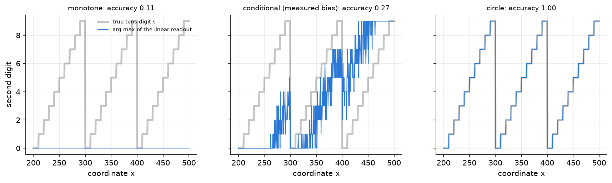
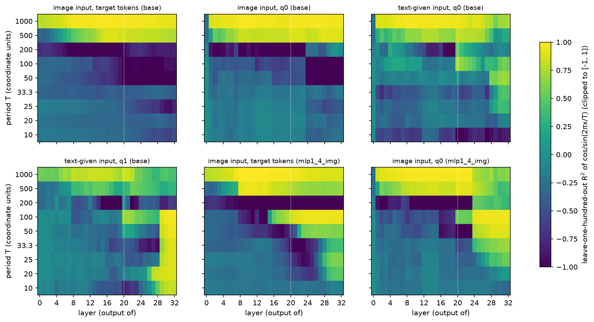
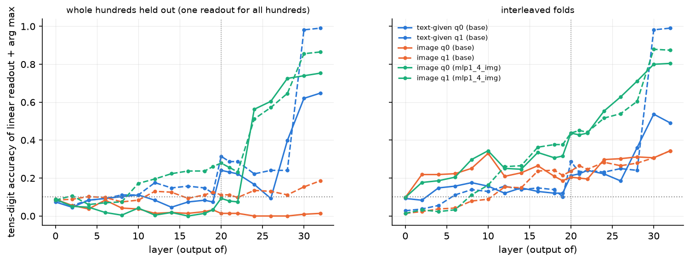
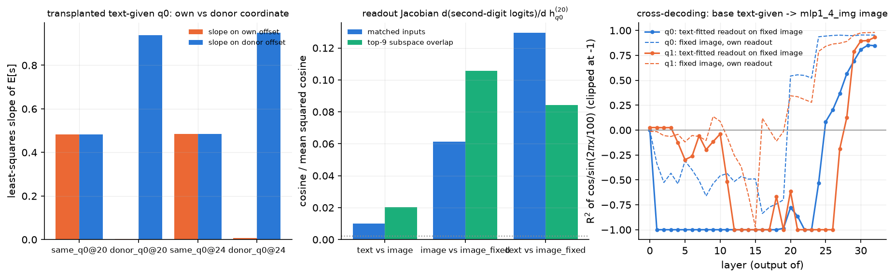
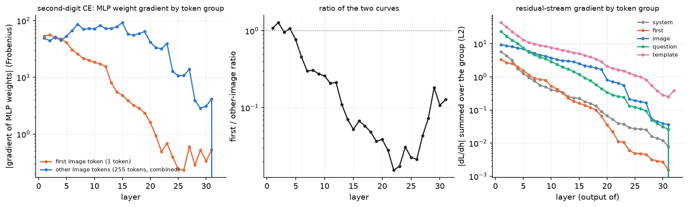
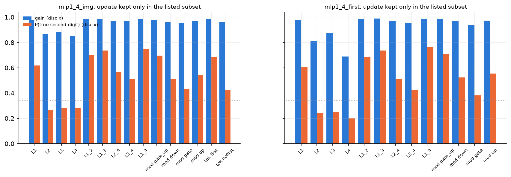
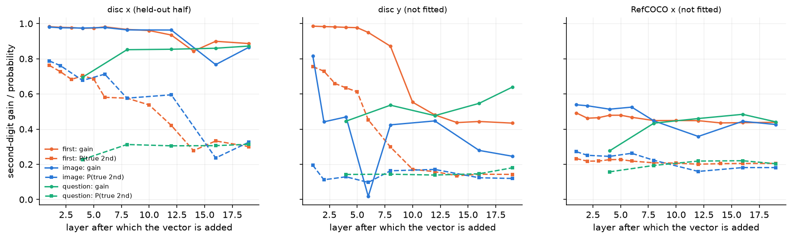
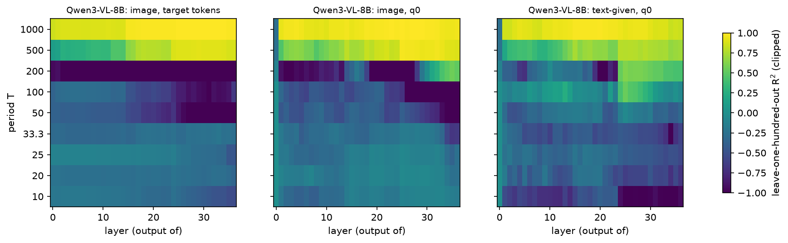
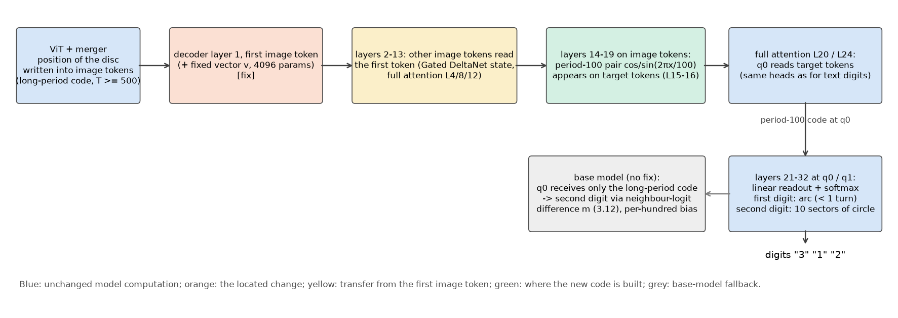

# 坐标读出缺陷的理论依据与精确定位（实验 3.16 第二轮）

实验日期：2026-11-11 至 2026-11-12。本文属于[位置信息与坐标读取](plan.md)研究，是[实验 3.16 第一轮](results_2026-11-05_readout_prior_localization.md)（以下简称“第一轮”）的续篇。模型为 Qwen3.5-9B（bfloat16、SDPA，thinking off，direct-answer 提示），机理对照使用 Qwen3-VL-8B-Instruct。本文的定位结论在训练之前写成预注册文件，由[实验 7.2 第二轮](../application/results_2026-11-11_located_finetune_r2.md)训练检验。

## 通俗讲述

Qwen3.5 回答“红色圆的中心在哪里”时，要把一个 0–1000 之间的坐标写成三个数字 token，例如“3”“1”“2”。这三个数字的变化节奏完全不同：首位每 100 个单位才变一次，在整个坐标范围里只是从 1 走到 9；第二位（十位）每 10 个单位加 1，每 100 个单位就从 9 回到 0，在整个范围里循环九次；第三位循环得更快。模型最后一步把 residual 乘以一个固定的矩阵得到十个数字的 logit，再取最大者，这是一个线性运算。线性运算能把一个随坐标平滑单调变化的量切成十段，每段对应一个数字，所以首位没有问题；但线性运算无法让同一个数字在坐标轴上反复出现九次，除非 residual 中本身就有一个随坐标每 100 个单位转一圈的分量。最简单的这种分量是一对正余弦特征 $\cos(2\pi x/100)$ 与 $\sin(2\pi x/100)$：它们把坐标绕在一个圆上，十个数字恰好把圆周分成十个扇区。周期 100 来自十进制记数本身，不是经验参数。

在原模型中，坐标信息沿以下路径流动。ViT 把圆的位置写进图像 token；decoder 第 1–19 层在这些 token 上处理位置，但测量表明，它们携带的坐标只含长周期成分，表示随坐标沿一条平滑曲线移动，整个坐标范围内转不到一圈。答题时，第一个数字之前的 token（$q_0$）在 full attention 第 20 与第 24 层从目标所在的图像 token 读取位置，读到的仍然只是这条平滑曲线。于是首位写对，第二位只能借助 3.12 所描述的备用办法：经 Gated DeltaNet 的短卷积读取首位分布在相邻两个数字之间的倾斜程度。这个办法要求首位读出的边界与真实百位边界精确对齐，而原模型的对齐误差在不同百位之间为 −6 至 +4 个十位，因此第二位接近随机。

修复需要让图像 token 在被读取之前带上周期为 100 的分量。逐层分析表明，原模型第 5–19 层已经具备构造这一分量的计算，只是没有被启用；启用它的位置非常精确：在第 1 层输出处，给图像片段的第一个 token 加上一个固定的 4096 维向量，就能让此后的图像 token 在第 15–16 层开始出现周期 100 分量，并在第 20–24 层被同一组读取 head 带入 $q_0$，第二位数字的增益由 0.34 升到 0.98。第一个图像 token 能起这个作用，是因为它是图像片段在 Gated DeltaNet 递推中的第一次强写入，其状态在第 7–13 层被其余图像 token 读取；越晚在这里加入向量，留给后续层的转换深度越少，效果越差。文本输入任务在本文中只起一个作用：它证明原模型的第 21–32 层一旦在 $q_0$ 处收到周期 100 分量，就能写出正确的数字；它不能告诉我们图像通路应当构造哪一个具体向量。

## 1. 问题与主要结论

本文按“理论 → 测量 → 定位 → 预注册”的顺序展开。第 2 节从读出的线性形式推出对表示的要求（回答周期 100 的来源与必要性）；第 3 节用可测量的几何量定义两种表示；第 4 节检验文本输入任务作为参照的有效范围；第 5 节逐层定位修复位置；第 6 节给出预注册；第 7 节为 Qwen3-VL 对照。

1. **第二位数字要求读出阶段的输入含有跨百位相位一致的周期 100 分量（第 2 节）。** 由于数字 logit 是 residual 的线性函数，一维单调编码只能让胜出的数字至多改变 9 次（第二位需要 89 次）；任意只含长周期分量的编码也受零点个数的限制。周期 100 是十位数字本身的周期，二维正余弦对是能实现 $9 \to 0$ 回绕的最低维结构。确定性：高（数学推导）。
2. **原模型的图像通路在第 0–32 层都只含周期 ≥ 500 的分量，文本通路在第 20 层出现周期 100 分量（第 3 节，图 1、图 2）。** 图像输入的目标 token 与 $q_0$ 对 $\cos/\sin(2\pi x/T)$ 的留一百位交叉验证 $R^2$ 在 $T = 1000$ 时为 0.93–0.98，在 $T \le 200$ 时全部为负；以同一组线性读出跨百位预测十位数字的准确率为 0.00–0.09（机会水平 0.10）。确定性：高。
3. **文本输入任务只能作为读出能力的阳性对照（第 4 节，图 3）。** 把一个十位相差 5 的文本输入的 $q_0$ 状态移植到图像输入，第二位数字跟随供体（对供体偏移的斜率 0.94，对自身偏移 0.00），说明移植的确实是坐标信息。但读出对 $q_0$ 的局部敏感方向（Jacobian）在文本与图像输入之间几乎不重合，训练后图像通路的周期 100 平面与文本通路在第 20–24 层也不重合（交叉解码 $R^2 < 0$），到第 28 层才部分重合（0.57）。确定性：高。
4. **修复位置精确到第一个图像 token 在第 1 层的输出（第 5 节，图 4–6），并经预注册训练确认（7.2 第二轮）。** 只学习一个加在第一个图像 token 第 1 层输出上的 4096 维向量，留出的水平扫描与从未用于拟合的竖直扫描上第二位增益为 0.98 / 0.99、$P_1$ 为 0.76 / 0.76；加在第 10 层时竖直扫描增益降到 0.55，第 14–19 层 $P_1$ 降到 0.28–0.33。7.2 的适配器只保留第 1 层时 $P_1$ 为 0.61–0.62，只保留第 2、3 或 4 层时为 0.20–0.28。确定性：高（合成画布）；RefCOCO 未改善。
5. **第一层高梯度的成因与“第 1–4 层”的问题（第 5.1 节）。** 第一个图像 token 的 MLP 梯度与其余 255 个图像 token 合计之比在第 1–4 层为 0.96–1.28，第 5 层降到 0.77，之后逐层下降（第 13 层 0.11）。这一比值是连续下降的，不能单独作为截取第 1–4 层的依据；精确定位来自第 4 条的干预实验。
6. **Qwen3-VL 的图像通路同样只有长周期编码（第 7 节，图 7）。** Qwen3-VL-8B 的目标 token 与 $q_0$ 在全部 36 层的 $R^2_{100}$ 都不为正（最大 −0.27 与 0.00），$R^2_{1000}$ 为 0.89–0.99；其第二位真值概率为 0.15–0.18。两种架构（一个以 Gated DeltaNet 为主、一个只有 full attention 并注入 DeepStack 特征）在这一点上相同，说明缺少周期 100 编码不是 Gated DeltaNet 特有的现象。确定性：中（只做了表示测量，没有做干预）。

## 2. 理论：逐位数字读出对表示提出的要求

### 2.1 符号与读出的形式

坐标记为 $x \in [100, 1000)$（0–1000 归一化单位），三位数字为

$$
k = \lfloor x / 100 \rfloor, \qquad s = \lfloor x / 10 \rfloor \bmod 10, \qquad u = \lfloor x \rfloor \bmod 10 ,
$$

分别称为首位（百位）、第二位（十位）与第三位（个位）。$q_0$ 是答案中第一个坐标数字之前的 token，首位在 $q_0$ 处预测；$q_1$ 是首位数字 token，第二位在 $q_1$ 处预测。$h_t^{(\ell)} \in \mathbb{R}^{D}$（$D = 4096$）是第 $\ell$ 层输出在位置 $t$ 的 residual，$\ell = 0$ 为输入 embedding。

下一个 token 的 logit 是最后一层 residual 经 RMSNorm 后的线性函数：

$$
\ell_d = w_d^\top \operatorname{RMSNorm}\!\left(h^{(32)}\right) = \frac{w_d^\top \left(g \odot h^{(32)}\right)}{\operatorname{rms}\!\left(h^{(32)}\right)}, \qquad d = 0, \dots, 9,
$$

其中 $w_d \in \mathbb{R}^D$ 是数字 $d$ 在 lm_head 中的行向量，$g \in \mathbb{R}^D$ 是 RMSNorm 的逐通道增益，$\operatorname{rms}(h) > 0$ 是 $h$ 各分量的均方根，$\odot$ 为逐元素乘积。任意两个数字的 logit 之差为

$$
\ell_d - \ell_{d'} = \frac{(w_d - w_{d'})^\top \left(g \odot h^{(32)}\right)}{\operatorname{rms}\!\left(h^{(32)}\right)} ,
$$

分母恒为正，所以“哪个数字胜出”只由 residual 在固定方向 $g \odot (w_d - w_{d'})$ 上投影的符号决定。下文把读出位置的 residual 看作坐标的函数 $h(x)$，讨论这个函数需要具备什么性质，$\arg\max_d \ell_d$ 才等于正确的数字。

### 2.2 十位数字是周期为 100 的函数

第二位数字满足

$$
s(x + 100) = s(x), \qquad s(x + 10) = \big(s(x) + 1\big) \bmod 10 ,
$$

它是周期为 100 的锯齿函数，在 $[100, 1000)$ 上改变取值 89 次。同理，首位 $k(x)$ 在整个范围内单调改变 8 次，相当于一个周期为 1000 的函数走不到一圈；个位 $u(x)$ 是周期为 10 的函数。周期 100 直接来自十进制记数：从首位起第 $j$ 位（$j = 0, 1, 2$）数字的周期是 $1000 / 10^{j}$。

### 2.3 单调编码只能读出首位

**命题 1（一维单调编码）。** 若 $h(x) = h_0 + \rho(x)\, v$，其中 $h_0, v \in \mathbb{R}^D$ 固定、$\rho$ 是 $x$ 的单调函数，则对任意读出向量，$\arg\max_d \ell_d$ 在 $x$ 从 100 增加到 1000 的过程中至多改变 9 次。

证明：此时 $\operatorname{rms}(h) \cdot \ell_d = a_d + b_d\, \rho$，是变量 $\rho$ 的十条直线，其中 $a_d = w_d^\top (g \odot h_0)$，$b_d = w_d^\top (g \odot v)$。十条直线的上包络是一条凸折线，每条直线至多在包络上出现一段，因此胜出的数字至多改变 9 次。第二位需要 89 次改变，故无法读对；首位只需 8 次单调的改变，可以读出。这是 3.12 所说“首位读出是一段不到一圈的圆弧、每个数字只赢得连续一段坐标”的代数原因。

**命题 2（低频编码）。** 一般地，把 $h(x)$ 在每个方向上的投影展开为以 1000 为基本周期的傅里叶级数。若 $h$ 只含频率不超过 $n$ 的分量（即周期不短于 $1000 / n$），则任意两个数字的 logit 差的分子是阶数不超过 $n$ 的三角多项式，在一个周期内至多有 $2n$ 个零点。另一方面，要读对第二位，相邻数字 $d$ 与 $d + 1$ 的 logit 差在每个百位内必须变号两次：在 $x = 100k + 10(d+1)$ 处由 $d$ 胜出转为 $d + 1$ 胜出，并在下一个百位的 $x = 100(k+1) + 10d$ 之前转回。九个百位合计至少变号 17 次，于是 $2n \ge 17$，$h$ 必须含有周期不长于 $1000 / 9 \approx 111$ 的分量。

**推论（读出权重跨百位共用）。** 读出向量 $w_d$ 与百位无关。若同一组读出向量要在每个百位内的相同偏移处变号，被读取的分量必须满足：$h(x + 100)$ 与 $h(x)$ 在这些方向上的投影符号相同。最直接的实现是让被读取的分量本身以 100 为周期，它的傅里叶级数只含周期 $100, 50, 33.3, 25, \dots$ 的项。其中最低维的实现是一对基频特征

$$
\phi(x) = \left[\cos\frac{2\pi x}{100},\ \sin\frac{2\pi x}{100}\right] ,
$$

它把坐标映射到单位圆上，$x$ 每增加 100 转一圈，每增加 10 转 36°。若 residual 含有 $r\,[\cos(2\pi x/100)\, a + \sin(2\pi x/100)\, b]$（$a, b \in \mathbb{R}^D$ 为两个正交方向，$r > 0$ 为半径），取读出向量 $g \odot w_d \propto \cos\psi_d\, a + \sin\psi_d\, b$，$\psi_d = 2\pi(d + 0.5)/10$，则

$$
\ell_d \propto r \cos\!\left(\frac{2\pi x}{100} - \psi_d\right) + c ,
$$

其中 $c$ 与 $d$ 无关。十个数字把圆周等分成十个 36° 扇区，$\arg\max_d \ell_d = s(x)$ 对所有百位同时成立，且不需要知道首位。若圆平面内的噪声标准差为 $\sigma$，角度误差约为 $\sigma / r$ 弧度，相应的坐标误差约为 $\frac{100}{2\pi} \cdot \frac{\sigma}{r}$；只要它小于半个扇区（5 个单位），第二位就能读对。一维的周期分量不够：一维特征下胜出的数字只能沿命题 1 中直线的固定顺序来回移动，无法实现由 9 回到 0 的回绕，二维圆周是能够回绕的最低维结构。语言模型对文本数字使用周期为 2、5、10、100 的傅里叶特征（Zhou et al., 2024；Kantamneni & Tegmark, 2025），与这一推导一致：周期 100 的特征正是十位数字所需要的。

### 2.4 不依赖周期分量的路径及其校准要求

在 $q_1$ 处，首位 $k$ 已经作为 token 写出，读出也可以先“减去百位”：若存在一维量 $z = \rho(x) - c_k$，其中 $c_k$ 由首位 token 提供，且对所有 $k$ 都有 $\rho(100k) = c_k$，则 $z$ 在每个百位内从同一个值单调增长到同一个值，命题 1 允许十条直线依次胜出。这条路径要求 $\rho$ 的标度与十个 $c_k$ 同时精确对齐。3.12 表明原模型在图像任务中使用这条路径：第二位经 Gated DeltaNet 的短卷积读取 $q_0$ 处首位 logit 的相邻差 $m = \ell_0(k+1) - \ell_0(k-1)$。第一轮测得单目标画布上 $m$ 的残差方差有 90% 来自每个百位各自的偏置，折算为十位单位在 −6.0 与 +4.2 之间，百位内噪声为 1.06 个十位。

### 2.5 数值验证：三种编码的模拟

*图 0：三种理想编码经线性读出 + arg max 后得到的第二位数字（蓝线）与真值（灰色粗线），坐标 200–500（模拟，不涉及模型激活）。左：一维单调编码，读出向量由 one-hot 目标的最小二乘拟合得到；中：减去百位的一维编码，百位偏置与百位内噪声取第一轮在原模型上测得的值；右：周期 100 的二维圆编码，读出向量按第 2.3 节取定。*

在 $[100, 1000)$ 上以 0.5 为步长模拟：一维单调编码的准确率为 0.11，胜出数字只改变 1 次；带原模型实测偏置的减百位编码为 0.27；圆编码为 0.96（无噪声，误差全部来自采样点恰在扇区边界附近），在角度噪声 0.3 个十位时为 0.76。原模型在单目标画布上的第二位真值概率为 0.15，与减百位编码的模拟同属一个量级。

## 3. 两种表示的几何定义与测量

### 3.1 定义：坐标表示的傅里叶谱

两种表示由下述可测量的量定义。对某个位置（token）与层，取 $N$ 个输入的 residual 组成特征矩阵 $X \in \mathbb{R}^{N \times D}$，对每个周期 $T$ 构造目标

$$
Y_T = \left[\cos\frac{2\pi x_i}{T},\ \sin\frac{2\pi x_i}{T}\right]_{i=1}^{N} \in \mathbb{R}^{N \times 2} ,
$$

用 ridge 回归从 $X$ 预测 $Y_T$，并以“留一个百位”的方式交叉验证：$\lfloor x / 100 \rfloor$ 相同的输入构成一折，每次用其余百位拟合、在留出的百位上预测。具体步骤如下。

1. 在训练折上把特征中心化，并除以训练折的均方根行范数 $\sqrt{\frac{1}{N_{\text{tr}}}\sum_i \lVert x_i - \mu \rVert^2}$，使同一个罚项在不同层与不同位置之间可比。
2. 以罚项 $\alpha = 0.1$ 求解 ridge 回归。因为 $N \ll D$，采用等价的核形式：$A = (Z Z^\top + \alpha I)^{-1}(Y_{\text{tr}} - \bar{Y}_{\text{tr}})$，预测为 $\hat{Y}_{\text{te}} = Z_{\text{te}} Z^\top A + \bar{Y}_{\text{tr}}$，其中 $Z$ 为缩放后的训练特征，$Z_{\text{te}}$ 为同样处理后的留出特征。
3. 合并所有留出折的预测，计算两列合并的决定系数

$$
R^2_T = 1 - \frac{\sum_i \lVert \hat{Y}_{T,i} - Y_{T,i} \rVert^2}{\sum_i \lVert Y_{T,i} - \bar{Y}_T \rVert^2} .
$$

$R^2_T$ 作为 $T$ 的函数称为该位置、该层表示的傅里叶谱。采用留一百位的原因是第 2.3 节的推论：读出权重对所有百位共用，只有在没见过的百位上仍能给出正确相位的线性特征才对读出有用；交错折只检验插值，局部的分段平滑特征也能得到正值。$R^2_T \le 0$ 表示不存在跨百位相位一致的周期 $T$ 分量。

据此，本文用两个定义取代第一轮的标签：

- **长周期编码**：表示只在 $T \ge 500$ 处有正的 $R^2_T$，在 $T \le 200$ 处全部非正。这样的表示随坐标沿一条平滑曲线移动，在整个坐标范围内转不到两圈；首位数字可由它读出（命题 1），第二位不能（命题 2）。
- **周期 100 编码**：$R^2_{100} > 0$，即存在跨百位相位一致的 $\cos/\sin(2\pi x/100)$ 分量，第 2.3 节的圆读出可以作用于它。

### 3.2 刺激与位置

单目标画布扫描沿用 3.6：红色圆（直径 64 pixels，画布 512×512，即 16×16 个视觉 token）水平扫描 215 张、竖直扫描每隔一张取 108 张，真值 100–999；文本数值输入（textconv）与水平扫描同圆心，在提示中以像素给出圆心并要求换算到 0–1000，共 108 张。所有读出测量都把首位强制为真值。记录的位置为 $q_0$、$q_1$、目标 token 平均（与圆外接框重叠的视觉 token）、第一个图像 token、问题 token 平均与最后一个问题 token，覆盖第 0–32 层输出。

### 3.3 结果：图像通路只有长周期编码

*图 1：坐标表示的傅里叶谱（第 3.1 节，由模型激活拟合）。纵轴为周期 $T$，横轴为层，颜色为留一百位交叉验证的 $R^2_T$（截断到 $[-1, 1]$）。上行：原模型图像输入的目标 token、图像输入的 $q_0$、文本数值输入的 $q_0$；下行：文本数值输入的 $q_1$、7.2 适配器 mlp1_4_img 下图像输入的目标 token 与 $q_0$。白色点线为第 20 层。*

**原模型图像通路在全部层都是长周期编码。** 目标 token 的 $R^2_{1000}$ 在第 8–32 层为 0.93–0.98，$R^2_{500}$ 为 0.48–0.89，而 $R^2_{200}$ 与 $R^2_{100}$ 在全部层都为负（第 20 层分别为 −0.95 与 −1.00）；$q_0$ 相同（第 20 层 $R^2_{100} = -0.53$）。这意味着位置信息完整（第一轮的线性 probe 能以约 5 个单位的精度读出 $x$），但只以平滑曲线的形式存在，命题 2 排除了由它直接读出第二位的可能。

**文本通路在第 20 层出现周期 100 编码。** 文本数值输入的 $q_0$ 在第 19 层之前 $R^2_{100} \le 0.16$，第 20 层跃升到 0.74；$q_1$ 在第 32 层各周期（100 至 10）全部为 0.82–0.98，后者是个位数字所需的周期 10 分量。文本 $q_0$ 第 20 层的 $R^2_{200} = 0.51$ 可能来自像素数值本身的周期：像素值每增加 100，$x$ 增加 195.3（以 $T = 195.3$ 计 $R^2 = 0.55$）。

**训练后的图像通路按同样的顺序出现周期 100 编码。** mlp1_4_img 下目标 token 的 $R^2_{100}$ 在第 14 层仍为负，第 16 层 0.50，第 20 层 0.83，第 24 层 0.95；$q_0$ 在第 20 层为 0.54，第 24 层 0.94，并出现周期 50 的二次谐波（0.75）。

### 3.4 结果：跨百位的十位数字线性读出

*图 2：用一组线性读出 + arg max 预测十位数字的准确率（one-hot ridge 回归，$\alpha = 0.1$，由模型激活拟合）。左：留一百位；右：5 折交错。蓝：原模型文本数值输入；橙：原模型图像输入；绿：mlp1_4_img 图像输入；实线 $q_0$，虚线 $q_1$。灰色点线为机会水平 0.10。*

**原模型图像通路的十位数字在跨百位读出下低于机会水平。** 图像 $q_0$ 在全部层为 0.00–0.09，$q_1$ 为 0.07–0.19；交错折下同一表示可达 0.2–0.3，说明局部可分但跨百位不可共用，这正是长周期编码的特征。文本 $q_1$ 第 30–32 层为 0.98–0.99；mlp1_4_img 的 $q_0$ 第 24 层为 0.56、第 32 层 0.75，$q_1$ 第 32 层 0.87。

## 4. 文本输入任务的作用与有效范围

### 4.1 为什么需要检验

第一轮用文本数值输入（坐标以像素数值写在提示里，模型换算为 0–1000）作参照。两种输入共享同一个模型，但没有理论保证它们在 $q_0$ 处的表示相同：文本中的坐标以数字 token 的身份进入，图像中的坐标来自 ViT 的位置表示。本文把文本通路的作用限定为一个可检验的命题：**原模型第 21–32 层在 $q_0$ 收到带周期 100 编码的状态时，能写出正确的数字**。这个命题只涉及读出阶段，与上游表示是否相同无关；第 2 节的要求也不依赖文本任务。下面三项测量检验这一命题的成立条件与适用边界。

### 4.2 移植携带的是坐标信息

协议：对每张水平扫描图选一个供体文本输入，供体与该图首位相同、组内偏移相差约 5 个十位；在第 20 或第 24 层输出处把图像输入 $q_0$ 的 residual 整体替换为供体文本输入的 $q_0$ residual，其余计算不变，首位强制为图像自身的真值，读出第二位分布，并回归 $\mathbb{E}[s] = a + b_{\text{own}}\, o_{\text{own}} + b_{\text{donor}}\, o_{\text{donor}}$（$o$ 为组内偏移，以十位为单位）。

**移植后的第二位数字跟随供体坐标。** 第 20 层移植时 $b_{\text{donor}} = 0.94$、$b_{\text{own}} = 0.00$，86% 的样本 arg max 等于供体的十位；第 24 层为 0.95 与 0.01（88%）。同坐标移植的 $P_1$ 为 0.74 / 0.76（与第一轮一致）。这表明第一轮的移植效果来自 $q_0$ 携带的坐标值，而不是某种与坐标无关的置信度或格式信号；第 21–32 层确实把周期编码转换成了对应的数字。

### 4.3 读出的局部敏感方向不共用

协议：在第 20 层输出处对 $q_0$ 的 residual 加一个可微的零向量，求十个第二位数字 logit（在 $q_1$）对它的 Jacobian $J \in \mathbb{R}^{10 \times 4096}$，去掉十行的平均（softmax 不变的部分）。比较三种输入：原模型文本输入、原模型图像输入、mlp1_4_img 图像输入。指标为同一坐标的两种输入之间展平 Jacobian 的余弦（打乱配对作基线），以及全部样本堆叠后前 9 个右奇异向量张成子空间的重合度（主角余弦平方的平均，随机子空间为 $9/4096 = 0.002$）。

**表 1：第二位 logit 对 $q_0$ 第 20 层的 Jacobian 的一致性。**

| 比较 | 同坐标余弦 | 打乱配对余弦 | 前 9 维子空间重合度 |
| --- | --- | --- | --- |
| 文本 vs 原模型图像 | 0.010 | 0.005 | 0.020 |
| 原模型图像 vs mlp1_4_img 图像 | 0.061 | 0.006 | 0.106 |
| 文本 vs mlp1_4_img 图像 | 0.129 | 0.009 | 0.084 |

**读出对 $q_0$ 的局部线性敏感方向在不同输入之间几乎不重合。** 第 21–32 层是非线性的，它在某一状态附近的线性化取决于该状态本身；文本与原模型图像的子空间重合度只有 0.020，训练后的图像与文本也只有 0.084。因此不能用文本输入下的线性化读出去推断图像输入应当提供的方向，这与第一轮“把文本源 token 的周期部分注入图像目标无效”以及 3.13 第二轮“注入二维时钟只把 $P_1$ 由 0.14 提高到 0.25”一致。

### 4.4 训练后的周期平面与文本通路的关系

*图 3：左：移植的回归斜率（第 4.2 节）；中：Jacobian 一致性（第 4.3 节，灰色点线为随机子空间的重合度）；右：交叉解码，即在原模型文本输入的 $q_0$（蓝）或 $q_1$（橙）上拟合 $\cos/\sin(2\pi x/100)$ 的 ridge 读出，直接用于 mlp1_4_img 图像输入的同一位置（实线），虚线为 mlp1_4_img 自身的留一百位 $R^2$。均由模型激活计算。*

**训练后的图像通路构造的周期 100 平面在第 20–24 层与文本通路不同，到第 28 层之后才部分重合。** 交叉解码 $R^2$ 在 $q_0$ 第 20 层为 −0.78、第 24 层 −0.53，第 28 层 0.57，第 32 层 0.85；而 mlp1_4_img 自身在第 24 层已达 0.94。两种通路在读出阶段的后段趋于一致，在读取层附近各用各的子空间。

**结论与限制。** 文本输入任务提供了一个存在性证明：原模型的读出阶段能消费周期 100 编码（第 4.2 节）。它不能提供目标向量：读出的局部敏感方向因输入而异（第 4.3 节），训练也会在另一个子空间中构造周期编码（第 4.4 节）。因此本文的定位只使用两类不依赖文本任务的证据：第 2 节的推导与图像通路的谱（第 3 节），以及第 5 节在图像输入上的逐层干预。

## 5. 修复位置的逐层定位

### 5.1 梯度范数逐层对比

*图 4：第二位交叉熵的梯度（原模型反向传播，72 个输入）。左：MLP 权重梯度的 Frobenius 范数（gate/up/down 平方和开方），橙为第一个图像 token（1 个 token），蓝为其余图像 token（255 个，合计）；中：两者之比；右：residual 梯度 $\lVert \partial L / \partial h_t^{(\ell)} \rVert$ 在各 token 组上的合计（系统前缀 4 个 token/样本，第一个图像 token，其余图像 token，问题 token，答案模板 token）。*

第一轮对第 1–4 层的强调来自下表。需要检验的是：第一个图像 token 的梯度是否从第 5 层起小于其余 255 个合计。逐层比值如下。

**表 2：第一个图像 token 与其余图像 token 合计的 MLP 梯度范数之比。**

| 层 | 1 | 2 | 3 | 4 | 5 | 6 | 7–10 | 11–12 | 13 | 14–28 |
| --- | --- | --- | --- | --- | --- | --- | --- | --- | --- | --- |
| 比值 | 1.09 | 1.28 | 0.96 | 1.07 | 0.77 | 0.46 | 0.26–0.31 | 0.21 | 0.11 | 0.02–0.07 |

**从第 5 层起第一个图像 token 的梯度确实小于其余图像 token 合计，但下降是连续的。** 第一个 token 自身的梯度范数在第 2 层最大（56.7），此后单调下降（第 6 层 30.7，第 12 层 15.5，第 20 层 1.6）。这一曲线说明“改动越早，杠杆越大”，却没有在第 4 与第 5 层之间给出分界，所以不能单独作为只训练第 1–4 层的依据。其成因可以从结构上解释：第一个图像 token 本身在第 20、24 层几乎不被 $q_0$ 读取（attention 0.001–0.007，见 7.2 第二轮），它对答案的全部影响都要经过此后的图像 token 在后续层中读取它的状态；在第 $\ell$ 层改动它，只剩第 $\ell+1$ 层到读取层之间的层数来完成传递。按 token 平均，第 1 层第一个图像 token 的 residual 梯度（每 token 1.38）是普通图像 token（0.26）的 5 倍。

### 5.2 已训练适配器的逐层分解

协议：载入 7.2 的 mlp1_4_img 与 mlp1_4_first，评测时只保留某些层、某些模块或某些 token 上的更新（LoRA 的其余部分置零），在水平与竖直扫描各 108 张上读出第二位数字（首位强制）。

*图 5：只保留所列子集时的第二位增益（蓝）与 $P_1$（橙），水平扫描，由模型前向计算。灰色点线为原模型增益 0.34。*

**表 3：适配器的逐层分解（水平扫描 $P_1$ / 竖直扫描 $P_1$；原模型 0.15 / 0.13）。**

| 保留的子集 | mlp1_4_img | mlp1_4_first |
| --- | --- | --- |
| 第 1–4 层（完整） | 0.75 / 0.77 | 0.76 / 0.82 |
| 只第 1 层 | 0.62 / 0.73 | 0.61 / 0.67 |
| 只第 2 / 3 / 4 层 | 0.27 / 0.28 / 0.28 | 0.24 / 0.25 / 0.20 |
| 第 1–2 层 | 0.70 / 0.78 | 0.69 / 0.74 |
| 第 2–4 层 | 0.56 / 0.68 | 0.51 / 0.67 |
| 只 gate+up / 只 down | 0.70 / 0.51 | 0.71 / 0.52 |
| 只第一个图像 token / 去掉第一个 | 0.69 / 0.42 | — |

**第 1 层承担了大部分效果，其余三层是补充。** 两个适配器只保留第 1 层时增益 0.98、$P_1$ 0.61–0.62，单独的第 2、3、4 层只有 0.20–0.28。mlp1_4_img 只保留第一个图像 token 上的更新即恢复 0.69，说明它与 mlp1_4_first 在第一个 token 上学到了同一种作用。

### 5.3 原模型上的逐层最小干预

适配器分解仍然依赖训练结果。为了在原模型上直接定位，本文对每一层 $\ell$ 学习一个向量 $v_\ell \in \mathbb{R}^{4096}$，加在第 $\ell$ 层输出的某一组 token 上：

$$
h_t^{(\ell)} \leftarrow h_t^{(\ell)} + v_\ell, \qquad t \in G ,
$$

其中 $G$ 为第一个图像 token、全部图像 token 或全部问题 token。$v_\ell$ 以 Adam 在水平扫描的偶数序号样本上最小化首位与第二位的交叉熵（60 步，每步 8 条，步长为该层图像 token 中位范数的 $10^{-3}$ 倍），在水平扫描的奇数序号样本、从未用于拟合的竖直扫描与 RefCOCO 上评测。这是一个分析工具：它回答“在第 $\ell$ 层、在这组 token 上，是否存在一个与输入无关的改变能启用第二位读出”，而参数只有 4096 个，不可能在读出阶段记忆坐标。

*图 6：逐层学习的单个向量加在第一个图像 token（橙）、全部图像 token（蓝）或问题 token（绿）后的第二位增益（实线）与 $P_1$（虚线）。左：水平扫描留出的一半；中：竖直扫描（未参与拟合）；右：RefCOCO（未参与拟合）。由模型前向计算。*

**表 4：单个向量的效果（增益 / $P_1$；原模型约 0.34 / 0.15）。** $\lVert v \rVert$ 以该层图像 token 的中位范数为单位。

| 位置 | 层 | $\lVert v \rVert$ | 水平（留出） | 竖直（未拟合） | RefCOCO |
| --- | --- | --- | --- | --- | --- |
| 第一个图像 token | 1 | 0.51 | 0.98 / 0.76 | 0.99 / 0.76 | 0.49 / 0.23 |
| 第一个图像 token | 2–5 | 0.56–0.65 | 0.97–0.98 / 0.68–0.73 | 0.98 / 0.61–0.73 | 0.46–0.48 |
| 第一个图像 token | 6 / 8 | 0.72 / 0.68 | 0.98 / 0.58；0.97 / 0.58 | 0.95 / 0.45；0.87 / 0.30 | 0.45–0.47 |
| 第一个图像 token | 10 / 12 | 0.64 / 0.81 | 0.96 / 0.54；0.93 / 0.42 | 0.55 / 0.17；0.48 / 0.16 | 0.45 |
| 第一个图像 token | 14–19 | 0.72–0.79 | 0.84–0.90 / 0.28–0.33 | 0.43–0.44 / 0.14 | 0.44 |
| 全部图像 token | 1 / 2 | 0.42 / 0.39 | 0.98 / 0.79；0.98 / 0.76 | 0.82 / 0.19；0.44 / 0.11 | 0.53–0.54 |
| 全部图像 token | 6–12 | 0.32–0.41 | 0.96–0.98 / 0.58–0.71 | 0.02–0.45 | 0.36–0.53 |
| 问题 token | 4–19 | 0.41–0.55 | 0.69–0.87 / 0.23–0.31 | 0.45–0.64 / 0.14–0.18 | 0.28–0.48 |

1. **在第一个图像 token 的第 1 层输出处，一个与输入无关的向量就足以启用第二位读出，并推广到未拟合的坐标轴。** 向量只在 $x$ 轴扫描上拟合，却使 $y$ 轴扫描的增益达到 0.99。这说明它没有写入任何坐标值，而是改变了此后各层处理图像 token 的方式。
2. **效果随层数单调减弱。** 第一个图像 token 上的向量加在第 6 层以后，竖直扫描开始失效（第 10 层增益 0.55），第 14 层以后两轴的 $P_1$ 都只有 0.14–0.33。这与第 5.1 节的梯度曲线及 7.2 第二轮的恢复实验一致：第一个 token 的状态在第 7–13 层被其余图像 token 读取，越晚改变，留给传递与转换的层数越少。
3. **同一个向量加到全部图像 token 上，在拟合的轴上有效，在未拟合的轴上明显变差**（第 1 层竖直扫描增益 0.82，第 2 层 0.44）。加在全部 256 个 token 上的向量更容易与坐标相关的内容相互作用而过拟合到 $x$ 轴。
4. **问题 token 上的向量只有部分效果**（$P_1 \le 0.31$），且第 4 层最差。这与 7.2 第二轮的结论一致：问题 token 不是修复的入口。
5. **RefCOCO 未改善。** 这些向量只在合成画布上拟合，自然图像的瓶颈主要在目标位置本身的不确定性（第一轮、7.2 第一轮）。

学到的第 1 层向量与 mlp1_4_first 在第一个 token 第 1 层输出上的平均改变的余弦为 0.33（4096 维中随机方向约为 0.02），两者都约为该 token 范数的 0.3 倍，说明训练与本节的最小干预找到了相近的方向。

### 5.4 综合：精确的位置

| 维度 | 定位 | 依据 |
| --- | --- | --- |
| token | 第一个图像 token | 单 token 向量推广到未拟合的轴（表 4）；适配器只保留第一个 token 即恢复 0.69（表 3）；问题 token 无效 |
| 层 | 第 1 层输出（第 1 层 MLP） | 第 1 层向量最佳并随层数单调减弱（表 4）；适配器只保留第 1 层恢复 0.61–0.62，单独第 2–4 层 0.20–0.28（表 3） |
| 模块 | MLP 的 gate/up（输入侧） | 只保留 gate+up 恢复 0.70–0.71，只保留 down 0.51–0.52（表 3） |
| 秩 | 1（一个与输入无关的向量） | 4096 个参数的向量在合成画布上达到与 157 万参数适配器相同的增益（表 4） |

## 6. 预注册

依据第 5.4 节，本文在 7.2 第二轮训练之前写定预注册文件（UTC 2026-11-12 04:46:24，sha256 见“实验产物”），条件为：

1. **vec_first_L1**：只学习一个加在第一个图像 token 第 1 层输出上的向量（4096 个参数），按 7.2 的数据与步数训练。预测：画布 x 误差 ≤ 6，水平与竖直扫描的第二位增益 ≥ 0.95、$P_1$ ≥ 0.65；纯文本输出不变（构造保证）；行列序号准确率 ≥ 16/72 且没有坐标前缀答案。
2. **mlp1_first**：第 1 层 MLP 的 gate/up/down，秩 8，只作用于第一个图像 token（39.3 万参数）。预测：画布 x 误差与 mlp1_4_first（2.8）相差不超过 1.5，增益 ≥ 0.97。
3. 表示：目标 token 在第 15–16 层出现周期 100 编码，第 20 层 $R^2_{100} \ge 0.5$；$q_0$ 第 24 层 $\ge 0.8$。失败判据：vec_first_L1 的画布误差 > 10 或增益 < 0.9。

结果见 7.2 第二轮第 6 节：按预注册学习率训练的向量欠拟合（范数 2.3，触发失败判据）；在位置不变、追加登记学习率 $10^{-2}$ 后，向量范数 10.0，画布 x 误差 3.8、两轴增益 0.98、20×20 网格误差 9.5，目标 token 的 $R^2_{100}$ 第 20 层 0.75，全部数值预测成立；mlp1_first 画布 x 误差 3.8、增益 0.99，同样成立。两者都使行列序号作答变差（22/72、15/72），但没有坐标前缀答案。

## 7. Qwen3-VL 对照

协议与第 3 节相同：Qwen3-VL-8B-Instruct（36 层 full attention，DeepStack 开启，以 input_ids 输入以保留 DeepStack 注入），同一组水平扫描（215 张）、竖直扫描（108 张）与文本数值输入（108 张），首位强制，记录 $q_0$ 与目标 token 平均在每层输出的 residual。本节只比较机理，不比较两个模型的能力。

*图 7：Qwen3-VL-8B 的坐标表示傅里叶谱（定义见第 3.1 节，由模型激活拟合）。左：图像输入的目标 token；中：图像输入的 $q_0$；右：文本数值输入的 $q_0$。*

1. **图像通路同样只有长周期编码。** 目标 token 的 $R^2_{1000}$ 在第 8 层以后为 0.89–0.99，所有 $T \le 200$ 的 $R^2$ 都为负（最大 −0.11）；$q_0$ 的 $R^2_{100}$ 在全部层都不为正（0.00 至 −4.65），只有 $R^2_{200}$ 在最后几层升到 0.56。
2. **文本通路的周期 100 编码较弱且出现得更晚。** 文本数值输入的 $q_0$ 在第 24–28 层 $R^2_{100} = 0.39$–$0.42$（Qwen3.5 第 20 层为 0.74）。
3. **第二位数字的读出同样接近随机**（水平 / 竖直扫描 $P_1$ 为 0.18 / 0.15），但第二位增益为 0.77 / 0.69，高于 Qwen3.5 的 0.34。按第 2.4 节，Qwen3-VL 的“减百位”路径校准得更好，但精度同样不足以写对十位。

因此，“图像通路在读取位置缺少周期 100 编码”在一个只含 full attention、并有 DeepStack 把 ViT 中间层特征注入 decoder 前几层的模型中同样成立。缺少这一编码不是 Gated DeltaNet 结构造成的；DeepStack 注入的 ViT 特征也没有提供它。第一个图像 token 的作用（第 5 节）依赖 Gated DeltaNet 的递推，本文没有在 Qwen3-VL 上检验对应的入口。

## 8. 机理流程

*图 8：坐标数字读出的机理示意图（根据本文与 7.2 第二轮的测量绘制，不含数据）。蓝色为原模型中不变的计算，橙色为定位到的改动，黄色为第一个图像 token 状态的传递，绿色为周期 100 编码形成的位置，灰色为原模型的备用路径。*

下面按数据流的顺序叙述原模型怎样写出坐标、在哪一步失败，以及定位到的改动怎样起作用。

1. **ViT 写入位置。** ViT 把红色圆的位置写进图像 token。由于 ViT 内部是双向 attention，每个图像 token（包括位于左上角背景处的第一个图像 token）都带有圆位置的信息；这些信息以长周期编码存在：表示随坐标沿一条平滑曲线移动，傅里叶谱只在周期 500 与 1000 处为正。
2. **decoder 第 1–19 层处理图像 token。** 原模型在这些层中保持长周期编码，目标 token 在任何一层都没有周期 100 分量（第 3.3 节）。
3. **第 20 与第 24 层的读取。** 答案中第一个数字之前的 token $q_0$ 在 full attention 第 20 层与第 24 层从目标 token 读取位置。读取由 attention 完成：$q_0$ 的 query 与目标 token 的 key 匹配，目标 token 的 value 经输出投影加到 $q_0$ 的 residual 上。读到的内容就是目标 token 当时的编码。
4. **数字写出。** 第 21–32 层在 $q_0$ 与 $q_1$ 上把 residual 变成数字 logit，最后一步是线性读出加 softmax。长周期编码足以让首位数字的十个扇区依次排开（命题 1），但不足以让十位数字循环九次（命题 2）。原模型于是使用备用路径：$q_1$ 经 Gated DeltaNet 的短卷积读取 $q_0$ 处首位分布的相邻 logit 差 $m$，用“首位偏向哪一侧”估计十位；这条路径要求首位扇区与真实百位对齐，原模型的对齐误差使第二位接近随机。
5. **定位到的改动。** 在第一个图像 token 的第 1 层输出上加一个固定向量。第一个图像 token 是图像片段在 Gated DeltaNet 递推中的第一次强写入（写入强度 $\beta$ 0.6–0.8），其余图像 token 在第 7–13 层经递推状态与 full attention 读取它的状态（7.2 第二轮的恢复实验）。这个与输入无关的改变使此后各层在每个图像 token 上执行不同的计算：第 15–16 层起，目标 token 出现 $\cos/\sin(2\pi x/100)$ 分量，第 20 层达到 $R^2_{100} = 0.83$。
6. **读出阶段不变。** 第 20 与第 24 层的同一组读取 head 把带周期分量的目标 token 编码带入 $q_0$（训练后 $q_0$ 第 24 层 $R^2_{100} = 0.94$，在三维主成分空间中呈螺旋，俯视为圆环，见 7.2 第二轮），第 21–32 层把圆上的角度切成十个扇区写出十位数字。读出阶段的权重从未改动。

## 9. 限制

1. **主要测量在合成单目标画布上。** RefCOCO 上所有方法都没有出现周期 100 编码，单个向量也不改善 RefCOCO；自然图像中目标中心本身的不确定性是另一个瓶颈。
2. **第 2.3 节的推导针对读出阶段的线性部分。** 第 21–32 层的非线性计算原则上可以实现“减去百位”的条件读出（第 2.4 节）；本文用实测偏置说明原模型的这条路径不准，没有证明它无法通过训练变准。
3. **逐层最小干预只用了 216 个训练样本中的一半、60 步**，不同层的向量范数相近（0.5–0.8 倍中位范数），但没有做范数受限的比较。
4. **文本输入任务只有像素到 0–1000 的换算一种，且只有 x 轴。**

## 实验产物

路径相对于 `$WORK_DIR`（另注 `DATA_DIR` 者除外）。程序为 `analysis_tools/position/readout_prior_r2.py`、`readout_prior_r2_run.py`、`readout_prior_r2_analysis.py`，入口为 `scripts/analysis/position/readout_prior_r2.sh`，测试为 `tests/analysis/position/test_readout_prior_r2.py`。运行目录记为 `R = analysis/position/2026-11-11_readout_prior_r2`。

| 内容 | 路径 | 阶段 |
| --- | --- | --- |
| 图 0、第 2.5 节（模拟） | `R/summary.json` 的 `simulation` | analysis（simulation） |
| 图 1、第 3.3 节（傅里叶谱） | `R/summary.json` 的 `spectrum`；residual 为 `DATA_DIR` 下 `scratch/analysis/position/2026-11-11_readout_prior_r2/capture/<条件>.npz` | capture；analysis（spectrum） |
| 图 2（十位线性读出） | `R/summary.json` 的 `decoding` | analysis（decoding） |
| 第 4.2 节（供体移植） | `R/mismatch/mismatch.jsonl`，汇总于 `summary.json` 的 `mismatch` | mismatch |
| 表 1（Jacobian） | `DATA_DIR` 下 `scratch/analysis/position/2026-11-11_readout_prior_r2/jacobian_L20.npz`，汇总于 `summary.json` 的 `jacobian` | mismatch |
| 图 3 右（交叉解码） | `summary.json` 的 `cross_decoding` | analysis（validity） |
| 表 2、图 4（梯度） | 第一轮 `analysis/position/2026-11-05_readout_prior/grad/grad.jsonl`；`R/grad2/grad2.jsonl`；汇总于 `summary.json` 的 `grad_layers`、`grad2` | grad2；analysis（grad） |
| 表 3、图 5（适配器分解） | `R/layers/layers.jsonl`，汇总于 `summary.json` 的 `adapter_layers`；适配器为 `analysis/application/2026-11-05_located_finetune/adapters/` | layers |
| 表 4、图 6（逐层最小干预） | `R/steer/steer.jsonl`、`R/steer/vec_<位置>_<层>.npz`，汇总于 `summary.json` 的 `steer` | steer |
| 第 7 节（Qwen3-VL） | `DATA_DIR` 下 `scratch/analysis/position/2026-11-11_readout_prior_r2/qwen3vl_capture.npz`，汇总于 `summary.json` 的 `qwen3vl` | vlcapture |
| 预注册 | `analysis/application/2026-11-11_located_finetune_r2/preregistration_r2.md`、`preregistration_r2.sha256` | 训练前 |
| 运行记录 | `R/experiment.json`、`R/stage_seconds.jsonl`、`R/run.log` | 全部 |
