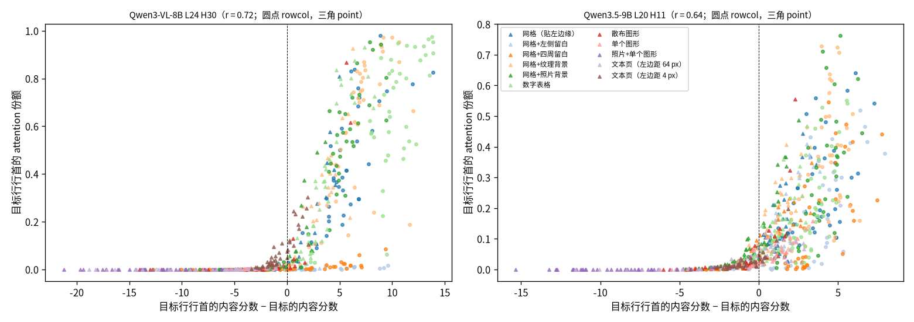
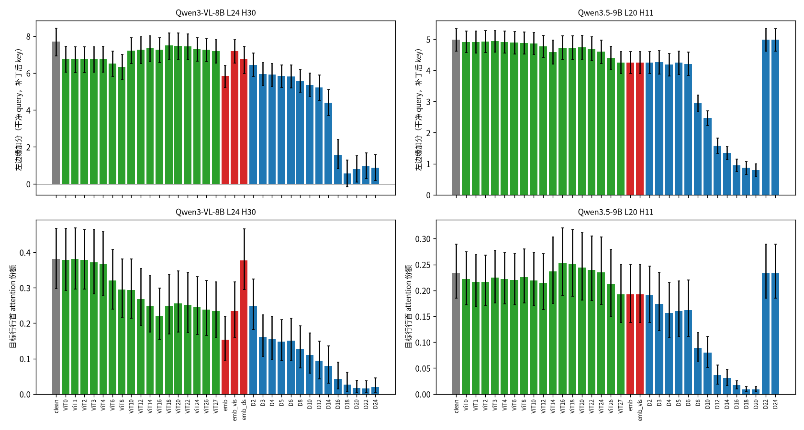
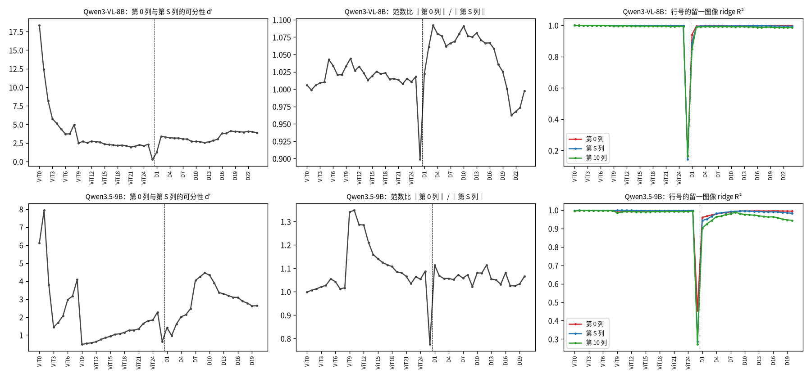
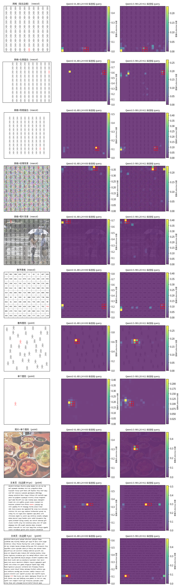
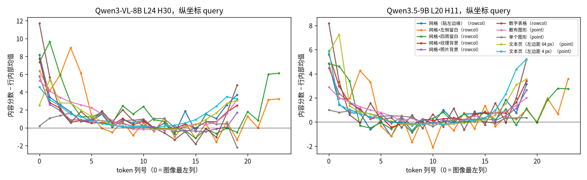
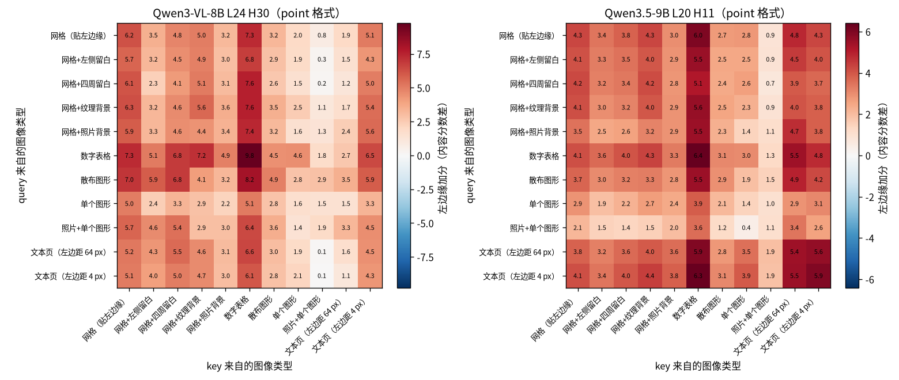
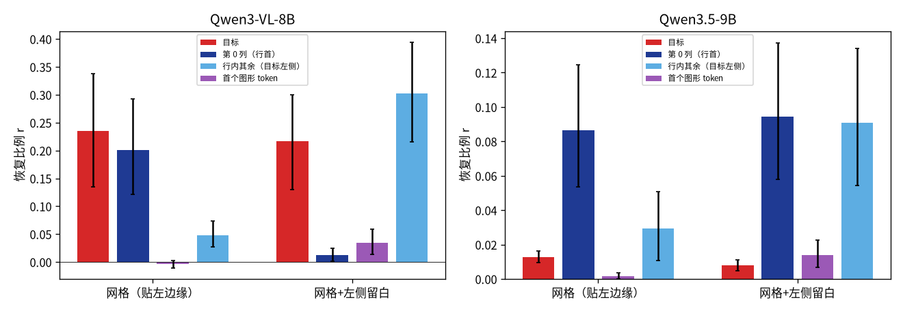
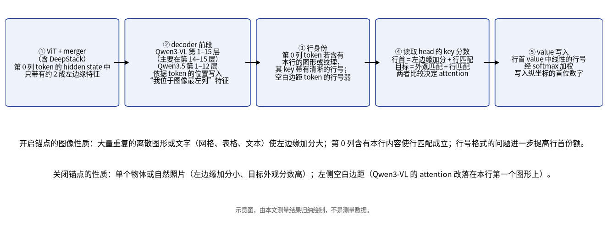

# 纵坐标读取中行首锚点的来源（3.14 第四轮）

实验日期：2026-11-11。本文属于[位置信息与坐标读取](plan.md)研究，编号为实验 3.14 第四轮，直接承接[第三轮](results_2026-11-05_row_attention.md)（下称“第三轮”）。模型为 Qwen3-VL-8B-Instruct（36 个 full attention 层，DeepStack 开）与 Qwen3.5-9B（24 个 Gated DeltaNet 层与 8 个 full attention 层），均使用 bfloat16、SDPA、teacher forcing（真实答案）与 thinking off，问题为只输出答案的 direct-answer 格式。本文只比较两个模型的内部机制，不比较任务正确率。

## 通俗讲述

第三轮发现，Qwen3-VL 在网格图像上写目标的行号时，纵坐标读取 head（以 L24 H30 为代表）把大量 attention 放在目标所在 token 行最左侧的那个 token 上，下文称为**行首 token**；这一 token 的 value 确实被用来写出行号。第三轮还证明，这个选择由 key 与 query 的内容决定，与 decoder 的旋转位置编码 MRoPE 在打分时的旋转无关。留下的问题是：key 中让行首 token 得高分的那部分内容从哪里来，为什么偏偏是最左列，为什么只在合成图像上出现。

先说清楚 attention 怎样在行首 token 与目标之间分配。读取 head 给每个图像 token 打一个分数，即 query 与该 token 的 key 的内积，再经 softmax 变成 attention。由于分数对 key 是线性的，行首 token 的分数可以拆成两项之和：一项是“这个 token 位于图像最左列”带来的加分，下文称为**左边缘加分**；另一项是“这个 token 所在的行恰好是目标所在的行”带来的加分，下文称为**行匹配**。目标自身的分数则来自它的外观（例如红色）与同样的行匹配。softmax 的性质决定了：哪个 token 的分数更高，哪个 token 就拿走更多 attention。因此行首锚点出现的条件可以写成一句话：行首 token 的“左边缘加分加行匹配”超过目标的“外观加行匹配”。我们在 11 类图像上逐例计算了这两个分数之差，它几乎单独决定了行首 token 的 attention：差值为正时，Qwen3-VL 的行首份额平均为 0.37，差值为负时只有 0.004。

接着追问左边缘加分在哪里形成。合成网格有一个方便的性质：最左列 token 覆盖的是第一个图形的左半边，它与第三列 token（第二个图形的左半边）的像素完全相同。于是可以在模型的任一位置，把最左列 token 的 hidden state 换成同一行第三列 token 的 hidden state，看下游的左边缘加分还剩多少。结果显示，即使把 ViT 输出与 DeepStack 特征全部换掉，Qwen3-VL 的左边缘加分仍保留约八成；只有在 decoder 第 16 层或更靠后的位置替换，加分才几乎消失。也就是说，左边缘特征主要由 LLM 的前半部分计算出来：decoder 的第 1–15 层（其中第 14–15 层贡献最大）依据最左列 token 的位置编号与它在序列中的位置，往它的 residual stream 中写入一个“我位于图像最左列”的成分；ViT（主要是输入端的绝对位置编码与早期 block）只提供约两成。Qwen3.5 的情形类似，写入集中在 decoder 第 6–12 层。

再看图像性质怎样打开或关闭锚点。左边缘加分的大小随图像而变：数字表格最大，网格次之，散布的图形与文本页居中，叠在照片上的网格较小，单个物体最小，白底上的单个图形几乎为零；把 query 与 key 在不同类型的图像之间互换后，加分的大小主要跟着 key 所在的图像走。行匹配则要求行首 token 本身含有本行的内容：在网格左侧加一段空白边距后，最左列成为空白 token，其行匹配从约 9 降到约 4，Qwen3-VL 的 attention 随即离开最左列，改落在本行第一个图形上。自然照片同时缺少两个条件：左边缘加分小，而目标的外观分数高，因此行首锚点不会出现。白底空画布的最左列虽然内容最“干净”，左边缘加分反而最小，可见锚点来自“大量重复的离散图形或文字排成行”这一合成图像与文档类图像的共同性质。

最后回答为什么被选中的是行首，行首与目标之间的那些 token 为什么没有被选中。行内中间的 token 也有行匹配，但没有左边缘加分，分数低于目标，拿不到 attention；同时，从行首 token 的 value 中线性读取行号的准确度高于中间 token，在背景纹理复杂时尤其明显。两者合起来，使最左列成为模型读取行号的固定位置。关于“结构还是训练”：架构提供了计算手段，即 MRoPE 与序列位置让 decoder 能够算出“第几列”，content-addressable 的 QK 内积让 query 能按这个特征寻址；但左边缘与右边缘、上边缘在架构上是对称的，模型却给左边缘的加分约为右边缘的两倍、上边缘的七倍，两个 decoder 又在不同的层写入它，所以“用左边缘读行号”是训练得到的读取策略。

## 1. 主要结论

1. **行首 token 是否获得 attention，由它与目标的内容分数之差决定。** 在 11 类图像、两种答案格式、共 675 个回答上，Qwen3-VL L24 H30 的行首份额与该差值的相关系数为 0.72；差值为正的 315 个回答平均份额 0.37 [0.34, 0.41]，为负的 360 个回答平均 0.004（第 4.1 节，图 1）。Qwen3.5 L20 H11 的相关系数为 0.64（0.20 对 0.02）。这意味着锚点可以完全用 softmax 中两个分数的比较来解释，不需要额外的机制。
2. **左边缘加分主要在 decoder 中写入，ViT 只提供一小部分。** 用内容相同的第 S 列 hidden state 替换第 0 列后，替换 ViT 任一 block 输入时 Qwen3-VL 的左边缘加分保留 0.83–0.98，替换全部 decoder 输入（merger 输出与 DeepStack）时保留 0.78 [配对，40 张图]，替换第 14 层输入时保留 0.57，替换第 16 层输入时只剩 0.16（第 4.2 节，图 2）。Qwen3.5 对应为 decoder 输入 0.85、第 8 层 0.59、第 12 层 0.31。这表明左边缘特征的大部分由 decoder 依据 token 的位置计算得到，Qwen3-VL 的主要写入层为第 14–15 层，Qwen3.5 为第 6–12 层。
3. **ViT 的边界效应与高范数 token 对左边缘加分的贡献很小。** 第 0 列与第 S 列在 ViT 各 block 的范数比为 0.90–1.04（Qwen3-VL），在 ViT 中段替换第 0 列几乎不改变加分（0.96–0.98）；Qwen3.5 在 ViT 第 9–13 个 block 的范数比为 1.29–1.35，但替换同一段 block 的输入仍保留 0.96–0.98（第 4.2 节，图 3）。
4. **左边缘加分的大小由图像决定，主要通过 key。** Qwen3-VL L24 H30 的加分在数字表格上为 11.7（rowcol），网格 8.2，散布图形 5.3，网格叠照片 5.8，文本页 2.5–4.6，照片上的单个图形 2.1，白底单个图形 0.2；不同类型图像之间互换 query 与 key 时，加分随 key 的来源变化（同一 query 下 0.1–9.8），随 query 的来源变化较小（第 4.3 节，图 4、图 5）。这说明锚点的开关首先取决于图像让 decoder 在最左列 key 中写入多少左边缘特征。
5. **行匹配要求最左列 token 含有本行的内容；左侧空白边距使 Qwen3-VL 的锚点移到本行第一个图形。** 网格加 128 pixels 左边距后，Qwen3-VL 最左列的行匹配由 9.4 降到 3.8，行首份额由 0.42 降到 0.00，本行第一个图形 token 的份额升到 0.21；答题时刻平移最左列 value 的恢复比例由 0.20 降到 0.01（第 4.3–4.4 节，图 6、图 8）。Qwen3.5 的锚点在空白最左列上保留（0.16，value 平移 0.09）。
6. **行首 token 的 value 比行内中间 token 更线性地携带行号。** 以留一图像的 ridge 回归从 L24 H30 的 value 预测 token 行号，最左列 R² 为 0.99，第 10 列 0.96；网格叠照片时为 0.84 对 0.64，白底单个图形时为 0.98 对 0.57（第 4.4 节，表 4）。value 平移中，最左列为 0.20 [0.12, 0.29]，目标左侧的其余同行 token 合计为 0.05（图 8）。
7. **“用左边缘读行号”由训练决定，架构只提供手段；确定程度较高。** 左边缘加分（8.2）约为右边缘（3.7）的两倍、上边缘（1.1）的七倍，而 MRoPE 对高度与宽度、对左右两端的处理是对称的；两个模型的写入层不同（第 14–15 层与第 6–12 层）。架构上的必要条件是 decoder 能从位置编号与序列位置计算出“第 0 列”，这一点由内容替换后加分仍被重建所证明（第 5 节）。

## 2. 问题、假设与推导

### 2.1 问题

第三轮给出三个事实：Qwen3-VL 纵坐标读取 head 的 attention 落在目标所在行的第 0 列；选择由 key 与 query 的内容决定；第 0 列有约 +10 的内容加分。本文研究由此引出的三个问题：

1. 第 0 列 key 中的加分在模型的哪一部分形成，由权重决定还是由结构决定；
2. 为什么被选中的是第 0 列，第 0 列与目标之间的其他同行 token 为什么没有被选中；
3. 为什么只在合成图像上出现，图像的哪一性质打开或关闭它。

### 2.2 记号与分数的分解

对一个读取 head，记答案中某个坐标首位数字处的旋转后 query 为 $\tilde q \in \mathbb{R}^{d}$，图像 token $m$ 旋转前的 key 为 $k_m \in \mathbb{R}^{d}$，$d$ 为 head 维度（Qwen3-VL 128，Qwen3.5 256）。沿用第三轮的内容分数：

$$
c_m = \frac{1}{\sqrt d}\, \tilde q^{\top} R_{\mathrm{ref}}\, k_m ,
$$

其中 $R_{\mathrm{ref}}$ 是目标第一个 token 处的 MRoPE 旋转矩阵，即假设每个 key 都位于目标处。第三轮证明实际分数与 $c_m$ 的差（位置部分）在图像 tokens 间的方差占比不超过 0.0022，因此下文直接用 $c_m$ 讨论 attention。图像 token 网格为 $H \times W$，第 $i$ 行第 $j$ 列的 token 记为 $(i, j)$，其内容分数记为 $c_{i,j}$。

由于 $c_m$ 对 $k_m$ 是线性的，把 key 写成若干成分之和，分数就相应地分解为若干项之和。设

$$
k_{(i,j)} = \bar k + e_{j} + r_{i} + u_{(i,j)},
$$

其中 $\bar k$ 是全图公共成分，$e_j$ 是只依赖列号的成分，$r_i$ 是只依赖行号的成分，$u_{(i,j)}$ 是该 token 自身外观的成分。由此定义三个可直接从 $c_{i,j}$ 测得的量：

1. **左边缘加分**：第 0 列相对于行内部的分数差，在不含目标的 token 行上平均，

$$
B = \frac{1}{\lvert \mathcal{I}_0 \rvert} \sum_{i \in \mathcal{I}_0} \Big( c_{i,0} - \frac{1}{\lvert J \rvert} \sum_{j \in J} c_{i,j} \Big),
$$

其中 $\mathcal{I}_0$ 为不含目标 token 的行集合，$J$ 为第 4 至第 $W-5$ 列中不含目标的列（行内部）。它度量 $\tilde q$ 与 $e_0 - e_j$ 的内积，即“位于最左列”这一 key 成分被 query 读到的强度。右边缘加分与上边缘加分按同样方式定义在第 $W-1$ 列与第 0 行。

2. **行匹配**：目标所在行的第 0 列相对于其他行第 0 列的分数差，

$$
M = \frac{1}{\lvert \mathcal{I}_T \rvert} \sum_{i \in \mathcal{I}_T} c_{i,0} - \frac{1}{\lvert \mathcal{I}_0 \rvert} \sum_{i \in \mathcal{I}_0} c_{i,0},
$$

其中 $\mathcal{I}_T$ 为目标所在的 token 行。它度量 query 中“目标在第几行”与 key 中 $r_i$ 的匹配程度。

3. **分数差**：目标所在行最高的行首分数与目标 tokens 平均分数之差，

$$
\Delta = \max_{i \in \mathcal{I}_T} c_{i,0} - \frac{1}{\lvert T \rvert} \sum_{m \in T} c_m ,
$$

其中 $T$ 为目标覆盖的 token 集合。

**推导：锚点出现的条件。** softmax 中任意两个 token 的 attention 之比只由分数差决定：

$$
\frac{\alpha_{(i,0)}}{\alpha_{m}} = \exp\big(c_{i,0} - c_m\big).
$$

把行首 token 的分数拆为公共部分、左边缘加分与行匹配，把目标分数拆为公共部分、外观项与行匹配，就得到：行首 token 拿到比目标更多 attention，当且仅当 $\Delta > 0$，即左边缘加分加上行首的行匹配超过目标的外观加分加上目标的行匹配。这一推导给出两个可检验的预测：$\Delta$ 应能单独预测行首份额；任何降低 $B$ 或降低行首 $M$、或提高目标外观分数的图像性质，都应关闭锚点。

### 2.3 候选假设

| 编号 | 假设 | 可检验的预测 |
| --- | --- | --- |
| H1 | ViT 边界效应：二维 RoPE 或绝对位置编码在图像边缘的统计、边缘处的高范数 token 或 merger 的边缘处理，使第 0 列的视觉特征带有边界标志 | 在 ViT 中或 decoder 输入处把第 0 列换成内容相同的第 S 列，加分消失 |
| H2 | decoder 依据位置计算：decoder 从 token 的 MRoPE 位置编号与序列位置算出“第 0 列”，写入 residual stream | 替换 decoder 输入后加分仍被重建；在某一层之后替换才消失 |
| H3 | 均匀背景假设：均匀背景使第 0 列内容为空，其 key 由学到的位置特征主导 | 白底稀疏图像的加分最大，空白边距增强锚点 |
| H4 | 重复结构假设：大量重复的离散图形或文字使 decoder 写入较强的左边缘特征，最左列 token 的内容又提供本行的行身份 | 表格与网格的加分最大，单个物体与照片最小；空白边距降低行匹配 |

第 4 节的证据支持 H2 与 H4，H1 只解释约两成，H3 与观测相反。

## 3. 方法

### 3.1 图像集合

在 3.11 网格（10×10，每个单元 64×64 pixels，对应 2×2 个 merged token，模板 person、ring、arrow、square，目标为红色）的基础上，构造 11 类图像（图 4 给出每类的一个例子），每类 40 张，目标位于随机单元（单元列号不小于 1，保证行首 token 存在且不属于目标）：

| 名称 | 构造 | 答案格式 |
| --- | --- | --- |
| 网格（贴左边缘） | 原网格，640×640，第 0 列含第一个图形的左半边 | rowcol、point |
| 网格+左侧留白 | 网格放在 768×640 白色画布上，左侧 128 pixels（4 个 token）空白 | rowcol、point |
| 网格+四周留白 | 网格放在 768×768 画布中央，四周各 64 pixels | rowcol、point |
| 网格+纹理背景 | 白色背景换成模糊的灰色噪声纹理 | rowcol、point |
| 网格+照片背景 | 白色背景换成调亮的 RefCOCO 照片 | rowcol、point |
| 数字表格 | 10×10 表格，灰色表格线（含外框），每格一个 2–3 位数，其中一个为红色 | rowcol、point |
| 散布图形 | 40 个图形放在不重叠的随机连续位置，不成行 | point |
| 单个图形 | 白底上只有红色目标图形 | point |
| 照片+单个图形 | 照片背景上只有红色目标图形 | point |
| 文本页（左边距 64 px） | 每行一行随机字母串，行高 32 pixels，左对齐，其中一个词为红色 | point |
| 文本页（左边距 4 px） | 同上，文字贴近左边缘 | point |

网格类问题使用 3.11 的问法（“One figure is drawn in red.”），表格与文本页把主语换成 number 与 word。每张图同时记录每个 token 中有笔画的像素比例，用来确定每行第一个含笔画的 token（下称**本行第一个图形 token**）。

### 3.2 测量量

每个回答在纵坐标与横坐标首位数字的 query 处测量第三轮的读取 head（Qwen3-VL：L22 H8、L22 H11、L24 H30、L25 H13、L27 H20、L29 H16、L35 H28；Qwen3.5：L20 H11、L24 H0、L24 H4、L32 H8、L32 H14），主报告 Qwen3-VL L24 H30 与 Qwen3.5 L20 H11 的纵坐标 query。测量量为第 2.2 节的 $B$、$M$、$\Delta$，行首份额（目标所在行第 0 列 token 的 attention 之和，除以全部图像 token 的 attention），以及用第二轮单 head 恢复比例加权的前 5 个纵坐标读取 head 的行首份额。

### 3.3 内容匹配替换（定位左边缘加分）

这一协议回答“左边缘特征在哪一处形成”。对每张网格图（40 张，目标单元列号 3–9），取 $S = 2$（目标位于第 1 个单元列时取 $S = 4$）。网格中第 0 列 token 与第 $S$ 列 token 覆盖的像素完全相同（两者都是一个非目标图形的左半边），因此两者的差别只来自位置。在下列一个位置上，把每一行第 0 列 token 的状态替换为同一行第 $S$ 列 token 的状态，其余计算照常进行：

1. ViT 第 $b$ 个 block 的输入（$b = 0, 1, \dots, 26$；$b = 27$ 表示 merger 的输入），每个 merged token 对应的 4 个 patch 一并替换；$b = 0$ 的输入是 patch embedding 加上插值的绝对位置编码；
2. decoder 的输入：merger 输出与三层 DeepStack 特征一起替换（记为“decoder 输入”），或只替换其中之一；
3. 进入 decoder 第 $l$ 层的 residual stream（$l = 2, \dots, 24$），DeepStack 在第 1–3 层之后的加入已包含在第 2–4 层的输入中。

替换之后，token 的 MRoPE 位置编号与序列位置保持为第 0 列，因此替换之后仍存在的左边缘加分只能由后续计算依据位置重建。度量为用未替换运行的 query 与替换后的 key 计算的 $B$（只反映 key 的变化），以及它占未替换运行 $B$ 的比例（按图像配对）。反向植入（第 $S$ 列接收第 0 列的状态）检验第 0 列状态单独携带多少加分。40 张中的 16 张另存了 ViT 各 block 输出与 decoder 各层输入在第 0、$S$、10 列的 hidden states，用于逐层统计：范数比、第 0 列与第 $S$ 列沿留一图像均值差方向的可分性 $d'$，以及行号的留一图像 ridge 回归 $R^2$。

### 3.4 value 的行号含量与答题时刻 value 平移

1. **行号含量。** 从 L24 H30（Qwen3.5 为 L20 H11）的 value 向量（head 维度）以留一图像的线性 ridge 回归预测 token 行号，分别对第 0 列、第 1、2、4、10 列的 token 计算 $R^2$。
2. **value 平移。** 沿用第三轮第 3.5 节的协议：先对 prompt 做一次未编辑的 prefill，再只把某组图像 token 在全部 full attention 层的 value 换成正下方两格（4 个 token 行）处 token 的 value，key 不变，然后计算答案；恢复比例 $r$ 为该编辑复现“目标真实下移两格”所引起的 logit 差变化的比例。分组为目标（value 取自目标下移后的图像）、目标所在行第 0 列、本行第一个图形 token（第 0 列为空白时）与目标左侧的其余同行 token。图像为贴左边缘的网格与左侧留白网格各 40 张，行列格式。

## 4. 证据

### 4.1 锚点由分数比较决定

*图 1：每个回答的分数差 $\Delta$（横轴，第 2.2 节定义，由模型激活计算）与目标所在行行首 token 的 attention 份额（纵轴，由模型激活测得）。左为 Qwen3-VL L24 H30，右为 Qwen3.5 L20 H11，纵坐标 query；颜色为图像类别（图例），圆点为 rowcol 格式，三角为 point 格式；虚线为 $\Delta = 0$。*

**行首份额几乎完全由 $\Delta$ 决定。** 两个模型的点都排成一条以 $\Delta = 0$ 为拐点的 S 形曲线：Qwen3-VL 在 $\Delta \le 0$ 的 360 个回答上份额平均 0.004，在 $\Delta > 0$ 的 315 个回答上为 0.37 [0.34, 0.41]，相关系数 0.72；Qwen3.5 为 0.02 与 0.20，相关系数 0.64。这验证了第 2.2 节的推导：行首 token 与目标在 softmax 中竞争，哪一方的内容分数更高，哪一方就拿到 attention。少数 $\Delta > 0$ 而份额接近 0 的点来自留白网格，在这些图像上本行第一个图形 token 的分数比行首与目标都高（第 4.3 节）。因此，“为什么有锚点”的问题转化为“为什么行首的分数高于目标”，即左边缘加分 $B$ 与行首行匹配 $M$ 从哪里来。

### 4.2 左边缘加分在哪里形成

*图 2：在不同位置把第 0 列 token 的状态换成同一行第 $S$ 列 token 的状态后（第 3.3 节协议，由模型激活测得，40 张网格图，误差线为 bootstrap 95% 区间）。上行：左边缘加分 $B$（未替换运行的 query 与替换后的 key）；下行：目标所在行行首的 attention 份额。左为 Qwen3-VL L24 H30，右为 Qwen3.5 L20 H11。灰色为未替换；绿色为替换 ViT 第 $b$ 个 block 的输入（ViT27 为 merger 输入）；红色为替换 decoder 输入（emb 为 merger 输出与 DeepStack 一起，emb_vis 只替换 merger 输出，emb_ds 只替换 DeepStack）；蓝色为替换进入 decoder 第 $l$ 层的 residual stream（D$l$）。Qwen3.5 第 22、24 层位于读取 head（第 20 层）之后，替换无效，作为对照。*

| 替换位置 | Qwen3-VL：$B$ 保留比例 | Qwen3-VL：行首份额 | Qwen3.5：$B$ 保留比例 | Qwen3.5：行首份额 |
| --- | --- | --- | --- | --- |
| 未替换 | 1.00（$B$ = 7.7） | 0.38 | 1.00（$B$ = 5.0） | 0.23 |
| ViT block 0 输入 | 0.89 | 0.38 | 0.99 | 0.22 |
| ViT block 10–26 输入 | 0.95–0.98 | 0.22–0.29 | 0.88–0.98 | 0.19–0.25 |
| decoder 输入（merger 输出与 DeepStack） | 0.78 | 0.15 | 0.85 | 0.19 |
| 只替换 DeepStack | 0.87 | 0.38 | — | — |
| decoder 第 8 层输入 | 0.74 | 0.13 | 0.59 | 0.09 |
| decoder 第 12 层输入 | 0.69 | 0.09 | 0.31 | 0.04 |
| decoder 第 14 层输入 | 0.57 | 0.08 | 0.26 | 0.03 |
| decoder 第 16 层输入 | 0.16 | 0.04 | 0.18 | 0.02 |
| decoder 第 20 层输入 | 0.05 | 0.02 | 0.14 | 0.01 |
| 反向植入：ViT block 0 / decoder 输入 / decoder 第 12 层 | 0.26 / 0.46 / 0.52 | — | 0.21 / 0.40 / 0.76 | — |

*表 1：内容匹配替换的结果（由模型激活测得，40 张图；保留比例为按图像配对的替换后 $B$ 除以未替换 $B$ 的均值）。反向植入行给出第 $S$ 列接收第 0 列状态后第 $S$ 列获得的加分占未替换第 0 列加分的比例。完整表格见 summary.json 的 `locate`。*

**左边缘加分的大部分在 decoder 中依据位置写入。** 把第 0 列在 decoder 输入处的全部视觉内容（merger 输出与三层 DeepStack 特征）换成像素相同的第 $S$ 列内容后，Qwen3-VL 的加分仍保留 0.78，Qwen3.5 保留 0.85。替换之后，第 0 列 token 与第 $S$ 列 token 的唯一区别是 MRoPE 位置编号（宽度分量为 0）与序列中的位置（紧跟上一行的最后一个 token），所以这部分加分只能由 decoder 依据位置重新计算。替换越晚，能被重建的部分越少：Qwen3-VL 在第 14 层输入处替换还保留 0.57，在第 16 层输入处只剩 0.16，说明第 14、15 两层承担了约四成的写入，第 1–13 层逐层承担其余部分；Qwen3.5 的下降集中在第 6–12 层（第 6 层输入 0.83，第 8 层 0.59，第 12 层 0.31）。

**ViT 只提供约两成，主要来自输入端。** Qwen3-VL 在 ViT 第 0 个 block 输入处替换（这一输入含插值的绝对位置编码）使加分保留 0.89，在 ViT 第 10–26 个 block 输入处替换只降到 0.95–0.98，只替换 DeepStack 为 0.87。这表明 ViT 中的边界信息主要由输入端的位置编码与前几个 block 带入，并经由 DeepStack（取自 ViT 第 9、17、25 个 block）进入 decoder；ViT 后半段的 block 并不额外制造边界标志。Qwen3.5 没有 DeepStack，任一 ViT 位置的替换都保留 0.85 以上。假设 H1 因此只解释一小部分。

**行首份额对 ViT 内容的依赖高于加分本身。** Qwen3-VL 在 ViT 第 10 个 block 以后替换时，加分几乎不变，行首份额却由 0.38 降到 0.22–0.29；只替换 merger 输出时降到 0.23。份额由 $\Delta$ 决定，而 $\Delta$ 同时含有行匹配，替换后的第 0 列携带的是第 $S$ 列 token 的视觉内容；第 4.4 节显示第 0 列 token 携带的行号比中间列更线性，这一差别在替换后丢失（解释，未单独检验）。

*图 3：16 张网格图上第 0 列、第 $S$ 列与第 10 列 token 的 hidden state 逐层统计（由模型激活计算）。横轴左段为 ViT 各 block 的输出，右段（虚线右侧）为进入 decoder 各层的 residual stream。左：第 0 列与第 $S$ 列沿留一图像均值差方向的可分性 $d'$；中：第 0 列与第 $S$ 列平均范数之比；右：从 hidden state 预测 token 行号的留一图像 ridge 回归 $R^2$（红色第 0 列，蓝色第 $S$ 列，绿色第 10 列）。ViT 最后一个 block 输出的数值受少数极大维度影响，不作解释。*

**逐层统计与替换结果一致，高范数 token 不参与。** 第 0 列与第 $S$ 列在 ViT 第 0 个 block 输出处的可分性最高（Qwen3-VL $d' = 18$，Qwen3.5 $d' = 6$），即绝对位置编码使两者可区分，随后在 ViT 中降到约 2；进入 decoder 后，Qwen3-VL 的 $d'$ 在第 2 层升到 3.4，在第 16 层以后升到 3.8–4.1，Qwen3.5 在第 7–9 层升到 4.0–4.5，与替换定位出的写入层吻合。范数比在 Qwen3-VL 的 ViT 中为 1.00–1.04，Qwen3.5 在 ViT 第 9–13 个 block 为 1.29–1.35，这与实验 2.2 中 register neurons 在第 10 个 block 写入高范数 token 的层位相符；但替换这些 block 的输入几乎不改变加分，所以高范数 token 不是左边缘加分的来源。各层 hidden state 都能以 $R^2 \ge 0.94$ 线性预测行号，残差流整体的行号信息不区分第 0 列与中间列；区分它们的是读取 head 的 key 投影，见第 4.4 节。

### 4.3 哪一种图像性质打开或关闭锚点

*图 4：11 类图像各一例（左列）及 Qwen3-VL L24 H30（中列）与 Qwen3.5 L20 H11（右列）在纵坐标 query 处的图像 attention（由模型激活测得，teacher forcing 在真实答案上）。viridis 色标为每个 token 在图像内的 attention 份额（每个子图单独的色标），红框为目标覆盖的 token。网格类图像使用 rowcol 格式，其余为 point 格式。*

| 图像 | Qwen3-VL $B$ | Qwen3-VL 行首份额 | Qwen3-VL 目标份额 | Qwen3.5 $B$ | Qwen3.5 行首份额 |
| --- | --- | --- | --- | --- | --- |
| 数字表格（rowcol） | 11.7 [11.0, 12.4] | 0.65 | 0.01 | 8.2 | 0.20 |
| 网格（贴左边缘，rowcol） | 8.2 [7.3, 9.1] | 0.42 | 0.20 | 4.9 | 0.24 |
| 网格+纹理背景（rowcol） | 7.7 [7.2, 8.3] | 0.61 | 0.06 | 5.6 | 0.34 |
| 网格+照片背景（rowcol） | 5.8 [5.3, 6.2] | 0.43 | 0.18 | 4.5 | 0.27 |
| 网格+左侧留白（rowcol） | 6.4 [4.9, 7.9] | 0.00 | 0.12 | 4.9 | 0.16 |
| 网格+四周留白（rowcol） | 7.3 [5.9, 8.8] | 0.01 | 0.21 | 4.8 | 0.14 |
| 数字表格（point） | 10.3 | 0.38 | 0.19 | 6.5 | 0.14 |
| 网格（贴左边缘，point） | 6.7 | 0.10 | 0.78 | 3.8 | 0.13 |
| 散布图形（point） | 5.3 [4.3, 6.3] | 0.04 | 0.70 | 2.9 | 0.05 |
| 文本页，左边距 4 px（point） | 4.6 | 0.08 | 0.58 | 5.9 | 0.03 |
| 文本页，左边距 64 px（point） | 2.5 | 0.00 | 0.51 | 5.7 | 0.03 |
| 照片+单个图形（point） | 2.1 [1.3, 3.0] | 0.00 | 0.82 | 1.4 | 0.00 |
| 单个图形（point） | 0.2 [−0.3, 0.7] | 0.00 | 0.33 | 1.0 | 0.05 |
| RefCOCO（第三轮，目标不接触左边缘） | 0.75 | 0.02 | — | 0.81 | 0.02 |

*表 2：各类图像的左边缘加分与 attention 份额（由模型激活测得，每格 40 个回答，方括号为按回答的 bootstrap 95% 区间；RefCOCO 行为第三轮 33 张目标不接触第 0 列的图像，份额为第 0 列全部 token 的份额）。完整数值（含加权份额、右边缘与上边缘加分、横坐标 query）见 summary.json 的 `factors`，条形图见 `figures/row_anchor/factor_bars.png`。*

*图 5：不含目标的 token 行上，内容分数减去该行内部均值后沿列号的平均剖面（由模型激活计算，每条线 40 个回答，纵坐标 query）。左为 Qwen3-VL L24 H30，右为 Qwen3.5 L20 H11；颜色为图像类别（图例）。*

**左边缘加分随图像中重复离散图形或文字的多少而变化，白底稀疏图像最小。** 表格与网格的加分最大（Qwen3-VL 8–12），散布图形与文本页居中（2.5–5.3），照片上的单个图形 2.1，白底上的单个图形 0.2，自然照片 0.75。假设 H3 预期白底稀疏图像的第 0 列 token“内容为空”、因而位置特征最突出，观测正好相反：内容越空，左边缘加分越小。假设 H4 的预期成立：图像中排成行的重复图形或文字越多，decoder 在第 0 列写入的左边缘特征越强。图 5 还显示两个附带现象：右边缘也有较小的加分（Qwen3-VL 网格 3.7），留白网格在本行第一个图形处出现第二个峰（第 3–4 列）。

*图 6：用 A 类图像的纵坐标 query（行）与 B 类图像的内容 key（列）计算的左边缘加分（由模型激活计算；每格为 A 类全部 query 与 B 类全部 key 两两组合的均值，point 格式，40×40 个组合；key 的旋转按 B 图目标位置，位置部分可以忽略，见第三轮）。左为 Qwen3-VL L24 H30，右为 Qwen3.5 L20 H11；色标为加分。*

**加分的大小主要由 key 所在的图像决定。** 图 6 中同一列（同一类 key）内各行的数值接近，同一行内各列差异很大：Qwen3-VL 以网格 query 读不同图像的 key，加分从照片+单个图形的 0.8 到表格的 7.3；以不同图像的 query 读网格 key，加分在 5.0–7.0 之间。这说明锚点的开关首先取决于图像让 decoder 在第 0 列 key 中写入多少左边缘特征；query 一侧的差别较小，其中 rowcol 格式的 query 比 point 格式更强（rowcol 互换矩阵见 summary.json 的 `cross_rowcol`）。

**行匹配要求第 0 列 token 含有本行的内容。** 下表给出 rowcol 格式下 Qwen3-VL 的两项分数（减去图像均值）：

| 图像 | 第 0 列的行匹配 $M$ | 本行第一个图形处的行匹配 | 目标行第 0 列分数 | 目标分数 |
| --- | --- | --- | --- | --- |
| 网格（贴左边缘） | 9.4 | 9.6 | 15.2 | 11.7 |
| 网格+纹理背景 | 9.3 | 9.4 | 15.2 | 10.2 |
| 数字表格 | 9.5 | 9.5 | 18.7 | 9.9 |
| 网格+左侧留白 | 3.8 | 10.7 | 7.8 | 10.5 |
| 网格+四周留白 | 5.7 | 10.9 | 10.2 | 11.9 |

*表 3：Qwen3-VL L24 H30 的行匹配与分数（由模型激活计算，每行 40 个回答）。Qwen3.5 的对应数值见第 4.5 节。*

网格贴左边缘时，第 0 列 token 含有第一个图形的左半边，其行匹配（9.4）与本行第一个图形处（9.6）相同，加上左边缘加分后目标行第 0 列的分数（15.2）高于目标（11.7），锚点出现。加左侧留白后，第 0 列成为空白 token，行匹配降到 3.8，分数（7.8）低于目标（10.5），锚点消失；本行第一个图形 token 的行匹配仍为 10.7，并在图 5 中带有第二个加分峰，于是 Qwen3-VL 的 attention 改落在本行第一个图形上（份额 0.21，图 4 第二行）。空白 token 的内容在各行之间完全相同，key 中的行身份只能来自位置，它比含有图形的 token 弱（第 4.4 节的 value 行号含量与此一致）。数字表格的外框线使第 0 列在每一行都含有笔画，行匹配与加分同时最大，锚点最强。

**自然照片同时缺少两个条件。** RefCOCO 照片的左边缘加分只有 0.75，同时目标在自然图像中外观独特，目标分数高（第三轮 RefCOCO 目标份额 0.69），因此 $\Delta$ 为负，锚点不出现。第三轮观察到的少数 RefCOCO 图像上第 0 列 attention 较高（0.36），全部来自目标框延伸到第 0 列的 7 张图（加分 5.6），这是目标所在列与第 0 列重合造成的列匹配，与左边缘加分无关。

### 4.4 行首被选中、行内中间 token 未被选中的原因

| 图像 | 第 0 列 | 第 1 列 | 第 2 列 | 第 4 列 | 第 10 列 |
| --- | --- | --- | --- | --- | --- |
| Qwen3-VL：网格（贴左边缘） | 0.99 | 0.97 | 0.97 | — | 0.96 |
| Qwen3-VL：网格+照片背景 | 0.84 | — | 0.75 | — | 0.64 |
| Qwen3-VL：单个图形（白底） | 0.98 | — | — | — | 0.57 |
| Qwen3-VL：网格+左侧留白 | 0.88（空白） | — | 0.79（空白） | 0.99（第一个图形） | 0.98 |
| Qwen3.5：网格（贴左边缘） | 0.99 | 0.97 | 0.97 | — | 0.90 |
| Qwen3.5：网格+照片背景 | 0.94 | — | 0.84 | — | 0.71 |
| Qwen3.5：单个图形（白底） | 0.97 | — | — | — | 0.70 |
| Qwen3.5：网格+左侧留白 | 0.95（空白） | — | 0.78（空白） | 0.97（第一个图形） | 0.95 |

*表 4：从读取 head 的 value 向量预测 token 行号的留一图像 ridge 回归 $R^2$（由模型激活计算并拟合：线性 ridge，正则系数为核矩阵平均对角元的 0.1 倍，每次留出一张图像，每格 40 张图像、约 800 个 token）。*

**行首 token 的 value 携带最线性的行号，背景越复杂差别越大。** 在网格上第 0 列与中间列都接近 1（0.99 对 0.96），在照片背景上为 0.84 对 0.64，在白底单个图形上为 0.98 对 0.57。中间列 token 的 value 混有该位置的图形、纹理或照片内容，行号只是其中一部分；第 0 列处于图像边界，decoder 又在其中写入了位置成分，行号在它的 value 中占更大比重。左侧留白时，空白的第 0 列与第 2 列行号含量较低（0.88、0.79），本行第一个图形 token 最高（0.99），这与第 4.3 节中空白 token 行匹配较弱一致。

*图 7：答题时刻 value 平移的恢复比例 $r$（由模型激活测得，第 3.4 节协议，每格 40 个纵坐标数值，误差线为 bootstrap 95% 区间）。左为 Qwen3-VL，右为 Qwen3.5；红色为目标，深蓝为第 0 列（行首），紫色为本行第一个图形 token（第 0 列为空白时；贴左边缘的网格中它与第 0 列重合，只在 10 个回答中第一个笔画落在第 1 列），浅蓝为目标左侧的其余同行 token。*

**行首 value 的因果作用随锚点一起出现与消失。** 网格贴左边缘时，Qwen3-VL 平移第 0 列 value 的恢复比例为 0.20 [0.12, 0.29]，目标为 0.24 [0.13, 0.34]，目标左侧的其余同行 token 合计 0.05，复现了第三轮的结果（0.28 与 0.44，图像集不同）。加左侧留白后，第 0 列降到 0.01，目标仍为 0.22；本行第一个图形 token 虽然拿到 0.21 的 attention，平移它只得到 0.03，而目标左侧的其余同行 token 合计升到 0.30 [0.22, 0.39]。因此在留白网格上，行号由多个同行 token 分担，单个第一个图形 token 的作用小于它的 attention 份额所暗示的（这一差异的原因未查明）。

**把三点合起来，行首被选中的原因是：** 行内中间的 token 只有行匹配，没有左边缘加分，分数低于目标，在 softmax 中拿不到 attention；行首 token 同时具有左边缘加分与行匹配，分数高于目标；它的 value 中行号又最为线性，读到它就能得到行号。

### 4.5 Qwen3.5 的对应机制与差异

1. **相同点。** Qwen3.5 L20 H11 的锚点同样由 $\Delta$ 决定（相关系数 0.64），左边缘加分同样主要由 decoder 写入（decoder 输入替换后保留 0.85），大小同样随图像类别变化（表格 8.2，白底单个图形 1.0），value 中第 0 列的行号同样最线性。
2. **写入层不同。** Qwen3.5 的写入集中在第 6–12 层（第 8 层输入替换后保留 0.59，第 12 层 0.31），早于 Qwen3-VL 的第 14–15 层。这一层位与实验 7.3 定位的计数相关 DeltaNet 门控（第 6–11 层）重叠，两者是否共享计算未检验。
3. **空白边距下的行为不同。** Qwen3.5 在左侧留白时仍把 0.16 的 attention 放在空白的第 0 列，平移它的恢复比例为 0.09，与贴左边缘时相同；第 0 列的行匹配同样降到 3.75，但目标的分数也较低（6.95，目标的 value 在 Qwen3.5 中几乎不携带纵坐标，$r = 0.01$），$\Delta$ 仍为正。这与第一、二轮的结论一致：Qwen3.5 的纵坐标载体在目标之外的同行 token 上，目标本身不与行首竞争。

## 5. 训练还是结构

“参数或数据问题”与“架构限制”的区分在这里落到两件不同的事情上。

**架构提供的手段（确定程度高）。** 第 4.2 节表明，第 0 列 token 的视觉内容被换成第 $S$ 列的内容后，decoder 仍能重建大部分左边缘加分；替换后两者唯一的区别是 MRoPE 位置编号与序列位置，所以 decoder 能够、并且确实从位置算出“第 0 列”。这一能力来自架构：MRoPE 给每个图像 token 一个宽度分量，causal attention 中 token 与前面的文本 token、上一行 token 之间的相对位置随列号变化，content-addressable 的 QK 内积又允许后续 head 按这一特征寻址。第三轮的序列置换显示，把每行改为从右到左排列后第 0 列份额由 0.49 降到 0.27，说明宽度位置与序列位置都参与这一计算，本文没有进一步拆分两者。ViT 的绝对位置编码提供另外约两成。

**训练决定的用途（确定程度较高）。** 架构对左、右、上三条边是对称的：MRoPE 的高度与宽度分量频率交替分配，左边缘与右边缘在宽度分量上互为镜像。但 Qwen3-VL 的左边缘加分为 8.2，右边缘 3.7，上边缘 1.1；横坐标 query 对第 0 行没有加分（第三轮）。两个模型的写入层不同（第 14–15 层与第 6–12 层），在空白边距下的行为也不同。这些差异只能由权重决定。哪类图像会激活这一特征（重复的离散图形与文字排成行）也指向训练数据：文档、表格与界面截图中，行从左边缘开始，最左列是确定行号最可靠的位置（这一数据来源的推断未检验）。

**结论。** 架构使“依据位置在 key 中写入列号特征”成为可能，但没有任何结构强制模型用左边缘来读行号；Qwen3-VL 对左边缘的偏好、它只服务于纵坐标、以及它对重复结构图像的依赖，都是训练得到的读取策略。

## 6. 综合：从输入到输出的过程

*图 8：行首锚点的机制示意图（由第 4 节的测量结果归纳绘制的示意图，图中没有测量数值）。*

以 Qwen3-VL 回答“红色图形在第几行”为例，从输入到输出的过程如下。

1. **ViT 与 merger。** 图像被切成 16×16 pixels 的 patch，加上插值的绝对位置编码后经过 27 个 ViT block，每 2×2 个 patch 合并成一个 visual token；DeepStack 另从 ViT 第 9、17、25 个 block 取出特征，准备加到 decoder 前三层的 visual token 上。此时最左列 token 已经带有一小部分“位于左边缘”的特征，主要来自绝对位置编码，约占最终左边缘加分的两成（第 4.2 节）。
2. **decoder 前段写入左边缘特征。** 在 decoder 的第 1–15 层，尤其是第 14、15 层，模型依据每个 visual token 的 MRoPE 位置编号与它在序列中的位置，往最左列 token 的 residual stream 中写入左边缘成分。图像中排成行的重复图形或文字越多，写入越强（表格最强，白底单个图形几乎为零，第 4.3 节）。与此同时，每个含有图形的 token 也获得本行的行身份；空白 token 的行身份较弱。
3. **答案处的 query 携带目标所在的行。** 到第 22–25 层，答案位置的纵坐标 query 已经含有“目标在第几行”的信息（第三轮），同时含有一个与左边缘成分对齐的分量。
4. **读取 head 比较分数。** L24 H30 用这个 query 给每个图像 token 打分：最左列 token 得到左边缘加分，目标所在行的 token 得到行匹配，目标得到外观加分。目标所在行的最左列 token 同时拿到前两项；当它的总分超过目标时，softmax 把大部分 attention 交给它（第 4.1 节）。行内中间的 token 只有行匹配，分数低于目标，不被选中。
5. **value 写出行号。** 被选中的行首 token 的 value 中线性地含有它所在的行号（第 4.4 节），经 attention 加权后加入答案位置的 residual stream，与从目标 value 读到的行号一起决定首位数字的输出（行首约占两成，目标约占两成多，第 4.4 节）。

当左侧有空白边距时，第 2 步写入的左边缘特征仍在，但空白的最左列 token 行身份弱，第 4 步中它的总分低于目标，attention 转到本行第一个图形与其余同行 token 上。当图像是自然照片或单个物体时，第 2 步写入的左边缘特征很弱，而第 4 步中目标的外观分数很高，attention 集中在目标上。Qwen3.5 的过程相同，只是第 2 步发生在第 6–12 层，且目标本身不携带纵坐标，行首在空白边距下仍被读取。

## 7. 与其他实验的一致与冲突

- **第三轮。** 一致：左边缘加分约 +10、横坐标 query 无端点加分、行首 value 的因果作用（本文 0.20，第三轮 0.28，图像集不同）。补充：第三轮把左边缘偏好解释为“训练得到、绑定在图像左边缘的读取习惯”，本文定位了它的形成位置（decoder 第 14–15 层，ViT 约两成）与开关条件（重复结构图像与第 0 列的行身份）。第三轮限制 2（来源未定位）与限制 4（文档、表格未测）由本文回答。
- **实验 2.2（高范数 token）。** 一致：Qwen3.5 的第 0 列在 ViT 第 9–13 个 block 范数略高，与 register neurons 的层位相符；本文的替换表明这些 token 不参与左边缘加分。
- **实验 4.4、4.5（DeepStack）。** 一致：4.4 与 4.5 认为 DeepStack 主要承载位置；本文中只替换 DeepStack 使左边缘加分降到 0.87，是 ViT 一侧贡献的主要通道。
- **实验 3.7 第二轮。** 一致：3.7 发现白色画布上背景 tokens 以 $R^2$ 0.98 编码圆盘横坐标、自然背景下该编码消失；本文的 value 行号含量在照片背景上同样下降（第 10 列 0.64）。
- **实验 2.7 第三轮（Qwen3.5 的起始效应）。** 2.7 发现读取 head 的抑制附着在第一个“有内容的”图形行上，而非第一个图像 token；本文中 Qwen3-VL 在空白边距下把 attention 转到本行第一个图形，二者都表明 decoder 以“第一个有内容的位置”组织图像，两者是否由同一组 head 实现未检验。

## 8. 限制

1. **位置信号未进一步拆分。** decoder 重建左边缘加分时所用的位置信息来自 MRoPE 宽度分量还是序列位置，本文未拆分；第三轮的序列置换只给出两者都参与的证据。本文不使用删除或缩放位置编码的干预。
2. **写入层只定位到层，没有定位到 head 或 neuron。** 第 14–15 层（Qwen3-VL）与第 6–12 层（Qwen3.5）中由哪些 attention head 或 MLP neuron 写入左边缘成分，需要逐组件的替换，本轮未做。
3. **只测了主要读取 head。** 统计以 Qwen3-VL L24 H30 与 Qwen3.5 L20 H11 为主，其余读取 head 只用于加权份额。
4. **文档与表格为合成图像。** 文本页与表格由程序绘制，真实扫描文档未测。
5. **重复结构为何增强左边缘特征没有解释。** 本文确认了相关性（表格最强、单个物体最弱）与 key 一侧的来源，但没有给出 decoder 计算中依赖图像内容的具体环节。
6. **留白网格上第一个图形 token 的因果作用小于其 attention 份额。** 原因未查明。

## 9. 实际执行

- **GPU 用量。** 共约 0.2 GPU 小时，经 claim 工具申请 A800：一次单例冒烟运行（GPU2，约 1 分钟）与一次完整运行（GPU1，10:55–11:05，两个模型依次运行；Qwen3.5 使用 FLA kernel）。启动前与启动约 1 分钟后的检查均记录为 0 个其他用户进程。等待空闲 GPU 的时间约 6 小时。
- **规模。** 每个模型 11 类图像共 680 个回答（rowcol 与 point），40 张网格图上各 38 种替换条件，80 张图的 value 平移。未使用批量生成，全部为 teacher forcing 的单条前向。
- **代码。** `analysis_tools/position/row_anchor.py`（GPU：factors、locate、edits 三个阶段），`analysis_tools/position/row_anchor_analysis.py`（CPU：统计、探针与全部图），测试为 `tests/analysis/position/test_row_anchor.py`，运行入口为 `scripts/analysis/position/row_anchor.sh`（参数 `JOB` 取 gpu 或 analyze）。复用第三轮 `row_attention.py` 的辅助函数，未修改共享模块。
- **存储。** 逐层统计所用的 hidden state（约 360 MB）在计算出探针结果后删除，结果保存在 `probes_vl.json` 与 `probes_q35.json`。

## 实验产物

以下路径均相对于 `$WORK_DIR/analysis/position/2026-11-11_row_anchor/`，由 `scripts/analysis/position/row_anchor.sh` 产生（`JOB=gpu` 调用 `row_anchor.py`，`JOB=analyze` 调用 `row_anchor_analysis.py`）；图位于仓库 `docs/analysis/position/figures/row_anchor/`。

| 内容 | 路径 |
| --- | --- |
| 图 1、第 4.1 节（分数差与行首份额） | `summary.json` 中 `race`；源数据 `factors_vl/`、`factors_q35/` |
| 表 1、图 2（内容匹配替换） | `locate_vl/`、`locate_q35/`（每张图一个 npz：`att`、`con`、`cq`）；`summary.json` 中 `locate` |
| 图 3（逐层统计） | `probes_vl.json`、`probes_q35.json`；`summary.json` 中 `probes` |
| 表 2、图 4、`factor_bars.png`（各类图像） | `factors_vl/`、`factors_q35/`（每个回答一个 npz：`att`、`con`、`q`、`v`、`kc`、`ink`、`meta`）；`factor_images/`；`summary.json` 中 `factors` |
| 表 2 的 RefCOCO 行 | 第三轮 `../2026-11-05_row_attention/maps_vl/`、`maps_q35/`；`summary.json` 中 `refcoco` |
| 图 5（沿行剖面） | `summary.json` 中 `profiles` |
| 图 6（query 与 key 互换） | `summary.json` 中 `cross`、`cross_rowcol` |
| 表 3（行匹配）与第 4.5 节第 3 点 | `summary.json` 中 `rowmatch` |
| 表 4（value 行号含量） | `summary.json` 中 `values` |
| 图 7（value 平移） | `edits_vl.jsonl`、`edits_q35.jsonl`；`summary.json` 中 `edits` |
| 运行参数、模型版本与读取 head 列表 | `run_log.jsonl` |
