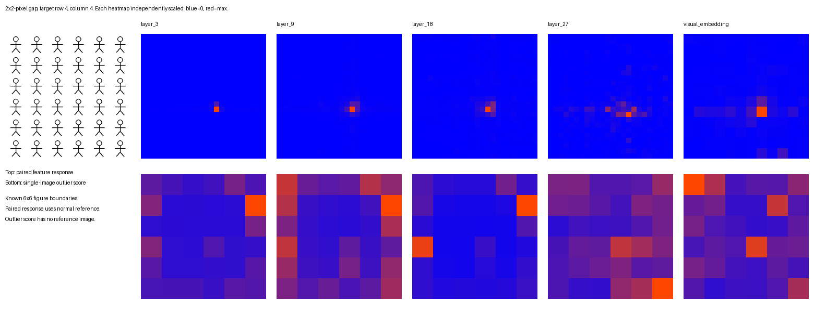

# 细节保留

实验日期：2026-09-20。本文记录[视觉表征差异性](plan.md)研究的初始实验，检验微小笔画变化是否影响深层特征，以及单张图像中的实例间距离能否定位异常。

## 1. 研究问题

重复小人图中的局部缺口提供两个需要分别测量的问题：

1. 已知一张完整图和一张缺口图时，对应位置的特征差分能否选择发生变化的小人。
2. 只使用缺口图时，各小人的特征距离能否选择真实异常小人。

前者测量受控改动的敏感性，后者检验一种具体的单图异常读出。即使前者成功，也不能直接认定模型能从单图发现缺口或输出坐标。

## 2. 模型与实验设计

### 2.1 表征与空间网格

Qwen3.5-9B vision encoder 含 27 层，patch size 为 16×16 pixels，hidden size 为 1152。merger 将相邻 2×2 个 token 分别 LayerNorm 后拼接，再经过 MLP 输出 4096 维向量。因此，merger 前后的空间网格分辨率不同，每个输出 token 对应的输入槽位为 32×32 pixels。该槽位大小不限制其 receptive field，也不能用于推断保留的信息量。

本实验在 patch embedding、ViT 第 3、9、18、27 层、merger LayerNorm 和最终 visual embedding 处记录特征。未合并特征先从 processor 的 2×2 block-major 顺序还原到空间网格，再按已知的小人区域分组。

### 2.2 数据与计算流程

设某一层的空间特征矩阵为 Z，形状为 N×D，其中 N 表示 token 数量，D 表示通道数。正常图像与缺口图像的对应特征分别记为 Z 和 Z′。一个小人区域对应的 token 索引集合记为 P。

1. 生成全部小人完整的图像，随后仅擦除预定小人的一段笔画，保持其余像素不变。
2. 对两张图像分别提取特征。将逐 token 特征差分的平方求和，得到每个小人区域的响应能量。
3. 对缺口图的每个小人，将区域内 token 按相对空间顺序连接为向量。计算该向量到所有小人向量逐维中位数的 RMS 距离，得到单图异常分数。
4. 两种算法各自选择唯一最高分区域，与真实缺口位置比较。并列最高分计为失败。正常图像只参与配对响应计算，不作为单图异常算法的参考。

区域的配对响应能量定义为：

$$
E(P)=\sum_{p\in P}\sum_{d=1}^{D}(Z'_{p,d}-Z_{p,d})^2.
$$

该量累加指定区域内全部通道的变化强度，用于比较一个已知改动在不同区域引起的响应。各层维度和量纲不同，原始能量不能直接跨层比较；目标区域能量占整图能量的比例描述响应集中程度，也不表示信息保留百分比。

## 3. 实验结果

2026-09-20 使用本地 Qwen3.5-9B 的 visual encoder 与 merger，在单张 A800 上以 float32 和 SDPA 执行测试。权重通过 checkpoint 中的 `model.visual.*` 严格加载；LLM backbone 未参与。合成图包含 6×6 个小人，画布为 384×384 pixels，每个小人占据 64×64 区域。processor 输出网格严格核对为 24×24 patches，未改变空间尺寸；visual embedding 网格为 12×12。

在四个预定位置分别擦除一个小人右臂上的 1、2、4、8 pixels 长的线段，线宽为 2 pixels，对应改变 2、4、8、16 个像素，共 16 个变体。位置覆盖角落与内部。实验比较已知正常图与变体的特征响应，同时独立计算每幅变体中的小人特征异常分数。异常分数仅使用已知区域边界与该幅图像。

表中每项给出正确定位的图像数量／全部 16 张缺口图像。每张图像各产生一次配对选择和一次单图选择。

| 阶段 | 配对响应能量最大的区域为目标区域 | 单图异常分数 top-1 正确 |
| --- | --- | --- |
| patch embedding，未加位置编码 | 16/16 | 16/16 |
| 第 3 层输出 | 16/16 | 0/16 |
| 第 9 层输出 | 16/16 | 0/16 |
| 第 18 层输出 | 16/16 | 0/16 |
| 第 27 层输出 | 15/16 | 4/16 |
| merger 的 LayerNorm 输出 | 16/16 | 4/16 |
| visual embedding | 16/16 | 4/16 |

图 1：受控缺口图像在不同模型位置的特征响应与单图异常分数。各热图用于显示空间分布，不能按颜色直接比较不同层的幅值。

对 2×2 pixels 缺口这一子集，四个位置在第 27 层和 visual embedding 中的配对响应最大区域均正确；两阶段的单图异常定位各成功 1/4，但成功位置不相同。图中选定的第 4 行第 4 列案例，第 27 层约 56.0% 的特征变化能量在目标小人区域，visual embedding 约为 80.3%。这些是各自特征空间中的响应分布比例，不能解释为信息保留率。

同图两次 forward 在所有记录阶段的最大绝对差为零。模型与 processor 加载完成后，18 次编码及分析约用时 3.03 秒，不包括导入、模型加载和最终绘图。结果表明该分析可以低成本执行，但这组图案简单且重复，位置和缺口尺度也少；当前结果没有提供 BabyVision 准确率、属性恢复准确率或完整 VLM 的回答。

这组实验支持的直接结论是：极小的局部改动能够影响深层输出与 visual embedding，而最简单的单图特征距离无法稳定定位异常。位置与上下文是需要检验的解释因素；细节是否被完整编码、是否能跨场景读出，以及是否被 LLM backbone 使用仍待后续实验。

代码位于 `analysis_tools/representation/visual_detail.py`，运行入口与输出说明见 README。产物包含完整配置、checkpoint revision、软件版本、代码 hash、原始合成图、逐位置响应、异常分数与热力图。没有新增依赖。

## 4. 研究进展

配对差分与单图异常读出的显著差距提出了下一项具体检验：将相同缺口移到全部 36 个位置，观察异常算法的最高分是否随之移动。该实验及不含异常实例图像的对照记录在[固定高分位置](results_2026-09-30_pilot.md)。距离度量、高范数处理与更广图像布局随后分别检验这一现象的原因和适用范围，统一进度见[研究计划](plan.md)。

模型结构依据本地 checkpoint 和锁定的 Transformers 实现核对：[Qwen3.5-9B 配置](https://huggingface.co/Qwen/Qwen3.5-9B/blob/main/config.json)、[Transformers v5.17.0 实现](https://github.com/huggingface/transformers/blob/v5.17.0/src/transformers/models/qwen3_5/modeling_qwen3_5.py)。本实验未测量 feature inversion 或独立属性 probe 的恢复效果；这些方法需要另行定义训练数据和评价指标。
