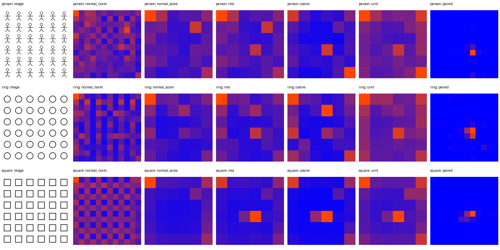
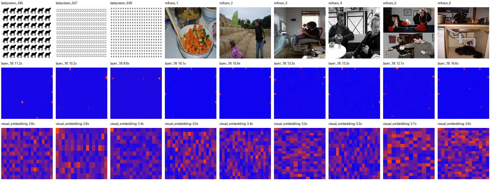

# 距离指标与高范数 token

实验日期：2026-09-30。本文属于[视觉表征差异性](plan.md)研究，承接[固定高分位置实验](results_2026-09-30_pilot.md)。

## 1. 研究问题与主要发现

本实验通过改变距离指标、图案和特征幅值处理，检验初始小人模板上的固定高分位置是否具有更广的适用范围。具体研究三个问题：

1. 同一局部像素改动在不同距离指标下是否仍能被定位。
2. 不含异常实例图像的特征在不同空间位置的差异，是否会掩盖单图中的真实异常。
3. 少数高范数 token 是否主导异常分数，以及抑制其幅值能否改善异常定位。

实验仅使用冻结的 Qwen3.5-9B vision encoder 和 connector，不运行语言生成，不测量模型回答的正确率。

结果支持一个需要按层、图案和度量方法区分的结论。重复实例即使具有相同像素内容，在深层也会得到不同特征；这些差异有时使简单距离读出长期选择固定实例。然而，这种失败没有覆盖全部图案。小人的最终 visual embedding 在两种平移下均只定位正确 1/36 个缺口，方框却分别达到 36/36 和 34/36。余弦距离有时显著改善结果，有时显著恶化结果。第 18 层出现最大范数约为中位数 7.62–10.53 倍的 token，逐 token 归一化改善了该层读出，但同一处理显著损害最终 visual embedding 的读出。因此，高范数干扰是部分层与部分读出方法的解释线索，尚不能作为全部异常定位失败的统一原因。

## 2. 数据、输入信息与控制条件

### 2.1 合成重复实例

构造小人、圆环和方框三个图案家族，每张图为 384×384 pixels，包含 6×6 个 64×64 pixels 的实例单元。每个家族包含原位置与整体向右下平移 4 pixels 两种条件。平移后图案仍完整位于原单元中，且同一图中各实例相对 patch 网格的相位相同。每种条件先生成全部实例相同的图像，再依次在 36 个实例中删除一段笔画，得到 216 张含一个异常实例的图像和 6 张不含异常实例的图像。小人删除右臂 8×2 pixels；圆环与方框在上边缘的 8×4 pixels 区域擦除笔画。不同家族实际发生变化的像素数不完全相同，家族间准确率不能解释为同等物理扰动下的感知难度排序。

两图差分可以访问相应的不含异常实例图像。单图异常读出仅访问当前图像的特征和已知的 6×6 单元边界，不使用配对图像、不使用真实异常位置、不使用正常图像得到的阈值或模板。单图任务因此仍然比完整 VLM 的无边界提示任务简单：实例分组已经由合成布局提供。正常图像的分数只用于事后分析固定峰现象。

提取 patch embedding、ViT 第 3、9、18、27 层以及最终 visual embedding。未合并 token 按 processor 的 2×2 block-major 顺序反重排到空间网格；最终 visual embedding 使用合并后的网格。384×384 图像没有发生 processor 缩放。所有前向计算使用 FP32，关闭 TF32。

### 2.2 外部图像

外部控制使用 BabyVision 507、445、638，以及 RefCOCO validation 首个 shard 按存储顺序选出的六张不同图像。RefCOCO 按 image bytes 的 SHA256 去重；相同 COCO 图像的不同 referring expressions 不构成独立图像。此处不运行 RefCOCO 的文本任务，也不使用其 question 字段作为 REC 指令。

外部图像先按最长边不超过 640 pixels 缩放，并将尺寸取到最近的 32 倍数。然后分别在横纵坐标比例为 1/4、1/2、3/4 的位置，将左上角对齐至 32-pixel 网格的 8×8 区域做颜色反相。两幅图使用相同处理尺寸。这产生 27 个已知局部像素改动，可以测量差分峰值是否落在被编辑 token 上。该实验不把编辑区域当作自然物体，也不把原图已有的异常修复为正常图；它不能衡量 BabyVision 原题的异常实例定位准确率或自然图像的语义分割质量。自然图像中的不同物体本来就应具有不同特征，其范数差异也不能自动解释为误报。

## 3. 距离、异常分数与高范数处理

设某阶段每个空间 token 的特征维度为 D，两个对应 token 的特征分别为向量 a 和 b。比较三种距离：

$$
d_{\mathrm{L2}}(a,b)=\|a-b\|_2,\qquad
d_{\mathrm{RMS}}(a,b)=\frac{\|a-b\|_2}{\sqrt{D}},\qquad
d_{\mathrm{cos}}(a,b)=1-\frac{a^\top b}{\|a\|_2\|b\|_2}.
$$

L2 和 RMS 在同一层具有固定比例，因而排序完全等价；列出两者用于数值验证，不能把相同结果当成两份独立证据。余弦距离消除整个向量的幅值，仅测量方向变化。对合成图像，先逐 token 计算距离，再对一个实例单元内的距离取 RMS，选择分数最大的实例。外部图像直接选择距离最大的 token。合成图像的最高分并列不计为正确。本轮外部图像记录采用首个最大值位置，未保存并列数量，因此外部统计不能确认所有最大值是否唯一；并列处理带来的潜在偏差仅影响外部结果。

对于单图，设一个实例单元包含 P 个 token，将这些 token 按空间顺序连接为维度 PD 的向量 c。36 个实例对应 36 个向量。基础读出以 36 个向量逐维中位数为参考，计算各实例到该参考的 RMS 或余弦距离。另一余弦读出计算某实例与其余 35 个实例的平均余弦距离。这两种方法均不训练，也不引入配对正常图像。

以下四类操作分别作用于当前图像的特征，每完成一种操作，便重新计算到实例逐维中位数的 RMS 分数。各方法独立比较，不按顺序叠加。

- **逐 token 归一化。** 每个 token 除以自身 L2 范数，使其长度为 1。该操作检验 token 幅值差异是否掩盖特征方向中的异常信息。
- **范数截断。** 分别以当前图像 token 范数的第 95 百分位和中位数为阈值，缩短超过阈值的向量并保留其方向。这两种强度用于检验少量极大幅值与更广泛幅值差异的影响。
- **高范数替换。** 选择范数最大的 5% token，将其向量替换为当前图像全部 token 的逐维中位数。该操作同时删除原幅值和原方向，用于判断这些位置的完整特征是否主导分数。
- **随机替换。** 对五个预先固定的随机种子，均匀抽取与高范数替换相同数量的 token，使用相同的中位数向量替换。该对照区分按范数选择的作用与任意删除局部证据的影响。

替换数量等于 token 总数的 5% 向上取整。每张 384×384 图像在未合并层共有 576 个 token，其中替换 29 个；merger 输出共有 144 个 token，其中替换 8 个。所有阈值与参考向量都只从当前输入图像计算，不使用异常位置标注。

逐 token 归一化与对整个实例向量计算余弦距离具有不同作用。后者仍保留实例内部各 token 的相对幅值，前者会消除这些相对幅值。两者结果不一致因此具有明确的数学原因，不能将二者统称为“去除幅值影响”。替换操作还会改变局部特征方向和实例内部模式，可能制造额外异常或删除真实证据。所有被处理样本都保留在分母中。

## 4. 合成图像结果

### 4.1 两图差分的定位准确率

本表每个数值表示正确选中真实异常实例的图像数量。评测包含 216 张图像，每张图像只修改一个实例，并只产生一次实例选择；准确率等于表中正确数量除以 216。最高分并列计为失败。例如，179 表示 216 张图像中有 179 张选中了真实异常实例。

| 特征阶段 | RMS | L2 | 余弦距离 |
|---|---:|---:|---:|
| patch embedding | 216 | 216 | 216 |
| ViT 第 3 层 | 216 | 216 | 216 |
| ViT 第 9 层 | 216 | 216 | 216 |
| ViT 第 18 层 | 216 | 216 | 216 |
| ViT 第 27 层 | 179 | 179 | 188 |
| 最终 visual embedding | 215 | 215 | 216 |

配对差分总体上保留较强的局部敏感性，但第 27 层存在明确反例。局部改动的影响可以传播到其他实例，使某个远处实例的总响应超过原改动位置。connector 后的最终 visual embedding 又恢复到较高定位率，说明“越深越不局部”不能由本实验支持。余弦距离对第 27 层和最终 visual embedding 略有改善，但这一改善不能直接外推到单图异常读出。

### 4.2 单图异常读出

| 特征阶段 | RMS 到中位数 | 余弦到中位数 | 实例间平均余弦 | 逐 token 归一化后 RMS | 95% 范数截断 | 中位数范数截断 | 高范数 5% 替换 | 随机 5% 替换均值 |
|---|---:|---:|---:|---:|---:|---:|---:|---:|
| patch embedding | 216 | 216 | 216 | 216 | 216 | 216 | 21 | 20.2 |
| ViT 第 3 层 | 30 | 37 | 43 | 50 | 46 | 60 | 41 | 19.6 |
| ViT 第 9 层 | 12 | 12 | 12 | 13 | 15 | 15 | 66 | 11.4 |
| ViT 第 18 层 | 8 | 10 | 11 | 96 | 89 | 89 | 52 | 8.0 |
| ViT 第 27 层 | 36 | 54 | 57 | 6 | 39 | 51 | 53 | 33.8 |
| 最终 visual embedding | 88 | 81 | 90 | 20 | 55 | 25 | 55 | 80.2 |

表中数值为 216 个样本中定位正确的数量，随机对照为五个种子的正确数量均值。高范数替换在第 9、18、27 层优于随机替换，但在最终 visual embedding 上低于随机替换与未处理读出。patch embedding 原始读出已完全成功，任何替换都严重破坏结果，这构成“高范数处理天然有益”的直接反证。

最终 visual embedding 的图案与平移条件分解如下。每个条件包含 36 张图像，分别在 36 个实例位置产生缺口；表中仍给出正确选择的图像数量，准确率为该数量除以 36。

| 图案与平移 | RMS 到中位数 | 余弦到中位数 | 实例间平均余弦 | 逐 token 归一化后 RMS | 高范数替换 |
|---|---:|---:|---:|---:|---:|
| 小人，0 pixels | 1 | 2 | 2 | 1 | 2 |
| 小人，4 pixels | 1 | 9 | 16 | 1 | 1 |
| 圆环，0 pixels | 1 | 1 | 1 | 1 | 23 |
| 圆环，4 pixels | 15 | 33 | 35 | 1 | 2 |
| 方框，0 pixels | 36 | 35 | 35 | 13 | 0 |
| 方框，4 pixels | 34 | 1 | 1 | 3 | 27 |

同一度量在不同图案中的方向相反，且只移动 4 pixels 就可能产生明显变化。4 pixels 平移改变了图案相对 patch 网格的相位，也改变了图像边缘空白的分配；它不是对网络内部“纯位置变量”的独立干预。本实验据此支持进一步研究 patch 相位和局部特征组合，不能仅归因于绝对位置编码。

图 1：每行对应一种图案。输入图的真实异常均位于第 4 行第 4 列。后续列依次显示正常图 token 范数、正常图实例分数、异常图 RMS 分数、余弦分数、逐 token 归一化后的分数和配对差分。各热图独立缩放；应比较高分位置，不能按颜色跨图比较幅值。

### 4.3 不含异常实例图像的固定峰与范数

六张不含异常实例的图像在 patch embedding 阶段具有完全相同的实例向量，基础 RMS 分数全部为零，没有唯一最高分。第 3 层的基础 RMS 最高分在六个条件中均位于第 2 行第 6 列；第 18 层在五个条件位于第 2 行第 6 列，在平移圆环中位于第 1 行第 2 列；最终 visual embedding 在六个条件中均位于第 1 行第 1 列。这里描述的是固定布局下不同图案的峰位置，不代表对任意图像尺寸与布局都成立。

加入异常后，第 18 层基础 RMS 在 214/216 张图中仍选择对应正常图像的最高分位置，而最终 visual embedding 为 134/216。最终层在方框上的异常信号足以超过原有位置偏好，所以固定峰的存在本身并不意味着异常不可分。

第 18 层六个条件的最大 token 范数与中位范数之比为 7.62–10.53；每个实例单元的平均 token 范数与该实例的 RMS 异常分数之间，Pearson 相关系数为 0.958–0.985。最终 visual embedding 的最大范数比为 2.18–3.14，相关系数为 0.718–0.886。第 27 层则出现负相关，最低约为 −0.803，说明范数与外部异常分数的关系随层显著变化。实例连接向量中的特征方向、相对幅值以及它们与参考向量的关系，都可能决定异常读出。

## 5. BabyVision 与 RefCOCO 外部图像结果

第 18 层的稀疏高范数现象在这九张外部图像中均可见。三张 BabyVision 图的最大范数/中位范数分别为 11.20、10.16、8.79，超过三倍中位范数的 token 占比为 0.33%–0.61%；六张 RefCOCO 图对应的最大范数比为 12.74–16.57，占比为 0.50%–0.83%。最终 visual embedding 的最大范数比则降到 BabyVision 的 2.78–3.37 和 RefCOCO 的 2.57–3.40。该现象说明少量中间层高范数 token 并不局限于合成小人图，但九张便利抽样图像不足以估计全数据分布。

图 2：外部图像及 ViT 第 18 层、merger 输出的 token 范数空间分布。各图采用独立色标，标题列出最大值与中位数之比；该比例用于比较幅值尾部，红色区域的位置用于观察范数的空间集中程度。

局部反相编辑的严格 token 峰值定位结果如下。每个单元格给出正确数量/编辑总数；L2 与 RMS 一致，故不重复列出。

| 特征阶段 | BabyVision RMS | BabyVision 余弦 | RefCOCO RMS | RefCOCO 余弦 |
|---|---:|---:|---:|---:|
| patch embedding | 9/9 | 9/9 | 18/18 | 18/18 |
| ViT 第 3 层 | 9/9 | 9/9 | 18/18 | 18/18 |
| ViT 第 9 层 | 9/9 | 9/9 | 18/18 | 18/18 |
| ViT 第 18 层 | 9/9 | 6/9 | 12/18 | 13/18 |
| ViT 第 27 层 | 0/9 | 3/9 | 7/18 | 8/18 |
| 最终 visual embedding | 6/9 | 4/9 | 9/18 | 7/18 |

外部图像中的严格局部峰值准确率明显低于合成图像上的最终实例级差分准确率。不过，两种评分空间尺度不同：合成实验允许峰值落在同一 64-pixel 实例单元的不同 token，外部实验要求精确落在被修改的单个 token。因此同时检查宽松条件：允许峰值落在目标 token 或横纵各相差一个 token 的邻域内。最终 visual embedding 的 RMS 对应 BabyVision 7/9、RefCOCO 15/18；余弦分别为 8/9、10/18。这说明部分严格失败属于邻近位置传播，同时仍保留远处响应超过局部响应的失败案例。

这些结果进一步限定了配对差分的解释：已知哪几个像素发生变化，并不保证任意层、任意度量的最大响应都停留在这些像素对应的 token。图像差分可用于研究敏感性与传播，但不能直接替代模型从单图中选择目标或读取坐标的证据。

## 6. register 假设的证据范围

[Vision Transformers Need Registers](https://arxiv.org/html/2309.16588v2) 研究了若干 ViT 中少量高范数 patch token，并结合局部位置与像素读出、全图分类读出以及加入显式 register 的训练干预讨论其作用。高范数只是其中一项诊断。

本实验确实在 Qwen3.5 ViT 中间层发现明显范数尾部，并发现抑制范数对部分单图读出有帮助。该现象与论文提出的机制相容，但本实验没有证明这些 token 失去了原位置、保存了全局语义，或在 VLM 的实际 grounding 计算中造成错误；本轮替换也只发生在外部分析器的输入上，没有把修改后的特征送回后续网络。因此应使用“高范数 token”描述观测，将 register-like 功能保留为待检验假设。

需要进一步区分的原因包括 ViT 的可学习二维位置 embedding、ViT attention 的空间 RoPE、有限图像边界导致的上下文差异、patch 内笔画相位、connector 对不同 token 方向和幅值的重新组合，以及高范数 token 的潜在全局信息存储。代码核查表明 Qwen3.5 vision encoder 在 patch embedding 后相加插值的 learned position embedding；相同实例像素因而没有在所有后续输入成分上保持相同。本轮未分别消融 learned position embedding 和视觉 RoPE，不能将固定峰唯一归因于其中任何一项。

## 7. 实验记录与研究进展

运行入口为 `scripts/analysis/distance_register.sh`，模型、GPU、运行目录和恢复开关集中在脚本顶部。实验产物位于 `WORK_DIR/grounding/distance_register_v1`。`results.json` 保存逐条件、逐层、逐度量正确性、正常图像分数和范数空间图、外部图像编辑位置与响应定位；`metric_comparison.png` 显示三个图案在同一预先指定目标上的可视化，`external_norms.png` 展示九张外部图像及两个阶段的范数图。恢复运行的 `elapsed_seconds` 仅统计该进程恢复后的计算时间，不代表完整实验耗时。每张热图独立缩放，仅用于观察其内部空间分布，不能按颜色跨图比较幅值。

针对性测试覆盖 L2/RMS 比例与余弦幅值不变性、全相同实例的并列处理与已知单元异常、各图案局部改动范围、checkpoint 兼容性和外部并列峰规则。恢复要求 checkpoint 的模型名称、snapshot、FP32 设置、实验条件、模型与 processor 配置以及实现签名完全匹配，并核对样本键的完整性。缺少兼容性元数据的 checkpoint 会被拒绝。本次保存的旧 checkpoint 保留原始内容，仅作为已有结果产物，不适用于当前严格恢复入口。

下一步优先开展三个直接依赖本轮证据的实验。首先，使用独立训练图像学习位置条件化的正常特征分布，并在未见图案、未见平移和未见画布上测量异常属性可读出性，避免使用测试配对图像。其次，在同一批高范数与普通 token 上分别训练位置和局部像素 probe，同时控制背景比例和图案内容，检验 register 假设所要求的功能差异。最后，把有选择的范数处理或特征替换送入后续网络，联合评估属性辨认、实例选择和 point/bbox 输出，并保留随机处理对照。只有最后一类实验能确定外部读出改善是否转化为模型实际 grounding 的改善。

2026-10-01 的[图像布局与直接排除实验](results_2026-10-01.md)扩展了实例数量、图像尺寸和 decoder 层，并加入不参与异常读出的高范数 token 排除。该实验与本轮使用不同异常评分，分别报告，避免将指标差异混入方法改善。
