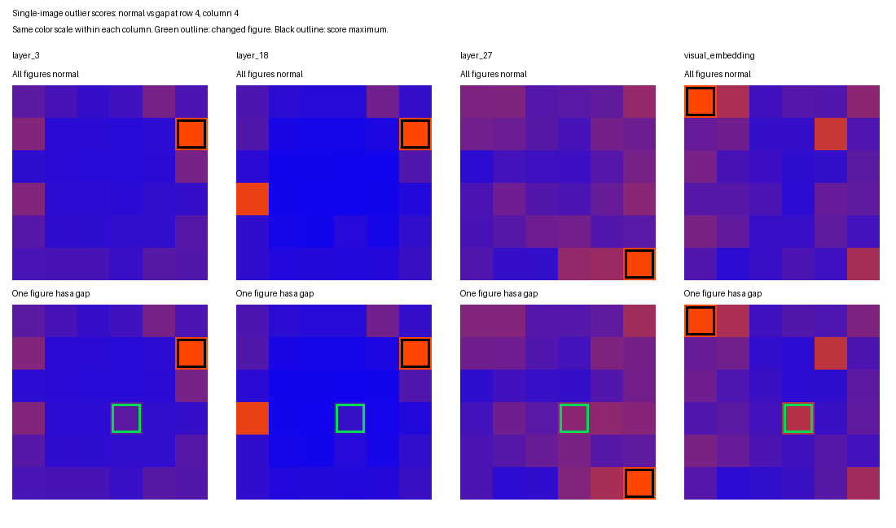

# 单图异常定位：固定高分位置

实验日期：2026-09-30。本实验承接[细节保留实验](results_2026-09-20.md)，检验移动真实缺口是否改变单图异常算法选中的位置。

## 1. 模型与运行条件

| 项目 | 实际设置 |
| --- | --- |
| 模型 | Qwen3.5-9B |
| checkpoint revision | `c202236235762e1c871ad0ccb60c8ee5ba337b9a` |
| Transformers / PyTorch | 5.17.0 / 2.14.0+cu130 |
| 表征实验 | 仅加载 visual encoder 与 merger，float32、SDPA |

实验采用仓库锁定环境，没有修改依赖。输出通过 `.env` 的 WORK_DIR 保存。原始实验路径为 `grounding/qwen35_9b_pilot_v1/representation/`。

## 2. 固定高分位置

### 2.1 实验设计

沿用已有实验的 384×384 PNG 生成器，包含 6×6 个相同小人，每个小人对应 64×64 区域。本文将所有小人均完整、不含异常实例的图像称为“正常图像”；其“跨位置特征差异”指相同小人位于不同位置时，编码后的特征向量仍不相同。首先编码正常图像，再依次在全部 36 个位置擦除 8×2 pixels 的右臂线段。每次只改变一个小人，processor 网格严格核对为 24×24，merger 后为 12×12。

每个区域内的特征保留空间顺序，展平后与所有小人的逐维中位数计算 RMS 距离。分别比较单图分数的最高位置、该位置是否与全正常图相同、完整分数向量的 Pearson correlation，以及配对特征变化能量最大的区域。配对响应使用测试图的正常参考，因此属于已知干预的敏感性测量。

### 2.2 实验结果

| 阶段 | 单图异常 top-1 | 与全正常图选中同一位置 | 与正常分数的平均相关性 | 配对差分能量最大区域正确 |
| --- | --- | --- | --- | --- |
| patch embedding，未加位置编码 | 36/36 | 不适用：正常分数全为 0 | 不适用 | 36/36 |
| ViT 第 3 层 | 1/36 | 36/36 | 0.9855 | 36/36 |
| ViT 第 9 层 | 1/36 | 36/36 | 0.9927 | 36/36 |
| ViT 第 18 层 | 1/36 | 36/36 | 0.9962 | 36/36 |
| ViT 第 27 层 | 1/36 | 36/36 | 0.9491 | 36/36 |
| visual embedding | 1/36 | 36/36 | 0.9166 | 36/36 |

第 3、9、18 层的固定最高分位于第 2 行第 6 列，第 27 层位于第 6 行第 6 列，visual embedding 位于第 1 行第 1 列。每一阶段的 1/36 正确都发生在真正异常恰好落到其固定最高分位置时。

该结果表明，在本模板和距离度量下，不含异常实例图像中已有的跨位置特征差异足以主导异常排序。它不能确定这些差异分别有多少来自绝对位置 embedding、边界上下文、特征范数或全图信息存储。位置中心化、cosine distance 和独立属性 probe 是必要对照。配对差分成功表明模型对局部变化敏感，不证明缺口在单图中可被语义识别。[多图案实验](../representation/results_2026-09-30.md) 提供了方框等反例，因此该固定峰结论的适用范围保持为本节的小人模板与度量。

图 1 展示全正常图与第 4 行第 4 列有缺口图的异常分数；每列的上下两图采用共同色标。黑框为异常算法的最高分位置，绿框为真实改动位置。不同层的原始分数量纲不同，颜色不能跨列比较。完整逐位置分数保存在 `results.json`。

36 个变体共享同一正常模板。这是穷举位置的受控实验，不能当作 36 幅独立自然图像的泛化评测。

## 3. 研究进展

本模板中的固定高分位置提示，局部干预敏感性和单图异常可读性需要分别研究。由此开展了[多图案距离与高范数实验](results_2026-09-30.md)，以改变图案与读取方法检验该现象的范围。
