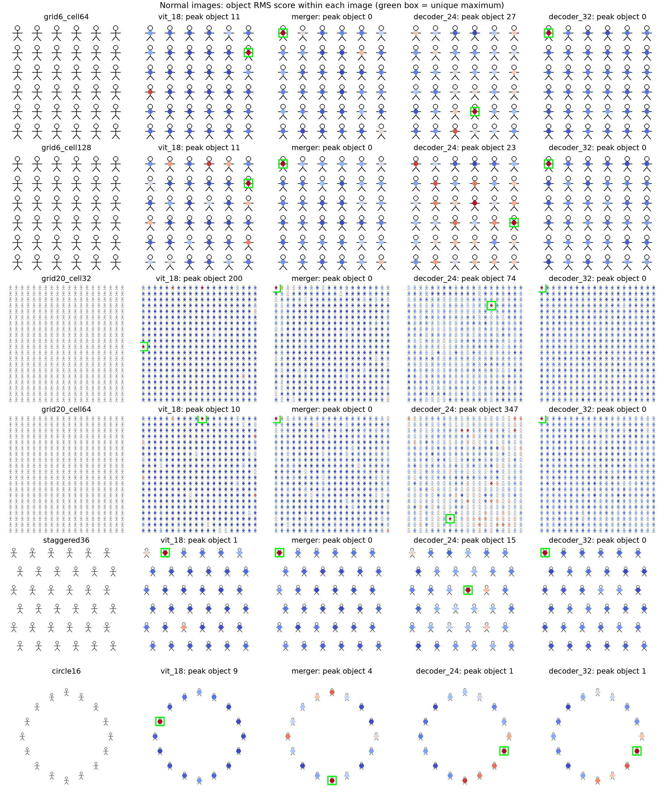
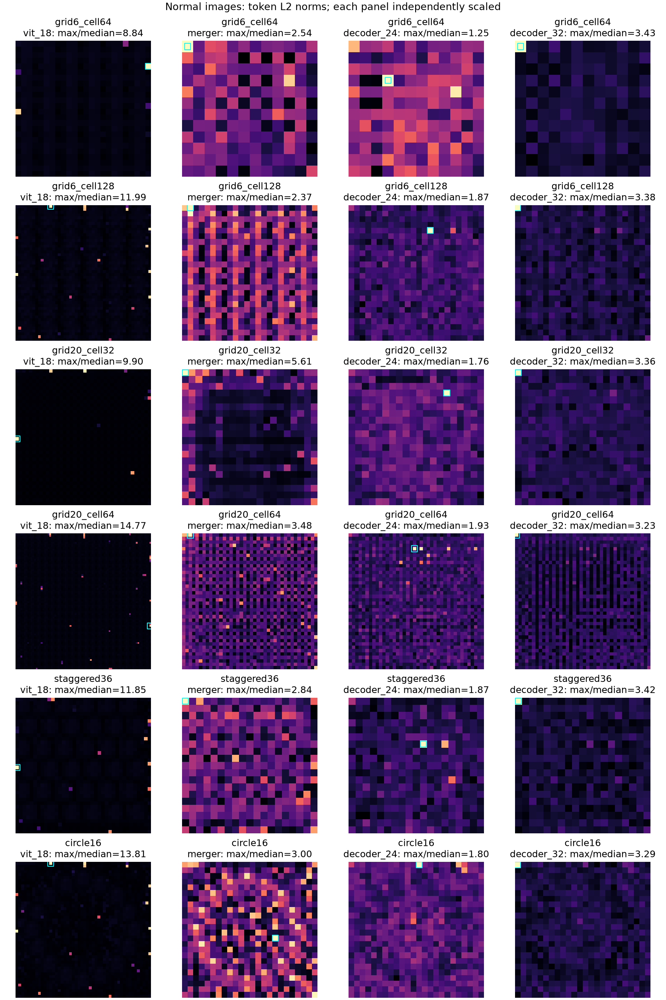
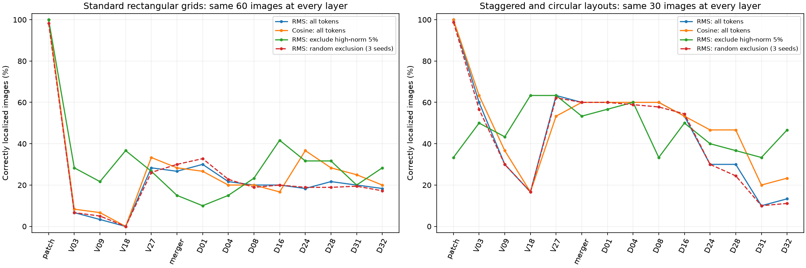

# 图像布局与高范数排除

实验日期：2026-10-01。本文属于[视觉表征差异性](plan.md)研究，扩展[距离指标与高范数 token](results_2026-09-30.md)实验的图像条件，并检验直接排除高范数位置是否改善单图异常定位。主模型为 Qwen3.5-9B；另使用 Qwen3-VL-8B-Instruct 检查部分规律是否跨模型成立。

## 1. 研究问题与主要结果

前一组实验发现，相同小人的单图异常分数在一些层主要受固定高分位置影响，但方框等图案提供反例。因此，本实验围绕同一研究问题，依次检验以下三个子问题：

1. 扩展到 20×20 个实例、不同图像尺寸和不同空间布局后，正常图像的高分位置是否仍然固定，真实异常能否超过该位置的分数。
2. 直接让高范数 token 不参与异常计算，能否改善定位；改善是否超过相同数量的随机排除。
3. 这些现象是否延续到 decoder 的不同层，以及另一个本地 VLM。

主模型正式实验包含 18 张正常图像和 288 张异常图像。标准网格及错列布局的 15 张正常图像，在 merger 输出上均以左上实例为 RMS 最高分；环形布局的最高分则依赖图案。直接排除高范数 token 将 ViT 第 18 层的正确定位数量从 15/288 提高到 89/288，但 merger 从 66/288 降到 61/288。decoder 第 32 层则从 15/90 提高到 31/90，体现明显的层依赖。这里的分子表示正确选择真实异常实例的图像数，分母表示该层参与异常定位评测的图像数。

## 2. 实验设计

### 2.1 图像构造

每种布局分别绘制小人、圆环和方框。首先生成同一图案完全重复的正常图像，再在预定的一个实例中擦除一小段笔画。实例局部图案沿用前一组实验的 64×64 pixels 模板；需要改变实例大小时，对完整模板和缺口模板使用相同的 nearest-neighbor 缩放。该操作保持同一图像各实例的像素图案一致，但不同尺度下缺口的像素大小也随之改变。

| 条件 | 图像尺寸 | 实例数量 | 每个实例的分析窗口 | 每种图案的异常图像数 |
|---|---:|---:|---:|---:|
| 标准 6×6 网格 | 384×384 | 36 | 64×64 | 12 |
| 标准 6×6 网格 | 768×768 | 36 | 128×128 | 12 |
| 标准 20×20 网格 | 640×640 | 400 | 32×32 | 24 |
| 标准 20×20 网格 | 1280×1280 | 400 | 64×64 | 24 |
| 错列布局 | 608×608 | 36 | 64×64 | 12 |
| 环形布局 | 768×768 | 16 | 64×64 | 12 |

标准网格用于主要结论。6×6 与 20×20 的 64-pixel 窗口条件保持实例像素大小相同，同时改变数量与画布大小；两个 20×20 条件保持实例数量相同，同时改变实例与画布尺度。这些是成组对照，尚未把实例数量、画布大小和空白比例完全独立化。

扩展布局定义如下：

- **错列布局。** 行列起点间隔为 96 pixels，交替行向右平移 32 pixels，窗口大小保持 64 pixels。因此相邻实例的间隙和二维排列改变，但所有窗口仍对齐 32-pixel 网格。
- **环形布局。** 16 个窗口中心按等角间隔放置于半径 280 pixels 的圆周，再将窗口起点取整到 32-pixel 网格。取整后窗口互不重叠。每个窗口包含一个图案，窗口之间的空白不参与实例比较。

分析窗口是生成器定义的固定区域，不是从模型特征中检测出的物体边界。窗口内部的 token 按相对空间位置对齐，像素中相同位置对应向量中的相同分量。所有图像尺寸与窗口均满足模型的 patch 对齐要求，程序核对 processor 没有缩放输入。

目标位置在读取模型特征前固定。对 36 和 400 个实例，包含四个角点，再使用 seed 20261001 从其余位置无放回抽样；对环形布局使用同一确定性采样程序选择 12 个索引。取样包含非对角位置，完整列表保存在 metadata。由于角点被固定纳入，该样本不用于估计均匀随机目标的总体准确率。

### 2.2 模型输入与表征

两模型均冻结，使用 bfloat16、SDPA、batch size 1 和 thinking off。主模型 checkpoint 与前一组实验相同，Qwen3-VL-8B-Instruct checkpoint 为 `0c351dd01ed87e9c1b53cbc748cba10e6187ff3b`。此次主模型的计算精度与前一组 FP32 实验不同，因此跨日期数值不作为单变量干预效果。

包含 decoder 的前向输入采用以下固定用户消息：

> 输入图像。Describe the image.

实验只进行 prefill，不生成答案。文本放在图像之后，因此 decoder 中的视觉位置不能通过 causal attention 读取这句后续描述；这些 hidden states 主要反映图像与前缀上下文。

1. 所有 306 张主模型图像均提取 patch embedding、ViT 第 3、9、18、27 层以及 merger 输出。
2. 每个“布局×图案”条件的正常图像，以及五个预先指定的异常位置，同时提取 decoder 第 1、4、8、16、24、28、31、32 层输出。五个位置从排序后的目标列表中按等间隔索引选择。因此 decoder 每层包含 18 张正常图像和 90 张异常图像。
3. 主模型 ViT 与 merger 的完整异常样本数为 288，decoder 为 90。跨层曲线只使用共同的 90 张异常图像；全样本表格则逐行注明分母。

Qwen3-VL 对照使用标准 6×6／64-pixel 窗口、标准 20×20／64-pixel 窗口和环形布局，每种图案取 12 个异常位置，共 9 张正常图像与 108 张异常图像。其 decoder 取其中 45 张异常图像。两个模型的 ViT 和 merger 可在相同的 108 张异常图像上比较；decoder 的预选位置交集为 36 张。Qwen3-VL 的 block hook 在该层额外 DeepStack 加法前记录输出，后续层仍会接收此前 DeepStack 注入，因而模型间差异不能解释为 linear attention 与 full attention 的单一差异。

### 2.3 异常分数

直接排除 token 会使不同实例剩下的相对位置不同。为了避免将实例甲的上半部分与实例乙的下半部分比较，本实验对每一对实例仅比较双方都保留的相对位置。

设图像包含 n 个实例，每个实例窗口包含 P 个 token，每个 token 为 D 维向量。实例特征记为 F，形状为 n×P×D；F 的第 i 个实例、第 p 个相对位置的向量记为 f。保留掩码 K 的形状为 n×P，值为 1 表示该 token 参与比较。实例 i 与 j 的共同有效位置集合为：

$$
C_{ij}=\{p:K_{i,p}=1\ \text{且}\ K_{j,p}=1\}.
$$

当该集合非空时，RMS 距离定义为：

$$
d_{ij}^{\mathrm{RMS}}
=\sqrt{\frac{1}{D|C_{ij}|}
\sum_{p\in C_{ij}}\|f_{i,p}-f_{j,p}\|_2^2}.
$$

该式只累加同一相对位置的通道差异，并按实际比较的标量数量取平均。余弦距离则将双方在共同位置上的向量按相同顺序连接后计算，使分子和两个范数使用完全相同的支持集合。

对实例 i，把与其他可比较实例的距离取算术平均，作为单图异常分数。没有任何可比较实例时，i 无法被选择。未排除、按范数排除和随机排除均使用同一评分程序；未排除条件中所有位置都有效。这个定义与前一组“到逐维中位数的距离”不同，本轮的处理收益仅与本轮未排除基线比较。

配对差分沿用对应 token 的 RMS 和余弦距离，再对实例窗口内 token 距离取算术平均。配对实验允许使用对应正常图，而单图实验只使用当前图像。配对评分也与前一组窗口内 RMS 聚合不同，跨日期正确数量不能当作只改变图像布局的效果。

### 2.4 直接排除高范数 token

以下三种条件独立运行，模型前向传播完全相同，只有外部异常计算参与的 token 不同。

1. **不排除。** 使用全部 token，作为本轮评分定义的基线。
2. **排除高范数 5%。** 计算当前图像全部空间 token 的 L2 范数，选择范数最高的 5%，数量向上取整。这些 token 不进入实例对距离，也不填入零向量或替换向量。阈值与选择只依赖当前图像，不使用真实异常位置。
3. **随机排除 5%。** 用 seed 0、1、2 分别从全图均匀选择与高范数条件相同数量的 token，执行相同的排除与评分，报告三个种子的平均正确数量。

例如，384×384 图像的 ViT 特征共有 576 个 token，高范数条件排除其中 29 个；merger 有 144 个 token，排除其中 8 个。640×640 图像的 merger 有 400 个 token，排除 20 个。后一条件中每个 32-pixel 实例窗口只有一个 token，因此被排除的实例没有可读特征，仍保留为评测样本中的候选真实异常，不能从正确率分母删除。

相同范数使用稳定排序，边界处同范数 token 按空间序列顺序决定是否排除。这一规则在重复的 patch embedding 中尤其重要。随机对照匹配的是全图排除数量，并不保证各实例或空白背景内部的排除数量相同；因此它控制了全局排除预算，但未完全控制实际删除的局部证据。

## 3. 图像布局与固定高分位置

图 1：六种布局的小人正常图像及实例间平均 RMS 分数。每行左侧为输入图，后面分别为 ViT 第 18 层、merger、decoder 第 24 和 32 层。点的颜色在各图内从低分蓝色到高分红色缩放，绿色框标出唯一最高分实例；标题中的实例索引从 0 开始。图中没有真实异常，因此颜色表示相同图案在不同位置的表征差异。

结果包含三条层次不同的规律：

- **ViT 中间层的最高分位置随布局变化。** 384-pixel 的标准 6×6 图像在三个图案中均以第 2 行第 6 列最高；增大实例和画布后，圆环与方框改为第一行的其他实例；20×20 图像的最高分还会随形状变化。因此，中间层不支持一个跨尺寸、跨图案固定不变的坐标。
- **Merger 的左上实例偏好覆盖全部标准网格与错列条件。** 共 15 张正常图像均以左上实例最高。环形布局的小人、圆环、方框峰分别落在生成顺序索引 4、12、4，对应不同的圆周位置，说明其适用范围依赖布局和物体是否覆盖图像左上区域。
- **Decoder 第 32 层的实例分数与全图范数需分别观察。** 标准网格及错列条件仍选择左上实例，环形条件则选择不同的圆周实例；然而 18 张正常图的全图 token 范数峰均在第一行的第 1 或第 2 个 token，环形图中这些位置属于空白背景。

图 2：与图 1 相同的六种小人正常图像，显示整幅图像的 token 范数。青色框为范数最大 token；每幅图独立缩放，标题给出最大值／中位数之比。环形图在 decoder 第 32 层的左上空白位置仍出现范数峰，这与“当前最高范数必须属于异常物体”的解释不相容。

这些现象给出了序列边界和位置编码的可检验线索，但尚未确定具体机制。ViT 的非因果 attention 已经产生跨位置差异，merger 会重新组合特征，decoder 则额外引入因果可见范围及有序递推。仅凭峰的位置无法区分位置编码、attention sink、全局信息存储或训练形成的特征尺度分布。

## 4. 异常定位与直接排除

### 4.1 逐层结果

下表的“正确数”是选择真实异常实例的图像数量。每张异常图像只产生一次实例选择；并列和无有效支持计为失败。随机排除列为三个种子的正确数量均值，因此允许小数。ViT 与 merger 使用 288 张异常图，decoder 使用预选的 90 张异常图，不能忽略这一分母差异直接比较正确数量。

| 模型位置 | 图像数 | 未排除 RMS 正确数 | 高范数排除 RMS 正确数 | 随机排除 RMS 正确数均值 |
|---|---:|---:|---:|---:|
| patch embedding | 288 | 288 | 240 | 283.67 |
| ViT 3 | 288 | 58 | 80 | 54.00 |
| ViT 9 | 288 | 29 | 57 | 29.33 |
| ViT 18 | 288 | 15 | 89 | 15.00 |
| ViT 27 | 288 | 74 | 77 | 71.67 |
| merger | 288 | 66 | 61 | 76.00 |
| decoder 1 | 90 | 36 | 23 | 37.67 |
| decoder 4 | 90 | 31 | 27 | 31.33 |
| decoder 8 | 90 | 30 | 24 | 28.67 |
| decoder 16 | 90 | 28 | 40 | 28.33 |
| decoder 24 | 90 | 20 | 31 | 20.33 |
| decoder 28 | 90 | 22 | 30 | 18.67 |
| decoder 31 | 90 | 15 | 22 | 14.67 |
| decoder 32 | 90 | 15 | 31 | 13.67 |

图 3：所有模型位置都使用同一子集绘制曲线。左图包含标准网格的 60 张异常图像，右图包含错列与环形布局的 30 张异常图像。纵轴为正确图像比例；横轴的 V 表示 ViT 层，D 表示 decoder 层。该图用于比较同一组图像的层间变化，表格则保留各层全部可用样本，所以曲线和全样本表中的百分比可能不同。

ViT 第 18 层的直接排除改善超过随机对照，但未恢复到 patch embedding 的准确率。merger 上，高范数排除既低于未排除条件，也低于随机排除，说明大范数 token 可能同时含有重要的局部区别。decoder 浅层同样受损，较深层的部分读出则改善。全部结果共同支持按模型位置研究，而不能把删除高范数 token 作为统一优化。

高范数排除只修改分析器读取的特征集合，没有改变 VLM 的 attention 或生成结果。本实验尚未验证模型优化收益，也没有把高范数位置认定为 register tokens。

### 4.2 布局分解

下表给出 merger 输出的单图定位结果，每一行跨三个图案汇总。未排除 RMS、未排除余弦和高范数排除 RMS 都报告正确数／该条件的异常图像数。

| 布局 | 未排除 RMS | 未排除余弦 | 高范数排除 RMS |
|---|---:|---:|---:|
| 6×6，64-pixel 窗口 | 14/36 | 13/36 | 8/36 |
| 6×6，128-pixel 窗口 | 9/36 | 8/36 | 12/36 |
| 20×20，32-pixel 窗口 | 1/72 | 3/72 | 0/72 |
| 20×20，64-pixel 窗口 | 3/72 | 3/72 | 5/72 |
| 错列 36 实例 | 3/36 | 3/36 | 5/36 |
| 环形 16 实例 | 36/36 | 36/36 | 31/36 |

环形布局在三类图案上均容易被当前未排除读出定位，表明“相同实例重复就无法单图发现异常”不成立。20×20 的两种尺度都很差，增大图案到与 6×6 相同像素大小仍未消除失败。但环形与网格还同时改变实例数量、空白比例和周围上下文，不能把准确率变化唯一归因于环形几何。

异常移动后，ViT 第 18 层仍选择对应正常图最高分的次数为 277/288，merger 为 236/288，decoder 第 32 层为 84/90。固定高分偏好在部分条件下确实强于真实缺口信号，但方框和环形条件提供明确反例。

### 4.3 配对响应

配对 RMS 与余弦定位在 patch embedding、ViT 第 3、9、18 层均为 288/288；ViT 第 27 层分别为 228/288、245/288；merger 为 259/288、266/288。decoder 第 32 层对应预选子集为 50/90、49/90。

merger 的 32-pixel 小人窗口条件中，配对 RMS 仅为 1/24；64-pixel 小人窗口条件为 23/24。这说明在密集小尺度条件下，最大响应也可能远离实际局部改动，配对定位能力本身并不在所有尺度上成立。两个条件同时改变缺口像素尺度和图像尺寸，因此下一步需要固定画布、逐级改变实例尺寸的独立对照。

## 5. 跨模型对照

Qwen3-VL-8B-Instruct 的 6×6 与 20×20 正常网格同样在 merger 上选择左上实例，但其最终 decoder 层在小人与圆环中出现不同的高分位置。Qwen3.5 的 decoder 末层左上偏好因此尚不具有模型普遍性。

在完全相同的 108 张异常图像上，merger 的未排除 RMS 定位结果如下。

| 布局 | Qwen3.5-9B | Qwen3-VL-8B-Instruct |
|---|---:|---:|
| 6×6，64-pixel 窗口 | 14/36 | 34/36 |
| 20×20，64-pixel 窗口 | 3/36 | 16/36 |
| 环形 16 实例 | 36/36 | 36/36 |
| 合计 | 53/108 | 86/108 |

即使两个模型在正常网格上具有相同的最高分实例，真实异常能否超过该位置仍明显不同。高范数排除使上述两个模型的正确数量分别变为 42/108 和 45/108，都低于各自未排除基线。正常图的峰位置相同因而不足以说明两个模型的异常可读性相同。

模型之间的 visual encoder 权重、merger、训练数据、decoder attention 和 DeepStack 机制同时不同。本实验只确定现象的适用范围，不从这一对照中归因具体结构。

## 6. 实验记录与研究进展

正式产物按研究问题和日期保存：

- `WORK_DIR/analysis/representation/2026-10-01_layouts_random_targets/`：主模型全部原图、逐条件结果、源代码快照、metadata 和图表。模型加载后计算约 191.95 秒，不包含加载和后续绘图。
- `WORK_DIR/analysis/representation/2026-10-01_cross_model_random_targets/`：第二模型的相同格式产物，模型加载后计算约 86.24 秒。

运行入口分别为 `scripts/analysis/representation_patterns.sh` 和 `scripts/analysis/representation_cross_model.sh`，图表由 `scripts/analysis/representation_pattern_figures.sh` 从已保存记录重建。参数集中在脚本顶部。主结果来源为逐图逐层记录，文档用图复制到本目录的 figures 文件夹，原始数值保留在实验目录。开发阶段的等间隔索引取样产生了偏向对角线的目标集，其产物保留用于追溯，但没有进入本文正式表格和图表。

当前最需要区分的解释是：左上位置的特征幅值或方向是否源于视觉位置编码、边界上下文、decoder 因果顺序，或用于全局信息存储的 token 功能。可以先构造只改变空白边界或前缀而保持实例局部像素的对照，再结合位置与局部内容 probe 检验高范数位置的功能。只有这些证据确定机制后，才适合将特征排除或其他干预送入完整模型评估实际 grounding。
