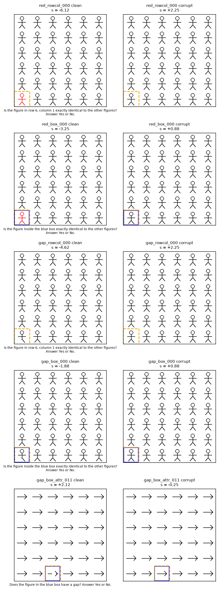
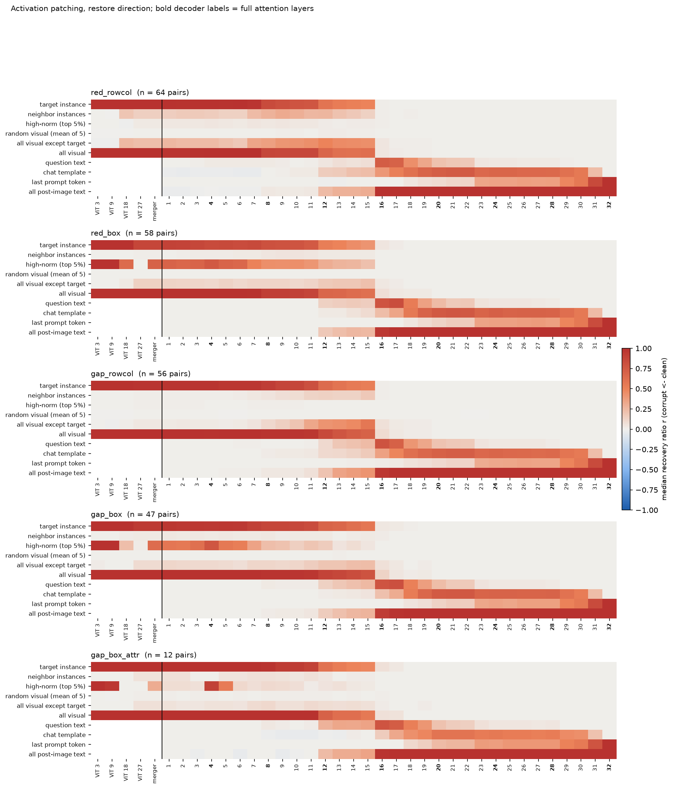
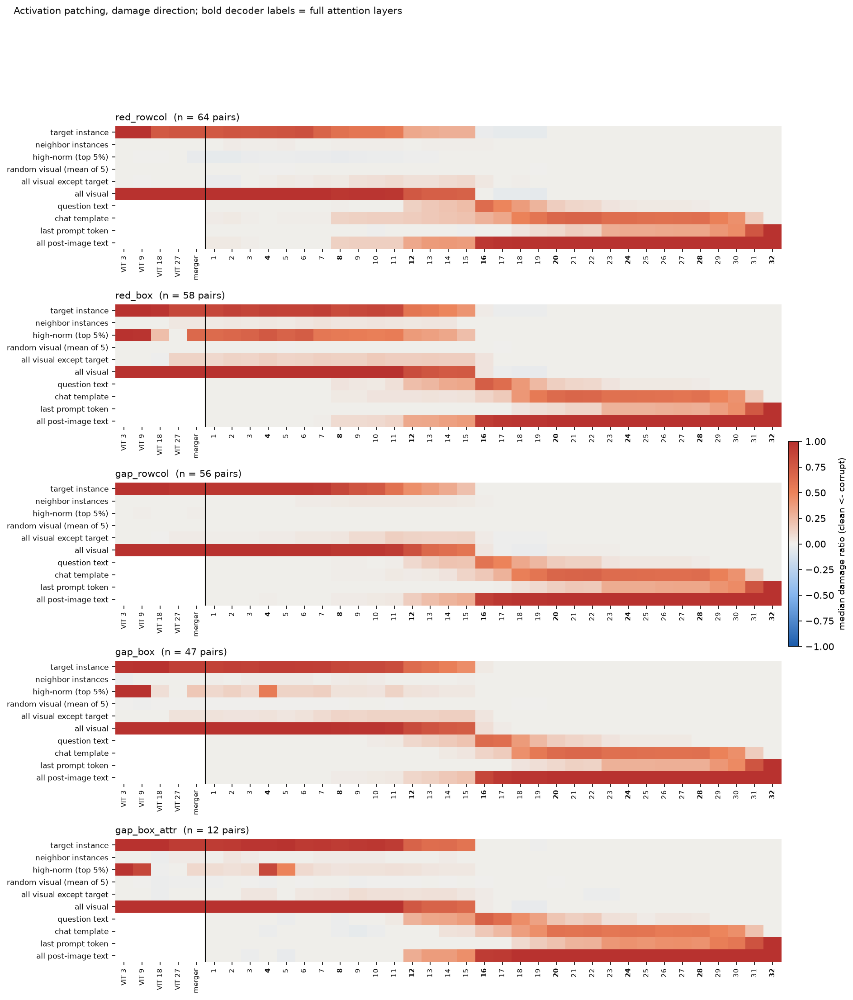
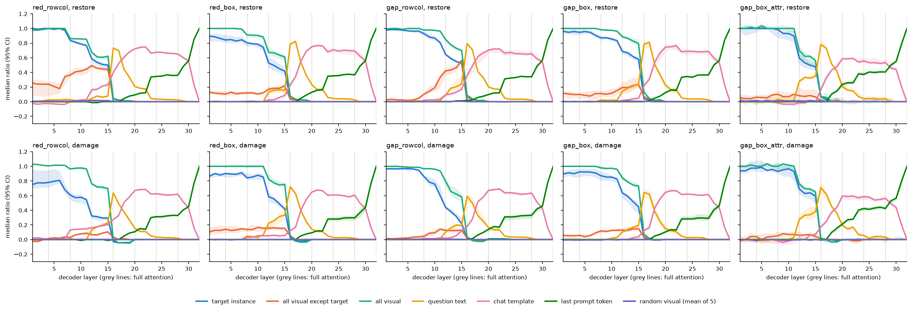
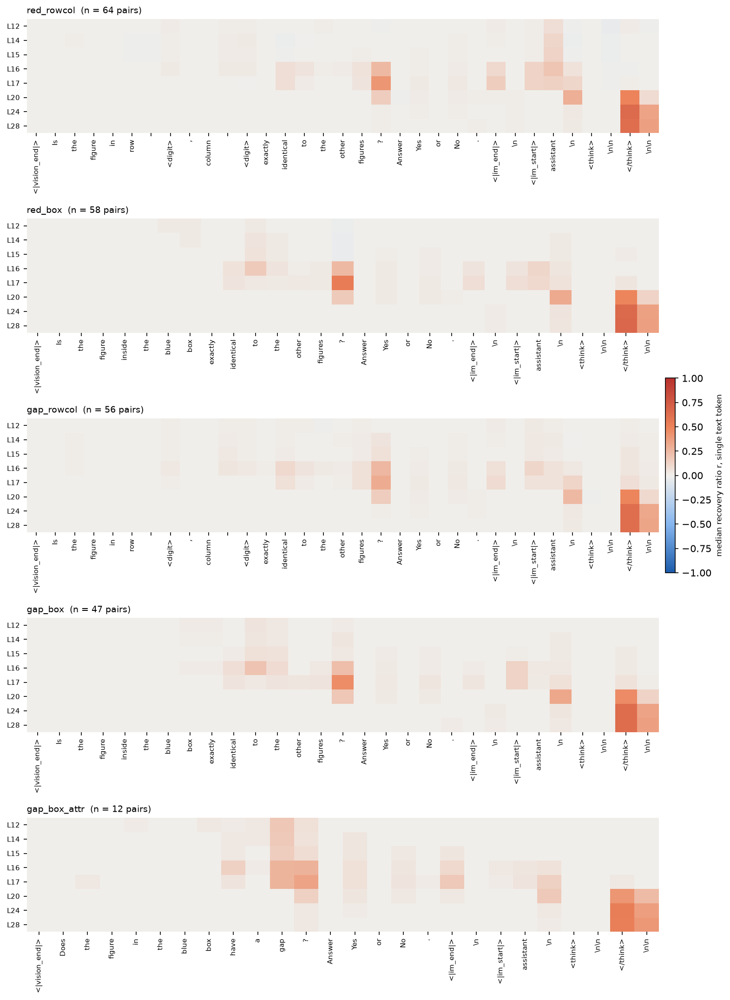

# Activation patching

实验日期：2026-10-13。本文属于[视觉细节表征](plan.md)研究，执行[实验 2.5 设计](design_causal.md)中的 2.5a。主模型为 Qwen3.5-9B，冻结、bfloat16、SDPA、thinking off；另以 float32 在 16 个配对上复核。

## 1. 研究问题与主要结果

实验 2.1 表明局部像素改动能够进入各层视觉表征，但这只说明信息可以被读出，不能说明模型生成答案时使用了这些信息。本实验在严格配对的异常图与正常图之间替换指定层、指定 token 组的 hidden states，测量答案判别分数的变化，回答三个问题：

1. 模型的回答依赖哪些视觉 token 上的异常信息，目标实例 token 是否足以且必需；
2. 异常信息在 decoder 的哪一层从视觉 token 转移到文本 token，转移是否集中于 full attention 层；
3. 文本侧的哪些 token 依次承载该信息，直到最后一个 prompt token 生成答案。

在五个任务条件、237 个合格配对上，结果高度一致：

1. **异常信息主要经由目标实例 token 进入答案。** 在 ViT、merger 与 decoder 第 1 至 7 层，仅替换目标实例的 4 个 visual tokens 即可恢复 85%–100% 的判别分数差；随机 visual tokens 的恢复比例接近 0，排除与目标重叠的情形后高范数 token 同样接近 0。
2. **视觉到文本的转移发生在 full attention 层，以第 16 层为主。** 目标实例 token 的恢复比例在第 8、12、16 层（均为 full attention 层）出现阶跃式下降；第 16 层输出处全部视觉 token 的恢复比例降至 0.05–0.13，全部图像后文本 token 的恢复比例达到 0.93–1.00。第 16 层之后的计算不再读取 visual tokens 中与答案有关的信息。
3. **文本侧的传递路径固定且分段。** 第 16–17 层由问题末尾的问号 token 承载最多信息；第 20–28 层集中于 chat template 中的 `</think>` token；最后一个 prompt token 直到第 23 层才获得约 0.33 的恢复比例，并在第 29–31 层（Gated DeltaNet 层）上升至约 0.85。
4. **颜色异常在 ViT 中扩散，缺口异常保持局部。** red_rowcol 条件下，从 ViT 第 18 层起非目标 visual tokens 也携带约 25% 的异常信息，gap_rowcol 条件下该比例不超过 3%。

## 2. 实验设计

### 2.1 任务条件

图像取自[共享合成刺激集](../stimuli.md)（生成器 stimuli-v1）：6×6 网格、64-pixel 实例单元、384×384 pixels 画布，四个开发模板（小人、圆环、方框、箭头）轮流使用。每张图像对应 12×12 个 merged visual tokens，每个实例单元覆盖 2×2 个 token。问题末尾统一追加“ Answer Yes or No.”，使回答首个 token 为 Yes 或 No。

| 条件 | 异常 | 指定方式 | 问题 | clean 输入的正确答案 |
| --- | --- | --- | --- | --- |
| red_rowcol | 纯红色 | 行列 | Is the figure in row r, column c exactly identical to the other figures? | No |
| red_box | 纯红色 | 蓝色方框 | Is the figure inside the blue box exactly identical to the other figures? | No |
| gap_rowcol | 16-pixel 缺口 | 行列 | 同 red_rowcol | No |
| gap_box | 16-pixel 缺口 | 蓝色方框 | 同 red_box | No |
| gap_box_attr | 16-pixel 缺口 | 蓝色方框 | Does the figure in the blue box have a gap? | Yes |

每个条件生成 64 个配对。目标位置由 seed 0 在 36 个单元中均匀抽样，模板按配对序号循环，缺口位置在模板预设的三个笔画位置中均匀抽样；五个条件共用同一组目标位置、模板与缺口位置，因此条件之间只差异常类型、指定方式与问题。

### 2.2 配对构造

每个配对包含 clean 输入与 corrupted 输入。clean 输入为异常图与问题，指定实例经过变化；corrupted 输入为正常图与相同问题，指定实例为原模板。蓝色方框在两张图中位于同一位置。程序对每个配对核对三项条件，任何一项不满足即报错：

1. 两张图像的像素差异全部位于目标实例单元内；
2. 两个输入的 token 序列完全相同；
3. processor 输出的 patch 中，发生变化的 patch 全部属于目标实例的 4 个 merged tokens。

下图为五个条件各一个配对的示例，橙色虚线框标出目标实例单元（仅用于展示，不输入模型），标题给出两种输入的判别分数。

### 2.3 符号与指标

- $c$ 与 $\tilde{c}$：clean 输入与 corrupted 输入。
- $h^{\ell}_{t}(c)$：输入 $c$ 在提取位置 $\ell$ 处第 $t$ 个 token 的 hidden state。decoder 层的 hidden state 维度为 4096；ViT 层以 16×16-pixel patch 为单位，维度为 1152。
- $G$：token 组，即一组 token 索引。
- $z_{\mathrm{Yes}}$ 与 $z_{\mathrm{No}}$：回答首个 token 处 Yes 与 No 两个 token 的 logit。

判别分数定义为

$$
s = z_{\mathrm{Yes}} - z_{\mathrm{No}},
$$

记两种输入的判别分数为 $s_{\mathrm{clean}}$ 与 $s_{\mathrm{corrupt}}$。

**恢复方向。** 在 corrupted 输入的前向计算中，把提取位置 $\ell$ 处 token 组 $G$ 的 hidden states 替换为 clean 输入的对应值，

$$
h^{\ell}_{t}(\tilde{c}) \leftarrow h^{\ell}_{t}(c), \qquad t \in G,
$$

后续计算照常进行，得到判别分数 $s_{\mathrm{patched}}$。恢复比例为

$$
r(\ell, G) = \frac{s_{\mathrm{patched}} - s_{\mathrm{corrupt}}}{s_{\mathrm{clean}} - s_{\mathrm{corrupt}}}.
$$

分母是两种输入之间判别分数的总差，分子是替换使分数向 clean 输入移动的量。$r = 1$ 表示替换 $G$ 足以使 corrupted 输入得到 clean 输入的判别分数，$r = 0$ 表示 $G$ 上的 clean 信息对答案没有作用。该指标检验 token 组上的信息是否**足以**改变答案。

**破坏方向。** 在 clean 输入中替换为 corrupted 输入的 hidden states，破坏比例为

$$
d(\ell, G) = \frac{s_{\mathrm{clean}} - s_{\mathrm{patched}}}{s_{\mathrm{clean}} - s_{\mathrm{corrupt}}}.
$$

$d = 1$ 表示去除 $G$ 上的异常信息即可使模型给出正常图的判别分数，因此该指标检验 token 组上的信息是否为答案所**必需**。两个方向的结果一致时，才将某一 token 组认定为承载异常信息的位置。

**汇总。** 每个“条件 × 方向 × 提取位置 × token 组”报告配对中位数及以配对为单位的 bootstrap 95% 区间（2000 次重抽样），并报告比值的均值形式，即先对分子与分母分别求均值再相除。正文图表使用中位数；两种汇总在本实验中差异很小，完整数值保存在 summary 文件中。

### 2.4 提取位置与 token 组

提取位置共 37 个：ViT 第 3、9、18、27 层输出，merger 输出（即 decoder 的视觉输入），以及 decoder 第 1 至 32 层输出。层号从 1 开始计数，decoder 第 4、8、…、32 层为 full attention 层，其余 24 层为 Gated DeltaNet 层。在 ViT 层替换一个 merged token，即替换它对应的 4 个 patch 特征，随后 ViT 后续层与 merger 重新计算。

| token 组 | 定义 | 检验内容 |
| --- | --- | --- |
| 目标实例 | 指定实例单元覆盖的 4 个 visual tokens | 异常信息是否停留在目标位置 |
| 相邻实例 | 上下左右相邻实例的 visual tokens（8–16 个） | 信息是否扩散到邻近实例 |
| 高范数 | 该提取位置上 corrupted 输入范数最高的 5% visual tokens（8 个） | 高范数 token 是否汇集答案相关信息 |
| 随机视觉 | 4 个随机非目标 visual tokens，5 个种子，按配对取均值 | 对照 |
| 非目标视觉 | 除目标实例外的全部 140 个 visual tokens | 目标之外的视觉信息总量 |
| 全部视觉 | 全部 144 个 visual tokens | 视觉侧信息总量 |
| 问题文本 | `<|vision_end|>` 与 `<|im_end|>` 之间的用户问题 token | 信息是否进入问题文本 |
| chat template | 图像后除问题文本与最后一个 token 外的 token：`<|vision_end|>`、`<|im_end|>`、assistant 头部与空 thinking 块 | 信息是否进入模板 token |
| 最后一个 prompt token | 生成回答首个 token 前的最后一个输入 token | 信息是否已汇集到回答位置 |
| 全部图像后文本 | 上述三个文本组的并集 | 文本侧信息总量 |

文本组只在 decoder 层定义。另在每个配对的恢复方向上，对图像后的每一个文本 token 单独替换，层取 12、14、15、16、17、20、24、28，用于定位单个文本 token 的作用。

### 2.5 运行与数值检查

所有前向计算只执行 prefill。为提高吞吐量，前向计算以 batch size 16 进行：同一 batch 的各行使用同一接收输入，只在所施加的替换上不同。程序在每个配对上运行三类检查：

1. 以接收输入自身的 hidden states 替换全部 token（identity），判别分数与基线的最大偏差为 0；
2. 在 decoder 第 1、16 层替换全部 token，$r$ 与 $d$ 与 1 的最大偏差为 0；
3. 扫描阶段重新测得的 $s_{\mathrm{clean}}$ 与 $s_{\mathrm{corrupt}}$ 与筛选阶段（不同的 batch 组成）完全一致，说明同一 batch 内各行的计算互不影响。

float32 复核取 red_rowcol、red_box、gap_rowcol、gap_box 四个条件各前 4 个合格配对，以 float32 加载模型重复全部扫描，结果见第 4.6 节。

## 3. 合格配对筛选

只有两种输入均回答正确（按判别分数的符号判断）且 $|s_{\mathrm{clean}} - s_{\mathrm{corrupt}}| \ge 1$ 的配对进入扫描。

| 条件 | 合格 | clean 输入答错 | corrupted 输入答错 | 分数差小于 1 | 合格配对 $\lvert s_{\mathrm{clean}} - s_{\mathrm{corrupt}} \rvert$ 中位数（最小值） |
| --- | ---: | ---: | ---: | ---: | --- |
| red_rowcol | 64/64 | 0 | 0 | 0 | 9.69（5.75） |
| red_box | 58/64 | 3 | 3 | 0 | 4.88（1.50） |
| gap_rowcol | 56/64 | 8 | 0 | 0 | 9.06（4.12） |
| gap_box | 47/64 | 13 | 3 | 1 | 4.75（1.12） |
| gap_box_attr | 12/64 | 4 | 46 | 2 | 2.56（1.25） |

1. 行列指定条件的合格率高于蓝色方框条件，判别分数差也约为后者的两倍。被排除的 gap_rowcol 配对全部为小人或箭头模板上 clean 输入答错（模型将有缺口的实例判为相同）。
2. gap_box_attr 的主要失败是对正常图回答“有缺口”：46/64 个正常图被判为 Yes。合格的 12 个配对中 10 个为箭头模板、2 个为方框模板，小人与圆环模板没有合格配对。该条件的结论只适用于箭头与方框模板，且样本较少。

## 4. 结果

### 4.1 恢复比例热图

下图为恢复方向的“token 组 × 提取位置”热图，颜色为配对中位数；竖线左侧为 ViT 与 merger，右侧为 decoder 各层，加粗的层号为 full attention 层。

破坏方向的热图结构相同：

下表列出 red_rowcol 与 gap_rowcol 在关键提取位置上的恢复比例中位数，其余条件的数值形态相同（见热图）。

| 提取位置 | 目标实例 | 非目标视觉 | 全部视觉 | 问题文本 | chat template | 最后一个 token | 全部图像后文本 |
| --- | --- | --- | --- | --- | --- | --- | --- |
| merger | 1.00 / 0.98 | 0.22 / 0.03 | 1.00 / 1.00 | – | – | – | – |
| decoder 7 | 0.97 / 0.97 | 0.34 / 0.05 | 1.00 / 1.00 | 0.03 / 0.01 | -0.04 / 0.00 | 0.00 / 0.00 | -0.01 / 0.01 |
| decoder 8 | 0.84 / 0.93 | 0.36 / 0.10 | 0.86 / 0.98 | 0.03 / 0.00 | 0.00 / 0.02 | 0.00 / 0.00 | 0.04 / 0.03 |
| decoder 11 | 0.77 / 0.81 | 0.44 / 0.33 | 0.85 / 0.96 | 0.01 / 0.01 | 0.03 / 0.04 | 0.00 / 0.00 | 0.03 / 0.06 |
| decoder 12 | 0.59 / 0.65 | 0.49 / 0.42 | 0.67 / 0.85 | 0.04 / 0.09 | 0.16 / 0.09 | -0.01 / 0.00 | 0.24 / 0.20 |
| decoder 15 | 0.50 / 0.53 | 0.44 / 0.57 | 0.62 / 0.70 | 0.08 / 0.24 | 0.23 / 0.17 | 0.00 / 0.01 | 0.30 / 0.42 |
| decoder 16 | 0.01 / 0.01 | 0.04 / 0.06 | 0.05 / 0.09 | 0.73 / 0.79 | 0.40 / 0.36 | 0.00 / 0.02 | 1.00 / 0.96 |
| decoder 20 | 0.00 / 0.00 | 0.01 / 0.00 | 0.00 / 0.00 | 0.21 / 0.20 | 0.72 / 0.70 | 0.09 / 0.10 | 1.00 / 0.99 |
| decoder 24 | 0.00 / 0.00 | 0.00 / 0.00 | 0.00 / 0.00 | 0.03 / 0.03 | 0.68 / 0.67 | 0.35 / 0.32 | 1.00 / 0.99 |
| decoder 30 | 0.00 / 0.00 | 0.00 / 0.00 | 0.00 / 0.00 | 0.00 / 0.00 | 0.56 / 0.55 | 0.56 / 0.56 | 1.00 / 1.00 |
| decoder 31 | 0.00 / 0.00 | 0.00 / 0.00 | 0.00 / 0.00 | 0.00 / 0.00 | 0.23 / 0.22 | 0.85 / 0.84 | 1.00 / 1.00 |

表中每格为“red_rowcol / gap_rowcol”。bootstrap 区间普遍较窄，例如 red_rowcol 在 decoder 第 8 层目标实例的中位数为 0.84，95% 区间为 [0.82, 0.86]。

### 4.2 目标实例 token 是异常信息的唯一入口

1. **充分性。** 在 ViT 第 3 层至 decoder 第 7 层，替换目标实例 token 的恢复比例在全部条件中为 0.85–1.01，接近替换全部 visual tokens 的效果。随机视觉 token 组的恢复比例不超过 0.01。相邻实例组只在 red_rowcol 中达到 0.14–0.28，这部分来自下文第 3 点所述的颜色信息扩散，其余条件在 decoder 第 7 层之前不超过 0.07。高范数组见第 4.5 节。
2. **必要性。** 缺口条件下，破坏比例在 ViT 与 decoder 前 7 层为 0.89–1.00；替换非目标视觉 token 的破坏比例不超过 0.09。因此去除目标实例 token 上的异常信息足以使模型给出正常图的答案，而其他视觉 token 上的变化对答案几乎没有作用。
3. **颜色异常的扩散。** red_rowcol 在 ViT 第 3、9 层的破坏比例为 1.00，从 ViT 第 18 层起降至 0.75–0.78；与之对应，非目标视觉 token 的恢复比例从 0 升至 0.22–0.25。这说明 ViT 第 9 至 18 层把红色实例的信息部分复制到了其他 visual tokens，复制量约为总效应的四分之一；该信息是冗余的，因为单独替换非目标视觉 token 的破坏比例接近 0。gap_rowcol 在 ViT 中没有这一扩散（非目标视觉的恢复比例不超过 0.03），破坏比例在 ViT 各层保持在 0.97–1.01。颜色作为全局显著的属性在 ViT 中被广播，笔画缺口则只保留在局部 token 上。蓝色方框条件在 ViT 第 27 层与 merger 上，非目标视觉的恢复比例为 0.06–0.14，颜色与缺口条件之间差别较小，这一扩散可能与方框标记有关，本实验未进一步区分。
4. **decoder 中的二次扩散。** decoder 第 8 至 15 层，非目标视觉 token 的恢复比例逐渐上升（gap_rowcol 从 0.10 升至 0.57），而目标实例 token 的恢复比例下降。由于 decoder 的计算是 causal 的，这部分信息只能传递到序列中位于目标之后的 visual tokens；破坏方向上非目标视觉 token 的比例不超过 0.16，说明这部分信息同样以冗余形式存在。

### 4.3 视觉到文本的转移层

下图为 decoder 各层上主要 token 组的中位数曲线，阴影为 bootstrap 95% 区间，灰色竖线标出 full attention 层。

1. **转移以阶跃形式发生在 full attention 层。** 以 red_rowcol 恢复方向为例，目标实例的恢复比例在第 7→8 层由 0.97 降至 0.84，在第 11→12 层由 0.77 降至 0.59，在第 15→16 层由 0.50 降至 0.01；三次下降分别对应 full attention 第 8、12、16 层。中间的 Gated DeltaNet 层只带来 0.01–0.05 的缓慢变化。全部图像后文本的恢复比例在同样的三个层上阶跃上升（0.04、0.24、1.00）。
2. **第 16 层完成转移。** 五个条件、两个方向的“全部图像后文本的比例首次超过全部视觉的比例”的层均为第 16 层。第 16 层输出处，全部视觉 token 的恢复比例为 0.05–0.13（破坏比例 0.00–0.07），全部图像后文本的恢复比例为 0.93–1.00（破坏比例 0.87–0.95）；第 17 层及以后，替换任何视觉 token 组的比例均不超过 0.06。
3. **设计指标的修正。** 设计文档将转移层定义为“最后一个 prompt token 的 $r$ 超过目标实例 token 组的最浅层”。在本实验中，目标实例的比例在第 16 层已降至 0，而最后一个 token 的比例在第 17–18 层才开始离开 0，该定义给出的第 16 或 18 层只反映两个接近 0 的数值的先后。异常信息从视觉 token 先进入问题文本与 chat template，再到达最后一个 token，因此本文以“全部图像后文本超过全部视觉”的层作为转移层。

### 4.4 文本侧的传递路径

下图为单个文本 token 替换的恢复比例中位数，纵轴为层，横轴为图像后的文本 token；行列问题中的数字 token 因配对而异，统一标为 `<digit>`。

文本侧的信息依次经过三组 token：

1. **问题末尾（第 16–17 层）。** 问号 token 在第 17 层的单 token 恢复比例为 0.31–0.53，是第 16–17 层最大的单个承载位置；其次为 `<|im_end|>`、`<|im_start|>`、assistant 等模板 token（0.1–0.2）。gap_box_attr 中属性词 gap 在第 16 层达到 0.27，接近问号。问题中的行号、列号以及“blue box”等指定实例的词的单 token 恢复比例中位数不超过 0.05，目标实例的信息主要写入问题结束处的 token。
2. **`</think>` token（第 20–28 层）。** 第 20 层起，空 thinking 块的结束 token `</think>` 承载 0.41–0.67 的恢复比例，assistant 后的换行 token 在第 20 层承载 0.17–0.33。chat template 组的比例在第 20–28 层稳定在 0.53–0.76。
3. **最后一个 prompt token（第 23 层与第 29–31 层）。** 最后一个 token 的比例在第 22→23 层由约 0.12 升至 0.33，在第 28→29→30→31 层依次升至约 0.48、0.56、0.85。第 23、29、30、31 层均为 Gated DeltaNet 层。第 31 层输出处 chat template 组仍有约 0.22，由第 32 层（full attention）读取。

综合来看，视觉信息进入文本的读取由 full attention 层完成，而文本 token 之间、特别是向最后一个 token 的汇集主要由 Gated DeltaNet 层完成。

### 4.5 高范数 token

行列条件下，高范数组的恢复比例不超过 0.04。高范数组有时偶然包含目标实例 token（red_rowcol 中各层约 11%–28% 的配对），排除这些配对后，red_rowcol 与 gap_rowcol 在各提取位置的中位数不超过 0.041，与随机视觉 token 相当。因此在本任务中，没有证据表明高范数 token 汇集了与答案相关的异常信息。

蓝色方框条件下，高范数组的恢复比例在 ViT 第 3、9 层为 0.95–1.00，在 merger 与 decoder 前 11 层为 0.02–0.70（red_box 最高、gap_box_attr 最低）。原因是蓝色方框使目标实例单元的 token 成为全图范数最高的 token：在 ViT 第 3 层，8 个高范数 token 平均包含全部 4 个目标 token；在 merger 与 decoder 第 1 至 12 层平均包含约 2 个，且几乎每个配对都有重叠。ViT 第 27 层是例外，该层高范数组与目标的重叠比例降至 0.06–0.17，对应的恢复比例为 0–0.02。这一现象说明视觉标记直接提高了被标记 token 的范数，可作为实验 2.2 研究高范数 token 来源的一条线索；它不能作为高范数 token 汇集全局信息的证据。

### 4.6 float32 复核

float32 复核覆盖 16 个配对、14752 次替换，与 bfloat16 结果在相同配对上逐项比较：

| 指标 | 数值 |
| --- | --- |
| 单次替换比例之差的中位数（绝对值） | 0.010 |
| 单次替换比例之差的 99% 分位数 | 0.097 |
| “条件 × 方向 × 提取位置 × token 组”中位数之差的均值 | 0.009 |
| 中位数之差小于 0.05 的单元比例 | 98.3%（2528 个单元） |
| 中位数之差的最大值 | 0.23（gap_box，decoder 第 8 层，高范数组） |
| 基线判别分数之差的最大值 | 0.31 logit |

1. 四个条件、两个方向在 float32 下的转移层均为第 16 层，目标实例的恢复比例同样在第 8、12、16 层阶跃下降（例如 red_rowcol 第 7、8、12、16 层为 1.00、0.85、0.59、0.01）。
2. 差异最大的单元来自两类情形。其一是高范数组：蓝色方框条件下高范数组包含哪些目标 token 取决于接近阈值的范数排序，计算精度改变时成员随之改变。其二是判别分数差较小的配对：gap_box_007 的分数差在 bfloat16 下为 1.375，单次替换的比例差最大达到 1.41。bfloat16 下 logit 在 20 左右的量化间隔为 0.125，分数差接近 1 的配对的比例分辨率约为 0.1，这类配对的单次比例只能作为粗略估计；正文结论依据配对中位数，不受影响。

## 5. 解释

### 5.1 读取路径

本任务中 Qwen3.5-9B 的读取路径可以概括为三段：

1. ViT 与 decoder 前 7 层把异常信息保持在目标实例的 visual tokens 上；
2. full attention 第 8、12、16 层把信息从视觉 token 读取到图像后的文本 token，第 16 层完成主要转移，此后视觉 token 不再被使用；
3. 第 17 至 32 层在文本 token 之间传递信息，经问号 token、`</think>` token，最终汇集到最后一个 prompt token。

在这些答对的条件下，读取路径完整，对应设计文档第 6 节的第一种结果模式。转移集中在第 16 层，意味着“第 16 层之后模型不再查看图像”：后半部分的 16 层只处理已经写入文本 token 的压缩结果。

### 5.2 Gated DeltaNet 层对解释的影响

1. **prefill 中 token 组的划分是完整的。** 第 $\ell + 1$ 层的 Gated DeltaNet 递推状态只由第 $\ell$ 层输出在此前各位置上的 hidden states 计算，第 $\ell$ 层及之前各层的递推状态在 prefill 中不会被后续层使用。因此第 $\ell$ 层输出处全部位置的 hidden states 构成后续计算的完整输入，第 2.5 节的全序列替换检查（$r = 1$ 与 $d = 1$ 精确成立）验证了这一点。替换某一 token 组时，其信息经由后续 Gated DeltaNet 层递推状态到达后续 token 的路径也包含在效应之内，不存在“只存于递推状态、不属于任何 token”的信息。设计文档第 3.4 节提出的递推状态替换，对回答首个 token 的 prefill 没有独立的必要。
2. **递推路径的作用被计入替换位置。** 第 8 至 15 层非目标视觉 token 比例的上升，既可能来自 full attention，也可能来自 Gated DeltaNet 沿序列的递推；本实验的设计不能区分这两条路径。若需区分，可在单层上分别阻断 attention 输出与递推输出。
3. **两类层的分工。** 视觉到文本的转移在 full attention 层上呈阶跃，而向最后一个 token 的汇集在 Gated DeltaNet 层上发生。一种解释是：视觉段与文本段相距 30 至 170 个 token，full attention 能够按内容直接读取；文本段内部的传递距离短，递推状态足以完成。这一解释需要对单层的两条路径分别干预才能确认。

### 5.3 解释范围与限制

1. **选择偏差。** 扫描只包含两种输入均答对且分数差至少为 1 的配对。行列条件几乎不受影响（56–64/64），蓝色方框条件排除了 6–17 个配对，gap_box_attr 只保留 12 个箭头与方框配对。结论描述的是模型答对时的读取路径；模型答错的配对中信息在何处中断，需要以本文热图为参照另行测量。
2. **问题与条件。** 五个条件的形态几乎相同，说明转移层与文本路径不依赖于异常类型与指定方式；但所有条件都使用 6×6 网格、64-pixel 单元和显著幅度的异常，转移层是否随网格规模或异常幅度改变尚未检验。
3. **替换的是整个 hidden state。** 恢复比例不能区分同一 token 上哪一种属性起作用，属性层面的检验由 2.5b 给出。
4. **非可加性。** 各 token 组的比例不能相加。例如 red_rowcol 的 ViT 第 18 层，目标实例的恢复比例为 1.00，非目标视觉为 0.25，二者之和大于 1，原因是目标实例 token 单独已足以产生完整效应，而其他 token 上的信息是冗余的。
5. **bfloat16 与 batch。** 主扫描使用 bfloat16 与 batch size 16。不同 batch size 下同一输入的判别分数可相差约 0.5 logit（例如 −7.75 与 −8.25），因此本实验所有判别分数均在相同 batch size 下测得，与其他实验的判别分数比较时需注意这一点。bfloat16 logit 的量化间隔使分数差较小的配对的单次比例分辨率约为 0.1。float32 复核表明配对中位数不受这两点影响，见第 4.6 节。

## 6. 与设计的偏离

1. **batch size。** 设计规定 batch size 1。实际使用 batch size 16，并以第 2.5 节的三项检查确认同一 batch 内各行互不影响。扫描在设计规模上完成，没有缩减层或 token 组。
2. **增加的 token 组。** 设计中的“问题文本”拆分为问题文本、chat template 与最后一个 token，并增加全部图像后文本与非目标视觉两组；另增加单个文本 token 的替换。这些组用于定位信息在文本侧的承载位置，以及区分目标实例之外的视觉信息。
3. **高范数 token。** 实验 2.2a 尚未完成，高范数组按设计的替代方案取 corrupted 输入在各提取位置上范数最高的 5% visual tokens。
4. **问题措辞。** 问题末尾追加“ Answer Yes or No.”，以满足只输出 Yes 或 No 的要求。
5. **递推状态替换。** 设计中的可选实验未执行，理由见第 5.2 节第 1 点。
6. **转移层定义。** 改为“全部图像后文本超过全部视觉”的最浅层，理由见第 4.3 节第 3 点。

## 7. 下一步

1. **答错条件的中断位置。** 本实验表明信息在第 16 层前必须从目标实例 token 转移到文本 token。对模型答错的配对（gap_box 中 13 个 clean 输入答错的配对、gap_box_attr 中 46 个正常图答错的配对，以及实验 1.3 中低幅度异常与大网格条件），测量 clean 与 corrupted 之间在目标实例 token 上的表征差异是否存在，以及第 8、12、16 层的读取是否失败。若目标 token 上的差异存在而文本 token 上不存在，则支持问题 5 中在推理时重新输入局部特征的方向。
2. **第 16 层的 attention 分析。** 第 16 层 full attention 中，问号与模板 token 对目标实例 token 的 attention 权重，以及行列文字或蓝色方框如何引导该 attention，是“指定位置的读取”这一步骤的直接机制，与问题 3 的坐标读取相衔接。
3. **单层路径分离。** 在第 8–15 层与第 23、29–31 层分别阻断 attention 输出与 Gated DeltaNet 递推输出，确认两类层的分工。
4. **规模与幅度。** 在 10×10、20×20 网格与较低幅度的异常上重复本实验的合格配对，检验转移层是否固定于第 16 层。
5. **蓝色方框与范数。** 结合实验 2.2，检验视觉标记提高 token 范数的机制，以及范数提高是否有助于第 16 层的读取。

## 8. 运行与产物

1. 代码：`analysis_tools/representation/activation_patching.py`；入口：`scripts/analysis/representation/activation_patching.sh`，按 screen、scan、detail、analyze 四个阶段运行，参数集中于脚本顶部；测试：`tests/analysis/representation/test_activation_patching.py`。
2. 产物目录：WORK_DIR 下 `analysis/representation/2026-10-13_activation_patching/`，包括配对图像（pairs）、筛选结果（screen.jsonl）、逐配对逐条件记录（records_bf16.jsonl，219936 条替换）、非目标视觉组记录（complement_bf16.jsonl）、单 token 记录（text_tokens_bf16.jsonl）、高范数重叠（high_norm_overlap_bf16.jsonl）、汇总（summary_bf16.json、high_norm_no_overlap_bf16.json）、float32 复核（records_fp32.jsonl、summary_fp32.json）、各阶段 metadata（含 runtime 描述、生成器版本、代码 sha256、参数与起止时间）与图像。pilot 阶段的记录以 pilot 为后缀保存。扫描阶段 metadata 中的代码 sha256 对应扫描启动时的版本；此后代码只增加了 detail 阶段、float32 比较与作图功能，扫描的计算过程未改变。
3. 耗时：筛选阶段 320 个配对约 50 秒；扫描阶段 237 个配对、每配对 928 次替换（另加基线），共约 3.3 小时；detail 阶段约 1.9 小时，与扫描在同一 GPU 上部分并行；float32 复核 16 个配对约 52 分钟。
