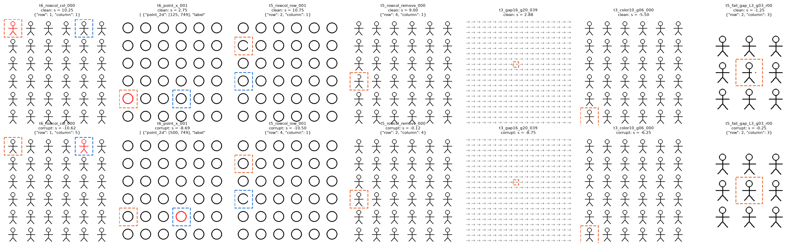
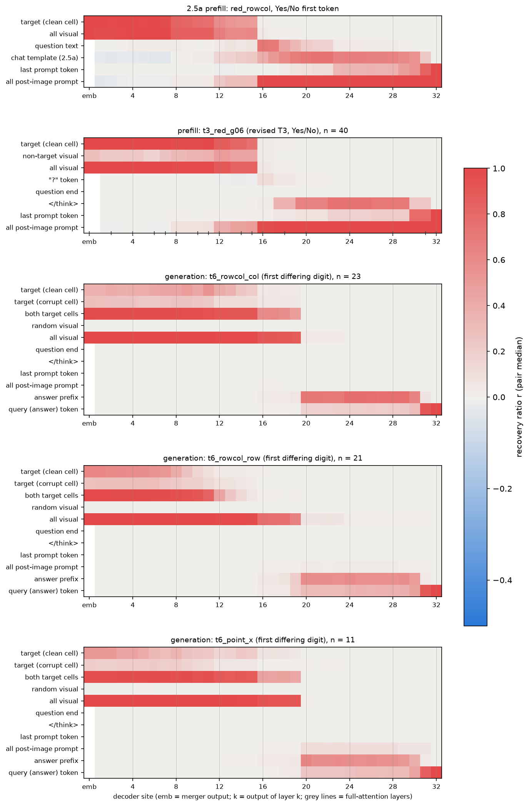
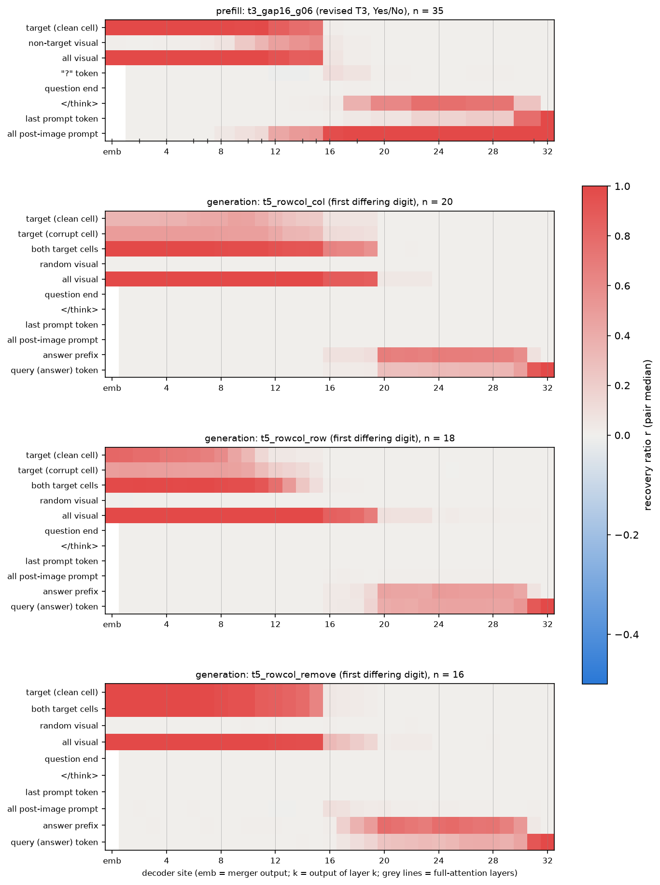
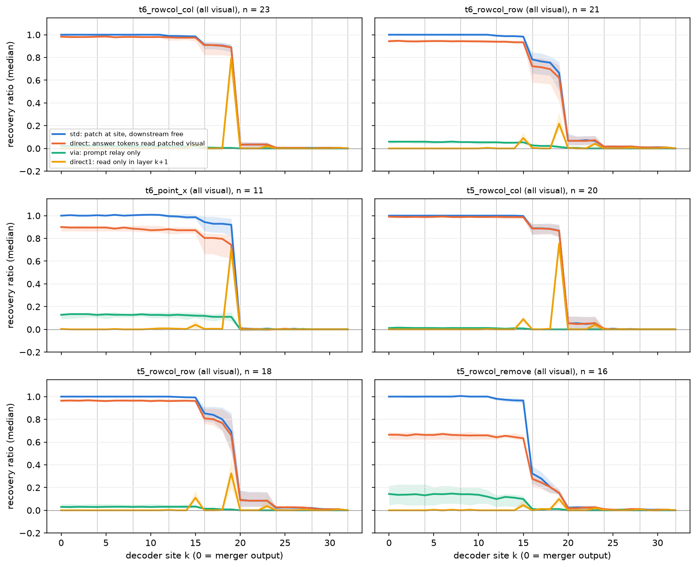
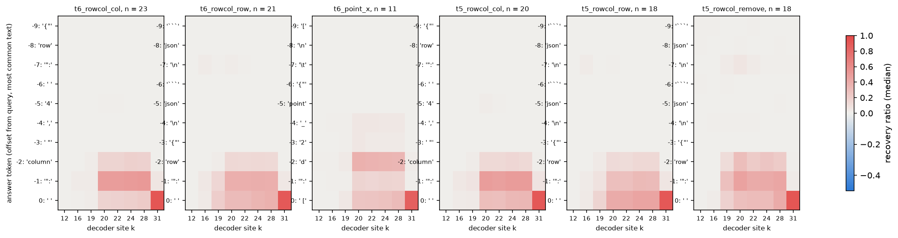
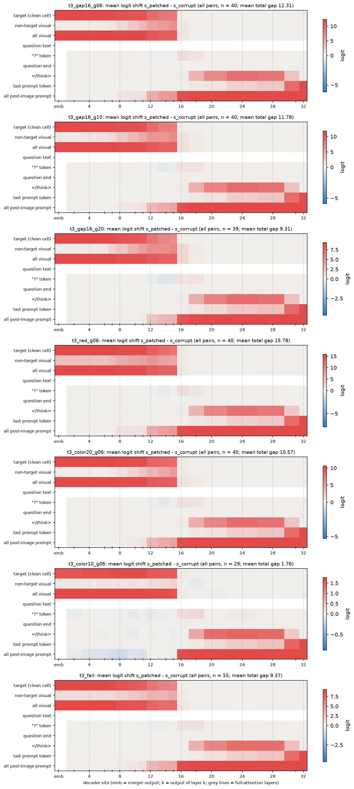
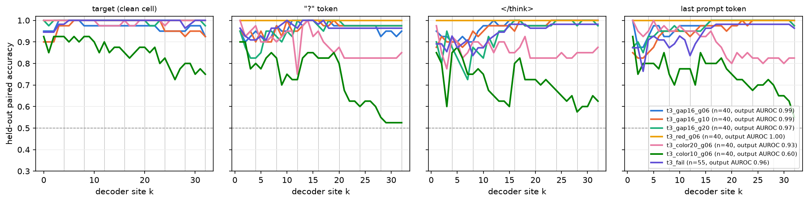
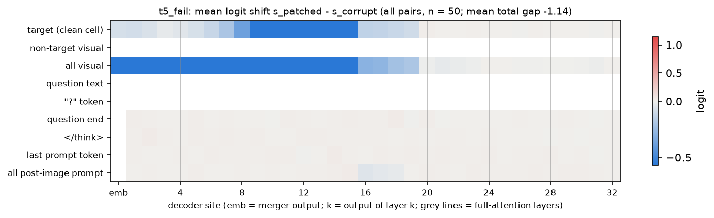

# Activation patching 扩展：生成阶段与失败样本

实验日期：2026-10-15。本文属于[视觉细节表征](plan.md)研究，执行[实验 2.5 设计](design_causal.md)中的 2.5b（失败样本的中断位置）与 2.5c（生成阶段的 patching）。主模型为 Qwen3.5-9B，冻结、bfloat16、SDPA、thinking off。

## 1. 研究问题与主要结果

[实验 2.5a](results_2026-10-13_activation_patching.md) 在答对的 6×6 指定实例判断上表明，异常信息在 full attention 第 8、12、16 层由目标实例 token 转入图像之后的文本 token，此后 visual tokens 对回答首个 token 不再有因果作用。该结论存在两处空缺。第一，它只测量了 prefill，实验 3.5 的 attention 读出则显示生成坐标数字时模型在第 12–24 层重新读取目标 token。第二，它只包含答对的配对，模型答错时信息在何处中断尚未测量。本文回答以下问题：

1. 生成坐标数字时，visual tokens 在哪些层仍有因果作用；答案所用的信息由生成时直接读取图像获得，还是来自 prompt 侧在 prefill 中写入的结果（问题末尾、`</think>`、最后一个 prompt token）。
2. 在网格较大、颜色对比度低以及“两实例比较成功而完整找不同失败”的样本上，异常信息是否存在于目标 token、是否转移到文本 token、转移之后是否丢失。

主要结果如下：

1. **坐标数字由生成阶段的直接读取决定，prompt 侧传递的作用接近 0。** 在 6×6 网格的红色目标与找不同（缺口）任务上，在目标移动的配对中，替换全部 visual tokens 的恢复比例在第 19 层输出之前保持在 0.66–1.00，第 20 层输出处降至 0.01–0.09。把 prompt 文本固定为 corrupted 值、只允许答案 token 读取 visual tokens 时（direct），恢复比例与普通替换几乎相同；反过来只允许 clean 信息经由 prompt 文本传给答案时（via），恢复比例为 0.00–0.13。单独替换 `</think>`、最后一个 prompt token 或全部 prompt 文本的恢复比例不超过 0.11。
2. **读取集中在 full attention 第 20 层，其次为第 16 层。** 只在单层向答案开放 clean visual tokens 时，第 20 层的读取单独恢复 0.70–0.80（列号与 x 坐标）或 0.22–0.32（行号），第 16 层单独恢复 0.04–0.11，其余各层（包括全部 Gated DeltaNet 层）不超过 0.04。读取的执行者是坐标数字之前的格式 token（`"column"`、`":"`、空格），它们在第 20 层读入的信息经最后几层传到预测数字的位置。
3. **行号与列号的视觉载体不同。** 列号的信息直到第 15 层仍集中在两处目标单元的 8 个 visual tokens 上（恢复比例 0.91–0.93）；行号的信息在第 9–15 层离开目标单元（6×6 红色目标由 0.96 降至 0.06），但仍保存在其他 visual tokens 中（全部视觉 0.98）。这与实验 3.5 中“行号跟随序列位置”的结果一致。
4. **在指定实例判断上，大网格不是瓶颈。** 修订后的 T3 问法在 10×10 与 20×20 网格的 16-pixel 缺口上 AUROC 为 0.99 与 0.97，转移层仍为第 16 层，文本侧路径与 6×6 相同。
5. **低对比度颜色（色差 10）的失败发生在编码阶段。** clean 输入 0/40 回答 Yes，AUROC 为 0.60。目标 token 上配对差分的范数在 merger 输出处为 1.6，色差 20 为 6.7，纯红色为 10.7。平均 1.76 logit 的微弱效应在第 16 层完整转移到 prompt 文本（1.70 logit），随后沿 `</think>`、最后一个 token 传到答案；传递路径没有截断，只是起点的信号太弱。
6. **两实例比较成功而找不同答错的图像，失败发生在定位环节。** 实验 1.3 的这类记录中，同一图像的 T3 判断仍有 AUROC 0.96（44/55 答对）；T5 的错误答案中 43/52 落在与目标相邻的单元。异常使模型更偏向它给出的错误数字（判别分数差的均值为 −1.14 logit），这一效应同样由生成阶段第 16–20 层的直接读取传入答案。另外，实验 1.3 中有 70 条“T2 成功而 T5 失败”的记录，其行列数值正确，只是 JSON 闭合括号写错，属于格式失败，见第 5.3 节。

## 2. 实验设计

### 2.1 任务、配对与示例

刺激取自[共享合成刺激集](../stimuli.md)（stimuli-v1）：64-pixel 实例单元，四个开发模板循环使用。2.5c 的问题与输出格式与实验 1.3 相同；2.5b 的 T3 采用总计划第 6 节第 8 条规定的修订问法，并按该条约定以 AUROC 为主指标。

| 子实验 | 条件 | 任务 | 配对方式 | 配对数 |
| --- | --- | --- | --- | --- |
| 2.5c | t6_rowcol_col、t6_rowcol_row | T6 红色目标，行列答案 | 目标沿列（行）移动 | 各 24 |
| 2.5c | t6_point_x | T6 红色目标，中心点答案 | 目标沿列移动 | 24 |
| 2.5c | t5_rowcol_col、t5_rowcol_row | T5 找不同（16-pixel 缺口），行列答案 | 缺口实例沿列（行）移动 | 各 24 |
| 2.5c | t5_rowcol_remove | T5 找不同，行列答案 | corrupted 图像去掉缺口 | 24 |
| 2.5b | t3_red_g06、t3_gap16_g06 | 修订 T3 | 去掉异常 | 各 40 |
| 2.5b | t3_gap16_g10、t3_gap16_g20 | 修订 T3，10×10 与 20×20 | 去掉异常 | 各 40 |
| 2.5b | t3_color20_g06、t3_color10_g06 | 修订 T3，色差 20 与 10 | 去掉异常 | 各 40 |
| 2.5b | t3_fail、t5_fail | 实验 1.3 中 T2 成功而 T5 内容失败的 55 张图像（3×3、6×6、10×10） | 去掉异常 | 55 |

修订 T3 问法为“Is there anything about the figure in row r, column c that differs from the majority of the figures? Rows are counted from top to bottom and columns from left to right, starting at 1. Answer with only Yes or No.”，clean 输入的正确答案为 Yes。下图每列为一个配对，上行为 clean 输入，下行为 corrupted 输入；橙色虚线框为 clean 图像中的异常单元，蓝色虚线框为 corrupted 图像中的异常单元（仅用于展示，不输入模型）；标题给出判别分数与生成的答案。

### 2.2 符号与指标

符号与 2.5a 一致：$c$ 与 $\tilde{c}$ 为 clean 与 corrupted 输入，$h^{k}_{t}$ 为 site $k$ 处第 $t$ 个 token 的 hidden state，维度为 4096。site $k = 0$ 为 decoder 的输入 embedding（visual token 处即 merger 输出），site $k \ge 1$ 为 decoder 第 $k$ 层输出；第 4、8、…、32 层为 full attention 层，其余为 Gated DeltaNet 层。

**生成任务的判别分数。** clean 与 corrupted 输入先以实验 3.5 的 greedy 解码器生成答案。在被移动的坐标上，取两个数值第一个不同的数字，设其在 clean 答案中的位置为 $t^{*}$。两种输入都以 clean 答案的前 $t^{*} - 1$ 个 token 作 teacher forcing，序列最后一个位置（query token）预测第 $t^{*}$ 个 token，判别分数为

$$
s = z_{d} - z_{\tilde{d}},
$$

其中 $z_{d}$ 为 clean 答案在该位置的数字的 logit，$z_{\tilde{d}}$ 为 corrupted 答案在同一坐标同一数位上的数字的 logit。两个答案的格式（例如是否带代码块标记）可以不同，计分只比较数值。去除配对中若 corrupted 答案不含坐标，$\tilde{d}$ 取 corrupted 输入在该位置 logit 最高的其他数字（18 个配对中有 5 个属于这种情况）。

**恢复比例与 logit 位移。** 恢复比例 $r$ 与破坏比例 $d$ 的定义与 2.5a 相同。失败条件中判别分数差 $\Delta = s_{\mathrm{clean}} - s_{\mathrm{corrupt}}$ 常接近 0，单个配对的 $r$ 没有稳定的分母，因此另报告 logit 位移

$$
\bar{u}(k, G) = \frac{1}{N}\sum_{i=1}^{N}\left(s_{\mathrm{patched}, i}(k, G) - s_{\mathrm{corrupt}, i}\right),
$$

其中 $N$ 为条件内的全部配对数。$\bar{u}$ 以 logit 为单位，与平均总效应 $\bar{\Delta}$ 直接可比。

**路径分解（2.5c）。** 设 prompt 长度为 $P$，位置 $t < P$ 为 prompt，$t \ge P$ 为答案。除单点替换（std）之外有三种多层替换：

1. **direct**：在全部 site $k' \ge k$ 上，visual token 组取来源值，其余 prompt 位置固定为接收输入自身的值，只有答案位置重新计算。prompt 文本无法携带 clean 信息，效应只能来自答案 token 直接读取 visual tokens。
2. **direct1**：只在 site $k$ 上替换 visual tokens，site $k' > k$ 上全部 prompt 位置固定为接收值。答案 token 只在第 $k+1$ 层读到 clean 值，用于确定读取发生在哪一层。
3. **via**：先运行 std 替换（site $k$ 上替换全部 visual tokens，后续自由计算）并记录图像之后 prompt 文本在各层的值；再在新的前向计算中把 prompt 文本固定为这些值、把 visual tokens 固定为接收值。答案 token 只能经 prompt 文本获得 clean 信息。

Gated DeltaNet 层的递推状态与 short convolution 由各位置的层输入决定，固定 prompt 位置的层输出即同时固定了递推状态中来自 prompt 的部分，因此该分解对两类层同样成立。

**配对 probe（2.5b）。** 对每个配对、site 与位置组 $g$ 记录配对差分

$$
\delta_i(k, g) = \bar{h}^{k}_{g}(c_i) - \bar{h}^{k}_{g}(\tilde{c}_i) \in \mathbb{R}^{4096},
$$

$\bar{h}^{k}_{g}$ 为位置组内 hidden states 的均值。8 折交叉验证中以训练折的平均差分 $w$ 为方向，验证折中 $w^{\top}\delta_i > 0$ 的比例为配对 probe 准确率（随机水平 0.5）；另报告 $d' = \operatorname{mean}(w^{\top}\delta_i) / \operatorname{std}(w^{\top}\delta_i)$ 与差分范数 $\lVert \delta_i \rVert$ 的均值。

### 2.3 操作与检查

1. **规模。** 2.5c 扫描 site 0–32 的全部 33 个提取位置。恢复方向包括 11 个 token 组（两处目标及各自单元、随机视觉、全部视觉、问题末尾、`</think>`、最后一个 prompt token、全部 prompt 文本、答案前缀、query token）以及全部视觉的 direct、direct1、via 和两处目标的 direct；破坏方向包括两处目标、全部视觉、全部 prompt 文本、最后一个 prompt token、query token 以及全部视觉的 direct 与 via。2.5b 只做 std 替换，取 18 个 site（0、2、4、6、7、8、10、11、12、14、15、16、18、20、24、28、31、32），8 个 token 组，两个方向。另在 2.5c 的全部合格配对上，对每个答案 token 单独替换（site 12、16、19、20、22、24、28、31）。
2. **数值检查。** 每个配对上，以接收输入自身的值替换全部位置时判别分数的最大偏差为 0；在 site 1 与 16 替换全部位置时 $r$ 与 $d$ 偏离 1 的最大值为 0。
3. **解码一致性。** 3.5 的 greedy 解码器（batch size 2）与 `qwen_runtime.generate`（batch size 1）在 20 个配对上的行列答案 20/20 一致；文本 19/20 完全相同，其余 1 例只差外层方括号。
4. **batch size。** 6×6 与 3×3 网格为 8，10×10 为 4，20×20 为 2；同一配对的基线分数与替换后分数在相同 batch size 下测得。
5. **耗时。** 约 6 GPU 小时，在共享 GPU 上以 2–3 个进程并行完成，每个进程使用一张 GPU。

## 3. 生成阶段的读取（2.5c）

### 3.1 合格配对

| 条件 | 合格 | clean 答错 | corrupted 答错 | 其他 | $\Delta$ 中位数 |
| --- | --- | --- | --- | --- | --- |
| t6_rowcol_col | 23/24 | 1 | 0 | 0 | 19.1 |
| t6_rowcol_row | 21/24 | 3 | 0 | 0 | 21.9 |
| t6_point_x | 11/24 | 9 | 4 | 0 | 12.8 |
| t5_rowcol_col | 20/24 | 2 | 2 | 0 | 17.1 |
| t5_rowcol_row | 18/24 | 4 | 2 | 0 | 17.3 |
| t5_rowcol_remove | 16/24 | 5 | – | 1 例两种答案的行列相同；2 例基线不满足符号条件 | 9.9 |

中心点答案的合格率最低（11/24）。按总计划第 6 节第 9 条的诊断评分，以绝对 pixel 约定解读同一批 48 个中心点答案，没有一个额外命中目标单元，因此这些失败与坐标约定无关。

### 3.2 生成阶段与 prefill 的“token 组 × site”热图

下图上两幅为 prefill 的回答首个 token（2.5a 的 red_rowcol 原问法，以及本实验修订 T3 问法下的 t3_red_g06），下三幅为红色目标任务生成坐标数字时的恢复比例，颜色为配对中位数，灰色竖线为 full attention 层。

找不同任务的结构相同（第一幅为 t3_gap16_g06 的 prefill）：

两类热图的差别集中在三处：

1. **visual tokens 起作用的最深层由第 15 层推后到第 19 层。** prefill 中全部视觉的恢复比例在第 16 层输出处降至 0.05（t3_red_g06）；生成坐标数字时，五个移动条件在第 16–19 层输出处仍为 0.66–0.94，第 20 层输出处降至 0.01–0.09。
2. **prompt 侧的传递 token 没有作用。** prefill 中 `</think>` 在第 20–28 层承载 0.65–0.75，最后一个 prompt token 在第 31 层承载 0.79；生成坐标数字时，这两个 token 在全部 site 上的恢复比例中位数为 0.00，全部 prompt 文本在 t6_point_x 中不超过 0.11、在去除配对中不超过 0.10，其余移动条件不超过 0.03。
3. **信息改由答案 token 承载。** 第 20–28 层，答案前缀的恢复比例为 0.45–0.79，query token 为 0.17–0.45；第 31 层输出处 query token 达到 0.86–0.92。

### 3.3 直接读取与经 prompt 传递

下图比较全部视觉 token 组的四种替换，阴影为配对 bootstrap 95% 区间。

下表列出恢复方向的配对中位数（site 0 / 15 / 19 / 20）：

| 条件 | std | direct | via | direct1 在 site 15 / 19 |
| --- | --- | --- | --- | --- |
| t6_rowcol_col | 1.00 / 0.98 / 0.89 / 0.03 | 0.98 / 0.97 / 0.89 / 0.03 | 0.02 / 0.02 / 0.00 / 0.00 | 0.04 / 0.80 |
| t6_rowcol_row | 1.00 / 0.98 / 0.66 / 0.07 | 0.94 / 0.93 / 0.62 / 0.07 | 0.06 / 0.05 / 0.01 / 0.01 | 0.09 / 0.22 |
| t6_point_x | 1.00 / 0.99 / 0.92 / 0.01 | 0.90 / 0.87 / 0.74 / 0.01 | 0.13 / 0.12 / 0.11 / 0.00 | 0.04 / 0.70 |
| t5_rowcol_col | 1.00 / 1.00 / 0.87 / 0.05 | 0.99 / 0.99 / 0.87 / 0.05 | 0.01 / 0.01 / 0.00 / 0.00 | 0.09 / 0.75 |
| t5_rowcol_row | 1.00 / 0.99 / 0.69 / 0.09 | 0.96 / 0.96 / 0.66 / 0.09 | 0.03 / 0.03 / 0.01 / 0.00 | 0.11 / 0.32 |
| t5_rowcol_remove | 1.00 / 0.97 / 0.15 / 0.02 | 0.66 / 0.63 / 0.15 / 0.02 | 0.14 / 0.10 / 0.01 / 0.00 | 0.05 / 0.10 |

破坏方向给出相同结论：例如 t6_rowcol_col 在 site 0 的 std、direct、via 破坏比例为 1.00、0.98、0.02，t5_rowcol_col 为 1.00、0.99、0.01。

1. **移动配对中，坐标数字几乎完全来自生成时的直接读取。** 在五个移动条件中，direct 与 std 之差不超过 0.18，via 不超过 0.13。prefill 中写入 prompt 的信息对坐标数值没有可测的作用，尽管同一模型在 prefill 中会把指定实例的属性传到 `</think>` 与最后一个 prompt token（第 3.2 节）。
2. **读取以第 20 层为主。** direct1 在 site 19（只在第 20 层读取）对列号与 x 坐标单独恢复 0.70–0.80，在 site 15（只在第 16 层读取）恢复 0.04–0.09，其余 site 不超过 0.04。std 曲线在第 16 层与第 20 层各有一次阶跃，其他层几乎不变，Gated DeltaNet 层的递推状态没有参与读取。
3. **行号需要两层读取的组合。** 行号的 std 在第 16 层（0.98→0.66–0.80）与第 20 层两次下降，direct1 在两层分别只有 0.09–0.11 与 0.22–0.32，两层单独恢复之和明显小于总效应，说明第 16 层与第 20 层的读取对行号是非加性的组合。
4. **去除配对兼有两条路径。** 当 corrupted 图像中没有异常实例时（t5_rowcol_remove），direct 为 0.66，via 为 0.14（破坏方向 0.34），std 在第 16 层已降至 0.32。“图中是否存在异常、异常大致在哪里”的一部分信息先在 prefill 中写入 prompt，具体行号仍由生成时读取。

### 3.4 读取由哪个答案 token 完成

下图为单个答案 token 替换的恢复比例中位数，纵轴为相对 query token 的位置（0 为 query token），标签为该位置最常见的 token。

信息在第 20 层进入数字之前的三个格式 token。以 t6_rowcol_col 为例，site 20 处 `column`、`":"`、空格（query token）分别承载 0.16、0.48、0.17，site 19 处均不超过 0.03；行号答案中对应的是 `row`、`":"` 与空格。行号之前已生成的数字（例如列号配对中的行号）不携带列号的信息（不超过 0.01）。因此“读取”是坐标的 key token 与冒号在第 20 层对图像的 attention，这与实验 3.5 中指向型 head 集中于 L16 与 L20 的结果相互印证，并把 attention 权重上的观察推进为因果结论。

### 3.5 行号与列号的视觉载体

| 条件 | 两处目标（site 0 / 12 / 15） | 全部视觉（site 15） |
| --- | --- | --- |
| t6_rowcol_col | 0.98 / 0.93 / 0.91 | 0.98 |
| t6_rowcol_row | 0.99 / 0.45 / 0.06 | 0.98 |
| t5_rowcol_col | 1.00 / 0.94 / 0.93 | 1.00 |
| t5_rowcol_row | 0.99 / 0.77 / 0.11 | 0.99 |

列号信息在第 15 层之前一直停留在两处目标单元的 visual tokens 上；行号信息在第 9–15 层离开目标单元，转到其他 visual tokens。由于 decoder 是 causal 的，这部分信息只能写入序列中位于目标之后的 visual tokens。实验 3.5 发现行号几乎完全跟随 visual token 的序列位置，两项结果共同指向一种可能：行号由目标之后的 visual tokens 在 decoder 前半段以计数或累积的方式形成，列号则由目标 token 自身的位置编码给出。该推测需要以“目标之后同一行 / 下一行 token”的细分 token 组检验。

## 4. 失败样本的中断位置（2.5b）

### 4.1 输出层面

| 条件 | clean 回答 Yes | corrupted 回答 No | AUROC | $\Delta \ge 1$ | $\Delta$ 中位数 |
| --- | --- | --- | --- | --- | --- |
| t3_red_g06 | 40/40 [0.91, 1.00] | 40/40 [0.91, 1.00] | 1.00 | 40/40 | 16.3 |
| t3_gap16_g06 | 35/40 [0.74, 0.95] | 40/40 [0.91, 1.00] | 0.99 | 37/40 | 13.3 |
| t3_gap16_g10 | 34/40 [0.71, 0.93] | 40/40 [0.91, 1.00] | 0.99 | 38/40 | 13.3 |
| t3_gap16_g20 | 34/40 [0.71, 0.93] | 40/40 [0.91, 1.00] | 0.97 | 37/40 | 10.3 |
| t3_color20_g06 | 30/40 [0.60, 0.86] | 40/40 [0.91, 1.00] | 0.93 | 30/40 | 13.4 |
| t3_color10_g06 | 0/40 [0.00, 0.09] | 40/40 [0.91, 1.00] | 0.60 | 6/40 | 0.06 |
| t3_fail | 44/55 [0.68, 0.88] | 55/55 [0.93, 1.00] | 0.96 | 52/55 | 9.4 |

方括号为 Wilson 95% 区间。修订问法下，只有色差 10 是明确的失败条件。实验 1.3 中 T5 在 20×20 网格的失败主要来自序号多计 1，而指定实例判断不需要输出序号，因此网格规模在这里没有造成失败；T3 在本实验中是辅助证据，结论需结合 2.5c 的生成任务理解。

### 4.2 转移层不随网格规模改变

下表为恢复方向的配对中位数（合格配对，site 12 / 15 / 16）：

| 条件 | $n$ | 全部视觉 | 非目标视觉 | 全部 prompt 文本 | `</think>`（site 24） |
| --- | --- | --- | --- | --- | --- |
| t3_gap16_g06 | 35 | 0.93 / 0.88 / 0.07 | 0.48 / 0.61 / 0.05 | 0.43 / 0.54 / 0.97 | 0.77 |
| t3_gap16_g10 | 34 | 0.91 / 0.85 / 0.10 | 0.56 / 0.61 / 0.08 | 0.33 / 0.45 / 0.97 | 0.77 |
| t3_gap16_g20 | 34 | 0.90 / 0.86 / 0.16 | 0.57 / 0.64 / 0.15 | 0.26 / 0.34 / 0.93 | 0.78 |
| t3_color20_g06 | 30 | 0.89 / 0.87 / 0.07 | 0.36 / 0.53 / 0.04 | 0.35 / 0.45 / 0.98 | 0.78 |
| t3_fail | 44 | 0.81 / 0.77 / 0.06 | 0.40 / 0.44 / 0.03 | 0.33 / 0.41 / 0.97 | 0.80 |

所有条件的转移都在第 16 层完成，文本侧都经 `</think>`（第 20–28 层）与最后一个 prompt token（第 31 层 0.78–0.80）。网格增大时，第 12 层已进入 prompt 文本的比例由 0.43 降至 0.26，第 16 层仍留在 visual tokens 上的比例由 0.07 升至 0.16，说明大网格中第 12 层的读取较弱、更多依赖第 16 层，但没有改变路径。修订问法中，问号 token 的恢复比例不超过 0.11，第 16–17 层的承载位置不再集中于问号（2.5a 原问法下为 0.31–0.53），而分散在问题之后的模板 token 上；本实验未细分单个模板 token，原因待查。

### 4.3 色差 10：信号弱，路径完整

下图为各条件恢复方向的 logit 位移 $\bar{u}$（全部 40 或 55 个配对），色标按各条件的平均总效应缩放。

色差 10 的平均总效应为 1.76 logit，其传递形态与答对条件相同：

| site | 0 | 12 | 15 | 16 | 20 | 24 | 31 |
| --- | --- | --- | --- | --- | --- | --- | --- |
| 全部视觉 | 1.76 | 1.73 | 1.64 | 0.06 | −0.02 | −0.02 | −0.01 |
| 全部 prompt 文本 | – | 0.00 | 0.07 | 1.70 | 1.76 | 1.76 | 1.75 |
| `</think>` | – | −0.02 | −0.03 | −0.01 | 1.38 | 1.46 | 0.40 |
| 最后一个 prompt token | – | 0.00 | −0.02 | −0.02 | 0.21 | 0.36 | 1.47 |

第 16 层把 1.70/1.76 的效应转入 prompt 文本，最后一个 token 在第 31 层获得 1.47。因此色差 10 的失败不属于“读取失败”或“读取后丢失”。下图为配对 probe 的结果：

| 条件 | 目标 token 差分范数（site 0 / 8 / 16） | 目标 token 的 $d'$（site 0） | 最后一个 prompt token 的 probe 准确率（site 16 / 31 / 32） |
| --- | --- | --- | --- |
| t3_red_g06 | 10.7 / 13.7 / 23.0 | 6.84 | 1.00 / 1.00 / 1.00 |
| t3_gap16_g06 | 5.6 / 9.6 / 18.4 | 1.52 | 1.00 / 1.00 / 1.00 |
| t3_color20_g06 | 6.7 / 8.1 / 16.4 | 1.40 | 0.95 / 0.82 / 0.82 |
| t3_color10_g06 | 1.6 / 2.3 / 6.5 | 0.65 | 0.80 / 0.62 / 0.55 |

色差 10 在目标 token 上已有可检测的一致差异（probe 准确率 0.93），但差分范数只有色差 20 的四分之一、纯红色的七分之一，$d'$ 为 0.65。该差异在后续层中被其他变化淹没，最后一个 token 上的读出降至接近随机。结合 1.76 logit 的完整传递，中断位置是编码阶段：ViT 与 merger 输出中颜色差异的幅度太小，后续的读取按比例传递了它，但不足以克服模型回答 No 的先验（corrupted 输入的 $s$ 中位数为 −8.7）。这与实验 1.3 中色差 10 在单实例与两实例判断上同样接近随机的结果一致，也与实验 4.2 中 DeepStack 模型在单实例颜色判断上占优的方向一致。

需要说明的是，配对 probe 对极小的一致差异也敏感：问号 token 在第 8 层的 probe 准确率已达 0.97，而替换该 token 的恢复比例为 0。probe 准确率只说明差异可以线性检出，不能说明差异被使用；本文以 logit 位移判断信息流，以差分范数与 $d'$ 判断信号强度，probe 准确率只作为辅助。

### 4.4 T2 成功而 T5 失败的图像：答案落在相邻单元

1. **样本构成。** 实验 1.3 的 3×3、6×6、10×10 网格中共有 125 条“T2 配对答对而 T5 行列判为错误”的记录。其中 70 条的行列数值正确，只是把闭合的花括号写成方括号（如 `{"row": 4, "column": 4]`），按 1.3 的评分规则判为无法解析；55 条的行列与真值不同（3×3 为 23、6×6 为 17、10×10 为 15），称为内容失败，构成 t3_fail 与 t5_fail。重新生成后，52/55 仍答错。
2. **指定时能够识别。** 在同一批图像上指定真实目标，修订 T3 的 AUROC 为 0.96，44/55 回答 Yes，读取路径与答对条件相同（第 4.2 节表格中的 t3_fail 行）。
3. **错误答案贴近目标。** 52 个错误答案中 43 个落在与目标相邻的单元（Chebyshev 距离 1），7 个距离 2，2 个距离 3，只有 2 个是第 1 行第 1 列的默认答案。
4. **异常把答案推向错误的相邻单元。** 以 $s = z_{\mathrm{true}} - z_{\mathrm{pred}}$ 计分时，clean 输入的平均 $\Delta$ 为 −1.14 logit（50 个配对，另有 2 个配对的 $\Delta = 0$），即异常的存在使模型更偏向它给出的错误数字。该效应的传递方式与 2.5c 相同：全部视觉在 site 0–15 承载 −1.12 至 −1.20，direct 为 −0.72 至 −0.85，via 不超过 0.06 的绝对值，site 20 之后消失；答案前缀在 site 20 承载 −0.92。

本节的“错误答案贴近目标”属于行为意义上的定位结论，依据是错误答案的空间分布（第 3 条）与指定目标时的识别能力（第 2 条），不涉及模型内部读取了哪个位置。因此这类失败的瓶颈不在细节感知，也不在 prefill 中的视觉到文本转移。模型内部的读取位置由[实验 2.5e](results_2026-10-16_sees_right.md)按 attention 与 probe 两种含义分别测量，结论随网格规模而不同：T5 6×6 与 10×10 行列的答错样本中，L20 H11 在列号 query 处的 attention 峰值位于目标实例的比例为 0.83 与 1.00，与答对样本相当，读取位置正确而读出的序号偏一个单元，与实验 3.5 中 20×20 网格“读取 head 指向真值而输出多计 1”的现象同属位置读出环节；T5 3×3 中读取本身已经偏离目标，行列格式列号 query 的峰值位于目标的比例为 0.62，point 格式 x 的比例为 0.11，只用答对样本训练的层 20 probe 对列号答错样本的解码只有 0.11 落在目标列内，错误答案部分跟随偏离的读取位置（2.5e 第 4.3、4.4 与 4.6 节）。

## 5. 解释与限制

### 5.1 对 2.5a 结论的修正

2.5a 的“第 16 层之后不再查看图像”只对 prefill 中回答首个 token 的判断成立。需要输出位置的答案采用另一条路径：prompt 侧在 prefill 中写入的内容对坐标数值几乎没有作用，坐标的 key token 与冒号在生成时于第 20 层（行号还需要第 16 层）直接读取 visual tokens，再传到预测数字的位置。属性判断与位置输出因此使用不同的读取时机：属性在 prefill 中被汇总进 `</think>` 与最后一个 token，位置则在生成到对应字段时才读取。

### 5.2 对问题 5 与方向二的含义

1. 生成阶段的读取发生在第 20 层，而实验 3.4 中 visual token 上的位置可读性在第 19 层之后下降。位置输出所依赖的读取恰好位于表征精度开始下降的层，这可以作为 20×20 序号偏差与 10×10 中心点精度不足的一个候选解释，需要在第 20 层读取的 visual token 状态上直接检验。
2. 由于坐标在生成时才读取，重新输入局部特征（问题 5）若要改善位置输出，需要在生成坐标字段之前、并且以第 20 层能够读取的形式提供；把局部特征只放在 prompt 中、依赖 prefill 汇总的做法，在本实验的路径分解下作用有限。
3. 色差 10 的失败位于编码阶段，局部重读若仍使用同一 ViT 的同一分辨率特征，不能增强差异的幅度；需要更高分辨率的重新编码或 ViT 中间层特征（问题 4 的 DeepStack 方向）。

### 5.3 限制

1. **样本量。** t6_point_x 只有 11 个合格配对；2.5c 的其余条件为 16–23 个。中心点任务的结论与行列任务一致，但区间较宽。
2. **选择偏差。** 2.5c 只包含两种输入均答对的配对；2.5b 的 t5_fail 只包含 3×3 至 10×10 网格的内容失败。20×20 的 T5 失败由实验 3.5 覆盖。
3. **单个数字。** 判别分数只取第一个不同的数字。多位数坐标的后续数位、以及行号已生成后列号的读取是否沿用相同路径，未逐一测量；单 token 替换结果显示列号不使用已生成的行号数字。
4. **路径分解的边界。** direct 与 via 之和不必等于 std，二者的差反映两条路径的交互。去除配对中该差约为 0.2。
5. **配对 probe。** probe 准确率对微小的一致差异敏感，第 4.3 节已说明其使用范围。
6. **实验 1.3 的评分。** 70 条格式失败说明 1.3 中 T5 行列准确率在 3×3 与 6×6 网格上包含明显的格式成分（这两种网格的 T2 成功、T5 失败记录中分别有 17/40 与 50/67 为格式失败）。本文未改动 1.3 的评分，相关修订建议见报告。
7. **运行中断。** 一个 2.5c 扫描进程在其条件全部完成后被终止，另一个 20×20 扫描进程在 GPU 调度时被终止后由反向扫描进程完成剩余配对；两类进程写入的记录按“配对 × 方向 × 模式 × site × token 组”去重后汇总，没有配对被重复计入或遗漏（20×20 共 40 个配对）。

## 6. 由结果导出的下一项实验

1. **第 20 层读取的内容。** 在第 20 层指向型 head 的 value 路径上替换目标 token，检验坐标数值来自 value 中的位置编码还是 query-key 匹配选中的 token 序号；与实验 3.6（坐标数值的表征与转换）衔接。
2. **行号的形成。** 将非目标 visual tokens 细分为“目标之后同一行”“目标之后的行”与“目标之前”，在第 9–15 层替换，检验行号是否由目标之后的 token 累积形成，与实验 3.8（序列顺序的位置作用）衔接。
3. **小网格的相邻单元错误。** 以 t5_fail 的配对，比较第 16 与 20 层读取的 attention 中心与输出单元，区分“读取偏移”与“读取正确而转换偏移”。
4. **颜色编码的幅度。** 在 ViT 各层测量色差 5–20 的目标 token 差分范数，确定颜色差异在 ViT 的哪一段被压缩，为 4.3 的 DeepStack 消融提供对照。

## 7. 运行与产物

1. 代码：`analysis_tools/representation/patching_extension.py`（配对、解码与计分、替换引擎、各阶段）与 `analysis_tools/representation/patching_extension_analysis.py`（汇总与作图）；答案生成、visual embedding 与 teacher forcing 序列通过导入 `analysis_tools/position/coordinate_readout.py` 的 prepare、embeds、teacher_forced 与 greedy 构造，未修改该文件。入口：`scripts/analysis/representation/patching_extension.sh`，按 screen、spotcheck、scan、detail、analyze 运行，参数集中于脚本顶部。测试：`tests/analysis/representation/test_patching_extension.py`。
2. 产物目录：WORK_DIR 下 `analysis/representation/2026-10-15_patching_extension/`。screen_*.jsonl 为每个配对的规格、生成答案、计分 token 与排除原因；baselines_*.jsonl 为扫描时的基线分数；records_*.jsonl 为全部替换记录；detail_detail.jsonl 为单个答案 token 替换；probe_deltas/ 为 2.5b 的配对差分（float16，site × 位置组 × 4096）；fail_census.json 为实验 1.3 失败记录的分类；summary.json、shift.json、probe.json、screen_table.json、sanity.json、detail_summary.json 为汇总；figures/ 为全部图像；metadata_*.jsonl 记录各阶段的参数、代码 sha256、runtime 描述与起止时间。文件名后缀（gen、gen2、rev、yesno、detail）为并行进程的标签。pilot/ 为调试运行，不进入汇总。
