# 高范数 token 的来源、信息与功能

实验日期：2026-10-16。本文属于[视觉细节表征](plan.md)研究，执行[实验 2.2 设计](design_positional_component.md)（2.2a–e）。主模型为 Qwen3.5-9B，对照模型为 Qwen3-VL-8B-Instruct；两者均冻结、bfloat16、SDPA、thinking off。产物位于 WORK_DIR 的 `analysis/representation/2026-10-16_high_norm/`，图位于 `figures/high_norm/`。

## 1. 研究问题与主要结果

实验 2.1 发现，ViT 输出中少数 token 的范数远高于其余 token，其位置与图像内容关系很弱，并且手工距离读出存在不随目标移动的固定高分位置。本实验回答三个问题：高范数 token 在哪一层、由哪一个组件产生，位置由什么决定（来源）；它们携带全局信息、位置信息还是自身 patch 的局部信息（信息）；它们是否是 attention sink，删除它们是否改变坐标、找不同与 RefCOCO 的回答（功能）。

主要结果如下（各条后的括号给出对应小节与图）：

1. **高范数 token 由 ViT block 10 的 9 个 register neurons 一次写入。** 在 1009/1009 张 Qwen3.5 图像上，以 $\tau = 5$ 判定的高范数 token 首次出现在 block 10；该 block 中高范数 token 的 MLP 更新范数为 188.6，其余 token 为 6.0，9 个 register neurons 写出的范数约 187。Qwen3-VL 的 ViT 使用同一组 neurons（第 3 节，图 5）。
2. **位置由插值后的 learned PE 与 patch 内容共同决定，RoPE 的作用小。** PE 置零后空白画布上的高范数 token 全部消失，PE 翻转后其位置随之翻转（Jaccard 0.85/0.88）；2D RoPE 置零后集合基本不变（0.89）。在 PE 选定的候选位置上，只有空白或低纹理 patch 成为高范数 token：以噪声块覆盖候选位置即可在 9/9 次中消除该位置（第 4 节，图 7–9）。
3. **高范数 token 是 ViT 内部的 attention sink，但在 decoder 中不是。** 占 token 数量不到 1% 的高范数 token 在 ViT block 18–22 获得 0.51–0.57 的 attention 质量，富集比 57–63；decoder 中包含这些 patch 的 visual tokens 富集比只有 0.96–1.77（第 5 节，图 10–11）。
4. **高范数 token 保留自身 patch 的局部内容，与 DINOv2 的 register 现象相反。** 在 RefCOCO 自然图像上，线性读出自身 patch 4×4 灰度的测试 $R^2$ 在 ViT block 26 为 0.82，纹理匹配的普通 token 为 0.18；全局属性（实例数量、画布尺寸、是否含异常）由高范数 token 读出的准确率高于随机普通 token，但不高于普通 token 的图像均值（第 6 节，图 12）。
5. **高范数 token 主导 ViT 中位置可解释方差，但不进入 merger 之后的位置成分。** 在 512 随机放置图上，ViT block 10 的 $R^2_{\mathrm{pos}}$ 为 0.845，去掉高范数位置后为 0.17，均值替换高范数 token 后为 0.154；merger 与 decoder 的 $R^2_{\mathrm{pos}}$ 只有 0.04–0.09，且不受消融影响。2.1 中 ViT block 18 的固定高分实例由高范数 token 造成，merger 与 decoder 第 16 层的固定高分实例与之无关（第 7 节，图 13）。
6. **删除高范数 token 只损害空白画布上的单圆点坐标。** Qwen3.5 的单圆点命中率由 20.1% 降至 9.0%（McNemar p = 0.0001），中心误差增加 19.1（0–1000 坐标）；T2、T3、T4（含先推理后回答）与 RefCOCO 的变化均不显著（p > 0.2），随机 token 对照无效应（第 8 节，图 14）。
7. **蓝框不制造高范数 token。** 蓝框使框线附近 merged tokens 的范数提高到无框图的 1.66 倍，但框线附近的 ViT 高范数 token 由 6 个减少为 1 个；T3 蓝框问法的较低 AUROC 不能由高范数 token 解释（第 9 节，图 15）。
8. **Qwen3-VL 的机制相同，高范数 token 更少，并另有 decoder 中的 massive visual tokens。** 同一组 register neurons 在 block 10 写入高范数 token；消融同样只显著损害 disc（命中率 24.3%→18.1%，p = 0.023），T2 与 T3_box 的准确率下降 3–5 个百分点但 AUROC 不变（第 10 节，图 16）。

## 2. 实验设计

### 2.1 符号与判定

对固定的提取位置与一张图像，记 $P$ 为 token 数，$x_p \in \mathbb{R}^{D}$ 为位置 $p$ 的特征（ViT 中 $D = 1152$，merger 与 decoder 中 $D = 4096$），$m$ 为同一图像在该位置全部 token 范数的中位数。范数比与高范数指示为

$$
\rho_p = \frac{\lVert x_p \rVert_2}{m}, \qquad h_p = \mathbb{1}\left[\rho_p > \tau\right].
$$

除首次出现层使用 $\tau = 5$ 外，本文统一使用 $\tau = 3$。以图像内中位数归一化可以消除不同层、不同图像之间范数尺度的差异。其余指标（高范数频率 $f_p$、PE 表坐标、attention 质量 $M_S$ 与富集比 $e$、$R^2_{\mathrm{pos}}$）的定义见[设计文档](design_positional_component.md)第 4 节。

### 2.2 数据

| 数据组 | 内容 | 数量（Qwen3.5） |
| --- | --- | --- |
| blank | 白色与灰色画布，256–1024 pixels | 21 |
| noise | 均匀噪声画布 | 16 |
| probe | 随机放置合成图：2–16 个同模板实例、随机偏移，部分图含一个颜色异常实例；画布 384、512、640 各 160 张 | 480 |
| grid | 实验 1.3 网格图，3×3 至 20×20 | 96 |
| marked | 实验 1.3 蓝框网格图（48 张）及其去框重绘图（48 张） | 96 |
| natural | 实验 3.5 使用的 RefCOCO 测试图像 | 300 |

功能实验使用的任务数据见第 8 节。下图给出各类输入的示例。

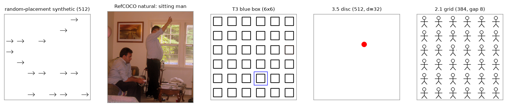

**图 1.** 输入示例。从左到右依次为 512 随机放置合成图、RefCOCO 自然图像（标题为指代表达）、6×6 蓝框网格图（T3 蓝框问法）、实验 3.5 的单圆点图（直径 32 pixels）与实验 2.1 的 6×6 小人缺口图（缺口 8 pixels）。灰色边框只用于展示。

## 3. 首次出现层与写入组件

### 3.1 逐层范数图

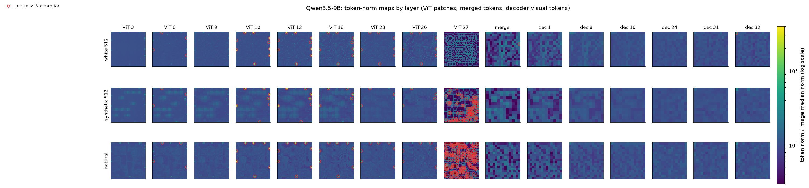

**图 2.** Qwen3.5 逐层范数图。每个小图为一张图像在一个提取位置上的 $\rho_p$，色标为 viridis 对数色标（色条单位为 token 范数与图像中位数之比）；红色空心圆标出 $\rho_p > 3$ 的 token。前九列为 ViT block 输出（patch 网格），第十列为 merger 输出，其后为 decoder 各层的 visual tokens（merged 网格）。

测量结果如下：

1. **首次出现层。** 全部 1009 张图像（blank 21、noise 16、probe 480、grid 96、natural 300、marked 96）的首次出现层均为 block 10。block 4–7 中同一位置存在 3–5 个范数比为 3–4 的弱峰，block 9 的最大范数比只有 2.2–2.6。
2. **逐层变化。** 最大范数比在 block 10 为 21–36，此后逐步下降，在 block 26 为 6–9.5。每张图像在 block 10 的高范数 token 数量为：blank 12.1、noise 16.2、probe 9.5、grid 14.5、natural 6.0。
3. **block 27 属于另一种现象。** 最后一个 block 的范数中位数提高 39–112 倍，block 10 的高范数位置在该层降为中位数的 0.21–0.53 倍，25%–33% 的 token 超过 2 倍中位数。图 2 中 block 27 的大量红圈来自这一全局重分布，本文的高范数 token 不包括它们。
4. **merger 与 decoder。** merger 输出的最大范数比为 2.6–4.5；decoder 第 1–31 层 visual tokens 的最大范数比不超过 2.7，第 32 层为 3.0–3.2，且在 90%–100% 的图像中最大者为第一个 visual token。前缀 token `<|im_start|>` 在第 8–16 层达到 visual tokens 中位数的 2.4–2.9 倍。Qwen3.5 的 decoder 中不存在 massive visual token。

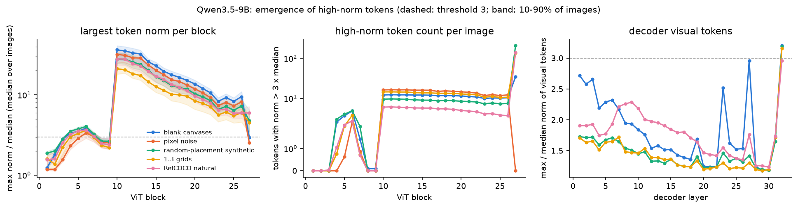

**图 3.** Qwen3.5 各数据组的最大范数比（左，对数纵轴）与每图高范数数量（中）随 ViT block 的变化，以及 decoder visual tokens 的最大范数比随层的变化（右）。曲线为图像间中位数，阴影为图像间 10%–90% 分位范围，灰色虚线为阈值 3；颜色区分数据组，见图例。

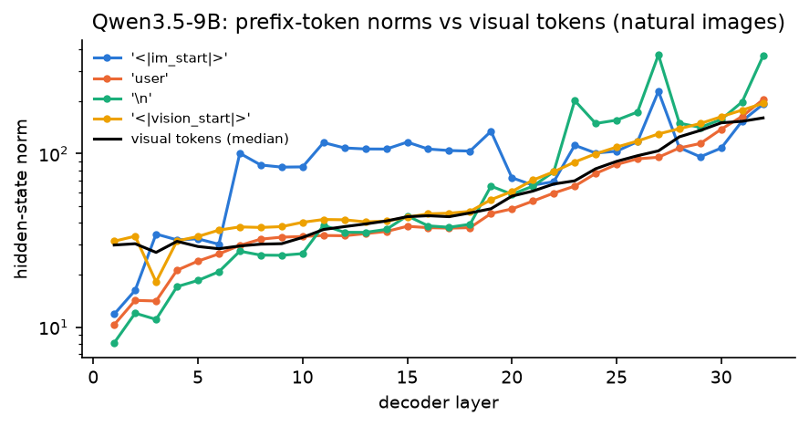

**图 4.** Qwen3.5 decoder 各层前缀 token 的 hidden-state 范数（彩色曲线，自然图像平均）与 visual tokens 范数中位数（黑色曲线），对数纵轴。

### 3.2 写入组件

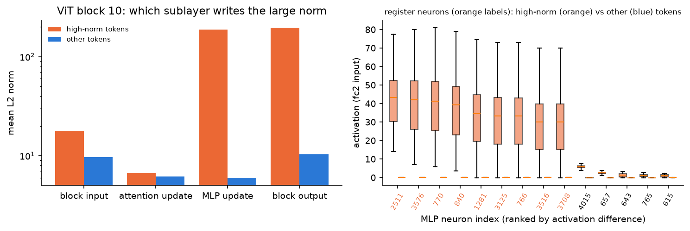

**图 5.** 左：ViT block 10 中高范数 token（橙色）与其余 token（蓝色）的 block 输入、attention 更新、MLP 更新与 block 输出的平均 L2 范数（对数纵轴）。右：按激活差排序的前 14 个 MLP neurons 的激活箱线图，橙色箱为高范数 token，蓝色箱为其余 token；横轴标签为橙色的 9 个 neurons 满足 register neuron 判据。

1. **MLP 一次写入。** block 10 中高范数 token 的输入范数为 18.0（其余 token 9.7），attention 更新为 6.6（6.2），MLP 更新为 188.6（6.0），输出为 196.0（10.4）。大范数几乎全部来自 MLP 更新。
2. **register neurons。** 满足判据（高范数 token 上平均激活大于 10，其余 token 上平均激活绝对值小于 0.1）的 neurons 为 2511、3576、770、840、1281、3125、766、3516、3708。它们在高范数 token 上的平均激活为 28–41，在 88%–100% 的高范数 token 上开启，经 $W_2$ 写出的向量范数约 187，占 MLP 更新的绝大部分。
3. **massive 通道。** 通道 514 出现在 100% 的高范数 token 的前 10 绝对值通道中，875 与 979 为 99.99%，179 为 95.6%（共 9734 个高范数 token）。

**解释。** 高范数 token 的形成符合 Jiang et al. 描述的 register neuron 机制：少数只对特定 token 开启的 MLP neurons 在单一 block 中写入固定方向的大向量。block 10 之前的弱峰说明候选位置在更浅的 block 已有区分，block 10 的 neurons 将其放大为离群值。

## 4. 位置的决定因素

### 4.1 位置分布与 PE 表坐标

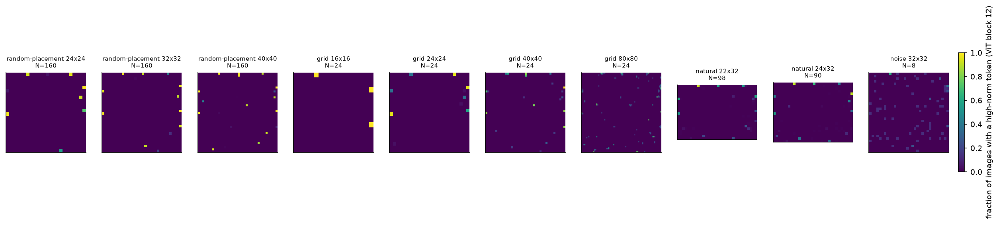

**图 6.** 高范数频率 $f_p$（block 12，viridis 色标，色条单位为含高范数 token 的图像比例）。每个小图对应一个数据组与 patch 网格尺寸的组合，标题给出图像数 $N$。

| 数据组（网格） | $N$ | $\max_p f_p$ | 前 10 个位置的占比 | 每图高范数数 |
| --- | --- | --- | --- | --- |
| probe（32×32） | 160 | 0.99 | 0.96 | 9.3 |
| natural（22×32） | 98 | 0.92 | 0.85 | 5.6 |
| noise（32×32） | 8 | 0.62 | 0.26 | 10.0 |
| grid（80×80） | 24 | 0.75 | 0.19 | 40.1 |

前 10 个位置的占比为前 10 个最高频位置上的高范数次数占全部高范数次数的比例。合成图与自然图像上的高范数 token 集中于少数固定位置；噪声画布上它们分散。

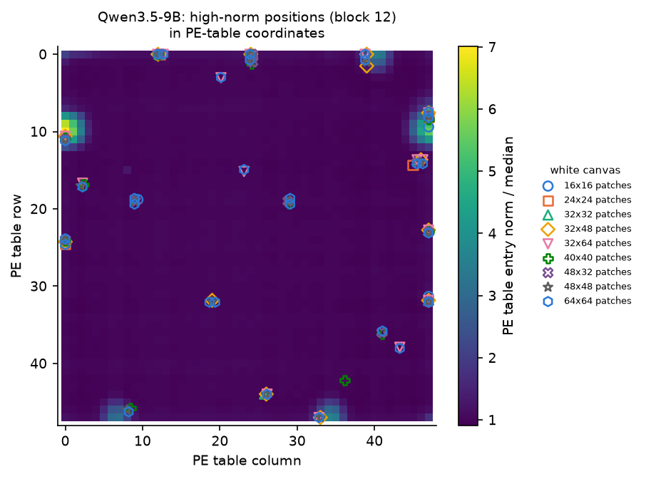

**图 7.** 不同尺寸白色画布上的 block 12 高范数位置换算到 $48 \times 48$ PE 表坐标后的散点（不同标记与颜色对应不同 patch 网格尺寸，见图例），底图为 PE 表各项 L2 范数与其中位数之比（viridis，见色条）。

不同画布尺寸的高范数位置在表坐标中重合。一部分位置对应 PE 表中范数离群的项，另一部分（例如表第 0 行第 12、24、39 列附近及若干内部位置）不对应离群项。

### 4.2 干预结果

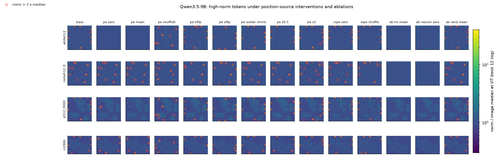

**图 8.** 位置来源干预下的 block 12 范数图（行：白色画布、噪声画布、随机放置图、自然图像各一例；列：干预条件）。色标与红圈同图 2。

下表给出 block 12 高范数集合相对未干预条件的平均 Jaccard 系数，括号内为每张图像的平均高范数数量（blank 2、noise 4、synthetic 16、natural 16 张）。翻转条件与翻转后的未干预集合比较。

| 干预 | blank | noise | synthetic | natural |
| --- | --- | --- | --- | --- |
| 未干预 | 1.00（11.3） | 1.00（9.2） | 1.00（9.5） | 1.00（6.0） |
| PE 置零 | 0.00（0.0） | 0.54（9.2） | 0.00（11.6） | 0.02（4.1） |
| PE 均值 | 0.00（0.0） | 0.57（9.5） | 0.00（9.3） | 0.02（4.3） |
| PE 打乱（种子 0） | 0.00（10.3） | 0.37（10.5） | 0.00（9.2） | 0.02（5.9） |
| PE 左右翻转 | 0.85（12.3） | 0.04（9.5） | 0.79（8.4） | 0.53（5.9） |
| PE 上下翻转 | 0.88（11.7） | 0.09（8.0） | 0.80（9.6） | 0.39（6.4） |
| PE ×0.5 | 0.77（9.0） | 0.64（9.8） | 0.71（7.3） | 0.55（4.8） |
| PE ×2 | 0.77（15.3） | 0.52（12.5） | 0.66（13.1） | 0.62（8.5） |
| 去除 PE 异常项 | 0.79（11.0） | 0.80（9.5） | 0.73（8.1） | 0.57（5.4） |
| RoPE 置零 | 0.89（11.3） | 0.70（9.8） | 0.87（8.5） | 0.76（5.1） |
| RoPE 打乱 | 0.78（10.7） | 0.56（9.5） | 0.80（8.4） | 0.70（5.2） |

1. **PE 决定空白区域的位置。** PE 置零或取均值后，空白画布上没有高范数 token；PE 打乱后数量不变但位置全部改变；PE 翻转后位置随之翻转。
2. **内容决定噪声画布上的位置。** 噪声画布在 PE 置零后保留 0.54 的集合，翻转后的 Jaccard 只有 0.04–0.09；合成图在 PE 置零后出现 11.6 个位于新位置的高范数 token。
3. **RoPE 与 PE 离群项不是必要条件。** RoPE 置零后 blank 的 Jaccard 为 0.89；去除 PE 离群项后为 0.79。PE 幅值改变数量：×2 时 blank 的数量为 15.3，×0.5 时为 9.0。
4. **相位窗口。** 512 画布使用 640 画布 PE 的 32×32 窗口时，偏移 (0,0) 与 (0,8) 下的高范数集合与 640 画布高范数图的对应裁剪完全相同（Jaccard 1.0），偏移 (2,2)、(4,4)、(8,8)、(8,0) 下为 0.29、0.60、0.57、0.63。
5. **内容放置。** 以 64×64 噪声块覆盖白色 512 画布上的一个固定高范数位置时，9/9 次该位置失去高范数 token，同时每图总数保持 8–10（原有 8 个其余位置保留，另在 0–2 个新位置出现）；覆盖 3 个对照位置不改变高范数集合。

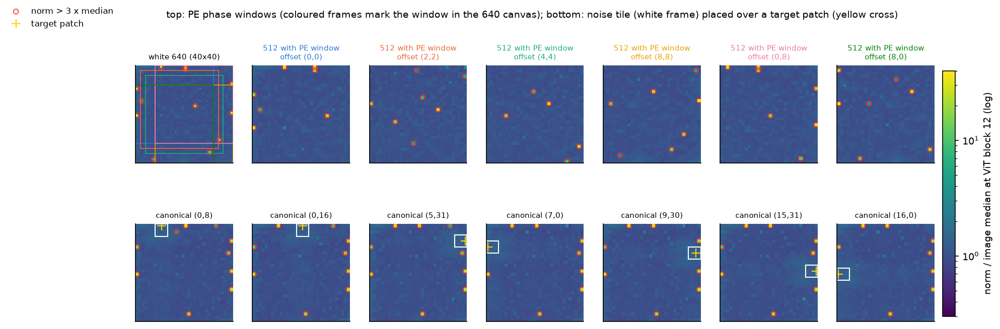

**图 9.** 上行：相位窗口实验。第一个小图为白色 640 画布（40×40 patches）的 block 12 范数图，彩色方框标出各窗口在其中的位置；其余小图为使用对应窗口 PE 的 512 画布（偏移以 patch 为单位，标题颜色与方框颜色对应）。下行：内容放置实验，白框为噪声块，黄色十字为被覆盖的固定高范数位置。色标与红圈同图 2。

**解释。** 位置由两个因素共同决定：插值后的 PE 在每个画布上选出一组候选位置，候选位置上的 patch 只有在内容空白或纹理很弱时才成为高范数 token。合成图与自然图像的大面积背景使 PE 候选位置几乎总能成立，因此高范数位置看起来固定；噪声画布没有空白 patch，高范数位置改由内容决定。去除 PE 离群项后多数位置保留，相位偏移改变部分位置，说明候选位置由 PE 局部模式在插值网格上的取样结果决定，单个离群项不足以确定它们。

## 5. Attention sink

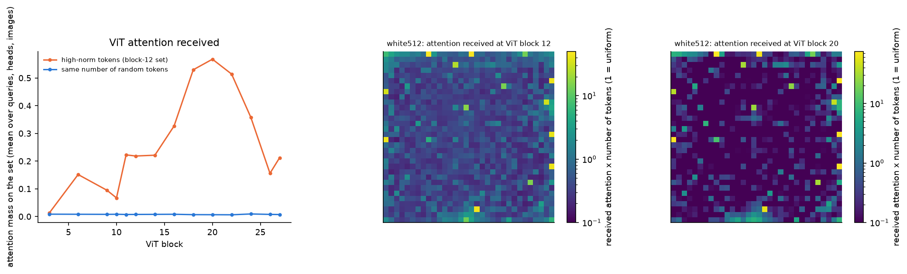

**图 10.** 左：Qwen3.5 ViT 各 block 中高范数集合 $S$（block 12 判定）获得的 attention 质量 $M_S$（橙色）与相同数量随机 token 的 $M_R$（蓝色），对 query、head 与图像取平均。中、右：白色 512 画布在 block 12 与 block 20 的 attention 接收图，每格为该 key 获得的平均 attention 乘以 token 数（1 表示均匀分配），viridis 对数色标。

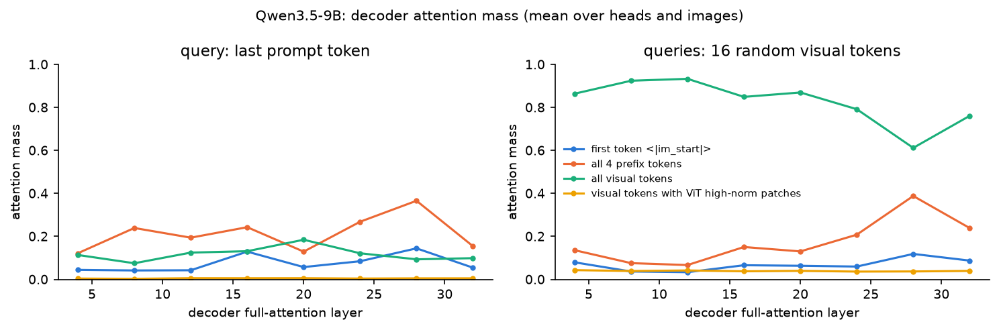

**图 11.** Qwen3.5 decoder full attention 层的 attention 质量（对 head 与图像取平均）。左：query 为最后一个 prompt token；右：query 为 16 个随机 visual tokens。蓝色为第一个 token，橙红色为 4 个前缀 token，绿色为全部 visual tokens，黄色为包含 ViT 高范数 patch 的 visual tokens。富集比在正文中给出。

1. **ViT 中是 sink。** $M_S$ 在 block 11–16 为 0.22–0.33，在 block 18、20、22 为 0.53、0.568（95% 区间 [0.547, 0.590]）、0.514，在 block 26 降为 0.16；相同数量随机 token 的 $M_R$ 为 0.007–0.009。富集比在 block 11–24 为 25–63，单个 head 的 $M_S$ 最高为 0.92。block 10 之前（block 3、6、9）$M_S$ 为 0.01–0.15，sink 在 register neurons 写入之后形成。
2. **decoder 中不是 sink。** 包含 ViT 高范数 patch 的 visual tokens 的富集比为 0.96–1.77。decoder 的 sink 位于序列前部：最后一个 prompt token 分配给 4 个前缀 token 的质量为 0.12–0.37，第一个 token 单独为 0.04–0.15，第一个 visual token 的富集比为 9–44。

**解释。** merger 将 2×2 patch 合并并投影到 decoder 空间后，高范数方向不再产生大范数（merger 最大范数比 2.6–4.5），decoder 另有自己的 sink（前缀 token 与第一个 visual token）。ViT 的 register 与 decoder 的 sink 是两套独立的机制。

## 6. 信息内容

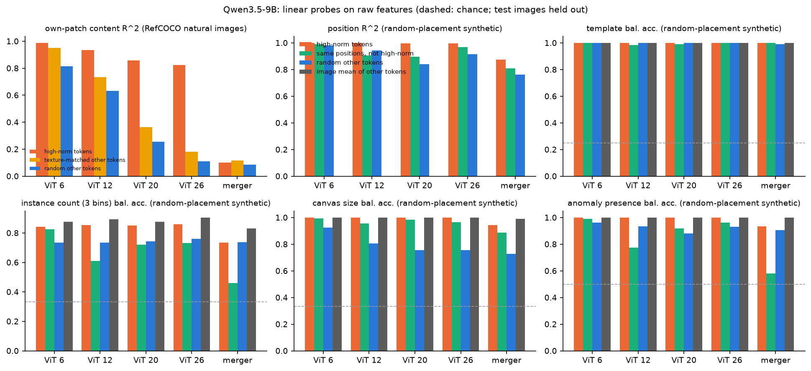

**图 12.** 线性读出结果（原始特征，测试图像与训练图像不重叠，虚线为随机水平）。第一个面板为 RefCOCO 自然图像上自身 patch 4×4 灰度的测试 $R^2$（橙色：高范数 token；黄色：纹理匹配的普通 token；蓝色：随机普通 token）。其余面板为随机放置合成图上的位置 $R^2$ 与全局属性 balanced accuracy（橙色：高范数 token；绿色：同位置未成为高范数的 token；蓝色：随机普通 token；灰色：普通 token 的图像均值）。

### 6.1 自身 patch 内容

高范数 patch 中空白 patch 的比例在 probe 集为 100%（8339/8339，随机 patch 为 90.6%），在自然图像上为 37.7%（95% Wilson 区间 [36.0, 39.5]，随机 patch 为 17.6%），在蓝框网格图上为 95%（随机 patch 为 49%）。由于合成图中的高范数 patch 全部空白，局部读出在自然图像上进行；纹理匹配组按 patch 灰度标准差与高范数组逐一匹配。

| 提取位置 | 高范数 token | 纹理匹配普通 token | 随机普通 token |
| --- | --- | --- | --- |
| ViT block 6 | 0.988 | 0.951 | 0.815 |
| ViT block 12 | 0.934 | 0.735 | 0.631 |
| ViT block 20 | 0.857 | 0.365 | 0.256 |
| ViT block 26 | 0.823 | 0.180 | 0.110 |
| merger | 0.100 | 0.116 | 0.085 |

普通 token 的局部内容随 block 加深而衰减，高范数 token 在 block 26 仍保留 0.82 的可解释方差。merger 之后三组均降到 0.1 左右。

**解释。** Darcet et al. 在 DINOv2 中观察到高范数 token 丢弃局部信息、转而存储全局信息；Qwen3.5 的高范数 token 保留了自身 patch 的内容。一种可能的原因是这些 token 所在的 patch 多为空白或低纹理，其内容维度少、易于保持；纹理匹配组控制了灰度标准差，但没有控制更高阶的纹理统计量，因此该差异中可能仍有一部分来自 patch 内容本身的简单性。merger 处的 $R^2$ 对应的是包含高范数 patch 的 merged token，它混合了 4 个 patch，因此不能与 ViT 中的逐 patch 结果直接比较。

### 6.2 全局属性与位置

在随机放置合成图上（480 张，3:1 划分）：

1. **模板**：四组在全部位置上均接近 1.0。
2. **实例数量（3 档）**：高范数 token 0.84–0.86，随机普通 token 0.74–0.76，图像均值 0.88–0.90。
3. **画布尺寸**：高范数 token 1.0，随机普通 token 0.76–0.93，同位置普通 token 0.96–0.99。同位置普通 token 也能读出画布尺寸，说明该信号与位置（PE 插值）相关。
4. **是否含异常**：高范数 token 1.0，随机普通 token 0.88–0.96。
5. **位置 $R^2$**：高范数 token 0.997–1.0，同位置普通 token 0.90–0.99，随机普通 token 0.84–0.98。高范数 token 只出现在少数固定位置，其位置读出因此偏高。
6. **merger**：高范数 merged token 的实例数量、画布尺寸与异常读出分别为 0.73、0.94、0.93。

**解释。** 高范数 token 比随机普通 token 聚合了更多全局信息，与其作为 ViT attention sink 的角色相容；但普通 token 的图像均值已经能达到同等或更高的准确率，高范数 token 并不是全局信息的唯一载体。

## 7. 位置成分与 2.1 距离读出

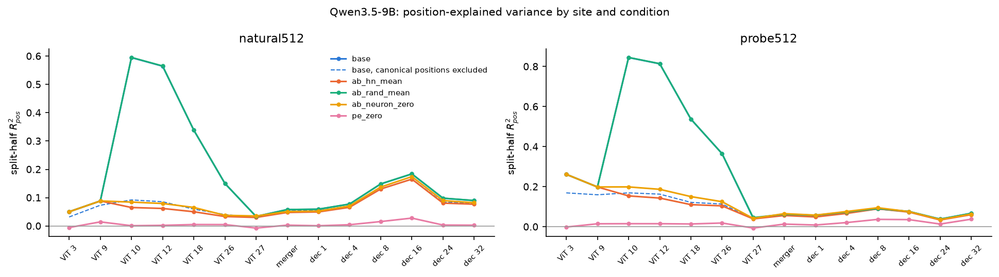

**图 13.** 交叉估计的 $R^2_{\mathrm{pos}}$ 随提取位置的变化（左：160 张 512×512 自然图像；右：160 张 512 随机放置图）。蓝色实线为未消融，蓝色虚线为去掉白色画布高范数位置后的未消融结果，橙红色为均值替换，绿色为随机对照，黄色为 neuron 置零，粉色为 PE 置零。随机对照与未消融的数值相同（差异小于 0.003），绿色曲线覆盖了蓝色实线。

| 条件 | ViT 10 | ViT 18 | ViT 26 | merger | dec 8 | dec 16 |
| --- | --- | --- | --- | --- | --- | --- |
| 随机放置，未消融 | 0.845 | 0.538 | 0.365 | 0.062 | 0.091 | 0.077 |
| 随机放置，去掉高范数位置 | 0.170 | 0.122 | 0.114 | 0.060 | 0.088 | 0.074 |
| 随机放置，均值替换 | 0.154 | 0.111 | 0.105 | 0.056 | 0.090 | 0.074 |
| 随机放置，neuron 置零 | 0.199 | 0.151 | 0.125 | 0.066 | 0.095 | 0.076 |
| 随机放置，PE 置零 | 0.016 | 0.014 | 0.019 | 0.014 | 0.037 | 0.036 |
| 自然图像，未消融 | 0.595 | 0.339 | 0.150 | 0.058 | 0.148 | 0.184 |
| 自然图像，均值替换 | 0.065 | 0.050 | 0.033 | 0.048 | 0.131 | 0.165 |

1. ViT 中 $R^2_{\mathrm{pos}}$ 的大部分来自高范数位置：去掉这些位置，或以均值替换高范数 token，block 10 的值由 0.845 降至 0.15–0.17；其余位置的位置成分（约 0.15）不受消融影响。
2. merger 与 decoder 的 $R^2_{\mathrm{pos}}$ 只有 0.04–0.18，消融后变化不超过 0.02；PE 置零使全部位置的值降至 0.04 以下。merger 之后的位置成分来自 PE，与高范数 token 无关。

**2.1 距离读出。** 在 2.1 的 6×6 小人缺口图上（36 个目标位置），记录 RMS 距离最高的实例。

| 条件 | ViT 18：命中（缺口 4 / 8） | ViT 18：最常见的最高分实例 | merger：命中（4 / 8） | merger：最常见的最高分实例 |
| --- | --- | --- | --- | --- |
| 未消融 | 1/36、1/36 | 实例 11（第 2 行第 6 列），100% | 1/36、1/36 | 实例 0，100% |
| 均值替换 | 4/36、2/36 | 实例 0，92%–97% | 1/36、1/36 | 实例 0，94%–100% |
| neuron 置零 | 7/36、6/36 | 实例 0，83%–86% | 1/36、1/36 | 实例 0，100% |
| 随机对照 | 1/36、1/36 | 实例 11，100% | 1/36、1/36 | 实例 0，100% |
| PE 置零 | 1/36、1/36 | 实例 11，89%–100% | 18/36、9/36 | 实例 19，50%–64% |

实例按行优先编号（0 起）。ViT block 18 的固定最高分实例 11 由高范数 token 造成，消融后该峰消失，命中数略有上升；PE 置零不改变 ViT 18 的峰（PE 置零后合成图仍产生由内容决定的高范数 token，见第 4.2 节）。merger 的固定最高分实例 0 不受高范数消融影响，PE 置零后 merger 的命中数升至 18/36，说明 merger 处的距离读出被 PE 带来的位置成分主导。

## 8. 完整模型消融

### 8.1 任务

| 任务 | 数据 | 问法 | 指标 |
| --- | --- | --- | --- |
| disc | 白色 512 画布单红色圆点，36 个位置 × 直径 32、64 pixels × point、bbox，共 144 条 | 直接回答 | 命中率（预测点落在圆点内），中心误差（0–1000 坐标） |
| T2 | 实验 1.3 两实例比较，240 条 | 直接回答 yes/no | 准确率，AUROC |
| T3_box / T3_rowcol | 实验 1.3 修订问法，蓝框与行列描述各 240 条 | 直接回答 yes/no | 准确率，AUROC |
| T4_point / T4_row_column | 实验 1.3 定位，各 200 条 | 直接回答 | 严格评分准确率 |
| T4_row_column_explicit | 实验 1.3 显式推理问法，72 条 | 先推理后回答，max_new_tokens 1024 | 严格评分准确率 |
| refcoco_point / refcoco_bbox | 实验 3.5 的 RefCOCO 测试样本，各 300 条 | 直接回答 | point 命中率、bbox IoU≥0.5 比例、中心误差 |

消融施加在 ViT block 10 的输出上：均值替换（hn_mean）、置零（hn_zero）、neuron 置零（neuron_zero）与随机 token 均值替换对照（rand_mean0、rand_mean1，两个种子）。在 4 张图像的 block 12 上复核，三种消融之后下游 block 中均不再出现高范数 token，随机对照不改变高范数集合（图 8 后三列）。

### 8.2 结果

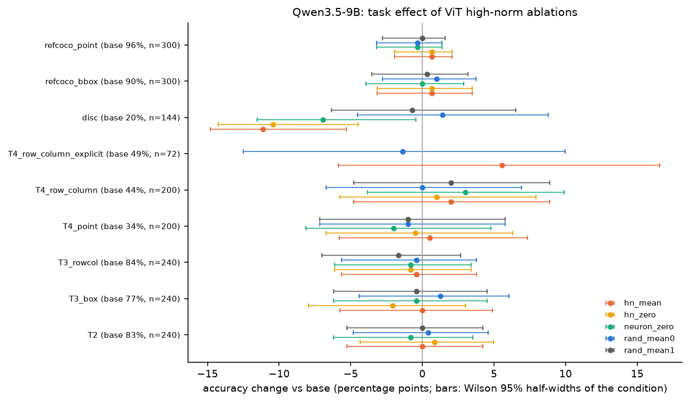

**图 14.** Qwen3.5 各任务在各消融条件下的准确率变化（百分点）。点为逐样本配对的差值，误差线为消融条件准确率的 Wilson 95% 区间半宽；颜色对应消融条件，见图例。纵轴标签给出未消融准确率与样本数。

| 任务 | 未消融 | hn_mean | hn_zero | neuron_zero | rand_mean0 | rand_mean1 |
| --- | --- | --- | --- | --- | --- | --- |
| disc 命中率 | 29/144（0.201） | 13/144，p = 0.0001 | 14/144，p = 0.0003 | 19/144，p = 0.006 | 31/144，p = 0.73 | 28/144，p = 1.0 |
| disc 中心误差变化 | 74.7 | +19.1 [14.1, 23.9] | +10.2 [5.7, 14.8] | +10.0 [5.6, 14.5] | −1.0 [−3.1, 1.1] | −0.3 [−2.0, 1.2] |
| T2 准确率（AUROC） | 0.829（0.846） | 0.829（0.859） | 0.838（0.875） | 0.821（0.849） | 0.833（0.848） | 0.829（0.843） |
| T3_box 准确率（AUROC） | 0.767（0.808） | 0.767（0.816） | 0.746（0.819） | 0.762（0.806） | 0.779（0.804） | 0.762（0.814） |
| T3_rowcol 准确率（AUROC） | 0.838（0.827） | 0.833（0.839） | 0.829（0.852） | 0.829（0.837） | 0.833（0.825） | 0.821（0.818） |
| T4_point | 0.345 | 0.350 | 0.340 | 0.325 | 0.335 | 0.335 |
| T4_row_column | 0.445 | 0.465 | 0.455 | 0.475 | 0.445 | 0.465 |
| T4_row_column_explicit | 35/72（0.486） | 39/72，p = 0.42 | — | — | 34/72，p = 1.0 | — |
| refcoco_point | 289/300（0.963） | 0.970，p = 0.63 | 0.970 | 0.960 | 0.960 | 0.963 |
| refcoco_bbox | 270/300（0.900） | 0.907，p = 0.75 | 0.907 | 0.900 | 0.910 | 0.903 |
| refcoco_point 中心误差变化 | — | +0.1 [−4.0, 4.1] | −0.3 [−3.6, 2.7] | +3.8 [0.1, 8.1] | +1.0 [−2.5, 5.1] | +0.2 [−3.4, 4.0] |

方括号内为逐样本差值的 bootstrap 95% 区间。除 disc 外，所有条件与未消融之间的 McNemar p 值均大于 0.2，AUROC 差异的 bootstrap 区间均包含 0 或接近 0（hn_zero 的 T3_rowcol 为 [0.002, 0.054]，方向为提升）。先推理后回答的 T4 只在 hn_mean 与 rand_mean0 下运行。

1. **disc 受损。** 三种消融均降低命中率、增大中心误差，且 x 与 y 两个方向的误差都增加；随机对照无效应。均值替换的效应最大（−11.1 个百分点，17 个样本由对变错、1 个由错变对）。
2. **其他任务不受影响。** 包括需要逐实例比较的 T2/T3、定位的 T4 与自然图像的 RefCOCO。
3. **回答文本发生改变。** 在 RefCOCO 上，hn_mean 下与未消融完全相同的回答只占 3%–7%，随机对照为 24%–25%；在 T4 与 disc 上也有类似差距。消融改变了模型的数值输出，但不改变正确率。
4. **批量推理复核。** 20 条单样本推理与批量推理的复核中，13 条文本完全相同，20 条正确性相同。

**解释。** 高范数 token 是 ViT 内部的计算结构，删除它会扰动 ViT 输出，但除空白画布上的单目标坐标外，模型的回答对这一扰动不敏感。disc 图像几乎全部是空白 patch，目标只占 1–4 个 merged token，这种输入下高范数 token 可能是 ViT 中少数承载画布全局结构的 token；自然图像和网格图中可供参照的内容更多。这一解释尚未经过直接验证（见第 11 节）。disc 的未消融命中率只有 20.1%，基线本身较弱，效应的大小需结合实验 3.5 的结果解读。

## 9. 蓝框效应

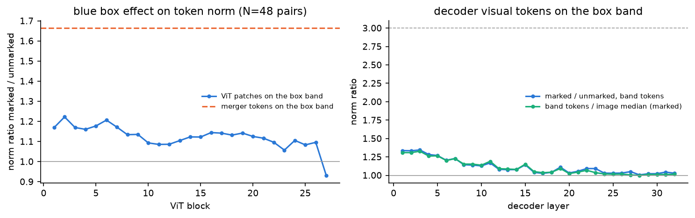

**图 15.** 48 对蓝框图与去框重绘图。左：与蓝框边带（框线内外各 4 pixels）相交的 ViT patches 的平均范数之比（蓝框图 / 无框图，蓝色）随 block 的变化，橙红色虚线为 merger 输出上的同一比值。右：decoder 各层边带 visual tokens 的范数之比（蓝色：蓝框图 / 无框图；绿色：蓝框图中边带 token / 图像中位数），灰色虚线为阈值 3。

1. ViT 各 block 的边带范数比为 1.06–1.22，merger 为 1.66 [1.51, 1.82]，decoder 第 1 层为 1.34，深层回落到约 1.0。decoder 中边带 token 相对图像中位数的范数比不超过 1.33。
2. 边带上的 ViT 高范数 token 在 48 张蓝框图中共 1 个，在无框图中共 6 个；每图 block 12 的高范数数量为 14.9 与 15.0。

**解释。** 蓝框覆盖了一部分空白 patch，使原本可能成为高范数 token 的候选位置失去资格，因此蓝框使边带上的高范数 token 减少。T3 蓝框问法的 AUROC（0.808）低于行列问法（0.827）的原因不在高范数 token；第 8 节中高范数消融也不改变 T3_box 的结果。

## 10. Qwen3-VL 对照

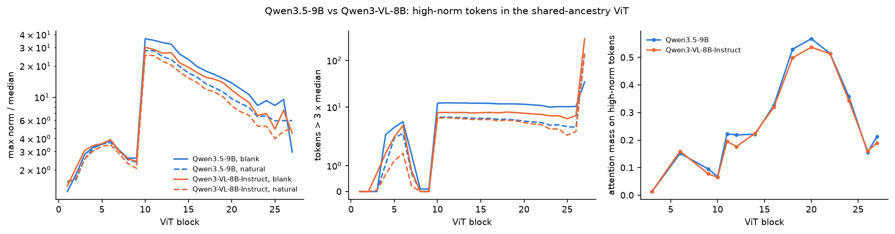

**图 16.** Qwen3.5（蓝色）与 Qwen3-VL（橙红色）的对照。左：ViT 各 block 的最大范数比（图像间中位数，对数纵轴）；中：每图高范数数量；实线为空白画布，虚线为 RefCOCO 自然图像。右：ViT 各 block 中高范数集合获得的 attention 质量 $M_S$。

Qwen3-VL 的逐层范数图、来源干预等图见 `figures/high_norm/*_q3vl.png`。

1. **机制相同。** 首次出现层同样是 block 10（100% 的图像），9 个 register neurons 与 Qwen3.5 完全相同（写出范数约 200），massive 通道相同。
2. **数量更少。** 每图高范数数量为 blank 7.6、probe 5.8、natural 5.8（Qwen3.5 为 12.1、9.5、6.0），block 10 最大范数比为 18–30。Qwen3-VL 的 PE 幅值约为 Qwen3.5 的 2.76 倍。在同一模型内，PE 幅值加倍使高范数数量增加（Qwen3.5 由 11.3 增至 15.3，Qwen3-VL 由 7.3 增至 10.0），而 PE 幅值更大的 Qwen3-VL 高范数数量更少，因此两模型之间的数量差异不能由 PE 幅值解释，应来自 ViT 其余权重的差异。
3. **内容与位置。** 高范数 patch 中空白 patch 比例为 probe 1.0、natural 0.428（随机 0.169）。PE 置零后 blank 上无高范数 token，左右与上下翻转的 Jaccard 为 0.89 与 0.77；RoPE 置零为 0.58，去除 PE 离群项为 0.65，RoPE 对位置的影响大于 Qwen3.5。内容放置同样消除被覆盖的位置。
4. **attention sink 与信息。** ViT 中 $M_S$ 峰值为 0.537（block 20），富集比最高 82。自然图像自身 patch 内容 $R^2$ 为 0.81–0.98（纹理匹配组 0.23–0.93）。
5. **位置成分与 2.1 读出。** 随机放置图 ViT 10 的 $R^2_{\mathrm{pos}}$ 为 0.781（去掉高范数位置后 0.253，均值替换后 0.206），merger 为 0.049。ViT 18 同样以实例 11 为固定最高分实例，消融后消失；merger 上缺口 8 的命中数为 32/36（未消融）与 26/36（均值替换）。
6. **decoder 中的 massive visual tokens。** Qwen3-VL 的 decoder 自第 17 层左右出现范数为中位数 100–145 倍的 visual token，位于第 2 行靠近顶部中间的位置；它出现在 21/21 张空白画布、44/48 张随机放置图与 19/48 张网格图上，但只出现在 2/300 张自然图像上。Qwen3.5 的 decoder 中没有这一现象。

### 10.1 Qwen3-VL 任务消融

Qwen3-VL 只运行直接回答的任务，条件为 hn_mean、neuron_zero 与 rand_mean0。

| 任务 | 未消融 | hn_mean | neuron_zero | rand_mean0 |
| --- | --- | --- | --- | --- |
| disc 命中率 | 35/144（0.243） | 26/144，p = 0.023 | 28/144，p = 0.065 | 35/144，p = 1.0 |
| disc 中心误差变化 | — | +11.1 [9.0, 13.3] | +8.5 [6.5, 10.6] | +0.4 [−0.3, 1.1] |
| T2 准确率（AUROC） | 0.775（0.839） | 0.742，p = 0.008（0.858） | 0.767，p = 0.63（0.831） | 0.779（0.839） |
| T3_box 准确率（AUROC） | 0.571（0.762） | 0.517，p = 0.024（0.757） | 0.525，p = 0.043（0.759） | 0.588（0.762） |
| T3_rowcol 准确率（AUROC） | 0.650（0.715） | 0.658（0.730） | 0.667（0.729） | 0.654（0.713） |
| T4_point | 0.265 | 0.210，p = 0.061 | 0.250 | 0.265 |
| T4_row_column | 0.440 | 0.425 | 0.430 | 0.445 |
| refcoco_point | 0.940 | 0.933 | 0.937 | 0.927 |
| refcoco_bbox | 0.910 | 0.903 | 0.897 | 0.910 |

逐任务的森林图见 `figures/high_norm/ablation_q3vl.png`，格式同图 14。与 Qwen3.5 相同，disc 在消融后命中率下降、中心误差增加，RefCOCO 不受影响。不同之处在于 T2 与 T3_box 的准确率在 hn_mean 下分别下降 3.3 与 5.4 个百分点（T2 中 8 个样本由对变错、0 个由错变对），但 AUROC 不变（0.839→0.858，0.762→0.757）。准确率的下降因此来自判别分数整体平移造成的 yes/no 偏置变化，模型区分正负样本的能力没有下降。这些 p 值未做多重比较校正（3 个条件 × 9 个任务），按 Bonferroni 校正后均不显著，应视为初步结果。

**解释。** Qwen3-VL 的 DeepStack 从 ViT block 9、17、25 取特征直接加到 decoder 前几层的 visual tokens 上，block 10 的消融改变了后两组特征，这为 Qwen3-VL 的 yes/no 偏置变化提供了一条 Qwen3.5 没有的通路；该通路尚未经单独消融验证。

## 11. 限制与后续

1. **分类读出。** 环境中没有 sklearn 与 scipy，全局属性的读出使用 ridge 分类器（one-hot 目标的 ridge 回归），未使用 logistic regression；balanced accuracy 可能略低于 logistic regression 的结果。
2. **消融方式。** neuron 置零近似 Jiang et al. 的测试时 register 去除，未添加额外 token；attention knockout 与 COCO caption loss 未测量。
3. **先推理后回答的覆盖。** 显式推理 T4 只在 Qwen3.5 的 3 个条件下运行（每条约 5 s），Qwen3-VL 未运行。Qwen3-VL 未运行 hn_zero 与 rand_mean1，任务消融的 p 值均未做多重比较校正。
4. **decoder 范数的覆盖。** Qwen3.5 probe 集的 decoder 范数只在前 48 张（384 画布）上计算。
5. **disc 基线。** disc 的未消融命中率为 20.1%，效应基于较弱的基线；disc 受损而 RefCOCO 不受损的原因尚未确定，可在含少量纹理的画布上重复 disc 以区分“空白画布”与“单目标”两个因素。
6. **ViT block 27 与 Qwen3-VL decoder massive tokens。** 前者的全局范数重分布与后者的形成机制，以及 ViT 高范数消融是否影响后者，均未测量。
7. **方法含义。** 高范数 token 不承载 merger 之后的位置成分，对除空白画布单目标之外的任务没有可测量的作用；视觉细节的损失主要发生在普通 token 随 block 加深的局部信息衰减与 merger 的 2×2 合并（第 6.1 节），后续分析应聚焦于这两处。
