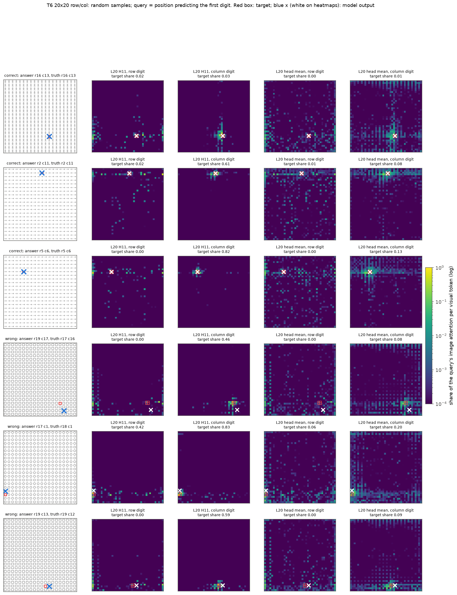
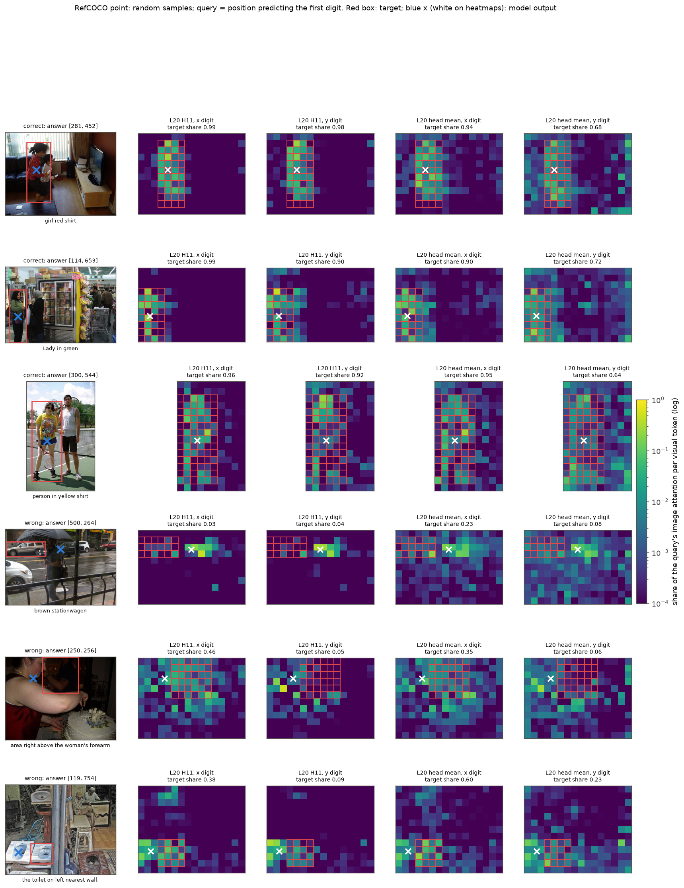
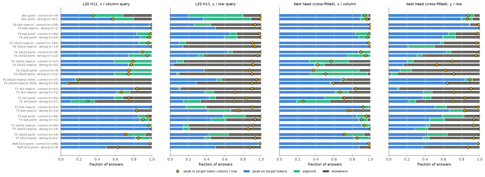
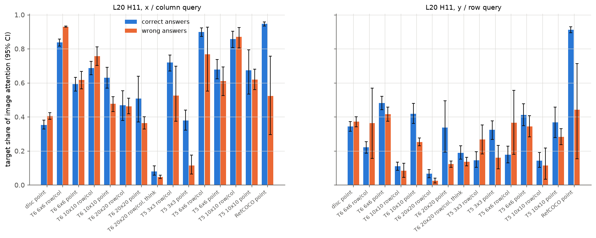
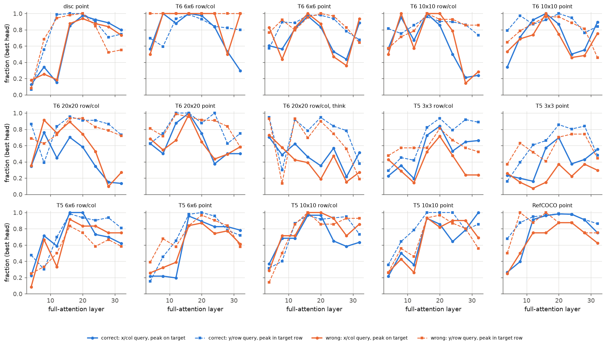
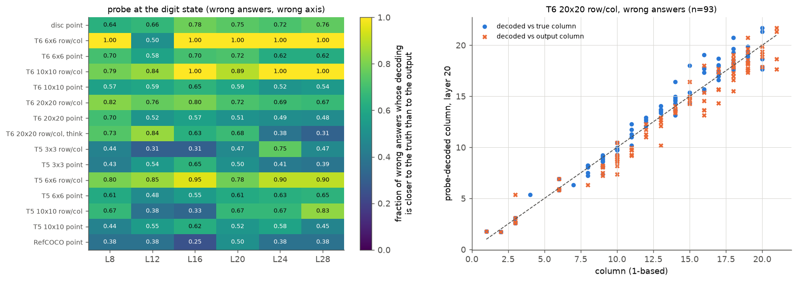
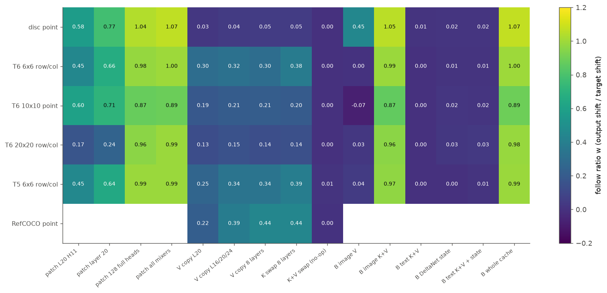
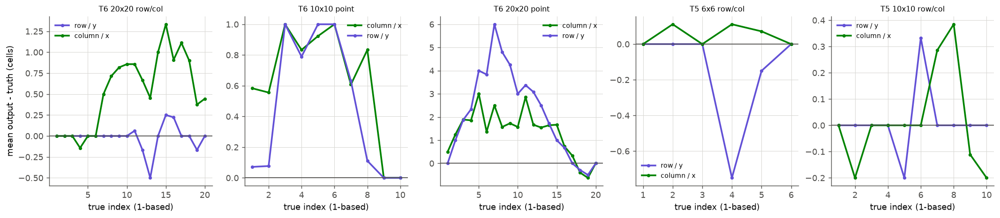

# “看得准但答错”的系统检验

实验日期：2026-10-16 至 2026-10-17，编号为实验 2.5e。本文属于[表征分析](plan.md)研究，模型为 Qwen3.5-9B，bfloat16、SDPA、greedy decoding，thinking off。前置结果见[坐标读取路径](../position/results_2026-10-14_coordinate_readout.md)（实验 3.5）、[序号偏差与 token 网格](../behavior/results_2026-10-15_ordinal_token_grid.md)（实验 1.4）、[坐标数值的表征与转换](../position/results_2026-10-15_coordinate_value.md)（实验 3.6）与[生成阶段与失败样本的 patching](results_2026-10-15_patching_extension.md)（实验 2.5b/2.5c）。

## 通俗讲述

本节以叙述方式概括全文，细节与数值见第 1–7 节。

多项早期实验给人一种印象：Qwen3.5-9B 在网格中答错行号、列号或坐标时，仍然“看”对了目标，错误只发生在把看到的位置写成数字的最后一步。这一说法之所以需要检验，是因为“看对”可以有三种完全不同的含义。第一种是 attention 意义：生成坐标数字时，读取图像的 head（主要是第 20 层的第 11 个 head，记为 L20 H11）把最大的 attention 放在目标上。第二种是 probe 意义：在答案位置的 hidden state 上训练的线性回归器，对答错样本仍然解码出真实位置。第三种是行为意义：错误答案总是落在目标的相邻单元。三种含义分别回答“模型往哪里看”“状态里存了什么”“错误长什么样”，彼此之间没有必然联系。本实验在 15 个条件、2066 个回答上把三者逐一分开测量，并以因果编辑检验“往哪里看”是否决定“读到什么”。

测量给出的第一个结论是横向与纵向不对称。生成 x 或列号时，L20 H11 的 attention 峰值落在目标 token 上，答对与答错样本没有差别；生成 y 或行号时，峰值几乎从不落在目标本身，而是落在目标所在的那一行 token 上，尤其是该行的行首与行尾。第二个结论是“看对”有明确的适用范围：在 6×6、10×10 的网格中，三种含义同时成立，答错时状态里仍然编码着真值，错误是真值序号的系统性偏差，例如大网格靠右的列容易多计 1；在 20×20 的 point 格式、3×3 的找不同网格以及先推理后作答的格式中，读取本身已经偏离目标，“看对”不成立。

第三个结论最出乎意料：attention 指向目标，并不等于坐标取自目标 token。若保持 attention 不变，只把目标 token 的 value 换成别处的 value，单目标圆的输出几乎不动；若把整幅图像全部 token 的 key 与 value 换成目标移动后的版本，输出完全跟随。坐标信息因此分布在大量 visual token 的 key 与 value 中，attention 热图上“亮在目标上”只说明 query 与目标 token 的 key 最匹配，不说明位置读数来自目标。对网格中的列号，目标 token 的 value 承担了一部分读数；对行号，读数来自目标所在行的其他 token。这一结论把后续研究的重点从“模型看向哪里”转到了“位置信息存放在哪些 token 中、如何被读出”，后者由实验 3.11 展开。

## 1. 研究问题与主要结果

此前四项实验以不同的证据支持同一个判断：模型在坐标输出出错时，仍然“看”对了目标，错误发生在读取之后。这些证据分别是：实验 3.5 C1 中答错样本的候选 head attention 质心与真值的相关为 0.99；实验 1.4 中列号 +1 样本的 attention 峰值在 0.76–1.00 的情形下位于目标实例；实验 3.6 中 probe 从层 12 起以 5–7 个单位的误差读出真实坐标；实验 2.5b 第 4.4 节把 T5 的失败归为答案落在相邻单元的定位问题，其依据只是错误答案落在相邻单元、指定目标时 T3 的 AUROC 为 0.96。四项证据使用的“看得准”含义不同，样本条件也不同：3.5 的质心相关在整幅单目标画布上计算，大范围的位置变化会使任何偏向目标的分布都得到接近 1 的相关；1.4 只比较列方向的一维 attention 曲线；3.6 只在单目标画布上训练和测试 probe；2.5b 只有行为证据。

本实验把“看得准”拆分为 attention、probe 与行为三种可检验的含义（第 2 节），在 15 个条件（单目标圆；T6 6×6、10×10、20×20 的行列与 point 格式；20×20 的先推理后作答格式；T5 3×3、6×6、10×10 的行列与 point 格式；RefCOCO point）的 2066 个回答上逐条件、按答对与答错分别测量，并以输出 patching 和 KV cache 编辑检验 attention 指向的位置是否决定输出。主要结果如下：

1. **attention 意义上的“看得准”只在横向（x 或列号）成立，纵向（y 或行号）的读取不以目标 token 为峰值。** L20 H11 在横向 query 处的 attention 峰值落在目标 token 上的比例，在 T6 6×6、10×10 行列与 T5 6×6、10×10 行列的答错样本中为 0.83–1.00，与答对样本相当；在同一组条件的纵向 query 处，同一比例只有 0.14–0.50，但峰值所在的 token 行属于目标所在行的比例为 0.75–1.00（表 2）。纵向读取把 attention 放在目标所在行的其他实例与行首、行尾的 token 上（图 1、图 3）。
2. **attention 意义上的“看得准”在三类条件下不成立。** 20×20 point 答错样本的纵向峰值在目标上的比例为 0.07；T5 3×3 point 答错样本的横向比例为 0.11（答对为 0.59）；先推理后作答的 20×20 行列格式中，最终答案列号处的峰值在目标上的比例为 0.07，在目标所在 token 列内的比例为 0.08，最终数字主要从推理文本得到，答案位置不再读取目标。
3. **probe 意义上的“看得准”在 6×6、10×10 网格与单目标画布上成立，在 20×20 point 与 T5 3×3 上不成立。** 只用答对样本训练、在留出样本上解码的层 20 probe，对答错样本的解码落在目标范围内的比例为：T6 6×6 point 0.98 与 1.00，10×10 point 0.79 与 0.79，单目标圆 0.68 与 0.81，20×20 point 0.25 与 0.31，T5 3×3 行列列号 0.11（表 3）。20×20 行列中列号多计 1 的样本，其层 20 解码比同一真值列的答对样本高 0.52 个单元，状态中已部分携带错误。
4. **attention 指向的位置不单独决定输出，输出由答案位置从 visual token 的 key 与 value 中读到的内容决定。** 保持 attention 落在目标上、只把目标 token 的 value 换成相邻位置的 value 时，单目标圆的输出几乎不动（$w = 0.05$），T6 网格的列号跟随 0.28–0.57、行号不跟随（$w \le 0.03$）；把全部图像 token 的 key 与 value 换成目标移动后的图像（run B）时输出完全跟随（$w = 0.87$–$1.05$），只换 post-image 文本的 key 与 value 或 Gated DeltaNet 状态时不跟随（$w \le 0.03$）（图 7）。
5. **“读取位置加系统性读出偏差”可以解释网格中的错误，偏差是真值序号的函数，attention 峰值不提供额外解释力。** 20×20 行列中，run B 答错的 53 个配对里，把 run B 全部 128 个 full attention head 的输出 patch 到 run A 的答案位置后，48 个输出与 run B 的错误答案完全相同，只有 1 个等于 run B 的真值；以“真值序号 + 按真值序号估计的偏差”预测答错样本的列号，准确率为 0.53，以 L20 H11 的峰值列代替真值时降为 0.35。

**结论。** “看得准但答错”只能在限定含义下成立：在 3×3 以上、20×20 以下的 T6 网格与 T5 6×6、10×10 网格中，答错时 L20 H11 的横向读取指向真值、纵向读取指向真值所在行，层 20 的数字状态仍可解码出真值，错误由真值序号对应的系统性偏差产生；在 20×20 point、T5 3×3 与先推理后作答的格式中该判断不成立。即使在成立的条件下，attention 峰值位于目标也不说明输出取自目标 token 的内容：位置信息分布在全部 visual token 的 key 与 value 中，只修改目标 token 不足以移动纵向输出。

## 2. “看得准”的三种含义

### 2.1 符号

| 符号 | 形状 | 含义 |
| --- | --- | --- |
| $\mathcal{V}$ | 集合，$\lvert \mathcal{V} \rvert = N_v$ | 一幅图像的全部 merged visual token（每个覆盖 32×32 pixels），按行优先编号 |
| $\mathcal{T} \subset \mathcal{V}$ | 集合 | 与目标 tight box 重叠的 visual token |
| $\mathcal{A} \subset \mathcal{V}$ | 集合 | 相邻 token：网格任务中位于与目标单元 Chebyshev 距离为 1 的单元内的 token；单目标圆与 RefCOCO 中与 $\mathcal{T}$ 的 Chebyshev 距离为 1 个 token、且不属于 $\mathcal{T}$ 的 token |
| $k \in \{1, 2\}$ | 标量 | 坐标值的序号：point 格式中 $k = 1$ 为 x、$k = 2$ 为 y；行列格式中 $k = 1$ 为行号、$k = 2$ 为列号 |
| $m_k$ | 标量 | 坐标值 $k$ 的 query 位置，即其 next-token 预测为该值首位数字的输入位置（例如 “ [” 或 “": ”） |
| $a^{\ell,h}_{j}$ | 标量 | full attention 层 $\ell$ 的 head $h$ 在 query $m_k$ 处对 token $j$ 的 softmax 权重 |
| $p^{\ell,h}_{j}$ | 标量 | 图像内归一化的 attention，$p^{\ell,h}_{j} = a^{\ell,h}_{j} / \sum_{i \in \mathcal{V}} a^{\ell,h}_{i}$ |
| $y^{\ast}_k, \hat y_k$ | 标量 | 坐标值 $k$ 的真值与模型输出（point 为 0–1000 坐标，行列为 1 起始的序号） |
| $r^{\ell}_{k}$ | $\mathbb{R}^{4096}$ | 层 $\ell$ 输出在 query $m_k$ 处的 residual |

“横向”指 x 与列号，“纵向”指 y 与行号。一个答案的横向 query 在 point 格式中为 $m_1$，在行列格式中为 $m_2$。

### 2.2 attention 意义

记峰值 token 为 $j^{\ast} = \arg\max_{j \in \mathcal{V}} p^{\ell,h}_{j}$。本文报告四个量：

$$
M^{\ell,h} = \sum_{j \in \mathcal{T}} p^{\ell,h}_{j}, \qquad R^{\ell,h} = 1 + \#\{ j \in \mathcal{V} : a^{\ell,h}_{j} > \max_{i \in \mathcal{T}} a^{\ell,h}_{i} \}.
$$

$M$ 为目标 token 在图像 attention 中的合计比例；$R$ 为目标 token 中最大权重的名次，$R = 1$ 等价于峰值位于目标。峰值类别按 $j^{\ast} \in \mathcal{T}$、$j^{\ast} \in \mathcal{A}$ 或其他分为“目标”“相邻”“其他”三类。另记“轴向命中”：横向 query 的峰值 token 所在的 token 列属于 $\mathcal{T}$ 覆盖的列，或纵向 query 的峰值 token 所在的 token 行属于 $\mathcal{T}$ 覆盖的行。attention 质心 $\sum_j p_j c_j$（$c_j$ 为 token 中心的 0–1000 坐标）只作补充：图像中分散的 attention 会把质心拉向画布中心，质心与真值的相关又主要由目标位置的大范围变化决定，因此质心不用于判定。

**定义 A（attention 意义）。** 坐标值 $k$ 在读取 head $(\ell, h)$ 上“看得准”，指 $R^{\ell,h} = 1$；在纵向 query 上另报告轴向命中。读取 head 取三种：L20 H11（实验 3.5 C4 中单个 head patching 权重最大的因果读取 head）、层 20 的 16 个 head 的平均 attention，以及按条件交叉选择的最佳 head（以奇偶编号把样本分成两半，用一半答对样本中 $M$ 的均值选 head，在另一半上评估）。

### 2.3 probe 意义

在 $r^{\ell}_{k}$ 上训练 ridge 回归 $f^{\ell}_{k}$，标签为 $y^{\ast}_k$。训练只用答对样本（这些样本中 $y^{\ast}_k = \hat y_k$），在同一格式族内按图像分 5 折，每个样本的解码值 $\tilde y_k = f^{\ell}_{k}(r^{\ell}_{k})$ 都来自不含该图像的折。point 格式族（单目标圆、T6 与 T5 的 point、RefCOCO）的标签为 0–1000 坐标，行列格式族的标签为 1 起始的序号；特征先按训练折标准化，ridge 的惩罚系数由训练折上的精确留一误差在 $10^{0}$–$10^{6}$ 中选择。

**定义 P（probe 意义）。** 答错样本的坐标值 $k$ 在层 $\ell$ 上“看得准”，指 $\lvert \tilde y_k - y^{\ast}_k \rvert$ 小于目标沿该轴的半宽：行列格式为 0.5 个序号，网格 point 为半个单元，单目标圆为半径，RefCOCO 为 box 半宽。另报告 $\lvert \tilde y_k - y^{\ast}_k \rvert < \lvert \tilde y_k - \hat y_k \rvert$ 的比例（“更接近真值”）。两项都只在该轴答错（$\hat y_k \ne y^{\ast}_k$）的样本上计算。训练集不含答错样本，因此若状态中编码的是错误输出，解码值会落向 $\hat y_k$；若编码的是真值，解码值会落向 $y^{\ast}_k$。

### 2.4 行为意义

**定义 B（行为意义）。** 网格任务的答错答案落在与目标 Chebyshev 距离为 1 的单元内；该含义不涉及模型内部，只说明错误在空间上贴近目标。实验 2.5b 第 4.4 节使用的“定位错误”属于此意义，另附指定目标时 T3 的 AUROC（0.96）说明模型能识别目标。

## 3. 实验设计

### 3.1 条件与输入

| 条件 | 图像与问题 | 样本数 |
| --- | --- | --- |
| 单目标圆 point | 512×512 白色画布，直径 32 或 64 pixels 的红色实心圆，圆心均匀随机；问题与实验 3.5 相同 | 240 |
| T6 行列 / point | stimuli-v1 网格，4 种开发模板循环，单元 64 pixels，一个实例为红色，目标单元均匀随机；6×6、10×10、20×20 各 160 张，每张图分别以行列与 point 格式提问（实验 1.3 原问题） | 各 160 |
| T6 20×20 先推理 | 上述 20×20 图像中的前 96 张，问题为实验 1.3 的显式推理措辞（先逐步描述，最后一行给出 {"row": r, "column": c}），max_new_tokens 1024，无截断 | 96 |
| T5 行列 / point | 实验 1.3 的找不同网格（3×3、6×6、10×10），取 T2 答对的图像：实验 1.3 中行列答案内容错误的全部 55 张（即 2.5b 的 t5_fail），加每种规模随机 60 张行列答对的图像；每张图分别以行列与 point 格式提问 | 83、77、75 |
| RefCOCO point | 实验 3.4 测试划分的 300 张图像（长边 512 pixels），问题与实验 3.5 第 3.6 节相同 | 300 |

行列与 point 两种格式都是直接作答的问题（“Output only the JSON, with no explanation.”）；先推理条件是唯一允许自由推理的格式。T5 图像由实验 1.3 的 spec 重新生成，并与原图像的 SHA-256 逐张核对。各条件的输入示例见第 4.2 节的随机样本图（每张图的第 1 列）。

### 3.2 操作

1. **解码。** 使用实验 3.5 的手写 greedy 解码器，按条件与 prompt 长度组成无 padding 的 batch（batch size 16，prompt 不短于 800 token 时为 8）。随机 20 个直接作答样本与参考实现 generate 比较，17/20 的答案完全相同，20/20 的对错判定相同。
2. **读取。** 对每个有效回答做一次 teacher-forced 前向，重算 8 个 full attention 层全部 16 个 head 在 4 个 query（$m_1$、$m_2$ 与两个首位数字本身）处对 visual token 的 softmax 权重，并记录层 8、12、16、20、24、28 在 $m_1$、$m_2$ 与 prompt 末位处的 residual。重算的 gated 输出与模块实际输出的相对最大误差中位数为 0.006、最大 0.012。2066 个回答中的 2061 个有效回答全部完成读取；无效回答（RefCOCO 2 个、T5 6×6 行列 2 个、T5 10×10 行列 1 个）计入答错之外的“无效”，不参与内部指标。
3. **因果检验（第 3.3 节）。** 单目标圆、T6 6×6 行列、T6 10×10 point、T5 6×6 行列与 RefCOCO 各 64 个样本，T6 20×20 行列 40 个样本，答错样本最多占一半。
4. **规模。** 生成 2066 次，读取 2061 次，因果检验 360 个样本 × 2 个位移方向 × 最多 18 个条件。GPU 为共享的 A40（48 GB），合计约 5 GPU 小时。

### 3.3 因果检验

对样本 run A 构造目标沿横向或纵向移动后的 run B：网格中目标实例移动 2 个单元（$o$ = 4 个 token），单目标圆移动 4 个 token（128 pixels），方向取画面内可行的正方向，否则取负方向。RefCOCO 没有 run B，只做目标局部的编辑，偏移为 4 个 token。记 run A 未编辑时的输出为 $\hat y_A$，编辑后为 $\hat y_e$，目标位移为 $d$（行列格式以单元计，point 格式以 0–1000 坐标计），跟随比

$$
w = \frac{\hat y_e - \hat y_A}{d}
$$

沿位移所在的轴计算。$w = 1$ 表示输出完全跟随被编辑的来源，$w = 0$ 表示不受影响。编辑分为三组，全部只作用于答案位置（prompt 末位与全部生成步）：

1. **输出 patching。** 以 run B 同一位置的 head 输出替换 run A 的输出，run B 每一步输入 run A 当步生成的 token；替换集合为 L20 H11、层 20 的 16 个 head、全部 128 个 full attention head、全部 token mixer（上限检查）。
2. **目标局部的 KV 编辑。** 在 prompt（除最后一个 token）的 KV cache 中修改目标 token 的条目后继续解码。value 复制 $V[\mathcal{T}] \leftarrow V[\mathcal{T} + o]$ 只改变被读取的内容，keys 不变，因此 attention 仍落在目标 token 上；key 交换 $K[\mathcal{T}] \leftrightarrow K[\mathcal{T} + o]$ 使 attention 移到 $\mathcal{T} + o$，读取的是该处原有的 value；key 与 value 同时交换只是重排 key 槽位，softmax attention 的输出不变，用作实现检查。value 复制分别作用于层 20、层 16/20/24 与全部 8 个 full attention 层，key 交换作用于全部 8 层。
3. **来源分解。** 把 run B 的 cache 中某一部分复制到 run A：全部图像 token 的 value、全部图像 token 的 key 与 value、post-image 文本 token 的 key 与 value、全部 Gated DeltaNet 状态、文本 key 与 value 加 Gated DeltaNet 状态，以及整个 cache（应复现 run B）。答案位置能接触 prompt 的途径只有 full attention 层的 key 与 value 和 Gated DeltaNet 的递推状态，这一组编辑因此覆盖了全部来源。

解码时另以前向 hook 重算层 20 在每个生成步的 attention，确认编辑后 attention 的去向（第 4.5 节）。

## 4. 结果

### 4.1 基准表现

表 1　各条件的答对比例（方括号为 Wilson 95% 区间）。

| 条件 | 样本数 | 答对 | 答错 | 答错中落在相邻单元 |
| --- | --- | --- | --- | --- |
| 单目标圆 point | 240 | 79（0.33 [0.27, 0.39]） | 161 | — |
| T6 6×6 行列 | 160 | 158（0.99 [0.96, 1.00]） | 2 | 2/2 |
| T6 6×6 point | 160 | 96（0.60 [0.52, 0.67]） | 64 | 64/64 |
| T6 10×10 行列 | 160 | 146（0.91 [0.86, 0.95]） | 14 | 14/14 |
| T6 10×10 point | 160 | 38（0.24 [0.18, 0.31]） | 122 | 122/122 |
| T6 20×20 行列 | 160 | 67（0.42 [0.35, 0.50]） | 93 | 81/93 |
| T6 20×20 point | 160 | 8（0.05 [0.03, 0.10]） | 152 | 30/152 |
| T6 20×20 行列（先推理） | 96 | 37（0.39 [0.29, 0.49]） | 59 | 51/59 |
| T5 3×3 行列 | 83 | 62（0.75 [0.64, 0.83]） | 21 | 15/21 |
| T5 3×3 point | 83 | 56（0.67 [0.57, 0.77]） | 27 | 20/27 |
| T5 6×6 行列 | 77 | 63（0.82 [0.72, 0.89]） | 12 | 8/12 |
| T5 6×6 point | 77 | 46（0.60 [0.49, 0.70]） | 31 | 30/31 |
| T5 10×10 行列 | 75 | 60（0.80 [0.70, 0.87]） | 14 | 14/14 |
| T5 10×10 point | 75 | 14（0.19 [0.11, 0.29]） | 61 | 56/61 |
| RefCOCO point | 300 | 290（0.97 [0.94, 0.98]） | 8 | — |

单目标圆的“答对”要求输出点落在圆内，直径 32 与 64 pixels 的圆面积小，答对比例因此低于实验 3.5 中含直径 128 的结果。按定义 B，网格任务中答错答案落在相邻单元的比例在 T6 6×6、10×10 与 T5 6×6 point、10×10 中为 0.92–1.00，在 T5 6×6 行列中为 0.67，在 T5 3×3 中为 0.71–0.74，在 20×20 point 中只有 0.20。T6 6×6 行列只有 2 个答错样本，RefCOCO 只有 8 个，这两个条件的答错指标只作描述。

### 4.2 attention：随机样本

图 1　T6 20×20 行列条件的随机样本（3 个答对、3 个答错）。第 1 列为输入，红框为目标的 tight box，蓝色叉号为模型输出；第 2–5 列依次为 L20 H11 在行号 query、列号 query 处，以及层 20 的 16 个 head 平均在行号、列号 query 处的 attention。颜色为 viridis 对数色标，表示该 query 落在图像上的 attention 中分配给每个 visual token 的比例，所有面板与本文全部 attention 图共用 $[10^{-4}, 1]$ 的固定范围（右侧 colorbar）；红色方格为目标 token，白色叉号为模型输出，面板标题给出目标 token 的合计比例 $M$。

图 1 的六个样本给出了全文的主要现象。列号 query 处，L20 H11 的 attention 在六个样本中都集中于目标 token 或与其紧邻的 token（$M$ = 0.03–0.83，$M$ 为 0.03 的第 1 个样本峰值位于目标旁的一个 token 上），三个答错样本（第 4–6 行）的白色叉号分别位于目标下方两个单元、上方一个单元和右侧一个单元，attention 没有向输出位置移动。行号 query 处，L20 H11 的 $M$ 在 6 个样本中有 5 个不超过 0.02（第 5 行为 0.42），attention 沿目标所在 token 行分布，较大的权重落在该行最左端与最右端的 token 上。层 20 的 head 平均在两个 query 处都更分散，列号 query 处出现以目标所在行与列为轴的十字形分布。

其余条件的随机样本图如下，作图规则与图 1 相同：[单目标圆](figures/sees_right/gallery_disc_point.png)、[T6 6×6 行列](figures/sees_right/gallery_t6g06_rowcol.png)、[T6 6×6 point](figures/sees_right/gallery_t6g06_point.png)、[T6 10×10 行列](figures/sees_right/gallery_t6g10_rowcol.png)、[T6 10×10 point](figures/sees_right/gallery_t6g10_point.png)、[T6 20×20 point](figures/sees_right/gallery_t6g20_point.png)、[T6 20×20 先推理](figures/sees_right/gallery_t6g20_rowcol_think.png)、[T5 3×3 行列](figures/sees_right/gallery_t5g03_rowcol.png)、[T5 3×3 point](figures/sees_right/gallery_t5g03_point.png)、[T5 6×6 行列](figures/sees_right/gallery_t5g06_rowcol.png)、[T5 6×6 point](figures/sees_right/gallery_t5g06_point.png)、[T5 10×10 行列](figures/sees_right/gallery_t5g10_rowcol.png)、[T5 10×10 point](figures/sees_right/gallery_t5g10_point.png)、[RefCOCO](figures/sees_right/gallery_rc_point.png)。单个样本全部 8 层 × 16 个 head 的 attention 见[单目标圆 y](figures/sees_right/heads_disc_point_000_v1.png)、[20×20 列号](figures/sees_right/heads_t6g20_rowcol_000_v1.png)、[20×20 行号](figures/sees_right/heads_t6g20_rowcol_000_v0.png) 与 [RefCOCO y](figures/sees_right/heads_rc_point_2730_v1.png)。

图 2　RefCOCO point 的随机样本，作图规则同图 1；输入下方为 referring expression。

自然图像中 L20 H11 的 attention 在两个坐标 query 处都覆盖目标物体的大部分 token（答对样本 $M$ = 0.95 与 0.91），横向与纵向没有合成网格中的分工。

### 4.3 attention：逐条件统计

图 3　各条件 attention 峰值的类别比例。四个面板依次为 L20 H11 的横向 query、L20 H11 的纵向 query、交叉选择的最佳 head 的横向 query 与纵向 query。蓝色为峰值位于目标 token，青色为相邻 token，深灰为其他位置；黄色菱形为轴向命中比例（横向面板为峰值位于目标的 token 列内，纵向面板为峰值位于目标的 token 行内）。每个条件上行为答对样本，下行为答错样本，括号内为样本数。

表 2　L20 H11 与最佳 head 的峰值命中比例（答对 / 答错）。

| 条件 | 答对 / 答错样本数 | L20 H11 横向：峰值在目标 | L20 H11 纵向：峰值在目标 | L20 H11 纵向：峰值在目标行 | 最佳 head 横向：峰值在目标 |
| --- | --- | --- | --- | --- | --- |
| 单目标圆 point | 79 / 161 | 0.34 / 0.57 | 0.20 / 0.37 | 1.00 / 0.99 | 0.90 / 0.89 |
| T6 6×6 行列 | 158 / 2 | 0.97 / 1.00 | 0.27 / 0.50 | 0.93 / 1.00 | 1.00 / 1.00 |
| T6 6×6 point | 96 / 64 | 0.83 / 0.88 | 0.66 / 0.59 | 0.98 / 1.00 | 0.83 / 0.88 |
| T6 10×10 行列 | 146 / 14 | 0.86 / 1.00 | 0.10 / 0.14 | 0.90 / 0.93 | 0.98 / 1.00 |
| T6 10×10 point | 38 / 122 | 0.87 / 0.75 | 0.63 / 0.31 | 1.00 / 0.96 | 0.87 / 0.75 |
| T6 20×20 行列 | 67 / 93 | 0.58 / 0.74 | 0.07 / 0.03 | 0.90 / 0.91 | 0.33 / 0.39 |
| T6 20×20 point | 8 / 152 | 0.75 / 0.59 | 0.38 / 0.07 | 0.88 / 0.90 | 0.38 / 0.34 |
| T6 20×20 行列（先推理） | 37 / 59 | 0.16 / 0.07 | 0.51 / 0.29 | 0.95 / 0.90 | 0.68 / 0.56 |
| T5 3×3 行列 | 62 / 21 | 0.81 / 0.62 | 0.10 / 0.38 | 0.90 / 0.71 | 0.81 / 0.62 |
| T5 3×3 point | 56 / 27 | 0.59 / 0.11 | 0.43 / 0.15 | 0.84 / 0.70 | 0.50 / 0.19 |
| T5 6×6 行列 | 63 / 12 | 1.00 / 0.83 | 0.17 / 0.42 | 0.90 / 0.75 | 0.92 / 0.75 |
| T5 6×6 point | 46 / 31 | 0.85 / 0.87 | 0.59 / 0.45 | 1.00 / 0.94 | 0.85 / 0.87 |
| T5 10×10 行列 | 60 / 14 | 0.97 / 1.00 | 0.15 / 0.14 | 0.92 / 0.86 | 0.90 / 1.00 |
| T5 10×10 point | 14 / 61 | 0.71 / 0.82 | 0.43 / 0.38 | 1.00 / 0.93 | 0.71 / 0.82 |
| RefCOCO point | 290 / 8 | 0.97 / 0.50 | 0.97 / 0.50 | 0.99 / 0.88 | 0.98 / 0.88 |

最佳 head 按两个坐标值的平均目标比例选择；20×20 行列中选出的是 L20 H11 与 L4 H10，前者在行号上目标比例低，因此该条件最佳 head 的横向命中低于 L20 H11 本身。

图 4　L20 H11 在横向（左）与纵向（右）query 处的目标比例 $M$，蓝色为答对样本、橙色为答错样本，误差线为以样本为单位的 bootstrap 95% 区间。

图 5　各层最佳 head 的命中比例。实线为横向 query 的峰值位于目标的比例，虚线为纵向 query 的峰值位于目标行的比例；蓝色为答对样本，橙色为答错样本。每层取 16 个 head 中比例最大者，该最大值在同一样本上选取，是各层的上界。

结果如下（实测）：

1. **横向读取指向目标，且与对错无关。** T6 6×6、10×10 网格与 T5 6×6、10×10 网格中，L20 H11 横向峰值位于目标的比例在答错样本中为 0.75–1.00，与答对样本相差不超过 0.17。20×20 行列中答错样本为 0.74、答对样本为 0.58，峰值不在目标时绝大多数位于左侧相邻单元：在层 20 的 head 平均上，答对样本 50/67、答错样本 81/93 的峰值单元为目标左侧一个单元。列号多计 1 的答案位于目标右侧，与 attention 的偏移方向相反。
2. **纵向读取指向目标所在行，不指向目标。** 行列格式的行号 query 处，L20 H11 峰值位于目标的比例在 T6 与 T5 的 10×10、20×20 网格中只有 0.03–0.15，峰值位于目标所在 token 行的比例为 0.86–0.93。point 格式的 y 读取介于两者之间（T6 6×6 point 0.59–0.66）。实验 1.4 以列方向的一维 attention 曲线判定峰值位置，只检验了横向读取。
3. **读取集中于层 16–20。** 图 5 中，横向峰值在目标上的比例在多数条件中于层 16 或 20 达到最大（0.85–1.00），层 24 起下降；T5 3×3 与 20×20 行列例外，前者各层最大值不超过 0.84，后者最大值出现在层 8（答错样本 0.91）。纵向的行内命中在层 16–20 的多数条件中不低于 0.8，层 28 起下降。
4. **三类条件中 attention 不指向目标。** 20×20 point 答错样本的纵向峰值位于目标的比例为 0.07（答对 8 个样本为 0.38），横向为 0.59；T5 3×3 point 答错样本的横向为 0.11、纵向为 0.15，答对样本为 0.59 与 0.43；先推理条件的列号 query 处为 0.07，轴向命中只有 0.08（答对样本 0.19）。先推理条件中答案数字之前已经生成了数百个推理 token，最终答案的列号主要由推理文本中的数字给出，答案位置的 attention 不再回到目标（随机样本图中列号 query 的 attention 分散在全图）。
5. **RefCOCO 的答对样本几乎全部命中。** 290 个答对样本中两个坐标 query 的峰值位于目标物体的比例均为 0.97；8 个答错样本中为 0.50，样本过少，不作结论。

### 4.4 probe

图 6　左：各层 probe 在答错样本上的解码更接近真值的比例（两个坐标值的平均，只计该轴答错的样本），颜色为 viridis 线性色标 $[0, 1]$；右：20×20 行列答错样本中，层 20 的列号解码值对真值列（蓝色圆点）与对输出列（橙色叉号）的散点，虚线为 $y = x$。

表 3　层 20 probe 在答错样本上的结果（只计该轴答错的样本）。

| 条件 | 横向：样本数 | 横向：解码落在目标范围内 | 横向：更接近真值 | 纵向：样本数 | 纵向：落在目标范围内 | 纵向：更接近真值 |
| --- | --- | --- | --- | --- | --- | --- |
| 单目标圆 point | 161 | 0.68 | 0.74 | 161 | 0.81 | 0.75 |
| T6 6×6 point | 64 | 0.98 | 0.81 | 64 | 1.00 | 0.62 |
| T6 10×10 行列 | 9 | 0.78 | 0.78 | 5 | 1.00 | 1.00 |
| T6 10×10 point | 122 | 0.79 | 0.65 | 120 | 0.79 | 0.53 |
| T6 20×20 行列 | 82 | 0.50 | 0.66 | 22 | 0.77 | 0.77 |
| T6 20×20 point | 152 | 0.25 | 0.32 | 150 | 0.31 | 0.69 |
| T6 20×20 行列（先推理） | 50 | 0.08 | 0.92 | 18 | 0.39 | 0.44 |
| T5 3×3 行列 | 18 | 0.11 | 0.28 | 3 | 0.67 | 0.67 |
| T5 3×3 point | 27 | 0.56 | 0.56 | 27 | 0.63 | 0.44 |
| T5 6×6 行列 | 3 | 0.67 | 0.67 | 10 | 0.70 | 0.90 |
| T5 6×6 point | 31 | 0.77 | 0.61 | 31 | 0.87 | 0.61 |
| T5 10×10 行列 | 12 | 0.50 | 0.83 | 2 | 0.50 | 0.50 |
| T5 10×10 point | 61 | 0.52 | 0.51 | 61 | 0.80 | 0.54 |
| RefCOCO point | 8 | 0.62 | 0.50 | 8 | 0.88 | 0.50 |

T6 6×6 行列只有 2 个答错样本、均为行号错误，未列入。答对样本上的解码误差（检验 probe 本身的质量）在层 20 为：单目标圆 14–15 个单位，T6 6×6 point 6–12，10×10 point 17–21，20×20 point 20–30，RefCOCO 44–55；行列格式为 0.1–0.7 个序号，先推理条件为 0.6–3.2 个序号。

1. **6×6、10×10 网格与单目标画布上，答错时状态仍编码真值。** T6 6×6 point 答错样本的层 20 解码有 0.98 与 1.00 落在目标单元内；10×10 point 为 0.79 与 0.79；单目标圆为 0.68 与 0.81。这些条件中解码离真值更近的比例为 0.53–0.81，低于“落在目标内”的比例，原因是 point 答错多为偏出单元边界不远的答案，真值与输出本身相距很近。
2. **20×20 point 中状态不能可靠地编码真值。** 答错样本的解码落在目标单元内的比例只有 0.25 与 0.31，8 个答对样本的解码误差也达到 20–30 个单位（超过半个单元，25 个单位），20×20 point 的真值本身就不能从数字状态中以单元精度读出。
3. **20×20 行列的列号状态部分携带错误。** 列号多计 1 的样本与同一真值列的答对样本相比，层 20 的解码值平均高 0.52 个单元（13 个同时含两类样本的真值列加权平均），层 24 高 0.20，层 28 为 −0.06。解码值随真值列号整体保持线性（图 6 右），错误样本的解码介于真值与输出之间。层 20 的状态因此已经部分偏向输出，这一偏移在层 28 不再可读；该结果只基于 13 个真值列，可靠性有限。
4. **T5 3×3 行列的列号状态指向错误实例。** 18 个列号答错样本中只有 0.11 的解码落在目标列内，列号多计 1 的样本比同一真值列的答对样本高 1.5 个序号（只有 2 个真值列可比较）。该条件中 attention 横向峰值在目标上的比例为 0.62，attention 与 probe 两种意义在此给出不同的判断。
5. **先推理条件的数字状态与直接作答的状态分布不同。** 该条件的答对样本误差为 3.2 个序号（列号），probe 不能在该条件上可靠解码，表中“更接近真值”的 0.92 来自远离两者的解码值，不作解释。

### 4.5 因果检验

图 7　各编辑条件的跟随比 $w$（横向与纵向位移的平均），颜色为 viridis 线性色标 $[-0.2, 1.2]$。RefCOCO 没有 run B，只有目标局部的编辑；key 交换与 key+value 交换只在 $\mathcal{T}$ 与 $\mathcal{T} + o$ 不重叠的样本上运行（RefCOCO 的 96 个可行位移中有 27 个）。

表 4　主要编辑条件的跟随比（全部样本；括号内为横向 / 纵向）。

| 编辑 | 单目标圆 | T6 6×6 行列 | T6 10×10 point | T6 20×20 行列 | T5 6×6 行列 | RefCOCO |
| --- | --- | --- | --- | --- | --- | --- |
| patch L20 H11 | 0.58（0.45 / 0.70） | 0.45（0.73 / 0.16） | 0.60（0.55 / 0.65） | 0.17（0.23 / 0.11） | 0.45（0.66 / 0.24） | — |
| patch 层 20 | 0.77（0.59 / 0.96） | 0.66（0.84 / 0.49） | 0.71（0.64 / 0.79） | 0.24（0.34 / 0.15） | 0.64（0.75 / 0.54） | — |
| patch 128 个 full attention head | 1.04 | 0.98 | 0.87 | 0.96 | 0.99 | — |
| value 复制，层 20 | 0.03 | 0.30（0.58 / 0.02） | 0.19 | 0.13（0.26 / 0.00） | 0.25（0.46 / 0.05） | 0.22（0.16 / 0.31） |
| value 复制，8 层 | 0.05 | 0.30（0.57 / 0.03） | 0.21 | 0.14（0.28 / 0.00） | 0.34（0.53 / 0.15） | 0.44（0.35 / 0.57） |
| key 交换，8 层 | 0.05 | 0.38（0.73 / 0.03） | 0.20 | 0.14（0.29 / 0.00） | 0.39（0.62 / 0.16） | 0.44（0.37 / 0.56） |
| key+value 交换（检查） | 0.00 | 0.00 | 0.00 | 0.00 | 0.01 | 0.00 |
| run B 图像 value | 0.45 | 0.00 | −0.07 | 0.03 | 0.04 | — |
| run B 图像 key+value | 1.05 | 0.99 | 0.87 | 0.96 | 0.97 | — |
| run B 文本 key+value | 0.01 | 0.00 | 0.00 | 0.00 | 0.00 | — |
| run B Gated DeltaNet 状态 | 0.02 | 0.01 | 0.02 | 0.03 | 0.00 | — |
| run B 整个 cache | 1.07 | 1.00 | 0.89 | 0.98 | 0.99 | — |
| run B 自身 | 1.07 | 1.00 | 0.89 | 0.99 | 0.99 | — |

检查项：key+value 交换的 $w$ 全部为 0.00–0.01，整个 cache 来自 run B 时输出与 run B 自身一致（$w$ 相差不超过 0.01），说明 KV 编辑的实现正确。层 20 的 attention 重算确认了编辑的作用方式：value 复制后 L20 H11 在首位数字处的目标比例保持不变（单目标圆 0.38 → 0.35，20×20 0.29 → 0.29），key 交换后合成条件中的目标比例降至 0.01–0.03、移动位置的比例升至 0.28–0.56（RefCOCO 为 0.14 与 0.64）。

1. **attention 指向目标不等于从目标 token 读取位置。** 单目标圆中，attention 仍落在目标上而目标 token 的 value 换成相邻位置时，输出不动（$w$ = 0.03–0.05）；key 交换使 attention 移到 4 个 token 之外，输出同样不动（0.05）。把全部图像 token 的 key 与 value 换成 run B 的值时输出完全跟随（1.05）。位置信息分布在大量 visual token 的 key 与 value 中，而非集中在 attention 峰值所在的目标 token 上；这些 token 在层 20 之前已经经过 Gated DeltaNet 与 full attention 的混合，目标之后的 token 可能携带目标位置的信息（解释）。
2. **网格中横向读取依赖目标 token，纵向读取不依赖。** T6 6×6 行列中，层 20 一层的 value 复制使列号跟随 0.58，key 交换跟随 0.73，行号均不超过 0.03；20×20 行列中列号跟随 0.26–0.29、行号为 0.00；T5 6×6 行列与之相同（列号 0.46–0.62，行号 0.05–0.16）。这与第 4.3 节的观测一致：横向 query 的 attention 落在目标上，并从目标 token 读取列位置；纵向 query 的 attention 落在目标所在行，行号取自这一行的其他 token。
3. **答案位置读取的全部位置信息来自图像 token 的 key 与 value。** 六个条件中，来自 run B 的文本 key 与 value、Gated DeltaNet 状态以及二者之和的跟随比都不超过 0.03；图像 key 与 value 为 0.87–1.05。只换图像 value 而保留 run A 的 key 时，网格条件不跟随（−0.07 至 0.04），单目标圆跟随 0.45：attention 由 run A 的 key 引向 run A 的目标槽位，读到的是 run B 在该槽位的 value，网格中该槽位是另一实例在同一位置的表示，位置仍属于 run A。
4. **20×20 的读取不集中在层 20。** 层 20 一层的 patching 在 6×6 与 10×10 中达到 0.64–0.77，在 20×20 中只有 0.24；全部 128 个 head 达到 0.96。20×20 网格的读取分布在多个 full attention 层上。
5. **自然图像的读取更依赖目标 token 的内容。** RefCOCO 中目标局部的 value 复制（8 层）使输出跟随 0.44，纵向 0.57，均高于合成网格的纵向读取，与实验 3.5 第 3.6 节“内容所在槽位决定自然图像坐标”的结果一致。

### 4.6 读取位置与系统性偏差

图 8　各条件中输出减真值的平均值（单元）随真值序号的变化。绿色为列号或 x，紫色为行号或 y。

对网格条件，把每个答案的输出序号 $\hat y_k$ 表示为“来源序号 $s$ 加偏差 $b(s)$”，其中来源序号分别取真值 $y^{\ast}_k$、L20 H11 的峰值单元、层 20 head 平均的峰值单元或 probe 解码值取整；$b(s)$ 为另一半样本（按编号奇偶划分）中同一 $s$ 上 $\hat y_k - s$ 的众数。以此预测答错样本的输出：

| 条件与坐标值 | 来源为真值 | 来源为 L20 H11 峰值 | 来源为层 20 平均峰值 | 来源为 probe |
| --- | --- | --- | --- | --- |
| T6 20×20 行列，列号（$n = 93$） | 0.53 | 0.35 | 0.47 | 0.39 |
| T6 20×20 行列，行号（$n = 93$） | 0.74 | 0.62 | 0.71 | 0.72 |
| T6 10×10 point，x（$n = 122$） | 0.79 | 0.74 | 0.63 | — |
| T6 10×10 point，y（$n = 122$） | 0.88 | 0.84 | 0.75 | — |
| T6 20×20 point，x（$n = 152$） | 0.36 | 0.28 | 0.24 | — |
| T5 3×3 行列，列号（$n = 21$） | 0.14 | 0.38 | 0.33 | 0.52 |
| T5 3×3 point，x（$n = 27$） | 0.30 | 0.41 | 0.52 | — |
| T5 6×6 行列，行号（$n = 12$） | 0.17 | 0.42 | 0.50 | 0.17 |

point 条件的 probe 解码为连续值，未换算为单元，不参与该比较。

1. **偏差是真值序号的函数。** 20×20 行列的列号偏差从第 7 列起为正，在第 15 列达到 +1.3 个单元（图 8），与实验 1.4 中 $\log p(c+1) - \log p(c)$ 随列号上升的结果一致；10×10 point 的 x 与 y 在第 3–6 个单元偏移 +0.8 至 +1.0 个单元。
2. **T6 网格中以 attention 峰值代替真值不提高预测，T5 小网格中相反。** T6 20×20 行列与 10×10、20×20 point 中，“真值 + 偏差”的预测准确率最高，以 attention 峰值或 probe 代替真值时下降 0.02–0.18；这些条件中 attention 峰值相对真值的偏移不能解释错误（解释：属于读取噪声）。T5 3×3 与 T5 6×6 行列的行号中，“真值 + 偏差”只有 0.14–0.30，以 attention 峰值单元或 probe 为来源时升至 0.38–0.52，错误部分跟随读取位置，与第 4.3 节第 4 条及第 4.4 节第 4 条的“读取偏离目标”一致。T5 的答错样本较少（12–27 个），该对比只作描述。
3. **错误由读到的内容决定。** 20×20 行列中，在 run B 答错的 53 个配对里，把 run B 全部 128 个 full attention head 的输出 patch 到 run A 后有 48 个输出与 run B 的错误答案相同，1 个等于 run B 的真值；只换图像 key 与 value 时同样为 48 与 1。T5 6×6 行列中 run B 答错的 58 个配对分别为 55 与 1（只换图像 key 与 value 时为 57 与 0），T6 6×6 行列中 run B 答错的 38 个配对两种编辑均为 38 与 0。给定答案位置从图像读到的内容，后续的数值转换是确定的，错误随读取内容一起被搬运；结合第 4.4 节第 3 条，20×20 的列号错误有一部分在层 20 的读取结果中已经存在。

## 5. “看得准”何时成立

| 条件 | 定义 A（attention） | 定义 P（probe，层 20） | 定义 B（行为） | 判断 |
| --- | --- | --- | --- | --- |
| T6 6×6 / 10×10 行列与 point，T5 6×6 / 10×10 | 横向成立（0.75–1.00）；纵向只在行内成立 | 多数成立（0.67–1.00 落在目标内），T5 10×10 横向为 0.50–0.52 | 成立（0.67–1.00 相邻，多数不低于 0.92） | 成立，限定为“横向指向目标、纵向指向目标行” |
| T6 20×20 行列 | 横向成立（0.74）；纵向只在行内成立 | 部分成立（列号 0.50，状态向输出偏移 0.52 个单元） | 成立（0.87） | 部分成立：读取位置正确，读到的内容已部分偏移 |
| 单目标圆 | 最佳 head 成立（0.89）；L20 H11 只有 0.57 | 成立（0.68–0.81） | 不适用 | 成立，但 attention 峰值不是输出的来源（第 4.5 节第 1 条） |
| T6 20×20 point | 纵向不成立（0.07） | 不成立（0.25–0.31） | 不成立（0.20） | 不成立 |
| T5 3×3 | point 不成立（0.11–0.15）；行列横向 0.62 | 行列列号不成立（0.11） | 部分成立（0.71–0.74） | 不成立：错误部分跟随偏离的读取位置（第 4.6 节） |
| T6 20×20 先推理 | 不成立（0.07） | 无法判定 | 成立（0.86） | 不成立：答案由推理文本给出 |
| RefCOCO | 答对样本成立（0.97）；答错 8 个样本无法判定 | 无法判定 | 不适用 | 答错样本不足 |

综合以上结果，“看得准但答错”适合表述为：在直接作答的中小规模合成网格中，答错时模型在层 16–20 对横向坐标的读取指向真值实例、对纵向坐标的读取指向真值所在行，层 20 的数字状态仍以单元精度编码真值，输出误差是真值序号的系统性函数。该表述有三个边界：一是纵向坐标从不以目标 token 为 attention 峰值；二是 20×20 point、T5 3×3 与先推理格式中读取本身已经偏离；三是 attention 峰值的位置本身不是输出的因果来源，坐标由全部 visual token 的 key 与 value 共同提供。

以下为解释，不是实测结论。第 4.5 节的结果表明，attention 图中“亮在目标上”只说明 query 与目标 token 的 key 匹配度最高，位置读数取决于被读取的 value 中编码的位置，而这些 value 在多数合成条件中分布于目标以外的 token。因此以 attention 热图判定“看得准”需要满足两个条件：读取的是横向坐标，且目标 token 的 value 携带其自身位置；后者在网格中部分成立，在单目标空白画布中不成立。

## 6. 对已有结论的修订

1. **实验 3.5 C1。** “答错时指向型 head 仍指向真值”的依据是整幅画布上的质心相关（0.99），该统计不能区分“峰值在目标上”与“分布偏向目标附近”。本实验在单目标圆答错样本上测得 L20 H11 横向峰值位于目标的比例为 0.57、纵向为 0.37，最佳 head 为 0.89；该结论应限定为“最佳 head 的峰值在 0.89 的答错样本中位于目标”。3.5 的 attention 叠加图采用本文第 4.2 节的作图规则（固定对数色标、首位数字 query、20×20 样本使用 L20 H11）。
2. **实验 1.4。** 0.76–1.00 的“峰值位于目标”是列方向一维曲线上的判定，等价于本文的横向轴向命中；它不涉及行方向，也不说明峰值 token 位于目标实例本身。
3. **实验 2.5b 第 4.4 节。** 该节“错误答案贴近目标”的结论属于行为意义（定义 B）。按 attention 与 probe 意义，T5 6×6 与 10×10 中读取位置正确，T5 3×3 中读取本身偏离目标（第 4.3、4.4 节）。

## 7. 限制

1. 答错样本在 T6 6×6 行列（2 个）与 RefCOCO（8 个）中过少，这两个条件的答错结论不作判断。
2. probe 只用线性 ridge，训练只用答对样本；“不成立”可能来自 probe 在该条件上的精度不足（例如 20×20 point 的答对样本误差已达 20–30 个单位），而非状态中不含真值。
3. attention 只测量了 full attention 层；Gated DeltaNet 层没有 attention 权重，其读取只能通过因果编辑间接评估。
4. 因果检验的 run B 只移动 2 个单元或 4 个 token；value 复制在单目标圆中把目标 token 换成空白 token 的 value，同时改变了内容与位置两个因素。
5. 先推理条件只有 20×20 行列一种，推理文本中的数字如何决定最终答案未做分析。

## 8. 运行与产物

- 代码：`analysis_tools/representation/sees_right.py`（刺激、解码、读取与因果检验）、`sees_right_analysis.py`（指标、probe、偏差与因果汇总）、`sees_right_figures.py`（作图）；入口 `scripts/analysis/representation/sees_right.sh`；测试 `tests/analysis/representation/test_sees_right.py`。实验 3.5 的作图函数 `fig_c1_overlay`（`analysis_tools/position/coordinate_readout_figures.py`）按第 4.2 节规则修正。
- 产物：`$WORK_DIR/analysis/representation/2026-10-16_sees_right/`，包括 `cases.json`、`gen.jsonl`、`spotcheck.jsonl`、`readout/`（每个样本的 attention 与 residual，float16）、`causal/records.jsonl`、`metrics.npz`、`probe.npz`、`summary.json` 与 `run_log.jsonl`。
- 图：`docs/analysis/representation/figures/sees_right/`。
