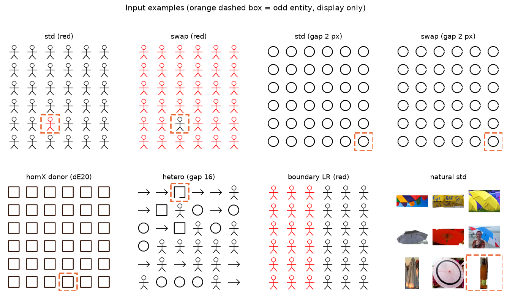
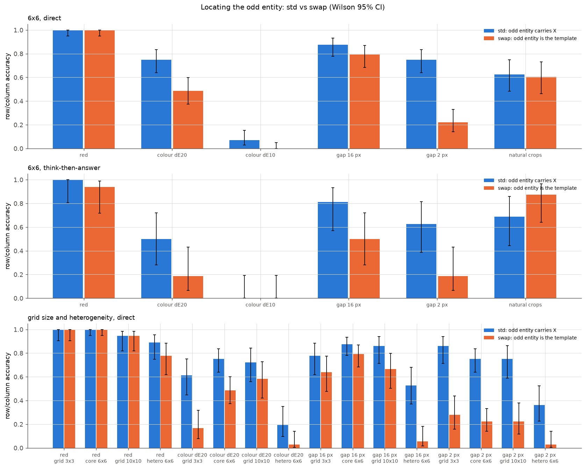
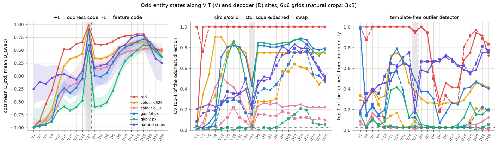
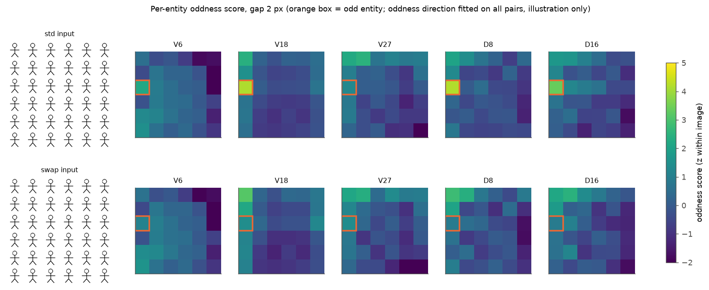
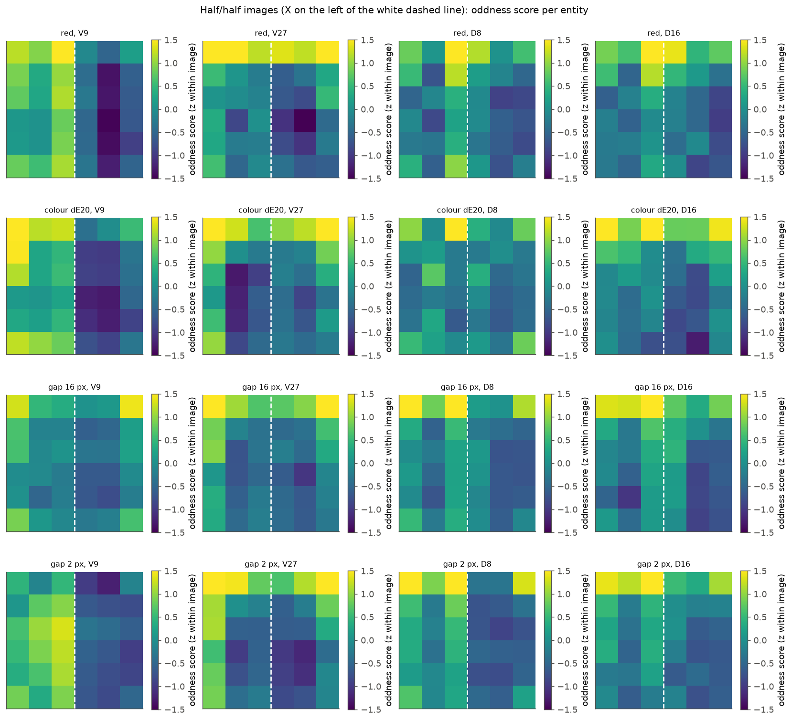
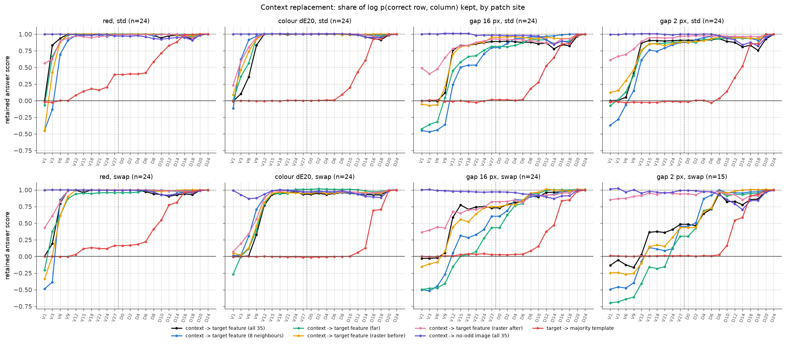
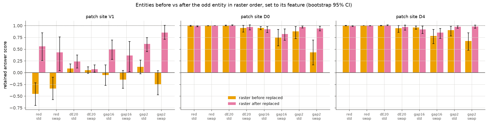
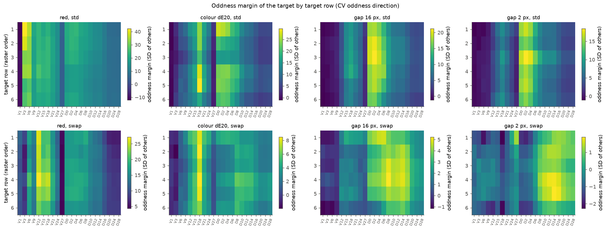
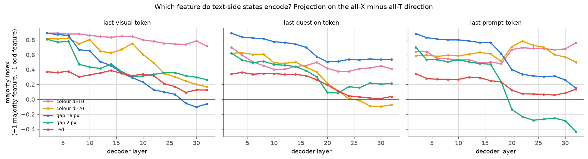

# 异常实体的比较机制

实验日期：2026-10-20。本文属于[视觉细节表征](plan.md)研究，执行[实验 2.6 设计](design_odd_entity.md)。主模型为 Qwen3.5-9B，冻结、bfloat16、SDPA，主评测为 thinking off。

## 0. 通俗讲述

在一组几乎相同的图形中找出与众不同的一个，人通常先看出“大多数图形长什么样”，再寻找偏离它的那一个。本实验检验 Qwen3.5 是否也这样做。我们为每个配对构造两张互为镜像的图：std 图中一个图形带有某种变化（例如缺口或颜色），其余 35 个是原模板；swap 图中只有一个图形是原模板，其余 35 个都带变化。两张图的异常图形位于同一格子，但异常图形“拥有”的属性恰好相反。如果模型的某一层只记录“这里有缺口”，它在两张图中给出相反的信号；如果它记录的是“这个图形与其他图形不同”，两张图中的信号方向一致。把目标图形相对其余图形的状态差在两张图中各取平均，二者的余弦从 −1 变为 +1 的位置，就是表征从“属性”转为“异常性”的位置。这一推导只依赖一个事实：若实体状态只是自身属性与全局上下文的加性叠加，图像内部做差后上下文抵消，两张图的差只差一个符号；同号分量必须来自“自身与上下文是否一致”的交互，也就是某种比较。

行为上首先出现了与人类视觉搜索相同的“搜索不对称”。在 6×6 网格中，带 2-pixel 缺口的一个图形混在完整图形中时，模型找到它的比例为 0.75；完整的一个混在 35 个带缺口的图形中时，比例降为 0.22。纯红色这样显著的变化则两个方向都是 1.00。若模型先建立对称的多数模板再逐一比较，两个方向应当同样容易，因此该结果与对称的模板比较不符。

表征与干预给出的机制如下。ViT 浅层只编码属性；比较首先发生在 ViT 的第 3–12 个 block，通过双向 attention 在全图范围内进行，结果是在目标图形自己的 token 上留下一个“与上下文不一致”的标记。到 ViT 第 12 个 block，对于“目标拥有某属性而其余没有”的情形，这个标记已经自足：此时把其余 35 个图形的状态全部换成与目标相同属性的状态，答案几乎不受影响。多数图形的 token 并不保存关于异常的信息，因为把它们换成一张从未出现异常的图像的对应状态，答案在 std 条件下保留 0.82 以上，在 swap 条件下保留 0.70 以上。decoder 接着把目标 token 上的标记整理为与属性无关的异常性编码，答案 token 在第 12–16 层从目标 token 读走它。对于“目标缺少其余都有的属性”的情形，ViT 的标记弱，比较要延续到 decoder 第 1–8 层，并且只和光栅顺序在目标之前的图形比较。像素级的检验最直接：在红色与缺口条件下，把目标之后的所有图形涂成目标的样子，答案保留 0.36–0.85；把目标之前的图形涂成目标的样子，答案保留不超过 0.12。模型实际找的是“按光栅顺序第一个与前面不同的图形”。这条光栅因果性也解释了 swap 条件下位于第一行的目标几乎从不被找到（0/12）。

## 1. 研究问题与主要结果

已有实验确定了异常信息进入答案的入口与读出层：[实验 2.5a](results_2026-10-13_activation_patching.md) 中，指定实例判断的异常信息由目标 visual tokens 进入，在 full attention 第 8–16 层转入文本；[实验 2.5c](results_2026-10-15_patching_extension.md) 中，坐标数字在第 16–20 层由格式 token 直接读取目标 visual tokens。本实验回答模型如何知道哪个实体是异常的，即异常性在哪里、以何种比较产生，以及答案如何使用它。主要结果：

1. **找不同存在搜索不对称。** 6×6 网格直接回答（每格 $n=72$）：2-pixel 缺口 std 0.75、swap 0.22（McNemar $p < 10^{-10}$）；色差 20 为 0.75 与 0.49；16-pixel 缺口为 0.88 与 0.79；纯红色均为 1.00（第 3.1 节）。
2. **异常性编码在目标 token 上逐层形成，形成位置取决于属性类型。** ViT 第 1 个 block 中全部条件的余弦 $c \approx -1$（纯属性编码）。纯红色在 ViT 第 12 个 block 转为正值，色差 20 在第 15 个 block；两种缺口与自然图像物体在整个 ViT 中保持负值或接近 0，到 decoder 第 6–16 层才升至 +0.60 至 +0.79（第 3.2 节）。
3. **对“拥有属性”的目标，自足的异常标记在 ViT 第 12 个 block 前形成，多数实体的 token 不承载异常信息。** 从 ViT 第 12 个 block 起把 35 个上下文实体替换为与目标相同属性的状态，std 条件的答案保留 0.76–1.00；把它们替换为无异常图像的状态，std 条件在任何位置的保留比例不低于 0.82，swap 条件不低于 0.70（第 3.4 节）。
4. **定位按光栅顺序因果进行。** 在 ViT 第 1 个 block 替换（相当于改像素）时，把目标之后的实体改为目标属性保留 0.36–0.85（红色、缺口），改目标之前的实体保留 −0.45 至 0.12。对 swap 的 2-pixel 缺口，decoder 输入处替换之前的实体只保留 0.43，替换之后的实体保留 0.94，比较延续到 decoder 第 8 层（第 3.5 节）。
5. **答案在 decoder 第 12–16 层从目标 token 读走异常信息。** 目标 token 替换为多数模板时，保留比例在 decoder 第 8 层为 −0.00 至 0.58，第 16 层为 0.69–0.99，与实验 2.5c 的读出层一致（第 3.4 节）。
6. **显式推理不弥补不对称。** 先描述再回答时，模型几乎总会先描述多数图形（13–16/16），但 swap 准确率不升反降（16-pixel 缺口 0.50，直接回答 0.79）（第 3.6 节）。

## 2. 实验设计与实际执行

### 2.1 刺激与输入示例

设计见[设计文档](design_odd_entity.md)第 2–3 节。下图为实际输入。橙色虚线框标出异常实体，仅用于展示，不输入模型。

| 组别 | 网格 | 变化类型 | 配对数 | 变体 |
| --- | --- | --- | --- | --- |
| 核心 | 6×6，单元 64 pixels | red、color20、color10、gap16、gap2 | 各 72（每格作目标两次） | std、swap、homT、homX |
| 实体数量 | 3×3、10×10 | red、color20、gap16、gap2 | 各 36 | std、swap |
| 异质多数 | 6×6，模板逐实体随机 | 同上 | 各 36 | std、swap |
| 半半分割 | 6×6，左右或上下各半 | 同上 | 每方向 12 | 无异常实体 |
| 自然物体 | 3×3，单元 128 pixels，RefCOCO 裁剪 | 类别 A 与 B | 48 | std、swap |

自然物体的 33 个类别由 RefCOCO testA（人）与 testB 指代表达中的关键词确定，每个类别取至少 9 个不同实例，配对随机抽取两个类别。直接回答问法与实验 1.3 的 T5 相同；显式推理问法与实验 1.3 的显式推理相同（thinking off，先描述再在最后一行给出 JSON）。

### 2.2 指标

符号与指标见设计文档第 2.3–2.4 节与第 3.4–3.5 节，此处只复述三项核心量。

1. 目标对比 $D = h_{t} - \frac{1}{n-1}\sum_{e \neq t} h_{e}$，其中 $h_{e} \in \mathbb{R}^{d}$ 为实体 $e$ 在某一提取位置的状态（覆盖 token 的均值，逐维标准化）。std 与 swap 的配对均值 $\bar{D}_{\mathrm{std}}$、$\bar{D}_{\mathrm{swap}}$ 的余弦记为 $c$。$c=-1$ 为纯属性编码，$c=+1$ 为纯异常性编码。
2. 异常性方向 $u_{\mathrm{odd}} = \tfrac{1}{2}(\bar{D}_{\mathrm{std}} + \bar{D}_{\mathrm{swap}})$ 在 4 折交叉验证下的 top-1 准确率（测试图像中投影最大的实体是否为目标，随机水平 $1/36$），以及目标的异常性 margin（目标投影减其余实体投影均值，再除以其余实体投影的标准差）。
3. 上下文替换的保留比例 $R$：以模型自己的正确直接回答作 teacher forcing，答案分数 $S$ 为正确行数字与列数字的对数概率之和，

$$
R = \frac{\sum_{i}\left(S_{\mathrm{patch}, i} - S_{\mathrm{base}, i}\right)}{\sum_{i}\left(S_{\mathrm{clean}, i} - S_{\mathrm{base}, i}\right)},
$$

   其中 $S_{\mathrm{base}}$ 为供体图像（不含异常的 homX 或 homT）在同一答案上的分数。$R=1$ 表示替换不影响答案，$R=0$ 表示答案退回无异常水平，$R<0$ 表示替换造成了指向别处的新异常。

### 2.3 规模、耗时与检查

| 阶段 | 规模 | 耗时 |
| --- | --- | --- |
| 直接回答 | 1680 条，`generate_batch` batch size 32（10×10 为 16） | 13 min |
| 显式推理 | 192 条（核心每种变化与自然物体各 16 个配对的 std 与 swap），batch size 8–16，上限 1024 tokens | 26 min |
| 实体状态提取 | 2496 张图像的 prefill，batch size 12 | 10 min |
| 上下文替换 | 184 张答对的图像 × 22 个提取位置 × 8 种替换，batch size 8 | 75 min |

合计约 2.1 GPU 小时，在共享 GPU 上运行。批量生成与 batch size 1 的 `generate` 在 20 条直接回答上 19/20 答案一致（16/20 文本完全一致）。替换实验在前 3 张图像上运行未替换的复制 batch，分数与基线的最大偏差为 $9.8 \times 10^{-5}$。上下文替换只用答对的图像；swap 的 2-pixel 缺口只有 16 张答对，其中 1 张的分母不足 1 nat 被剔除，其余条件各 23–24 张。

ViT 第 27 个 block 的输出中 5 个维度占全部方差的 97%（massive activation，merger 的 LayerNorm 会移除它们），该位置的余弦与 top-1 不稳定，图中以灰色带标出，正文不据此作结论。

### 2.4 与设计的偏离

1. 候选工具中的 attention 分析没有运行。实验 2.5c 与 3.11 已给出答案 token 的读取头，本实验的问题是异常性如何产生，上下文替换能直接给出因果答案，因此把 GPU 时间用于替换实验。
2. 自然物体只运行了行为与表征分解，没有构造同类别均匀供体图像，未做上下文替换。
3. 显式推理的 batch size 在运行中由 16 降为 8，以保持 GPU 余量；结果文件中逐条记录了 batch size。

## 3. 结果

### 3.1 行为：搜索不对称

图中蓝色为 std（异常实体带有变化 $X$），橙色为 swap（异常实体为原模板 $T$），误差线为 Wilson 95% 区间。

| 条件 | std | swap | std 独对 / swap 独对 | McNemar $p$ |
| --- | --- | --- | --- | --- |
| red 6×6 | 1.00 [0.95, 1.00] | 1.00 [0.95, 1.00] | 0 / 0 | 1 |
| color20 6×6 | 0.75 [0.64, 0.84] | 0.49 [0.37, 0.60] | 19 / 0 | $4 \times 10^{-6}$ |
| color10 6×6 | 0.07 [0.03, 0.15] | 0.00 [0.00, 0.05] | 5 / 0 | 0.06 |
| gap16 6×6 | 0.88 [0.78, 0.93] | 0.79 [0.68, 0.87] | 13 / 7 | 0.26 |
| gap2 6×6 | 0.75 [0.64, 0.84] | 0.22 [0.14, 0.33] | 39 / 1 | $7 \times 10^{-11}$ |
| gap16 异质多数 | 0.53 [0.37, 0.68] | 0.06 [0.02, 0.18] | 17 / 0 | $2 \times 10^{-5}$ |
| gap2 3×3 / 10×10 | 0.86 / 0.75 | 0.28 / 0.22 | 21 / 0，20 / 1 | $< 10^{-4}$ |
| 自然物体 3×3 | 0.62 [0.48, 0.75] | 0.60 [0.46, 0.73] | 9 / 8 | 1 |

**细微属性的缺失比属性的出现难找得多。** std 中模型要找的是唯一带缺口的图形，swap 中要找的是唯一完整的图形；两者的异常实体与多数实体之间像素差异相同，只是方向相反。若模型先建立多数模板再逐一比较，两者应同样容易；实际上 2-pixel 缺口的差距达 0.53，色差 20 达 0.26，只有纯红色这种极显著的变化对称。该不对称与心理学中视觉搜索的“特征出现优于特征缺失”现象一致，表明模型的异常检测以属性的出现为主要信号。

**多数实体的异质性对 swap 是致命的。** 当多数图形的模板逐实体随机时，“唯一完整的图形”要求模型知道每种模板完整时的样子，swap 准确率降至 0.03–0.06；std 中“唯一带缺口的图形”仍有 0.36–0.53。实体数量从 8 个增加到 99 个对两个方向的影响都很小（gap2 std 0.86 / 0.75 / 0.75，swap 0.28 / 0.22 / 0.22），这与逐个比较的串行搜索不符，更像一次并行的整体处理。

自然物体在两个方向上对称（0.62 与 0.60），因为“8 个人和 1 只狗”与“8 只狗和 1 个人”在语义上并无出现与缺失之分。失败时模型最常回答第 1 行第 1 列（2-pixel 缺口 swap 的 40 个有效错误答案中 17 个），这是没有检测到异常时的默认答案；另有 0–18 条回答声明“所有图形相同”并因 32 token 上限被截断（color10 每个方向 18 条，gap2 swap 14 条），这些均计为失败。

### 3.2 表征：属性编码转为异常性编码

左图为余弦 $c$（阴影为以配对为单位的 bootstrap 95% 区间），中图为异常性方向的交叉验证 top-1（圆点实线为 std，方块虚线为 swap），右图为“与图像均值距离最大的实体”这一不依赖训练的读出。颜色表示变化类型：红色为纯红色，黄色为色差 20，粉色为色差 10，蓝色为 16-pixel 缺口，青色为 2-pixel 缺口，紫色为自然物体。横轴 V$k$ 为 ViT 第 $k$ 个 block 输出，D0 为 merger 输出，D$k$ 为 decoder 第 $k$ 层输出；竖直虚线为 ViT 与 decoder 的分界，灰色带为 ViT 第 27 个 block。

| 变化 | $c$：V1 | V12 | V18 | D0 | D8 | D16 | top-1 std / swap：D16 |
| --- | --- | --- | --- | --- | --- | --- | --- |
| red | −0.99 | +0.15 | +0.52 | +0.62 | +0.74 | +0.81 | 1.00 / 1.00 |
| color20 | −1.00 | −0.21 | +0.33 | +0.34 | +0.56 | +0.66 | 0.75 / 0.60 |
| color10 | −1.00 | −0.58 | −0.19 | +0.15 | +0.40 | +0.52 | 0.22 / 0.12 |
| gap16 | −1.00 | −0.38 | −0.33 | +0.01 | +0.45 | +0.72 | 0.88 / 0.76 |
| gap2 | −0.99 | −0.67 | −0.67 | −0.59 | +0.05 | +0.60 | 0.83 / 0.19 |
| 自然物体 | −0.25 | +0.01 | −0.02 | +0.16 | +0.54 | +0.79 | 0.79 / 0.83 |

**ViT 浅层只编码属性，异常性编码是后来形成的。** 在 ViT 第 1 个 block，全部合成条件的 $c$ 为 −0.99 至 −1.00，即目标在 std 与 swap 中的独特性完全由其自身属性决定，此时还没有任何比较。异常性分量随层增长，说明目标 token 的状态逐渐依赖于“自身与其他实体是否一致”。

**颜色的比较在 ViT 中完成，缺口与物体类别的异常性编码在 decoder 中完成。** 纯红色在 V12、色差 20 在 V15 已转为正值，并且 V18 处 swap 的 top-1 达到 1.00 与 0.85；两种缺口在整个 ViT 中 $c$ 保持在 −0.67 至 −0.04，直到 decoder 第 6–16 层才升至 +0.60 以上。自然物体在 ViT 中 $c$ 接近 0，decoder 第 16 层达到 +0.79。解释：颜色是单个 patch 就能表达的低层属性，ViT 的双向 attention 可以直接在全图统计它；缺口和物体类别需要先在实体内部组合成形状或语义，再进行实体间的比较，这一步落在 decoder。

**decoder 中的异常性编码同样存在不对称。** 对 2-pixel 缺口，D16 处异常性方向在 std 上 top-1 为 0.83，在 swap 上只有 0.19，与行为准确率（0.75 与 0.22）相符；色差 20 的 swap 在 V18 达到 0.85，经 merger 后降至 0.28，decoder 再恢复到 0.60–0.64，行为 swap 准确率为 0.49。color10 的 top-1 在任何位置都不超过 0.53，与[实验 2.5b](results_2026-10-15_patching_extension.md) 中“低对比度颜色的失败发生在编码阶段”一致。不依赖训练的离群读出在多数条件下接近随机水平（右图），重现了[实验 2.1](plan.md) 中位置相关成分主导单图距离读出的结论；异常信息集中于特定方向，目标在整体距离上并不突出。

下图为 2-pixel 缺口的一个配对上每个实体在异常性方向上的投影（图像内 z 分数，viridis 色标）。std 中目标从 V18 起明显高于其余实体；swap 中目标始终不突出，与行为失败一致。该图使用全部配对估计的方向，仅作示意。

### 3.3 比较的范围：全局而非局部

**半半分割图中分界线附近的实体只获得很弱的异常性分数。** 设计中的局部对比假设预测，分界线两侧的实体有 3/8 的邻居属性不同，其异常性分数应达到单个异常实体的数分之一。下图将核心组估计的 $u_{\mathrm{odd}}$ 投影到半半分割图的每个实体上（图像内 z 分数，$X$ 位于白色虚线左侧）。

以同侧比较消除属性泄漏与图像边缘效应，定义局部指数为（分界线上的列减去相邻非边缘列，两侧平均），以图像内 z 分数为单位：

| 变化 | V12 | V18 | D0 | D8 | D16 |
| --- | --- | --- | --- | --- | --- |
| red（左右 / 上下） | 1.38 / 1.29 | 1.39 / 1.36 | 0.69 / 0.75 | 1.05 / 0.90 | 0.69 / 0.64 |
| color20 | 0.35 / 0.35 | 0.47 / 0.58 | −0.13 / 0.11 | 0.14 / 0.28 | 0.06 / 0.11 |
| gap16 | 0.21 / 0.23 | 0.13 / 0.23 | 0.36 / 0.34 | 0.66 / 0.47 | 0.81 / 0.39 |
| gap2 | 0.26 / 0.30 | 0.07 / 0.16 | 0.20 / 0.18 | 0.40 / 0.23 | 0.50 / 0.28 |

同一批位置上单个异常实体的 margin 在 std 中为 4.2–29.6（第 3.5 节的 margin 图，V18、D0、D16），局部指数只有其 2%–10%。分界效应确实存在，红色在 ViT 中最明显，缺口在 decoder 中最明显，与各自异常性编码形成的位置相同；但其幅度远小于纯局部对比的预测。上下文替换给出同样的结论：在 std 条件下，替换 27 个较远实体造成的损失大于替换 8 个相邻实体（色差 20 在 V3：保留 0.36 与 0.62），按单个实体计算邻居的权重约为远处实体的 2 倍。**比较在全图范围内进行，并带有较弱的邻近偏好。** 这与 ViT 的全局 attention 以及 decoder 的全序列读取相符，排除了纯粹的局部 pop-out（H2）。

### 3.4 因果检验：异常标记位于目标 token，多数实体不保存模板

每个子图为一种变化与变体，曲线为把指定实体组在该位置的状态替换后答案分数的保留比例 $R$。黑色、蓝色、绿色、黄色、粉色分别为把全部 35 个、8 个相邻、较远、光栅顺序在前、光栅顺序在后的上下文实体替换为与目标相同属性的状态；紫色为把全部上下文替换为无异常图像的状态；红色为把目标替换为多数模板。

| 变化与变体 | 上下文→目标属性：V6 | V12 | D0 | D8 | 上下文→无异常图像：最小值 | 目标→模板：D8 | D12 | D16 |
| --- | --- | --- | --- | --- | --- | --- | --- | --- |
| red std | 0.94 | 1.00 | 1.00 | 0.98 | 0.91 | 0.58 | 0.83 | 0.99 |
| red swap | 0.80 | 1.00 | 1.00 | 0.94 | 0.92 | 0.41 | 0.77 | 0.97 |
| color20 std | 0.35 | 1.00 | 1.00 | 1.00 | 0.95 | 0.09 | 0.43 | 0.92 |
| color20 swap | 0.01 | 0.77 | 0.93 | 0.96 | 0.87 | −0.00 | 0.06 | 0.69 |
| gap16 std | −0.01 | 0.76 | 0.89 | 0.88 | 0.84 | 0.18 | 0.52 | 0.85 |
| gap16 swap | −0.02 | 0.59 | 0.73 | 0.91 | 0.87 | 0.08 | 0.37 | 0.84 |
| gap2 std | 0.05 | 0.87 | 0.91 | 0.93 | 0.82 | 0.03 | 0.35 | 0.85 |
| gap2 swap | −0.13 | 0.03 | 0.48 | 0.94 | 0.70 | 0.03 | 0.54 | 0.91 |

**对“拥有属性”的目标，ViT 前 12 个 block 内形成的标记足以让答案成立。** 在 V12 处把全部上下文实体换成与目标属性相同的状态后，图中已不存在任何属性差异，唯一剩下的区别是目标 token 在前 12 个 block 中“看到过不同的上下文”。std 条件下答案仍保留 0.76–1.00，说明这一历史留下的标记已被模型当作异常的证据。缺口在表征上仍以属性编码为主（第 3.2 节，$c<0$），但标记中的关系分量已足以支持答案；decoder 随后放大这一分量。

**多数实体的 token 不承载答案所需的模板或指针。** 把全部上下文换成一张从未出现异常的图像的对应状态时，上下文的属性不变，只去掉了它们在前向计算中从目标处获得的信息；在 ViT 与 decoder 的全部 22 个位置上，保留比例不低于 0.70，绝大多数在 0.9 以上。若模型在多数实体的 token 上（例如经 Gated DeltaNet 状态累积到靠后的 visual tokens）形成多数模板并标记异常者，该替换会破坏答案。另外，在 decoder 输入处把上下文全部换成与目标相同属性时，文本 token 此后看到的是一张“全部相同”的图，std 条件的答案仍保留 0.89–1.00，因此文本侧的多数表征也不是答案所必需的（第 3.7 节）。

**答案在 decoder 第 12–16 层从目标 token 读走异常信息。** 目标替换为多数模板的保留比例在 D8 处为 −0.00 至 0.58，D16 处为 0.69–0.99；红色的信息离开目标较早（D8 已为 0.41–0.58）。这与实验 2.5c 中坐标读取集中于第 16–20 层一致。

### 3.5 光栅顺序：模型找“第一个与前面不同的实体”

黄色柱为把光栅顺序在目标之前的实体替换为目标属性，粉色柱为替换目标之后的实体，误差线为 bootstrap 95% 区间。由于目标位置在 36 个单元中均衡，两组的平均实体数相同（17.5）。

| 变化与变体 | V1：之前 | V1：之后 | D0：之前 | D0：之后 | D4：之前 | D4：之后 |
| --- | --- | --- | --- | --- | --- | --- |
| red std | −0.45 | 0.56 | 1.00 | 0.99 | 1.00 | 0.99 |
| red swap | −0.34 | 0.43 | 1.00 | 1.00 | 1.00 | 1.00 |
| color20 std | 0.09 | 0.23 | 1.00 | 1.01 | 1.00 | 1.01 |
| gap16 std | −0.05 | 0.49 | 0.95 | 0.93 | 0.96 | 0.92 |
| gap16 swap | −0.15 | 0.36 | 0.75 | 0.82 | 0.78 | 0.85 |
| gap2 std | 0.12 | 0.61 | 0.88 | 0.97 | 0.90 | 0.97 |
| gap2 swap | −0.25 | 0.85 | 0.43 | 0.94 | 0.67 | 0.98 |

**像素层面的替换揭示了光栅因果性。** 在 ViT 第 1 个 block 替换几乎等同于重绘像素。把目标之后的所有实体涂成目标的属性后，图像变为“前半为多数属性、从目标开始全部为目标属性”，目标成为光栅顺序上第一个与前面不同的实体，红色与缺口条件的答案保留 0.36–0.85（色差 20 为 0.07–0.23）；把目标之前的实体涂成目标属性后，目标成为一段相同实体的最后一个，答案保留 −0.45 至 0.12。ViT 的 attention 是双向的，不区分前后，因此这一不对称来自 decoder 按光栅顺序的因果处理：每个实体只能与它之前的实体比较。

**对“缺少属性”的目标，比较延续到 decoder 并且只看前面的实体。** swap 的 2-pixel 缺口在 decoder 输入处替换之前的实体只保留 0.43 [0.16, 0.69]，替换之后的实体保留 0.94；全部上下文替换的保留比例要到 decoder 第 8 层才回到 0.94。这说明 ViT 留下的标记不足以支持答案，decoder 前 8 层仍在把目标与它之前的实体比较。其他条件在 decoder 中前后差异很小，因为它们的比较已在 ViT 中完成。

**光栅因果性解释了行为中的位置效应。** swap 的 2-pixel 缺口按目标所在行的准确率为 0/12、2/12、3/12、4/12、5/12、2/12：位于第一行的目标之前只有不足 6 个实体可供比较，几乎从不被找到。D16 处异常性方向的 top-1 按行为 1、1、3、4、5、0（每行 12 个）。第 6 行的下降未得到解释；std 条件与纯红色没有行效应（下图）。

图中每格为目标位于该行时异常性 margin 的均值（viridis 色标，单位为其余实体投影的标准差），横轴为提取位置。在 V18、D0、D16 三个位置上，margin 与目标行号的 Spearman 相关的绝对值在全部条件中不超过 0.32，说明光栅效应主要体现在比较是否能完成（swap、细微属性），而不在 std 条件的信号强度上。

### 3.6 直接回答与先推理后回答

| 变化 | std：直接 / 推理 | swap：直接 / 推理 | 推理中描述多数图形 | 推理截断（std / swap） |
| --- | --- | --- | --- | --- |
| red | 1.00 / 1.00 | 1.00 / 0.94 | 31/32 | 0 / 0 |
| color20 | 0.75 / 0.50 | 0.49 / 0.19 | 31/32 | 0 / 10 |
| gap16 | 0.88 / 0.81 | 0.79 / 0.50 | 32/32 | 1 / 3 |
| gap2 | 0.75 / 0.62 | 0.22 / 0.19 | 29/32 | 3 / 5 |
| 自然物体 | 0.62 / 0.69 | 0.60 / 0.88 | 24/32 | 4 / 2 |

推理条件每格 $n=16$。描述多数图形以规则匹配“all other / the rest / most …”等表述判定。

**在文本中说出多数模板并不能补救视觉上的不对称。** 推理文本几乎总是先描述多数图形（例如“all figures are stick figures”），再声称逐一检查；但 swap 的准确率不升反降，color20 swap 有 10/16 条在 1024 tokens 内没有结束，文本在多个候选间反复。不描述多数图形的推理每格只有 0–5 条，无法比较两类推理的准确率。这与第 3.4 节一致：异常定位在 prefill 的视觉 token 上完成，image-token 状态与问法无关，推理文本只能读取它，无法重新进行比较。自然物体的 swap 在推理条件下达到 0.88（直接回答 0.60），样本只有 16 个，语义比较是否能借助语言完成需要更大样本确认。

### 3.7 文本侧的多数表征

纵轴为多数指数 $m$（$+1$ 表示该位置编码多数实体的属性，$-1$ 表示编码异常实体的属性），三个子图分别为最后一个 visual token、问题最后一个 token 与最后一个 prompt token，颜色同第 3.2 节。

文本位置在 decoder 第 4–16 层的多数指数为 +0.25 至 +0.84，即其状态更接近多数属性对应的均匀图像。这一结果本身不能区分“形成了模板”与“对 36 个实体的汇聚自然由 35 个多数实体主导”，而第 3.4 节表明它对答案不是必需的。对 2-pixel 缺口，最后一个 prompt token 在第 20 层后转为负值（第 32 层为 −0.43），即晚层的文本状态开始编码异常实体的属性，与 2.5a 中答案信息在晚层汇聚到最后一个 token 一致。

## 4. 解释：异常实体的定位机制

以下为根据第 3 节结果的解释。

1. **ViT 进行全局的属性比较，在目标自身 token 上留下标记。** ViT 第 1 个 block 只编码属性（第 3.2 节）；第 3–12 个 block 中，每个实体的状态开始依赖全图其他实体的属性，相邻实体的权重约为远处实体的 2 倍（第 3.3 节）。比较的结果写在异常实体自己的 token 上，到第 12 个 block 已经自足（第 3.4 节）。多数实体的 token 不保存模板或指针，因此 H1 中“模板存放在多数实体或文本 token 上”的形式被排除，H2 的纯局部 pop-out 也被排除。比较是隐式的：每个实体与全图属性分布的不一致程度直接写入自身状态，不存在一个被单独读取的多数模板。
2. **标记的强度取决于属性是否出现。** 目标拥有其他实体没有的属性时，标记强；目标缺少其他实体都有的细微属性时，标记弱（第 3.1–3.2 节）。这对应视觉搜索中的特征出现优势：模型对“多出来的东西”敏感，对“少了的东西”不敏感。
3. **标记弱时，decoder 按光栅顺序继续比较。** decoder 第 1–8 层把目标与它之前的实体比较（第 3.5 节），这依赖 Gated DeltaNet 与 full attention 的因果结构，因此靠前的目标难以被找到。
4. **decoder 把标记整理为异常性编码，答案在第 12–16 层读取。** 目标 token 上的状态在 decoder 中变为与属性无关的异常性方向（第 3.2 节），答案 token 在第 12–16 层读走它（第 3.4 节），其后的行列输出沿用实验 2.5c 与问题 3 所述的坐标读取路径。

该机制解释了实验 1.3 中“T5 与已知属性搜索 T4 准确率接近”的现象：std 条件下的找不同实际上就是对“出现的属性”的搜索，比较已在 ViT 中隐式完成，没有额外的比较步骤可以失败。它同时预测了两类失败：低对比度颜色在 ViT 中不产生标记（color10），细微属性的缺失只能依靠 decoder 的光栅因果比较完成。

## 5. 与其他实验的关系

1. **与实验 2.5a/2.5c 一致。** 两者确定目标 visual tokens 是异常信息的唯一入口、读出在第 16–20 层；本实验补充入口处的信号在 ViT 中由全局比较产生，并在 decoder 中转为异常性编码。目标替换的保留比例在 D16 处达到 0.69–0.99，与 2.5a 中视觉信息在第 16 层后不再被读取一致。
2. **与实验 3.8、3.10、3.9r2 一致。** 3.8 发现 Gated DeltaNet 在光栅顺序上链式累积行计数，3.9r2 发现行列序号只使用目标之前的实例数。本实验发现异常定位同样按光栅顺序因果进行：模型以“之前的实体”为参照判断异常。三者共同说明 decoder 把图像当作一条光栅序列处理，位置与关系都相对于序列中更早的 token 计算。
3. **与实验 2.1 一致。** 不依赖训练的离群读出接近随机（第 3.2 节），与 2.1 中“手工单图距离读出受位置相关成分主导”相同；异常信息位于特定方向上。
4. **与 BabyVision 的关系。** BabyVision 的找不同题目常要求找出缺少某部件的图形或异质图形中的异常者，正是本实验中 swap 与异质多数的情形，模型在这两类条件下的准确率为 0.03–0.22。

## 6. 限制

1. 上下文替换只在答对的图像上进行，swap 的 2-pixel 缺口只有 15 张有效图像，区间较宽。
2. 部分实体组替换（相邻、较远、之前、之后）会在图中制造新的属性簇，$R<0$ 即来自这种新异常；比较不同实体组时应注意它们改变的是不同的图像结构，而不只是实体数量。
3. 显式推理每格只有 16 个样本，且有截断；自然物体推理条件的提升需要更大样本确认。
4. 自然物体只做了行为与表征分解，没有上下文替换（缺少同类别的均匀供体图像），其异常性编码在 decoder 中形成这一结论只来自相关性证据。
5. 只测试了 Qwen3.5-9B；Qwen3-VL 的 DeepStack 是否改变 ViT 中比较的强度尚未检验。

## 7. 由结果导出的下一项实验

1. **光栅因果性的组件定位。** 在 swap 的细微缺口上，对 decoder 第 1–8 层的 Gated DeltaNet 门控（沿用 3.8 的 $\alpha$、$\beta$ 编辑）与 full attention 第 4、8 层分别消融，确定“与之前实体比较”由哪类层实现。
2. **双向重读的检验。** 若比较只看之前的实体，则把图像按相反光栅顺序（旋转 180°）再输入一次，或在推理时允许模型以第 2.2 节方向二的窗口方式重新读取后半部分，应能提高靠前目标的 swap 准确率。这一检验与问题 5 的局部重读直接相关，且不依赖任何任务特定结构。
3. **ViT 中比较的头级定位。** 在 ViT 第 3–12 个 block 中逐头消融，寻找把全图属性分布写入实体 token 的 attention 头，并检验它们是否同样负责 BabyVision 原题中的异常检测。

## 8. 运行与产物

- 入口：`scripts/analysis/representation/odd_entity.sh`（阶段 build、behave、spotcheck、capture、patch、analyze）。
- 代码：`analysis_tools/representation/odd_entity.py`、`odd_entity_run.py`、`odd_entity_analysis.py`；测试为 `tests/analysis/representation/test_odd_entity.py`。
- 产物：WORK_DIR 的 `analysis/representation/2026-10-20_odd_entity/`，包括 `items.jsonl` 与 `images/`（全部刺激及 SHA-256）、`results_behave.jsonl`、`spotcheck.json`、`capture/`（实体状态，float16）、`patch.jsonl`、`summary.json`，以及各阶段的 `run_*.json`（模型版本、batch size、起止时间）。
