# 视觉搜索不对称的机理

实验日期：2026-10-21。本文属于[视觉细节表征](plan.md)研究，执行[实验 2.7 设计](design_search_asymmetry.md)，承接[实验 2.6](results_2026-10-20_odd_entity.md)。主模型为 Qwen3.5-9B，冻结、bfloat16、SDPA，评测为 thinking off、直接回答。

## 0. 通俗讲述

人在一群 O 中找一个 Q 几乎不费力，在一群 Q 中找一个 O 却要逐个查看。心理物理学把这种现象称为搜索不对称，经典解释是：视觉系统有专门响应“线段”“末端”“倾斜”等特征的检测器，一个 Q 会让线段检测器在某个位置单独激活，这个“出现”的信号可以被全局一眼看到；一个 O 混在 Q 中时，只是某个位置的检测器没有激活，而“没有激活”本身并不构成信号，只有与周围比较才能发现。实验 2.6 已在 Qwen3.5 上看到同样的现象（缺口的出现比缺口的缺失容易找得多），本实验检验三件事：不对称出现在哪些特征上，它在模型内部来自何处，以及模型自己是如何完成“缺失”目标的定位的。

行为上，模型的不对称图谱与人类部分重合。Q 混在 O 中的准确率为 1.00，O 混在 Q 中只有 0.17；开口圆混在闭合圆中为 1.00，反过来为 0.28；倾斜线与饱和色有中等不对称；弯曲与笔直、大与小基本对称。“出现”的搜索与实体数量无关（Q 在 9、36、100 个 O 中分别为 1.00、1.00、0.97），这是并行搜索的特征；“缺失”的搜索即使只有 9 个实体也失败（0.14），因此它的困难不来自需要逐个检查太多实体，而来自缺少可以检测的信号。

原因可以用一个简单的数学模型说明。把 ViT 的一个 MLP 神经元看作特征检测器：在特征出现时它的激活均值为 $\mu_1$、标准差为 $\sigma_1$；在特征缺失时，GELU 把它压在接近 0 的下限上，均值为 $\mu_0$、标准差为 $\sigma_0$。目标相对干扰项的突出程度可以用目标偏离干扰项均值的标准差倍数衡量。std 图中目标出现、干扰项缺失，突出程度为 $(\mu_1-\mu_0)/\sigma_0$；swap 图中目标缺失、干扰项出现，突出程度为 $(\mu_1-\mu_0)/\sigma_1$。两者之比恰为 $\sigma_1/\sigma_0$：被压在下限的“关闭”状态几乎没有波动，“开启”状态却随特征在 patch 网格中的位置、偏移而大幅波动，所以出现的目标比缺失的目标突出得多。实测 Q 选择性最强的神经元在 O 上的标准差为 0.06、在 Q 上为 0.20，与 std 中目标偏离 13 个标准差、swap 中只偏离 4 个标准差相符。更关键的是，对 O 来说，几乎不存在“只在 O 上激活、在 Q 上关闭”的神经元，因为 Q 包含 O 的全部笔画；而弯曲与笔直两类实体各自都有专属的检测器，所以弯曲与笔直的搜索是对称的。把每个实体上偏离最大的 10 个神经元的偏离量作为“局部突出度”，Q 与开口圆在 swap 中的突出度与普通干扰项相同，等于没有局部信号。

模型自己的定位过程分两条路。对“出现”的目标，ViT 的 attention 在目标 token 上写下标记，进入 decoder 时答案已经可以直接读取：把 decoder 第 1–16 层所有 token mixer 在目标 token 上的输出全部替换为“上下文与目标相同”时的输出，答案几乎不受影响。对“缺失”的目标，同样的替换使答案完全退回无异常水平；decoder 必须让目标 token 读取光栅顺序在它之前的实体，这一读取由 full attention 第 4、8 层与 Gated DeltaNet 层共同完成，任何一类单独去掉都只造成部分损失。阻止光栅顺序在前的实体写入 DeltaNet 状态会选择性地破坏缺失目标的定位，阻止其后实体写入则没有影响。这解释了缺失目标位于第一行时几乎从不被找到：它之前没有可供比较的实体。

## 1. 研究问题与主要结果

1. **不对称集中在“额外线段或末端”的特征上。** 6×6、subtle 水平：Q 与 O 1.00 与 0.17，开口与闭合 1.00 与 0.28（McNemar $p<10^{-15}$），倾斜与竖直 0.99 与 0.83，饱和与不饱和 0.67 与 0.44；弯曲与笔直、大与小对称（第 3.1 节）。
2. **出现的搜索是并行的，缺失的搜索在任何实体数量下都困难。** Q 在 9、36、100 个实体中为 1.00、1.00、0.97；O 为 0.14、0.17、0.08。开口圆的 swap 随实体数量下降（0.61、0.28、0.08）（第 3.2 节）。
3. **ViT 的 MLP 神经元是被整流的出现检测器，缺失的目标没有正向局部信号。** ViT 第 9 个 block 中目标的局部突出度：Q 与 O 为 47 与 6.3，开口与闭合为 37 与 6.4，普通干扰项为 4.5–5.3；弯曲与笔直为 48 与 25（第 3.3 节）。
4. **对称的 MLP 激活编辑重现不对称。** 在均匀图像的一个实体上，把 ViT 第 3–18 层中 6 个 block 的 MLP 激活换成另一种实体的值：注入“出现”使模型指向该实体的比例在 Q、开口、倾斜、缺口上为 0.29–0.50，删除“出现”为 0.00–0.12（第 3.4 节）。
5. **出现目标不需要 decoder 中的目标侧 token 混合，缺失目标完全依赖它。** decoder 第 1–16 层全部 mixer 在目标上的输出替换后，std 保留 0.71–0.99，swap 保留 −0.03 至 0.32（第 3.5 节）。
6. **缺失目标的 decoder 比较由 full attention 与 Gated DeltaNet 冗余承担，并依赖光栅顺序在前的实体。** full attention 第 4、8 层替换后 swap 保留 0.45–0.72；光栅在前的实体在 DeltaNet 第 1–8 层不写入时 swap 保留 −0.22 至 0.53，std 保留 0.77–0.92，在后的实体不写入时两者均为 0.85–1.00（第 3.6 节）。

## 2. 实验设计与实际执行

### 2.1 刺激与输入示例

设计见[设计文档](design_search_asymmetry.md)第 3 节。下图每行为一个特征对，四列依次为 subtle 水平的 std、swap 与 salient 水平的 std、swap；最后一行为合取组。橙色虚线框标出异常实体，仅用于展示，不输入模型。

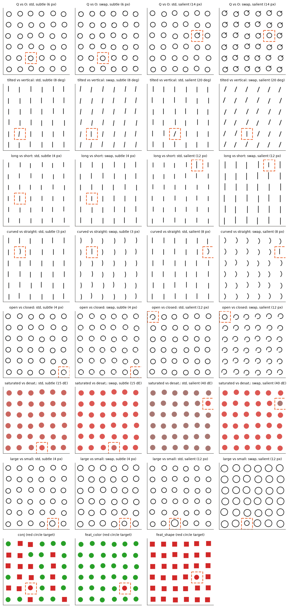

问法与实验 2.6 的直接回答问法相同：“One figure differs from all the others. Give its position. Return only {"row": r, "column": c} …”。

### 2.2 规模、耗时与检查

| 阶段 | 规模 | 耗时 |
| --- | --- | --- |
| 直接回答 | 2952 条，`generate_batch` batch size 32（10×10 为 8） | 17 min |
| 批量一致性检查 | 20 条以 batch size 1 的 `generate` 重解码 | 18/20 答案一致，16/20 文本一致 |
| 实体激活提取 | 864 张图像（9 个特征对 × 24 组 × 4 个变体），batch size 12 | 5 min |
| 神经元编辑 | 两轮，各 216 组 × 12 个条件 | 12 + 15 min |
| mixer 替换与门控编辑 | 171 张答对的图像 × 41 个条件，batch size 8 | 30 min |

合计约 1.4 GPU 小时。编辑与替换阶段因共享 GPU 显存不足，把模型拆分到两张卡上运行；mech 阶段前两张图像的空干预复制 batch 与基线分数的最大偏差为 $1.2 \times 10^{-3}$ nat。替换实验只用答对且有均匀供体的图像（每个特征对的前 24 组）。Q 与 O 的 swap 只有 5 张、开口与闭合的 swap 只有 6 张满足条件，区间很宽；另有 2 张图像的分数差不足 1 nat 被剔除。

### 2.3 与设计的偏离

1. 神经元编辑第一轮按设计在第 3、6、9、12 个 block 各选 32 个神经元，结果全部无效（第 3.4 节）；第二轮扩大为第 3、6、9、12、15、18 个 block 各 256 个神经元，并以同样 6 个 block 的全部 MLP 激活替换作为主要结论的依据。
2. attention 边的“背景 token”一组为空：6×6 网格恰好铺满 384×384 画布，没有不属于实体的 visual token。
3. 合取组的结果与预期相反（第 3.2 节），本实验未进一步分析其原因。

## 3. 结果

### 3.1 行为：不对称图谱

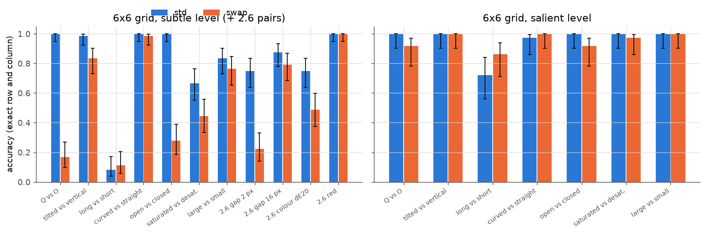

图中蓝色为 std（异常实体拥有特征 $A$），橙色为 swap（异常实体缺少特征 $A$），误差线为 Wilson 95% 区间；数值为模型直接回答的严格准确率（行与列均正确）。左图右侧四组取自实验 2.6。

| 特征对（6×6） | subtle std | subtle swap | std 独对 / swap 独对 | McNemar $p$ | salient std / swap |
| --- | --- | --- | --- | --- | --- |
| Q 与 O | 1.00 [0.95, 1.00] | 0.17 [0.10, 0.27] | 60 / 0 | $2 \times 10^{-18}$ | 1.00 / 0.92 |
| 开口与闭合 | 1.00 [0.95, 1.00] | 0.28 [0.19, 0.39] | 52 / 0 | $4 \times 10^{-16}$ | 1.00 / 0.92 |
| 倾斜与竖直 | 0.99 [0.93, 1.00] | 0.83 [0.73, 0.90] | 11 / 0 | $1 \times 10^{-3}$ | 1.00 / 1.00 |
| 饱和与不饱和 | 0.67 [0.55, 0.76] | 0.44 [0.34, 0.56] | 23 / 7 | 0.005 | 1.00 / 0.97 |
| 大与小 | 0.83 [0.73, 0.90] | 0.76 [0.65, 0.85] | 10 / 5 | 0.30 | 1.00 / 1.00 |
| 弯曲与笔直 | 1.00 [0.95, 1.00] | 0.99 [0.93, 1.00] | 1 / 0 | 1 | 0.97 / 1.00 |
| 长与短 | 0.08 [0.04, 0.17] | 0.11 [0.06, 0.20] | 5 / 7 | 0.77 | 0.72 / 0.86 |

subtle 水平每格 $n=72$，salient 水平每格 $n=36$。

**不对称集中在“额外的线段或末端”上。** Q 比 O 多一条短线段，开口圆比闭合圆多两个笔画末端，实验 2.6 的缺口同样增加末端；这三对的 swap 准确率只有 0.17–0.28，而 std 接近 1.00。倾斜线与饱和色这两个在人类中同样不对称的维度在模型中也不对称，但幅度小得多。差异变大时（salient 水平）所有特征对都接近对称，说明不对称是“细微差异”下的现象，与实验 2.6 中 16-pixel 缺口近乎对称一致。

**模型的图谱与人类并不完全一致。** 人类在弯曲与笔直、大与小上都有不对称（弯曲、更大的目标更容易找），模型在这两对上对称；长与短在 subtle 水平接近随机，salient 水平方向反转（短线在长线中 0.86，长线在短线中 0.72，$p=0.13$）。第 3.3 节表明，对称与否取决于 ViT 中是否同时存在两个方向的专属检测器，与人类视觉系统的特征清单无须相同。

### 3.2 实体数量与合取搜索

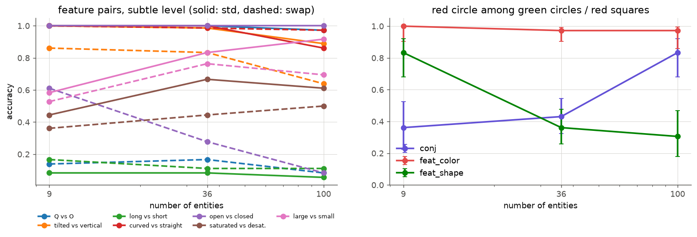

左图为 subtle 水平各特征对的准确率随实体数量（9、36、100）的变化，实线为 std，虚线为 swap；右图为红色圆盘目标在绿色圆盘（feat_color）、红色方块（feat_shape）或两者各半（conj）中的准确率，误差线为 Wilson 95% 区间。每点 $n=36$（6×6 为 72）。

| 条件 | 9 | 36 | 100 |
| --- | --- | --- | --- |
| Q 在 O 中 / O 在 Q 中 | 1.00 / 0.14 | 1.00 / 0.17 | 0.97 / 0.08 |
| 开口在闭合中 / 闭合在开口中 | 1.00 / 0.61 | 1.00 / 0.28 | 1.00 / 0.08 |
| 倾斜在竖直中 / 竖直在倾斜中 | 1.00 / 0.86 | 0.99 / 0.83 | 0.89 / 0.64 |
| feat_color / feat_shape / conj | 1.00 / 0.83 / 0.36 | 0.97 / 0.36 / 0.43 | 0.97 / 0.31 / 0.83 |

**出现的搜索不随实体数量变化，缺失的搜索在两种意义上失败。** Q 在 100 个 O 中仍为 0.97，这是并行搜索的标志。O 在 Q 中即使只有 9 个实体也只有 0.14，说明困难并非来自实体太多需要逐个比较，而是缺失本身在局部没有可检测的信号（第 3.3 节）。开口圆的 swap 随实体数量下降（0.61、0.28、0.08），表明在信号较弱时，可供比较的实体越多，目标越容易被淹没。

合取搜索的结果不符合串行搜索的预期：conj 条件在 9 个实体中为 0.36，在 100 个实体中反而升至 0.83。feat_shape（圆在方块中）在 36 和 100 个实体中只有 0.36 与 0.31，但行列相差不超过 1 的近似命中为 0.90 与 0.81，错误几乎都落在目标的相邻单元（6×6 中 41 个错误中 35 个相邻）。因此形状差异的困难主要在定位的精度，而非检测本身。合取组的反向实体数量效应本实验未作解释，列为限制。

两组的失败答案也与实验 2.6 相同：O 在 Q 中与闭合在开口中的目标位于第一行时 0/12 被找到，位于第 2–5 行时为 2/12–6/12，第 6 行为 0/12–1/12（`summary.json` 的 `by_row` 字段）。

### 3.3 ViT 神经元：被整流的出现检测器

本节所有数值直接取自 ViT 的 MLP 中间激活（GELU 之后，每个实体取其 16 个 patch 上的最大值），未经拟合；选择性 $d'$ 与局部偏差 $\delta$ 的定义见设计文档第 4.2 节。

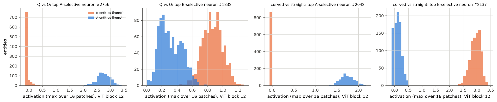

上图为 ViT 第 12 个 block 中选择性最强的单个神经元在 homA（蓝色，24 张图像 × 36 个实体）与 homB（橙色）全部实体上的激活直方图。左两幅为 Q 与 O：Q 选择性神经元 #2756 在 O 上被压在 GELU 下限附近（约 −0.1 至 0.2），在 Q 上为 2.1–3.4；O 选择性最强的神经元 #1832 在 O 上为 0.7–1.2，在 Q 上仍有 0.1–0.7。右两幅为弯曲与笔直：两个方向各有一个在另一类实体上完全关闭的神经元。

**“出现”有专属检测器，“缺失”没有。** 对 Q 与 O，Q 选择性神经元在 O 上处于关闭状态，O 选择性神经元却在 Q 上仍部分激活，因为 Q 包含 O 的全部笔画，任何响应 O 笔画的单元也会响应 Q。于是在 swap 图中，缺失的目标不会让任何神经元“单独亮起”，只能表现为某些神经元“单独熄灭”。弯曲与笔直不存在这种包含关系，两类实体各有在对方身上完全关闭的检测器，因此两个方向都有正向信号。

| 特征对（ViT block 12） | $d'>2$ 的 A 选择性 / B 选择性神经元数 | A 神经元在 A / B 上的均值 | A 神经元在 A / B 上的标准差 | std 目标偏差 / swap 目标偏差（top-32 A 神经元） |
| --- | --- | --- | --- | --- |
| Q 与 O | 93 / 45 | 0.83 / 0.07 | 0.20 / 0.06 | +13.0 / −4.4 |
| 开口与闭合 | 66 / 18 | 0.72 / 0.13 | 0.21 / 0.07 | +9.1 / −2.9 |
| 倾斜与竖直 | 173 / 374 | 0.71 / 0.19 | 0.14 / 0.07 | +3.8 / −2.0 |
| 弯曲与笔直 | 286 / 307 | 0.77 / 0.03 | 0.14 / 0.06 | +21.2 / −4.0 |
| 2.6 红色 | 17 / 16 | 0.19 / −0.02 | 0.10 / 0.04 | +15.5 / −6.8 |
| 2.6 缺口 2 px | 0 / 0 | 0.24 / 0.06 | 0.22 / 0.09 | +10.6 / −3.0 |

**std 与 swap 的局部偏差之比等于“开启”与“关闭”状态的标准差之比。** 第 0 节的推导给出 std 偏差约为 $(\mu_1-\mu_0)/\sigma_0$，swap 偏差约为 $(\mu_1-\mu_0)/\sigma_1$。以 Q 与 O 为例，$(0.83-0.07)/0.06 \approx 13$，$(0.83-0.07)/0.20 \approx 3.8$，与实测的 +13.0 与 −4.4 相符。也就是说，单就“出现检测器”这一组神经元而言，缺失的目标并非完全不可见，而是被开启状态的大波动稀释到了 std 的三分之一左右。

为了不依赖“哪些神经元是 A 选择性的”这一选择，定义实体的局部突出度为 4304 个神经元中正向偏差最大的 10 个的均值：

$$
P_{e} = \frac{1}{10} \sum_{j \in \operatorname{top10}} \frac{z_{e,j} - \operatorname{mean}_{e' \neq e} z_{e',j}}{\operatorname{std}_{e' \neq e} z_{e',j} + 0.01},
$$

其中 $z_{e,j}$ 为实体 $e$ 上神经元 $j$ 的激活，0.01 防止在其余实体上完全静默的神经元产生无穷大。普通干扰项的 $P_e$ 作为零假设水平。

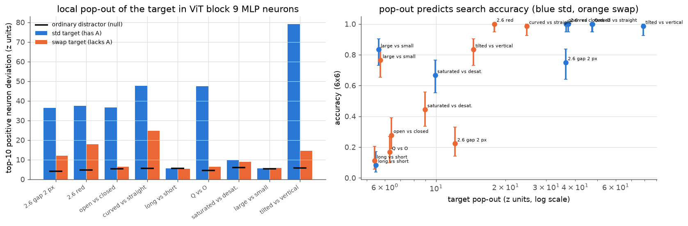

左图为 ViT 第 9 个 block 中目标的 $P_e$（蓝色 std，橙色 swap，黑色横线为同图中一个普通干扰项的 $P_e$，每个特征对 24 组）；右图横轴为同一突出度（对数坐标），纵轴为 6×6 的行为准确率（Wilson 区间）。

| 特征对 | std $P$ | swap $P$ | 普通干扰项 $P$ | swap 中最大负向偏差 |
| --- | --- | --- | --- | --- |
| Q 与 O | 47.4 | 6.3 | 4.5 | 3.9 |
| 开口与闭合 | 36.6 | 6.4 | 5.3 | 3.7 |
| 2.6 缺口 2 px | 36.4 | 12.1 | 4.2 | 13.5 |
| 倾斜与竖直 | 79.0 | 14.5 | 5.8 | 6.0 |
| 弯曲与笔直 | 47.5 | 24.7 | 5.6 | 6.1 |
| 2.6 红色 | 37.4 | 17.9 | 4.7 | 10.5 |
| 饱和与不饱和 | 9.9 | 9.0 | 6.0 | 2.5 |
| 大与小 | 5.6 | 5.7 | 5.4 | 3.0 |
| 长与短 | 5.5 | 5.4 | 5.6 | 2.5 |

**缺失的目标在 ViT 中没有正向局部信号，局部突出度大致预测了行为。** Q 与开口圆的 swap 目标的突出度与普通干扰项相同，行为准确率为 0.17 与 0.28；弯曲、倾斜与红色的 swap 目标有明显高于零假设的突出度（14.5–24.7），行为准确率为 0.83–1.00。大与小、长与短在两个方向都没有局部神经元信号：长与短在行为上接近随机，与此一致；大与小的行为却达到 0.76–0.83，说明尺寸差异经由本节未测量的途径（例如 attention 对整体轮廓的汇总）被检测，局部 MLP 突出度对它不适用。

下图把同一机制落在一张图像上。上排为 std（一个 Q 在 O 中），下排为 swap（一个 O 在 Q 中），三列依次为输入、Q 选择性神经元 #2756 在每个实体上的激活、每个实体的局部突出度 $P_e$，均为 viridis 色标，橙色虚线框为目标。

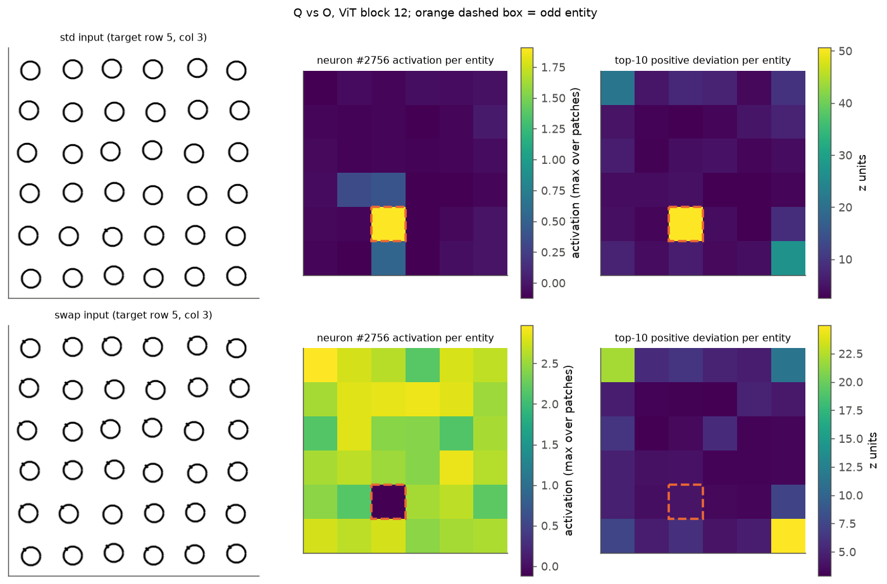

std 中目标是唯一亮起的单元，突出度约 50；swap 中该神经元在目标处形成一个暗洞，线性读出完全可以发现它，但正向突出度图上目标不突出，最突出的反而是左上角与右下角的实体。解释：模型的失败默认答案正是第 1 行第 1 列（10×10 网格中 36 张 O 在 Q 中的图像有 9 张回答 (1,1)），网格角落的边缘效应在缺少正向信号时成为最强的“异常”。

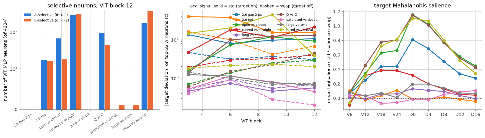

左图为 ViT 第 12 个 block 中 $d'>2$ 的神经元数（对数坐标，蓝色 A 选择性，橙色 B 选择性）；中图为 top-32 A 选择性神经元上目标的局部偏差绝对值随 block 的变化（实线 std，虚线 swap）；右图为目标相对干扰项分布的 Mahalanobis 显著性在 std 与 swap 中之比的对数（设计文档第 4.3 节，取自 24 组 capture 的实体状态）。

**残差流中的目标显著性在 merger 输出处最不对称，decoder 只部分缩小差距。** Q 与 O、开口与闭合、倾斜与竖直的显著性之比在 D0 达到 $e^{1.11}$–$e^{1.16}$（约 3 倍），2.6 缺口为 $e^{0.81}$；弯曲与笔直只有 $e^{0.32}$，红色、饱和度、尺寸接近 0。Q 与 O、开口与闭合的 swap 显著性从 V24 到 D16 保持在 15–17，比值在 decoder 中下降主要来自 std 显著性的回落。这说明残差流整体的“离群程度”不能反映 decoder 对缺失目标的补救，补救发生在第 3.5–3.6 节所示的特定读取上。

### 3.4 对称的神经元编辑

编辑在均匀图像的一个实体上进行，读出为 teacher forcing 下行列数字的 argmax 是否指向该实体（设计文档第 4.4 节），每个特征对 24 组。“注入 A”在 homB 中把该实体的激活设为 homA 的值，“删除 A”在 homA 中设为 homB 的值；两者改变同样的神经元、同样大小的差值。

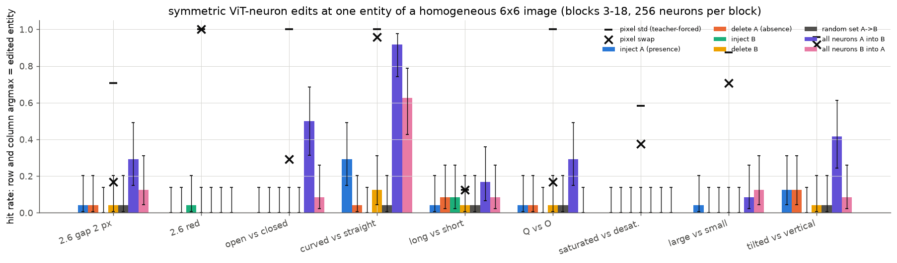

柱为命中率（Wilson 区间）：蓝色注入 A，橙色删除 A，青色注入 B，黄色删除 B，灰色为随机 256 个神经元，紫色为 6 个 block 的全部 MLP 激活由 A 注入 B，粉色为全部激活由 B 注入 A；黑色短横与叉号为像素层面的 std 与 swap 图像在同一读出下的命中率。

| 特征对 | 像素 std / swap | 全部 MLP：注入 / 删除 | McNemar（注入独中 / 删除独中） | 256 个 A 神经元：注入 / 删除 |
| --- | --- | --- | --- | --- |
| Q 与 O | 1.00 / 0.17 | 0.29 / 0.00 | 7 / 0，$p=0.016$ | 0.04 / 0.04 |
| 开口与闭合 | 1.00 / 0.29 | 0.50 / 0.08 | 10 / 0，$p=0.002$ | 0.00 / 0.00 |
| 倾斜与竖直 | 0.96 / 0.92 | 0.42 / 0.08 | 9 / 1，$p=0.02$ | 0.12 / 0.12 |
| 2.6 缺口 2 px | 0.71 / 0.17 | 0.29 / 0.12 | 5 / 1，$p=0.22$ | 0.04 / 0.04 |
| 弯曲与笔直 | 1.00 / 0.96 | 0.92 / 0.62 | 7 / 0，$p=0.016$ | 0.29 / 0.04 |
| 大与小 | 0.88 / 0.71 | 0.08 / 0.12 | 1 / 2 | 0.04 / 0.00 |
| 2.6 红色、饱和度 | 1.00 / 1.00；0.58 / 0.38 | 0.00 / 0.00 | — | 0.00 / 0.00 |

**同样大小的 MLP 激活差，“使其出现”比“使其消失”更容易被模型当作异常。** 在 Q、开口、倾斜、缺口四对上合计，注入的命中为 36/96，删除为 7/96。编辑只改动 MLP 激活，不改像素，也不改 attention 与 patch embedding，因此这一差异说明不对称在 ViT 的 MLP 表征层面已经成立，并且 decoder 的读出对“多出来的激活”敏感、对“少掉的激活”不敏感。弯曲与笔直在像素层面对称，在 MLP 编辑中也表现出注入优势（0.92 与 0.62），说明这种读出偏好是普遍的，只是弯曲与笔直的两个方向都有正向信号可用。

**出现信号是分布式的，少数选择性神经元不足以承载它。** 每个 block 选 32 或 256 个最具选择性的神经元做同样的编辑，命中率几乎都停留在 0.00–0.12（弯曲的注入为 0.29），与随机神经元相同。红色与饱和度在全部 MLP 替换后仍为 0，说明颜色信息主要经由 patch embedding 与 attention 写入残差流，不经过 MLP。这一节的因果证据因此限于“MLP 全体”这一粒度。

### 3.5 token mixer 替换：比较发生在哪里

替换方法见设计文档第 4.5 节：把指定层的 token mixer 在目标 token 上的输出换成“上下文与目标相同”的均匀图像中的值，纵轴为保留比例 $R$，阴影与误差线为以图像为单位的 bootstrap 95% 区间。$n$ 为每格答对的图像数：缺口 2 px、缺口 16 px、色差 20、红色各 15–16，Q 与 O 的 std 15、swap 5，开口与闭合的 std 16、swap 6。

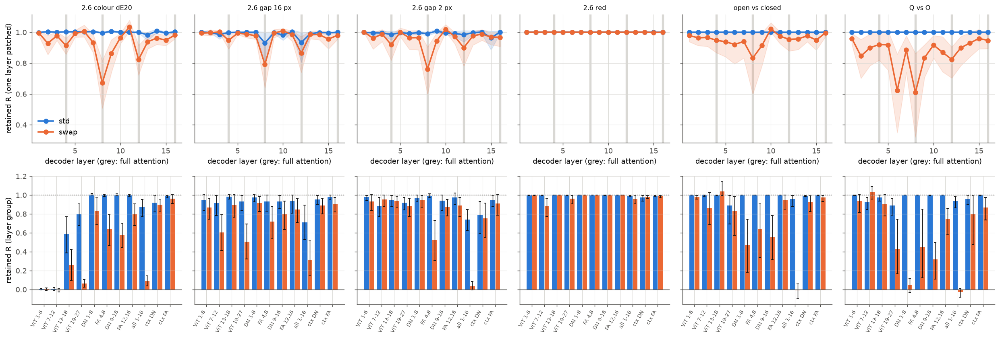

上排为 decoder 第 1–16 层逐层替换（灰色竖带为 full attention 层），下排为按层组替换：ViT attention 的四个 block 组、DeltaNet 第 1–8 层（DN 1-8）、full attention 第 4、8 层（FA 4,8）、DeltaNet 第 9–16 层、full attention 第 12、16 层、全部 16 层（all 1-16），以及在干扰项 token 上把 DeltaNet 或 full attention 的输出换成无异常图像值的对照（ctx DN、ctx FA）。蓝色 std，橙色 swap。

| 特征对 | ViT attention 全部 block：std / swap | decoder 全部 mixer：std / swap | FA 4,8：std / swap | DN 1–16：std / swap | 干扰项 DN 1–16：std / swap |
| --- | --- | --- | --- | --- | --- |
| Q 与 O | 0.21 / 0.42 | 0.94 / −0.03 | 1.00 / 0.45 | 0.99 / −0.05 | 0.96 / 0.80 |
| 开口与闭合 | 0.39 / 0.62 | 0.96 / −0.01 | 1.00 / 0.64 | 1.00 / 0.14 | 0.99 / 0.93 |
| 2.6 缺口 2 px | 0.30 / 0.84 | 0.74 / 0.03 | 0.99 / 0.52 | 0.94 / 0.59 | 0.79 / 0.75 |
| 2.6 缺口 16 px | 0.74 / 0.52 | 0.71 / 0.32 | 0.93 / 0.72 | 0.89 / 0.68 | 0.95 / 0.89 |
| 2.6 色差 20 | −0.00 / −0.02 | 0.88 / 0.09 | 1.00 / 0.64 | 1.00 / 0.46 | 0.92 / 0.90 |
| 2.6 红色 | 0.07 / 0.01 | 0.99 / 0.96 | 1.00 / 1.00 | 0.98 / 0.92 | 0.97 / 0.98 |

**出现的目标在 ViT 中完成比较，进入 decoder 时答案已可直接读取。** 去掉 decoder 第 1–16 层全部 mixer 写入目标的上下文信息后，std 保留 0.71–0.99；反过来，去掉 ViT 各层 attention 写入目标的上下文信息，std 只保留 −0.00 至 0.74（Q 与 O 0.21，缺口 2 px 0.30）。这与实验 2.6 中“自足的异常标记在 ViT 第 12 个 block 前形成”一致，并把它定位到 ViT attention 的输出。色差 20 只替换 ViT 第 1–6 个 block 的 attention 就降为 0.00，说明颜色的比较发生得最早。

**缺失的目标必须在 decoder 中读取上下文。** 同样的 decoder 替换使 Q 与 O、开口与闭合、缺口 2 px、色差 20 的 swap 分别保留 −0.03、−0.01、0.03、0.09，即答案完全退回无异常水平；ViT attention 替换对 Q 与 O、开口与闭合、缺口 2 px 的 swap 影响反而较小（0.42–0.84）；色差 20 是例外，它在两个方向都依赖 ViT 第 1–6 个 block 的 attention。缺失目标的信息因此来自 decoder 中目标 token 对其他 token 的读取，与第 3.3 节“ViT 中没有正向局部信号”相互印证。红色在两个方向都不依赖 decoder（0.96–0.99），与其两个方向都有强局部信号一致。

**没有单独哪一层是必需的，两类 token mixer 冗余地完成这一读取。** 逐层替换时，swap 的明显下降集中在第 8 层（full attention，保留 0.61–0.83），Q 与 O 在第 6 层（DeltaNet）也降至 0.62，其余各层多在 0.85 以上；成组替换时 full attention 第 4、8 层保留 0.45–0.72，DeltaNet 第 1–16 层保留 −0.05 至 0.68，两者同时替换才降至 0 附近。干扰项 token 上的替换影响较小（0.75–0.98），说明干扰项不需要从目标处获得信息，比较的结果写在目标自己的 token 上。

### 3.6 Gated DeltaNet 门控与光栅顺序

门控编辑见设计文档第 4.6 节，图中标签 a=0 表示衰减门 $\alpha_t=0$（目标在该层不能读取之前的状态），b=0 表示写入强度 $\beta_t=0$（该 token 不写入状态）；对照为一个光栅位置相近的干扰项（a=0 control）或光栅顺序在目标之后的实体（b=0 after）。

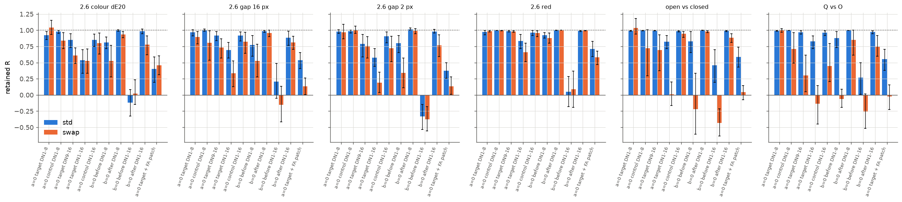

| 特征对 | $\alpha=0$ 目标 DN 1–8 | $\alpha=0$ 目标 DN 1–16 / 对照 | $\beta=0$ 之前实体 DN 1–8 | $\beta=0$ 之后实体 DN 1–8 | $\alpha=0$ 目标 + FA 替换 |
| --- | --- | --- | --- | --- | --- |
| Q 与 O swap | 1.00 | −0.14 / 0.45 | −0.06 | 0.85 | −0.02 |
| 开口与闭合 swap | 1.03 | 0.01 / 0.95 | −0.22 | 0.98 | 0.04 |
| 缺口 2 px swap | 0.97 | 0.19 / 0.72 | 0.34 | 0.99 | 0.14 |
| 缺口 16 px swap | 0.90 | 0.33 / 0.82 | 0.52 | 0.96 | 0.13 |
| 色差 20 swap | 1.04 | 0.53 / 0.80 | 0.53 | 0.93 | 0.46 |
| 上述五对 std 的范围 | 0.93–0.99 | 0.54–0.83 / 0.85–0.98 | 0.77–0.88 | 0.99–1.01 | 0.38–0.59 |

**缺失目标的定位依赖光栅顺序在前的实体写入 DeltaNet 状态。** 让目标之前的实体在 DeltaNet 第 1–8 层不写入状态时，swap 保留 −0.22 至 0.53，std 保留 0.77–0.88；让目标之后数量相当的实体不写入，两者都保留 0.85 以上。也就是说，模型判断“这个实体缺少某物”时，参照系是光栅顺序上更早出现的实体，这与实验 2.6 的像素级光栅检验以及 swap 目标位于第一行时 0/12 的行为一致。

**目标在 DeltaNet 第 1–8 层并不直接读取这个状态，读取发生在 full attention 第 4、8 层与 DeltaNet 第 9–16 层。** 只在 DeltaNet 第 1–8 层的目标 token 上令 $\alpha_t=0$ 完全没有影响（0.90–1.04），扩大到第 1–16 层后 Q 与 O、开口与闭合的 swap 降到 −0.14 与 0.01，而对照干扰项为 0.45 与 0.95。结合第 3.5 节，较合理的解释是：浅层 DeltaNet 在光栅顺序上把之前实体的信息累积进状态与后续 token 的表示，目标 token 在 full attention 第 4、8 层直接 attend 之前的实体，并在 DeltaNet 第 9–16 层读取累积的状态，两条读取通路各自足以完成大部分比较。$\beta=0$ 同时改变了之前实体自身的输出（它们不再读到自己的写入），因此“之前实体被写入状态”与“之前实体的表示被改变”在本实验中未能完全分离；对照中之后实体的同类编辑几乎无影响，说明非特异的表示损伤不足以解释 swap 的下降。

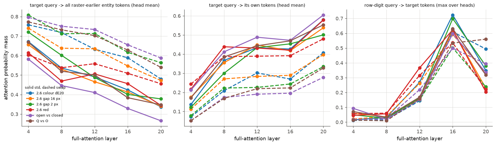

图中数值由 full attention 层的 query 与 key 重算 softmax 概率得到（未经拟合）：左图为目标 token 作为 query 时落在光栅顺序之前全部实体 token 上的概率质量（head 平均），中图为落在目标自身 token 上的质量，右图为预测行数字的位置落在目标 token 上的质量（取最大的 head）；实线 std，虚线 swap，颜色区分特征对。

**缺失目标的 token 在 full attention 中更多地看向之前的实体，答案读取路径在两种情形下相同。** 在第 4、8 层，Q 与 O、开口与闭合的 swap 目标把 0.73–0.80 的概率质量放在之前的实体上，std 为 0.45–0.67；std 目标看向自身的质量为 0.17–0.41，swap 为 0.05–0.17。这一模式与“swap 目标需要读取参照”相符，但由于两组答对图像的目标位置分布不同（swap 答对的目标较少位于第一行），之前实体的数量有差异，这里只作描述。预测行数字的位置在第 16 层以 0.50–0.72 的最大 head 质量读取目标 token，std 与 swap 相差不大，与实验 2.5c、3.11 的第 16–20 层读出一致。

## 4. 解释：不对称从何而来

以下为根据第 3 节结果的解释。

1. **局部信号的来源（参数与数据层面）。** ViT 的 MLP 神经元以整流的方式编码特征：特征出现时激活且随位置波动，特征缺失时停在 GELU 下限且几乎不波动（第 3.3 节）。一个实体能否被并行地找到，取决于是否存在“在它身上开启、在干扰项上关闭”的神经元。当 $B$ 的笔画是 $A$ 的子集（O 之于 Q、闭合圆之于开口圆），这样的神经元只对 $A$ 存在，于是出现与缺失之间产生不对称；当两者各有专属特征（弯曲与笔直），搜索对称。哪些特征拥有专属检测器取决于训练数据学到的特征清单，因此不对称的范围是数据与参数问题，确定性较高（行为、单神经元分布与突出度三方面一致）。
2. **读出的偏好（读出机制）。** 在 MLP 层面对称地改变同样大小的激活，“多出来”的激活更容易被模型报告为异常（第 3.4 节），出现目标的标记在 ViT attention 中形成后，decoder 无需再做目标侧的比较即可读取（第 3.5 节）。这说明模型的异常检测本质上是对正向离群激活的读取，与 Rosenholtz 的显著性模型以及 Wolfe 的激活图解释相符。
3. **缺失目标的补救（架构层面）。** 缺失的目标只能在 decoder 中通过与其他实体的比较定位。decoder 是因果的：目标只能读取光栅顺序在它之前的实体，读取由 full attention 第 4、8 层与 DeltaNet 第 9–16 层冗余地完成，参照信息由浅层 DeltaNet 在光栅顺序上累积（第 3.6 节）。因此第一行的缺失目标没有参照，最后一行附近的目标也受边缘效应干扰。这一部分源于 decoder 的因果结构，属于架构限制；双向 attention 的 ViT 本可以完成两个方向的比较，但它在缺少正向局部信号时没有做到，这一点又回到第 1 条的参数问题，确定性为中等。

## 5. 与其他实验的关系

1. **与实验 2.6 一致并补充。** 实验 2.6 发现出现目标在 ViT 中形成自足标记、缺失目标在 decoder 第 1–8 层按光栅顺序比较。本实验把前者定位到 ViT attention 的输出、把后者定位到 full attention 第 4、8 层与 DeltaNet 第 9–16 层的目标侧读取，并给出不对称的来源：ViT MLP 神经元的整流编码与特征包含关系。
2. **与实验 3.8、3.10 一致。** 3.8 与 3.10 发现 DeltaNet 在光栅顺序上链式累积行计数；本实验发现“缺失”的参照同样由光栅顺序在前的实体经 DeltaNet 状态提供，阻止其写入只破坏缺失目标的定位。两者共同说明 decoder 中“相对于之前内容”的计算普遍依赖 DeltaNet 的光栅累积；不同的是本实验中 full attention 第 4、8 层同样承担了读取，单独去掉 DeltaNet 的读取（$\alpha=0$ 于第 1–8 层）没有影响。
3. **与实验 2.5c、3.11 一致。** 答案在第 16 层从目标 token 读取行列信息，std 与 swap 使用同一读出路径；不对称发生在读出之前。
4. **与实验 5.2 的关系。** 5.2 测试的倒序重读没有带来收益；本实验表明缺失目标的困难首先在于 ViT 中没有正向信号，单纯改变光栅顺序只能改变参照的方向，不能产生信号，这与 5.2 的结果相符。
5. **与 BabyVision 的关系。** BabyVision 的找不同常要求找出“少了一个部件”的图形，正是本实验中 Q 与 O 的 swap 情形，模型在 9 个实体时也只有 0.14。

## 6. 限制

1. 替换实验中 Q 与 O 的 swap 只有 5 张、开口与闭合的 swap 只有 6 张有效图像，第 3.5–3.6 节对这两对的 swap 结论区间很宽，主要依据来自四个 2.6 特征对的一致结果。
2. 神经元编辑只在 MLP 全体的粒度上有效；32 或 256 个最具选择性的神经元无效，未能定位到具体的特征方向。
3. $\beta=0$ 编辑同时改变了之前实体自身的表示，“写入状态”与“表示改变”未完全分离。
4. 合取组的反向实体数量效应、大与小在没有局部 MLP 信号时仍能被找到的途径，均未解释。
5. 只测试了 Qwen3.5-9B 的合成线条图形；自然图像中缺失部件的检测是否遵循同一机制需要另行检验。

## 7. 由结果导出的下一项实验

1. **正向化的缺失信号。** 第 3.3 节表明缺失目标在单个出现检测器上形成一个可线性读出的“暗洞”，只是读出偏好正向离群。一个通用的检验是在 ViT 输出或 merger 前对每个通道计算相对图像均值的偏差并同时保留其正负两部分（例如拼接 $x-\bar{x}$ 的正部与负部），观察缺失目标的可读性是否改善；该改动不针对特定任务，可在多类任务上评估。
2. **full attention 第 4、8 层的头级定位。** 在这两层逐头消融目标 token 的读取，确定承担“与之前实体比较”的头，并检验它们是否与 3.10 的行计数电路共享。

## 8. 运行与产物

- 入口：`scripts/analysis/representation/search_asymmetry.sh`（阶段 build、behave、spotcheck、capture、select、edit、mech、analyze；第二轮编辑在脚本顶部设置 `TOP_K=256`、`EDIT_BLOCKS="3 6 9 12 15 18"`、`EDIT_TAG="_k256"`）。
- 代码：`analysis_tools/representation/search_asymmetry.py`、`search_asymmetry_run.py`、`search_asymmetry_analysis.py`；测试为 `tests/analysis/representation/test_search_asymmetry.py`。
- 产物：WORK_DIR 的 `analysis/representation/2026-10-21_search_asymmetry/`，包括 `items.jsonl` 与 `images/`（全部刺激及 SHA-256）、`results_behave.jsonl`、`spotcheck.json`、`capture/`（ViT MLP 激活与实体状态，float16）、`neurons.json` 与 `neurons_k256.json`、`edit.jsonl` 与 `edit_k256.jsonl`、`mech.jsonl`、`attn.jsonl`、`summary.json`，以及各阶段的 `run_*.json`（模型版本、参数、起止时间）。
