# 视觉搜索不对称的机理（第二轮）

实验日期：2026-11-03。本文属于[视觉细节表征](plan.md)研究，是[实验 2.7 第一轮](results_2026-10-21_search_asymmetry.md)的修订与扩展，承接[实验 2.6](results_2026-10-20_odd_entity.md)。主模型为 Qwen3.5-9B，冻结、bfloat16、SDPA，thinking off，问法为直接回答：“One figure differs from all the others. Give its position. Return only {"row": r, "column": c} …”。第一轮的结论在本文中重新组织为一条“假说—理论—实验—证据”的链条，第一轮文档的术语已同步修订。

## 0. 通俗讲述

在一群 O 中找一个 Q，模型几乎从不出错；在一群 Q 中找一个 O，模型多半找不到。本文把前者称为特征存在目标（异常实体多出一个部件或属性），把后者称为特征缺失目标（异常实体缺少这个部件或属性）。第一轮把这种不对称归因于“像素上的包含关系”：O 的笔画是 Q 的子集，所以缺少尾巴的 O 没有可检测的信号。第二轮首先检验这一说法是否普遍成立，然后追问模型内部到底写下了什么、如何读取，以及为什么缺失目标在网格开头几乎找不到。

第一个发现是，像素包含关系并不能预测不对称，真正起作用的是 ViT 中有没有“专属检测器”。我们新增了五对图形。方框里有没有一个点、线段末端有没有一根短横，这两对与 Q 和 O 一样是像素子集关系，也表现出不对称；四臂十字与缺一臂的三臂十字同样是像素子集关系，模型却两个方向都找得到（0.93 与 0.93）；直立十字与旋转 15° 的十字没有包含关系，模型却在旋转十字中找直立十字时只有 0.32。开口圆与闭合圆是 PI 特别关心的一对：开口圆的像素是闭合圆的子集，按像素规则开口圆应当难找，实际上开口圆在闭合圆中一眼可见（1.00），闭合圆在开口圆中反而难找（0.28）。原因在于 ViT 的 MLP 神经元经过 GELU 整流，像一组只在“看到某样东西”时才放电的检测器。开口圆的缺口带来两个笔画末端，ViT 第 9 个 block 中有专门在缺口所在 patch 上放电、在闭合圆上完全静默的神经元；闭合圆在开口圆中没有任何这样的神经元，它在缺口位置多出的一小段弧线只引起很弱的响应。把每一对图形在两个方向上“只在目标上放电、在干扰项上静默”的神经元数出来，子集型不对称的四对图形在缺失方向上都只有 0–2 个这样的神经元。局部检测器解释了“一眼可见”，缺失目标还可以经由另一条途径被找到：四臂与三臂十字的缺失方向同样几乎没有专属检测器，三臂十字却在 decoder 中获得了很强的异常信号，因而两个方向都找得到。

第二个发现回答“模型写下了什么”。我们在残差流中找到了一个跨特征共享的方向：把目标与干扰项平均的差向量在“目标有特征”和“目标缺特征”两种图像中相加，特征本身的差异相互抵消，剩下的就是“这个实体与众不同”的成分，我们称之为 oddness 方向。用八对图形求出的方向去度量第九对图形，目标在这个方向上的投影能够很好地预测行为：在 decoder 第 16 层，28 个条件上投影与准确率的秩相关为 0.94。特征存在目标在 ViT 末层就已经达到约 4.5 个标准差，特征缺失目标在 ViT 末层接近 0，只有在 decoder 中、并且只有在比较成功的情形下才逐渐升高。这个方向是因果的：在一张没有异常实体的均匀图像中，只要在某一个实体的 token 上加上“一个特征存在目标通常携带的量”的该方向，模型就有 0.88 的概率回答这个实体的位置，加上同样长度的随机方向只有 0.18。它被读取的方式也很具体：decoder 第 16 层的 head 6、11、2 与第 20 层的 head 2、11、10 在预测行数字时把注意力集中到这个实体上，其中第 20 层 head 11 正是实验 3.9 与 3.11 发现的坐标读出 head；把这 6 个 head 在答案位置置零，加方向后的命中率从 0.88 降到 0.23，真实图像上的答案分数也只剩约四成。

第三个发现回答“为什么缺失目标在第一行几乎找不到”。第一行第三个实体之前已有两个实体，因此“之前没有可比较的实体”不成立。为了区分“第几行”与“之前有多少个实体”，我们把同样的 36 个实体排成 3 行 12 列和 12 行 3 列。结果表明，决定成败的是光栅顺序在前的实体数量：之前不足 6 个实体时，三种排列中缺失目标都很少被找到；一个位于 3 × 12 网格第一行、之前有 6–11 个实体的目标，找到的概率与 6 × 6 网格第二行的目标相当。decoder 内部也给出了对应的图景：在没有异常实体的均匀图像中，第一个和第二个实体在 oddness 方向上本身就很突出（第 8–16 层约 2.6 与 1.4 个标准差），即 decoder 把序列开头的实体当作“新出现的东西”。特征存在目标在进入 decoder 前已经带着约 4.5 个标准差的 oddness，足以压过这种开头效应；特征缺失目标的 oddness 由 decoder 通过与前文比较才产生，在序列开头它与“新出现”的信号混在一起，无法区分。

## 1. 假说、实验与主要结论

本轮围绕四个假说组织，每个假说对应一组实验：

| 假说 | 检验方式 | 结论 | 章节 |
| --- | --- | --- | --- |
| H1：目标能否被一眼找到，取决于 ViT 中是否存在只在目标上放电的整流检测器，与像素包含关系无关 | 12 对图形的行为图谱；局部突出度与专属检测器计数；patch 级神经元图 | 支持；像素规则在 3 对上失败 | 第 4 节 |
| H2：异常信号最终写入一个跨特征共享的 oddness 方向；特征存在目标在 ViT 中写入，特征缺失目标在 decoder 中写入 | 留一法 oddness 方向；投影与行为的秩相关；层间轨迹 | 支持 | 第 5 节 |
| H3：decoder 通过少数 full attention head 读取 oddness 方向，把目标的位置复制到答案 | 加方向、去方向、reader head 消融 | 支持；方向充分，且承担约一半的答案信号 | 第 6 节 |
| H4：特征缺失目标需要足够多的光栅在前实体；第一行的失败来自“之前实体太少”，与“处在第一行”无关 | 36 个位置逐一采样；3 × 12 与 12 × 3 排列；均匀图像中的开头效应 | 支持；6 × 6 末行另有未解释的下降 | 第 7 节 |

主要结论如下：

1. **决定不对称的是检测器空间中的包含关系。** 若目标拥有某些神经元的专属激活，搜索在各种实体数量下都几乎不出错；若目标的全部激活也出现在干扰项上，只能依赖比较。像素子集关系只是检测器包含关系的一个近似：四臂与三臂十字（像素子集）对称，直立与旋转十字（无像素包含）不对称（第 4.1–4.3 节）。
2. **开口圆在闭合圆中一眼可见，闭合圆在开口圆中需要比较。** 缺口处有强烈的专属检测器（激活约 1.4，在闭合圆上为 0）；闭合圆在缺口位置只引起约 0.35 的弱响应，subtle 水平准确率 0.28；缺口加大到 12 像素时准确率升至 0.92，但其失败集中在光栅位置靠前的目标，说明它依赖 decoder 的比较（第 4.4 节）。
3. **残差流中存在跨特征共享的 oddness 方向，它是两条路径共同的终点。** 第 16 层投影与 28 个条件的准确率秩相关 0.94；特征存在目标在 ViT 末层即达到 z≈4.5，特征缺失目标只在 decoder 中上升（第 5 节）。
4. **oddness 方向是答案读取的“钥匙”。** 加 1 倍典型量即可让模型指向任意实体（0.88，随机方向 0.18）；第 16、20 层的 6 个 head 负责读取，消融后命中率 0.23；在 5 个位置同时去除该方向，答案分数保留约一半（第 6 节）。
5. **缺失目标的成败取决于光栅在前的实体数量。** 合并三种排列的 logistic 回归中，“之前不足 6 个实体”的系数为 −0.89，加入“位于第一行”后后者不再显著（第 7 节）。

## 2. 模型组件、操作与度量

本节先定义后文反复出现的模型组件、实验操作与度量。所有层号从 1 开始计数；Qwen3.5-9B 的 ViT 有 27 个 block，decoder 有 32 层，其中第 4、8、…、32 层为 full self-attention 层，其余 24 层为 Gated DeltaNet 层。

### 2.1 实体、token 与光栅顺序

刺激为网格排列的实体，每个实体占 $64 \times 64$ 像素。ViT 的 patch 为 $16 \times 16$ 像素，因此一个实体覆盖 $4 \times 4 = 16$ 个 patch；merger 把 $2 \times 2$ 个 patch 合并为一个 decoder 的 visual token，因此一个实体对应 4 个 visual token。decoder 按光栅顺序（逐 token 行、行内从左到右）读入 visual token。记实体 $e$ 的光栅序号为 $i_e$：在 $R$ 行 $C$ 列的网格中，第 $r$ 行第 $c$ 列的实体有 $i_e = C(r-1) + c$。光栅顺序在前的实体是满足 $i_{e'} < i_e$ 的实体，共 $i_e - 1$ 个。

### 2.2 两类序列混合子层

decoder 每一层由一个在 token 之间传递信息的子层和一个逐 token 的 MLP 组成。前者在本文称为序列混合子层，分为两类。

**full self-attention 层。** 记该层输入（RMSNorm 之后）为 $h_1, \dots, h_L \in \mathbb{R}^{4096}$，第 $t$ 个 token 在一个 head 中的输出为

$$
o_t = \sum_{s \le t} a_{ts} W_V h_s, \qquad a_{ts} = \frac{\exp\left(q_t^{\top} k_s / \sqrt{d}\right)}{\sum_{s' \le t} \exp\left(q_t^{\top} k_{s'} / \sqrt{d}\right)},
$$

其中 $q_t = W_Q h_t$ 与 $k_s = W_K h_s$ 为施加 MRoPE 位置旋转后的 query 与 key，$W_V$ 为 value 投影，$d$ 为 head 维度，$a_{ts}$ 为 attention 概率。第 $t$ 个 token 可以按内容相似度直接读取任何一个更早的 token，这是“读取某个特定实体”最直接的实现方式。每层 16 个 head，head 的输出经门控后由 $W_O$ 合并写回残差流。

**Gated DeltaNet 层。** 每个 head 维护一个状态矩阵 $S_t \in \mathbb{R}^{d_v \times d_k}$，按光栅顺序逐 token 更新：

$$
S_t = \alpha_t S_{t-1}\left(I - \beta_t k_t k_t^{\top}\right) + \beta_t v_t k_t^{\top}, \qquad o_t = S_t q_t ,
$$

其中 $k_t, q_t \in \mathbb{R}^{d_k}$ 与 $v_t \in \mathbb{R}^{d_v}$ 为当前 token 的 key、query 与 value（先经过一个沿序列方向、kernel 长度为 4 的因果短卷积），$\alpha_t \in (0, 1)$ 为衰减门，$\beta_t \in (0, 1)$ 为写入强度。把第一式展开可得 $S_t = \alpha_t S_{t-1} + \beta_t \left(v_t - \alpha_t S_{t-1} k_t\right) k_t^{\top}$：$\alpha_t S_{t-1} k_t$ 是状态根据已读内容对当前 value 的“预测”，状态只写入预测误差（delta rule）。因此 DeltaNet 层的输出只依赖光栅顺序在前的内容，并以压缩的形式保存它们。

### 2.3 局部突出度与专属检测器

局部突出度回答的问题是：ViT 的 MLP 神经元中，是否有一些神经元只在某个实体上明显激活、在同一图像的其余实体上几乎不激活。记 ViT 第 $k$ 个 block 的 MLP 中间激活（GELU 之后，4304 个神经元）在实体 $e$ 的 16 个 patch 上的逐维最大值为 $z_e \in \mathbb{R}^{4304}$（取最大值是因为 Q 的尾巴、开口圆的缺口只占实体的少数 patch）。实体 $e$ 在神经元 $j$ 上的标准化偏差为

$$
\delta_{e,j} = \frac{z_{e,j} - \operatorname{mean}_{e' \neq e} z_{e',j}}{\operatorname{std}_{e' \neq e} z_{e',j} + \epsilon}, \qquad \epsilon = 0.01,
$$

即该实体的激活比同图其余 35 个实体的平均高出多少个“其余实体之间的标准差”。局部突出度取 4304 个偏差中最大的 10 个的平均：

$$
P_e = \frac{1}{10} \sum_{j \in \operatorname{top10}(\delta_{e,\cdot})} \delta_{e,j} .
$$

这样定义出于三点考虑。第一，只取正向偏差，因为整流后的神经元只有“激活”能形成显著的离群值，“熄灭”的幅度受 GELU 下限限制。第二，分母是其余实体之间的波动：一个在其余实体上恒处于 GELU 下限（波动极小）、只在 $e$ 上激活的神经元会给出很大的 $\delta$，这正是专属检测器的特征。第三，取前 10 个而不固定某组神经元，是为了不预先假定哪些神经元负责哪个特征；$\epsilon$ 防止在其余实体上完全静默的神经元产生无穷大。

由于在 4304 个神经元中挑选最大值，即使普通实体也会得到正的 $P_e$，因此必须有参照分布：对同一批图像中的一个普通干扰项（光栅序号比目标大 7 的实体，循环计数）计算同样的 $P_e$，称为零假设水平。目标的 $P_e$ 明显高于零假设水平，才说明它有正向的局部信号。除特别说明外取 ViT 第 9 个 block。

专属检测器计数在均匀图像上计算，不依赖单张图像的抽样。记 $\mu_{A,j}, \sigma_{A,j}$ 为神经元 $j$ 在 homA（全部为 $A$）全部实体上的均值与标准差，$\mu_{B,j}, \sigma_{B,j}$ 同理。“一个 $A$ 在一群 $B$ 中”时神经元 $j$ 的预期偏差为

$$
\zeta^{A \mid B}_{j} = \frac{\mu_{A,j} - \mu_{B,j}}{\sigma_{B,j} + \epsilon},
$$

$\zeta^{B \mid A}_{j}$ 交换 $A$ 与 $B$ 即得。$\zeta > 5$ 的神经元称为该方向的专属检测器：它在目标上的激活比干扰项高出 5 个以上的干扰项标准差，只有当它在干扰项上接近静默时才可能达到。

### 2.4 答案分数、保留比例与输出替换

答案分数 $S$ 为 teacher forcing 下正确答案文本中行数字与列数字的对数概率之和。一次干预后的保留比例为

$$
R = \frac{\sum_i \left(S_{\mathrm{edit}, i} - S_{\mathrm{base}, i}\right)}{\sum_i \left(S_{\mathrm{clean}, i} - S_{\mathrm{base}, i}\right)},
$$

其中 $S_{\mathrm{clean}}$ 为未干预图像的分数，$S_{\mathrm{base}}$ 为同一答案文本在所有实体都与干扰项相同（不含异常实体）的均匀图像上的分数，求和遍历图像。$R = 1$ 表示干预不改变答案分数；$R = 0$ 表示答案分数降到不含异常实体的均匀图像上的水平，即模型对目标位置的偏好完全消失、只剩与目标无关的位置先验，这是对定位最彻底的破坏。$S_{\mathrm{clean}} - S_{\mathrm{base}} < 1$ nat 的图像不进入 $R$ 的计算，并单独报告其数量。第一轮的“输出替换”指把某一子层在目标 token 上的输出换成“上下文与目标相同”的均匀图像中的值，协议见[第一轮设计文档](design_search_asymmetry.md)第 4.5 节。

### 2.5 oddness 方向

为把“目标与众不同”落到残差流中的具体方向上，在每个提取位置定义目标对比向量

$$
c = h_t - \operatorname{mean}_{e \neq t} h_e \in \mathbb{R}^{d},
$$

其中实体状态 $h_e$ 为其 token 上残差流的平均（ViT 位置 $d = 1152$，decoder 位置 $d = 4096$）。对一个特征对，特征存在图像的平均对比 $\bar{c}_{\mathrm{pres}}$ 既含有“目标是 $A$、干扰项是 $B$”的特征差，也含有“目标与众不同”的成分；特征缺失图像的平均对比 $\bar{c}_{\mathrm{abs}}$ 中特征差的符号相反，“与众不同”的成分符号不变。因此

$$
u_{\mathrm{pair}} = \frac{\bar{c}_{\mathrm{pres}} + \bar{c}_{\mathrm{abs}}}{\left\lVert \bar{c}_{\mathrm{pres}} + \bar{c}_{\mathrm{abs}} \right\rVert}
$$

消去了特征差，只保留与“目标是哪一种实体”无关的成分，称为该特征对的 oddness 方向。为了检验它是否跨特征通用，评估某一特征对时使用其余第一轮特征对（共 9 对：七对图形与实验 2.6 的 2 像素缺口、红色）的 $u_{\mathrm{pair}}$ 的平均并归一化，记为 $u$（留一法）；第二轮新增的特征对不参与方向的估计。实体 $e$ 的 oddness 分数为 $s_e = (h_e - \operatorname{mean}_{e'} h_{e'})^{\top} u$，在图像内标准化为 z 分数。$u$ 的典型量 $m$ 定义为第一轮各特征对的特征存在目标在 $u$ 上投影 $c^{\top} u$ 的中位数（merger 输出 4.3，第 8 层 7.0，第 16 层 12.7）。

### 2.6 三类因果操作

1. **加方向。** 在不含异常实体的均匀图像中随机选一个实体，在某一位置（merger 输出记为 dec0，decoder 第 $l$ 层输出记为 dec$l$）给它的 4 个 token 加上 $\alpha m u$，$\alpha \in \{1, 2, 4\}$；读出为 teacher forcing 下以该实体坐标为答案时，行数字与列数字的 argmax 是否都指向它（命中）。对照为与 $u$ 正交的随机单位方向，长度相同。
2. **去方向。** 在答对的特征存在与特征缺失图像中，把目标 token 相对干扰项平均在 $u$ 上的分量去掉：

$$
h_t \leftarrow h_t - \left( (h_t - \bar{h}_{d})^{\top} u \right) u ,
$$

其中 $\bar{h}_{d}$ 为同一位置干扰项 token 的平均。单位置版本只在一个位置执行；全位置版本在 dec0、dec4、dec8、dec12、dec16 同时执行，并在前向传播中实时计算，使后续层无法从未修改的值恢复。对照为长度相同的随机正交方向。
3. **reader head 消融。** 把指定 full attention head 在答案文本位置上的输出置零（修改 $W_O$ 的输入），对照为同两层中随机选择的同样数量的其他 head。

## 3. 刺激与执行

### 3.1 新特征对与输入示例

| 特征对 | $A$（多出的部件） | $B$ | subtle / salient 参数 | 像素关系 |
| --- | --- | --- | --- | --- |
| 端点短横 | 线段一端加垂直短横 | 线段 | 短横长 6 / 14 像素 | $B \subset A$ |
| 四臂与三臂十字 | 四臂十字 | 缺一臂的十字 | 第四臂长 5 / 12 像素 | $B \subset A$ |
| 方框内点 | 方框加中心实心点 | 空方框 | 点直径 4 / 8 像素 | $B \subset A$ |
| 圆角方框与圆 | 圆角方框 | 圆 | 圆角半径 7 / 0 像素 | 无包含 |
| 旋转与直立十字 | 旋转十字 | 直立十字 | 旋转 15° / 45° | 无包含 |

下图每行一个新特征对，四列依次为 subtle 水平的特征存在目标、特征缺失目标与 salient 水平的两种目标；橙色虚线框标出异常实体，仅用于展示，不输入模型。

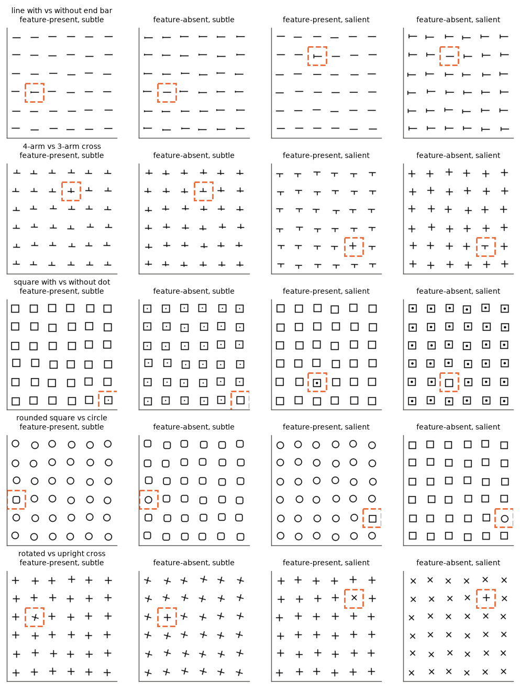

第一轮的七对图形（Q 与 O、开口与闭合圆、倾斜与竖直线、长与短线、弯曲与笔直线、饱和与不饱和色、大与小圆）见[第一轮第 2.1 节](results_2026-10-21_search_asymmetry.md)。

### 3.2 规模与检查

| 阶段 | 内容 | 规模 |
| --- | --- | --- |
| behave | 5 对新图形 × 6 × 6 × 两种目标（subtle 72、salient 36）；Q 与 O、开口与闭合 salient 各 24 组；位置集：Q 与 O、开口与闭合、倾斜与竖直的特征缺失目标各 216 张（每格 6 张，与第一轮每格 2 张合并为 8 张）；排列集：同三对在 3 × 12 与 12 × 3 上各 108 张特征缺失目标与 36 张特征存在目标 | 2688 次生成，batch size 32 |
| spotcheck | 20 条以 batch size 1 重解码 | 答案 17/20 一致，文本 16/20 一致 |
| capture | 带均匀供体的 4 元组：新图形 subtle 各 24 组、salient Q 与 O 和开口与闭合各 24 组、第一轮 Q 与 O、开口与闭合、弯曲与笔直、倾斜与竖直各 24 组；记录 ViT MLP 激活、实体状态、ViT 与 decoder 的 attention | 1056 张图像 |
| states | 位置集与排列集的实体状态（dec0、dec4、dec8、dec12、dec16） | 1512 张图像 |
| steer / steer2 | 6 对图形各 12 组均匀图像（144 张）；答对的图像 112 张 | 约 4300 次前向 |

GPU 用量约 0.35 GPU 小时（单张 A40 或 A800）。批量解码与单条解码在 3 条上答案不同，统计使用批量解码结果，失败样本全部保留。

### 3.3 与计划的偏离

1. 圆角方框与圆、旋转与直立十字原计划作为“互不包含”的对照，后者的结果与预期相反（第 4.1 节），保留为反例。
2. ViT attention 原计划报告每个实体从其余实体获得的注意力，该量被少数固定位置的高范数 token 主导，无法反映目标，因此改为报告实体的自注意力（第 5.3 节）。
3. reader head 的选择依据加方向实验中注意力增量最大的 head，因此 reader head 消融是对同一批图像的事后检验；消融同时在真实的特征存在与特征缺失图像上评估，后者不参与选择。

## 4. H1：整流检测器决定能否一眼找到

**假说与理论。** ViT 的 MLP 神经元经过 GELU，未被激活时停在接近 0 的下限、几乎不波动，被激活时数值大且随特征的位置与形变波动。设某神经元在特征出现时均值为 $\mu_1$、标准差为 $\sigma_1$，未出现时均值为 $\mu_0$、标准差为 $\sigma_0$，且 $\sigma_0 \ll \sigma_1$。一个特征存在目标在该神经元上的偏差约为 $(\mu_1 - \mu_0)/\sigma_0$，一个特征缺失目标的偏差约为 $-(\mu_1 - \mu_0)/\sigma_1$，前者远大于后者的绝对值，且前者为正。因此，一个实体能否“一眼”被找到，取决于是否存在在它身上开启、在干扰项上关闭的神经元。若目标所激活的每个神经元也在干扰项上激活（检测器空间中的包含关系），目标只能表现为“少激活了一些”，需要逐一比较。像素包含关系只是这一条件的近似：多出一段笔画可能同时去掉一个笔画末端或改变交叉点的类型，从而产生对方独有的特征。

**预测。** 特征存在目标总有专属检测器；特征缺失目标是否有专属检测器，应由检测器计数而非像素关系预测，并与行为一致。

### 4.1 行为图谱

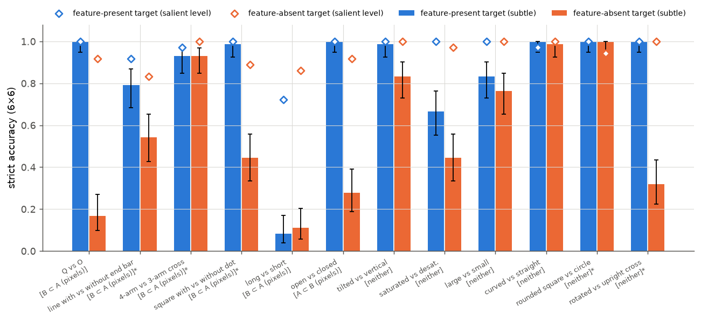

图中数值为模型直接回答的严格准确率（行与列都正确），由 behave 阶段的生成结果计算。蓝色柱为特征存在目标，橙色柱为特征缺失目标（subtle 水平，误差线为 Wilson 95% 区间）；空心菱形为 salient 水平；横轴括号内为像素关系，星号标出第二轮新增的特征对。

| 特征对（6 × 6，subtle） | 像素关系 | 特征存在 | 特征缺失 [95% 区间] | 仅存在答对 / 仅缺失答对 | McNemar $p$ | salient 存在 / 缺失 |
| --- | --- | --- | --- | --- | --- | --- |
| Q 与 O | $B \subset A$ | 1.00 | 0.17 [0.10, 0.27] | 60 / 0 | $2 \times 10^{-18}$ | 1.00 / 0.92 |
| 方框内点 | $B \subset A$ | 0.99 | 0.44 [0.34, 0.56] | 39 / 0 | $4 \times 10^{-12}$ | 1.00 / 0.89 |
| 端点短横 | $B \subset A$ | 0.79 | 0.54 [0.43, 0.65] | 24 / 6 | $1.4 \times 10^{-3}$ | 0.92 / 0.83 |
| 四臂与三臂十字 | $B \subset A$ | 0.93 | 0.93 [0.85, 0.97] | 3 / 3 | 1.0 | 0.97 / 1.00 |
| 长与短线 | $B \subset A$ | 0.08 | 0.11 [0.06, 0.20] | 5 / 7 | 0.77 | 0.72 / 0.86 |
| 开口与闭合圆 | $A \subset B$ | 1.00 | 0.28 [0.19, 0.39] | 52 / 0 | $4 \times 10^{-16}$ | 1.00 / 0.92 |
| 旋转与直立十字 | 无包含 | 1.00 | 0.32 [0.22, 0.43] | 49 / 0 | $4 \times 10^{-15}$ | 1.00 / 1.00 |
| 倾斜与竖直线 | 无包含 | 0.99 | 0.83 [0.73, 0.90] | 11 / 0 | $1.0 \times 10^{-3}$ | 1.00 / 1.00 |
| 饱和与不饱和色 | 无包含 | 0.67 | 0.44 [0.34, 0.56] | 23 / 7 | $5 \times 10^{-3}$ | 1.00 / 0.97 |
| 大与小圆 | 无包含 | 0.83 | 0.76 [0.65, 0.85] | 10 / 5 | 0.30 | 1.00 / 1.00 |
| 弯曲与笔直线 | 无包含 | 1.00 | 0.99 [0.93, 1.00] | 1 / 0 | 1.0 | 0.97 / 1.00 |
| 圆角方框与圆 | 无包含 | 1.00 | 1.00 [0.95, 1.00] | 0 / 0 | 1.0 | 1.00 / 0.94 |

subtle 水平每格 $n = 72$，salient 水平每格 $n = 36$；McNemar 检验在共享目标位置、朝向与抖动的配对图像上进行。

**像素包含关系在三对图形上给出错误预测。** 四臂与三臂十字是像素子集关系，搜索却完全对称（0.93 与 0.93）；开口圆是闭合圆的像素子集，按像素规则应当难找，实际上开口圆一眼可见、闭合圆难找；旋转与直立十字没有像素包含，却与 Q 和 O 一样强烈不对称（1.00 与 0.32）。这说明决定不对称的是模型内部对这些像素的编码方式，像素几何只是它的近似，下文用神经元计数检验这一点。

**方框内点与端点短横复现了子集型不对称，幅度与差异大小有关。** 4 像素的点缺失时只有 0.44，短横缺失时为 0.54；差异放大到 salient 水平后两者都升至 0.83 以上，与第一轮“不对称是细微差异下的现象”一致。

### 4.2 局部突出度与专属检测器

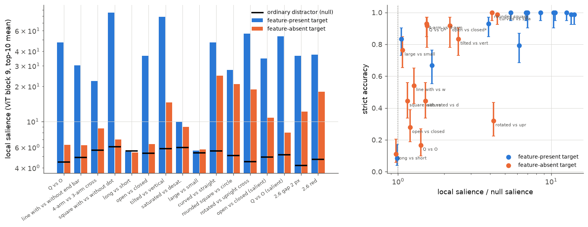

左图数值直接取自 ViT 第 9 个 block 的 MLP 激活（第 2.3 节定义，未经拟合）：蓝色为特征存在目标的 $P_e$，橙色为特征缺失目标的 $P_e$，黑色短横为普通干扰项的零假设水平，纵轴为对数坐标，每对 24 组图像。右图横轴为 $P_e$ 除以零假设水平，纵轴为行为准确率（Wilson 区间），蓝点与橙点含义同左图。

| 特征对 | 存在 $P$ | 缺失 $P$ | 零假设 $P$ | 专属检测器 $A$ / $B$ | 特征缺失准确率 |
| --- | --- | --- | --- | --- | --- |
| Q 与 O | 47.4 | 6.3 | 4.5 | 30 / 0 | 0.17 |
| 开口与闭合圆 | 36.6 | 6.4 | 5.3 | 39 / 0 | 0.28 |
| 方框内点 | 85.9 | 7.0 | 6.1 | 90 / 2 | 0.44 |
| 端点短横 | 30.3 | 6.2 | 4.9 | 8 / 0 | 0.54 |
| 旋转与直立十字 | 56.7 | 18.9 | 4.5 | 107 / 29 | 0.32 |
| 四臂与三臂十字 | 22.1 | 8.7 | 5.7 | 2 / 0 | 0.93 |
| 倾斜与竖直线 | 79.0 | 14.5 | 5.8 | 52 / 10 | 0.83 |
| 弯曲与笔直线 | 47.5 | 24.7 | 5.6 | 64 / 22 | 0.99 |
| 圆角方框与圆 | 27.6 | 20.8 | 5.1 | 32 / 39 | 1.00 |
| 饱和与不饱和色 | 9.9 | 9.0 | 6.0 | 0 / 0 | 0.44 |
| 大与小圆 | 5.6 | 5.7 | 5.4 | 0 / 1 | 0.76 |
| 长与短线 | 5.5 | 5.4 | 5.6 | 0 / 0 | 0.11 |
| 开口与闭合圆（salient） | 34.6 | 10.8 | 4.9 | 43 / 0 | 0.92 |
| Q 与 O（salient） | 53.8 | 8.0 | 5.2 | 89 / 0 | 0.92 |

专属检测器为 ViT 第 9 个 block 中 $\zeta > 5$ 的神经元数（第 2.3 节），“$A$”列为特征存在方向，“$B$”列为特征缺失方向。

**子集型不对称的四对图形，特征缺失方向的专属检测器数为 0–2，局部突出度与零假设水平相当。** Q 与 O、开口与闭合圆、方框内点、端点短横中，缺失目标的 $P$ 只比零假设高 0.9–1.8，而存在目标高出 25–80；对称的弯曲与笔直线、圆角方框与圆在两个方向都有数十个专属检测器。这直接对应第 4 节开头的推导：缺失目标的每一个强激活也出现在干扰项上，它在 ViT 局部表征中没有“只属于自己”的信号。

**局部突出度不能单独解释所有特征缺失目标。** 四臂与三臂十字的缺失方向只有 0 个专属检测器、$P = 8.7$，准确率却有 0.93；旋转与直立十字的缺失方向有 29 个专属检测器、$P = 18.9$，准确率只有 0.32。按 28 个条件计算，$P$ 与零假设之比和准确率的秩相关为 0.78，只看特征缺失目标时为 0.62。也就是说，ViT 第 9 个 block 的局部信号解释了“一眼可见”的那条路径，但缺失目标还能经由另一条路径被找到，这条路径的强弱由第 5 节的 oddness 投影更好地刻画。旋转十字的反例的一种解释是：旋转 15° 的检测器响应在直立十字上同样存在，只是较弱，因此 29 个专属检测器的数值偏差虽大，绝对激活很小；本实验未进一步区分。

### 4.3 检测器在实体内部的位置

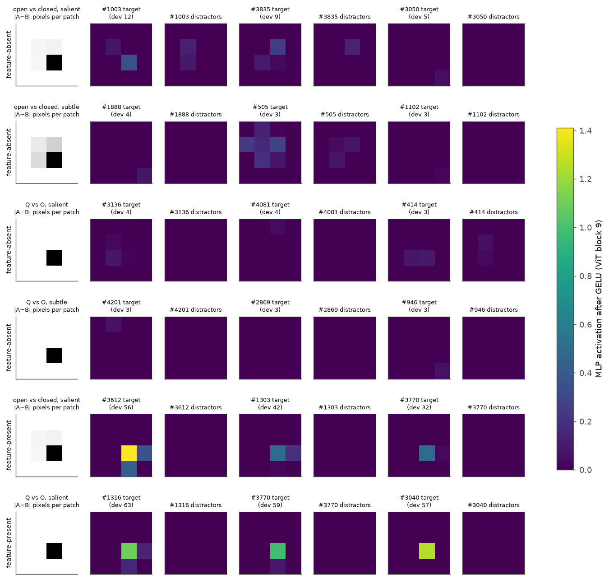

图中数值直接取自 ViT 第 9 个 block 的 MLP 激活（GELU 之后），对每个 4 元组的前 12 组图像平均。每行一个条件：最左列为 $A$ 与 $B$ 的像素绝对差在实体 $4 \times 4$ 个 patch 上的平均（灰度，越黑差异越大）；其余列成对出现，依次为平均偏差 $\delta$ 最大的三个神经元在目标上与在干扰项上的 patch 图（viridis 色标见右侧，单位为激活值），标题中括号内为该神经元的平均 $\delta$。所有 patch 图已按刺激朝向旋转，使尾巴、缺口统一位于右下方。

**特征存在目标的检测器恰好在多出部件所在的 patch 上放电，在干扰项上为 0。** 开口圆（salient）的最强神经元 #3612 在缺口所在 patch 的激活为 1.41，在闭合圆上为 −0.06；Q 的最强神经元 #1316 在尾巴所在 patch 为 1.10。值得注意的是，神经元 #3770 同时出现在开口圆与 Q 的前三名中，它响应的是两者共有的笔画末端，这与 Treisman 把“末端”列为基本特征的结论相合。

**特征缺失目标没有相应的放电中心。** subtle 水平的闭合圆与 O 的前三名神经元平均激活不超过 0.08，位置分散；salient 水平的闭合圆有一个较弱的例外（#1003 在缺口位置的激活为 0.35，在开口圆的同一位置接近 0），它对应闭合圆在缺口处多出的一小段弧线，是一个幅度只有缺口检测器四分之一的“存在”信号。

### 4.4 开口圆与闭合圆

把以上结果集中到这一对图形上：

1. 开口圆在闭合圆中：准确率 1.00（subtle 与 salient），缺口处有 39 个专属检测器（salient 水平 43 个，最强激活约 1.4），搜索与实体数量无关（第一轮：9、36、100 个实体中均为 1.00）。
2. 闭合圆在开口圆中：subtle（4 像素缺口）准确率 0.28，0 个专属检测器；salient（12 像素缺口）准确率 0.92，仍为 0 个专属检测器，只有缺口处一个弱响应（0.35）。

**闭合圆在开口圆中被找到，依靠的是 decoder 中的比较，ViT 中的弱局部信号不足以完成定位。** 证据是 salient 水平缺失目标的失败分布：Q 与 O、开口与闭合圆、方框内点、端点短横四对合计，光栅在前实体少于 6 个的缺失目标为 21/31 答对，6 个及以上为 152/161 答对，而对应的存在目标在两组中为 31/31 与 158/161。依赖前文实体数量正是 decoder 比较的特征（第 7 节），说明模型并没有一个“闭合”检测器，它通过逐步积累的比较发现“这一个的缺口处有笔画”。

## 5. H2：两条路径写入同一个 oddness 方向

**假说与理论。** 第 4 节表明 ViT 的局部信号是特征专属的，而答案只需要“哪一个与众不同”。若模型在某处把各种特征的差异转换为一个与特征无关的“与众不同”信号，后续读出就可以对所有特征使用同一套机制。第 2.5 节的构造正好分离出这样一个成分：若它跨特征通用，用其余特征对估计的方向也应能刻画新特征对；若它是行为的决定变量，它在目标上的大小应预测准确率。

### 5.1 方向跨特征共享

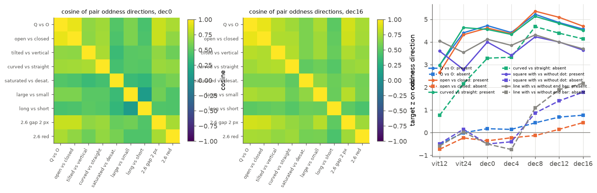

左、中两图为 9 个第一轮特征对的 $u_{\mathrm{pair}}$ 两两余弦（由 capture 的实体状态直接计算，viridis 色标为余弦值）；右图为几对图形中目标在留一法方向 $u$ 上的图像内 z 分数随提取位置的变化，实线为特征存在目标，虚线为特征缺失目标，颜色区分特征对。

**oddness 方向从 ViT 后段开始跨特征对齐，在 decoder 中进一步收敛。** 两两余弦的平均值在 ViT 第 12 个 block 为 0.22（最小 −0.70），在 merger 输出为 0.57（最小 0.11），在 decoder 第 16 层为 0.66（最小 0.43）。也就是说，Q 的尾巴、开口圆的缺口、倾斜、红色等完全不同的特征，在进入 decoder 时已经以相当一致的方向标示“这一个不同”。

### 5.2 投影预测行为

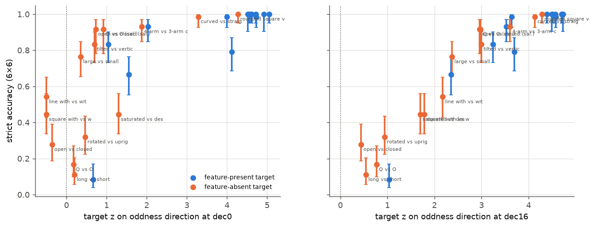

横轴为目标在留一法方向 $u$ 上的图像内 z 分数（由 capture 的实体状态计算），左图为 merger 输出，右图为 decoder 第 16 层；纵轴为行为准确率（Wilson 区间）。蓝点为特征存在目标，橙点为特征缺失目标，标签为特征对名称（sal. 表示 salient 水平）。

| 特征对 | ViT 第 24 block：存在 / 缺失 | merger 输出：存在 / 缺失 | decoder 第 16 层：存在 / 缺失 | 缺失准确率 |
| --- | --- | --- | --- | --- |
| Q 与 O | 4.4 / 0.0 | 4.7 / 0.2 | 4.6 / 0.8 | 0.17 |
| 开口与闭合圆 | 4.3 / −0.2 | 4.6 / −0.4 | 4.7 / 0.4 | 0.28 |
| 旋转与直立十字 | 4.3 / 0.7 | 5.0 / 0.5 | 4.7 / 0.9 | 0.32 |
| 方框内点 | 2.8 / 0.1 | 4.0 / −0.5 | 3.6 / 1.8 | 0.44 |
| 端点短横 | 3.5 / 0.0 | 4.1 / −0.5 | 3.7 / 2.2 | 0.54 |
| 倾斜与竖直线 | 4.3 / 0.8 | 4.7 / 0.7 | 4.6 / 3.0 | 0.83 |
| Q 与 O（salient） | 4.7 / 0.8 | 4.5 / 0.9 | 4.5 / 3.0 | 0.92 |
| 开口与闭合圆（salient） | 4.6 / 0.3 | 4.9 / 0.7 | 4.7 / 3.0 | 0.92 |
| 四臂与三臂十字 | 1.0 / 0.9 | 2.0 / 1.9 | 3.5 / 3.6 | 0.93 |
| 弯曲与笔直线 | 4.6 / 2.2 | 4.6 / 3.3 | 4.5 / 4.1 | 0.99 |
| 圆角方框与圆 | 3.7 / 4.0 | 4.6 / 4.3 | 4.4 / 4.3 | 1.00 |

新增的五对图形不参与方向的估计，因此表中这五行是方向的外推检验。

**目标在 oddness 方向上的投影是行为的统一预测量。** 在 28 个条件（14 个特征对或水平 × 两种目标）上，投影与准确率的秩相关在 ViT 第 24 个 block 为 0.88，在 merger 输出为 0.86，在 decoder 第 8 层为 0.93，在第 16 层为 0.94；只看特征缺失目标，第 16 层的秩相关为 0.97。这一预测力超过局部突出度（0.78 与 0.62），而且对四臂与三臂十字、旋转与直立十字这两个反例都给出正确的排序：前者的缺失目标在第 16 层达到 3.6，后者只有 0.9。

**特征存在目标在 ViT 中写入 oddness，特征缺失目标只在 decoder 中写入。** 所有有专属检测器的特征存在目标在 ViT 第 24 个 block 已达到 z≈2.8–4.7；子集型特征缺失目标在 ViT 与 merger 输出处接近 0（−0.5 至 0.9），只在 decoder 中上升，上升幅度与准确率一致（Q 与 O 0.2→0.8，端点短横 −0.5→2.2，salient 开口与闭合圆 0.7→3.0）。在同一特征对内，模型答对的缺失目标在第 16 层的投影也高于答错的（例如 Q 与 O 2.0 与 0.4，方框内点 2.6 与 1.1）。这说明两种目标最终使用同一个信号，差别只在信号由谁、在何时写入。

### 5.3 ViT 中的写入：自注意力的集中

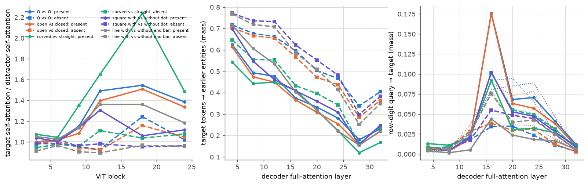

图中数值由各层的 query 与 key 重新计算 softmax 概率得到（未经拟合），head 平均。左图：ViT 中目标的自注意力（其 16 个 patch 作为 query 时落在自身 16 个 patch 上的概率质量）除以干扰项的平均自注意力；中图：decoder full attention 层中目标 token 作为 query 时落在光栅顺序在前的实体上的概率质量；右图：预测行数字的位置落在目标 token 上的概率质量，点线为答对的特征缺失图像。实线为特征存在目标，虚线为特征缺失目标，颜色区分特征对。

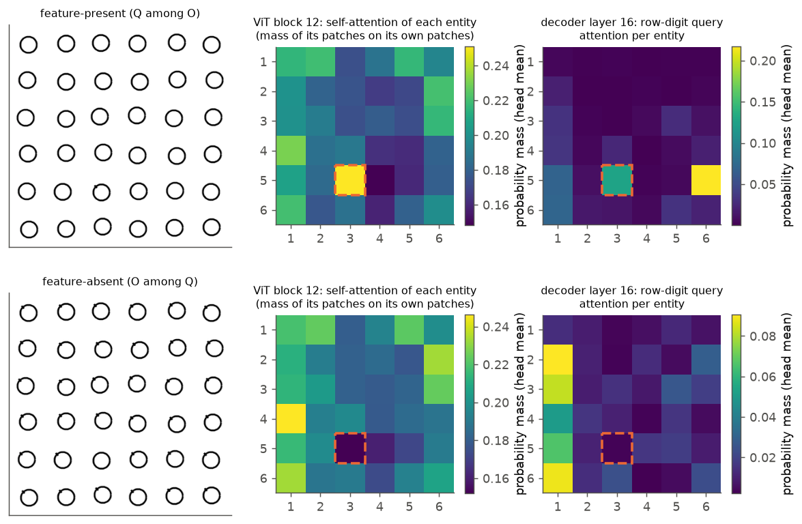

上排为一个 Q 在 O 中的图像，下排为一个 O 在 Q 中的图像。中列为 ViT 第 12 个 block 中每个实体的自注意力（概率质量，head 平均），右列为 decoder 第 16 层预测行数字的位置对每个实体的注意力（概率质量，head 平均），橙色虚线框为目标。

**特征存在目标在 ViT 第 12–18 个 block 中更多地注意自身，特征缺失目标没有这一变化。** 特征存在目标的自注意力在第 12–18 个 block 中最高达到干扰项的 1.26–2.24 倍（Q 与 O 在第 18 个 block 为 1.55，弯曲与笔直线 2.24），特征缺失目标为 0.92–1.24；salient 水平的缺失目标也接近 1（0.95–1.08），与它在 ViT 中尚无 oddness 一致。这一模式与 softmax attention 的性质相符：一个携带独有特征的 token，其 query 只与自己的 key 匹配，attention 便集中于自身，输出与上下文平均产生差异；第一轮的输出替换实验（把 ViT attention 在目标上的输出换成“上下文与目标相同”时的值，特征存在目标 Q 与 O 只保留 $R = 0.21$）表明这一差异是因果必需的。需要说明的是，在单张图像的层面，自注意力之比与目标的 oddness 投影几乎不相关（同一目标类型内 $r$ 为 0.06 与 0.08，两类合并为 0.40），因此“自注意力集中写入 oddness 方向”只是群体层面的解释，具体的写入电路尚未确定。

**decoder 中特征缺失目标更多地读取光栅在前的实体。** 在 full attention 第 4、8 层，子集型的五对图形（Q 与 O、开口与闭合圆、方框内点、端点短横、旋转与直立十字）中特征缺失目标 token 落在前文实体上的质量为 0.67–0.78，特征存在目标为 0.47–0.72，与第一轮第 3.6 节一致；结合第一轮的门控编辑（阻止前文实体写入 DeltaNet 状态使特征缺失目标的 $R$ 降至 −0.22 至 0.53），缺失目标的 oddness 由目标与前文实体的比较产生。

## 6. H3：decoder 用少数 head 读取 oddness 方向

**假说与理论。** 实验 2.5c 与 3.11 发现，答案的行列数字在 decoder 第 16–20 层从目标 token 读取位置信息。若 oddness 方向是读取的“钥匙”，则答案位置的 query 应与携带该方向的 key 匹配：把方向加到任意实体上，答案就会被吸引过去，相应 head 的注意力应随之转移；去掉这些 head，读取应失效。

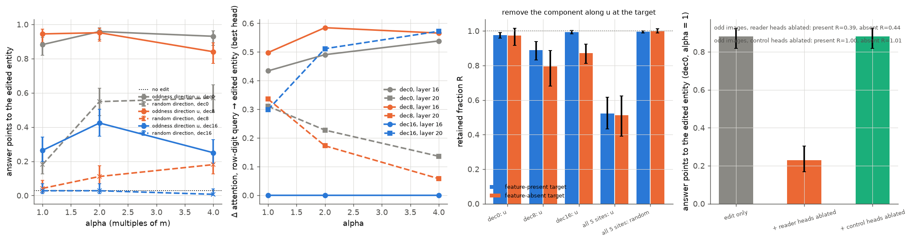

所有数值由 teacher forcing 的前向传播直接得到。第一幅：均匀图像中一个实体被加上 $\alpha m u$ 后答案指向它的比例（实线），虚线叉号为长度相同的随机正交方向，点线为未编辑；灰、橙、蓝分别为在 dec0、dec8、dec16 加入，每点 144 张图像，误差线为 Wilson 区间。第二幅：同一编辑下，预测行数字的位置对被编辑实体的注意力增量（取增量最大的 head），实线为第 16 层，虚线为第 20 层。第三幅：在答对的图像上去掉目标的 $u$ 分量后的保留比例 $R$（蓝色特征存在 70 张，橙色特征缺失 42 张，误差线为按图像 bootstrap 的 95% 区间）。第四幅：在 dec0 加 $1 \cdot m u$ 后的命中率，单独编辑、同时消融 6 个 reader head、同时消融 6 个对照 head；图内文字为真实图像上消融 head 后的 $R$。

| 编辑位置 | $u$，$\alpha = 1$ | $u$，$\alpha = 2$ | 随机，$\alpha = 1$ | 随机，$\alpha = 2$ | 随机，$\alpha = 4$ |
| --- | --- | --- | --- | --- | --- |
| merger 输出（dec0） | 0.88 | 0.96 | 0.18 | 0.55 | 0.57 |
| decoder 第 8 层 | 0.94 | 0.95 | 0.04 | 0.11 | 0.18 |
| decoder 第 16 层 | 0.26 | 0.42 | 0.03 | 0.03 | 0.01 |

未编辑时答案指向该实体的比例为 0.03（4/144）。

**一个特征存在目标所携带的 oddness 量足以让模型报告任意实体。** 在 merger 输出或第 8 层加入 1 倍典型量，命中率为 0.88 与 0.94，六对图形之间差别不大（dec0、$\alpha = 4$ 时为 0.88–1.00）；同长度的随机方向在第 8 层只有 0.04。这说明 $u$ 携带的正是答案所需的信息，它的作用不来自“使实体偏离”这一非特异的扰动。merger 输出处的随机方向在 $\alpha \ge 2$ 时也有 0.55 的命中率，这与第 5 节一致：decoder 的比较机制会把任何明显偏离前文的实体转换为 oddness，只是效率远低于直接给出 $u$。在第 16 层加入时命中率降到 0.26–0.42，原因见下一段。

**读取由第 16 层的 head 6、11、2 与第 20 层的 head 2、11、10 完成。** 在 dec0 或 dec8 加方向后，第 16 层增量最大的 head 对被编辑实体的注意力质量增加 0.43–0.59（head 6 增加 0.46–0.51）；在 dec16 加方向时，第 16 层的 attention 发生在加入之前，增量为 0，第 20 层的 head 11、2、10 则增加 0.45–0.52，这解释了 dec16 处命中率较低：此时只剩第 20 层及之后的读取机会。把这 6 个 head 在答案文本位置的输出置零后，加方向的命中率从 0.88 降到 0.23，对照 head 为 0.88；在真实图像上，特征存在目标保留 $R = 0.39$，特征缺失目标保留 $0.44$，对照 head 均为 1.00。第 20 层 head 11 正是实验 3.9 选出的单 head 坐标读出工具与实验 3.11 的坐标读出 head，因此“定位异常实体”与“输出坐标”共享同一读出通路：oddness 方向决定 head 看向哪个实体，该实体 token 上的位置信息随 value 被复制到答案。

**oddness 方向充分，但只承担约一半的答案信号。** 只在一个位置去掉 $u$ 分量几乎没有影响（$R = 0.79$–$0.99$），因为后续层会从目标的特征内容重新算出 oddness；在 5 个位置同时去掉后，特征存在与特征缺失目标分别保留 $0.52$ 与 $0.51$，随机方向为 1.00。也就是说，$u$ 是答案读取所依赖的主要方向之一，其余约一半信号由 $u$ 以外的方向（例如特征专属的差异）承担。

## 7. H4：特征缺失目标需要足够多的前文实体

**假说与理论。** 第 5 节表明特征缺失目标的 oddness 来自 decoder 中与前文的比较。decoder 是因果的，第 $i$ 个实体只能与前 $i - 1$ 个实体比较；若比较需要从多个样本中形成稳定的参照，成功率应取决于光栅在前的实体数量 $i - 1$，与实体位于第几行无关。第一轮的解释“第一行之前没有可比较的实体”与这一假说不同：第一行第 3 个实体之前已有 2 个实体，若 2 个样本即可比较，第一行就不应几乎全部失败。

**实验设计。** 6 × 6 网格中“第一行”与“之前少于 6 个实体”完全重合，无法区分。把同样的 36 个实体排成 3 × 12 时，第一行包含之前有 0–11 个实体的位置；排成 12 × 3 时，前两行就已覆盖之前 0–5 个实体的位置。若成败取决于前文数量，三种排列中“之前 0–5 个实体”的位置都应失败，3 × 12 第一行后半段应正常；若取决于行号，3 × 12 第一行应整行失败，12 × 3 的第二行应正常。

### 7.1 行为

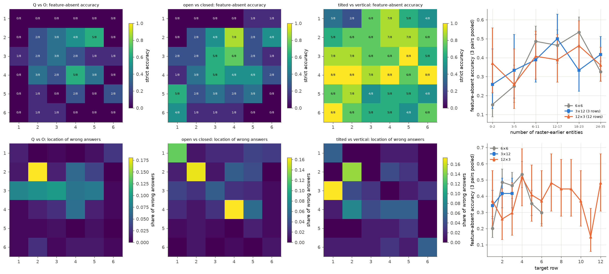

上排前三幅为 6 × 6 网格中特征缺失目标位于每个位置时的准确率（viridis，格内为答对数/图像数，第一轮与第二轮合并，每格 8 张）；下排前三幅为答错时所答位置的分布（每个位置所占答错比例）。右上图为三对图形合并后，准确率随光栅在前实体数量的变化，灰色为 6 × 6，蓝色为 3 × 12，橙色为 12 × 3；右下图为同一数据按目标所在行汇总。误差线为 Wilson 区间。

| 特征对 | 排列 | 之前 0–5 个实体 | 6–11 | 12–23 | 24–35 |
| --- | --- | --- | --- | --- | --- |
| Q 与 O | 6 × 6 | 0/48 | 14/48 | 23/96 | 7/96 |
| Q 与 O | 3 × 12 | 0/18 | 2/18 | 8/36 | 4/36 |
| Q 与 O | 12 × 3 | 3/18 | 0/18 | 7/36 | 5/36 |
| 开口与闭合圆 | 6 × 6 | 2/48 | 19/48 | 37/96 | 22/96 |
| 开口与闭合圆 | 3 × 12 | 6/18 | 8/18 | 8/36 | 14/36 |
| 开口与闭合圆 | 12 × 3 | 3/18 | 7/18 | 13/36 | 13/36 |
| 倾斜与竖直线 | 6 × 6 | 27/48 | 37/48 | 84/96 | 65/96 |
| 倾斜与竖直线 | 3 × 12 | 10/18 | 11/18 | 29/36 | 27/36 |
| 倾斜与竖直线 | 12 × 3 | 11/18 | 15/18 | 26/36 | 21/36 |

**成败取决于光栅在前的实体数量，与位于第几行基本无关。** 三对图形合并，“之前 0–5 个实体”的准确率在 6 × 6、3 × 12、12 × 3 中分别为 0.20、0.30、0.31，“之前 6–11 个实体”为 0.49、0.39、0.41。3 × 12 网格中之前有 6–11 个实体的位置全部位于第一行，其准确率与 6 × 6 第二行相当；12 × 3 网格的第 2 行（之前 3–5 个实体）仍然偏低（Q 与 O 0/9，开口与闭合圆 2/9）。对三种排列合并的 1512 张图像拟合 logistic 回归（自变量为特征对、“之前不足 6 个实体”、首行、末行、首列、末列）：“之前不足 6 个实体”的系数为 −0.89 [−1.48, −0.31]，“首行”为 −0.31 [−0.87, 0.25]；去掉其中一项后，只保留前文数量的模型对数似然为 −790.5，只保留首行的模型为 −794.4。因此第一行失败的主要原因是之前的实体太少，“处在第一行”本身的作用较小且不显著。

**6 × 6 末行另有一个下降，原因未确定。** 在 6 × 6 中，之前 24–35 个实体的缺失目标准确率低于 12–23 个（Q 与 O 7/96 对 23/96，开口与闭合圆 22/96 对 37/96），logistic 回归中“末行”系数为 −0.46 [−0.78, −0.13]；3 × 12 中同一区间没有下降（开口与闭合圆 14/36）。答错时的答案集中在少数固定位置（Q 与 O 的 (2, 2)，开口与闭合圆的 (2, 2)、(4, 4) 与 (1, 1)），本实验未解释这些位置为何成为默认答案。

### 7.2 decoder 中的开头效应

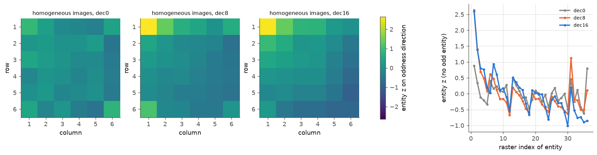

图中数值为不含异常实体的均匀图像中每个实体在留一法 oddness 方向上的图像内 z 分数（由 capture 的实体状态计算，16 组特征对或水平、每组 48 张均匀图像平均）。左三幅为 6 × 6 位置图（viridis，色标为 z 分数），依次为 merger 输出、decoder 第 8 层与第 16 层；右图为同一数据按光栅序号排列。

**decoder 把序列开头的实体当作与众不同。** 在没有任何异常实体的图像中，第 1 个与第 2 个实体在第 8 层的 z 分数为 2.64 与 1.40，在第 16 层为 2.59 与 1.39；在 merger 输出只有 0.89 与 0.34。这一梯度在 decoder 中产生，并在每行行首出现较小的峰（锯齿形），与 3.10、3.14 中 DeltaNet 沿光栅顺序累积、在行首重置的现象一致。对一个由比较产生 oddness 的系统，这是预期的行为：参照尚未形成时，每个新实体都偏离参照。特征存在目标在进入 decoder 时已带着 z≈4.5 的 oddness，高于开头效应的幅度；特征缺失目标的 oddness 由同一比较产生，在序列开头与“新出现”的信号叠加，模型无法把两者区分开。

**输入表征本身的统计不足以解释这一依赖。** 用模型自己的 merger 输出模拟一个“均值参照”比较者：从同图干扰项中随机取 $n$ 个作为前文，以它们的平均为参照，若目标离参照比另一个随机干扰项更远则判对。开口与闭合圆的判对率从 $n = 1$ 的 0.67 升到 $n = 5$ 的 0.78，之后基本持平（$n = 30$ 为 0.82）；Q 与 O 始终约为 0.6。这一模拟（由模型激活计算，非模型行为）的增益远小于行为从 0.20 到 0.49 的跃升，说明行为对前文数量的依赖主要来自 decoder 自身的计算方式（开头效应），而非输入中样本太少导致的参照噪声。

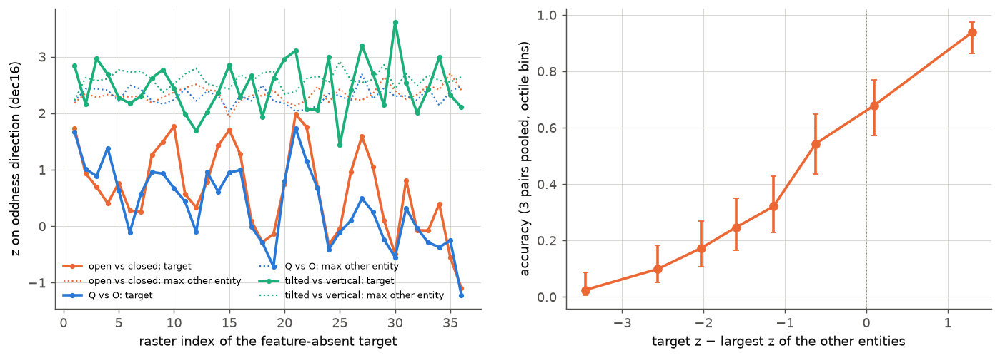

左图为位置集中特征缺失目标在第 16 层 oddness 方向上的 z 分数随光栅序号的变化（实线），点线为同图中其余实体的最大 z；右图为三对图形合并后，准确率随“目标 z 减去其余实体最大 z”的变化（按八分位数分箱，Wilson 区间）。数值由 states 阶段的实体状态计算。

**答案近似指向 oddness 最大的实体，但第 16 层的投影没有完整反映开头效应的影响。** 目标与其余实体最大 z 之差从 −3.5 增大到 +1.3 时，准确率从 0.02 单调升至 0.94，与“答案读取 oddness 最大者”的读出机制（第 6 节）一致。然而前 6 个位置上的缺失目标在第 16 层的 z 并不低于后面的位置（例如开口与闭合圆 0.80 对 0.95），因为开头效应同样抬高了它们自己的分数；其余实体的最大 z 在各位置都约为 2.3，且多数情况下由第 1 或第 2 个实体给出。单一方向的投影因此无法把“与众不同”与“刚出现”分开，这正是开头位置失败的表现形式，但模型最终如何在后续位置抑制开头效应、本实验尚未确定。

## 8. 讨论

### 8.1 统一的机制图景

综合第 4–7 节，模型找出异常实体的过程可以概括为三步，每一步都有直接证据：

1. **局部检测（ViT MLP）。** 整流神经元只在它们偏好的局部部件上放电；目标若拥有专属检测器，就在 ViT 中出现一个其余实体都没有的强激活（第 4 节）。
2. **转换为 oddness（ViT attention 或 decoder 比较）。** 专属激活经 ViT attention 转换为一个跨特征共享的残差方向 $u$，特征存在目标在 ViT 末层已达 z≈4.5；没有专属检测器的目标只能在 decoder 中通过与光栅在前实体的比较获得 $u$ 方向的分量，其大小取决于差异的幅度与前文实体的数量（第 5、7 节）。
3. **读取（decoder full attention）。** 第 16 与 20 层的少数 head 以 $u$ 为钥匙定位实体，把该实体 token 上的位置信息复制到答案（第 6 节）。

在这一图景下，搜索不对称的直观原因可以用一句话表述：特征存在目标的“与众不同”在像素进入 decoder 之前就已由并行的检测器给出，特征缺失目标的“与众不同”只能由一个沿光栅顺序进行、需要预热的比较过程算出。

### 8.2 参数问题与架构问题

1. **哪些特征拥有专属检测器（参数与数据问题，确定性较高）。** 四臂与三臂十字、旋转与直立十字的结果表明，检测器清单由训练学到，与像素几何不对应；若训练数据中“缺少某部件”是常见的判别线索，模型完全可能学到相应的检测器（例如闭合圆在缺口位置的弱响应已部分存在）。
2. **比较的因果方向与开头效应（与 decoder 结构相关，确定性中等）。** decoder 的因果性使每个实体只能与前文比较，开头效应在 decoder 中产生；但 ViT 是双向的，原则上可以对所有实体做比较，它对特征缺失目标没有做到，这又回到参数问题。本实验没有在其他架构上检验开头效应，因此不把它归为架构必然。

### 8.3 与其他实验的关系

1. **实验 3.9、3.11（一致）。** reader head 中的第 20 层 head 11 就是坐标读出 head；本实验补充了它“看向哪里”的依据：携带 oddness 方向的实体。
2. **实验 3.10、3.14（一致）。** 均匀图像中的开头效应在每行行首出现小峰，与 DeltaNet 行计数在行首重置的现象吻合；“缺失目标依赖前文实体数量”与 3.10 中光栅累积的计算方式相容。
3. **实验 2.6 与第一轮（修订）。** 第一轮把第一行的失败解释为“之前没有可比较的实体”，本实验表明决定因素是前文实体的数量（不足约 6 个），并给出 decoder 开头效应这一内部对应；第一轮的“ViT attention 在目标上写下标记”在本文中具体化为 oddness 方向 $u$ 及其读取 head。
4. **实验 1.7（一致）。** 1.7 发现思维链中的位置信息来自对 image KV 的重读；本实验的读取同样发生在 full attention 对图像 token 的注意力上。

## 9. 限制

1. reader head 依据加方向实验中的注意力增量选出，在同一批均匀图像上检验属于事后检验；真实图像上的消融（$R = 0.39$ 与 $0.44$）不参与选择，但只覆盖 6 对图形、112 张答对的图像。
2. oddness 方向只解释约一半的答案信号（全位置去除后 $R \approx 0.5$），其余信号的载体未确定。
3. ViT 中“专属激活如何转换为共享方向”只有群体层面的证据（自注意力集中与第一轮的输出替换），单图层面的相关很弱，具体电路尚未确定。
4. 开头效应在后续位置如何被抑制、6 × 6 末行的下降与固定默认答案的来源，均未解释。
5. 旋转与直立十字的不对称与其 29 个缺失方向专属检测器之间的矛盾未进一步分析。
6. 只使用合成线条图形；自然图像中缺失部件的搜索是否遵循同一机制需要另行检验。

## 10. 运行与产物

- 入口：`scripts/analysis/representation/search_asymmetry_r2.sh`，阶段 build、behave、spotcheck、capture、states、direction、steer、steer2、analyze，参数在脚本顶部设置。
- 代码：`analysis_tools/representation/search_asymmetry_r2.py`（刺激与无模型度量）、`search_asymmetry_r2_run.py`（GPU 阶段）、`search_asymmetry_r2_analysis.py`（分析）、`search_asymmetry_r2_figures.py`（图）；测试为 `tests/analysis/representation/test_search_asymmetry_r2.py`。复用第一轮的 `search_asymmetry*.py` 与实验 2.6 的 `odd_entity.py`，未修改共享模块。
- 产物：WORK_DIR 的 `analysis/representation/2026-11-03_search_asymmetry_r2/`，包括 `items.jsonl` 与 `images/`（全部刺激及 SHA-256）、`results_behave.jsonl`、`spotcheck.json`、`capture/`、`states/`、`directions.npz`、`steer.jsonl`、`steer2.jsonl`、`steer2_heads.json`、`summary.json` 与各阶段的 `run_*.json`。
