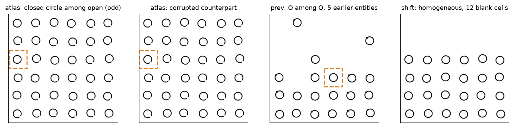
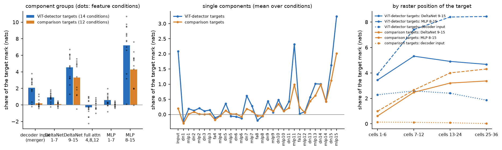
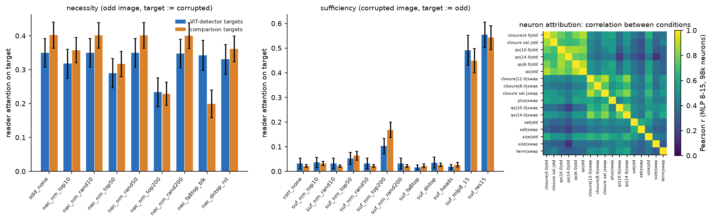
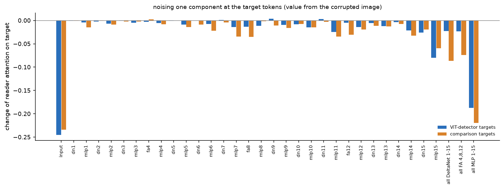
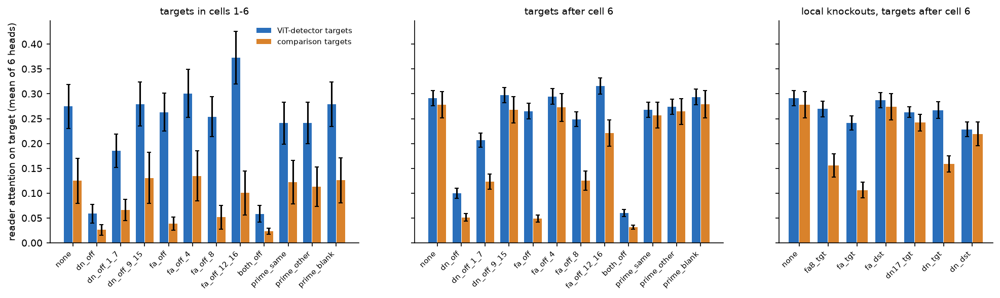
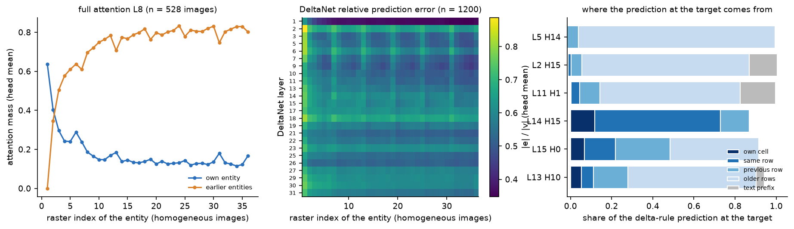
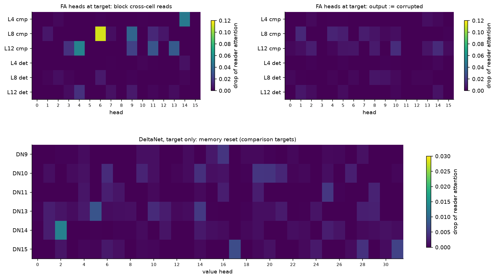
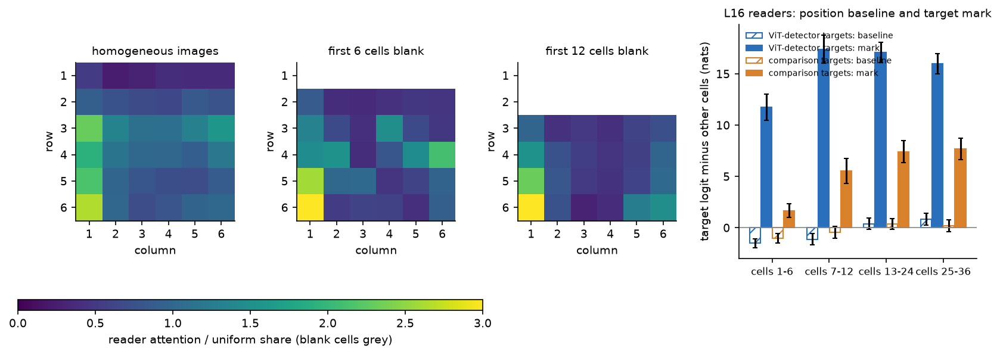
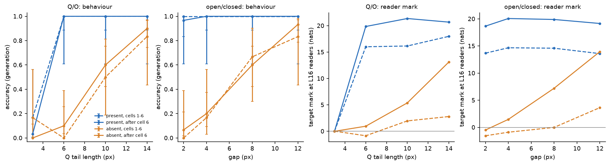
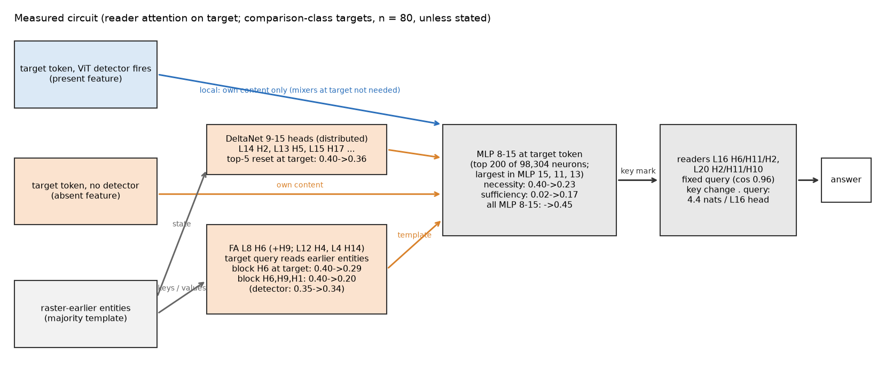

# 异常实体定位的计算过程（实验 2.7 第三轮）

实验日期：2026-11-05。本文属于[视觉细节表征](plan.md)研究，设计见[设计文档](design_2026-11-05_search_circuit.md)，承接[实验 2.7 第二轮](results_2026-11-03_search_asymmetry_r2.md)与[第一轮](results_2026-10-21_search_asymmetry.md)。主模型为 Qwen3.5-9B，冻结、bfloat16、SDPA，thinking off，问法为直接回答：“One figure differs from all the others. Give its position. Return only {"row": r, "column": c} …”。本轮的全部机理结论都建立在单张图像的前向计算上，用模型实际执行的运算（注意力 logit、Gated DeltaNet 状态更新、残差相加）表述。

## 0. 通俗讲述

模型回答“哪一个与众不同”时，答案中的行数字与列数字由少数几个 full attention head 从图像 token 中“读出”：预测行数字的那个位置向图像发出 query，哪个实体的 key 与它匹配得最好，注意力就落在哪里，该实体的位置随之被复制到答案中。前两轮已经知道这些 head 是谁（第 16 层 head 6、11、2，第 20 层 head 2、11、10，本文称为读取 head）。本轮把问题落到一个可以精确计算的量上：读取 head 对目标的注意力 logit 比对其他实体高出多少。我们称这个差值为目标标记。由于残差流是各层输出的和，而 key 投影前后的两个 RMSNorm 在固定缩放系数后是线性的，目标标记可以精确拆成“decoder 输入（ViT 与 merger）贡献多少、第几层 DeltaNet 贡献多少、第几层 MLP 贡献多少”，各项相加正好等于实际的 logit 差。这一拆分不引入任何人为方向，只是把模型的加法按来源记账。

第一个发现是，无论异常特征是什么，目标标记都主要由 decoder 第 9–15 层的 DeltaNet 与第 8–15 层的 MLP 在目标 token 上写入；26 个特征条件的组件贡献谱两两余弦为 0.87–0.90，标记总量与准确率的秩相关为 0.88。这是一套与特征无关的“写标记”机制。ViT 与 merger 直接写进读取 key 的部分很小：有 ViT 专属检测器的目标约 2.1 nats（总标记约 15 nats），没有检测器的目标约 0.2 nats。也就是说，即使 ViT 已经检测到 Q 的尾巴，读取 head 能用的标记仍要由 decoder 中段重新写出。

第二个发现回答“比较是怎样算出来的”。对两类目标分别做单图反事实：把目标重绘为多数实体，其余像素不变。有 ViT 专属检测器的目标（例如 O 群中的 Q），在目标 token 上把任何一层的序列混合子层输出换成反事实值，读取注意力几乎不变；只阻断目标 token 在 full attention 中读取其他实体，读取注意力也不变。它的标记由目标 token 自身的内容经 MLP 逐层变换得到，属于局部计算。没有专属检测器的目标（例如 Q 群中的 O）则依赖比较：只阻断目标 token 在 full attention 第 4–16 层读取其他实体，读取注意力从 0.278 降到 0.106，只阻断第 8 层就降到 0.156，对一个普通干扰项施加同样的阻断则没有影响（0.274）；只清除目标 token 在 DeltaNet 中的记忆，读取注意力降到 0.159。换言之，比较由目标 token 主动完成：它在第 8 层用 query 与前文实体的 key 做 softmax 匹配，并从 DeltaNet 状态中取回对前文实体的压缩记忆，两者的结果再被中段 MLP 转写为读取 head 能识别的标记。中段 DeltaNet 在目标处的取回内容有 33–47% 来自两行以前的实体，个别 head 更高（例如第 13 层 head 10 为 0.62，第 11 层 head 1 为 0.68），因此它更像对前文实体的一个累积摘要，与逐个邻居比较不同。

第三个发现把这一过程落到单个 head 与神经元上。只禁止 full attention 第 8 层 head 6 在目标 token 处读取其他实体，比较类读取注意力从 0.40 降到 0.29，同时禁止第 8 层 head 6、9、1 降到 0.20；把 head 6 在目标处的输出换成去异常图像中的值则毫无影响。第四轮（[完整计算链](results_2026-11-11_search_pipeline.md)第 6.2 节）进一步表明，把 head 6 的输出置零或换成同类图像中的值同样无影响，禁止读取的效应来自禁止后产生的非典型输出，head 6 不是必要组件；目标与前文的比较由多个 full attention head 与 DeltaNet 层共同提供的参照向量和第 8–15 层 MLP 完成。MLP 中的 98,304 个神经元里，按直接贡献排序的前 200 个（主要在 MLP 15、14、13、11）在目标处被换成去异常值时，读取注意力降到 0.23（随机 200 个不变）；反过来把这 200 个神经元在去异常图像中设为异常图像的值，读取注意力从 0.02 升到 0.17，把 MLP 8–15 的全部神经元设为异常值则升到 0.45，与异常图像本身相当。读取 head 一侧的运算更简单：第 16 层三个读取 head 的 query 在不同图像之间几乎不变（余弦 0.96），它们只是在每个图像 token 的 key 上寻找一个固定方向，目标 key 在异常与去异常图像之间的差与该 query 的点积为每个 head 3.7–4.4 nats（检测器类 5.9–7.0）。DeltaNet 9–15 的单个 head 作用都很小（最大的第 14 层 head 2 只降 0.013），比较中的 DeltaNet 贡献分散在许多 head 上。

第四个发现解释光栅顺序靠前为什么吃亏。把目标所在格的读取 logit 拆成两部分：同一格在去异常图像中的值（位置基线）与目标像素差异带来的增量（标记）。光栅前 6 个格的基线为 −1.0 到 −1.5 nats，其后为正；同时前 6 格的标记也偏小，没有检测器的目标只有 1.7 nats（第 13 格以后约 7.5），有检测器的目标为 11.8（其后约 17）。基线的负值由第 9–15 层 DeltaNet 与第 8、12 层 full attention 写入，与 ViT 无关；把前若干格留空后，读取 head 的低注意力跟随第一行实体移动，与第一个图像 token 或图像顶端无关。造成开头劣势的是两个因果计算的性质：full attention 第 8 层中，第 1、2、3 个实体能注意的前文 key 太少，softmax 只能把 0.64、0.40、0.30 的质量放在自己身上，目标 token 从前文读到的参照因此主要由目标自己构成；DeltaNet 的 delta rule 是在线最小二乘，开头几个实体还没有被状态“学会”，相对预测误差从第 1 个实体的 0.63 逐步降到第 8 个实体的 0.37。用另一张均匀图像读完后的 DeltaNet 状态预热第一个图像 token，没有改善开头位置的定位，说明单独补足 DeltaNet 的记忆不够。PI 关于“ViT 已经标记则 decoder 方向无关”的设想部分成立：有检测器的目标不需要跨实体的 full attention，在第一行也有 0.85 的准确率；但它们的标记在开头同样缩小约三成，只是余量足够大。

第五个发现是两种定位模式的剂量—反应。把 Q 的尾长与开口圆缺口各取四档：特征存在的一方（有检测器）只要像素差异可见，标记就立刻达到 14–21 nats，准确率为 1.00，且与差异大小、光栅位置基本无关；特征缺失的一方（无检测器）标记随差异大小单调增长（开口圆缺口 2、4、8、12 像素时，第 7 格以后的标记为 −0.5、1.5、7.2、14.0），在前 6 格则始终很小（−1.5 到 3.6）。前者是“检测即标记”，后者是“比较才有标记”，比较的强度同时受差异幅度和前文实体的影响。

## 1. 问题、假说与主要结论

| 假说 | 检验 | 结论 | 章节 |
| --- | --- | --- | --- |
| H1：定位由读取 head 的注意力 logit 实现，目标标记由一套与特征无关的组件写入 | 读取 logit 的精确加法分解，26 个特征条件 | 支持；写入者为第 9–15 层 DeltaNet 与第 8–15 层 MLP | 第 4 节 |
| H2：有检测器的目标由局部计算产生标记，无检测器的目标由目标 token 对前文实体的比较产生标记 | 目标处逐组件噪声化；全局与局部 full attention 跨实体阻断、DeltaNet 记忆清除 | 支持；比较由目标 token 在 full attention 第 8 层与 DeltaNet 记忆中完成 | 第 5 节 |
| H3：光栅靠前的劣势来自因果计算，表现为位置基线与标记两方面 | 基线与标记按光栅位置分解；均匀图像中的第 8 层自注意与 DeltaNet 预测误差；留空平移；状态预热 | 部分支持；两种因果来源均被测得，DeltaNet 预热无效 | 第 6 节 |
| H4：两类目标的剂量—反应不同 | 差异幅度四档 × 光栅位置 | 支持 | 第 7 节 |
| 电路：比较类目标的比较由 full attention head 读取前文、MLP 8–15 少数神经元写出读取方向上的分量，读取 head 以固定 query 读出 | 逐 head 阻断与输出替换、逐神经元直接贡献、top-k 神经元的必要性与充分性、读取 QK | 神经元与读取部分支持；单个 head 不必要（第四轮第 6.2 节） | 第 4.2、5.4 节 |

主要结论：

1. **读取 head 对目标的 logit 优势是定位的决定变量。** 答对与答错的样本在第 16 层的目标标记分别约为 9–18 与 0.3–2.8 nats（表 4.2）。这说明模型是否找到目标，几乎完全取决于读取 head 能否在目标的 key 上看到足够大的增量。
2. **写标记的组件对所有特征相同。** 去掉 decoder 输入项后，26 个条件的 31 维组件贡献谱两两余弦为 0.87–0.90，两类目标之间（0.87）与类内（0.88、0.90）相同。这满足 PI 要求的“特征无关性”：模型并不为每种特征单独准备读出通路。
3. **ViT 检测器只提供原料。** decoder 输入直接写入的标记在检测器类中为 2.1 nats，在比较类中为 0.2 nats，分别占总标记的 14% 与 3%。ViT 检测到的特征需要 decoder 中段 MLP 改写，读取 head 才能使用。
4. **比较由目标 token 发起。** 只阻断目标 token 的跨实体 full attention，比较类读取注意力降至 0.106（阻断干扰项：0.274）；检测器类不变（0.242 对 0.291）。只阻断第 8 层也能降至 0.156。
5. **比较电路可以具体到神经元。** MLP 8–15 的前 200 个神经元在目标处写出读取方向上的分量（必要：0.40→0.23；充分：0.02→0.17），第 16、20 层读取 head 以跨图像几乎不变的 query 读取这一分量（第 4.2 节）。第 8 层 head 6 的阻断效应（0.40→0.29）不表示它必要，见第四轮第 6.2 节。
6. **开头劣势是因果计算的结构性后果。** full attention 第 8 层对前几个实体的 softmax 只能集中在自身，DeltaNet 的在线最小二乘需要几次重复才能预测准确，两者都让开头实体“看起来异常”，从而淹没没有检测器的目标；读取 head 的位置基线在开头为负，由序列混合子层写入。

## 2. 模型运算与度量

本节约定后文使用的模型运算、度量与干预协议。层号从 1 开始；decoder 第 4、8、…、32 层为 full attention 层，其余为 Gated DeltaNet 层；每个实体占 $64 \times 64$ 像素，即 decoder 中 $2 \times 2 = 4$ 个图像 token。实体按光栅顺序编号为第 1–36 格。

### 2.1 读取 head

读取 head 按真实异常图像中“预测行数字的位置”落在目标上的注意力排序选出（第二轮 capture 数据，528 张特征存在与特征缺失图像）。前 6 名为第 16 层 head 11（0.456）、head 6（0.449）、head 2（0.369）与第 20 层 head 2、11、10，与第二轮由加方向实验选出的 head 完全一致。本轮的选择只依据模型在真实输入上的注意力，没有使用 oddness 方向。

### 2.2 读取 logit 的精确分解、位置基线与目标标记

记预测行数字的位置为行查询位置 $p$。读取 head $(l, h)$ 对图像 token $j$ 的注意力 logit 为

$$
z_j = \frac{1}{\sqrt{d}} \, q_p^{\top} \, \mathrm{RoPE}_j\!\left( \mathrm{N}_k\!\left( W_K \, \mathrm{N}_{\mathrm{in}}(x_j) \right) \right),
$$

其中 $x_j \in \mathbb{R}^{4096}$ 为第 $l$ 层输入处 token $j$ 的残差，$\mathrm{N}_{\mathrm{in}}$ 为该层输入 RMSNorm，$W_K \in \mathbb{R}^{256 \times 4096}$ 为该 head 所属 key 组的投影，$\mathrm{N}_k$ 为 key 的 RMSNorm，$\mathrm{RoPE}_j$ 为位置 $j$ 的旋转，$q_p \in \mathbb{R}^{256}$ 为查询位置的 query，$d = 256$。残差是各组件输出之和：

$$
x_j = x_j^{(0)} + \sum_{m < l} \left( a_j^{(m)} + f_j^{(m)} \right),
$$

其中 $x_j^{(0)}$ 为 decoder 输入（图像 token 处即 merger 输出），$a_j^{(m)}$ 为第 $m$ 层序列混合子层（DeltaNet 或 full attention）的输出，$f_j^{(m)}$ 为第 $m$ 层 MLP 的输出。RMSNorm 只把向量除以自身的均方根再逐维缩放；把均方根固定为实际前向中的值后，$\mathrm{N}_{\mathrm{in}}$ 与 $\mathrm{N}_k$ 都是线性映射，RoPE 也是线性旋转，因此

$$
z_j = \sum_{c} z_j^{(c)}, \qquad c \in \left\{ x^{(0)}, a^{(1)}, f^{(1)}, \dots, a^{(l-1)}, f^{(l-1)} \right\},
$$

其中 $z_j^{(c)}$ 是把 $x_j$ 换成组件 $c$ 的输出、其余运算不变时得到的 logit。selftest 中各项之和与实际 logit 的最大绝对误差为 0.07（第 16 层）与 0.10（第 20 层），实际 logit 的平均绝对值约 7.5，误差来自 bfloat16 舍入。

对第 $e$ 格取其 4 个 token 的平均，记为 $z_e$。记目标格为 $t$，定义某张图像中目标相对其余格的读取优势 $D = z_t - \operatorname{mean}_{e \ne t} z_e$，第 16 层三个读取 head 求和。对同一目标格：

$$
D_{\mathrm{base}} = D\big|_{\text{去异常图像}}, \qquad M = D\big|_{\text{异常图像}} - D\big|_{\text{去异常图像}} .
$$

$D_{\mathrm{base}}$ 称为位置基线，即目标格在没有异常时就具有的读取偏好；$M$ 称为目标标记，即目标的像素差异使读取优势增加了多少。两者都可以按组件 $c$ 精确拆开，记 $M^{(c)}$ 为组件 $c$ 对标记的贡献，$\sum_c M^{(c)} = M$。

### 2.3 full attention 的因果 softmax

full attention 层中 token $t$ 的一个 head 对 token $s \le t$ 的注意力为

$$
a_{ts} = \frac{\exp\left(q_t^{\top} k_s / \sqrt{d}\right)}{\sum_{s' \le t} \exp\left(q_t^{\top} k_{s'} / \sqrt{d}\right)} .
$$

分母只对光栅在前的 token 求和。若前文中有与 $q_t$ 匹配的 key（例如同类实体），注意力分散到这些实体上；若没有匹配，质量集中在自身与少数固定位置。这种“自身集中”会改变该 head 的输出，是一个与特征无关的“与前文不同”信号。它的副作用是：序列开头的实体前文 key 很少，无论内容如何都只能集中在自身。

### 2.4 Gated DeltaNet 的预测误差与预测来源

DeltaNet 每个 value head 维护状态 $S_t \in \mathbb{R}^{128 \times 128}$，按光栅顺序更新：

$$
\hat{v}_t = \left(\alpha_t S_{t-1}\right)^{\top} k_t, \qquad e_t = v_t - \hat{v}_t, \qquad S_t = \alpha_t S_{t-1} + \beta_t \, k_t e_t^{\top}, \qquad o_t = S_t^{\top} q_t ,
$$

其中 $k_t, q_t \in \mathbb{R}^{128}$ 为 L2 归一化后的 key 与 query，$v_t \in \mathbb{R}^{128}$ 为 value，$\alpha_t \in (0,1)$ 为衰减门，$\beta_t \in (0,1)$ 为写入强度。$\hat{v}_t$ 是状态以当前 key 为线索对 value 的预测，$e_t$ 为预测误差，状态只写入误差。这一更新等价于对 $\lVert S^{\top} k - v \rVert^2$ 做一步学习率为 $\beta_t$ 的在线最小二乘：同一对 $(k, v)$ 重复出现时误差按 $1 - \beta$ 的比例几何缩小（单元测试中验证）。本文记录相对预测误差

$$
\rho_t = \lVert e_t \rVert / \lVert v_t \rVert ,
$$

它衡量当前 token 有多少内容不能由前文记忆预测。展开递推得到预测的来源分解

$$
\hat{v}_t = \sum_{j < t} w_{tj} \, e_j, \qquad w_{tj} = \exp\left(G_t - G_j\right) \beta_j \left(k_j^{\top} k_t\right), \qquad G_t = \sum_{m \le t} \log \alpha_m ,
$$

其中 $w_{tj}$ 同时包含“key 相似”与“尚未被遗忘”两个因素。token $j$ 对预测的份额定义为 $w_{tj} \, e_j^{\top} \hat{v}_t / \lVert \hat{v}_t \rVert^2$，所有来源之和为 1。DeltaNet 层在 trace 阶段由逐 token 的 float32 递推执行（与库实现在 4 张图像上的答案 argmax 一致率为 1.00，logit 最大差 0.89，来自分块算法与逐 token 算法的数值差）。

### 2.5 单图反事实与干预协议

每张异常图像配一张去异常图像：目标重绘为多数实体，抖动、朝向、空白格完全相同，两者只在目标格像素上不同。所有干预都在 teacher forcing 下对单张图像执行，答案文本固定为正确坐标。

1. **全局阻断。** DeltaNet 记忆清除：在指定 DeltaNet 层的全部图像 token 上令 $\alpha_t = 0$，每个 token 的输出只依赖自身与长度为 4 的短卷积窗口（第 1–15 层全部 12 个 DeltaNet 层，或其中第 1–7 层、第 9–15 层）。full attention 跨实体阻断：在指定层中，图像 token 作为 query 时不能注意其他格的 token，可以注意本格与文本前缀；答案位置的 query 不受影响（第 4、8、12、16 层，或单层）。
2. **局部阻断。** 只对目标格的 4 个 token 施加上述阻断（目标 query 不能读其他格；目标 token 在 DeltaNet 中 $\alpha_t = 0$）；对照为对光栅序号为 $t + 7$（模 36）的普通干扰项施加相同阻断。
3. **状态预热。** 在第一个图像 token 处，把每个 DeltaNet 层的状态替换为同一提示下另一张图像读完最后一个图像 token 时的状态。供体为同一特征对、同一多数实体的均匀图像（同类预热），另一特征对的均匀图像，或全白图像。
4. **目标处噪声化。** 把某一个组件（decoder 输入、第 $l$ 层序列混合子层或 MLP，或一组组件）在目标 4 个 token 上的输出替换为它在去异常图像中的值，其余位置与后续计算照常进行。

全局阻断会同时破坏行列序数的计数（实验 3.10、1.5：坐标由 DeltaNet 沿光栅累积产生），答案命中率因此不能区分“没找到”与“找到了但数错了”。本文以读取 head 在行查询位置落在目标格上的注意力（6 个 head 平均，记为读取注意力）作为定位的读出，它只反映读取 head 是否选中目标，与坐标如何拼写无关。

### 2.6 特征类别

按第二轮 ViT 第 9 个 block 的专属检测器数（第二轮第 4.2 节，$\zeta > 5$ 的神经元数）预先划分：目标所在方向有不少于 5 个专属检测器的称为检测器类，否则称为比较类。检测器类为 Q 与 O、开口与闭合圆、方框内点、端点短横、旋转与直立十字、倾斜与竖直线、弯曲与笔直线、圆角方框与圆的特征存在目标，以及旋转与直立十字、倾斜与竖直线、弯曲与笔直线、圆角方框与圆的特征缺失目标（14 个条件）；比较类为 Q 与 O、开口与闭合圆、方框内点、端点短横、四臂与三臂十字的特征缺失目标，四臂与三臂十字的特征存在目标，以及饱和与不饱和色、大与小圆的两种目标（12 个条件）。

### 2.7 head 与神经元层面的协议

在 atlas 与 mag 中选出答对、目标位于第 7 格以后的 80 对比较类与 40 对检测器类图像（随机抽样，种子 0），对每对执行：

1. **逐 head 干预（目标 token）。** full attention 第 4、8、12 层的每个 head：只禁止该 head 的目标 query 读取其他格（阻断），或把该 head 在目标处的输出（$W_O$ 之前、门控之后的 256 维切片）换成去异常图像中的值（输出替换）。DeltaNet 第 9–15 层每个 value head：只在目标 token 上令该 head 的 $\alpha_t = 0$（仅比较类）。
2. **神经元直接贡献。** 记第 $l$ 层 MLP 在 token $j$ 的神经元激活为 $u_j^{(l)} \in \mathbb{R}^{12288}$（$\mathrm{SiLU}$ 门控与 up 投影之积，即 $W_{\mathrm{down}}$ 的输入），读取 head 对 token $j$ 的 logit 对残差的梯度（RMSNorm 缩放固定，故沿直接路径为常向量）记为 $g_j \in \mathbb{R}^{4096}$。神经元 $n$ 对目标标记的直接贡献为

$$
A_n^{(l)} = \sum_{j \in \mathcal{T}} \left( u_{j,n}^{(l),\mathrm{odd}} - u_{j,n}^{(l),\mathrm{corr}} \right) \, g_j^{\top} W_{\mathrm{down}}^{(l)}[:, n] ,
$$

其中 $\mathcal{T}$ 为目标格的 4 个 token，$W_{\mathrm{down}}^{(l)}[:, n]$ 为该神经元写入残差的方向，$g_j$ 对第 16 层与第 20 层读取 head 分别计算后相加。$A_n$ 是“该神经元的激活变化经由残差直接改变读取 logit 的量”，对直接路径是精确的。
3. **必要性与充分性。** 按比较类平均 $A_n$ 选出前 $k \in \{10, 50, 200\}$ 个神经元（第 8–15 层合排），并取同样数量的随机神经元作对照。必要性：在异常图像中把这些神经元在目标处的激活换成去异常值。充分性：在去异常图像中把它们在目标处的激活换成异常值；同法检验前 3 个第 8 层 head、前 5 个 DeltaNet head 的输出，以及 MLP 8–15 的全部激活与第 15 层输出（上限）。
4. **QK 记录。** 第 8 层每个 head 的目标 query 对本格 key 与前文 key 的平均 logit 与注意力质量（异常与去异常图像）；读取 head 在行查询位置的 query $q$ 与目标 key 的变化 $\Delta k = k^{\mathrm{odd}} - k^{\mathrm{corr}}$（4 个 token 平均）。

## 3. 刺激与执行

### 3.1 刺激

| 集合 | 内容 | 规模 |
| --- | --- | --- |
| atlas | 6 × 6，11 对特征，subtle 水平，两种目标；Q 与 O、开口与闭合圆另有 salient 水平；目标均匀分布于 36 格 | 26 条件 × 24 对 |
| mag | 6 × 6，Q 的尾长 3、6、10、14 像素，开口圆缺口 2、4、8、12 像素，两种目标，每格一个目标 | 16 条件 × 36 对 |
| prev | 6 × 6，目标固定在第 4 行第 4 列，前 21 格中随机留空，使光栅在前实体数为 0、2、5、10、21 | 12 条件 × 5 × 12 对 |
| shift | 6 × 6 均匀图像，前 $k \in \{0, 6, 12, 18\}$ 格留空 | 2 对 × 2 种多数实体 × 4 × 6 张 |

从左到右：atlas 中一个开口圆群中的闭合圆（异常图像），它的去异常图像，prev 集中一个前文只有 5 个实体的 Q 群中的 O，shift 集中前 12 格留空的均匀图像。橙色虚线框标出目标格，仅用于展示，不输入模型。

### 3.2 规模与检查

| 阶段 | 内容 | 规模 |
| --- | --- | --- |
| behave | 全部异常图像直接回答，batch size 32，最多 24 个新 token | 2016 次生成 |
| spotcheck | 20 条以 batch size 1 重解码 | 答案 19/20 一致 |
| selftest | 改写后的 DeltaNet 前向与库实现对照；logit 分解求和检验 | 见第 2.2、2.4 节 |
| trace | 每张异常图像与去异常图像一次 teacher forcing 前向，batch size 16 | 4032 张 |
| knock | 12 种全局干预（atlas、prev、shift）与 6 种局部干预（atlas），mag 集 5 种 | 21600 次单图前向 |
| patch | atlas 每条件 12 对，46 种噪声化 | 13728 次单图前向 |
| circuit | 120 对图像，逐 head 与神经元干预（第 2.7 节） | 约 3.0 万次单图前向，batch size 16 |

全部 GPU 阶段在一张 A40 上完成，约 2.6 GPU 小时（含冒烟测试与 circuit 阶段的 0.7 小时）。

### 3.3 与设计的偏离

1. **答案解析。** 部分回答以带代码围栏的 JSON 列表给出，超过 24 个 token 的预算而未到 EOS；本文按文本中最后一个行列对计分（不要求 EOS），未解析的回答计为错误。
2. **prev 集不能干净地分离前文实体数。** 均匀留空图像中，读取 head 把 0.16–0.33 的图像注意力放在空白格上（空白格本身也是“与众不同”的对象），而且行序数从第一个非空行开始计数（$n_{\mathrm{prev}} = 0$ 时多数回答为第 1 行或第 2 行、列正确）。因此 prev 集只用于第 6.4 节的补充说明，前文实体数的主要证据来自 atlas 与 mag 中目标的光栅位置，以及第二轮 3 × 12、12 × 3 排列实验。
3. **Q 尾长 3 像素** 与 O 的像素差异只有 66（灰度和），两种目标准确率均接近 0、标记为 0.0，作为“无可见差异”的下限对照保留。

## 4. 读取：目标标记由 decoder 中段写入，且与特征无关（H1）

**假说与理论。** 若读取 head 是定位的出口，则一张图像是否答对应由目标标记 $M$ 决定；若定位机制与特征无关，则不同特征写入 $M$ 的组件应相同。第 2.2 节的分解可以直接检验这两点。

### 4.1 组件层面的标记分解

所有数值由 trace 阶段的实际前向按第 2.2 节精确分解得到（未经拟合），第 16 层三个读取 head 求和，行查询位置。左图：六组组件对标记的贡献，柱为条件平均，黑点为各特征条件；中图：逐组件贡献（条件平均）；右图：DeltaNet 9–15（实线）、MLP 8–15（虚线）与 decoder 输入（点线）的贡献随目标光栅位置的变化。蓝色为检测器类，橙色为比较类。

| 组件组 | 检测器类（14 条件） | 比较类（12 条件） |
| --- | --- | --- |
| decoder 输入（merger 输出） | 2.09 | 0.20 |
| DeltaNet 1–7 | 0.92 | 0.11 |
| DeltaNet 9–15 | 4.55 | 3.31 |
| full attention 4、8、12 | −0.29 | 0.02 |
| MLP 1–7 | 0.59 | 0.04 |
| MLP 8–15 | 7.21 | 4.27 |
| 合计 $M$（nats） | 15.08 | 7.95 |

**目标标记几乎全部在 decoder 第 9–15 层写入。** 两类目标中，DeltaNet 9–15 与 MLP 8–15 合计占标记的 78% 与 95%；单个组件中贡献最大的是 MLP 15（3.24 与 2.02）、MLP 11（2.32 与 0.99）、DeltaNet 15、DeltaNet 14。这说明读取 head 识别的“异常”格式是 decoder 中段在目标 token 上写出的，第 16 层读取之前的最后几层承担了把各种特征差异转换为统一可读信号的工作。

**写标记的组件对所有特征相同。** 去掉 decoder 输入项后，把每个条件的 31 维组件贡献谱归一化，标记总量大于 3 nats 的条件之间两两余弦平均为 0.88（检测器类内）、0.90（比较类内）与 0.87（类间）。Q 的尾巴、开口圆的缺口、倾斜、饱和度、尺寸这些完全不同的特征，最终由同一组层、以相同的相对比例写入标记，这正是一个特征无关的机制所要求的。

**标记总量预测行为。** 26 个条件上，第 16 层标记总量与生成准确率的秩相关为 0.88（第 20 层为 0.67）。Q 群中的 O（subtle）标记为 −1.0、准确率 0.04；开口圆群中的闭合圆为 2.6 与 0.25；salient 水平的两者为 10.7–11.0 与 0.88–0.92。逐样本看（表 4.2），答对与答错的标记相差一个数量级，说明标记接近一个“全有或全无”的量：比较一旦成功，就写出与检测器类相当的标记。

表 4.2　按答对与否、光栅位置分组的读取基线与标记（nats，atlas 与 mag 合并，第 16 层与第 20 层读取 head 分别求和）

| 类别 | 光栅位置 | 答对 | $n$ | 第 16 层基线 | 第 16 层标记 | 第 20 层标记 |
| --- | --- | --- | --- | --- | --- | --- |
| 比较类 | 第 1–6 格 | 否 | 64 | −1.39 | 0.42 | 1.07 |
| 比较类 | 第 1–6 格 | 是 | 37 | −0.35 | 3.85 | 11.12 |
| 比较类 | 第 13–24 格 | 否 | 82 | 0.84 | 1.34 | 1.67 |
| 比较类 | 第 13–24 格 | 是 | 108 | 0.03 | 12.03 | 14.39 |
| 检测器类 | 第 1–6 格 | 是 | 90 | −1.42 | 13.70 | 15.88 |
| 检测器类 | 第 13–24 格 | 是 | 188 | 0.32 | 18.30 | 13.51 |

**ViT 检测器只提供原料，不直接提供读取标记。** decoder 输入直接写入读取 key 的标记在检测器类中为 2.09 nats，仅占 14%；在比较类中为 0.20 nats。即使 ViT 中存在只在 Q 尾巴上放电的神经元，这一激活也要经过 decoder 中段 MLP 的改写，读取 head 才能使用。第 5 节表明，对检测器类，这一改写只用到目标 token 自身的内容。

### 4.2 写标记的神经元与读取 head 的 QK 形式

左、中图为读取注意力（6 个读取 head 平均，误差线为 95% 正态区间），由 circuit 阶段的前向直接测得：左图在异常图像的目标处把指定组件换成去异常值（必要性），中图在去异常图像的目标处把指定组件换成异常值（充分性）；蓝色为检测器类（40 对），橙色为比较类（80 对）。右图为 17 个特征条件（每条件至少 3 对）的神经元直接贡献向量（MLP 8–15 共 98,304 维）两两 Pearson 相关，由第 2.7 节的 $A_n$ 计算。

| 干预（目标 token） | 比较类 | 检测器类 |
| --- | --- | --- |
| 异常图像，无干预 | 0.402 | 0.350 |
| 前 200 个神经元换成去异常值 | 0.229 | 0.234 |
| 随机 200 个神经元换成去异常值 | 0.400 | 0.348 |
| 去异常图像，无干预 | 0.022 | 0.032 |
| 前 200 个神经元换成异常值 | 0.168 | 0.103 |
| 随机 200 个神经元换成异常值 | 0.022 | 0.032 |
| MLP 8–15 全部激活换成异常值 | 0.449 | 0.491 |
| 第 15 层输出换成异常值（上限） | 0.543 | 0.554 |

**标记由 MLP 8–15 中少数神经元写入，且这些神经元同时服务两类目标。** 前 200 个神经元（占 98,304 个的 0.2%，按比较类直接贡献选出）在目标处恢复为去异常值，比较类读取注意力损失 43%，检测器类损失 33%，随机 200 个无影响。正贡献随层数增加：MLP 8 至 15 分别占 5%、7%、8%、13%、13%、15%、17%、23%。贡献最大的神经元为 MLP 15 的 #9530（比较类 1.85，检测器类 0.78）、MLP 15 的 #1448（0.95 与 1.76）、MLP 11 的 #6275（0.81 与 1.68）、MLP 13 的 #3734（0.92 与 0.57）。按比较类选出的前 200 个神经元承载了检测器类净直接贡献的 88%。这说明两种模式在 MLP 层面汇入同一批“写标记”神经元。

**神经元层面的特征无关性是部分的。** 17 个条件的神经元贡献向量两两相关：检测器类内 0.79，比较类内 0.52，两类之间 0.42；各条件自身的前 50 个神经元与比较类总体前 50 个的重合率为 0.28–0.76。组件层面的贡献谱几乎完全一致（第 4.1 节余弦 0.87–0.90），神经元层面则是一个共享核心（前 200 个神经元在两类上都必要）加上随特征变化的外围。

**读取 head 以固定 query 读取一个共享的 key 方向。** 同一读取 head 在不同图像中的行查询 query 余弦为 0.96–0.97（第 16 层）与 0.74–0.77（第 20 层），即读取 head 发出的是一个几乎与图像无关的“探针”。目标 key 的变化 $\Delta k$ 与该 query 的点积（乘以 $1/\sqrt{d}$）即目标 logit 的增量：第 16 层三个 head 在比较类上为 3.7、4.4、3.9 nats，在检测器类上为 5.9、7.0、6.0 nats；$\Delta k$ 与 $q$ 的余弦为 0.26–0.35，$\Delta k$ 方向在比较类内两两余弦约 0.40、检测器类内约 0.66、两类之间约 0.40；第 16 层输入处目标残差的变化 $\Delta x$ 在两类之间余弦为 0.33。用模型运算表述，读取就是

$$
z_t^{\mathrm{odd}} - z_t^{\mathrm{corr}} = \frac{1}{\sqrt{d}} \, q_p^{\top} \Delta k_t, \qquad \Delta k_t \approx \mathrm{RoPE}_t\!\left( \mathrm{N}_k \circ W_K \circ \mathrm{N}_{\mathrm{in}} \right) \Big( \sum_{l=8}^{15} \sum_{n} \Delta u_{t,n}^{(l)} W_{\mathrm{down}}^{(l)}[:, n] + \dots \Big) ,
$$

其中 $z_t$ 为读取 head 对目标 token 的 attention logit，$q_p$ 为行查询位置的 query，$\Delta k_t$ 为目标 key 在异常与去异常图像之间的差，$\mathrm{N}_{\mathrm{in}}$ 与 $\mathrm{N}_k$ 为输入与 key 的 RMSNorm（缩放因子固定为异常图像中的值，因此近似号来自归一化缩放的变化），$\Delta u_{t,n}^{(l)}$ 为第 $l$ 层 MLP 神经元 $n$ 在目标处的激活差，省略号表示 DeltaNet 9–15 等其余组件的写入（第 4.1 节）。由于 $q_p$ 近乎固定，读取 head 实际上对每个图像 token 计算残差在一个固定方向上的投影，投影最大的实体获得注意力。

## 5. 比较：两类目标的标记由不同的运算产生（H2）

**假说与理论。** 检测器类目标的 decoder 输入已经与多数实体明显不同，中段 MLP 可以只根据目标 token 自己的残差写出标记，不需要读取其他实体；比较类目标的 decoder 输入与多数实体几乎相同（第二轮：ViT 中无专属检测器），“与众不同”只能通过读取前文实体得到。decoder 中能读取其他 token 的只有两种运算：full attention 的因果 softmax（第 2.3 节）与 DeltaNet 的状态取回（第 2.4 节）。因此预测：检测器类的标记对目标处的序列混合子层输出不敏感，比较类敏感；只阻断目标 token 的跨实体读取应破坏比较类，对干扰项施加同样阻断则不应破坏。

### 5.1 目标处噪声化

纵轴为把一个组件（或右侧三组）在目标 4 个 token 上的输出换成去异常图像中的值后，读取注意力相对未干预时的变化，数值由 patch 阶段的前向直接测得。蓝色为检测器类（168 对），橙色为比较类（144 对）。

| 噪声化的组件 | 检测器类 | 比较类 |
| --- | --- | --- |
| decoder 输入 | −0.245 | −0.234 |
| 全部 DeltaNet 1–15 的输出 | −0.023 | −0.086 |
| full attention 4、8、12 的输出 | −0.023 | −0.074 |
| 全部 MLP 1–15 的输出 | −0.187 | −0.220 |

**检测器类的标记来自目标 token 自身的内容。** 把目标处全部 12 个 DeltaNet 层或 3 个 full attention 层的输出换成反事实值，检测器类读取注意力只下降 0.023（为完全破坏时的 9%）；换掉 MLP 则下降 0.187。目标 token 从上下文读到了什么并不重要，重要的是它自己的 decoder 输入经 MLP 逐层变换后写出了标记。

**比较类的标记依赖目标处的序列混合子层输出。** 同样的替换使比较类下降 0.086（DeltaNet）与 0.074（full attention），分别为完全破坏时的 37% 与 32%；单层中第 8 层 full attention 的影响最大（−0.035，检测器类 −0.013）。比较类目标与多数实体的差别必须先由序列混合子层“带进来”，再由 MLP 转写。

### 5.2 跨实体阻断

纵轴为读取注意力（6 个读取 head 平均，误差线为 95% 正态区间），由 knock 阶段的前向直接测得。左、中图为全局干预，分别为光栅前 6 格与其后的目标；右图为局部干预（只作用于目标或对照干扰项的 token）。蓝色为检测器类，橙色为比较类。

| 干预（第 7 格以后的目标） | 检测器类（$n = 278$） | 比较类（$n = 235$） |
| --- | --- | --- |
| 无 | 0.291 | 0.278 |
| 全局 full attention 跨实体阻断（4、8、12、16） | 0.265 | 0.049 |
| 只阻断第 8 层 | 0.249 | 0.125 |
| 只阻断第 4 层 | 0.295 | 0.273 |
| 目标 query 跨实体阻断（4、8、12、16） | 0.242 | 0.106 |
| 目标 query 跨实体阻断（只第 8 层） | 0.269 | 0.156 |
| 干扰项 query 跨实体阻断（对照） | 0.287 | 0.274 |
| 全局 DeltaNet 记忆清除（1–15） | 0.100 | 0.051 |
| 全局 DeltaNet 记忆清除（1–7） | 0.207 | 0.123 |
| 全局 DeltaNet 记忆清除（9–15） | 0.297 | 0.267 |
| 目标 token DeltaNet 记忆清除（1–15） | 0.267 | 0.159 |
| 目标 token DeltaNet 记忆清除（1–7） | 0.263 | 0.242 |
| 干扰项 DeltaNet 记忆清除（对照） | 0.229 | 0.219 |

mag 集给出相同的结果：比较类目标 query 只在第 8 层被阻断时，读取注意力从 0.219 降到 0.097（$n = 240$），检测器类从 0.337 变为 0.363。

**检测器类不需要跨实体的 full attention。** 全局阻断所有 full attention 层的跨实体读取，检测器类读取注意力从 0.291 变为 0.265，前 6 格的目标从 0.275 变为 0.263。读取 head 仍能找到目标，这与第 5.1 节的局部计算结论一致。同一干预使检测器类的答案命中率从 0.93 降到 0.30，原因是行列坐标的生成需要跨实体信息（实验 3.10、3.14），与定位无关。

**比较类的比较由目标 token 发起，主要发生在 full attention 第 8 层。** 只禁止目标的 4 个 token 在第 4–16 层读取其他实体，比较类读取注意力降到 0.106，只禁止第 8 层降到 0.156；对一个普通干扰项施加相同阻断几乎无影响（0.274）。因此，“这个实体与前面的实体不同”这一判断是在目标 token 的 query 与前文实体 key 的 softmax 匹配中算出来的；多数实体是否互相比较，对定位目标并不重要。

**DeltaNet 的作用分两层。** 全局清除第 1–7 层 DeltaNet 记忆使比较类降到 0.123，但只清除目标 token 的第 1–7 层记忆只降到 0.242；只清除目标 token 第 1–15 层记忆则降到 0.159。解释（推断）：前段 DeltaNet 在所有 token 上整理上下文，为目标后续的读取准备好 key 与 value；中段 DeltaNet 在目标 token 上取回对前文实体的记忆，直接参与比较。全局清除第 1–15 层记忆也破坏检测器类（0.100），而目标局部清除不破坏（0.267），说明这一破坏来自整幅图像的上下文表征失真，与检测器类的标记本身无关。

### 5.3 比较在运算层面的形式

左图：均匀图像中每个实体的 token 在 full attention 第 8 层落在本实体（蓝）与光栅在前实体（橙）上的注意力（16 个 head 平均），由第二轮 capture 中的 query 与 key 重新计算 softmax 得到，528 张图像。中图：均匀图像中 DeltaNet 各层相对预测误差 $\rho$ 随光栅序号的变化（32 个 head 平均，viridis 色标），由本轮 trace 的逐 token 递推测得，1200 张图像。右图：第 7–36 格（第 3–6 行）的目标处，几个 DeltaNet head 的预测 $\hat{v}_t$ 来自本格、同一行此前的格、上一行、更早的行与文本前缀的份额（第 2.4 节），head 依据“异常图像减去去异常图像的 $\rho$ 增量”在 atlas 上选出：前 4 个为比较类增量最大者，第 2 层 head 15 与第 5 层 head 14 为检测器类增量最大者。

**目标与前文的匹配程度在第 8 层 softmax 中可见，但比较类目标并不依赖这一变化。** 第二轮 capture 中（第 9 格以后的目标，各 212 张），第 8 层 head 1 在特征存在目标上落在前文实体的注意力只有 0.22（去异常图像同一格为 0.70），特征缺失目标为 0.49（0.71）；16 个 head 全部呈同样方向，且特征存在目标的下降都大于特征缺失目标。目标的 query 找不到匹配的前文 key 时，softmax 的质量回到自身。第 5.4 节的逐 head 实验表明，比较类目标真正需要的是第 8 层 head 6 对前文的读取本身，它的注意力分布在目标异常与否时几乎相同。

**DeltaNet 的预测是前文实体的累积摘要。** 在中段 DeltaNet（第 11–17 层）中，目标处的预测平均有 33–47% 来自两行以前的实体，同一行与上一行合计 32–45%。比较类增量最大的 head 中，第 13 层 head 10 的预测 62% 来自更早的行，第 15 层 head 0 为 43%；第 14 层 head 15 则 61% 来自同一行（该 head 在行首重置）。delta rule 写入状态的是误差，因此取回的 $\hat{v}_t$ 是“前文所有实体按 key 相似度加权的、尚未被预测的内容之和”，即随光栅推进不断更新的前文实体累积内容；目标的 $e_t = v_t - \hat{v}_t$ 是它与该累积内容之差。

**单个 DeltaNet head 的误差不足以单独构成标记。** 比较类目标在增量最大的 6 个 head 上的 $\rho$ 只比去异常图像同一格高 0.07–0.12，且低于同图开头实体的 $\rho$（目标减去同图最大值为 −0.09 至 −0.16）。DeltaNet 的误差是比较的一个输入，读取 head 使用的标记要经过中段 MLP 与 full attention 第 8 层的共同作用才形成（第 5.1、5.2 节）。

### 5.4 比较电路中的 head

所有数值为目标处单 head 干预后读取注意力的下降量（未干预减干预，均值），由 circuit 阶段测得。上左：full attention 第 4、8、12 层每个 head 在目标处不能读取其他格；上右：该 head 在目标处的输出换成去异常值；“cmp”行为比较类（80 对），“det”行为检测器类（40 对）。下图：DeltaNet 第 9–15 层每个 value head 在目标处 $\alpha_t = 0$（比较类）。viridis 色标单位为读取注意力。

| head（目标 token） | 阻断跨格读取：比较类 | 阻断：检测器类 | 输出替换：比较类 |
| --- | --- | --- | --- |
| L8 H6 | 0.112 ± 0.021 | 0.008 | −0.001 |
| L12 H4 | 0.054 | 0.017 | 0.002 |
| L4 H14 | 0.049 | 0.006 | 0.002 |
| L8 H9 | 0.039 | 0.001 | 0.003 |
| L12 H13 | 0.034 | 0.004 | — |
| L12 H11 | 0.032 | — | — |

（比较类未干预时为 0.402，检测器类为 0.350；“—”表示小于 0.005。）

**第 8 层 head 6 的阻断效应与输出替换效应不一致。** 只禁止 head 6 的目标 query 读取其他格，比较类读取注意力下降 0.112（28%），检测器类只下降 0.008；同时禁止第 8 层 head 6、9、1，比较类降到 0.200（检测器类 0.342）。把 head 6 在目标处的输出换成去异常图像的值则没有影响（−0.001）。head 6 的 QK 账目：比较类目标 query 对本格 key 的平均 logit 从 4.42 升到 5.41，对前文 key 从 4.43 升到 4.72，落在前文实体上的质量从 0.84 变为 0.80；检测器类目标对前文 key 的 logit 降到 3.79，质量降到 0.56。第四轮第 6.2 节把 head 6 的输出置零、换成平均值或换成同类图像中的值均无影响，并测得禁止读取时它的输出被文本前缀与本格的 value 主导（与正常输出余弦 0.49），说明阻断效应来自非典型输出，head 6 对定位不必要。

**第 8 层 head 的输出单独不足以产生读取方向上的分量。** 在去异常图像的目标处换入第 8 层前 3 个 head 的异常值，读取注意力为 0.023（无干预 0.022）；充分性只在 MLP 层面出现（第 4.2 节）。

**DeltaNet 中段的贡献分散在许多 head 上。** 单个 value head 在目标处清除记忆，最大的下降为第 14 层 head 2 的 0.013，其次为第 13 层 head 5（0.008）与第 15 层 head 17（0.007）；前 5 个同时清除只降到 0.362。与第 5.2 节目标处清除第 1–15 层全部记忆（0.278 降到 0.159）相比，DeltaNet 对比较的贡献由几十个 head 分摊，没有单一的关键 head。

## 6. 光栅顺序与开头效应（H3）

**假说与理论。** 第二轮发现特征缺失目标的成败取决于光栅在前的实体数量。decoder 中两种因果计算都会在序列开头产生系统偏差：full attention 的 softmax 分母只含前文 key（第 2.3 节），DeltaNet 的在线最小二乘需要重复样本才能预测准确（第 2.4 节）。若开头劣势来自它们，应同时观察到：开头实体在均匀图像中“像异常实体”；读取标记在开头缩小；该劣势跟随第一批实体而非第一个图像 token。

### 6.1 位置基线与标记

左三图：均匀图像（atlas 与 mag 的去异常图像，1200 张）以及前 6、12 格留空的 shift 图像（各 24 张）中，读取 head 在行查询位置对每格的注意力除以非空格的均匀份额（viridis 色标，空白格以白色显示）。右图：第 16 层读取 head 的位置基线（空心）与目标标记（实心），按目标光栅位置分组，误差线为 95% 正态区间。所有数值由 trace 前向测得。

| 光栅位置 | 检测器类基线 | 检测器类标记 | 比较类基线 | 比较类标记 | 比较类准确率 |
| --- | --- | --- | --- | --- | --- |
| 第 1–6 格 | −1.50 | 11.78 | −1.01 | 1.68 | 0.37 |
| 第 7–12 格 | −1.11 | 17.40 | −0.43 | 5.55 | 0.61 |
| 第 13–24 格 | 0.39 | 17.09 | 0.38 | 7.42 | 0.57 |
| 第 25–36 格 | 0.84 | 16.00 | 0.19 | 7.69 | 0.47 |

**读取 head 对开头实体有负的位置基线。** 在均匀图像中，第一行实体只得到读取注意力的 0.060（均匀为 0.167），第 16 层 head 6 在第一行为均匀份额的 0.05–0.19 倍；目标格的基线在前 6 格为 −1.0 到 −1.5 nats。按第 2.2 节分解均匀图像中第一行的基线，负值来自 DeltaNet 9–15（−3.05，其中第 15 层 −1.91、第 11 层 −0.81）与 full attention（−2.05，其中第 12 层 −1.21、第 8 层 −0.64），MLP 8–15 抵消一部分（+3.43），decoder 输入为 −0.09。基线是序列混合子层根据光栅上下文写入的，与 ViT 无关。

**开头位置的标记同样缩小。** 比较类前 6 格的标记为 1.68，第 13 格以后约 7.5；检测器类为 11.78 对约 17。缩小的部分集中在 DeltaNet 9–15 与 MLP 8–15（attribution 图右）：比较类从第 1–6 格到第 13–24 格，两者分别从 0.61、0.99 增至 3.21、4.00，decoder 输入项不变。开头劣势因此是“读取偏好低”与“标记写得弱”的叠加；检测器类的标记足够大，两者叠加后仍能被读取（前 6 格准确率 0.85），比较类则不能。

### 6.2 开头实体为什么“像异常实体”

**full attention 第 8 层：前文 key 太少。** 均匀图像中，第 1、2、3、4 个实体在第 8 层落在自身的注意力为 0.64、0.40、0.30、0.24，约第 8 个实体后稳定在 0.13；落在前文实体上的注意力相应从 0 升到约 0.8（第 5.3 节左图）。这对比较有两个后果：开头实体从前文读到的参照很少、主要由自身构成，第 8–15 层 MLP 计算的自身与参照之差因此接近 0（该机制推断尚未在开头位置直接测量）；同时“注意力回到自身”也是 full attention 中异常实体的表现，每个开头实体都产生与异常目标相同方向的信号。这是因果 mask 起作用的具体方式：mask 本身不阻止目标读取前文，但前文过短时 softmax 的归一化使比较失去参照。

**DeltaNet：在线最小二乘尚未收敛。** 均匀图像中，第 1 层 DeltaNet 的相对预测误差从第 1 个实体的 0.63 降到第 8 个实体的 0.37；其余层也在前几个实体处最高，并在每行行首（第 7、13 格等）出现锯齿形的峰（第 5.3 节中图），与实验 3.8、3.10 中 DeltaNet 在 token 行首重置衰减门的现象一致。开头实体的内容大部分不能由记忆预测，它们在 DeltaNet 中同样表现为“新的”。

### 6.3 开头劣势跟随第一批实体

**留空平移后，低读取注意力随第一行实体移动。** 前 0、6、12、18 格留空时，第一个非空行相对非空格均匀份额的读取注意力为 0.49、0.50、0.61、0.67，始终低于 1。若开头劣势绑定在第一个图像 token 或图像顶端，留空后第一个非空行应恢复到均匀水平；实际上它仍被压低，说明劣势由“最先出现的实体”决定。第一个图像 token 只在第 4 层是一个较弱的注意力汇聚点（图像 token query 平均 0.134 的质量落在它上面，单个 head 最高 0.37），第 8–16 层降到 0.02–0.03，其残差范数为图像 token 中位数的 1.3–1.7 倍。

**预热 DeltaNet 状态不能消除开头劣势。** 把第一个图像 token 处的 DeltaNet 状态替换为同类均匀图像读完后的状态，前 6 格比较类目标的读取注意力为 0.122（无干预 0.125，另一特征对供体 0.113，空白供体 0.126，各 $n = 53$）；shift 集中第一个非空行的相对注意力从 0.58 变为 0.69。单独补足 DeltaNet 的记忆不足以恢复开头位置的比较。原因有两种可能（推断）：第 6.2 节的 full attention 来源不受预热影响；132 个在 token 行首重置衰减门的 DeltaNet head（实验 3.8）在第一个图像 token 处就清除了注入的状态。实验 7.1 发现图像块双向 full attention mask 也没有改善第一行的缺失目标，与这里的结论共同说明：开头劣势同时存在于两条因果路径中，只放开其中一条不能消除它。

### 6.4 “ViT 已经标记，decoder 方向就无关”的检验

这一设想对“是否需要跨实体比较”成立：检测器类目标在全局或局部阻断跨实体 full attention 后读取注意力不变（第 5.2 节），前 6 格的准确率为 0.85，第二轮中 O 群中的 Q 在任何位置都为 1.00。它对“是否受因果位置影响”不成立：检测器类在前 6 格的位置基线（−1.50）与标记（11.78，后段约 17）同样受损，只是标记余量远大于损失。端点短横、饱和度这类检测器较弱或缺失的目标，在开头会更明显地受到同一劣势的影响。prev 集补充了一个方向一致但受混杂的观察：目标位置固定时，比较类目标的标记随前文实体数增加（salient 开口与闭合圆从 1.06 增至 3.49，salient Q 与 O 从 0.82 增至 3.64），检测器类也随之增加，但空白格本身吸引读取注意力并打乱行序数（第 3.3 节），因此不作为主要证据。

## 7. 两种定位模式（H4）

**假说与理论。** 由第 5 节，检测器类的标记由目标 token 的局部计算产生，只要 ViT 检测器被激活，标记就应接近饱和，并与前文无关；比较类的标记由目标与前文实体的比较产生，其大小应随差异幅度增大，并在前文实体不足时缩小。

左两图为 mag 集的生成准确率（Wilson 95% 区间），右两图为第 16 层读取标记（nats），均由实际前向测得。蓝色为特征存在目标（检测器类），橙色为特征缺失目标（比较类）；虚线为第 1–6 格的目标（每点 $n = 6$），实线为其后的目标（每点 $n = 30$）。

| 差异 | 存在：准确率 / 标记（第 7 格后） | 缺失：准确率 / 标记（第 7 格后） | 缺失：标记（第 1–6 格） |
| --- | --- | --- | --- |
| Q 尾长 6 像素 | 1.00 / 19.8 | 0.10 / 1.0 | −0.9 |
| Q 尾长 10 像素 | 1.00 / 21.4 | 0.60 / 5.4 | 2.0 |
| Q 尾长 14 像素 | 1.00 / 20.7 | 0.90 / 13.1 | 2.8 |
| 缺口 2 像素 | 0.97 / 18.7 | 0.07 / −0.5 | −1.5 |
| 缺口 4 像素 | 1.00 / 20.1 | 0.20 / 1.5 | −0.9 |
| 缺口 8 像素 | 1.00 / 19.9 | 0.60 / 7.2 | 0.0 |
| 缺口 12 像素 | 1.00 / 19.1 | 0.93 / 14.0 | 3.6 |

**检测器模式：一旦可见，标记即饱和。** 特征存在目标在差异可见的所有档位上标记为 18.7–21.4 nats、准确率 0.97–1.00，与差异大小无关；在前 6 格标记为 13.6–18.0，仍远高于读取所需。模型在这一模式下的行为类似并行检测：判断只依赖目标 token 本身。

**比较模式：标记随差异幅度增长，并受前文限制。** 特征缺失目标的标记随差异单调增长，第 7 格以后从约 0 增至 13–14 nats，准确率从 0.07–0.10 增至 0.90–0.93；第 1–6 格的标记在最大差异下也只有 2.8–3.6。比较类在第 6.1 节的四个光栅位置上标记为 1.7、5.6、7.4、7.7，前 12 格内上升最快。比较的强度同时取决于“目标与前文实体差多少”和“前文参照是否已经形成”。

**两种模式的机制差异可以用模型运算概括。** 检测器模式：ViT MLP 的专属神经元给出强局部信号 → decoder 第 8–15 层 MLP 只用目标 token 自己的残差把它转写为读取 key 上的标记 → 第 16、20 层读取 head 选中目标。比较模式：ViT 中没有局部信号 → 目标 token 在 full attention 第 8 层与前文实体做 softmax 匹配、在中段 DeltaNet 中取回前文实体的累积摘要 → 中段 MLP 把两者与自身内容之差转写为标记 → 同一组读取 head 选中目标。两条路径在写标记的组件与读取 head 上汇合，区别只在标记的原料来自目标自身还是来自目标与前文的比较。

## 8. 讨论

### 8.1 机制图景

以模型的实际运算表述，“定位异常实体”由三步完成，每一步都有单图因果证据：

1. **原料。** 若 ViT 中存在只在目标特征上放电的神经元，目标的 decoder 输入与多数实体明显不同（第二轮第 4 节；实验 7.3：特征缺失目标在 ViT 第 1–12 个 block 中没有专属检测器）。
2. **写标记。** decoder 第 8–15 层在目标 token 上写出读取 key 的增量：检测器类只用目标自身内容（第 5.1 节），比较类需要目标 query 在第 8 层读取前文实体与中段 DeltaNet 取回前文摘要（第 5.2、5.3 节）。写标记的组件与比例对所有特征相同（第 4 节）。
3. **读取。** 第 16 层 head 6、11、2 与第 20 层 head 2、11、10 以注意力 logit 选中标记最大的实体，并把其位置复制到答案（第二轮第 6 节；实验 3.9、3.11）。读取 logit 中还叠加一个由序列混合子层写入的位置基线，它压低开头实体（第 6.1 节）。

开头劣势与第二轮的“光栅在前实体数”依赖由第 2 步的两种因果计算解释：前文过短时 full attention 的 softmax 无法形成参照，DeltaNet 的在线最小二乘尚未收敛，二者都使开头实体本身呈现“异常”的信号，比较类目标的增量被淹没。

电路示意图中的数字全部为 circuit 阶段测得的读取注意力（比较类 80 对，除非另行注明）：方框内“block / reset / necessity”为在目标处去除该组件后的值，“sufficiency”为在去异常图像中换入该组件异常值后的值。蓝色箭头为检测器类的局部路径，橙色箭头为比较类的路径，灰色箭头为前文实体提供的 key、value 与 DeltaNet 状态。

按组件具体化，上述三步是：原料来自 ViT（检测器类）或目标 token 自身的 decoder 输入（比较类）；比较类目标经 full attention 第 4、8、12 层的多个 head 与分散的 DeltaNet 9–15 head 读取前文实体（第四轮第 6 节：单个 head 不必要）；MLP 8–15 中以 MLP 15、14、13、11 为主的少数神经元把自身内容与参照之差写到读取方向上（第四轮第 7 节）；第 16、20 层读取 head 以近乎固定的 query 选出读取 logit 最大的实体。

### 8.2 参数问题与架构问题

1. **ViT 缺少“缺失”检测器（参数与数据问题，确定性高）。** 实验 7.3 显示特征缺失信息在 ViT 中可线性读出但没有对应神经元，对 ViT block 13–15 MLP 的定位微调可以显著提高缺失目标的准确率；这与本文“检测器类不需要比较、标记即饱和”的结论一致。
2. **比较在开头失效（与因果结构相关，确定性中等）。** softmax 归一化与 delta rule 的收敛速度都是运算本身的性质；但读取基线的负值与第 8 层“匹配失败”的强度由参数决定，放开 full attention mask（实验 7.1）或预热 DeltaNet（第 6.3 节）都不足以消除它。本文不把它归为不可训练的架构限制；更可行的方向是让 ViT 承担更多检测（上一条），使目标不依赖开头位置的比较。

### 8.3 与其他实验的关系

1. **第二轮（修订）。** 第二轮用 oddness 方向 $u$ 测得均匀图像中第 1、2 个实体的 oddness 分数很高，并据此称 decoder 把开头实体当作“新出现的东西”。本轮用读取 head 的实际注意力检验：读取 head 在均匀图像中对第一行的注意力远低于均匀水平，读取基线为负。两者并不矛盾：开头实体在 full attention 与 DeltaNet 中确实呈现“与前文不同”的信号（第 6.2 节），$u$ 捕捉到了这一点；但读取 head 的位置基线压低了它们，所以它们不会被当作答案读出，它们的作用是使开头的比较类目标无法凸显。第二轮“$u$ 承担约一半答案信号”的结论在本文中具体化为组件层面的标记写入。
2. **实验 7.1（一致）。** 双向 full attention mask 不改善第一行缺失目标；本文的预热实验同样无效，两者共同说明开头劣势存在于两条因果路径中。
3. **实验 7.3（一致）。** ViT 中特征缺失目标没有专属检测器；本文表明有检测器时 decoder 只需局部计算。
4. **实验 3.14 第三轮（一致）。** 读取 head 选择图像 token 依据内容而非 MRoPE 旋转；本文的标记分解同样显示读取由内容写入的 key 增量决定。
5. **实验 3.8、3.10（一致）。** DeltaNet 在 token 行首重置衰减门；本文在均匀图像中观察到 DeltaNet 预测误差在行首出现锯齿形峰，并发现第 14 层 head 15 的预测主要来自同一行。

## 9. 限制

1. head 与神经元层面的结论只在 120 对答对、目标位于第 7 格以后的图像上得到；前 200 个神经元的必要性约为一半、充分性约为三分之一，其余由更多神经元分担；神经元的直接贡献只统计经残差到读取 key 的直接路径。
2. 第 5.3 节关于第 8 层“匹配失败”的 head 级数据取自第二轮 capture（Q 与 O、开口与闭合圆等 11 个文件，528 张），与本轮的干预数据来自不同图像。
3. 全局 DeltaNet 记忆清除同时破坏检测器类的定位，说明该干预使整幅图像的上下文失真；DeltaNet 在比较中的具体贡献主要依据局部干预。
4. prev 集受空白格混杂，前文实体数的证据主要来自光栅位置与第二轮的排列实验。
5. 只使用 6 × 6 合成线条图形与直接回答问法；自然图像中缺失部件的搜索是否遵循同一机制需要另行检验。

## 10. 实验产物

以下路径相对 `$WORK_DIR/analysis/representation/2026-11-05_search_circuit/`；入口脚本为 `scripts/analysis/representation/search_circuit.sh`，代码为 `analysis_tools/representation/search_circuit.py`（刺激与 delta rule 参考实现）、`search_circuit_run.py`（GPU 阶段）、`search_circuit_analysis.py`（统计）、`search_circuit_figures.py`（图），测试为 `tests/analysis/representation/test_search_circuit.py`。

| 内容 | 路径 | 生成阶段 |
| --- | --- | --- |
| 全部刺激、SHA-256 与配对关系 | `items.jsonl`、`images/`、`build_config.json` | build |
| 生成答案与准确率（第 3.2、4、7 节表格的准确率） | `results_behave.jsonl`、`summary.json` 的 `behaviour` | behave |
| 批量与单条解码一致性（19/20） | `spotcheck.json` | spotcheck |
| 改写前向与 logit 分解的数值检验（第 2.2、2.4 节） | `selftest.json`（冒烟测试的输出，冒烟测试目录已删除） | selftest |
| 读取 logit 分解、读取注意力、DeltaNet 预测误差与来源（第 4、5.3、6 节的表与图） | `trace/atlas.npz`、`trace/mag.npz`、`trace/prev.npz`、`trace/shift.npz`；汇总于 `summary.json` 的 `attribution`、`baseline_mark`、`reader_prior`、`dn`、`dn_sources`、`start_sources`、`localisation` | trace、analyze |
| 全局与局部阻断、状态预热（第 5.2、6.3 节） | `knock.jsonl`；`summary.json` 的 `knock` | knock |
| 目标处噪声化（第 5.1 节） | `patch.jsonl`；`summary.json` 的 `patch` | patch |
| 剂量—反应（第 7 节） | `summary.json` 的 `mag_dose` | analyze |
| head 与神经元电路（第 2.7、4.2、5.4、8.1 节） | `circuit/rows.jsonl`（逐 head、神经元干预）、`circuit/records.npz`（第 8 层 QK、读取 $q$ 与 $\Delta k$、神经元直接贡献）、`circuit/selection.json`（选出的 head 与神经元）、`circuit/run.json`；汇总于 `summary.json` 的 `circuit`；代码 `analysis_tools/representation/search_circuit_heads.py` | circuit |
| 第 8 层逐实体注意力（第 5.3、6.2 节） | `../2026-11-03_search_asymmetry_r2/capture/*.npz` 的 `dec_attn` | 第二轮 capture |
| 图 | 仓库 `docs/analysis/representation/figures/search_circuit/` | analyze |

## 修改记录

- 2026-11-12（实验 2.7 第四轮之后）：
  1. 第 0 节第三段、第 1 节表格“电路”行与结论 5、第 5.4 节第 8 层 head 6 的两段、第 8.1 节最后一段：删去“第 8 层 head 6 是搬运模板的 head”的结论。原因：第四轮把 head 6 在目标处的输出置零、换成图像平均值或同类图像中的值均不影响定位，阻断效应来自阻断后产生的非典型输出（[第四轮](results_2026-11-11_search_pipeline.md)第 6.2 节）。
  2. 第 0 节第四段、第 6.2 节：开头劣势中关于“head 6 搬运的模板由目标自身构成”的解释改为“目标从前文读到的参照主要由自身构成”，并注明尚未在开头位置直接测量。
  3. 第 5.3 节、第 7 节：把“模板”一词改为精确表述（前文实体的累积内容、前文参照），未改变数值与结论。
  4. 第 5.1 节的“检测器类的标记来自目标 token 自身的内容”保留，其更严格的证据（参照替换不影响检测器类）见第四轮第 6.1 节。

