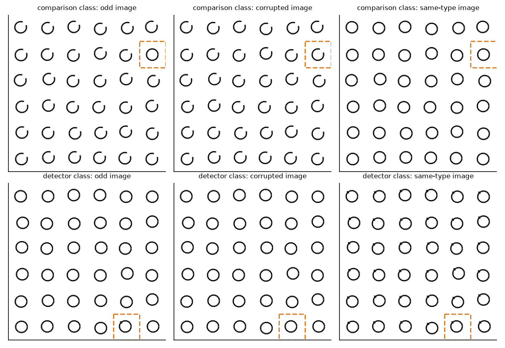
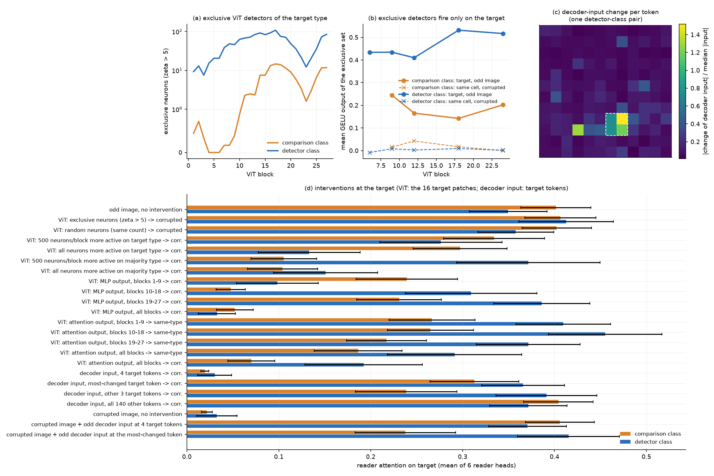
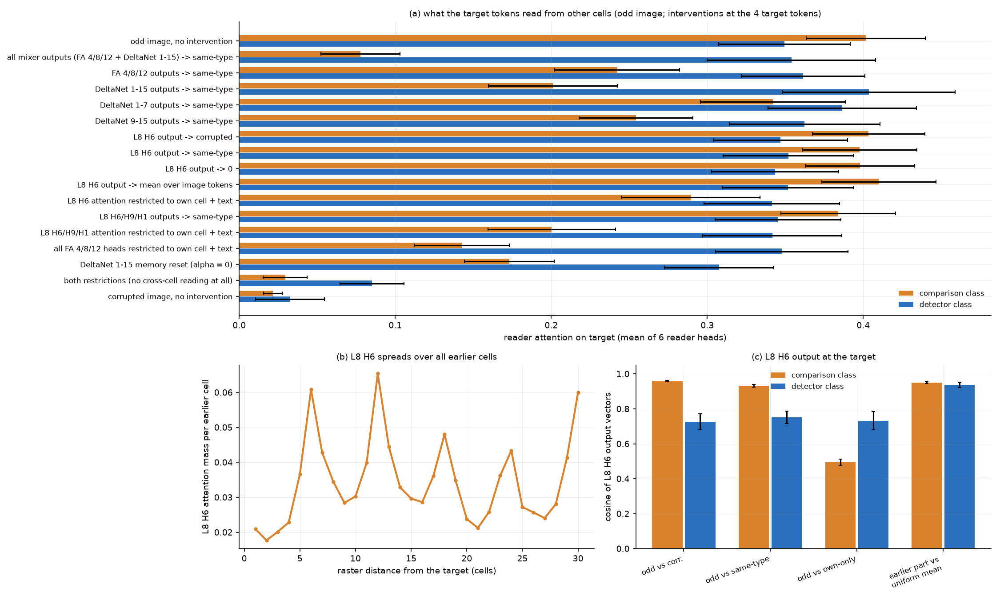
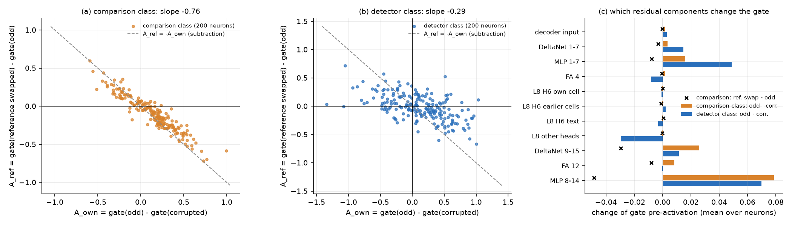
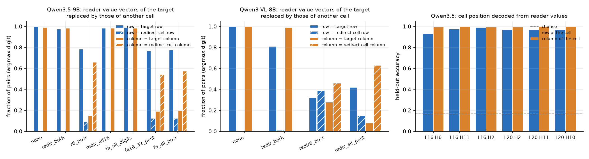
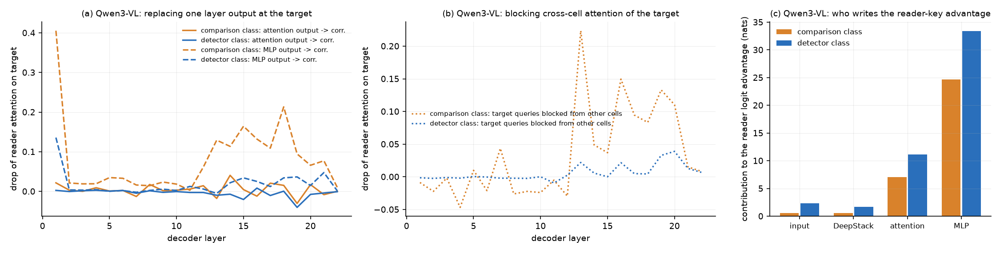
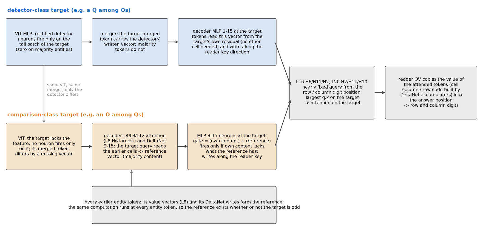

# 异常实体定位的完整计算链（实验 2.7 第四轮）

实验日期：2026-11-11 至 2026-11-12。本文属于[视觉细节表征](plan.md)研究，是实验 2.7 的完整机理报告，取代[第三轮](results_2026-11-05_search_circuit.md)中关于“局部计算”“模板 head”与读取后作答的叙述；第三轮的读取 logit 分解、光栅开头效应与剂量—反应结论继续有效，本文直接引用。主模型为 Qwen3.5-9B，冻结、bfloat16、SDPA，thinking off，问法为直接回答（“One figure differs from all the others. Give its position. Return only {"row": r, "column": c} …”）；机理对照模型为 Qwen3-VL-8B-Instruct（第 9 节，只比较机理，不比较能力）。

## 0. 通俗讲述

本节按“图像进入模型 → ViT → decoder 前段 → decoder 中段 → 读取 head → 写出行列号”的顺序，分别讲两类异常实体的处理过程。两类目标的划分沿用前几轮：一类目标拥有多数实体没有的部件（例如一群 O 中的 Q，Q 多一条尾巴），ViT 中存在只在这个部件上放电的神经元，称为检测器类；另一类目标缺少多数实体都有的部件（例如一群 Q 中的 O），ViT 中没有只在它身上放电的神经元，称为比较类。

**有 ViT 检测器的目标（一群 O 中的 Q）。** 图像被切成 16 × 16 像素的 patch，一个实体覆盖 16 个 patch。ViT 的每个 block 先让各 patch 通过 self-attention 交换信息，再让每个 patch 各自通过 MLP。Q 的尾巴所在的 patch 在 ViT 前 9 个 block 的 MLP 中激活了一批神经元，它们在 O 的任何 patch 上都几乎不激活；这些神经元把各自的输出向量加到尾巴 patch 的表示上。此后的 block 继续在这个 patch 上加工，merger 再把每 2 × 2 个 patch 合并成一个 decoder token。结果是：Q 所在的 4 个 decoder token 中，含尾巴的那一个与 O 的 token 差别很大，其余 3 个也有较小的差别；其他实体的 token 几乎不受影响。ViT 中没有一个专门的“标记”：所谓 Q 被“标记”，就是它的 decoder token 携带了 O 的 token 所没有的那部分内容。这些内容不是由少数“专属检测器”单独承载的，只在 Q 上放电的神经元被抹去后，许多在 Q 上比在 O 上更活跃的普通神经元仍然携带同样的信息。

进入 decoder 后，读取 head（第 16、20 层的 6 个 full attention head）还不能直接认出 Q：Q 的 token 携带的内容与读取 head 寻找的方向关系不大。decoder 第 1–15 层在每个图像 token 上都运行同样的计算：序列混合子层（DeltaNet 与第 4、8、12 层 full attention）把其他实体的内容带到这个 token 上，MLP 再对这个 token 自己的残差做非线性变换。对 Q 来说，起决定作用的是它自己的 token 内容经过 MLP 逐层变换：第 8–15 层 MLP 中一批神经元因为 Q 的 token 携带尾巴的内容而放电，它们的输出向量恰好指向读取 head 的 key 所对应的方向，于是 Q 的 token 在读取 head 眼中变得“显眼”。Q 的 token 从其他格读到的内容是什么并不重要：即使把它读到的全部内容换成“周围全是 Q”时的内容，读取 head 仍然同样地注意 Q。这正是“局部”的确切含义：读取 head 对 Q 的偏好只取决于 Q 自己的 4 个 token 的内容，不取决于其他实体的 token 内容。

**没有 ViT 检测器的目标（一群 Q 中的 O）。** O 的 patch 上没有任何神经元是 Q 所没有的；它与 Q 的差别是：Q 的尾巴在 ViT 第 10–18 个 block 中激活的那批神经元，在 O 上不激活。O 的 decoder token 因此是“少了一部分内容”的 Q 的 token。单看 O 自己的 token，无法区分“一群 Q 中的 O”与“一群 O 中的 O”，后者并不异常。判断“O 与众不同”必须知道周围是什么。

decoder 提供周围信息的方式是：在第 4、8、12 层 full attention 中，O 的 token 发出 query，对光栅顺序在它之前的实体 token 做 softmax 加权平均，把这些实体的 value 写入自己的残差；在 DeltaNet 层中，O 的 token 用自己的 query 从递推状态中取回此前各实体写入的内容。本文把“目标 token 的序列混合子层输出中来自其他格的部分”称为参照向量（第 2.4 节有精确定义）。在一群 Q 中，参照向量携带的是 Q 的内容，包括尾巴；O 自己的内容没有尾巴。第 8–15 层 MLP 中的神经元同时读取自身内容与参照向量：它们的门控预激活在“自身没有尾巴、参照有尾巴”时最高，两项方向相反、相互抵消的部分在“自身与参照相同”时把神经元压回不放电的状态。这是一种由线性加和加 SiLU 阈值实现的相减。证据是：把参照向量换成“周围全是 O”时的内容，这批神经元因目标像素而增加的预激活大部分被抵消，读取 head 对 O 的注意力几乎降到没有异常时的水平。放电的神经元把输出写到读取方向上，O 的 token 在读取 head 眼中变得显眼。

参照向量由许多 head 与许多 DeltaNet 层共同提供，没有单一的关键 head。第 8 层 head 6 并非必要组件：把它在目标处的输出置零、换成图像平均值或换成“周围全是 O”时的值，都不影响定位。它的输出是对此前所有实体 value 的近乎均匀的平均，无论此前实体是 Q 还是 O 都几乎相同。第三轮观察到的“禁止它读取其他格就使定位变差”，原因是禁止后它只能读本格与文本前缀，输出被替换成一个它在正常运行中从不产生的向量，并非因为它提供了必要的参照。

**两类目标的汇合与作答。** 两类目标在第 8–15 层 MLP 汇合：同一批神经元（主要在第 15、14、13、11 层）对两类目标都写出读取方向上的分量，另有少数神经元只对某些特征起作用。到第 16 层，读取 head 从预测行数字的位置发出 query，这个 query 在不同图像之间几乎不变，它与每个图像 token 的 key 做点积，目标 token 的点积最大，注意力因而集中在目标上。读取 head 把目标 token 的 value 复制到答案位置。这些 value 编码了所在格的行与列，从读取 head 的 value 向量几乎可以无误地解码出格子的行列。复制发生在写出数字之前的答案格式 token 上，不在数字 token 本身：只在数字位置改动读取 head 读到的 value，答案不变；在图像之后的全部位置把目标的 value 换成另一格的 value，答案的列号随之变为那一格的列号，行号多数仍为目标的行号。行号在 Qwen3.5 中另有来源：实验 3.14 发现行号由 DeltaNet 的行累加器沿光栅顺序产生，并由同一行中位于目标之后的 token 携带。Qwen3-VL 没有 DeltaNet，它的读取 head 同时从目标的 value 中读取行与列（第 9 节）。

## 1. 假说与主要结论

| 假说 | 检验 | 结论 | 章节 |
| --- | --- | --- | --- |
| H1：检测器类目标在 ViT 中的差异来自少数专属检测神经元 | ViT 中按选择性替换神经元激活、按 block 段替换 MLP 与 attention 输出 | 不成立；差异分布在大量选择性神经元上，检测器类形成于第 1–9 个 block 的 MLP，比较类形成于第 10–18 个 block | 第 4 节 |
| H2：定位所需的全部图像信息位于目标自身的 decoder token | decoder 输入按 token 子集替换与插入 | 成立；检测器类只需含特征的一个 token | 第 5 节 |
| H3：比较类目标依赖参照向量的内容，检测器类不依赖；第 8 层 head 6 提供必要的参照 | 同类图像替换参照向量、head 6 的零化、均值化与替换 | 前半成立；head 6 不必要，参照由多个 full attention head 与 DeltaNet 层共同提供 | 第 6 节 |
| H4：MLP 8–15 神经元以“自身内容减参照”的形式产生读取方向上的分量 | 门控预激活的精确分解与参照替换下的抵消比例 | 比较类成立（抵消 73%），检测器类主要读取自身内容（抵消 17%） | 第 7 节 |
| H5：读取 head 把目标 value 中的格子位置复制到答案 | value 解码；在不同位置替换目标 value | 列号成立且发生在数字之前的格式 token；行号在 Qwen3.5 中另有来源 | 第 8 节 |
| H6：Qwen3-VL 的计算链结构相同 | 读取 logit 分解、逐层与逐 head 干预、参照替换、value 替换 | 结构相同；差异在于参照只由 attention 提供、DeepStack 参与输入、行列都从目标 value 读取 | 第 9 节 |

主要结论：

1. **ViT 中没有单独的“标记”，目标的 decoder token 只是携带了多数实体没有（或缺少了多数实体都有）的内容。** 把检测器类目标 16 个 patch 上全部专属检测神经元（每张图约 1,500 个 block-神经元对）换成去异常图像中的值，读取注意力不降反升（0.350 → 0.413）；把在目标类型上更活跃的全部神经元换掉则降到 0.133。这说明 ViT 中的目标信息由大量有选择性但不专属的神经元共同承载，前几轮统计的专属检测器只是其中最显眼的一部分。
2. **定位所需的图像信息全部位于目标自身的 4 个 decoder token 中。** 把异常图像中目标 4 个 token 的 decoder 输入插入去异常图像，读取注意力恢复到 0.406（比较类）与 0.371（检测器类），与异常图像本身相同；替换其余 140 个 token 的 decoder 输入没有影响。ViT 的双向 attention 虽然让邻近 token 也发生小的变化，这些变化对定位没有作用。
3. **ViT 与 merger 的输出对定位是必要的，但它们几乎不直接写入读取方向。** 替换目标的 decoder 输入使两类目标的读取注意力都降到无异常水平；第三轮的读取 logit 分解显示 decoder 输入直接贡献的读取 logit 优势只占 14%（检测器类）与 3%（比较类）。两者合起来说明：decoder 输入是原料，它通过 decoder 中段 MLP 的变换才影响读取。
4. **比较类目标的定位依赖参照向量的内容，检测器类不依赖。** 把目标 token 在第 1–15 层全部序列混合子层的输出换成同类图像中的值，比较类读取注意力从 0.402 降到 0.078，检测器类不变（0.350 → 0.354）。只换 full attention 降到 0.242，只换 DeltaNet 降到 0.201，参照由两类子层分担。
5. **第 8 层 head 6 不是必要组件。** 它在目标处的输出置零（0.398）、换成图像 token 平均（0.410）、换成同类图像中的值（0.398）都不影响比较类定位；只有把它的注意力限制在本格与文本前缀时下降（0.290），这时它的输出与正常输出的余弦只有 0.49、范数变化为正常输出的 1.46 倍，且对下游神经元的改变主要来自被放大的文本前缀 value。第三轮的“模板 head”结论据此撤回。
6. **MLP 8–15 神经元对比较类目标执行“自身内容与参照的抵消”。** 对第三轮选出的 200 个神经元，目标像素带来的门控预激活变化 $A_{\mathrm{own}}$ 与把参照换成目标类型带来的变化 $A_{\mathrm{ref}}$ 在神经元之间的相关为 −0.94，斜率 −0.76，总量上 73% 被抵消；检测器类相关为 −0.56、斜率 −0.29、抵消 17%。这直接说明比较类神经元读取“自身与参照之差”，检测器类神经元主要读取自身内容。
7. **读取 head 把目标的列号复制到答案，复制发生在数字之前的格式 token 上；Qwen3.5 的行号另有来源。** 只在两个数字位置替换 6 个读取 head 读到的目标 value，答案不变；在图像之后的全部位置替换，列号跟随替换格的比例为 0.66（比较类）与 0.65（检测器类），行号仍为目标行的比例为 0.75 与 0.85。Qwen3-VL 中同样的替换使行号与列号都跟随替换格（行 0.33 与 0.47，列 0.38 与 0.57）。

## 2. 模型运算、符号与度量

本节先约定实体、token 与残差的符号，再逐一定义后文使用的量。每个量都由模型在单张图像上实际执行的运算给出；凡是需要两张图像才能计算的量（例如异常图像与去异常图像之差），只作为度量，不作为模型内部的运算。

### 2.1 实体、token 与三种图像

图像为 $6 \times 6$ 网格，每个实体占 $64 \times 64$ 像素。ViT 的 patch 为 $16 \times 16$ 像素，因此一个实体覆盖 $4 \times 4 = 16$ 个 patch；merger 把每 $2 \times 2$ 个相邻 patch 合并为一个 decoder token，因此一个实体对应 decoder 中 $2 \times 2 = 4$ 个图像 token。实体按光栅顺序编号为第 1–36 格，第 $e$ 格的 4 个 token 记为集合 $T_e$，目标格记为 $t$。

每个样本使用三张图像，它们的抖动与朝向完全相同：

1. **异常图像**：目标格为目标类型，其余 35 格为多数类型。
2. **去异常图像**：目标格重绘为多数类型，其余像素不变；整幅图像只含多数类型。
3. **同类图像**：全部 36 格都画成目标类型，目标格的像素与异常图像完全相同。它提供“上下文与目标相同”的反事实：目标 token 从其他格读到的内容全部来自与它自己相同的实体。同类图像由重放第三轮刺激生成的随机数序列得到，重放出的异常图像与存档图像的 SHA-256 全部一致。

### 2.2 残差流

decoder 第 $l$ 层输入处 token $j$ 的残差 $x_j^{(l)} \in \mathbb{R}^{4096}$ 是各组件输出之和：

$$
x_j^{(l)} = x_j^{(0)} + \sum_{m < l} \left( a_j^{(m)} + f_j^{(m)} \right),
$$

其中 $x_j^{(0)}$ 为 decoder 输入（图像 token 处即 merger 输出，本文也称 token $j$ 的自身内容），$a_j^{(m)}$ 为第 $m$ 层序列混合子层（第 $4, 8, \dots$ 层为 full attention，其余为 Gated DeltaNet）的输出，$f_j^{(m)}$ 为第 $m$ 层 MLP 的输出。

### 2.3 full attention head 的输出及其按来源拆分

Qwen3.5 的 full attention head $(l, h)$ 在 token $i$ 处写入残差的向量为

$$
o_i^{(l,h)} = W_O^{(l,h)} \Big( \sigma(g_i) \odot \sum_{j \le i} \alpha_{ij} \, v_j \Big), \qquad \alpha_{ij} = \operatorname{softmax}_{j \le i}\Big( \tfrac{1}{\sqrt{d}} \, q_i^{\top} k_j \Big),
$$

其中 $q_i, k_j, v_j \in \mathbb{R}^{256}$ 为 query、key、value（$d = 256$），$g_i \in \mathbb{R}^{256}$ 为输出门控的 logit，$\sigma$ 为 sigmoid，$\odot$ 为逐元素乘，$W_O^{(l,h)} \in \mathbb{R}^{4096 \times 256}$ 为该 head 对应的输出投影切片。门控只依赖 query 所在的 token，因此给定注意力权重后，输出对来源 $j$ 是线性的，可以精确拆成三部分之和：读自本格（$j \in T_t$）、读自光栅在前的格、读自图像之前的文本前缀。每一部分都是把上式中的求和限制在对应的 token 集合上。

### 2.4 参照向量

目标 token $i \in T_t$ 的序列混合子层输出中来自其他格的部分称为参照向量，记为 $r_i \in \mathbb{R}^{4096}$：

$$
r_i = \sum_{l \in \{4, 8, 12\}} \sum_{h} W_O^{(l,h)} \Big( \sigma(g_i) \odot \sum_{j \in T_{<t}} \alpha_{ij}^{(l,h)} v_j^{(l,h)} \Big) + r_i^{\mathrm{DN}},
$$

其中 $T_{<t}$ 为光栅在前各格的 token，$r_i^{\mathrm{DN}}$ 为 DeltaNet 层输出中由前文 token 写入状态的部分（第 2.5 节）。DeltaNet 的状态是前文全部 token 写入的累积，不能像 full attention 一样逐来源精确拆分，因此参照向量整体只通过干预检验：在异常图像的目标 token 上，把第 1–15 层全部序列混合子层的输出换成同类图像中同一位置的输出，称为参照替换。替换后目标 token 自身的 decoder 输入不变，它从其他格读到的内容变成“全是目标类型”的内容。定义参照向量的目的，是把“目标 token 从其他实体读到了什么”与“目标 token 自己是什么”分开。由于其余 35 格在异常图像与去异常图像中完全相同，参照向量在这两张图像中几乎相同（第 6.2 节测得第 8 层 head 6 的输出余弦为 0.96）。

### 2.5 Gated DeltaNet

DeltaNet 每个 value head 维护状态 $S_i \in \mathbb{R}^{128 \times 128}$，按 token 顺序更新：

$$
S_i = \alpha_i S_{i-1} + \beta_i \, k_i \big( v_i - (\alpha_i S_{i-1})^{\top} k_i \big)^{\top}, \qquad y_i = S_i^{\top} q_i ,
$$

其中 $k_i, q_i \in \mathbb{R}^{128}$ 为 L2 归一化的 key 与 query，$v_i$ 为 value，$\alpha_i \in (0,1)$ 为衰减门，$\beta_i \in (0,1)$ 为写入强度，$y_i$ 为输出。记忆清除指在目标 token 处令 $\alpha_i = 0$，此时 $y_i$ 只含目标 token 自身（及长度为 4 的短卷积窗口）的内容。

### 2.6 MLP 神经元的门控预激活及其分解

第 $l$ 层 MLP 在 token $i$ 处先做 RMSNorm，再计算 12,288 个神经元：

$$
\hat{x}_i = \frac{x_i \odot (1 + w)}{\operatorname{rms}(x_i)}, \qquad u_{i,n} = \operatorname{SiLU}\big( s_{i,n} \big) \cdot \big( w_{u,n}^{\top} \hat{x}_i \big), \qquad s_{i,n} = w_{g,n}^{\top} \hat{x}_i, \qquad f_i = \sum_n u_{i,n} \, w_{d,n},
$$

其中 $x_i$ 为 MLP 之前的残差，$w \in \mathbb{R}^{4096}$ 为 RMSNorm 的逐维缩放，$w_{g,n}, w_{u,n} \in \mathbb{R}^{4096}$ 为神经元 $n$ 的 gate 与 up 输入权重，$w_{d,n} \in \mathbb{R}^{4096}$ 为它写入残差的方向（down 投影的第 $n$ 列），$s_{i,n}$ 为门控预激活。$\operatorname{SiLU}(s) = s \, \sigma(s)$ 在 $s \ll 0$ 时接近 0、在 $s > 0$ 时近似线性，因此 $s_{i,n}$ 决定神经元是否放电。把 $\operatorname{rms}(x_i)$ 固定为实际前向中的值后，$\hat{x}_i$ 对残差是线性的，于是门控预激活可以精确拆成各残差组件的贡献之和：

$$
s_{i,n} = \sum_{c} \frac{w_{g,n}^{\top} \big( x_i^{[c]} \odot (1 + w) \big)}{\operatorname{rms}(x_i)},
$$

求和遍历第 2.2 节的全部残差组件 $x_i^{[c]}$（decoder 输入、各层序列混合子层与 MLP 的输出；第 8 层 head 6 的输出再按第 2.3 节拆成三部分）。由各组件重建的激活与实际激活的最大绝对差为 0.14（bfloat16 舍入）。这一分解告诉我们一个神经元的放电由目标的自身内容、参照向量还是上游 MLP 推动。

### 2.7 读取 head、读取方向与读取 logit 优势

读取 head 为第 16 层 head 6、11、2 与第 20 层 head 2、11、10（按真实图像中预测行数字的位置落在目标上的注意力选出，与第二、三轮相同）。记预测行数字的位置为行查询位置 $p$。读取 head 对图像 token $j$ 的注意力 logit 为

$$
z_j = \frac{1}{\sqrt{d}} \, q_p^{\top} \, \mathrm{RoPE}_j\!\Big( \mathrm{N}_k\big( W_K \, \mathrm{N}_{\mathrm{in}}(x_j) \big) \Big),
$$

$\mathrm{N}_{\mathrm{in}}$、$\mathrm{N}_k$ 为两个 RMSNorm，$W_K \in \mathbb{R}^{256 \times 4096}$ 为 key 投影，$\mathrm{RoPE}_j$ 为位置 $j$ 的旋转。把两个 RMSNorm 的缩放固定后，$z_j$ 是 $x_j$ 的线性函数：

$$
z_j = c_j^{\top} x_j, \qquad c_j = \frac{\partial z_j}{\partial x_j} \in \mathbb{R}^{4096}.
$$

$c_j$ 称为 token $j$ 处的读取方向：残差在这个方向上的分量越大，读取 head 越注意 token $j$。读取 head 的 query $q_p$ 在不同图像之间几乎不变（第三轮：第 16 层余弦 0.96），因此读取方向几乎只取决于 token 的位置与归一化缩放。目标的读取 logit 优势定义为

$$
D = \bar{z}_t - \frac{1}{35} \sum_{e \ne t} \bar{z}_e ,
$$

$\bar{z}_e$ 为第 $e$ 格 4 个 token 的 logit 平均，三个第 16 层读取 head 求和。同一目标格在异常图像与去异常图像中的 $D$ 之差记为 $M$，它度量目标的像素差异使读取 logit 优势增加了多少。第三轮把 $M$ 称为“目标标记”；本文只使用 $M$ 这一精确定义。

### 2.8 读取注意力与干预协议

定位的读出为读取注意力：6 个读取 head 在行查询位置落在目标 4 个 token 上的注意力之和，取 head 平均。它只反映读取 head 是否选中目标，与行列数字如何写出无关。所有干预都在 teacher forcing 下对单张图像执行（答案文本固定为正确坐标），只作用于指定的 token 与组件：

1. **替换为去异常值 / 同类值**：把指定组件在指定 token 上的输出换成它在去异常图像 / 同类图像同一位置的输出，其余计算照常进行。
2. **零化、平均值化**：把第 8 层 head 6 在目标 token 上的输出（$W_O$ 之前、门控之后的 256 维切片）换成 0，或换成它在去异常图像全部图像 token 上的平均。
3. **限制注意力**：指定 head 的目标 query 不能注意其他格的 token，只能注意本格与文本前缀（softmax 在剩余位置上重新归一化）。
4. **ViT 中的替换**：在目标的 16 个 patch 上，把 ViT 指定 block 的 MLP 神经元激活（GELU 输出）、MLP 输出或 attention 输出换成去异常图像或同类图像中的值。
5. **value 替换**（第 8 节）：对指定 head 与指定 query 位置，把该 head 读到的目标 4 个 token 的 value 换成另一格（行与列都不同、光栅距离至少 7 格的控制格）4 个 token 的 value，注意力权重保持不变。实现为在该 head 输出上加 $\sigma(g_p) \odot \sum_{i} \alpha_{p, t_i} (v_{e_i} - v_{t_i})$，单元测试验证其与直接重算等价。

## 3. 刺激与执行

### 3.1 样本

Qwen3.5 使用第三轮 circuit 阶段的 120 对图像：80 对比较类、40 对检测器类，均为模型答对、目标位于第 7 格以后的样本（atlas 与 mag 集，覆盖 Q 与 O、开口与闭合圆、尺寸、饱和度、四臂与三臂十字、端点短横、方框内点、倾斜、圆角方框等特征）。每对补一张同类图像。ViT 神经元的选择性统计使用这些样本所在的 40 个特征条件下的全部 960 张去异常图像与 960 张同类图像。Qwen3-VL 先在 624 张 atlas 异常图像上生成答案，只用于挑选答对的样本，再按同样规则随机抽取 60 对比较类与 40 对检测器类。

上排为一个比较类样本（开口圆群中的闭合圆），下排为一个检测器类样本（O 群中的 Q）；从左到右为异常图像、去异常图像与同类图像。橙色虚线框标出目标格，仅用于展示，不输入模型。

### 3.2 执行

| 阶段 | 内容 | 规模 |
| --- | --- | --- |
| ViT 统计 | 去异常与同类图像上 27 个 block 的 MLP 激活，按实体取 16 个 patch 的最大值，求每个条件、每个 block 的均值、标准差与专属检测分数 $\zeta$ | 1,920 张 |
| Qwen3.5 记录与干预 | 每对 6 次记录前向（异常、去异常、同类、head 6 限制注意力、参照替换，以及第 8 层 key 分解）与 46 种干预 | 120 对，约 6,200 次前向，batch size 16 |
| Qwen3.5 value 替换 | 6 种位置与 head 组合 | 120 对 × 6 |
| Qwen3.5 解码 | 624 张 atlas 异常图像上读取 head 的输出与 value | 624 张 |
| Qwen3-VL | 生成、读取 head 选择、读取 logit 分解、逐层与逐 head 干预、参照替换、value 替换 | 624 次生成；100 对 × 约 90 种干预 |

全部 GPU 阶段约 0.8 GPU 小时（一张 A40 与一张 A800）。所有干预结果在答对的样本上测得，无失败或丢弃的样本。读取注意力的误差为 95% 正态区间。

## 4. ViT：两类目标的差异如何形成（H1）

**假说与理论。** 第一、二轮把 ViT MLP 神经元视为被 GELU 整流的检测器：多数实体上处于下限、只在目标特征上放电的神经元（$\zeta > 5$ 的专属检测器，定义见第二轮第 2.3 节）。若这些神经元是检测器类目标差异的唯一来源，把它们在目标 patch 上的激活换成去异常值，目标的 decoder token 就应与多数实体相同，定位应失败。

(a) 每个 block 中目标类型相对多数类型的专属检测器数（$\zeta > 5$），按类别平均，由均匀图像的激活统计得到。(b) 第 6、9、12、18、24 个 block 的专属检测器在目标上的平均激活：实线为异常图像中的目标，虚线为去异常图像中同一格的多数实体。(c) 一个检测器类样本中每个 decoder token 的输入变化范数（异常减去去异常，除以图像 token 输入范数的中位数，viridis 色标），白色虚线框为目标的 4 个 token。(d) 各干预下的读取注意力（橙色比较类 80 对，蓝色检测器类 40 对；误差线为 95% 区间）。所有数值由实际前向测得，未经拟合。

| ViT 中的干预（目标的 16 个 patch） | 比较类 | 检测器类 |
| --- | --- | --- |
| 无 | 0.402 | 0.350 |
| 专属检测器（$\zeta > 5$）的激活 → 去异常值 | 0.406 | 0.413 |
| 同数量随机神经元 → 去异常值 | 0.402 | 0.358 |
| 每 block 500 个在目标类型上更活跃的神经元 → 去异常值 | 0.334 | 0.276 |
| 全部在目标类型上更活跃的神经元 → 去异常值 | 0.297 | 0.133 |
| 每 block 500 个在多数类型上更活跃的神经元 → 去异常值 | 0.105 | 0.372 |
| MLP 输出 → 去异常值：block 1–9 / 10–18 / 19–27 | 0.239 / 0.048 / 0.231 | 0.098 / 0.309 / 0.386 |
| attention 输出 → 同类值：全部 block | 0.186 | 0.291 |
| 去异常图像（参照） | 0.022 | 0.033 |

**专属检测器存在，但对定位不必要。** 检测器类目标每张图约有 1,540 个 block-神经元对满足 $\zeta > 5$，它们在目标上平均激活 0.41–0.53，在多数实体上为 0.00–0.01（图 b），正是第一轮描述的整流检测器。把它们全部换成去异常值后读取注意力为 0.413，不低于未干预的 0.350。这说明“Q 在 ViT 中被标记”并不依赖这批专属神经元：Q 的尾巴同时让大量普通神经元在 Q 上比在 O 上更活跃，这些神经元携带同样的信息，只有把它们一并替换（0.133）才能抹去目标。

**两类目标的差异形成于不同深度，方向相反。** 检测器类的差异主要来自第 1–9 个 block 的 MLP（替换后 0.098），即尾巴、缺口这类局部笔画在浅层就被编码；比较类的差异主要来自第 10–18 个 block（0.048），并且承载它的是“在多数类型上更活跃”的神经元（0.105），即多数实体的特征神经元在目标上没有激活。比较类目标的“与众不同”在 ViT 中表现为一组神经元的缺席，单看目标自己无法与“全是目标类型”的图像区分。

**ViT 的 attention 已经对比较类目标做了一部分上下文比较。** 把目标 patch 的 attention 输出换成同类图像中的值（目标自身像素不变，周围变成目标类型），比较类读取注意力降到 0.186，检测器类为 0.291。ViT 的 self-attention 是双向的，目标 patch 读到的周围内容会改变它的表示；对比较类目标，这一部分上下文差异是后续定位的原料之一。同类图像中比较类目标的专属神经元激活为 0.38–0.55，在异常图像中只有 0.14–0.24（图 b 的数据），也说明比较类目标在 ViT 中的表示受周围实体影响；检测器类为 0.37–0.63 对 0.41–0.53，几乎不受影响（解释）。

## 5. decoder 输入：差异位于目标自身的 token（H2）

**假说与理论。** 若定位所需的图像信息只在目标自身的 decoder token 中，则把目标 4 个 token 的 decoder 输入插入去异常图像应足以恢复定位，替换其余 token 的 decoder 输入应无影响。

| decoder 输入的干预 | 比较类 | 检测器类 |
| --- | --- | --- |
| 异常图像：目标 4 个 token → 去异常值 | 0.020 | 0.030 |
| 异常图像：变化最大的 1 个目标 token → 去异常值 | 0.313 | 0.366 |
| 异常图像：其余 3 个目标 token → 去异常值 | 0.239 | 0.391 |
| 异常图像：其余 140 个图像 token → 去异常值 | 0.404 | 0.372 |
| 去异常图像：插入目标 4 个 token 的异常值 | 0.406 | 0.371 |
| 去异常图像：只插入变化最大的 1 个 token | 0.238 | 0.415 |

**目标自身的 4 个 token 包含定位所需的全部图像信息。** 插入目标 4 个 token 的 decoder 输入即可让去异常图像获得与异常图像相同的读取注意力，而其余 140 个 token 的输入换掉后没有影响。ViT 的双向 attention 使目标附近的 token 也有小的变化（图 c；非目标 token 的相对变化中位数为 0.10 与 0.03），这些变化不参与定位。

**检测器类只需要含特征的那一个 token，比较类需要全部 4 个。** 检测器类目标变化最大的 token 的输入变化是其范数的 2.9 倍，单独插入它就能使读取注意力达到 0.415；比较类的变化分散在 4 个 token 上（最大 token 的相对变化 1.14），单独插入一个只恢复到 0.238。这与第 4 节一致：检测器类的差异是一个局部笔画写入一个 patch，比较类的差异是整个实体缺少多数实体共有的内容。

**decoder 输入对定位必要，但几乎不直接写入读取方向。** 替换目标的 decoder 输入使读取注意力降到无异常水平，是总效应；第三轮的精确分解显示，decoder 输入直接贡献的读取 logit 优势在检测器类为 2.1 nats（共 15.1），在比较类为 0.2 nats（共 8.0），是直接效应。二者之差由 decoder 中段的 MLP 承担（第 7 节）：decoder 输入经由 MLP 的变换才影响读取。

## 6. 参照：目标 token 从其他格读到的内容（H3）

**假说与理论。** 比较类目标的自身内容与“全是目标类型”图像中的实体相同，若它的定位依赖与周围的比较，就必须依赖参照向量的内容；检测器类目标的自身内容已经与多数实体不同，不需要参照。参照替换（第 2.4 节）可以直接检验这一点：替换后目标的自身内容不变，参照变成目标类型的内容。

(a) 目标 token 上各种干预后的读取注意力（橙色比较类，蓝色检测器类，误差线为 95% 区间）。(b) 第 8 层 head 6 的目标 query 落在每个光栅在前格上的平均注意力随光栅距离的变化（比较类异常图像），由记录的 query 与 key 重算 softmax 得到。(c) 第 8 层 head 6 在目标处输出向量（$W_O$ 之后，4 个 token 平均）在不同图像或干预之间的余弦，以及其“读自前文”部分与前文 value 均匀平均之间的余弦。

### 6.1 参照替换

| 目标 token 上的干预 | 比较类 | 检测器类 |
| --- | --- | --- |
| 无 | 0.402 | 0.350 |
| 第 1–15 层全部序列混合子层输出 → 同类值 | 0.078 | 0.354 |
| 只 full attention 4、8、12 → 同类值 | 0.242 | 0.361 |
| 只 DeltaNet 1–15 → 同类值 | 0.201 | 0.404 |
| 只 DeltaNet 9–15 → 同类值 | 0.254 | 0.362 |
| full attention 4、8、12 全部 head 限制在本格与文本 | 0.143 | 0.348 |
| DeltaNet 1–15 记忆清除 | 0.173 | 0.308 |
| 两者同时（不读取任何其他格） | 0.029 | 0.085 |

**比较类目标的定位取决于参照向量的内容。** 只改变目标从其他格读到的内容、不改变目标自身，比较类读取注意力就从 0.402 降到 0.078，接近去异常图像的 0.022。目标 O 只有在参照携带“尾巴”时才显得异常。参照由 full attention 与 DeltaNet 分担：只替换其中一类各损失约一半，DeltaNet 中段（第 9–15 层）的份额大于前段。

**检测器类目标的定位不取决于参照内容。** 同样的替换对检测器类没有影响（0.354）。Q 在“周围全是 Q”的参照下仍被读取 head 选中，说明它的读取 logit 优势完全由自身内容产生。这是“局部”的精确含义：读取 head 对目标的偏好只取决于目标自身 4 个 token 的内容（第 5 节）与它们在 decoder 中的变换，与其他实体的 token 内容无关。

**完全不读取其他格是另一种扰动，不能用来判断是否需要比较。** 同时限制 full attention 与清除 DeltaNet 记忆后，检测器类也降到 0.085。检测器类对参照内容不敏感，却对“没有任何参照”敏感，这说明该干预造成的是分布外扰动：正常运行中每个 token 都会读到上下文，一个完全没有上下文输入的 token 的残差统计与 MLP 训练时见到的不同。第三轮用“阻断跨实体读取”区分两类目标时，比较类的下降中也混有这一成分；参照替换不改变残差的统计特性，是更干净的检验。

### 6.2 第 8 层 head 6 的作用

| 第 8 层 head 6 在目标处的干预 | 比较类 | 检测器类 |
| --- | --- | --- |
| 无 | 0.402 | 0.350 |
| 输出 → 去异常值 | 0.403 | 0.347 |
| 输出 → 同类值 | 0.398 | 0.352 |
| 输出 → 0 | 0.398 | 0.343 |
| 输出 → 图像 token 平均 | 0.410 | 0.352 |
| 注意力限制在本格与文本 | 0.290 | 0.341 |
| head 6、9、1 输出 → 同类值 | 0.384 | 0.345 |
| head 6、9、1 注意力限制在本格与文本 | 0.200 | 0.342 |

**head 6 的输出对定位不必要。** 把它在目标处的输出置零、换成平均值或换成同类图像中的值，比较类读取注意力都保持在 0.40 左右；第 8 层贡献最大的三个 head 一起换成同类值也只到 0.384。这直接回答了“删除它有没有影响”：删除没有影响。

**head 6 计算的是此前实体 value 的近乎均匀的平均，与此前实体是什么几乎无关。** 比较类目标 query 把 0.80 的注意力放在此前各格上，归一化熵为均匀分布的 0.93；读自前文的部分与前文 value 的均匀平均余弦为 0.95，占输出范数的 0.88。异常图像与去异常图像中它的输出余弦为 0.96，与同类图像（此前实体全为目标类型）余弦为 0.93。120 张去异常图像上它的输出有效维数（参与比，$(\sum \lambda)^2 / \sum \lambda^2$，$\lambda$ 为主成分方差）约为 10。也就是说，无论此前的实体是 Q 还是 O，它写入的向量几乎相同，它所携带的“此前实体是什么”的信息很少，这就是替换它的输出没有影响的原因。

**限制注意力的效应来自限制本身产生的异常输出。** 限制后 head 6 只能读本格与文本前缀，softmax 重新归一化使文本前缀与本格的 value 被放大：输出与正常输出的余弦降到 0.49，变化量为正常输出范数的 1.46 倍。在第 7 节的门控分解中，限制注意力改变 200 个神经元预激活的主要来源是 head 6 的“读自文本前缀”部分（平均 −0.021），而它的“读自前文”部分几乎没有作用（+0.005）。因此第三轮观察到的 0.40 → 0.29 是向目标 token 注入一个非典型向量的效应，不是失去参照的效应。“模板 head”一说不成立。

**head 6 的 QK：对所有实体 key 共有的成分做匹配。** 比较类目标 query 对前文各格 key 的 logit 平均为 4.72，格间标准差只有 0.60 nats，因此注意力近乎均匀。按第 2.6 节同样的方法把 key 一侧精确拆到各组件，前文 key 上的 logit 主要来自 decoder 输入（1.09）、full attention 4（0.77）、DeltaNet 7、6、3 与 1（0.58–0.66），这些成分在所有实体 token 上都存在，与实体类型无关；去掉 RoPE 后 logit 与原 logit 的相关为 0.93，位置旋转只做小的调制，表现为光栅距离为 6、12、18 格（同一列、上方各行）的格子略多得一些注意力（图 b）。目标 query 在不同图像之间余弦为 0.83。检测器类目标对本格 key 的 logit 升到 6.36（去异常图像中同一格为 4.85），注意力的 0.25 回到本格，这是检测器类目标自身内容与众不同的一个副产品，同样不影响定位。

## 7. MLP 8–15 神经元：自身内容与参照的组合（H4）

**假说与理论。** 设第 8–15 层 MLP 中神经元 $n$ 的门控预激活可以近似写成目标自身内容与参照向量在某个特征轴上的线性组合：

$$
s_n = b_n + \lambda_n \, \phi(x_{\mathrm{own}}) - \mu_n \, \phi(r),
$$

其中 $\phi(\cdot)$ 为某个特征（例如“有尾巴”）在相应向量上的强度，$b_n$ 为与特征无关的部分，$\lambda_n, \mu_n \ge 0$ 为神经元对自身与参照的权重。SiLU 只在 $s_n > 0$ 附近放电。在一群多数实体 $M$ 中，若目标为 $T$，则自身内容为 $\phi_T$、参照为 $\phi_M$；去异常图像中两者都是 $\phi_M$；参照替换后两者都是 $\phi_T$。定义两个可测的变化：

$$
A_{\mathrm{own}} = s_n(\text{异常}) - s_n(\text{去异常}) = \lambda_n (\phi_T - \phi_M), \qquad A_{\mathrm{ref}} = s_n(\text{参照替换}) - s_n(\text{异常}) = -\mu_n (\phi_T - \phi_M).
$$

若神经元读取“自身与参照之差”（$\lambda_n = \mu_n$），则 $A_{\mathrm{ref}} = -A_{\mathrm{own}}$，二者斜率为 −1；若神经元只读取自身内容（$\mu_n = 0$），则 $A_{\mathrm{ref}} = 0$，斜率为 0。对比较类目标，$\phi$ 为多数实体有、目标缺少的特征，$\phi_T < \phi_M$；神经元若要在“目标缺少、参照拥有”时放电，必须对自身取负权重、对参照取正权重，两项在去异常图像与同类图像中都相互抵消，只在异常图像中留下正的余量。这是一种由线性加和与 SiLU 阈值实现的相减，不需要任何专门的比较运算。

(a)(b) 第三轮选出的 200 个 MLP 8–15 神经元（按比较类读取 logit 的直接贡献排序）在目标 4 个 token 上的平均门控预激活变化，每点一个神经元，横轴 $A_{\mathrm{own}}$、纵轴 $A_{\mathrm{ref}}$，样本平均；灰色虚线为 $A_{\mathrm{ref}} = -A_{\mathrm{own}}$。(c) 按第 2.6 节精确分解的门控预激活变化，按残差组件分组，在 200 个神经元与样本上平均：柱为异常减去去异常（橙色比较类，蓝色检测器类），黑叉为比较类的参照替换减异常。所有数值由实际前向的激活与权重计算，未经拟合。

| 统计量 | 比较类（80 对） | 检测器类（40 对） |
| --- | --- | --- |
| $A_{\mathrm{ref}}$ 对 $A_{\mathrm{own}}$ 的相关（200 个神经元） | −0.94 | −0.56 |
| 斜率 | −0.76 | −0.29 |
| 抵消比例 $-\sum A_{\mathrm{ref}} / \sum A_{\mathrm{own}}$ | 0.73 | 0.17 |
| head 6 限制注意力的抵消比例 | 0.34 | 0.02 |

**比较类目标的神经元读取自身内容与参照之差。** 200 个神经元中，目标像素带来的门控变化与参照替换带来的变化几乎互为相反数（相关 −0.94，斜率 −0.76），总量的 73% 被抵消。这正是上式在 $\lambda_n \approx \mu_n$ 时的预言：同一个神经元在“自身缺少、参照拥有”时被推高，在“自身与参照相同”时被压回。检测器类的抵消只有 17%，神经元主要读取自身内容（$\mu_n$ 小），与第 6.1 节参照替换不影响检测器类定位一致。

**推动这些神经元的是上游 MLP 与 DeltaNet 中段，不是 decoder 输入本身，也不是 head 6。** 精确分解显示，比较类目标的门控变化主要来自第 8–14 层 MLP 的输出（0.079）、DeltaNet 9–15（0.026）与 MLP 1–7（0.016），decoder 输入的直接贡献只有 0.002；参照替换时减少最多的也是这三部分（−0.049、−0.029、−0.008）。head 6 的三部分贡献都接近 0。也就是说，“自身减参照”不是在某一层一次完成，而是在第 8–15 层中逐层累积：前一层 MLP 已经部分完成的差异被后一层 MLP 继续放大，DeltaNet 中段在每一层补充参照。

**神经元写出的方向。** 这 200 个神经元的写入方向 $w_{d,n}$ 与读取方向 $c_t$ 的内积就是它们对读取 logit 的直接贡献（第三轮第 2.7 节的 $A_n$）：前 200 个神经元在比较类上的净直接贡献达到全部 98,304 个神经元净贡献的 108%（其余神经元正负抵消），在检测器类上为 101%；第三轮的必要性实验显示把它们恢复为去异常值使读取注意力损失 43%（比较类）与 33%（检测器类）。

**共享核心与特征特异的外围。** 用第三轮记录的逐神经元直接贡献，按 10 个各有至少 3 对样本的特征条件统计：200 个神经元中 167 个在两类目标的至少 80% 条件中都为正贡献（共享），承载比较类 87%、检测器类 96% 的净贡献，主要在第 15 层（71 个）、第 14、11、13 层；13 个只对比较类为正（特异），1 个只对检测器类为正。若在全部 98,304 个神经元中分别取每个条件的前 50 个，10 个条件的并集只有 205 个神经元（完全独立时为 500 个），其中 101 个只出现在一个条件中，3 个（第 15 层 #9530、#8405、#9317）出现在全部条件中；按检测器类与按比较类平均贡献选出的前 200 个重合 96 个。结论是一个跨特征共享的写出核心加上随特征变化的外围神经元，外围神经元承担把特定特征转写为共享核心可读输入的工作（解释）。

## 8. 读取与作答（H5）

**假说与理论。** 读取 head 的注意力集中到目标后，其输出 $\sigma(g_p) \odot \sum_j \alpha_{pj} v_j$ 近似为目标 token 的 value。若 value 编码了目标所在格的行与列，且答案从这些输出中读取，则：从 value 应能解码格子的行列；把读取 head 读到的目标 value 换成另一格的 value，答案应改为那一格的行列。

左、中：value 替换后答案数字（teacher forcing 下的 argmax）等于目标行列（实心）或替换格行列（斜线）的比例，蓝色为行、橙色为列，两类样本合并（Qwen3.5 120 对，Qwen3-VL 100 对）。横轴条件：none 为无干预；redir_both 为 6 个读取 head、只在两个数字位置；r6_post 与 redir6_post 为 6 个读取 head、图像之后的全部位置；redir_all16 为第 16、20 层全部 head、数字位置；fa_all_digits 为全部 full attention head、数字位置；fa16_32_post 为第 16–32 层全部 full attention head、图像之后全部位置；fa_all_post 与 redir_all_post 为全部 full attention 层（Qwen3-VL 为全部 36 层）的全部 head、图像之后全部位置。右：从每个读取 head 在一个格子 4 个 token 上的平均 value 预测该格行号与列号的留出准确率（岭回归分类器，按图像 5 折，120 张异常图像 × 36 格），灰色虚线为随机水平。

| value 替换（Qwen3.5） | 行 = 目标行 | 行 = 替换格行 | 列 = 目标列 | 列 = 替换格列 |
| --- | --- | --- | --- | --- |
| 无（比较类 / 检测器类） | 1.00 / 1.00 | 0.00 / 0.00 | 0.99 / 1.00 | 0.00 / 0.00 |
| 6 个读取 head，两个数字位置 | 0.97 / 1.00 | 0.00 / 0.00 | 0.97 / 1.00 | 0.00 / 0.00 |
| 6 个读取 head，图像之后全部位置 | 0.75 / 0.85 | 0.11 / 0.05 | 0.12 / 0.20 | 0.66 / 0.65 |
| 全部 full attention head，图像之后全部位置 | 0.74 / 0.85 | 0.16 / 0.05 | 0.17 / 0.25 | 0.55 / 0.62 |

**读取 head 的 value 编码所在格的行与列。** 6 个读取 head 的 value 向量预测所在格列号的准确率为 0.99–1.00，行号为 0.93–0.99。在 624 张 atlas 异常图像上，读取 head 落在目标上时，它们在行查询位置的输出（$W_O$ 之后）预测目标行号 0.93、列号 0.92，没有落在目标上时为 0.62 与 0.45。读取 head 选中哪个实体，它的输出就携带哪个实体的格子位置。

**列号在数字之前的格式 token 上被读取，6 个读取 head 足以承担。** 只在两个数字位置替换 value 不改变答案，即使替换第 16、20 层全部 head 或全部 full attention head 也不改变；在图像之后的全部位置替换 6 个读取 head 的 value，列号跟随替换格的比例达到 0.65–0.66，扩大到全部 full attention head 并不更高。这与实验 3.15 的发现一致：坐标数值的主要信息在数值之前的格式 token 处读入，数字 token 本身由前一 token 经短卷积传递。

**Qwen3.5 的行号主要不来自目标的 value。** 同样的替换下，行号仍为目标行的比例为 0.75–0.85。value 中虽然编码了行，答案却没有使用这条通路。实验 3.14 的结论给出了行号的来源：DeltaNet 的行累加器沿光栅顺序累积行号，“本行含有目标”由同一行中位于目标之后的 token 携带，读取纵坐标时注意力集中在这些 token 与行尾上。本实验的 value 替换只改动目标 4 个 token 的 value，因此不影响这条通路。

## 9. Qwen3-VL：同一计算链的架构差异（H6）

**假说与理论。** Qwen3-VL-8B 的 36 层全部为 causal full attention（32 个 query head、8 个 key/value head、head 维度 128、无输出门控），没有 DeltaNet；DeepStack 把 ViT 第 8、16、24 个 block 的输出经各自的 merger 加到第 1、2、3 层之后的图像 token 残差上。若计算链与模型结构无关，应观察到：读取 logit 优势主要由中段 MLP 写入；比较类目标依赖参照内容、检测器类不依赖；单个 head 不必要。架构差异应表现为：参照只由 attention 提供；ViT 信息同时经 decoder 输入与 DeepStack 进入；行号也从目标 value 读取。

(a) 只把第 $l$ 层的 attention 输出（实线）或 MLP 输出（虚线）在目标 token 上换成去异常值后读取注意力的下降。(b) 只把第 $l$ 层全部 head 的目标 query 限制在本格与文本后的下降。(c) 读取 logit 优势的精确分解（异常减去去异常，6 个读取 head 求和），按组件类型汇总，单位 nats。橙色比较类 60 对，蓝色检测器类 40 对；读取 head 为第 21 层 head 15、第 22 层 head 10、11、8、30 与第 23 层 head 0，按行查询位置落在目标上的注意力选出。分解之和与实际 logit 的最大差为 0.13 nats。

| Qwen3-VL 的干预（目标 token） | 比较类 | 检测器类 |
| --- | --- | --- |
| 无 | 0.587 | 0.782 |
| decoder 输入 → 去异常值 | 0.051 | 0.267 |
| DeepStack 三层注入 → 去异常值 | 0.446 | 0.760 |
| 二者同时 | 0.028 | 0.012 |
| 去异常图像插入目标的 decoder 输入与 DeepStack 注入 | 0.577 | 0.787 |
| 第 1–22 层全部 attention 输出 → 同类值（参照替换） | 0.229 | 0.808 |
| 第 1–22 层全部 MLP 输出 → 去异常值 | 0.034 | 0.032 |
| 第 13 层 head 3 / 第 16 层 head 8 / 第 13 层 head 26：限制注意力 | 0.504 / 0.524 / 0.539 | 0.779 / 0.775 / 0.783 |
| 同上三个 head：输出 → 同类值 | 0.575 / 0.618 / 0.585 | 0.777 / 0.790 / 0.781 |
| 三个 head 同时限制注意力 | 0.358 | 0.765 |
| 去异常图像（参照） | 0.027 | 0.012 |

**计算链的结构与 Qwen3.5 相同。** 读取 logit 优势在比较类为 32.8 nats，其中第 1–22 层 MLP 写入 24.6、attention 写入 7.1、decoder 输入与 DeepStack 直接写入 1.1；检测器类为 48.5、33.4、11.1 与 4.0。MLP 的贡献集中在第 13–21 层，第 18 层最大。参照替换使比较类降到 0.229，检测器类不变（0.808）。第 13、16 层几个 head 的注意力限制有效、输出替换为同类值无效，与 Qwen3.5 第 8 层 head 6 的模式完全相同：单个 head 的输出内容不必要，限制注意力的效应来自异常输出。

**参照只由 attention 提供，比较发生在第 13–20 层。** 逐层限制目标 query 时，比较类在第 13（0.22）、16（0.15）、19（0.13）、20 层（0.11）下降最多，检测器类几乎不变；单层 attention 输出替换为去异常值的效应都很小（≤ 0.04），因为去异常值同样携带多数实体的参照。与 Qwen3.5 相比，DeltaNet 承担的那一半参照在 Qwen3-VL 中由中段 attention 层承担。

**ViT 信息经两条通路进入，DeepStack 主要服务比较类。** 检测器类只替换 decoder 输入时仍保留 0.267，因为 DeepStack 注入也携带目标的内容；二者同时替换才完全失效。DeepStack 单独替换使比较类下降 0.141、检测器类几乎不变，说明 ViT 中间 block 的表示对比较类的差异有额外贡献，这与第 4 节“比较类差异形成于 ViT 中间 block”相合（解释）。第 1 层 MLP 在目标处的输出单独替换就使比较类下降 0.41、检测器类下降 0.14，是 Qwen3-VL 中单个组件里最大的一项。

**行号与列号都从目标的 value 读取。** 在图像之后全部位置替换 6 个读取 head 的 value，行号跟随替换格的比例为 0.33（比较类）与 0.47（检测器类），列号为 0.38 与 0.57；只在数字位置替换时列号不变、行号略降（目标行 0.80–0.82）。这与实验 3.14 一致：Qwen3-VL 的读取 head 按内容选中目标并复制其 value，value 中同时含有 ViT 写入的横纵位置；Qwen3.5 的行号则由 DeltaNet 的行累加器另行提供。

## 10. 完整流程

示意图（不含数据）：上半为检测器类目标，下半为比较类目标，右侧为两类共享的读取与作答；底部灰色框表示每个前文实体都在提供参照。每个方框的证据见正文对应章节。

以 Qwen3.5-9B 为例，从输入图像到写出行列号的过程如下。

1. **切块与 ViT 前段（第 4 节）。** 图像被切成 $16 \times 16$ 像素的 patch，每个实体 16 个。在 ViT 第 1–9 个 block 中，每个 patch 先经 self-attention 与所有 patch 交换信息，再各自经 MLP。检测器类目标多出的笔画（例如 Q 的尾巴）落在一两个 patch 上，这些 patch 的 MLP 中有一大批神经元比在多数实体上更活跃，其中一部分在多数实体上完全不激活（专属检测器）；这些神经元的输出向量被加到该 patch 的表示上。

2. **ViT 中后段（第 4 节）。** 在第 10–18 个 block，多数实体共有的特征（例如 Q 的尾巴）在每个多数实体上激活一批神经元。比较类目标（例如 O）缺少该特征，这批神经元在它身上不激活，它的表示因而“少了”一部分内容；ViT 的双向 attention 同时让每个 patch 读到周围实体，比较类目标的表示部分地反映了它与周围的差别。

3. **merger（第 5 节）。** 每 $2 \times 2$ 个 patch 合并成一个 decoder token，一个实体对应 4 个 token。检测器类目标的差异集中在含特征的那一个 token 上；比较类目标的差异分散在 4 个 token 上。其他实体的 token 几乎不变，它们的微小变化对后续定位不起作用。定位所需的全部图像信息此时都在目标自己的 4 个 token 里。

4. **decoder 第 1–7 层（第 6、7 节）。** 每个图像 token 都经过同样的计算：DeltaNet 层把此前 token 的内容按 delta rule 写入递推状态，并用当前 token 的 query 取回；第 4 层 full attention 让当前 token 对此前所有 token 做加权平均；MLP 对当前 token 的残差做非线性变换。目标 token 在这些层中开始积累参照向量（此前实体的内容），MLP 1–7 开始把自身内容变换为后续层可读的形式。

5. **decoder 第 8–15 层：读取方向上分量的写出（第 6、7 节）。** 第 8、12 层 full attention 的多个 head（包括近乎均匀平均此前实体 value 的第 8 层 head 6）与 DeltaNet 9–15 继续向目标 token 写入参照。MLP 8–15 中的神经元读取目标残差，其门控预激活是“自身内容”与“参照”两部分的线性加和。
   - 对检测器类目标，神经元主要由自身内容推动：目标 token 携带的笔画内容让它们越过 SiLU 阈值，参照是什么几乎无关。
   - 对比较类目标，神经元对自身内容与参照取相反的权重：自身缺少、参照拥有某个特征时预激活为正；自身与参照相同时两项抵消。前一层 MLP 产生的差异被后一层 MLP 继续放大。
   - 放电的神经元（共享核心约 170 个，主要在第 15、14、13、11 层）把输出写到目标 token 的读取方向 $c_t$ 上，使目标的读取 logit $z_t = c_t^{\top} x_t$ 高于其他实体。异常带来的读取 logit 优势 $M$ 在检测器类约 15 nats、比较类约 8 nats（第三轮）。

6. **读取 head 选中目标（第 8 节；第三轮第 4 节）。** 在答案文本中，第 16 层 head 6、11、2 与第 20 层 head 2、11、10 从答案位置发出几乎与图像无关的 query，与每个图像 token 的 key 做点积，目标 token 的点积最大，softmax 把注意力集中到目标的 4 个 token 上。

7. **复制位置并写出数字（第 8 节；实验 3.14、3.15）。** 读取 head 把目标 token 的 value 复制到答案位置。value 中编码了目标所在格的行与列；这一复制主要发生在数字之前的格式 token 上。列号由这一通路决定；行号由 DeltaNet 的行累加器沿光栅顺序产生、由目标所在行中位于目标之后的 token 携带，经另一条通路进入答案。后续层把位置编码转换为数字 token。

Qwen3-VL 的过程在第 1–6 步结构相同，差别在于：ViT 第 8、16、24 个 block 的表示经 DeepStack 直接加到 decoder 前 3 层的图像 token 上；参照只由第 13–20 层的 attention 提供；第 7 步中行号与列号都从目标的 value 读取。

## 11. 与其他实验的关系

1. **第三轮（修订）。** 第三轮的读取 logit 精确分解、光栅开头效应与剂量—反应结论不变。修订三点：（a）“检测器类由局部计算产生标记”的证据是把目标处混合子层输出换成去异常值无效，而去异常值本身携带与异常图像相同的多数实体参照，该检验不能区分“不需要参照”与“参照内容不变”；本文的参照替换给出了干净的检验，结论成立并获得精确定义（第 6.1 节）。（b）“第 8 层 head 6 是模板 head”撤回：它的输出不必要，限制注意力的效应来自非典型输出（第 6.2 节）。（c）“读取 head 把目标位置复制到答案”具体化为：列号经 6 个读取 head 在数字之前的格式 token 上复制，行号另有来源（第 8 节）。第三轮第 6.2 节用 head 6 解释开头劣势的部分随之不再成立；开头劣势的 DeltaNet 与 softmax 两个来源本身的测量不受影响，但它们如何削弱第 8–15 层的抵消需要另行检验。
2. **第一、二轮（修订）。** 第一、二轮把 ViT 中的专属检测器视为“一眼可见”的来源。本文显示专属检测器与目标特征同时出现，但对定位不必要；承载检测器类差异的是第 1–9 个 block 中大量选择性不同的神经元（第 4 节）。专属检测器数仍可作为“该特征在 ViT 中是否形成强局部差异”的指标，用于预测行为（第二轮第 4.2 节）。
3. **实验 7.3（一致）。** 定点 ViT 微调对特征缺失目标有效且没有形成新的专属检测神经元；本文表明检测器类的差异本来就不依赖专属神经元，ViT 中分布式的差异足以让 decoder 局部完成定位。
4. **实验 3.14、3.15（一致）。** Qwen3.5 的行号由 DeltaNet 行累加器与目标之后的同行 token 提供，Qwen3-VL 的行列都从目标 value 读取；坐标信息主要在数值之前的格式 token 读入。本文的 value 替换在两个模型上分别重现了这两点。

## 12. 限制

1. Qwen3.5 的结论建立在 120 对答对、目标位于第 7 格以后的样本上，Qwen3-VL 为 100 对；开头位置与答错样本中第 8–15 层的抵消如何失效没有测量。
2. 参照替换把目标 token 的全部序列混合子层输出换成同类图像中的值，其中也含有同类图像中目标本格的读取结果（与异常图像中的本格内容相同，但经过的上游计算不同），因此它是“参照为目标类型”的近似反事实。
3. 第 7 节的门控分解只覆盖第三轮按比较类直接贡献选出的 200 个神经元；“自身减参照”的线性模型是对这些神经元门控预激活的描述，没有对 SiLU 之后的乘法项（up 投影）做同样的分解。
4. value 替换只改动目标 4 个 token 的 value，没有替换 DeltaNet 状态，因此 Qwen3.5 行号的通路只由实验 3.14 的结果间接说明。
5. 只使用 $6 \times 6$ 合成图形与直接回答问法。

## 13. 实验产物

以下路径相对 `$WORK_DIR/analysis/representation/2026-11-11_search_pipeline/`。入口脚本为 `scripts/analysis/representation/search_pipeline.sh`；代码为 `analysis_tools/representation/search_pipeline.py`（同类图像重放与统计工具）、`search_pipeline_run.py`（Qwen3.5 GPU 阶段）、`search_pipeline_vl.py`（Qwen3-VL GPU 阶段）、`search_pipeline_analysis.py`（统计）、`search_pipeline_figures.py`（图）；测试为 `tests/analysis/representation/test_search_pipeline.py`。第三轮刺激与记录位于 `$WORK_DIR/analysis/representation/2026-11-05_search_circuit/`。

| 内容 | 路径 | 生成阶段 |
| --- | --- | --- |
| 同类图像、样本表（第 2.1、3.1 节） | `same_type/`、`items.jsonl` | prep |
| ViT 神经元均值、标准差与 $\zeta$（第 4 节表与图 a、b） | `zeta.npz`；`summary.json` 的 `vit` | main |
| Qwen3.5 全部干预的读取注意力（第 4、5、6 节表格，图 vit d、reference a） | `rows.jsonl`；`summary.json` 的 `interventions` | main |
| decoder 输入变化、head 6 输出与拆分、第 8 层注意力与 key 分解、神经元门控分解、读取 head 输出与 value（第 5、6.2、7、8 节） | `records/*.npz`；`summary.json` 的 `x0_locality`、`h6`、`h6_distance`、`h6_dim`、`l8_key`、`neurons`、`value_probe` | main |
| 数字位置的 value 替换（第 8 节表第 2 行） | `rows.jsonl`（`redir_*`）；`summary.json` 的 `redirect` | main |
| 图像之后全部位置的 value 替换（第 8 节表第 3、4 行） | `redirect.jsonl`；`summary.json` 的 `redirect_post` | redirect |
| 读取 head 输出解码（第 8 节） | `probe.npz`；`summary.json` 的 `output_probe` | probe |
| 神经元共享与特异（第 7 节最后一段） | 第三轮 `circuit/records.npz`、`circuit/selection.json`；`summary.json` 的 `neuron_sharing` | analyze |
| Qwen3-VL 生成（只用于选样） | `vl_behave.jsonl` | vl_behave |
| Qwen3-VL 读取 head、读取 logit 分解、全部干预（第 9 节） | `vl/readers.json`、`vl/records.npz`、`vl/rows.jsonl`、`vl/selection.json`、`vl/run.json`；`summary.json` 的 `vl` | vl_main |
| 图 | 仓库 `docs/analysis/representation/figures/search_pipeline/` | analyze |
