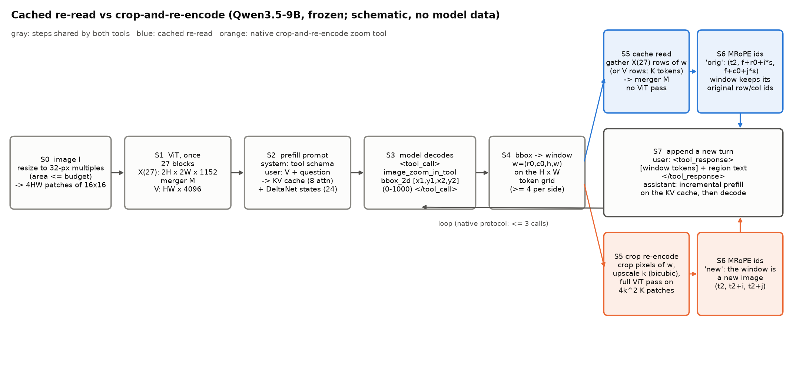

# 缓存重读方法设计（实验 5.2–5.4）

本文档属于[局部重读](plan.md)问题，是方向二（AGENTS.md 第 2.2 节）的方法设计。第 0 节给出缓存重读的完整算法规范，并逐步与模型原生的裁剪重编码工具对比；第 1–6 节为实验 5.2 的设计。实验 5.3（[免重编码的缓存重读](results_2026-10-21_cache_only.md)）与实验 5.4（[两项敏捷实验](results_2026-11-03_reread_pilots.md)）沿用第 0 节的流程，只改变第 5 步的读取方式。

## 0. 缓存重读的完整算法

### 0.1 定义

缓存重读是一个由冻结的 Qwen3.5-9B 驱动的工具调用循环，包含以下三个要点：

1. **模型只输出一个坐标框。** 模型使用 Qwen3.5 原生的工具调用格式（chat template 中的 `<tool_call>` 协议）调用一个名为 `image_zoom_in_tool` 的工具，参数 `bbox_2d` 为 0–1000 归一化坐标下的矩形框。模型不输出任何特征，也不需要新增 special token 或训练。
2. **系统在缓存上取窗口。** 工具的执行者是推理系统。系统把坐标框换算为 visual token 网格上的窗口，从首次 ViT 前向时保存的特征缓存中取出该窗口对应的特征，经冻结的 patch merger 得到一段 LLM 输入 embedding。这一步不对图像像素做任何操作，也不再运行 ViT。
3. **窗口特征作为新的一轮输入追加到序列末尾。** 系统把这段 embedding 放入一条 tool response 消息中，作为新的对话轮次追加在已生成的序列之后；已有 token 及其 KV cache 保持不变，系统只对新追加的 token 做增量 prefill，之后模型继续解码，可以直接作答，也可以再次调用工具。

原生的裁剪重编码工具与缓存重读共享除第 5、6 步以外的全部步骤：它在第 5 步把窗口对应的像素裁下、放大后重新运行一次完整的 ViT，并在第 6 步把结果当作一张新图像编排 position IDs。

上图为示意图，不含模型数据。灰色框为两种工具共享的步骤 S0–S4 与 S7，蓝色框为缓存重读的 S5、S6，橙色框为裁剪重编码的 S5、S6；S7 指回 S3 的箭头表示模型可以再次调用工具（实验 5.2 的原生协议最多 3 次调用）。

### 0.2 符号

| 符号 | 形状 | 含义 |
| --- | --- | --- |
| $I$ | $H_{\mathrm{px}} \times W_{\mathrm{px}} \times 3$ | 输入图像，边长缩放为 32 pixels 的整数倍，面积不超过输入预算 |
| $H, W$ | 标量 | merged token 网格的行数与列数，$H = H_{\mathrm{px}}/32$，$W = W_{\mathrm{px}}/32$ |
| $N$ | 标量 | ViT patch 数，$N = 4HW$，每个 patch 为 16×16 pixels |
| $X^{(\ell)}$ | $2H \times 2W \times 1152$ | ViT 第 $\ell$ 个 block 输出的 patch 状态，$\ell = 1, \dots, 27$；$X^{(0)}$ 为 patch embedding 与绝对位置编码之和 |
| $M$ | 映射 | patch merger：把一个 2×2 patch 组的 4 个 1152 维状态经 LayerNorm 后拼接为 4608 维，再经两层 MLP 投影到 $d = 4096$ 维 |
| $V$ | $HW \times d$ | 首次输入 LLM 的 visual tokens，$V = M(X^{(27)})$，按光栅顺序排列 |
| $\mathcal{C}$ | 集合 | 特征缓存，至少包含 $X^{(27)}$（等价地包含 $V$） |
| $b$ | 4 个标量 | 模型在工具调用中输出的坐标框 $(x_1, y_1, x_2, y_2) \in [0, 1000]^4$，相对于模型看到的整图 |
| $w$ | 4 个整数 | token 网格上的窗口 $(r_0, c_0, h, w)$：起始行、起始列、行数、列数 |
| $K$ | 标量 | 窗口的 merged token 数，$K = hw$ |
| $R$ | $K' \times d$ | 工具返回的窗口 embedding，$K'$ 为其 token 数（标准读法 $K' = K$） |
| $f$ | 标量 | $V$ 的第一个 token 在 MRoPE 位置轴上的起点 |
| $t_2$ | 标量 | 工具返回段的第一个 token 在位置轴上的起点 |
| $\boldsymbol{p}$ | 3 个实数 | 一个 token 的 MRoPE position IDs $(p^t, p^h, p^w)$ |

### 0.3 算法

**S0 预处理。** 把 $I$ 按保持宽高比的方式缩放，使两边都是 32 pixels 的整数倍且面积不超过预算（自然图像实验为 $512^2$ pixels）。processor 把图像切成 $N = 4HW$ 个 16×16 的 patch；Qwen3.5 的视频式 patch 化把同一帧复制为 2 帧，因此每个 patch 是 $2 \times 16 \times 16 \times 3 = 1536$ 个像素值。patch 按 2×2 merge group 连续排列，便于 merger 直接分组。

**S1 一次 ViT 前向并缓存。** ViT 的计算为

$$
X^{(0)} = \mathrm{PatchEmbed}(I) + E_{\mathrm{pos}}, \qquad X^{(\ell)} = \mathrm{Block}_\ell\left(X^{(\ell-1)}\right),\ \ell = 1, \dots, 27, \qquad V = M\left(X^{(27)}\right).
$$

其中 $\mathrm{PatchEmbed}$ 是 1536 维到 1152 维的线性映射（以 Conv3d 实现），$E_{\mathrm{pos}}$ 是双线性插值到当前网格的可学习绝对位置编码，每个 $\mathrm{Block}_\ell$ 是一层带二维 RoPE 的全局 self-attention 与 MLP。同一次前向中，forward hook 把 $X^{(27)}$（若读取方式需要，再加上其他 block 的输出）写入缓存 $\mathcal{C}$。hook 只保存已经算出的张量，不增加计算；$X^{(27)}$ 每个 patch 占 $1152 \times 2$ bytes（bfloat16），一张 $512^2$ pixels 的图像约 2.4 MB。

**S2 构造 prompt 并 prefill。** 序列按 chat template 组织为三段：system 消息声明工具 `image_zoom_in_tool` 的 JSON schema 与调用格式说明；user 消息为 `<|vision_start|>`、$HW$ 个 `<|image_pad|>` 占位符、`<|vision_end|>`、问题文本与“先调用一次工具再作答”的要求；最后是 assistant 轮次的起始标记与空的 thinking 块（thinking off）。占位符的输入 embedding 被替换为 $V$ 的各行。第 $r$ 行、第 $c$ 列 visual token 的 position IDs 为 $(f, f + r, f + c)$，文本 token 的三个分量相同并逐个递增。prefill 之后，8 个 gated full attention 层保存逐 token 的 KV cache，24 个 Gated DeltaNet 层保存与序列长度无关的递推状态。

**S3 模型解码工具调用。** 模型在 assistant 轮次中生成

`<tool_call>` `<function=image_zoom_in_tool>` `<parameter=bbox_2d>` `[x1, y1, x2, y2]` `</parameter>` `</function>` `</tool_call>`

其中 `<tool_call>` 与 `</tool_call>` 是 Qwen3.5 词表中的单个 special token（id 248058 与 248059），函数名与参数名标签由普通文本 token 组成。系统以 `</tool_call>` 作为停止符，用正则表达式解析出 $b$。实验中使用过两种协议：原生协议（5.2）允许模型在调用前写推理文本；精简协议（5.3、5.4）把 assistant 轮次预填到 `[` 为止，模型只续写 4 个坐标，解码到 `]` 后由系统补上固定的闭合标签，以排除推理文本对时间的影响。

**S4 坐标框换算为窗口。** 行方向按

$$
a = \left\lfloor \frac{y_1 H}{1000} \right\rfloor, \qquad e = \max\left(\left\lceil \frac{y_2 H}{1000} \right\rceil,\ a + 1\right), \qquad h = \min\left(\max(e - a,\ 4),\ H\right),
$$

$$
r_0 = \min\left(\max\left(\operatorname{round}\left(\frac{a + e - h}{2}\right),\ 0\right),\ H - h\right)
$$

计算，列方向以 $x_1, x_2, W$ 同理得到 $c_0, w$。也就是说，坐标框先向外取整到 token 边界；若某边不足 4 个 token（128 pixels），则以框中心为中心对称扩展到 4 个 token，并在图像边界处向内平移。窗口覆盖原图的 $K = hw$ 个 merged token，即 $2h \times 2w$ 个 patch。

**S5 在缓存上读取窗口。** 标准读法（实验中的 c27）直接取出窗口内的 visual tokens：

$$
R = \left[\, M\left(X^{(27)}_{2(r_0+i):2(r_0+i)+2,\ 2(c_0+j):2(c_0+j)+2}\right) \,\right]_{0 \le i < h,\ 0 \le j < w} = \left[\, V_{(r_0+i)W + c_0 + j} \,\right]_{0 \le i < h,\ 0 \le j < w}.
$$

方括号按行优先顺序排列，$K' = K$。由于 $V$ 已经是 $M(X^{(27)})$ 的结果，这一读法只是一次索引，不需要任何矩阵乘法。实验 5.3 的其余读法在同一窗口的 $X^{(27)}$ 上以不同分组重新调用 $M$（例如步长为 1 的重叠 2×2 分组，$K' = (2h-1)(2w-1)$），实验 5.4 的学习读法先用一个约 900 万参数的卷积模块把 $X^{(27)}$ 映射为 2 倍密度的 patch 网格再调用 $M$（$K' = 4K$），两者都只在缓存上计算，不运行 ViT。

**S6 编排 position IDs。** 窗口段的时间分量取它在序列中的起点 $t_2$，行、列分量沿用窗口在原图中的位置（记为 orig）：

$$
\boldsymbol{p}(i, j) = \left(t_2,\ f + r_0 + s\,i,\ f + c_0 + s\,j\right),
$$

其中 $s$ 为相邻返回 token 在原图中的间距（以 merged token 为单位），标准读法 $s = 1$，$4K$ 个 token 的读法 $s = 1/2$。这一编排使窗口 token 与原图同一位置的 visual token 在行、列频段上对齐。实验 5.3 显示，改用把窗口视为新图像的编排（$p^h = t_2 + i$，$p^w = t_2 + j$）对准确率没有可测影响（差值 0.000）。段之后的文本从 $t_2 + \max(\text{段的行数}, \text{段的列数})$ 继续编号，与 Qwen3.5 对图像之后文本的默认规则一致。

**S7 作为新的一轮追加并继续解码。** 系统在已生成的调用之后追加以下 token：

1. `<|im_end|>`、换行、`<|im_start|>user`、换行、`<tool_response>`、换行；
2. `<|vision_start|>`、$K'$ 个 `<|image_pad|>` 占位符（embedding 替换为 $R$）、`<|vision_end|>`；
3. 一句文本，给出窗口在原图中的 0–1000 坐标并重述答案格式，例如“Zoomed view of region [x1, y1, x2, y2] of the image …”；
4. 换行、`</tool_response>`、`<|im_end|>`、换行、`<|im_start|>assistant`、换行与空的 thinking 块（精简协议再预填“Final answer:”）。

这段 token 共约 $K' + 87$ 个。模型在已有 KV cache 上只对它们做增量 prefill，然后继续 greedy 解码。若模型再次输出工具调用，则回到 S3；缓存 $\mathcal{C}$ 与窗口无关，任意多次调用都只需重复 S4–S7。

### 0.4 与裁剪重编码的逐步对比

| 步骤 | 缓存重读 | 裁剪重编码（Qwen 原生 zoom 工具） |
| --- | --- | --- |
| S0 预处理 | 相同 | 相同 |
| S1 ViT | 整图一次前向，hook 保存 $X^{(27)}$ | 整图一次前向，不需要保存中间状态 |
| S2 prefill | 相同 | 相同 |
| S3 工具调用 | 相同的工具名、参数与 special token | 相同 |
| S4 窗口 | 相同的换算 | 相同的换算，窗口换成像素框 $[32c_0, 32r_0, 32(c_0+w), 32(r_0+h)]$ |
| S5 读取 | 在缓存上索引（或调用 merger），不运行 ViT | 裁下像素，边长以 bicubic 放大 $k$ 倍，对 $4k^2K$ 个新 patch 运行完整的 27 层 ViT 与 merger，得到 $k^2K$ 个 token；放大后面积上限为 $1280^2$ pixels |
| S6 position IDs | 原图行列位置（orig） | 新图像的默认编排（new） |
| S7 追加 | 相同的消息格式与增量 prefill | 相同 |
| 窗口内的视觉上下文 | 窗口 token 在整图上下文中编码，携带原图位置 | 窗口单独编码，ViT 看不到窗口外的内容 |

两者唯一的信息差别在 S5：裁剪重编码让 ViT 以 $k$ 倍密度的 patch 网格重新编码同一批像素，缓存重读只能复用 1 倍编码的结果。实验 5.3 据此得到缓存重读的准确率上限：$k = 1$ 时两者相同，$k = 2$ 时裁剪更准确，差距集中在小窗口的文字题上。

### 0.5 每步的计算量与开销

ViT 对 $n$ 个 patch 的前向计算量（每次乘加计 2 FLOPs，忽略 LayerNorm 与 RoPE）为

$$
F_{\mathrm{ViT}}(n) = 2n \cdot 1536 \cdot 1152 + 27\left[\, 2n\left(4 \cdot 1152^2 + 2 \cdot 1152 \cdot 4304\right) + 4n^2 \cdot 1152 \,\right] + F_M\!\left(\frac{n}{4}\right),
$$

其中第一项为 patch embedding，方括号内依次为每个 block 的 QKV 与输出投影、MLP（中间维 4304）和全局 attention 的打分与加权求和，$F_M(m) = 2m\,(4608^2 + 4608 \cdot 4096) \approx 0.080$ GFLOPs 乘以 $m$ 为 merger 产生 $m$ 个 token 的计算量。attention 项随 $n^2$ 增长，因此大图的 ViT 代价增长快于线性。LLM 侧每处理一个 token 约需 $2 \times 7.16 \times 10^9 \approx 14.3$ GFLOPs（7.16B 为不含词表矩阵的 decoder 参数量），解码时每个新 token 都要读取全部权重，速度受显存带宽限制。

下表以 $512^2$ pixels 的自然图像（$H = W = 16$，$N = 1024$）和 $8 \times 8$ 的窗口（$K = 64$）为例；时间取自实验 5.3 闭合调用协议在单张 A800 上对四个自然数据集各 20 题的逐段计时中位数（`timing2/timing.jsonl`）。

| 步骤 | 计算 | 计算量（示例） | 实测时间 | 显存与缓存 |
| --- | --- | --- | --- | --- |
| S1 ViT | $F_{\mathrm{ViT}}(4HW)$ | 997 GFLOPs | 27–32 ms | 缓存 $X^{(27)}$ 2.4 MB |
| S2 prefill | 约 $461 + HW$ 个 token | 约 10 TFLOPs | 与 S3 合计 0.66 s | KV cache 每 token 32 KiB |
| S3 调用解码 | 约 20 个 token 的逐 token 解码 | 每 token 14.3 GFLOPs | 见上 | 同上 |
| S4 窗口换算 | 常数次算术 | 可忽略 | 可忽略 | 无 |
| S5 缓存重读（c27） | 索引 $K$ 行 | 0 | 约 1 ms | 无新增 |
| S5 缓存重读（4K 读法） | $F_M(4K)$ | 20 GFLOPs | 约 1 ms | 无新增 |
| S5 裁剪重编码 $k = 1$ | $F_{\mathrm{ViT}}(4K)$ | 225 GFLOPs | 21 ms | ViT 激活 |
| S5 裁剪重编码 $k = 2$ | $F_{\mathrm{ViT}}(16K)$ | 997 GFLOPs | 32 ms | ViT 激活 |
| S6 position IDs | $O(K')$ | 可忽略 | 可忽略 | 无 |
| S7 增量 prefill 与作答 | 约 $K' + 87$ 个 token 加答案解码 | $(K' + 87) \times 14.3$ GFLOPs | 0.19–0.21 s | KV cache 增加 $(K' + 87) \times 32$ KiB |

由此可见，在 $512^2$ pixels 的输入下，缓存重读省下的只是 S5 中 20–30 ms 的 ViT 计算，而端到端时间（中位数 0.88–0.93 s）主要由 S2、S3 的 prefill 与逐 token 解码构成。缓存重读的效率优势只有在 ViT 代价占比更高的场景（高分辨率输入、多次重读）才会体现，这正是实验 5.4 选项 2 检验的问题。

## 实验 5.2 的设计

本实验属于[局部重读](plan.md)问题，是方向二（AGENTS.md 第 2.2 节）的第一个可运行原型。实验 5.1 以 oracle 窗口比较了像素裁剪重编码与缓存窗口重读，本实验把缓存重读放进 Qwen3.5-9B 原生的工具调用协议中：模型自己用工具调用给出窗口，工具返回整图编码缓存中该窗口的视觉特征，并在相同协议下与模型原生的裁剪放大工具比较准确率、时间、显存与 KV cache 开销。

## 1. 问题与判据

判据只有一条：在相同的工具调用协议与相同的窗口下，缓存重读能否比原生的像素裁剪工具更准确，并在更准确的同时更省时间与显存。为此需要回答三个子问题：

1. **读取方式。** 窗口固定时，工具返回缓存特征与返回裁剪重编码的图像，哪一种更有利于回答。
2. **窗口选择。** 模型自主给出的窗口与 oracle 窗口相比差多少，以及窗口选择失败时任何读取方式能否弥补。
3. **开销。** 两种工具在追加 token、ViT 计算、端到端时间、峰值显存与 KV cache 上的差别。

## 2. 依据的机制结论

方法的每个设计选择都对应一条已有结论：

| 设计选择 | 依据 |
| --- | --- |
| 缓存来源包含 ViT 第 9 个 block 经主路径 merger 投影的特征 | 实验 5.1：色差 10 的判断在第 9 层缓存上 AUROC 为 0.88 与 0.99，末层缓存为 0.62 与 0.77，末层缓存重读甚至低于整图基线 |
| 缓存 token 保持窗口内的光栅行结构 | 实验 3.8 r2：Gated DeltaNet 在每个 token 行的起点复位遗忘门，行序数是逐行递推并在行首校准的估计；保持行结构是递推正常工作的前提 |
| 缓存 token 默认沿用原图中的行列 MRoPE ids | 实验 5.1：像素裁剪使模型改用窗口内的行列序号作答（T5 20×20 中 53% 的回答等于窗口内序号），缓存重读不引入这一错误；实验 3.7：整图上下文中编码的 token 携带原图位置 |
| 工具返回文本给出窗口的原图坐标 | 实验 3.8 r2 的方法推论：窗口在原图中的位置需要显式提供，模型不会从序列中恢复 |
| 增加由 2 倍分辨率 ViT 前向得到的缓存 | 实验 5.1：整图放大 2 倍是唯一能改善稠密网格原图坐标的条件，但它使 LLM 输入的 visual token 增至 4 倍；高分辨率缓存只把选中窗口的高分辨率 token 送入 LLM |
| 浅层特征以可注意的序列 token 形式输入，而非加性注入 | 实验 4.4：Qwen3-VL 的 DeepStack 在 decoder 第 1–3 层加性注入 ViT 第 9 层特征，其中的高频细节在 decoder 中衰减，被使用的主要是位置编码 |
| 不对 PE、RoPE 做删除或缩放 | 计划第 4 轮规则；本方法只改变工具返回的内容，不改变模型组件 |

## 3. 符号

| 符号 | 形状 | 含义 |
| --- | --- | --- |
| $I$ | 图像 | 输入图像，边长为 32 pixels 的整数倍 |
| $H, W$ | 标量 | $I$ 的 merged token 网格行数与列数，每个 token 对应 32×32 pixels |
| $s$ | 标量 | 缓存的分辨率倍数，$s \in \{1, 2\}$；$s = 2$ 表示在边长放大 2 倍的图像上做 ViT 前向 |
| $X_s^{(\ell)}$ | $4s^2HW \times 1152$ | 分辨率倍数为 $s$ 时 ViT 第 $\ell$ 个 block（1 起编号）的 patch 输出 |
| $M_0$ | 映射 | 主路径 merger，把 2×2 个 patch 合并并投影到 $d = 4096$ 维 |
| $C_s^{(\ell)}$ | $s^2HW \times d$ | 缓存，$C_s^{(\ell)} = M_0\left(X_s^{(\ell)}\right)$，按光栅顺序排列；$\ell = 27$ 时即原 visual tokens |
| $b$ | 4 个标量 | 模型在工具调用中给出的 0–1000 坐标框 $(x_1, y_1, x_2, y_2)$ |
| $w = (r_0, c_0, h, w)$ | 4 个整数 | 由 $b$ 向外取整到 token 网格得到的窗口，单位为原分辨率的 token；每边至少 4 个 token |
| $K$ | 标量 | 窗口在原分辨率下的 token 数，$K = hw$ |
| $f$ | 标量 | 第一张图像 visual tokens 的起始位置 |
| $p = (p^t, p^h, p^w)$ | 3 个实数 | 一个 token 的 MRoPE position IDs |

## 4. 方法

### 4.1 流程

1. **编码与缓存。** 对整图做一次 ViT 前向，取得 LLM 输入用的 visual tokens $C_1^{(27)}$，同时由 forward hook 保存 $C_1^{(9)}$。若使用高分辨率缓存，再对放大 2 倍的图像做一次 ViT 前向，保存 $C_2^{(27)}$ 与 $C_2^{(9)}$。LLM 只接收 $C_1^{(27)}$。
2. **工具调用。** system prompt 按 Qwen3.5 chat template 声明工具 `image_zoom_in_tool`（参数 `bbox_2d`，0–1000 坐标，与 Qwen-VL 的“think with images”示例相同），问题之后要求模型先调用一次该工具再作答。模型生成到 `</tool_call>` 为止，得到坐标框 $b$。
3. **工具返回。** 工具把 $b$ 换算为窗口 $w$，在 tool response 中放入一段视觉输入与一句文本。文本为“Zoomed view of region $[x_1, y_1, x_2, y_2]$ of the image …”，坐标为 $w$ 的 0–1000 坐标，随后重述答案格式要求。视觉输入随条件而不同，见第 4.2 节。
4. **作答。** 模型在新的 assistant 轮次生成答案。

第 2 步的工具调用在每道题上只生成一次，所有读取条件共享同一个 $b$；因此条件之间只在工具返回的视觉内容上不同，窗口选择被严格固定。oracle 条件以由真值证据框导出的窗口替换 $b$，并把该框写入工具调用文本。

### 4.2 工具返回的视觉内容

缓存重读返回缓存中窗口对应的 token：

$$
R_s^{(\ell)}(w) = \left[\, C_s^{(\ell)}[\, s r_0 + i,\ s c_0 + j \,] \,\right]_{0 \le i < s h,\ 0 \le j < s w},
$$

其中方括号内按行优先顺序排列，$i$ 为窗口内的行号，$j$ 为列号。该段共有 $s^2 K$ 个 token，保持窗口的行结构。这一形式不需要任何新的 ViT 计算（$s = 1$），或者只需要一次与窗口无关的整图 ViT 前向（$s = 2$），之后任意窗口都只是对缓存的索引。

这一段 token 的 position IDs 有两种编排。原图编排（记为 orig）为

$$
p(i, j) = \left(t_2,\ f + r_0 + \frac{i}{s},\ f + c_0 + \frac{j}{s}\right),
$$

其中 $t_2$ 是该段在序列中的起始位置。原图编排使窗口 token 的行、列分量与原图中同一位置的 token 一致；$s = 2$ 时相邻 token 的间隔为 1/2，落在原图 token 的整数位置之间。Qwen3.5 的 MRoPE 以 position IDs 乘以频率得到旋转角，实数位置可以直接使用，模型代码在计算前会把 IDs 转为浮点数。新图编排（记为 new）把该段视为一张 $sh \times sw$ 的新图像，使用默认 IDs。两种编排下，该段之后的文本都从 $t_2 + s \max(h, w)$ 开始，与默认规则一致。

原生裁剪工具返回窗口的像素裁剪 $I[w]$，边长放大 $k$ 倍后作为新图像经过 ViT 与 merger，使用默认 IDs；放大后的面积上限为 $1280^2$ pixels，超过时 $k$ 自动减小。$k$ 倍裁剪追加 $k^2K$ 个 token，需要编码 $4k^2K$ 个新 patch。

### 4.3 条件

| 条件 | 工具返回 | 追加 visual tokens | 新 ViT patch |
| --- | --- | ---: | ---: |
| base | 无工具，直接作答 | 0 | 0 |
| full2x | 无工具，整图边长放大 2 倍后作为唯一输入 | $3HW$ | $16HW$（替代原图的 $4HW$） |
| crop1 / crop2 / crop4 | 像素裁剪，放大 1、2、4 倍后重编码（原生工具） | $K$、$4K$、$16K$ | $4K$、$16K$、$64K$ |
| c27 | $R_1^{(27)}(w)$，orig | $K$ | 0 |
| c9 | $R_1^{(9)}(w)$，orig | $K$ | 0 |
| h27 | $R_2^{(27)}(w)$，orig | $4K$ | $16HW$（与窗口无关） |
| h9 | $R_2^{(9)}(w)$，orig | $4K$ | $16HW$（与窗口无关） |
| h9n | $R_2^{(9)}(w)$，new | $4K$ | $16HW$ |
| h9r | $R_2^{(9)}(w)$ 按逆光栅顺序排列，orig（IDs 随 token 移动） | $4K$ | $16HW$ |
| o_crop2 / o_h27 / o_h9 / o_h9r | 与 crop2、h27、h9、h9r 相同，首次调用的窗口取 oracle | 同左 | 同左 |

等 token 数的对照为 c9 对 crop1（各 $K$ 个）与 h9 对 crop2（各 $4K$ 个）；c9 对 c27 检验缓存深度，h9 对 h9n 检验 position IDs，h9 对 full2x 检验“只读高分辨率窗口”能否代替“整图高分辨率输入”。

### 4.4 训练与通用性

本方法不训练任何参数。工具协议、窗口换算与缓存索引都与任务无关，不包含任何找不同或网格专用的逻辑；oracle 窗口只用于分析，不属于方法本身。$C^{(9)}$ 经主路径 merger 投影属于分布外输入，实验 5.1 显示原模型可以直接使用第 9 层以后的投影。若未经训练的模型不能把缓存段当作窗口视图使用，最小的补救是用通用的工具调用轨迹数据做轻量微调（例如只训练 LoRA），而非新增结构。

## 5. 评测

### 5.1 数据

| 数据 | 来源 | 规模 | 输入分辨率 | oracle 窗口 |
| --- | --- | --- | --- | --- |
| TextVQA | val，随机抽样 | 300 | 面积不超过 $512^2$ pixels | 无 |
| GQA | Visual-CoT 的 GQA val 标注（证据框），证据框面积不超过图像的 2% | 300 | 同上（GQA 原图多为 500×375） | 证据框边长放大 2 倍 |
| MMVP | 全部 300 题（150 对） | 300 | 同上 | 无 |
| POPE | adversarial，yes 与 no 各半 | 300 | 同上 | 无 |
| BabyVision | Fine-grained Discrimination 全部 163 题，直接作答 | 163 | 原尺寸（面积上限 $1024^2$） | 无 |
| 合成 ΔE 10 | stimuli-v1，20×20 网格，色差第 2 级，修订 T3 问法 | 48 | 1280×1280 | 以被问实例为中心的 3×3 单元 |
| 合成缺口 | 同上，缺口第 1 级（2 pixels） | 48 | 同上 | 同上 |
| 合成 T5 | 20×20 找不同（缺口第 3 级），行列回答 | 48 | 同上 | 含目标的 5×5 单元，目标位置随机 |

自然图像采用 $512^2$ pixels 的输入预算（约 256 个 visual tokens），这是工具式放大有意义的场景：在原生高分辨率下，细节本已可见，放大工具的作用会减小。full2x 在该预算下约为 1024 个 visual tokens，接近 TextVQA 原图分辨率，作为“提高整图分辨率”的上界参照。

### 5.2 指标与统计

1. **准确率。** TextVQA 用标准 VQA accuracy（与 10 个标注答案中至少 3 个一致记为 1）；GQA 用规范化后的精确匹配；MMVP 报告单题与成对准确率；POPE 报告准确率；BabyVision 用仓库的本地严格评分，另报告诊断评分；合成 ΔE 与缺口以首个答案 token 的 $z_{\mathrm{Yes}} - z_{\mathrm{No}}$ 计算 AUROC；T5 为行列完全正确的比例，并统计窗口内序号错误。
2. **区间与检验。** 比例报告 Wilson 95% 区间，TextVQA 报告 bootstrap 区间；预先指定的配对比较为 h9 对 crop2、c9 对 crop1、h9 对 full2x、h9 对 base、crop2 对 base、c9 对 c27、h9 对 h9n，二值指标用精确 McNemar 检验，TextVQA 用符号翻转置换检验，在每个数据集内做 Holm 校正。
3. **窗口选择。** 工具调用率，所选窗口占图像面积的比例，以及证据框落在所选窗口内的面积比例（GQA 与合成任务）。
4. **开销。** 每题作答时的 prompt 长度、追加 visual tokens、新编码的 ViT patch 数，以及 KV cache 大小。Qwen3.5-9B 只有 8 个 gated full attention 层保存逐 token 的 KV cache，每个 token 占 $8 \times 2 \times 4 \times 256 \times 2 = 32768$ bytes；24 个 Gated DeltaNet 层的递推状态大小固定，与序列长度无关。端到端时间与峰值显存在 batch size 1 下测量：整图 ViT 前向、第一轮 prefill 与工具调用解码、工具执行、在 KV cache 上续接 tool response 的 prefill 与答案解码依次计时，峰值显存记为相对模型权重的增量。

### 5.3 运行

准确率阶段使用左侧 padding 的批量 greedy decoding。首次工具调用每题生成一次，被全部工具条件共享；之后每个条件以自己的工具继续，每题最多 3 次调用。全部条件（含 base 与 full2x）采用同一作答约定：允许自由文本，最后一行为“Final answer: …”，每轮生成上限 256 tokens，首次调用上限 160 tokens；tool response 文本重述答案格式。合成细节任务的判别分数取最后一个“Final answer:”之后首个 token 的 $z_{\mathrm{Yes}} - z_{\mathrm{No}}$。自然数据集各取 200 题。自定义 inputs_embeds 路径在运行前与 processor 标准路径核对首 token logits，并对批量与逐条解码做一致性抽查。程序为 `analysis_tools/reread/cached_reread.py`（引擎）、`cached_reread_run.py`（运行）与 `cached_reread_analysis.py`（统计与作图），入口为 `scripts/analysis/reread/cached_reread.sh`；产物位于 WORK_DIR 的 `analysis/reread/2026-10-20_cached_reread/`。

## 6. 结果模式与解释

| 结果模式 | 解释 |
| --- | --- |
| h9 或 c9 优于 crop2，且 token 与时间更少 | 缓存重读在原生协议下胜出，方向二的读取操作成立 |
| oracle 条件明显优于模型窗口条件 | 瓶颈在窗口选择；读取方式的差别需要在 oracle 窗口下比较 |
| 所有工具条件都不优于 base，full2x 优于 base | 未经训练的模型不会利用第二段视觉输入，收益只来自整图分辨率 |
| h9 与 full2x 相当 | 高分辨率缓存只读窗口即可替代整图高分辨率输入，LLM 侧 token 显著减少 |
| c9 优于 c27 | 浅层缓存保留了末层丢失的细节，与实验 5.1 一致 |
| h9 与 h9n 无差别 | position IDs 编排不起作用，与实验 5.1 的 d 对 e 一致 |
