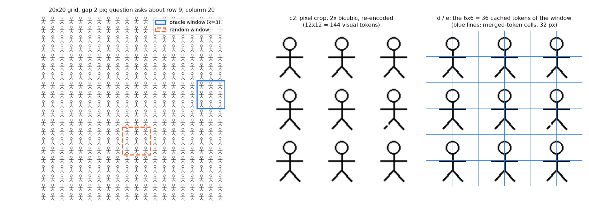
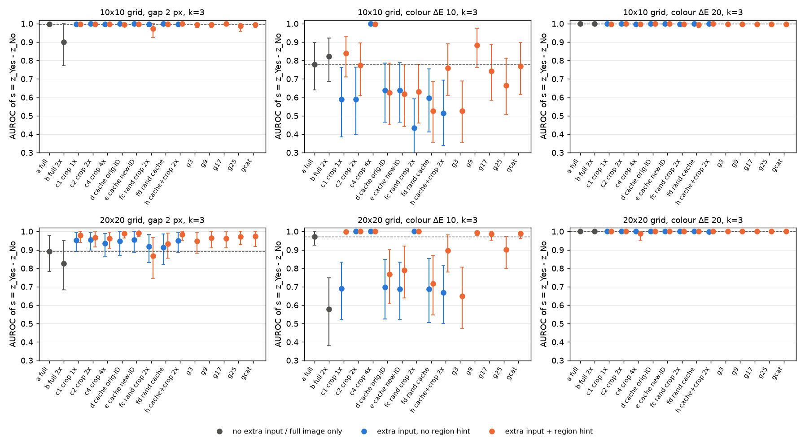
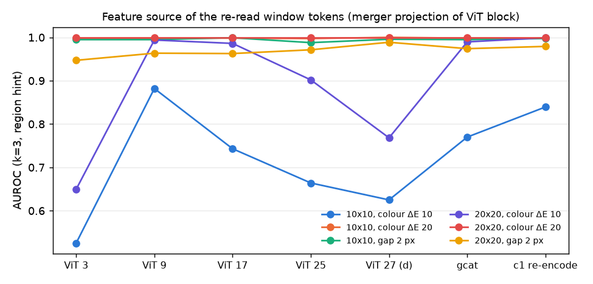
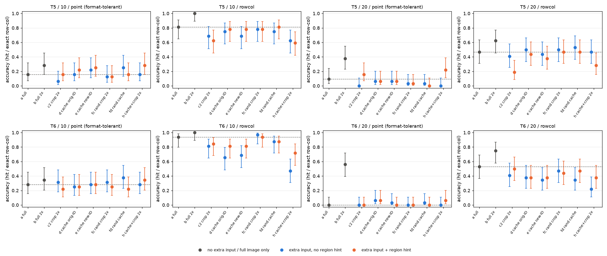
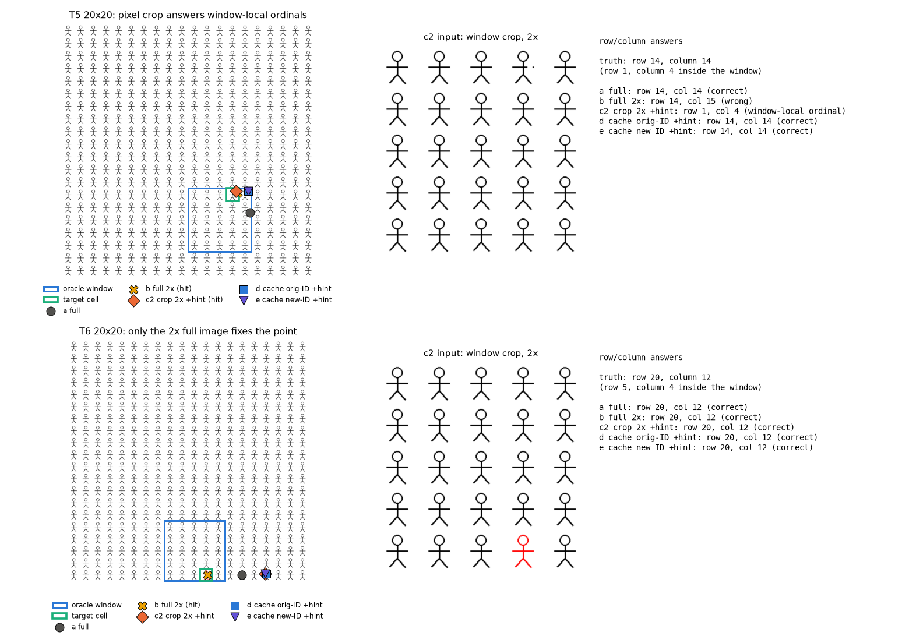
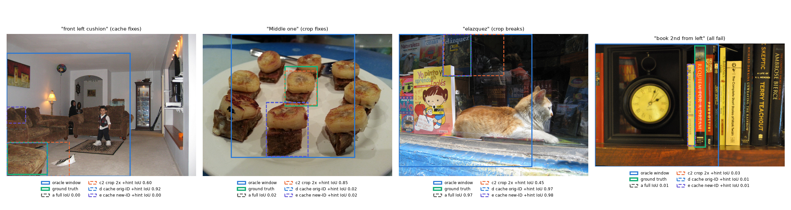
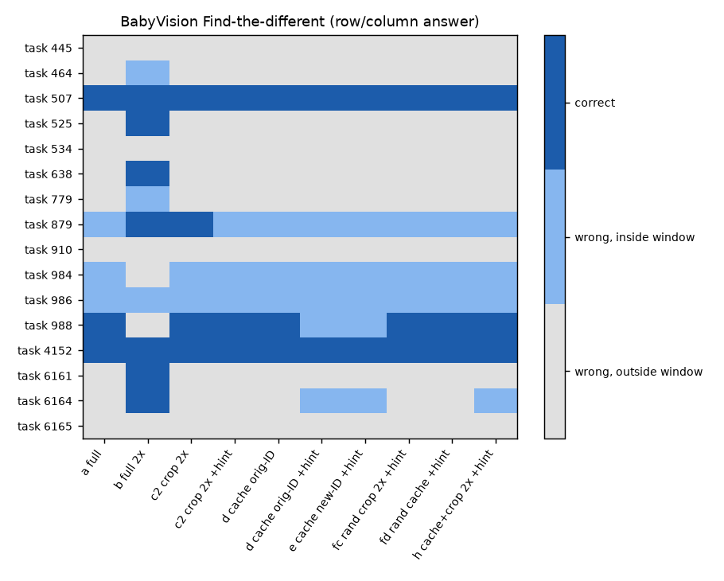
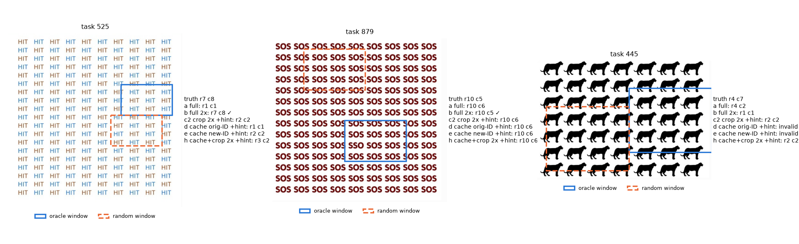
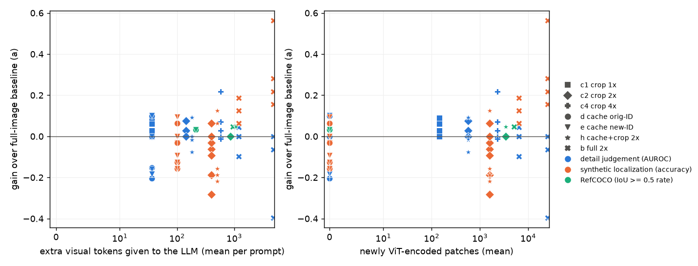

# 实验 5.1：局部重读 pilot

本实验属于[局部重读](plan.md)问题，在 Qwen3.5-9B（thinking off）上以 oracle 窗口比较两类局部重读方式：当前 VLM 工具调用中通用的像素裁剪后重新编码，以及方向二设想的从整图编码缓存中截取窗口 token。比较对象为细节判断、原图坐标输出、RefCOCO 小目标与 BabyVision 找不同四类任务，并同时记录每种方式的 token 与 ViT 计算开销。

## 通俗讲述

人在看一张密密麻麻的图时，常常先扫一眼全图，再凑近看可疑的地方。当前的 VLM 工具调用也模仿这一过程：模型给出一个框，系统把框内的像素裁下来、放大，再当作一张新图片交给模型。这样做有两个隐患。第一，裁下来的图片要重新经过 ViT 编码，代价不小；第二，裁剪图在 ViT 眼里是一张独立的小图，它不知道自己原本位于大图的哪个位置。本实验检验另一种做法：整图编码时 ViT 已经为每个 32×32 像素的小块算出了特征，只要把这些特征保存下来，需要“凑近看”时直接从缓存中取出框内那一部分再送给语言模型即可，不必重新编码。

这一想法成立需要两个前提：缓存里的特征保留了足够的细节，并且语言模型能把这段重复输入当作原图某一区域的放大视图来使用。为了只检验“读取”本身，本实验暂不让模型自己选框，而是直接给出包含答案的真值窗口，在合成网格的细节判断、原图坐标输出、RefCOCO 小目标定位与 BabyVision 找不同上比较多种读取方式。

结果分三层。对于还没有达到天花板的结构细节（2 像素的缺口），缓存重读与裁剪重编码带来的提升相当，前者只用四分之一的 token，也不需要额外的 ViT 计算。对于低对比度的颜色差异，ViT 末层的缓存已经丢失了信号，追加这些 token 反而有害；改用 ViT 第 9 层的缓存则基本恢复，这与“细节在 ViT 深层逐渐丢失”的整体图景一致。对于需要报告原图行列号的任务，两种局部重读都没有帮助，只有把整图放大 2 倍才有效；而像素裁剪还会让模型改用裁剪图内部的行列号作答，缓存重读不会出现这种错误，因为缓存特征是在整图上下文中算出来的，携带的是原图位置。position IDs 的两种编排没有可测差别。这些结论都基于真值窗口，是局部重读收益的上界；模型能否自己选对窗口，以及在原生工具协议下缓存重读是否优于裁剪放大，由实验 5.2 检验。

## 1. 研究问题与主要结果

工具调用式的“裁剪—重编码”已经在许多任务上有效，缓存窗口重读若要成立，需要在具体任务上说明它何时与前者相当、何时更好、何时更差。本实验回答三个问题：

1. 在模型已经看过整图的条件下，追加目标区域的视觉输入能否改善细节判断与定位；
2. 缓存窗口 token 与像素裁剪重编码相比，各自在哪类任务上占优；
3. 重读输入是否会破坏原图坐标系，以及 MRoPE position IDs 的编排是否起作用。

主要结果如下（数字均为 oracle 窗口下的上界，区间为 95% 区间）：

1. **在仍有提升空间的细节判断上，缓存重读与裁剪重编码的收益相当，且只需后者四分之一的 visual tokens、不需要额外的 ViT 计算。** 20×20 网格、2-pixel 缺口条件下（k=3 窗口、带区域提示），整图基线 AUROC 为 0.89 [0.78, 0.98]，缓存重读为 0.99 [0.96, 1.00]，1 倍裁剪重编码为 0.98 [0.94, 1.00]，2 倍裁剪为 0.97 [0.92, 1.00]；二者之差为 +0.01 [−0.00, 0.03]。随机窗口对照的增益为 +0.04 与 −0.02，低于目标窗口。缓存重读追加 36 个 token，2 倍裁剪追加 144 个 token 并需要编码 576 个新 patch（第 3.1 节，图 det_auroc_k3）。
2. **ViT 末层缓存不足以支持低对比度颜色判断，ViT 第 9 层的缓存与 4 倍像素裁剪可以弥补。** CIELAB 色差 10 的条件下，ViT 末层缓存重读使 AUROC 下降（10×10：0.78 降至 0.62；20×20：0.97 降至 0.77），随机窗口的缓存重读下降幅度相近；同一窗口改用 ViT 第 9 层特征经 merger 投影后的 token，AUROC 为 0.88 与 0.99；4 倍裁剪重编码在两种网格上均为 1.00（第 3.1、3.2 节，图 det_feature_scan）。20×20 网格中随机窗口的像素裁剪同样达到 1.00，因此这一条件下裁剪的收益不完全来自目标区域。
3. **在合成网格的定位任务中，局部重读（无论哪种方式）都没有提高原图坐标精度；唯一有效的是把整图放大 2 倍。** T6（红色目标）20×20 网格的中心点命中率由 0.00 [0.00, 0.11] 升至 0.56 [0.39, 0.72]（18/0 个不一致对，p < 0.001），所有附加窗口的条件均不超过 0.06。代价是 visual tokens 由 1600 增至 6400（第 3.3 节，图 loc_accuracy）。
4. **像素裁剪会使模型改用窗口内的行列序号作答，缓存窗口 token 不会。** T5 20×20 网格中，带区域提示的 2 倍裁剪使行列准确率由 0.47 降至 0.19（0/9 个不一致对，Holm 校正后 p = 0.02），53% 的回答恰好等于目标在窗口内的局部行列号；缓存重读（d、e）的这一比例为 0.00（第 3.3 节，图 loc_cases）。这与实验 3.7 的结论一致：在整图上下文中编码的 token 携带原图位置，单独编码的裁剪图只携带裁剪图内的位置。
5. **MRoPE position IDs 的两种编排没有可测差别。** 在全部任务与网格中，原坐标 IDs（d）与新图像 IDs（e）的配对差异不超过 0.06，且全部不显著（第 3.1、3.3 节）。
6. **think-then-answer 下，附加任何第二张图像都会使推理陷入对第二张图的反复计数。** 在 1024 tokens 的上限内，附加裁剪图或缓存窗口后 115/128 条回答被截断，只有整图条件能正常结束（第 3.4 节）。
7. **自然图像上的结论与合成网格方向一致，但效应很小。** RefCOCO 面积占比 1%–5% 的 151 个目标中，整图基线的 IoU≥0.5 比例为 0.83 [0.77, 0.89]；缓存重读（d|1、e|1）为 0.87，缓存加裁剪（h|1）与整图放大 2 倍均为 0.88，带提示的 2 倍裁剪为 0.83（7/7 个不一致对）；不带提示的裁剪降至 0.79，并有 10/151 个回答按窗口局部坐标给出（第 3.5 节）。BabyVision 找不同的 16 道题中，整图放大 2 倍的正确数为 7/16，整图基线为 3/16，裁剪与缓存重读为 2–4/16（第 3.6 节，图 babyvision_matrix）。

## 2. 实验设计与实际执行

### 2.1 符号

| 符号 | 形状 | 含义 |
| --- | --- | --- |
| $I$ | 图像 | 原图，边长为 32 pixels 的整数倍，不经 processor 缩放 |
| $H, W$ | 标量 | 原图 merged 网格的行数与列数，每个 visual token 对应 32×32 pixels |
| $V$ | $HW \times d$ | 原图 merger 输出的 visual tokens，按光栅顺序排列，$d = 4096$ |
| $X^{(\ell)}$ | $4HW \times 1152$ | ViT 第 $\ell$ 个 block（1 起编号）的输出，$\ell = 27$ 为末层 |
| $M_0$ | 映射 | 主路径 merger，$V = M_0\left(X^{(27)}\right)$ |
| $R$ | 窗口 | oracle 窗口，行 $r_0, \dots, r_0 + h_R - 1$，列 $c_0, \dots, c_0 + w_R - 1$，与 token 网格对齐 |
| $K$ | 标量 | 窗口内的 token 数，$K = h_R w_R$ |
| $s_1, s_2$ | 整数 | 原图与第二段视觉输入在序列中的起始位置 |
| $k$ | 标量 | 合成网格中窗口覆盖的实例单元数（每边），每个单元 64 pixels，即 2×2 个 token |

### 2.2 条件

每个条件都由“原图 visual tokens + 可选的第二段视觉输入 + 可选的区域提示 + 问题”构成。第二段输入的来源与 MRoPE position IDs 如下：

| 条件 | 第二段视觉输入 | 第二段的 position IDs $(p^t, p^h, p^w)$ | 新编码的 ViT patch |
| --- | --- | --- | --- |
| a 整图 | 无 | 无 | 0 |
| b 整图 2 倍 | 无；整图边长放大 2 倍（bicubic）后作为唯一输入 | 默认编排 | $16HW$ |
| c1 / c2 / c4 裁剪 | 窗口像素裁剪，放大 1、2、4 倍后作为第二张图重新经过 ViT 与 merger | 新图像默认编排 | $4K$、$16K$、$64K$ |
| d 缓存，原坐标 | $V$ 中窗口内的 $K$ 个 token，行优先 | $(s_2,\ s_1 + r,\ s_1 + c)$ | 0 |
| e 缓存，新坐标 | 与 d 相同 | $(s_2,\ s_2 + r - r_0,\ s_2 + c - c_0)$ | 0 |
| fc / fd 随机窗口 | 与 c2 / d 相同的操作，作用于同尺寸的非目标窗口 | 同 c2 / d | 同 c2 / d |
| h 缓存 + 裁剪 | d 的 token 之后再接 c2 的裁剪图 | 两段分别同 d 与 c2 | $16K$ |
| g$\ell$ 特征来源 | $M_0\left(X^{(\ell)}\right)$ 中窗口内的 token，$\ell \in \{3, 9, 17, 25\}$ | 同 d | 0 |
| gcat | g9、g17 与 d 三段依次排列 | 三段均同 d，时间轴位置依次递增 | 0 |

其中 $(r, c)$ 为 token 在原图网格中的行列号。d 的行列 IDs 与原图中同一位置的 token 相同，时间轴取第二段的起点，与视频后续帧的编排方式相同；e 把同一组 token 视为一张 $h_R \times w_R$ 的新图像。两种编排下第二段之后的文本都从 $s_2 + \max(h_R, w_R)$ 开始，因此 d 与 e 只在第二段内部的 IDs 上不同。所有含第二段的条件分别在无提示（记为 |0）与有提示（记为 |1）两种情况下运行，提示文本为“The second image shows region (x1, y1, x2, y2) of the first image, given in 0-1000 coordinates of the first image.”，随机窗口条件给出随机窗口自身的坐标。

自定义输入路径的正确性在运行前核对：用本实验的 inputs_embeds 与 position IDs 构造条件 a 与 c2（裁剪图 384 pixels，processor 不缩放），与标准 processor 路径的首 token logits 完全一致（最大绝对差 0.0），MRoPE IDs 与 get_rope_index 逐项相同。

### 2.3 任务与窗口

| 任务 | 输入与问题 | 窗口 | 规模 |
| --- | --- | --- | --- |
| 细节判断（det） | stimuli-v1 网格 10×10、20×20；变化为缺口 2 pixels（第 1 级）、色差 10（第 2 级）、色差 20（第 3 级）；修订问法 T3“Is there anything about the figure in row r, column c that differs from the majority of the figures?”，读取 $s = z_{\mathrm{Yes}} - z_{\mathrm{No}}$ | 以被问实例为中心的 $k \times k$ 单元，$k = 1, 3$；被问实例为正常实例时与目标的 Chebyshev 距离不小于 2，窗口内不含目标 | 每个（网格, 变化）48 张，正负各半 |
| 定位（loc） | T6 红色目标与 T5 找不同（缺口 8 pixels），网格 10×10、20×20；中心点与行列两种直接回答格式 | 包含目标的 5×5 单元，目标在窗口内的位置均匀随机（窗口内随机水平为 1/25） | 每个（任务, 网格）32 张 |
| think-then-answer | 与 loc 相同的 20×20 图像，行列格式，允许先逐步描述再给出答案（实验 1.3 的显式推理问法） | 同 loc | 每任务 16 张，5 个条件，上限 1024 tokens |
| RefCOCO | 实验 4.2 的 val 样本中面积占比 1%–5% 的全部 151 条，bbox 回答 | 以 bbox 中心为中心、边长为 bbox 长边 3 倍的正方形，中心附加至多半个长边的均匀随机平移 | 151 条 |
| BabyVision | Find the different 16 题，原题行列回答 | 包含答案实例的 3×3 单元（实验 1.3 第 7 节的实例标注），答案在窗口内的位置随机 | 16 题 |

合成网格的随机窗口与目标窗口等大、按实例单元对齐，且不包含目标与被问实例；10×10 网格的 5×5 窗口不存在完全不重叠的位置时，取与目标窗口重叠最少的位置。RefCOCO 与 BabyVision 的随机窗口不含目标中心，并在 200 个随机位置中取与目标窗口重叠最少者。

上图为 20×20 网格、缺口条件的一张输入。左图蓝色实线框为 oracle 窗口（k=3），橙色虚线框为随机窗口；中图为条件 c2 的第二张图像（2 倍裁剪，144 个 visual tokens）；右图为条件 d 与 e 读取的同一区域，蓝色细线标出 36 个 merged token 的范围，这些 token 直接取自整图编码。

### 2.4 指标与统计

1. 细节判断以 $s$ 的 AUROC 为主指标（实验 1.3 与计划第 6 节第 8 条），区间由以图像为单位的 1000 次 bootstrap 给出；条件间差异使用配对 bootstrap，预先指定的对比为 c2|1 对 a、d|1 对 c1|1、d|1 对 e|1、d|1 对 fd|1、c2|1 对 fc|1、h|1 对 c2|1，在每个任务单元内做 Holm 校正。
2. 定位任务的比例报告 Wilson 区间，配对比较用精确 McNemar 检验，对上述对比做 Holm 校正。
3. 中心点回答报告两种评分：严格评分只接受计划要求的 `[{"point_2d": [x, y]}]` 结构；格式容错评分另外接受裸字典或裸数组，坐标约定仍为 0–1000。带区域提示时，模型常输出裸字典 `{"point_2d": [x, y]}`，严格评分会把这些回答记为格式错误，因此下文的中心点数字均为格式容错评分，严格结果保存在 results.json。“任一坐标约定命中”与格式容错命中在全部条件下相同，没有以 pixel 约定作答的回答。
4. **坐标系错误**：回答在原图坐标中不正确，但若按窗口内的局部坐标（中心点）或局部行列号（行列）解释则正确。
5. **token 开销**：每条输入的 visual token 总数、追加的 visual token 数，以及需要新编码的 ViT patch 数（缓存条件为 0）。

### 2.5 运行

全部运行使用 bfloat16、greedy decoding；直接回答上限 128 tokens。同长度的输入合并成 batch，不使用 padding，batch size 不超过 8（长序列按长度减小）；批量与逐条解码在 20 个中心点回答上文本完全一致 12/20，其余 8 条的坐标差 1–8 个单位（0–1000 坐标），不改变命中判定的量级。各阶段在 GPU 0、2、3 上运行（GPU 由其他用户共享），合计约 7 GPU-hours：det 34 min，loc 77 min，think 85 min，think 长上限检查 45 min，RefCOCO 由两个进程分段运行共约 140 min，BabyVision 约 5 min；另有一次 RefCOCO 运行因把 bbox 误读为 (x, y, w, h) 而作废（约 70 min）。

## 3. 结果

### 3.1 细节判断：裁剪与缓存的比较

每个面板为一种（网格, 变化）组合，k=3 窗口。横轴为条件，纵轴为 $s$ 的 AUROC，误差线为 bootstrap 95% 区间；灰色点为不含第二段输入的条件（a、b），蓝色点为附加输入但无区域提示，橙色点为附加输入且带区域提示，虚线为条件 a 的数值。k=1 的结果见 figures/reread_pilot/det_auroc_k1.png。

1. **色差 20 与 10×10 缺口处于天花板。** 这些单元的整图基线 AUROC 为 1.00，任何重读都没有改进空间，下文不再讨论。
2. **20×20 缺口：两种重读收益相当，随机窗口收益较小。**

| 条件（k=3，带提示） | AUROC | 相对 a 的差 | 追加 token | 新编码 patch |
| --- | --- | --- | ---: | ---: |
| a 整图 | 0.89 [0.78, 0.98] | — | 0 | 0 |
| b 整图 2 倍 | 0.83 [0.68, 0.95] | −0.06 [−0.21, 0.07] | 4800 | 25600 |
| c1 裁剪 1 倍 | 0.98 [0.94, 1.00] | +0.09 [0.01, 0.18] | 36 | 144 |
| c2 裁剪 2 倍 | 0.97 [0.92, 1.00] | +0.08 [0.00, 0.17] | 144 | 576 |
| d 缓存，原坐标 | 0.99 [0.96, 1.00] | +0.10 [0.02, 0.20] | 36 | 0 |
| e 缓存，新坐标 | 0.99 [0.97, 1.00] | +0.10 [0.02, 0.21] | 36 | 0 |
| fc 随机裁剪 | 0.87 [0.74, 0.97] | −0.02 [−0.09, 0.03] | 144 | 576 |
| fd 随机缓存 | 0.93 [0.86, 0.99] | +0.04 [−0.01, 0.12] | 36 | 0 |
| h 缓存 + 裁剪 | 0.98 [0.95, 1.00] | +0.09 [0.01, 0.19] | 180 | 576 |

d 对 c1 的差为 +0.01 [−0.00, 0.03]，d 对 fd 为 +0.06 [0.01, 0.12]，c2 对 fc 为 +0.10 [0.02, 0.20]；在 Holm 校正后这些对比均未达到 0.05（最小为 0.07），样本量（48 张）只能确认方向。整图放大 2 倍没有改善这一条件。
3. **色差 10：末层缓存有害。** 10×10 网格中，d|1 的 AUROC 为 0.62 [0.45, 0.79]，低于整图的 0.78 [0.64, 0.90]，也低于 c1|1 的 0.84；20×20 网格中 d|1 为 0.77 [0.61, 0.90]，低于整图的 0.97 [0.93, 1.00]，d|1 对 c1|1 的差为 −0.23 [−0.39, −0.10]（Holm 校正后 p < 0.001）。随机窗口的缓存重读（fd）下降幅度相近（0.53 与 0.72），说明下降与窗口位置无关，追加任意一段末层缓存 token 都会干扰色差 10 的判断。4 倍裁剪在两种网格上均为 1.00。20×20 网格中随机窗口的 2 倍裁剪（fc）也达到 1.00，与目标窗口的裁剪相同，因此在这一单元中，像素裁剪的收益至少部分来自“额外提供一组清晰的正常实例作为参照”。这一解释属于推测，尚未单独检验。
4. **该任务中 T3 的回答偏置仍然存在。** 色差 10 条件下，整图的 Yes 回答比例为 0.00–0.04，准确率为 0.50–0.54，因此这一条件只以 AUROC 解释。

### 3.2 重读特征的来源深度

横轴为重读 token 的来源：ViT 第 3、9、17、25、27 个 block 的输出经主路径 merger 投影（第 27 层即条件 d），gcat 为第 9、17、27 层三段依次排列，最右为 1 倍裁剪重编码（c1）作为参照。纵轴为 k=3、带区域提示时的 AUROC；每条折线为一种（网格, 变化）组合，颜色见图例。

1. **色差 10 的判断在 ViT 第 9 层最好，向深层单调下降。** 10×10 网格依次为 0.53、0.88、0.74、0.66、0.62，20×20 网格为 0.65、0.99、0.99、0.90、0.77。这一深度曲线与实验 2.5b 的结论一致：色差 10 的信号在 merger 输出处已经很弱。
2. **第 3 层特征经主路径 merger 投影后不可用**（0.53 与 0.65），与“主路径 merger 只在末层特征上训练”的分布外预期一致；第 9 层以后的投影均能被原模型直接使用。
3. **gcat 没有达到最佳单层。** 同时提供第 9、17、27 层三段时，10×10 网格为 0.77，介于各单层之间，说明原模型不会自动选用最有用的一段。
4. 缺口条件对来源深度不敏感（0.95–0.99）。

### 3.3 原图坐标的输出

每个面板为一种（任务, 网格, 回答格式）组合；纵轴为中心点命中率（格式容错评分）或行列完全正确的比例，误差线为 Wilson 95% 区间，虚线为条件 a 的数值，点的颜色含义与第 3.1 节相同。

| 条件 | T6 20×20 中心点 | T6 20×20 行列 | T5 20×20 中心点 | T5 20×20 行列 | T5 20×20 行列的坐标系错误 |
| --- | --- | --- | --- | --- | --- |
| a 整图 | 0/32 | 17/32 | 3/32 | 15/32 | 0/32 |
| b 整图 2 倍 | 18/32 | 24/32 | 12/32 | 20/32 | 0/32 |
| c2\|1 裁剪 2 倍 | 0/32 | 16/32 | 5/32 | 6/32 | 17/32 |
| d\|1 缓存，原坐标 | 2/32 | 12/32 | 2/32 | 14/32 | 0/32 |
| e\|1 缓存，新坐标 | 0/32 | 12/32 | 2/32 | 12/32 | 0/32 |
| h\|1 缓存 + 裁剪 | 2/32 | 12/32 | 7/32 | 9/32 | 6/32 |

1. **局部重读不改善原图坐标。** 20×20 网格的中心点命中率在所有附加窗口的条件下为 0/32 至 7/32。带区域提示时，预测点落在 oracle 窗口内的比例明显上升（T5：整图 10/32，d|1 23/32，h|1 28/32），但落在窗口内的回答中命中的比例只有 2/23 与 7/28。区域提示把回答限制在窗口内，模型仍然不能在窗口内选出正确的单元。
2. **整图放大 2 倍是唯一有效的条件。** T6 20×20 中心点命中率为 18/32（相对 a 为 18/0 个不一致对），中心误差中位数由 132 降至 17 个单位（0–1000 坐标，单元边长为 50）；T5 20×20 为 12/32（10/1，p = 0.012）；T5 10×10 行列由 26/32 升至 32/32（6/0，p = 0.031）。10×10 网格放大后中心点命中率只由 9/32 升至 11/32，因此改善集中在 2560-pixel 画布上，这一点尚未解释。
3. **像素裁剪引入窗口内坐标系。** T5 20×20 网格中，c2|1 的 17/32 个回答等于目标在 5×5 窗口内的局部行列号，c2|0（无提示）为 6/32；10×10 网格为 8/32 与 7/32。h（先缓存、后裁剪）同样出现 6/32。缓存条件 d、e 在全部单元中的坐标系错误不超过 1/32。T6 中这一错误很少（不超过 2/32）。在 T5 中，只有放大后的裁剪图能让目标的缺口清楚可见，模型在裁剪图中找到目标后报告其在裁剪图中的位置（解释）。
4. **附加任何视觉输入都会降低 10×10 网格的行列准确率。** T6 10×10 行列由 30/32 降至 d|0 的 21/32、h|0 的 15/32；随机窗口的裁剪（fc）不降低（31/32）。h|0 的错误中多数为格式问题（例如输出多个行列对），有效回答比例只有 15/32。
5. **d 与 e 没有差别。** 两者在全部定位单元中的配对差异不超过 2 个样本。

上图给出两个具体样本。每行左图为原图，蓝色实线框为 oracle 窗口，绿色框为目标单元，各标记为不同条件的中心点回答（灰色圆点 a，黄色叉 b，橙色菱形 c2|1，蓝色方块 d|1，紫色三角 e|1，图例中标注是否命中）；中图为 c2 输入的裁剪图；右侧文本为各条件的行列回答。第一行为 T5 20×20：裁剪图中缺口清晰可见，c2|1 的中心点命中，行列回答却是窗口内的“row 1, column 4”；缓存条件给出原图行列号且正确。第二行为 T6 20×20：所有窗口条件的中心点都偏离一个单元以上，只有整图放大 2 倍命中。

### 3.4 think-then-answer

| 条件 | T6 20×20 正确 | T5 20×20 正确 | 截断（1024 tokens） |
| --- | --- | --- | --- |
| a 整图 | 9/16 | 5/16 | 1/32 |
| c2\|1 | 1/16 | 0/16 | 30/32 |
| d\|1 | 0/16 | 1/16 | 29/32 |
| e\|1 | 3/16 | 0/16 | 26/32 |
| h\|1 | 2/16 | 0/16 | 30/32 |

附加第二段视觉输入后，模型在推理文本中反复尝试数出第二张图像的行数与列数（例如“It has 4 rows and 20 columns? Let me count”），并在计数中多次重新开始，直至达到上限。把上限放宽到 2048 tokens 后（每任务前 8 张，c2|1、d|1、e|1 三个条件，共 48 条），仍有 34/48 条被截断：T6 的正确数依次为 4/8、2/8、2/8（有效回答 4/8、3/8、4/8），T5 全部错误（有效回答 2/8、1/8、0/8）。放宽上限只恢复了部分 T6 回答，计数循环本身没有消失。直接回答格式（第 3.3 节）不受这一问题影响。

### 3.5 RefCOCO 小目标

| 条件 | IoU≥0.5 | 中心落入真值框 | 坐标系错误 | 相对 a 的不一致对 | 追加 token | 新编码 patch |
| --- | --- | --- | --- | --- | ---: | ---: |
| a 整图 | 126/151，0.83 [0.77, 0.89] | 0.87 | 1 | — | 0 | 0 |
| b 整图 2 倍 | 133/151，0.88 [0.82, 0.92] | 0.91 | 1 | 7/0，p = 0.016 | 952 | 5081 |
| c2\|0 裁剪 2 倍 | 120/151，0.79 [0.72, 0.85] | 0.85 | 10 | — | 855 | 3419 |
| c2\|1 裁剪 2 倍 + 提示 | 126/151，0.83 [0.77, 0.89] | 0.87 | 7 | 7/7，p = 1.0 | 855 | 3419 |
| d\|1 缓存，原坐标 + 提示 | 131/151，0.87 [0.80, 0.91] | 0.89 | 2 | 8/3，p = 0.23 | 214 | 0 |
| e\|1 缓存，新坐标 + 提示 | 131/151，0.87 [0.80, 0.91] | 0.89 | 2 | 8/3，p = 0.23 | 214 | 0 |
| h\|1 缓存 + 裁剪 + 提示 | 133/151，0.88 [0.82, 0.92] | 0.91 | 2 | 8/1，p = 0.039 | 1069 | 3419 |
| 平凡预测 | 4/151，0.03 [0.01, 0.07] | — | — | — | — | — |

不一致对记为“该条件正确而 a 错误 / a 正确而该条件错误”的样本数，p 为未校正的精确 McNemar 检验；预先指定的对比（c2|1 对 a、d|1 对 e|1、d|1 对 fd|1、c2|1 对 fc|1、h|1 对 c2|1）经 Holm 校正后均不显著。平凡预测为以窗口中心为中心、边长为窗口边长 1/3 的方框，其命中率远低于各条件，说明窗口位置本身几乎不泄露答案。

1. **缓存重读与整图放大带来小幅、方向一致的改善**（+0.03 至 +0.05），带提示的像素裁剪没有净改善：它修正了 7 个样本，同时破坏了 7 个样本。
2. **像素裁剪在自然图像上同样引入窗口局部坐标。** 不带提示时 10/151 个裁剪条件的回答按窗口局部坐标解释后 IoU≥0.5，带提示时为 7/151；缓存条件为 2/151，与整图的 1/151 相当。
3. **d 与 e 完全一致**（131/151，不一致对 2/2）。
4. **窗口覆盖了图像的大部分。** 按设计，窗口边长为 bbox 长边的 3 倍；对面积 1%–5% 的目标，缓存窗口平均含 214 个 token，占整图 318 个 token 的约三分之二。因此本节的“局部重读”接近于“重复输入大半张图”，这是自然图像上效应较小的一个可能原因。随机窗口要求不含目标中心，只有 88/151 个样本存在满足条件的位置，fc 与 fd 只在这 88 个样本上运行，结果保存在 results.json。

上图为四个 RefCOCO 样本，标题为指代表达式与样本类型。蓝色实线框为 oracle 窗口，绿色实线框为真值，虚线框为各条件的预测（灰色 a，橙色 c2|1，蓝色 d|1，紫色 e|1；图例给出各自的 IoU，相互重叠的框以图例为准）。第一例“front left cushion”中整图与 e|1 都选中了左侧中部的另一个靠垫，d|1 选中正确的前景靠垫（IoU 0.92）；第二例“Middle one”只有含裁剪图的条件（c2|1，以及图中未画出的 h|1）选中中间的食物；第三例为书店橱窗中的文字“elazquez”，裁剪条件把框扩大到相邻区域；第四例“book 2nd from left”所有条件都选中了相邻的书。

### 3.6 BabyVision 找不同

每行为一道题，每列为一个条件；深蓝为行列正确，浅蓝为错误但落在 oracle 窗口内，浅灰为错误且落在窗口外或回答无效（有效回答在全部条件下为 15–16/16）。

| 条件 | a | b | c2\|0 | c2\|1 | d\|0 | d\|1 | e\|1 | fc\|1 | fd\|1 | h\|1 |
| --- | --- | --- | --- | --- | --- | --- | --- | --- | --- | --- |
| 正确 | 3 | 7 | 4 | 3 | 3 | 2 | 2 | 3 | 3 | 3 |
| 落在窗口内（含正确） | 6 | 10 | 6 | 6 | 6 | 7 | 7 | 6 | 6 | 7 |

1. **整图放大 2 倍在 5 道题上由错误变为正确**（525、638、879、6161、6164），在题 988 上由正确变为错误，净增益与合成网格的定位结果方向一致。
2. **裁剪与缓存重读基本不改变答案。** 只有题 879 在无提示的 2 倍裁剪下变为正确；缓存重读在题 988 上把正确答案改为窗口内的相邻单元。
3. 窗口条件并不能让回答落入窗口：整图条件下 6/16 的回答已在窗口内，各窗口条件为 6–7/16。

上图为三道题的原图，蓝色实线框为 oracle 窗口，橙色虚线框为随机窗口，右侧文本为各条件的行列回答（✓ 表示正确）。题 525（“HIT”网格，答案为第 7 行第 8 列）中，带提示的 2 倍裁剪回答“第 2 行第 2 列”，恰好是答案在 3×3 窗口内的局部位置，与第 3.3 节合成网格上的坐标系错误相同；整图放大 2 倍回答正确。题 879 中各窗口条件都回答了答案的相邻单元，题 445 中各窗口条件的回答远离答案或无效。

### 3.7 token 开销与收益

左图横轴为相对整图追加的 visual tokens（对数刻度），右图横轴为需要新编码的 ViT patch 数，纵轴为相对整图基线的指标增益（细节判断为 AUROC，定位为准确率）；标记形状表示条件，颜色表示任务类别（蓝色为细节判断，橙色为合成网格定位，绿色为 RefCOCO），每个点为一个任务单元，只画出带区域提示的条件与 b；定位的中心点使用格式容错评分。

| 方式 | 追加 visual tokens | 新编码 ViT patch | 有效的场景（本实验） |
| --- | --- | --- | --- |
| 缓存重读（d、e） | $K$（det k=3 为 36，loc 为 100） | 0 | 尚有提升空间的结构细节（20×20 缺口），且不改变原图坐标系 |
| 像素裁剪 2 倍（c2） | $4K$（144 与 400） | $16K$ | 结构细节与缓存相当；在低对比度颜色上优于末层缓存；会引入窗口内坐标系 |
| 像素裁剪 4 倍（c4） | $16K$（576） | $64K$ | 色差 10 的最佳条件（AUROC 1.00） |
| 整图 2 倍（b） | $3HW$（20×20 网格为 4800，RefCOCO 平均 952） | $16HW$ | 稠密网格的原图坐标与 BabyVision 找不同；RefCOCO 小幅改善；对细节判断无益 |

## 4. 解释

以下为对第 3 节结果的解释，属于推断。

1. **两条瓶颈对应两种不同的补救方式。** 实验 1.3 指出找不同存在细节感知与位置输出两个瓶颈。本实验中，结构细节（2-pixel 缺口）的瓶颈可以由任何一种目标窗口重读缓解，缓存 token 已经足够（第 3.1 节）；位置输出的瓶颈不能由局部重读缓解，只能由提高整图分辨率缓解（第 3.3 节）。后者说明稠密网格的坐标失败与“每个实例在整图中分到的 token 数”有关，而与局部细节是否可见无关：T6 的红色目标在整图中完全可见，局部重读仍不能使中心点命中。
2. **缓存的价值在于保留原图位置，代价在于继承了 ViT 末层的信息损失。** 缓存 token 在整图上下文中编码，因而携带原图位置（实验 3.7 的 $w = 0.91$），模型使用它们时不会改用窗口内坐标（第 3.3 节第 3 点）；但末层缓存与原图中的对应 token 完全相同，对已经在末层衰减的低对比度颜色信号没有补充（第 3.1 节第 3 点），追加这些重复 token 反而降低了判断。ViT 第 9 层的投影保留了这一信号，且在原图位置上与 d 共享同样的 IDs，因此“缓存浅层特征”可以同时得到两方面的好处（第 3.2 节）。
3. **position IDs 的编排对结果影响很小。** d 与 e 在所有任务中没有差别，与实验 3.5、3.7 的结论一致：在 Qwen3.5 中，坐标主要由 ViT 编码时的位置计算写入 token 内容，decoder 的 MRoPE IDs 单独改变时作用很小。
4. **未经训练的原模型不会把第二张图当作原图的放大视图使用。** 提示文本把预测限制在窗口内，却没有提高窗口内的选择精度（第 3.3 节第 1 点）；think-then-answer 下模型把第二张图当作需要单独计数的新图（第 3.4 节）。这一行为说明，若采用任一种重读方式，都需要训练数据教会模型“第二段输入是原图某一区域的视图”。

对工具调用式裁剪的比较可以归纳为：在需要看清局部颜色或纹理、且答案不涉及原图坐标的任务上，像素裁剪重编码（尤其是大倍率）更好；在需要把局部观察结果换回原图位置的任务上，缓存窗口重读更安全，因为它不引入窗口内坐标系，且开销只有裁剪的四分之一、不需要 ViT 计算；对稠密网格的坐标输出，两种重读都无效，提高整图分辨率才有效。

## 5. 与设计的偏离

1. **只运行了 Qwen3.5-9B。** 设计中的 Qwen3-VL 对照与 (g-VL) 系列未运行；本 pilot 的目标是在主模型上比较两类重读方式。
2. **定位窗口只取 k=5，未运行 k=3；T5 只取缺口第 3 级。** 细节判断使用 k=1 与 k=3。条件 c1-$\ell$（裁剪图的中间层特征）未运行。
3. **attention 去向分析未做。** d 与 e 在行为上没有差别，按设计第 6.4 条的目的，这一分析的优先级降低。
4. **think-then-answer 的上限为 1024 tokens**（实验 1.3 为 2048）；2048 的检查只覆盖每任务 8 张、3 个条件。
5. **随机窗口的不重叠约束在 10×10 的 5×5 窗口与部分 RefCOCO、BabyVision 样本中放宽为“重叠最少且不含目标”**，重叠比例保存在 cases.json。

## 6. 限制

1. **oracle 窗口给出的是上界。** 模型能否自主选择窗口未检验。
2. **样本量。** 每个细节判断单元 48 张、每个定位单元 32 张，Holm 校正后多数对比不显著，结论以效应方向与区间为准。
3. **分布外输入。** 第二段缓存 token 与浅层投影在训练中从未出现，失败不说明训练后仍会失败；成功说明原模型无需训练即可利用。
4. **合成刺激为白色背景的线条图。** 实验 3.7 指出白色背景是 ViT 位置计算的特殊情形；自然图像上的比较以 RefCOCO 为准，而 RefCOCO 的窗口覆盖了约三分之二的图像（第 3.5 节第 4 点），局部重读的作用在自然图像上尚未在较小窗口下检验。RefCOCO 也没有细节判断类的问题，因此“末层缓存不足以支持低对比度细节”这一结论只在合成刺激上成立。
5. **2560-pixel 画布上 b 的定位改善机制未解释**（第 3.3 节第 2 点）。

## 7. 产物

产物位于 WORK_DIR 的 `analysis/reread/2026-10-16_reread_pilot/`：`verify/`（自定义路径核对与批量解码一致性）、`det/`、`loc/`、`think/`、`think_long/`、`refcoco/`、`babyvision/`（各含 cases.json、results.jsonl 与运行元数据，记录全部 prompt、窗口、随机窗口、原始回答、首 token 判别分数与 token 计数）、`scores_loc.jsonl` 与 `results.json`；`refcoco_invalid_box_convention/` 为上述作废运行的原始记录，不用于本文任何结果。程序为 `analysis_tools/reread/reread_pilot.py`（引擎、任务与评分）、`reread_pilot_run.py`（GPU 阶段）与 `reread_pilot_analysis.py`（统计与作图），入口为 `scripts/analysis/reread/reread_pilot.sh`，测试为 `tests/analysis/reread/test_reread_pilot.py`。
