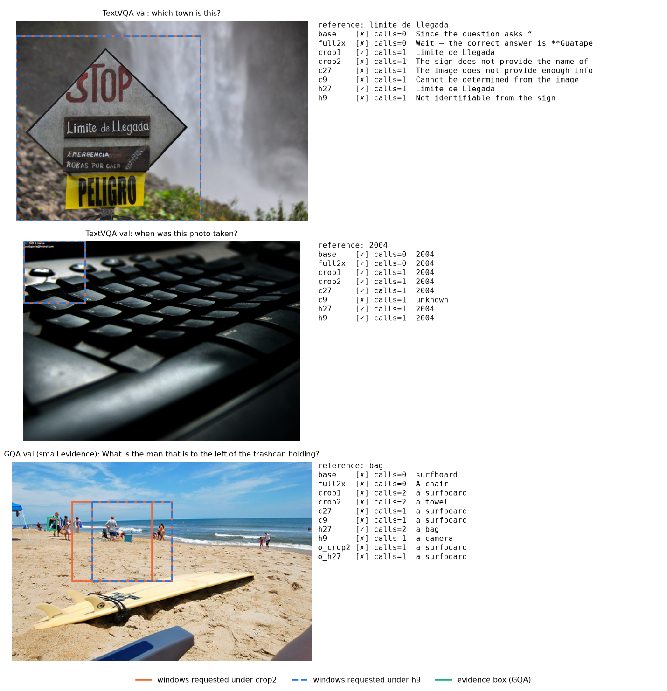
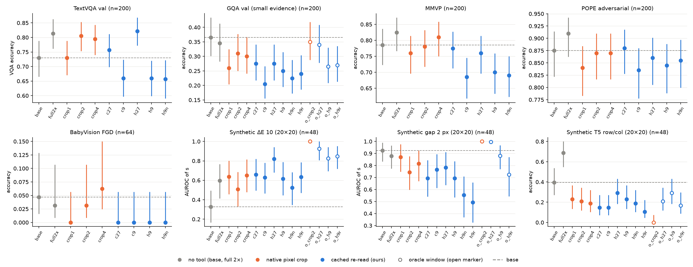
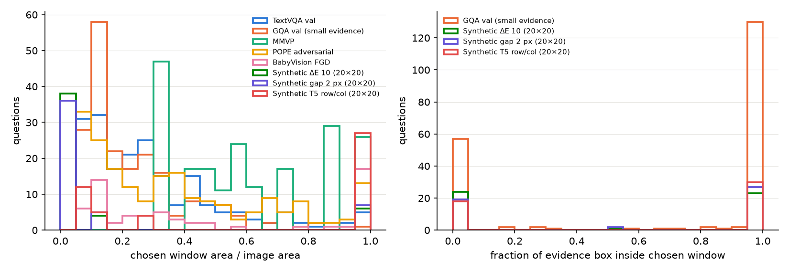
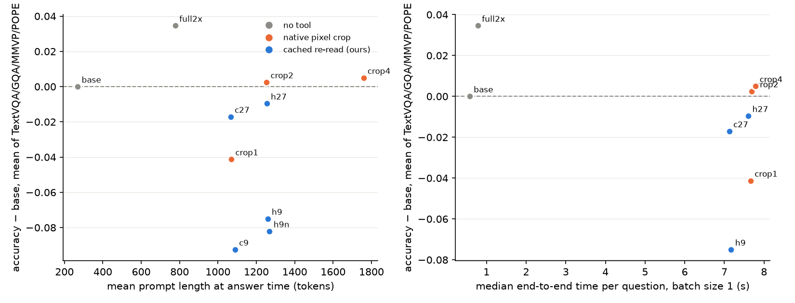

# 实验 5.2：缓存重读方法

本实验属于[局部重读](plan.md)问题，方法设计见 [design_cached_reread.md](design_cached_reread.md)。实验把方向二的缓存重读放进 Qwen3.5-9B 原生的工具调用协议，在相同协议、相同窗口下与原生的像素裁剪放大工具比较准确率、时间、显存、追加 token 与 KV cache。

## 通俗讲述

VLM 的“放大工具”做的事情很简单：模型说出一个框，系统把框里的像素裁下来、放大，再当成一张新图片交给模型。实验 5.1 用真值窗口发现，另一种读法在开销与坐标系上有优势：整图编码时 ViT 已经为每个 32×32 像素块算出了特征，需要细看时直接从这份缓存里取出框内的特征即可，不必重新编码，而且这些特征是在整图上下文中算出来的，携带原图位置。本实验要回答的是 PI 关心的最终问题：让模型自己用工具选框，缓存读法能不能在准确率上胜过原生的裁剪放大，并且更省时间与显存。

实验的做法是把两种读法装进同一个工具接口。模型看到图像和问题后，按 Qwen 官方的“think with images”工具格式调用一次放大工具；同一次调用的框被分别交给“裁剪重编码”和“缓存读取”两种工具实现，模型之后可以继续调用（最多 3 次）或作答。这样，两种读法看到的窗口完全相同，差别只在工具返回的视觉内容。缓存有三个可调因素：缓存来自 ViT 的哪一层（末层 merger 输出，或实验 5.1 中对颜色细节最好的第 9 层），缓存的分辨率（原图，或对放大 2 倍的整图做一次 ViT 前向得到的缓存），以及缓存 token 用原图的行列位置还是新图位置。评测覆盖 TextVQA、GQA 小目标、MMVP、POPE、BabyVision 细粒度子集和三个合成网格任务，并在 batch size 1 下测量端到端时间与显存。

结论分三层。第一，在相同的 LLM token 数下，末层缓存不差于、并在一些数据上略好于像素裁剪：1 倍缓存比 1 倍裁剪在四个自然图像数据集上合计高 2.4 个百分点（800 题，置信区间不含 0），2 倍分辨率缓存与 2 倍裁剪持平，在 TextVQA 上为 0.822 对 0.805；在合成网格上，裁剪放大会使模型改用窗口内的行列号作答（oracle 窗口下 48/48 题），缓存读法基本不会。第二，第 9 层缓存在自然图像上明显变差，模型常把这些 token 描述为模糊或无法辨认，它在合成颜色任务上的收益不能迁移到真实图像。第三，也是 PI 判据下最重要的一点：任何一种工具读法都没有胜过“直接把整图放大 2 倍”。在本实验的输入预算下，整图放大 2 倍不调用工具，准确率与最好的工具条件持平或更高，每题耗时约 0.9 秒，而工具流程约 7–8 秒；耗时差几乎全部来自模型在工具协议下多生成的约 200–250 个推理 token，ViT 计算与追加 visual token 的差别相比之下可以忽略。因此，缓存重读是比像素裁剪更好的“工具实现”，但工具调用这种使用方式本身在这些任务上不划算；要让局部重读真正胜出，需要让模型在不写长篇推理的前提下发起重读，这需要训练。

## 1. 问题与主要结果

本实验检验方向二的读取操作能否在 PI 的判据下胜出：与模型原生的裁剪放大工具相比，准确率更高，并且时间与显存更省。主要结果如下：

1. **在相同窗口与相同 LLM token 数下，末层缓存重读与像素裁剪相当或略优。** 四个自然图像数据集合计（800 题），1 倍末层缓存（c27）相对 1 倍裁剪（crop1）的平均得分差为 +0.024 [0.004, 0.045]（置换检验 p = 0.02）；由 2 倍整图 ViT 前向得到的末层缓存（h27）相对 2 倍裁剪（crop2）为 −0.012 [−0.031, 0.007]，无显著差别（第 3.1 节）。这说明在整图上下文中编码的特征至少与单独编码的裁剪一样可读，且 c27 不需要任何新的 ViT 计算。
2. **第 9 层缓存在自然图像上有害。** c9 相对 crop1 为 −0.051 [−0.078, −0.025]，h9 相对 crop2 为 −0.077 [−0.103, −0.050]（均 p < 0.001）；TextVQA 中 c9、h9 的回答有 12/200 与 16/200 条声称内容模糊或无法辨认，其余条件不超过 2/200（第 3.2 节）。实验 5.1 中第 9 层缓存对合成色差的收益依赖于“白底线条图”这一特殊分布，不能作为通用的缓存来源。
3. **整图放大 2 倍在准确率与时间上同时优于全部工具条件。** h27 相对 full2x 合计为 −0.044 [−0.070, −0.020]（p < 0.001）；batch size 1 的中位耗时，full2x 为 0.68–0.89 秒，工具条件为 6.9–8.1 秒（自然图像）。工具流程的耗时主要来自工具协议下的推理文本解码，与读取方式几乎无关（第 3.4 节）。
4. **像素裁剪引入窗口内坐标系，缓存重读不引入。** 合成 T5（20×20 行列回答）中，oracle 窗口的 2 倍裁剪 48/48 题全部答错且全部等于目标在窗口内的局部行列号，oracle 窗口的 h9 与 h27 只有 2/48 与 3/48 条（第 3.3 节）。这一结论与实验 5.1 一致，并在模型自选窗口下同样出现（crop2 10/48，缓存条件 0/48）。
5. **窗口选择是另一个独立瓶颈。** GQA 中模型首个窗口完整覆盖证据框的比例为 0.65，合成色差任务为 0.48；在 GQA 与合成任务上，oracle 窗口条件普遍明显好于模型自选窗口（第 3.3 节）。
6. **position IDs 编排与 token 逆序都没有改善。** h9 对 h9n（原图 IDs 对新图 IDs）合计差 +0.007 [−0.013, 0.026]；逆光栅顺序的缓存（h9r）在合成缺口任务上把 AUROC 由 0.69 降至 0.49，在其余任务上不优于 h9（第 3.5 节）。

## 2. 实验设计与实际执行

### 2.1 条件

符号与方法定义见设计文档第 3–4 节。实际运行的条件如下，其中 $K$ 为窗口在原分辨率下的 token 数，$HW$ 为整图 token 数：

| 条件 | 工具返回的视觉内容 | 每次调用追加的 visual tokens | 新编码的 ViT patch |
| --- | --- | ---: | ---: |
| base | 无工具 | 0 | 0 |
| full2x | 无工具，整图边长放大 2 倍 | 整图变为 $4HW$ | $16HW$ |
| crop1 / crop2 / crop4 | 像素裁剪放大 1、2、4 倍后重编码（原生工具） | $K$、$4K$、$16K$ | 每次调用 $4K$、$16K$、$64K$ |
| c27 / c9 | 原分辨率缓存，ViT 第 27 / 9 个 block 经 merger，原图 IDs | $K$ | 0 |
| h27 / h9 | 2 倍分辨率缓存（对放大 2 倍的整图做一次 ViT 前向），原图 IDs（间隔 1/2） | $4K$ | 一次 $16HW$，与调用次数无关 |
| h9n | 同 h9，新图 IDs | $4K$ | 同 h9 |
| h9r | 同 h9，窗口 token 逆光栅排列，IDs 随 token 移动 | $4K$ | 同 h9 |
| o_crop2 / o_h27 / o_h9 / o_h9r | 首次调用的框替换为 oracle 窗口（GQA 与合成任务） | 同左 | 同左 |

### 2.2 协议

1. **工具调用。** system prompt 按 Qwen3.5 chat template 声明 `image_zoom_in_tool`；问题后附加“先调用一次该工具再作答”。首个调用每题只生成一次，被所有工具条件共享；之后每个条件用自己的工具继续，最多 3 次调用。超过 3 次的完整调用记为 call_limit 并按错误计分。
2. **作答格式。** 全部条件（包括 base 与 full2x）使用同一约定：允许自由文本，最后一行写“Final answer: …”。pilot 运行表明，工具轮次之后模型几乎总是先写一段分析，无法强制裸答案，因此统一采用这一约定以保证可比。每轮生成上限 256 tokens，首次调用上限 160 tokens。
3. **合成细节任务的判别分数。** 取最后一个“Final answer:”之后首个 token 的 $z_{\mathrm{Yes}} - z_{\mathrm{No}}$（空格前缀的 token），以其 AUROC 为主指标。
4. **输入分辨率。** 自然图像面积不超过 $512^2$ pixels（约 256 个 visual tokens）；合成网格为 1280×1280；BabyVision 为原尺寸。

### 2.3 数据与规模

| 数据 | 规模 | 指标 |
| --- | --- | --- |
| TextVQA val（随机） | 200 | VQA accuracy |
| GQA val，Visual-CoT 证据框面积 ≤ 2% | 200 | 精确匹配；另报告宽松匹配 |
| MMVP 前 200 题（100 对） | 200 | 准确率、成对准确率 |
| POPE adversarial（yes/no 各半） | 200 | 准确率 |
| BabyVision Fine-grained Discrimination | 64（前 64 题） | 本地严格评分 |
| 合成色差 10、合成缺口 2 px（20×20，修订 T3） | 各 48 | AUROC 与准确率 |
| 合成 T5 找不同（20×20，行列） | 48 | 行列准确率与窗口内序号错误 |

### 2.4 运行与核对

1. 自定义 inputs_embeds 与浮点 MRoPE IDs 的路径与 processor 标准路径的首 token logits 完全一致（12 条输入，最大绝对差 0.0）。
2. 准确率阶段使用左侧 padding 的批量 greedy decoding；批量与逐条解码在 36 条工具轮次输入上的文本完全一致比例为 0.86，不一致的条目都是在若干 token 之后才分叉的长推理文本。
3. GPU 被多个用户共享，运行分散在 GPU 0、1、6、7 上，合计约 15 GPU-hours（含因显存被占用而失败的重试）。合成 T5 的主条件因一次重试被两个进程重复运行了 32 题，分析保留每个（题目，条件）的第一条记录；重复记录的正误一致率为 318/352。
4. 时间与显存在 batch size 1 下测量（TextVQA、GQA、合成 T5 各 20 题，GQA 实际完成 8 题），完整流程依次为整图 ViT 前向、首轮 prefill 与工具调用解码、工具执行、在 KV cache 上续接 tool response 的 prefill 与后续解码。各条件在同一题上依次运行，共享 GPU 的负载对各条件的影响相近，但绝对数值偏慢。

上图为三道题的输入与回答。左图为送入模型的图像，橙色实线框为 crop2 条件下模型请求的窗口，蓝色虚线框为 h9 条件下请求的窗口（首个窗口相同，之后的窗口可能不同），绿色框为 GQA 的证据框；右侧为各条件的最终答案与调用次数（✓ 表示正确）。第一例“which town is this?”的参考答案是标牌上的文字“limite de llegada”，crop1、crop4 与 h27 给出了这一答案，crop2、c27、c9 与 h9 回答无法确定；第二例中 c9 回答“unknown”，其推理文本称窗口中没有可见的日期，而同一窗口的其他读法都读出了“2004”；第三例中模型的窗口没有覆盖证据框（远处左侧的人），所有读法都答错，体现窗口选择的瓶颈。

## 3. 结果

### 3.1 读取方式：缓存与裁剪在相同 token 数下的比较

每个面板为一个数据集，横轴为条件，纵轴为准确率（合成色差与缺口为判别分数的 AUROC）；灰色为无工具条件，橙色为原生像素裁剪，蓝色为缓存重读，空心点为 oracle 窗口条件；误差线为 95% 区间（比例为 Wilson 区间，TextVQA 与 AUROC 为 bootstrap 区间）；虚线为 base。

| 条件 | TextVQA | GQA | MMVP | POPE | 追加 tokens（TextVQA） | 新 ViT patch（TextVQA） |
| --- | --- | --- | --- | --- | ---: | ---: |
| base | 0.730 [0.665, 0.788] | 0.365 [0.301, 0.434] | 0.785 | 0.875 | 0 | 969 |
| full2x | 0.813 [0.762, 0.863] | 0.345 | **0.825** | **0.910** | 整图 1042 | 3878 |
| crop1 | 0.730 | 0.260 | 0.760 | 0.840 | 77 | 1278 |
| crop2 | 0.805 [0.753, 0.853] | 0.310 | 0.780 | 0.870 | 307 | 2196 |
| crop4 | 0.795 | 0.300 | 0.810 | 0.870 | 907 | 4598 |
| c27 | 0.757 | 0.275 | 0.775 | 0.880 | 79 | 969 |
| c9 | 0.660 | 0.205 | 0.685 | 0.835 | 92 | 969 |
| h27 | **0.822** [0.772, 0.868] | 0.275 | 0.760 | 0.860 | 309 | 4847 |
| h9 | 0.660 | 0.250 | 0.700 | 0.845 | 340 | 4847 |
| h9n | 0.657 | 0.225 | 0.690 | 0.855 | 345 | 4847 |

“追加 tokens”为工具轮次中全部第二段视觉输入的 token 总数（含多次调用），“新 ViT patch”为整题需要编码的 patch 总数（含整图）。四个自然图像数据集合计的配对比较如下（每题得分差的均值，置换检验）：

| 比较 | 差 | 95% 区间 | p |
| --- | --- | --- | --- |
| c27 − crop1（相同 $K$ 个 token） | +0.024 | [0.004, 0.045] | 0.02 |
| h27 − crop2（相同 $4K$ 个 token） | −0.012 | [−0.031, 0.007] | 0.27 |
| h27 − full2x | −0.044 | [−0.070, −0.020] | < 0.001 |
| crop2 − base | +0.003 | [−0.024, 0.030] | 0.89 |
| h27 − base | −0.010 | [−0.037, 0.017] | 0.51 |

1. **相同 token 数下，末层缓存与裁剪相当或略优。** c27 相对 crop1 在四个数据集上的差都不为负（TextVQA +0.027，GQA +0.015，MMVP +0.015，POPE +0.040），合计显著；h27 相对 crop2 在 TextVQA 上为 +0.017，在其余三个数据集上为 −0.010 至 −0.035，合计无差别。按数据集分别做 Holm 校正后，这些单数据集差异都不显著。解释（推断）：缓存 token 在整图上下文中编码，同一窗口的单独裁剪则丢失了窗口外的上下文，1 倍分辨率下这一差别更明显；2 倍分辨率下两者都提供了更多像素细节，上下文的作用被稀释。
2. **工具调用本身在 GQA 上有害。** GQA 的 base 为 0.365，所有模型窗口条件为 0.205–0.310；oracle 窗口把 crop2 与 h27 提高到 0.350 与 0.340，仍不超过 base。宽松匹配（参考答案作为词序列出现在预测中）的排序相同（base 0.430，o_crop2 0.485，crop2 0.415，h27 0.365）。工具轮次中的推理文本常把注意力转向窗口内的其他物体（第 2.4 节示例三），这是 GQA 下降的一个可能原因（解释）。

### 3.2 缓存深度：第 9 层缓存在自然图像上不可读

| 比较（四个自然数据集合计） | 差 | 95% 区间 |
| --- | --- | --- |
| c9 − crop1 | −0.051 | [−0.078, −0.025] |
| h9 − crop2 | −0.077 | [−0.103, −0.050] |
| h9 − h27（TextVQA） | −0.162 | [−0.222, −0.103] |

TextVQA 中，以下关键词（blurry、not legible、cannot read、unable to read、pixelated 等）出现在回答中的比例为：c9 12/200，h9 16/200，h9n 17/200；base、full2x、crop1、crop2、c27、h27 均不超过 2/200。c9 与 h9 的平均调用次数也更高（1.44 与 1.33，crop2 与 h27 为 1.14 与 1.15），模型在读不清时倾向于再次放大。

**ViT 第 9 层经主路径 merger 投影的特征，对自然图像中的文字与物体属于不可读的输入。** 实验 5.1 中第 9 层缓存在合成色差上优于末层，是因为白底线条图上的低对比度颜色信号在深层衰减；而自然图像的文字识别依赖 ViT 后段形成的特征，主路径 merger 只在末层输出上训练，浅层投影不能被 LLM 当作同类视觉内容解读。这与实验 4.4 的结论相互印证：Qwen3-VL 的 DeepStack 从同一深度注入特征，其中可读的高频细节在 decoder 中很快衰减，实际被使用的部分是位置编码。合成任务上，h9 也不优于 h27（色差 AUROC 0.62 对 0.82，缺口 0.69 对 0.78），说明在原生工具协议下，第 9 层缓存在合成刺激上也失去了 5.1 中的优势（5.1 的问法为直接回答，本实验为工具轮次后的自由文本）。

### 3.3 窗口选择与坐标系

左图为模型首个窗口占图像面积的比例分布，右图为证据框落在首个窗口内的面积比例（GQA 与合成任务）；颜色表示数据集，见图例。

1. **模型窗口经常错过证据。** 首个窗口完整覆盖证据框的比例：GQA 0.65，合成色差 0.48，合成缺口 0.56，合成 T5 0.62。合成 T5 中模型窗口平均占图像面积的 0.62，许多调用直接框选整幅网格，因为找不同任务在调用前并不知道目标在哪里。
2. **oracle 窗口下的读取差别。** 合成细节任务中，oracle 窗口的 2 倍裁剪与 h27 都接近天花板（色差 AUROC 1.00 与 0.92，缺口 1.00 与 1.00），o_h9 明显更低（0.83 与 0.88；相对 o_crop2 的准确率差为 −0.27 与 −0.35，Holm 校正后 p ≤ 0.003）。
3. **像素裁剪引入窗口内坐标系。**

| 条件（合成 T5，48 题） | 行列正确 | 窗口内序号错误 |
| --- | --- | --- |
| base | 19 | — |
| full2x | 33 | — |
| crop2（模型窗口） | 10 | 10 |
| h27（模型窗口） | 14 | 0 |
| o_crop2（oracle 5×5 窗口） | 0 | 48 |
| o_h27 | 10 | 3 |
| o_h9 | 14 | 2 |

“窗口内序号错误”指回答错误但恰好等于目标在窗口内的行列号。oracle 窗口的 2 倍裁剪使模型全部改报窗口内的序号；缓存条件相对 o_crop2 的不一致对为 10/0（o_h27）与 14/0（o_h9），Holm 校正后 p = 0.018 与 0.001。**缓存读法保留了原图坐标系，这是它相对裁剪唯一稳定、可解释的优势。** 机制上（解释），缓存 token 的内容在整图 ViT 前向中形成，携带原图位置（实验 3.7），行序数由 DeltaNet 沿原图 token 行逐行递推（实验 3.8 r2）；裁剪图是一张新的小图，模型对它重新计数，自然得到窗口内的序号。不过，在不给窗口的情况下，所有工具条件的行列准确率都低于 base（0.40）和 full2x（0.69），定位任务中局部重读本身并不带来收益，与实验 5.1 一致。

### 3.4 开销

纵轴为相对 base 的准确率差（TextVQA、GQA、MMVP、POPE 的平均）；左图横轴为作答时的平均 prompt 长度（tokens），右图横轴为 batch size 1 下每题端到端时间的中位数（TextVQA 与 GQA 平均）；颜色含义同前。

| 条件 | TextVQA 时间（s） | GQA 时间（s） | 合成 T5 时间（s） | 峰值显存增量（TextVQA，GiB） | 最终序列长度（TextVQA） | KV cache（TextVQA，MiB） |
| --- | ---: | ---: | ---: | ---: | ---: | ---: |
| base | 0.64 | 0.51 | 3.4 | 0.10 | 312 | 9.7 |
| full2x | 0.89 | 0.68 | 8.1 | 0.22 | 1033 | 32.3 |
| crop1 | 7.46 | 7.86 | 19.8 | 0.17 | 1095 | 34.2 |
| crop2 | 7.41 | 7.96 | 18.7 | 0.17 | 1296 | 40.5 |
| crop4 | 7.49 | 8.09 | 18.3 | 0.25 | 1813 | 56.7 |
| c27 | 7.02 | 7.23 | 18.0 | 0.17 | 1100 | 34.4 |
| h27 | 7.67 | 7.53 | 16.3 | 0.19 | 1283 | 40.1 |
| h9 | 7.49 | 6.85 | 15.8 | 0.20 | 1372 | 42.9 |

峰值显存增量为相对模型权重的增量；KV cache 只计 8 个 gated full attention 层（每 token 32 KiB），24 个 Gated DeltaNet 层的递推状态固定约 50 MiB，与序列长度无关。

1. **工具流程的时间由解码主导，与读取方式基本无关。** 工具条件比 full2x 慢 8–11 倍（自然图像），主要原因是工具协议下模型在调用前后各写一段推理文本，最终序列比 full2x 多 50–800 个 token，其中大部分是逐 token 解码的文本；相比之下，c27 省去的裁剪 ViT 前向（约数百个 patch）只节省约 0.4–1.8 秒：c27 在三类数据上都快于 crop1（7.02 对 7.46，7.23 对 7.86，18.0 对 19.8 秒）。h27 的 2 倍整图 ViT 前向在自然图像上没有造成可测的额外耗时。
2. **显存差别很小。** 自然图像上所有条件的峰值显存增量都在 0.1–0.25 GiB；合成 T5 中 h27、h9 与 full2x 的增量约 1.3 GiB（2560×2560 图像的 ViT 前向），裁剪条件约 0.45 GiB。
3. **相同 token 数下缓存与裁剪的 KV cache 相同**（c27 与 crop1 均约 34 MiB，h27 与 crop2 均约 40 MiB），差别只在 ViT 计算：c27 无新计算，h27 的 ViT 计算与窗口无关、可以在调用前并行完成，裁剪需要在每次调用后串行编码。

### 3.5 position IDs 与 token 顺序

1. **原图 IDs 与新图 IDs 无差别。** h9 对 h9n 在四个自然数据集合计为 +0.007 [−0.013, 0.026]；合成缺口与色差上 h9 的 AUROC 略高（0.69 对 0.56，0.62 对 0.52），区间重叠。与实验 5.1 的 d 对 e 一致：decoder 的 MRoPE IDs 单独改变时作用很小。
2. **逆光栅顺序没有帮助。** 实验 2.6 显示找不同的比较沿光栅顺序进行，据此测试了逆序重读（h9r）。h9r 在合成缺口上 AUROC 为 0.49（h9 为 0.69），合成 T5 行列准确率为 0.10（h9 为 0.23），GQA 为 0.240（h9 为 0.250），合成色差为 0.64（h9 为 0.62）。逆序破坏了窗口内的行结构，与“DeltaNet 以 token 行为递推单位”（实验 3.8 r2）的结论一致（解释）。

### 3.6 BabyVision

BabyVision 细粒度子集在本协议下处于地板效应：前 64 题中 base 为 3/64，所有条件为 0–4/64；base 的 64 条回答中有 56 条在 256 tokens 处被截断，工具条件中 23–35 条用完 3 次调用。该数据集需要数千 token 的推理（实验 4.2 中位数约 2500 tokens），在本实验的预算下无法区分读取方式，因此在 64 题后停止，不作结论。

## 4. 讨论

### 4.1 PI 判据下的结论

| 判据 | 缓存重读相对原生裁剪工具 | 两者相对整图放大 2 倍 |
| --- | --- | --- |
| 准确率 | 相同 token 数下相当或略优（c27 对 crop1 +0.024；h27 对 crop2 −0.012，不显著）；保留原图坐标系 | 均不优于 full2x（h27 对 full2x −0.044） |
| 时间 | 相同或略快（省去每次调用的裁剪 ViT 前向） | 慢 8–11 倍 |
| 显存与 KV cache | 相同 token 数下相同；2 倍缓存需要一次与窗口无关的 2 倍整图 ViT 前向 | 工具条件的最终序列更长，KV cache 相当或更大 |

**缓存重读是比像素裁剪更好的工具实现，但在本实验的任务与预算下，工具式局部重读整体输给了整图放大。** 前一点来自读取本身：在相同窗口、相同 token 数下，缓存不差于裁剪，且不引入窗口内坐标系。后一点来自使用方式：未经训练的模型在工具协议下会写大量推理文本，这一开销比任何读取方式的差别大一个数量级；同时窗口选择错过证据的比例为 35%–52%，而整图放大没有窗口选择的风险。

### 4.2 失败的机制与需要的条件

1. **窗口选择。** 模型只能根据整图的低分辨率表征选框；在找不同这类搜索任务中，调用前并不知道目标位置，窗口常覆盖整图（合成 T5 平均 0.62 的面积）。这与实验 2.6 的“比较沿光栅顺序进行”以及 3.10 的“行列计数在 prefill 中累积”一致：定位信息在 prefill 结束时已经决定，局部重读只能复读模型已经看过的区域。
2. **重读内容的可读性。** 只有与 LLM 训练分布一致的 merger 输出（第 27 层）才能被直接读取；第 9 层投影在自然图像上不可读（第 3.2 节），实验 4.4 也显示加性注入的浅层细节在 decoder 中衰减。若要利用浅层细节，需要为浅层特征训练投影，而不能直接复用主路径 merger。
3. **工具协议的解码开销。** 时间劣势来自推理文本而非视觉计算。要让局部重读在时间上胜出，需要模型在不写长篇推理的前提下发起重读，例如训练一个以特殊 token 触发、直接给出窗口坐标的读取动作，并以缓存 token 作为返回内容；按本实验的数据，这样的读取在 KV cache 与 ViT 计算上与整图放大相比只需要 $4K$ 而非 $3HW$ 个额外 token（TextVQA 中约 309 对 720），是缓存重读可能真正胜出的场景。这一判断尚未验证（推断）。

### 4.3 与其他实验的对照

1. **与实验 5.1 一致。** 像素裁剪引入窗口内坐标系，缓存重读不引入；position IDs 编排无差别；整图放大 2 倍是稠密网格定位唯一有效的条件。
2. **与实验 5.1 冲突。** 5.1 中第 9 层缓存在合成色差上优于末层；本实验中，自然图像上第 9 层缓存明显更差，合成任务上在工具协议下也不再优于 2 倍末层缓存。冲突的来源是刺激分布与问法：5.1 的收益局限于白底线条图与直接回答。
3. **与实验 4.4 一致。** DeepStack 的浅层注入主要提供位置编码，细节在 decoder 中衰减；本实验直接把第 9 层 token 作为可注意的序列 token 输入，也未能让模型读出自然图像细节，说明问题首先在于主路径 merger 对浅层特征的投影不可读，而不只在于注入形式。
4. **与实验 2.6 的建议。** 逆序重读作为任务无关的读取变体进行了测试，没有收益（第 3.5 节）。

## 5. 与设计的偏离

1. **作答格式与调用次数。** 设计中为单次调用、短答案；pilot 运行显示工具轮次后模型总是先写分析，并常发起第二次调用，因此改为“Final answer”约定、每轮 256 tokens、最多 3 次调用，全部条件统一适用。
2. **规模。** 自然数据集由 300 题减为 200 题；条件 h27、o_h27、h9r、o_h9r 在主运行后补充运行，首次调用由同一 greedy 设置重新生成；o_crop4、o_c9 未运行。
3. **BabyVision** 在 64/163 题后停止（第 3.6 节）。
4. **时间测量** 在共享且满载的 GPU 上进行，绝对值偏大，条件间比较以同题依次运行保证可比；GQA 只完成 8 题。

## 6. 限制

1. 输入预算固定为 $512^2$ pixels。在更低预算或更高分辨率原图（例如高分辨率文档）上，full2x 的代价会增长，局部重读的相对价值可能不同。
2. 所有结论都针对未经训练的 Qwen3.5-9B 与 thinking off；工具协议下的推理文本长度是该模型的行为，经过工具使用训练的模型可能不同。
3. 合成任务每个 48 题，单数据集的多数对比在 Holm 校正后不显著，结论以合计比较与效应方向为准。

## 7. 产物

产物位于 WORK_DIR 的 `analysis/reread/2026-10-20_cached_reread/`：`verify/`（路径核对与批量一致性）、各数据集目录（`results.jsonl` 保存全部 prompt 依据、调用文本、窗口、原始回答、评分与 token 计数，`cases.json` 保存题目与证据框，`meta_*.json` 保存运行元数据）、`timing/timing.jsonl` 与 `summary.json`。程序为 `analysis_tools/reread/cached_reread.py`（工具协议、缓存读取、浮点 MRoPE IDs、批量解码、评分）、`cached_reread_run.py`（运行与计时）与 `cached_reread_analysis.py`（统计与作图），入口为 `scripts/analysis/reread/cached_reread.sh`，测试为 `tests/analysis/reread/test_cached_reread.py`。
