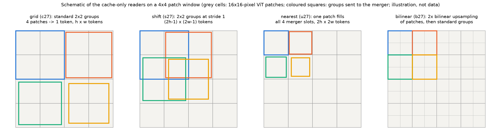
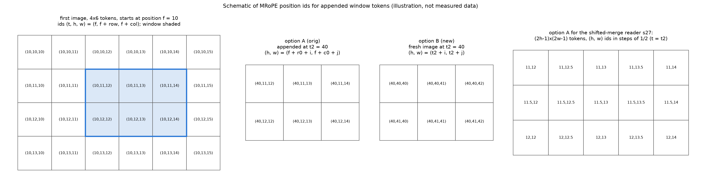
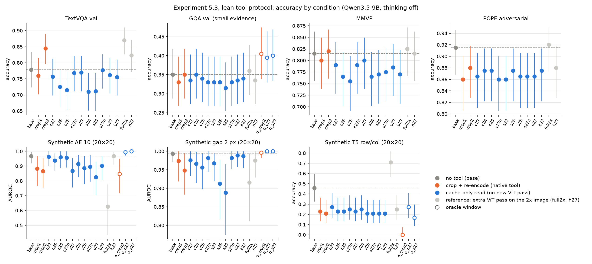
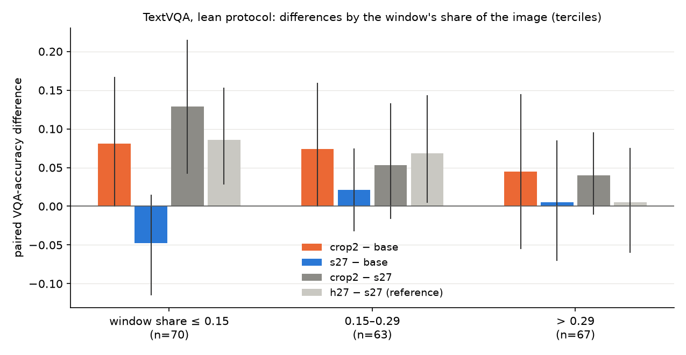
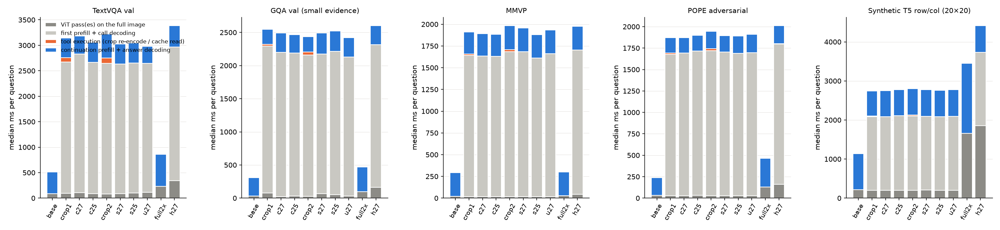
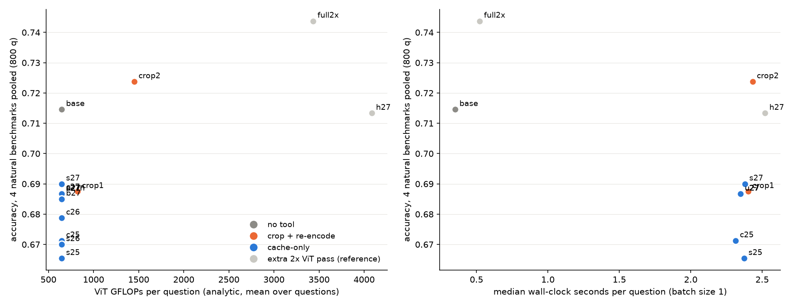
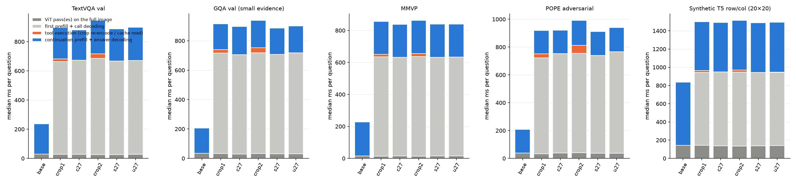

# 实验 5.3：免重编码的缓存重读

本实验属于[局部重读](plan.md)问题，承接实验 5.2（[results_2026-10-20_cached_reread.md](results_2026-10-20_cached_reread.md)，方法设计见 [design_cached_reread.md](design_cached_reread.md)）。实验检验一种只读取原图单次 ViT 前向缓存、不做任何新 ViT 前向的局部重读，能否在准确率上不低于模型原生的裁剪重编码工具，同时在时间、计算量、token 与显存上更省。

## 通俗讲述

VLM 的放大工具做的事情是：模型给出一个框，系统把框里的像素裁下来、放大，再让 ViT 把这块小图重新编码一遍，交给 LLM。实验 5.2 发现另一种读法在相同 token 数下不差于裁剪：整图编码时 ViT 已经为每个位置算出了特征，需要细看时直接从这份缓存里取出框内的特征即可。PI 对这一方向提出了更严格的判据：方法必须比标准做法更省，也就是说不能再跑任何新的 ViT 前向（5.2 中表现最好的“2 倍分辨率缓存”需要额外对放大 2 倍的整图跑一次 ViT，因此不符合要求）；同时准确率要不低于裁剪重编码。比较对象只有两个：模型原生的裁剪重编码工具，以及不调用工具的 base；“把整图放大 2 倍”在真实应用中不会发生，只放在附录作参照。

本实验的核心问题因此变成：只用原图那一次 ViT 前向留下的缓存，能不能拼出和 2 倍裁剪一样有用的窗口视图？ViT 内部以 16×16 pixels 的 patch 为单位工作，merger 再把 2×2 个 patch 合并成一个送入 LLM 的 token。合并之前的 patch 状态比 LLM 实际看到的 token 多 4 倍，于是我们设计了三种只读缓存、但给出 4 倍 token 的读法：把 2×2 合并的分组错开一个 patch 重复做（shift），让每个 patch 单独占满 merger 的四个槽位（nearest），以及先对 patch 网格做双线性插值再合并（bilinear）。我们还按 PI 的建议把缓存来源从 ViT 最后一层换成倒数第 2、3 层，并为了排除工具协议里冗长推理文本的干扰，改用一个“精简协议”：模型不写推理，直接给出框，看到工具结果后直接写答案，所有条件一视同仁。

结果有三点。第一，在相同 token 数下，只读缓存的标准窗口读法（c27）与 1 倍裁剪准确率相同（四个自然图像数据集 800 题合计差 −0.001），而且不需要任何新的 ViT 计算，每题 ViT 计算量少 17%–37%，工具执行时间由 17–106 ms 降到约 1 ms。第二，所有 4 倍 token 的缓存读法都追不上 2 倍裁剪（合计差 −0.034 至 −0.039），它们的准确率与 1 倍缓存几乎一样：同一份信息换一种排列、复制或插值再读一遍，不会多出任何细节。差距集中在 TextVQA 的小窗口上（窗口不到图像 15% 时，2 倍裁剪比 shift 读法高 0.13），而 2 倍裁剪其实是把同一张低分辨率图像的像素放大后重新编码，并没有引入新的像素；这说明细节丢失发生在 ViT 以 16 pixels 为步长编码图像的那一步，后续任何只读缓存的办法都拿不回来。倒数第 2、3 层的缓存在 TextVQA 与 MMVP 上反而更差。第三，position IDs 用原图行列还是新图编号对准确率没有影响，也不决定“窗口内序号”错误：在合成网格找不同任务中，oracle 窗口的 2 倍裁剪 48 题全部报出窗口内的行列号，两种编号下的缓存读法都没有这种错误。总的来说，只读缓存满足“和 1 倍裁剪一样准、更省”，但不满足“和 2 倍裁剪一样准”；要达到后者，冻结模型下必须为窗口提供更密的 ViT 采样，这一上限由 ViT 的采样分辨率决定，读取方式无法突破它。

## 1. 问题与主要结果

判据有两条，比较对象为原生的裁剪重编码工具（crop1、crop2）与无工具的 base：

1. **效率。** 头号方法只能读取原图单次 ViT 前向的缓存，不允许任何新的 ViT 前向，并且在时间、ViT 计算量、追加 token 与峰值显存上不多于裁剪重编码。
2. **准确率。** 不低于相同 token 数的裁剪重编码。

主要结果如下（精简工具协议，四个自然图像数据集 TextVQA、GQA、MMVP、POPE 各 200 题合计 800 题，另有三个合成网格任务各 48 题）：

1. **只读缓存的 1 倍窗口读法与 1 倍裁剪同样准确，且更省。** c27 相对 crop1 的合计差为 −0.001 [−0.013, 0.011]（p = 0.92）；c27 不做新的 ViT 前向，每题 ViT 计算量少 17%–37%，工具执行时间由 14–89 ms 降至约 1 ms，追加 token、KV cache 与峰值显存与 crop1 相同（第 3.1、3.5 节）。在实验 5.2 的原生多轮协议下，同一比较为 +0.024 [0.005, 0.044]。
2. **4 倍 token 的缓存读法都不如 2 倍裁剪，也不优于 1 倍缓存。** shift、nearest、bilinear 相对 crop2 的合计差为 −0.034、−0.037、−0.039（均 p < 0.001），相对 c27 的差在 ±0.005 以内（第 3.3 节）。差距集中在 TextVQA 的小窗口（窗口面积不超过图像 15% 的三分之一题目上，crop2 − s27 = +0.129 [0.043, 0.214]）。
3. **细节在 ViT 的 1 倍采样中已经丢失，这是只读缓存的信息上限。** 2 倍裁剪取自同一张已按 $512^2$ pixels 预算缩小的图像，经 bicubic 插值放大后重新编码，没有引入新的像素信息；它的收益只能来自 ViT 以更密的 patch 网格重新编码同一批像素。对缓存做任何重排、复制或插值都不能恢复这部分信息（第 3.3 节）。
4. **ViT 倒数第 2、3 层的缓存不优于末层。** c26、c25 相对 crop1 为 −0.009 与 −0.016，s26、s25 相对 crop2 为 −0.054 与 −0.058；TextVQA 与 MMVP 上的下降最明显（第 3.2 节）。
5. **position IDs 编排不影响准确率，也不是窗口内序号错误的来源。** c27 对 c27n、s27 对 s27n 的合计差为 0.000 与 +0.003；合成 T5 中 oracle 窗口的 2 倍裁剪 48/48 题报出窗口内序号，c27、c27n 与 o_c27 均为 0/48（第 3.4 节）。
6. **结论在两种协议变体下成立。** 关闭工具调用格式的精简协议（第 3.6 节）与 5.2 的原生多轮协议下，c27 ≈ crop1、4 倍缓存读法 < crop2 的排序不变。

## 2. 方法

### 2.1 符号

| 符号 | 形状 | 含义 |
| --- | --- | --- |
| $I$ | 图像 | 输入图像，边长为 32 pixels 的整数倍 |
| $H, W$ | 标量 | $I$ 的 merged token 网格行数与列数，每个 merged token 对应 32×32 pixels |
| $X^{(\ell)}$ | $2H \times 2W \times 1152$ | ViT 第 $\ell$ 个 block（1 起编号，共 27 个）输出的 patch 状态，按空间位置排列，每个 patch 对应 16×16 pixels |
| $\mathrm{LN}$ | 映射 | merger 内的逐 patch LayerNorm，作用在 1152 维上 |
| $M$ | 映射 | 主路径 patch merger：把一个 2×2 patch 组的 4 个 $\mathrm{LN}$ 输出按固定槽位顺序拼接为 4608 维，再经两层 MLP 投影到 $d = 4096$ 维 |
| $w = (r_0, c_0, h, w)$ | 4 个整数 | 工具调用给出的窗口，单位为 merged token；窗口覆盖 $2h \times 2w$ 个 patch |
| $K$ | 标量 | 窗口的 merged token 数，$K = hw$ |
| $f$ | 标量 | 第一张图像 visual tokens 在序列中的起始位置 |
| $t_2$ | 标量 | 工具返回的视觉段在序列中的起始位置 |

merger 对一个 2×2 patch 组 $(x_{00}, x_{01}, x_{10}, x_{11})$ 的计算为

$$
M(x_{00}, x_{01}, x_{10}, x_{11}) = W_2\, \mathrm{GELU}\!\left(W_1 \left[\mathrm{LN}(x_{00});\ \mathrm{LN}(x_{01});\ \mathrm{LN}(x_{10});\ \mathrm{LN}(x_{11})\right] + b_1\right) + b_2,
$$

其中 $W_1$ 的形状为 $4608 \times 4608$，$W_2$ 的形状为 $4096 \times 4608$，分号表示沿特征维拼接，下标 $ab$ 表示 patch 在组内的行 $a$ 与列 $b$。原模型只在 $X^{(27)}$ 的非重叠 2×2 组上调用 $M$，得到 $HW$ 个 visual tokens。merger 的计算量约为每个输出 token 0.08 GFLOPs，而 ViT 编码一个 merged token（4 个 patch）约需 3.3 GFLOPs，因此在已缓存的 patch 状态上重新调用 $M$ 的代价约为重新编码的 1/40。

### 2.2 只读缓存的读取方式

所有缓存读法都从整图那一次 ViT 前向中取得 $X^{(\ell)}$：前向时用 forward hook 保存第 25、26、27 个 block 的输出，这一步不增加计算，存储量为每张 $512^2$ pixels 的图像每层约 2.4 MB。工具执行时，只在窗口内的 patch 状态上调用 merger，不做任何新的 ViT 前向。四种读取方式如下，示意见下图。

上图为示意图，不含模型数据。灰色方格为窗口内的 16×16 pixels ViT patch，彩色方框为送入 merger 的 patch 组；每个方框产生一个 LLM token。

1. **grid（c27、c26、c25）。** 标准的非重叠 2×2 组，产生 $h \times w$ 个 token。$\ell = 27$ 时就是原图中该窗口的 visual tokens，与实验 5.2 的 c27 相同；$\ell = 26, 25$ 时把倒数第 2、3 个 block（0 起编号为 25、24）的输出送入同一个 merger。
2. **shift（s27、s26、s25）。** 以步长 1 在 patch 网格上取全部 2×2 组：

$$
T_{ij} = M\!\left(X_{2r_0+i,\,2c_0+j},\ X_{2r_0+i,\,2c_0+j+1},\ X_{2r_0+i+1,\,2c_0+j},\ X_{2r_0+i+1,\,2c_0+j+1}\right),\quad 0 \le i < 2h-1,\ 0 \le j < 2w-1 .
$$

其中 $T_{ij}$ 为第 $i$ 行、第 $j$ 列的输出 token，形状为 $d$。$i, j$ 均为偶数的 token 就是标准 2×2 组（即 grid 读法的全部 token），其余 token 是水平、垂直或对角方向错开一个 patch 的组。merger 在每个槽位上看到的仍然是“左上、右上、左下、右下”相邻排列的真实 patch，只是组的边界移动了半个 merged token，因此这类输入落在 merger 的训练分布之内。这一读法产生 $(2h-1)(2w-1) \approx 4K$ 个 token，与 2 倍裁剪的 $4K$ 个 token 相当，但信息全部来自原图缓存。

3. **nearest（u27）。** 每个 patch 单独填满 merger 的 4 个槽位，$T_{ij} = M(X_{ij}, X_{ij}, X_{ij}, X_{ij})$，产生 $2h \times 2w$ 个 token，一个 token 对应一个 16 pixels 的 patch。它等价于把 patch 网格按最近邻插值放大 2 倍后再做标准合并，这是 PI 提出的“1×1 方式通过 merger”的实现。merger 从未见过 4 个槽位相同的输入，因此这一读法属于分布外输入。
4. **bilinear（b27）。** 把窗口（四周各多取 1 个 patch 作为插值上下文）的 patch 网格按双线性插值放大 2 倍，再做标准 2×2 合并，产生 $2h \times 2w$ 个 token。它与 nearest 的差别在于每个槽位是相邻 patch 的加权平均。

与原生工具的上限规则一致，当 2 倍裁剪会超过 $1280^2$ pixels（即 $4K > 1600$）时，裁剪工具把放大倍数降为 1；三种 $4K$ token 的缓存读法服从同一上限，此时退回 grid 读法。该规则只在合成网格的大窗口上触发。

### 2.3 位置编码：工具返回段的 MRoPE position IDs

Qwen3.5 的 decoder 使用 MRoPE：每个 token 有一个三元组 position ID $p = (p^t, p^h, p^w)$，query 与 key 的不同频段分别按 $p^t$、$p^h$、$p^w$ 旋转，注意力分数因而依赖两个 token 在这三个分量上的差。文本 token 的三个分量相同，等于序列位置；一张 $H \times W$ 的图像从位置 $f$ 开始时，第 $r$ 行、第 $c$ 列的 visual token 取

$$
p(r, c) = (f,\ f + r,\ f + c),
$$

图像之后的文本从 $f + \max(H, W)$ 继续编号。工具返回的视觉段从序列位置 $t_2$ 开始，其 $p^t$ 一律为 $t_2$；行、列分量有两种编排：

$$
\text{orig（选项 A）：}\quad p(i, j) = \left(t_2,\ f + r_0 + s\, i,\ f + c_0 + s\, j\right),
$$

$$
\text{new（选项 B）：}\quad p(i, j) = \left(t_2,\ t_2 + i,\ t_2 + j\right),
$$

其中 $i, j$ 为 token 在返回段内的行号与列号，$s$ 为相邻 token 在原图中的间距（以 merged token 为单位）：grid 读法 $s = 1$，shift、nearest、bilinear 与 2 倍裁剪类读法 $s = 1/2$。选项 A 让每个缓存 token 的行、列分量等于它在原图中的位置，因此窗口 token 与原图同一位置的 visual token 在 $p^h, p^w$ 上完全一致（$s = 1/2$ 时落在原图整数位置之间）；选项 B 把返回段当作一张从 $t_2$ 开始的新图像，与模型对待裁剪图像的默认方式相同，窗口的左上角 token 得到 $(t_2, t_2, t_2)$。两种编排下，返回段之后的文本都从 $t_2 + \max(\text{段的行数}, \text{段的列数})$ 继续。

上图为示意图（不含模型数据）。左：一张 4×6 token 的图像从 $f = 10$ 开始，每格标出 $(p^t, p^h, p^w)$，蓝框为窗口 $(r_0, c_0, h, w) = (1, 2, 2, 3)$。中左：选项 A，窗口的 6 个 token 在 $t_2 = 40$ 处追加，行、列分量沿用原图的 11–12 与 12–14。中右：选项 B，同一组 token 的行、列分量重新从 40 开始。右：shift 读法在选项 A 下的 $3 \times 5$ 个 token，行、列分量以 1/2 为步长。

**实现方式。** 代码中，每个视觉段由 `VSeg`（`analysis_tools/reread/cached_reread.py`）描述，字段 `ids` 取 `'orig'` 或 `'new'`，`origin` 为 $(r_0, c_0)$，`step` 为 $s$。`mrope_float` 按上式逐段生成 $3 \times L$ 的浮点 position IDs，模型以 `inputs_embeds` 与这组 IDs 前向；实验 5.2 已核对：只有一张图像时，这一路径与 processor 标准路径的首 token logits 完全一致。条件 c27n 与 s27n 分别是 c27 与 s27 的选项 B 版本。

**这一因素可能起作用的原因。** 实验 3.10 显示，网格中的行号与列号由两个 Gated DeltaNet 累加器沿 token 的光栅顺序在 prefill 中逐步累积；实验 3.11 显示，生成坐标时第 16–24 层“回看图像”，横坐标取自目标 tokens，纵坐标取自同一行中光栅顺序位于目标之后的 tokens。两条机制对 position IDs 的依赖不同。Qwen3.5-9B 的 32 层中有 24 层是 Gated DeltaNet，这些层的递推只依赖 token 在序列中的先后，不使用 MRoPE；只有 8 个 gated full attention 层按 $(p^t, p^h, p^w)$ 旋转 query 与 key。由此可以预期：

1. 选项 A 使窗口 token 与原图同一位置的 token 在行、列频段上对齐，full attention 层可以据此把窗口内容对应到原图位置；选项 B 使窗口在位置编码上成为一张新图像。
2. 窗口 token 以光栅顺序追加在序列末尾，DeltaNet 累加器无论在哪种编排下都会把它们当作一段新的行序列重新累积。实验 5.2 中裁剪重编码在 oracle 窗口下 48/48 题报出窗口内序号，而使用原图 IDs 与新图 IDs 的缓存读法（h9 与 h9n）在自然图像上没有差别；因此窗口内序号错误更可能来自裁剪图像的内容（一张没有原图上下文的新图），与 position IDs 关系不大。本实验以 c27 对 c27n、s27 对 s27n 在合成 T5 行列任务与自然图像上检验这一预期。

### 2.4 协议、条件与数据

**精简工具协议。** 实验 5.2 中工具流程的耗时几乎全部来自推理文本，读取方式的差别被淹没。本实验对全部条件统一压缩推理开销：

1. 首轮 assistant 文本被预填到 bbox 的取值处，即以“`<tool_call>`、函数名 `image_zoom_in_tool`、参数名 `bbox_2d` 与左方括号”开头，模型只需续写 4 个坐标；首轮生成上限 40 tokens。工具调用每题只生成一次，被全部非 oracle 工具条件共享，因此各条件的窗口完全相同。
2. 工具执行一次，tool response 的文本与实验 5.2 相同（窗口的 0–1000 坐标与答案格式）。
3. 作答轮的 assistant 文本被预填为“Final answer:”，生成上限 32 tokens。base 与 full2x 也在无工具 prompt 后预填同一前缀。

运行后发现，模型在坐标之后几乎总会续写可选的 `label` 参数，97% 的首轮在 40 tokens 处截断，调用格式没有闭合（tool response 跟在未闭合的调用之后）。这一缺陷对所有工具条件相同，不影响条件之间的比较，但会增加首轮解码时间并偏离标准格式。为此另做了闭合调用变体（记为 lean2）：首轮解码到 bbox 的右方括号即停止，再由系统补上固定的闭合标记，所有调用都格式完整；lean2 在四个自然数据集上重跑了 6 个关键条件，并单独计时（第 3.6 节）。

**条件。** 所有缓存条件都使用选项 A 的 position IDs，名称以 n 结尾者使用选项 B。

| 条件 | 工具返回 | 追加 tokens | 新 ViT 前向 |
| --- | --- | ---: | --- |
| base | 无工具 | 0 | 无 |
| crop1 / crop2 | 像素裁剪放大 1、2 倍后重编码（原生工具） | $K$ / $4K$ | 每次调用编码 $4K$ / $16K$ 个 patch |
| c27 / c26 / c25 | grid 读法，ViT 第 27 / 26 / 25 个 block | $K$ | 无 |
| s27 / s26 / s25 | shift 读法，第 27 / 26 / 25 个 block | $(2h-1)(2w-1)$ | 无 |
| u27 / b27 | nearest / bilinear 读法，第 27 个 block | $4K$ | 无 |
| c27n / s27n | c27 / s27，选项 B 的 position IDs | 同左 | 无 |
| full2x（参照） | 无工具，整图边长放大 2 倍 | 整图变为 $4HW$ | 整图 $16HW$ 个 patch |
| h27（参照） | 5.2 的 2 倍分辨率缓存 | $4K$ | 对 2 倍整图额外编码 $16HW$ 个 patch |
| o_crop2 / o_c27 / o_s27 | oracle 窗口（GQA 与合成任务） | 同左 | 同左 |

**数据与指标。** 数据、抽样种子、评分与实验 5.2 相同，因此题目完全一致：TextVQA val（VQA accuracy）、GQA val 中证据框面积不超过 2% 的题目（精确匹配）、MMVP 前 200 题（准确率与成对准确率）、POPE adversarial（准确率），自然图像面积不超过 $512^2$ pixels；合成任务为 20×20 网格的色差 10 与 2 px 缺口检测（以“Final answer:”之后首个 token 的 $z_{\mathrm{Yes}} - z_{\mathrm{No}}$ 计算 AUROC）和 T5 找不同的行列回答。配对比较报告每题得分差的均值、bootstrap 95% 区间，二值指标用精确 McNemar 检验，TextVQA 与合并数据用符号翻转置换检验；单数据集内做 Holm 校正。

**开销。** 每题记录追加 tokens、新编码的 ViT patch 数与 ViT FLOPs（按 ViT 结构解析计算：patch embedding、27 个 block 的投影、全注意力与 MLP，以及 merger）、缓存读法调用 merger 的 FLOPs。端到端时间与峰值显存在 batch size 1、单张 GPU 上测量，五个数据集各 20 题，每题各条件依次运行且条件顺序逐题轮换，流程分为四段：整图 ViT 前向、首轮 prefill 与调用解码、工具执行、在 KV cache 上续接 tool response 的 prefill 与答案解码。

**运行与核对。** 在已缓存的第 27 个 block 输出上重新调用 merger，得到的 token 与模型的 visual tokens 完全一致（12 张图像，最大绝对差 0.0）；shift 读法在偶数位置的 token 与 grid 读法完全一致（最大绝对差 0.0）。批量解码与逐条解码在 48 条作答输入上的答案一致率为 46/48。准确率阶段使用左侧 padding 的批量 greedy decoding（batch size 至多 16）。GPU 被多个用户共享，精简协议运行于 GPU 6、7（A40），lean2 运行于 GPU 2、3（A800，按层切分），计时分别在 GPU 7 与 GPU 2 上单卡完成；合计约 6 GPU-hours。

## 3. 结果

### 3.1 相同 token 数下：c27 与 crop1

每个面板为一个数据集，横轴为条件，纵轴为准确率（合成色差与缺口为 AUROC）。灰色为 base，橙色为原生裁剪重编码，蓝色为只读缓存，浅灰为需要额外 2 倍 ViT 前向的参照条件，空心点为 oracle 窗口；误差线为 95% 区间（比例为 Wilson 区间，TextVQA 与 AUROC 为 bootstrap 区间）；虚线为 base。数值全部由模型实际生成的答案评分得到。

| 条件 | TextVQA | GQA | MMVP（成对） | POPE | 合计（800 题） | 追加 tokens（TextVQA） |
| --- | --- | --- | --- | --- | --- | ---: |
| base | 0.778 | 0.350 | 0.815（0.64） | 0.915 | 0.715 | 0 |
| crop1 | 0.760 | 0.330 | 0.800（0.61） | 0.860 | 0.688 | 61 |
| crop2 | **0.845** | 0.350 | 0.820（0.65） | 0.880 | **0.724** | 245 |
| c27 | 0.757 | 0.335 | 0.790（0.59） | 0.865 | 0.687 | 61 |
| c26 | 0.725 | 0.350 | 0.765（0.55） | 0.875 | 0.679 | 61 |
| c25 | 0.715 | 0.340 | 0.755（0.52） | 0.875 | 0.671 | 61 |
| c27n | 0.768 | 0.330 | 0.790（0.59） | 0.860 | 0.687 | 61 |
| s27 | 0.770 | 0.330 | 0.800（0.61） | 0.860 | 0.690 | 215 |
| s26 | 0.710 | 0.330 | 0.765（0.55） | 0.875 | 0.670 | 215 |
| s25 | 0.712 | 0.315 | 0.770（0.56） | 0.865 | 0.665 | 215 |
| s27n | 0.777 | 0.330 | 0.775（0.56） | 0.865 | 0.687 | 215 |
| u27 | 0.762 | 0.335 | 0.785（0.58） | 0.865 | 0.687 | 245 |
| b27 | 0.755 | 0.340 | 0.770（0.55） | 0.875 | 0.685 | 245 |

四个数据集合计的配对比较（每题得分差的均值，置换检验）：

| 比较 | 差 | 95% 区间 | p |
| --- | --- | --- | --- |
| c27 − crop1（各 $K$ 个 token） | −0.001 | [−0.013, 0.011] | 0.92 |
| s27 − crop1 | +0.003 | [−0.011, 0.016] | 0.77 |
| s27 − crop2（约 $4K$ 个 token） | −0.034 | [−0.052, −0.017] | < 0.001 |
| u27 − crop2 | −0.037 | [−0.056, −0.019] | < 0.001 |
| b27 − crop2 | −0.039 | [−0.057, −0.022] | < 0.001 |
| s27 − c27 | +0.003 | [−0.008, 0.015] | 0.64 |
| c26 − crop1 | −0.009 | [−0.028, 0.010] | 0.38 |
| c25 − crop1 | −0.016 | [−0.035, 0.002] | 0.08 |
| s26 − crop2 | −0.054 | [−0.075, −0.033] | < 0.001 |
| s25 − crop2 | −0.058 | [−0.080, −0.036] | < 0.001 |
| crop2 − base | +0.009 | [−0.015, 0.035] | 0.48 |
| c27 − base | −0.028 | [−0.052, −0.005] | 0.02 |

**在相同 LLM token 数下，只读缓存的 c27 与 1 倍裁剪重编码准确率相同。** c27 相对 crop1 在四个数据集上的差都在 ±0.01 以内（TextVQA −0.003，GQA +0.005，MMVP −0.010，POPE +0.005），合计区间宽度约 ±0.012。这意味着把窗口裁下来、在没有窗口外上下文的情况下单独重新编码，并不比直接取用整图编码中同一位置的 token 更有用；而后者完全省去了 ViT 计算。实验 5.2 原生协议下 c27 比 crop1 高 0.024，本实验精简协议下差为 0，两者都满足“不低于裁剪”的判据。

**在本实验的输入预算下，1 倍重读本身不带来收益。** c27 与 crop1 都比 base 低约 0.03，主要来自 POPE（−0.05）；只有 crop2 在 TextVQA 上比 base 高 0.067（Holm 校正后 p = 0.14）。也就是说，同一窗口在同一分辨率下再看一遍，无论来自缓存还是重编码，都没有给模型新的信息，工具调用带来的额外上下文反而略有干扰。

### 3.2 缓存深度：倒数第 2、3 层

**把 ViT 倒数第 2、3 个 block 的输出送入 merger，读出效果不如末层。** 在 TextVQA 上，c26、c25 比 c27 低 0.032 与 0.042，s26、s25 比 s27 低约 0.06；MMVP 上低 0.025–0.035；GQA 与 POPE 上差别在 ±0.015 以内。合成缺口任务上 s26、s25 的 AUROC 也低于 s27（0.91、0.89 对 0.97）。解释（推断）：merger 只在第 27 个 block 的输出上训练，越靠前的层与其输入分布差得越远；实验 5.2 中第 9 层的投影几乎不可读，倒数第 2、3 层落在两者之间，已能被 LLM 部分理解，但没有显示出“保留更多细节”的收益。这与 PI 的判断一致：末层缓存是只读缓存的合适来源。

### 3.3 4 倍 token 读法与信息上限

**三种 4 倍 token 读法的准确率与 1 倍缓存几乎相同，全部低于 2 倍裁剪。** s27、u27、b27 的合计准确率为 0.690、0.687、0.685，c27 为 0.687，crop2 为 0.724。shift 读法的输入完全落在 merger 的训练分布之内（每个槽位都是真实相邻的 patch），nearest 与 bilinear 则是分布外输入，三者结果相同，说明 merger 能够解读这些组合，限制准确率的是这些 token 携带的信息与原有的 $K$ 个 token 相同：shift 的 token 是相同 patch 的不同分组，nearest 与 bilinear 只是对 patch 的复制与加权平均。

横轴为模型首个窗口占图像面积的比例，按三分位分为三组（每组 63–70 题）；纵轴为配对 VQA accuracy 差的均值，误差线为 bootstrap 95% 区间。橙色为 crop2 − base，蓝色为 s27 − base，深灰为 crop2 − s27，浅灰为 h27 − s27（h27 需要额外的 2 倍整图 ViT 前向，仅作参照）。数值由模型答案评分得到。

| 窗口占图像面积 | 题数 | crop2 − s27 | crop2 − base | s27 − base |
| --- | ---: | --- | --- | --- |
| ≤ 0.15（中位 0.10） | 70 | +0.129 [0.043, 0.214] | +0.081 [0.000, 0.167] | −0.048 [−0.114, 0.014] |
| 0.15–0.29（中位 0.22） | 63 | +0.053 [−0.016, 0.132] | +0.074 [0.000, 0.159] | +0.021 [−0.032, 0.074] |
| > 0.29（中位 0.41） | 67 | +0.040 [−0.010, 0.095] | +0.045 [−0.055, 0.144] | +0.005 [−0.070, 0.085] |

**2 倍裁剪的优势集中在小窗口，来源是 ViT 对同一批像素的更密采样。** 小窗口多对应小字（TextVQA 的典型情形），此时 crop2 比 s27 高 0.13。由于裁剪取自已经缩小到 $512^2$ pixels 预算的同一张图像，再以 bicubic 插值放大，crop2 并没有获得原图之外的像素；它与缓存读法的唯一差别是 ViT 用 4 倍密度的 16 pixels patch 网格重新编码这些像素。因此，**丢失的细节在 ViT 的 1 倍编码中已经不存在**：一个 16×16 pixels 的 patch 内的笔画在 1152 维状态里没有被保留到可以读出的程度，之后无论如何重排或插值缓存都无法恢复。h27 对 s27 在小窗口组同样高 0.086，进一步说明需要的是更密的 ViT 采样，而这必然意味着新的 ViT 计算。

这一结论的确定性分两层。“只读缓存在本模型上存在信息上限”是由数据直接支持的测量结果（四种读法、三层缓存全部不超过 c27，而 crop2 与 h27 都超过）。“上限来自 ViT 的 patch 尺寸与采样密度这一架构属性”是推断：它也可能部分来自参数，即 ViT 在 1 倍分辨率下本可以把更多细节写入 patch 状态，但训练没有要求它这样做；区分两者需要在 patch 状态上做细节探针或对 ViT 做以细节为目标的训练，本实验没有做。

### 3.4 position IDs 编排

**选项 A（原图行列）与选项 B（新图编号）对准确率没有可测影响。** c27 − c27n 合计为 0.000 [−0.009, 0.008]，s27 − s27n 为 +0.003 [−0.005, 0.013]；七个数据集中没有一个比较在 Holm 校正后显著。

| 条件（合成 T5，48 题） | 行列正确 | 窗口内序号错误 |
| --- | ---: | ---: |
| base | 22 | — |
| crop1 / crop2（模型窗口） | 11 / 10 | 1 / 3 |
| c27 / c27n（模型窗口） | 13 / 12 | 0 / 0 |
| s27 / s27n（模型窗口） | 11 / 10 | 0 / 0 |
| o_crop2（oracle 5×5 单元窗口） | 0 | 48 |
| o_c27 / o_s27 | 13 / 8 | 0 / 1 |

**窗口内序号错误来自裁剪图像的内容，与 position IDs 无关。** oracle 窗口的 2 倍裁剪再次使 48/48 题报出目标在窗口内的行列号；使用新图编号的缓存条件（c27n、s27n）与原图编号的缓存条件一样没有这种错误。按第 2.3 节的机制分析，这一结果符合预期：行列计数由 Gated DeltaNet 沿 token 序列逐行累积（实验 3.10），这些层不使用 MRoPE，position IDs 只影响 8 个 full attention 层；缓存 token 在整图上下文中编码（实验 3.7），其内容已经携带原图位置，而裁剪图是一张新的小图，ViT 与 decoder 都把它当作完整图像重新计数。

### 3.5 开销

每个面板为一个数据集，柱高为 batch size 1 下每题四段耗时的中位数（ms），由单卡（GPU 7，A40，与其他用户共享）实测得到：深灰为整图 ViT 前向，浅灰为首轮 prefill 与调用解码，橙色为工具执行（裁剪重编码或缓存读取），蓝色为续接 prefill 与答案解码。

| 条件 | ViT GFLOPs / 题（TextVQA） | merger GFLOPs | 工具执行 ms（TextVQA / POPE / T5） | 端到端 s（TextVQA） | 峰值显存增量 MiB（TextVQA / T5） | KV cache MiB（TextVQA） |
| --- | ---: | ---: | --- | ---: | --- | ---: |
| base | 937 | 0 | — | 0.51 | 100 / 339 | 9.3 |
| crop1 | 1155 | 0 | 89 / 17 / 18 | 3.13 | 176 / 414 | 29.7 |
| c27 | 937 | 0 | 1 / 0 / 0 | 3.09 | 176 / 414 | 29.7 |
| crop2 | 1934 | 0 | 106 / 22 / 27 | 3.21 | 176 / 414 | 34.4 |
| s27 | 937 | 17.2 | 1 / 1 / 1 | 3.08 | 178 / 429 | 33.5 |
| u27 | 937 | 19.7 | 1 / 1 / 1 | 3.00 | 178 / 429 | 34.4 |

ViT FLOPs 为每题均值，按 ViT 结构解析计算；KV cache 只计 8 个 gated full attention 层（每 token 32 KiB）。

纵轴为四个自然数据集合计的准确率（800 题，精简协议）；左图横轴为每题 ViT GFLOPs（解析计算的均值，不含 merger），右图横轴为 batch size 1 下每题端到端时间的中位数（四个自然数据集平均，实测）。颜色含义同第 3.1 节；左图中只读缓存的各条件 ViT 计算量相同，纵向排列，部分标签重叠，精确数值见上表与第 3.1 节。

1. **只读缓存在每一项开销上都不多于裁剪重编码。** c27 比 crop1 少 17%–37% 的 ViT 计算（TextVQA 937 对 1155 GFLOPs，MMVP 171 对 271），s27 比 crop2 少 47%–70%（TextVQA 954 对 1934，含 merger 的 17 GFLOPs）；追加 token、KV cache 与峰值显存在相同 token 数下相同（s27 的 $(2h-1)(2w-1)$ 个 token 略少于 crop2 的 $4K$）。merger 的计算量不到 crop2 额外 ViT 计算的 1/50（TextVQA 17 对 997 GFLOPs）。
2. **工具执行时间从数十 ms 降到约 1 ms，但在端到端时间中只占很小比例。** 在 100 道配对计时题上，c27 的工具执行时间全部短于 crop1（中位差 −21 ms），s27 全部短于 crop2（中位差 −30 ms）；端到端时间的中位差为 −24 ms 与 −57 ms，分别在 61% 与 63% 的题目上更快。端到端时间由首轮 prefill 与调用解码主导（TextVQA 约 2.5 s，其中大部分是被截断的 40 个调用 token 的解码），LLM 解码每个 token 的代价远高于一次小窗口的 ViT 前向。
3. **h27 的额外 ViT 前向在大图上代价明显。** 合成 T5（1280×1280）中，h27 的整图 ViT 段为 1.85 s，c27 为 0.20 s；这再次说明 5.2 的 2 倍缓存不满足效率判据。

### 3.6 协议稳健性：闭合调用（lean2）与原生多轮协议

| 比较（四个自然数据集合计，800 题） | 精简协议 | lean2（闭合调用） | 原生多轮协议（5.2） |
| --- | --- | --- | --- |
| c27 − crop1 | −0.001 [−0.013, 0.011] | +0.004 [−0.009, 0.016] | +0.024 [0.005, 0.044] |
| s27 − crop2 | −0.034 [−0.052, −0.017] | −0.018 [−0.035, 0.000] | −0.028 [−0.048, −0.007] |
| u27 − crop2 | −0.037 [−0.056, −0.019] | −0.024 [−0.042, −0.007] | −0.030 [−0.051, −0.010] |
| c25 − crop1 | −0.016 [−0.035, 0.002] | −0.015 [−0.034, 0.004] | +0.005 [−0.018, 0.028] |
| s27 − c27 | +0.003 [−0.008, 0.015] | +0.004 [−0.010, 0.018] | −0.008 [−0.026, 0.009] |

原生多轮协议的 s27、u27、c25 为本实验新跑的条件（首轮调用以相同 greedy 设置重新生成），crop1、crop2、c27 取自实验 5.2 的同一批题目。lean2 下 crop2 在 TextVQA 上为 0.825，s27 为 0.768，POPE 上 s27 为 0.895、crop2 为 0.890。

**三种协议下排序一致：c27 不低于 crop1，4 倍 token 的缓存读法低于 crop2，且与 c27 无差别。** 差值的大小随协议变化（lean2 下 s27 与 crop2 的差缩小到 −0.018），但方向没有变化。

闭合调用的计时在单卡 GPU 2（A800）上完成，图例同上。

| 条件 | TextVQA s | GQA s | MMVP s | POPE s | T5 s | 工具执行 ms（TextVQA） |
| --- | ---: | ---: | ---: | ---: | ---: | ---: |
| base | 0.24 | 0.21 | 0.23 | 0.21 | 0.84 | — |
| crop1 | 0.91 | 0.91 | 0.86 | 0.94 | 1.51 | 19 |
| c27 | 0.88 | 0.89 | 0.84 | 0.91 | 1.48 | 1 |
| crop2 | 0.94 | 0.94 | 0.86 | 0.99 | 1.54 | 31 |
| s27 | 0.89 | 0.89 | 0.84 | 0.90 | 1.50 | 0 |

**闭合调用把工具流程的端到端时间降到 0.84–0.99 s（自然图像），只读缓存在此基础上再快约 2%–4%（配对中位差）。** 配对计时中，c27 比 crop1 的中位差为 −18 ms（75% 的题目更快），s27 比 crop2 为 −34 ms（87% 的题目更快）。工具流程仍比 base 慢约 4 倍，剩余开销来自工具轮次带来的第二次 prefill 与调用解码。

### 3.7 合成细节任务

精简协议下，base 在合成色差与缺口任务上已接近天花板（AUROC 0.967 与 0.993），任何工具条件都没有超过它，模型窗口条件普遍更低（例如 crop2 为 0.866 与 0.948）。oracle 窗口下，o_c27 与 o_s27 的色差 AUROC 为 0.994 与 1.000，o_crop2 为 0.846（o_c27 对 o_crop2 的准确率不一致对为 12/1，Holm 校正后 p = 0.07）。在 4 倍 token 读法会超过 1600 tokens 的大窗口上，裁剪与缓存都按上限规则退回 1 倍，色差与缺口任务各 2/48 题、T5 6/48 题触发。

## 4. 讨论

### 4.1 PI 判据下的结论

| 判据 | c27（只读缓存，$K$ 个 token）对 crop1 | s27 / u27（只读缓存，约 $4K$ 个 token）对 crop2 |
| --- | --- | --- |
| 新 ViT 前向 | 无 | 无（只调用 merger，不到裁剪 ViT 计算的 1/50） |
| 准确率 | 相同（−0.001；原生协议 +0.024） | 更低（−0.034 至 −0.037；lean2 −0.018 至 −0.024） |
| ViT 计算 | 少 17%–37% | 少 47%–70% |
| 工具执行时间 | 约 1 ms 对 14–89 ms | 约 1 ms 对 19–106 ms |
| 端到端时间 | 略快（中位 −18 至 −24 ms） | 略快（中位 −34 至 −57 ms） |
| 追加 token、KV cache、峰值显存 | 相同 | 相同或略少 |

**只读缓存满足“与 1 倍裁剪同样准确且更省”，但在冻结模型上达不到 2 倍裁剪的准确率。** 前一点使缓存读取成为 1 倍分辨率局部重读的合理默认实现：它不需要 ViT、没有串行的裁剪编码，并保持原图坐标系。后一点是一条硬约束：2 倍裁剪的收益来自 ViT 对同一批像素的更密采样，缓存里没有这部分信息，任何不做新 ViT 计算的读法都无法提供。

### 4.2 原因的归属

1. **测量结果（确定）。** 在本模型与 $512^2$ pixels 预算下，只读缓存的准确率上限等于 1 倍缓存本身；四种读法与三层缓存都没有突破这一上限。
2. **参数还是架构（推断，中等确定）。** 上限最直接的来源是 ViT 以 16 pixels 为步长的 patch 化与 1 倍分辨率的编码，这是架构与输入分辨率共同决定的；但 1 倍 patch 状态中能保留多少细节也取决于 ViT 的训练目标，属于参数问题的一部分。若后者占主导，以细节为目标微调 ViT（或训练一个从缓存恢复细节的轻量模块）可以抬高上限；若前者占主导，只能通过对窗口做更密的 ViT 采样获得细节，此时最省的做法是只对窗口做高分辨率编码，也就是裁剪重编码本身。
3. **工具协议（确定）。** 即使闭合调用，工具流程的端到端时间仍约为 base 的 4 倍，主要由 LLM 侧的 prefill 与解码构成；ViT 侧的节省只占 2%–4%。读取方式的效率优势要在端到端上体现，需要在大图（ViT 代价高）或多次重读的场景下使用。

### 4.3 与其他实验的对照

1. **与实验 5.2 一致。** c27 不低于 crop1；缓存读法不引入窗口内坐标系；position IDs 编排无影响。
2. **补充实验 5.2。** 5.2 中 h27 与 crop2 持平，本实验说明其原因是 h27 本身包含一次 2 倍整图的 ViT 前向，提供了与 crop2 相同来源的细节；只读 1 倍缓存的读法无法做到这一点。
3. **与实验 3.10、3.7 一致。** 窗口内序号错误只出现在裁剪条件，与 position IDs 无关，符合“行列计数由不使用 MRoPE 的 DeltaNet 沿序列累积、缓存 token 的内容携带原图位置”的机制。

## 5. 与设计的偏离

1. **工具协议。** 为满足 PI 的第 4(c) 点，全部条件改用精简协议；首轮调用在 40 tokens 处截断的缺陷在运行后发现，通过 lean2 变体在关键条件上复核（第 2.4、3.6 节）。
2. **原生协议** 只补跑了 s27、u27、c25 三个条件，其余条件取自实验 5.2。
3. **合成任务** 只在精简协议下运行；BabyVision 因 5.2 中的地板效应未运行。
4. **一次误用 GPU 1。** 在 GPU 0、1 停用通知之后，一个已在运行的自动重试脚本因 GPU 6 上的 OOM 在 GPU 1 上续跑了约 10 分钟（POPE 第 105–192 题），发现后立即终止，其余题目在 GPU 7 上完成。该段结果的代码与设置与其余运行相同，予以保留。

## 6. 限制

1. 输入预算固定为 $512^2$ pixels。原图本身为高分辨率（例如文档）时，整图 ViT 的代价更高，只读缓存在时间上的优势会更明显，而“缓存里有多少细节”也会改变。
2. 只测试了冻结的 Qwen3.5-9B（thinking off）。缓存读法能否通过训练突破信息上限（第 4.2 节）没有检验。
3. 计时在共享 GPU 上进行，绝对值偏慢；条件间比较依靠同题依次运行与逐题轮换顺序。
4. 合成任务每个 48 题，单数据集对比在 Holm 校正后大多不显著，结论以四个自然数据集合计的比较为准。

## 7. 产物

产物位于 WORK_DIR 的 `analysis/reread/2026-10-21_cache_only/`：`verify/verify.json`（merger 复现与批量一致性），`lean_<bench>/` 与 `lean2_<bench>/`（`results.jsonl` 保存每个（题目, 条件）的调用文本、窗口、答案、评分、token 数、ViT 与 merger FLOPs），`native/<bench>/`（原生协议），`timing/` 与 `timing2/`（逐题分段计时、峰值显存、KV cache），`summary.json`（全部统计）。程序为 `analysis_tools/reread/cache_only.py`（缓存读法、merger 复用、FLOPs、闭合调用）、`cache_only_run.py`（运行、计时、核对）与 `cache_only_analysis.py`（统计与作图），入口为 `scripts/analysis/reread/cache_only.sh`，测试为 `tests/analysis/reread/test_cache_only.py`。

## 附录 A：需要额外 ViT 前向的参照条件

| 条件 | TextVQA | GQA | MMVP | POPE | 合计 | 合成 T5 |
| --- | --- | --- | --- | --- | --- | --- |
| full2x | 0.870 | 0.360 | 0.825 | 0.920 | 0.744 | 34/48 |
| h27 | 0.823 | 0.335 | 0.815 | 0.880 | 0.713 | 12/48 |

full2x 把整图边长放大 2 倍作为唯一输入，真实应用中不会出现，只作为“提高整图 ViT 采样密度”的参照；h27 为实验 5.2 的 2 倍分辨率缓存。s27 − full2x 合计为 −0.054 [−0.078, −0.030]，s27 − h27 为 −0.023 [−0.039, −0.008]，h27 − crop2 为 −0.010 [−0.024, 0.003]。**两者都高于只读缓存，与第 3.3 节的结论一致：提升来自更密的 ViT 采样。** full2x 在 TextVQA 上最高（0.870），但其 ViT 计算为每题 3878 个 patch，合成 1280×1280 图像上整图 ViT 段为 1.66 s；在合成色差任务上 full2x 的 AUROC 降至 0.63，原因未做分析。

