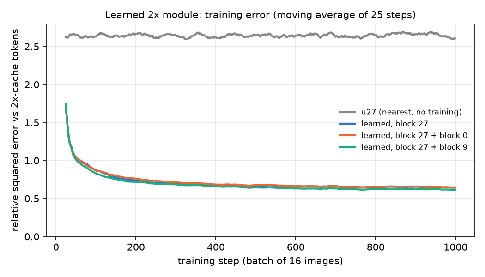
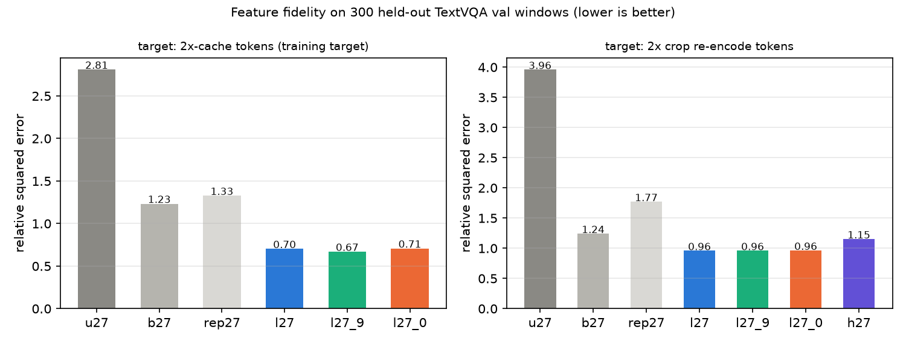
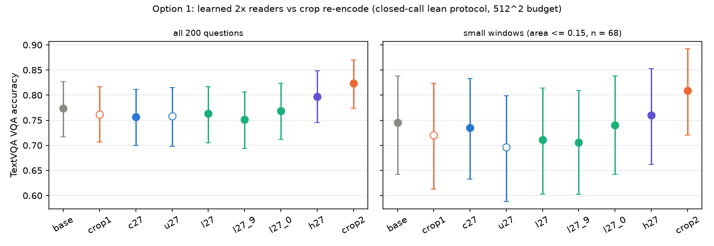
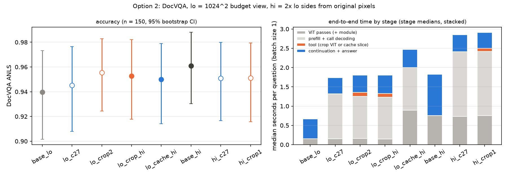
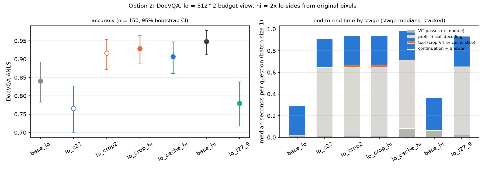

# 实验 5.4：缓存重读的两项敏捷实验

本实验属于[局部重读](plan.md)问题，承接实验 5.3（[免重编码的缓存重读](results_2026-10-21_cache_only.md)）。缓存重读的完整算法、符号与每步开销见[方法设计](design_cached_reread.md)第 0 节。本实验用两项小规模实验判断缓存重读的两个延伸方向是否值得继续：选项 1 检验一个轻量的学习模块能否从 1 倍缓存中恢复 2 倍裁剪重编码才有的细节，选项 2 检验在高分辨率文档上，缓存读取的效率优势能否在端到端时间上体现。

## 通俗讲述

实验 5.3 留下了一个硬约束：只读整图那一次 ViT 前向的缓存，最多只能和 1 倍裁剪一样准；2 倍裁剪在小字题上更准，因为它让 ViT 以 2 倍密度的 16×16 patch 网格重新编码同一批像素，而缓存里只有 1 倍密度的编码结果。这里有一个看似可以钻的空子。ViT 的第一步 patch embedding 是一个线性映射，把每个 patch 的像素值映射到 1152 维；只要这个映射是单射，patch embedding 之后的状态就完整保存了像素信息。末层缓存是否还保存着“2 倍编码才会显式写出”的细节，是一个未知数；如果保存着，或者把几乎无损的浅层缓存一起交给一个小模块，那么也许不必再跑 ViT，就能用一个廉价的学习模块拼出接近 2 倍编码的 token。选项 1 就是这个检验：我们训练了一个约 900 万参数的卷积上采样模块，输入 1 倍缓存（末层，或末层加 patch embedding，或末层加第 9 层），输出 2 倍密度的 patch 状态，再经冻结的 merger 变成 LLM token，训练目标是对 2 倍放大图像做 ViT 前向得到的 token。

结果很清楚。在特征层面，模块把与目标的相对误差从 1.23（双线性插值，无训练）降到 0.67–0.71，以 2 倍裁剪的 token 为目标时甚至比真正做了 2 倍 ViT 前向的 h27 更接近（0.96 对 1.15）。但这一点“接近”对回答毫无用处：在 TextVQA 上，三个学习读法的准确率为 0.752–0.768，与什么都不学的 1 倍缓存（0.757）相同，比 2 倍裁剪（0.823）低 0.055–0.072，在小窗口上低 0.07–0.10。也就是说，均方误差意义下的保真度主要来自 token 中平滑、可预测的部分（例如整体幅值与邻域平均），而真正决定小字能否读出的笔画细节，模块一点也没有恢复出来。加入几乎无损的 patch embedding 同样无济于事，说明“信息在缓存里”与“小模块能把它算出来”是两回事：把 16 pixels patch 内的笔画写成 LLM 可读的特征，需要的正是 ViT 那 27 层计算，900 万参数的局部卷积替代不了。

选项 2 换到 ViT 本身昂贵的场景：DocVQA 文档。原图约 1700×2200 pixels，按原生分辨率编码约需 1.6 万个 patch，ViT 前向在 A40 上约 0.75 s，与 LLM prefill 相当。我们比较了几种组合：LLM 直接看高分辨率整图（base_hi）；LLM 看低分辨率整图，工具从高分辨率原图裁剪重编码（lo_crop_hi），或者从一次高分辨率 ViT 前向的缓存中切出窗口（lo_cache_hi）；LLM 看高分辨率整图，再用 1 倍缓存或 1 倍裁剪重读（hi_c27、hi_crop1）。在 $1024^2$ pixels 的低分辨率视图下，所有条件都接近天花板（ANLS 0.94–0.96），彼此没有显著差别；在 $512^2$ pixels 下差别出现了，最准的是直接看高分辨率整图（0.948），其次是从原图裁剪（0.929）和从高分辨率缓存切窗口（0.907）。时间上，缓存读取省下的只是工具那一步的 ViT：高分辨率整图下 hi_c27 比 hi_crop1 每题快 33 ms（总时长 2.9 s 中约 1%）；而“高分辨率缓存加低分辨率上下文”需要预先对整图做一次昂贵的 ViT 前向，单次重读时比裁剪慢 0.63 s，要重读约 8 次才能摊平。端到端时间的大头始终是 LLM 侧的工具轮次（调用解码与第二次 prefill，约 0.6–1.7 s），与读取方式无关。因此两个选项都不值得继续：选项 1 已被直接否定，选项 2 的效率优势在端到端上只有 1%–6%，只有在一张图要被重读许多次的场景中才可能有意义。

## 1. 问题与主要结果

本实验回答两个是否继续的问题：

1. **选项 1。** 一个轻量、与任务无关的学习模块，能否把 1 倍缓存（可选地加上更浅层的缓存）映射为接近 2 倍重编码的 merger token，从而在不做新 ViT 前向的条件下达到 2 倍裁剪的准确率。
2. **选项 2。** 在 ViT 代价高的高分辨率文档上，缓存读取相对裁剪重编码的效率优势，能否在端到端时间上体现，同时不损失准确率。

主要结果如下：

1. **学习模块提高了特征层面的均方保真度，但没有恢复任何对回答有用的细节。** 在 300 个留出窗口上，学习读法相对 2 倍缓存 token 的相对平方误差为 0.67–0.71，双线性插值为 1.23；在 TextVQA 200 题上，学习读法比 1 倍缓存 c27 的差在 −0.005 至 +0.012 之间（均不显著），比 2 倍裁剪低 0.055–0.072（p ≤ 0.008）（第 2.3 节）。
2. **加入几乎无损的 patch embedding 或第 9 层缓存都没有帮助。** 三个输入变体的训练误差、留出误差与准确率几乎相同（第 2.3 节）。
3. **在高分辨率文档上，读取方式对准确率的影响小于“LLM 看到的整图分辨率”。** $512^2$ pixels 视图下，base_hi 为 0.948，lo_crop_hi 为 0.929，lo_cache_hi 为 0.907，base_lo 为 0.841；1 倍缓存重读 lo_c27 反而比 base_lo 低 0.075（第 3.2 节）。
4. **缓存读取的端到端时间优势只有 1%–6%。** 高分辨率整图下 hi_c27 比 hi_crop1 每题快 33 ms（中位数，2.87 s 对 2.88 s）；高分辨率缓存加低分辨率上下文（lo_cache_hi）比从原图裁剪（lo_crop_hi）慢 0.63 s，单次 ViT 前向的代价需要约 8 次重读才能摊平（第 3.3 节）。
5. **2 倍裁剪的收益大部分来自更密的 ViT 采样，与像素是否为真实高分辨率关系较小。** $512^2$ pixels 视图下，从低分辨率图像 bicubic 放大后裁剪（lo_crop2）为 0.916，从高分辨率原图裁剪为 0.929，差 −0.012（p = 0.06）（第 3.2 节），与实验 5.3 的“信息上限来自 ViT 采样密度”一致。

## 2. 选项 1：学习 2 倍缓存

### 2.1 假设与原理

记号沿用设计文档第 0.2 节。ViT 的输入层为

$$
X^{(0)} = \mathrm{PatchEmbed}(I) + E_{\mathrm{pos}},
$$

其中 $\mathrm{PatchEmbed}$ 把每个 patch 的 1536 个像素值（同一帧复制 2 次，实际独立的值为 768 个）线性映射到 1152 维。768 小于 1152，只要映射矩阵满秩，$X^{(0)}$ 就是像素的可逆函数，即 patch embedding 不丢失像素信息。实验 5.3 的结论是：2 倍裁剪之所以更准，是因为 ViT 以 2 倍密度重新编码同一批像素，而对 1 倍末层缓存 $X^{(27)}$ 做任何重排、复制或插值都追不上它。由此可以提出两个可检验的假设：

1. **H1（末层残留）。** $X^{(27)}$ 中仍有 2 倍编码会显式写出的细节，只是未经训练的读法无法取出；一个学习模块可以把它取出。
2. **H2（浅层补充）。** 即使 $X^{(27)}$ 中没有，$X^{(0)}$ 或 $X^{(9)}$ 中有，一个以它们为额外输入的学习模块可以近似 2 倍编码的结果。

H2 的难点在于，“信息存在”不等于“轻量模块能算出 ViT 会算出的特征”：后者相当于用一个小模块近似 27 层 ViT 在 2 倍网格上的计算。本实验的判据只看结果：模块的输出能否让冻结的 LLM 读出 2 倍裁剪才能读出的内容。

### 2.2 设计

**模块。** 模块 $U$ 输入同一张图像的若干层缓存 $\{X^{(k)}\}_{k \in S}$（每个形状为 $2H \times 2W \times 1152$），输出 2 倍密度的 patch 状态 $\hat{X}$（形状为 $4H \times 4W \times 1152$），再由冻结的 merger 得到 $2H \times 2W$ 个 token：

$$
\hat{X} = \mathrm{Up}_{\mathrm{nn}}\left(X^{(27)}\right) + \mathrm{Head}\left(\mathrm{Conv}_{\mathrm{hi}}\left(\mathrm{PS}\left(\mathrm{Conv}_{\mathrm{lo}}\left(\mathrm{Proj}\left[\mathrm{LN}(X^{(k)})\right]_{k \in S}\right)\right)\right)\right), \qquad \hat{T} = M_{2\times2}\left(\hat{X}\right).
$$

各部分的含义如下：

1. $\mathrm{Up}_{\mathrm{nn}}$ 把每个 patch 复制到它的 2×2 个子位置（最近邻上采样）。它经过 merger 后正是实验 5.3 的 nearest 读法 u27，因此模块学习的是相对 u27 的残差。$\mathrm{Head}$ 的权重初始化为 0，未训练的模块与 u27 完全一致（单元测试核对）。
2. $\mathrm{LN}$ 对每层缓存逐 patch 归一化，$\mathrm{Proj}$ 把拼接后的 $1152|S|$ 维线性投影到 $c = 384$ 维。
3. $\mathrm{Conv}_{\mathrm{lo}}$ 与 $\mathrm{Conv}_{\mathrm{hi}}$ 分别是 4 个与 2 个 ConvNeXt block（7×7 depthwise 卷积、LayerNorm、4 倍宽的逐点 MLP 与残差连接），分别作用在 1 倍与 2 倍 patch 网格上；$\mathrm{PS}$ 是 pixel shuffle，把 1 倍网格上每个位置的 $4c$ 维特征重排为 2 倍网格上 2×2 个 $c$ 维特征。
4. $M_{2\times2}$ 为 2 倍网格上标准的非重叠 2×2 merge，使用原模型冻结的 merger 权重。

模块只含局部运算（感受野约 13 个 patch），因此与图像尺寸、窗口位置和任务无关；参数量为 870 万（$S = \{27\}$）至 913 万（两层输入），约为 ViT 的 2%、整个模型的 0.1%。在 $16 \times 16$ 的 merged 网格上前向一次约 36 GFLOPs，为 1 倍 ViT 前向（997 GFLOPs）的 3.6%。推理时模块在整图缓存上运行一次，得到一份与窗口无关的“学习 2 倍缓存”，之后的读取与 5.2 的 h27 相同：按窗口切出 $4K$ 个 token，position IDs 取原图编排、步长 $s = 1/2$。

**输入变体。** l27：$S = \{27\}$，检验 H1；l27_0：$S = \{27, 0\}$，$X^{(0)}$ 为 patch embedding 与位置编码之和，检验 H2 的极端情形；l27_9：$S = \{27, 9\}$，检验中间层。

**训练。** 训练目标为 2 倍缓存 token $T_2 = M(\mathrm{ViT}(\mathrm{up}_2(I)))$，即对 bicubic 放大 2 倍的整图做 ViT 前向得到的 $2H \times 2W$ 个 token。选用它而非逐窗口的 2 倍裁剪 token，是因为它对整图的每个位置都给出监督，且实验 5.2、5.3 中 h27 与 crop2 的准确率接近（5.3 合计差 −0.010）。损失为相对平方误差：

$$
\mathcal{L} = \frac{\sum_{n} \left\lVert \hat{T}_n - T_{2,n} \right\rVert^2}{\sum_{n} \left\lVert T_{2,n} - \bar{T}_2 \right\rVert^2},
$$

其中求和遍历一个 batch 中全部图像的全部 token，$\bar{T}_2$ 为该 batch 目标 token 的均值。分母使损失与 token 的整体幅值无关：$\mathcal{L} = 1$ 相当于对每个 token 都预测 batch 均值，$\mathcal{L} = 0$ 为完全重现。训练图像为 12000 张 TextVQA train 图像与 4000 张 COCO val2014 图像（与 TextVQA val 评测不重叠），按 $512^2$ pixels 预算缩放；batch size 16，1 个 epoch（1000 步），AdamW，学习率 $10^{-3}$，OneCycle 调度；三个变体在相同的 batch 上同时训练，ViT 只在 vision tower 上运行（不加载 decoder），单张 A40 用时 47 分钟。

**特征保真度。** 在 300 张 TextVQA val 图像上各随机取一个窗口（每边 4–12 个 merged token），对每种读法计算窗口内 $4K$ 个 token 的相对平方误差（定义同上式，分母中的均值取窗口内目标 token 的均值），目标分两种：2 倍缓存 token（训练目标）与该窗口 2 倍裁剪重编码的 token。对照读法为 u27、b27（双线性）、rep27（把 1 倍 visual token 复制到 2×2 个子位置）与 h27。

**准确率。** 与实验 5.3 相同的 TextVQA val 200 题（相同种子）与闭合调用精简协议（lean2：首轮预填到 bbox 的左方括号，解码到右方括号后补上固定的闭合标签，作答轮预填“Final answer:”）。每题的工具调用只生成一次，被全部工具条件共享，因此各条件的窗口完全相同。小窗口子集为窗口面积不超过图像 15% 的题目（68 题）。配对比较报告每题得分差的均值、bootstrap 95% 区间与符号翻转置换检验的 p 值。

### 2.3 结果

横轴为训练步数，纵轴为相对平方误差 $\mathcal{L}$（上式，相对 2 倍缓存 token），曲线为 25 步滑动平均，数值由训练中每个 batch 实测得到。灰色为未训练的 u27，蓝色、橙色、绿色分别为输入 $\{27\}$、$\{27, 0\}$、$\{27, 9\}$ 的学习模块。

训练误差在约 400 步后进入平台，最后 100 步的均值为 0.648（l27）、0.651（l27_0）与 0.620（l27_9），u27 为 2.65。三个变体几乎重合，说明额外的浅层输入没有提供模块能利用的信息。

纵轴为 300 个留出窗口上的相对平方误差（窗口内全部 token 求和后相除，越低越接近目标），由冻结 ViT 与训练后的模块在 TextVQA val 图像上实测得到。左图目标为 2 倍缓存 token，右图目标为 2 倍裁剪重编码 token。灰色系为无训练读法（u27、b27、rep27），蓝、绿、橙为三个学习读法，紫色为 h27（2 倍整图 ViT 前向的窗口切片，只在右图出现，因为它就是左图的目标）。

| 读法 | 相对 2 倍缓存 | 余弦相似度 | 相对 2 倍裁剪 | 余弦相似度 |
| --- | ---: | ---: | ---: | ---: |
| u27（nearest） | 2.81 | 0.784 | 3.96 | 0.749 |
| b27（bilinear） | 1.23 | 0.829 | 1.24 | 0.802 |
| rep27（复制 1 倍 token） | 1.33 | 0.779 | 1.77 | 0.748 |
| l27 | 0.70 | 0.847 | 0.96 | 0.819 |
| l27_0 | 0.71 | 0.846 | 0.96 | 0.818 |
| l27_9 | 0.67 | 0.852 | 0.96 | 0.818 |
| h27（2 倍 ViT 前向） | — | — | 1.15 | 0.825 |

**学习模块在均方误差意义下比真正的 2 倍 ViT 前向更接近 2 倍裁剪 token。** 以 2 倍裁剪为目标时，学习读法的相对误差为 0.96，h27 为 1.15。这一结果本身说明，均方误差衡量的主要是 token 中可以从邻域平均预测的部分：以均方误差训练的模块会向条件均值收缩，从而在平均意义下离任何一个具体目标都更近，h27 与 crop2 之间则存在由窗口外上下文不同造成的差别。均方保真度高并不意味着细节被恢复，下一项结果直接检验后者。

纵轴为 TextVQA VQA accuracy，由模型生成的答案按标准规则评分得到；误差线为 bootstrap 95% 区间。左图为全部 200 题，右图为窗口面积不超过 15% 的 68 题。灰色为 base，橙色为裁剪重编码（空心 crop1，实心 crop2），蓝色为 1 倍缓存读法（实心 c27，空心 u27），绿色为三个学习读法，紫色为 h27。

| 条件 | 全部 200 题 | 小窗口 68 题 | 追加 token |
| --- | ---: | ---: | ---: |
| base | 0.773 | 0.745 | 0 |
| crop1 | 0.762 | 0.721 | $K$ |
| c27 | 0.757 | 0.735 | $K$ |
| u27 | 0.758 | 0.696 | $4K$ |
| l27 | 0.763 | 0.711 | $4K$ |
| l27_0 | 0.768 | 0.740 | $4K$ |
| l27_9 | 0.752 | 0.706 | $4K$ |
| h27（需要 2 倍整图 ViT 前向） | 0.797 | 0.760 | $4K$ |
| crop2 | **0.823** | **0.809** | $4K$ |

| 配对比较 | 全部 200 题 | p | 小窗口 68 题 | p |
| --- | --- | ---: | --- | ---: |
| crop2 − c27 | +0.067 [0.028, 0.108] | 0.001 | +0.074 [0.025, 0.137] | 0.016 |
| l27 − c27 | +0.007 [−0.015, 0.030] | 0.67 | −0.025 [−0.074, 0.010] | 0.51 |
| l27_0 − c27 | +0.012 [−0.015, 0.040] | 0.48 | +0.005 [−0.059, 0.064] | 1.00 |
| l27_9 − c27 | −0.005 [−0.030, 0.018] | 0.80 | −0.029 [−0.074, 0.000] | 0.50 |
| l27 − crop2 | −0.060 [−0.100, −0.022] | 0.004 | −0.098 [−0.172, −0.034] | 0.008 |
| l27_0 − crop2 | −0.055 [−0.097, −0.017] | 0.008 | −0.069 [−0.142, 0.000] | 0.08 |
| l27_9 − crop2 | −0.072 [−0.112, −0.033] | < 0.001 | −0.103 [−0.176, −0.039] | 0.005 |
| h27 − crop2 | −0.027 [−0.053, −0.003] | 0.05 | −0.049 [−0.103, −0.005] | 0.13 |
| c27 − crop1 | −0.005 [−0.030, 0.022] | 0.83 | +0.015 [0.000, 0.044] | 1.00 |

**三个学习读法的准确率与不学习的 1 倍缓存相同，2 倍裁剪的优势一点也没有被追回。** 学习读法相对 c27 的差都在 ±0.012 以内且不显著，相对 crop2 低 0.055–0.072，小窗口上低 0.07–0.10。这意味着模块输出的 $4K$ 个 token 对 LLM 而言只是 1 倍缓存信息的另一种排列：它们在特征空间里更接近 2 倍编码，却没有携带 2 倍编码中使小字可读的那部分差别。本实验重现了实验 5.3 的排序：c27 ≈ crop1（−0.005），crop2 明显更好（+0.062 对 crop1）。

**把几乎无损的 patch embedding 交给模块也没有用。** l27_0 与 l27 在训练误差、留出误差和准确率上都相同。这一结果否定了 H2 的“轻量模块”形式：$X^{(0)}$ 含有全部像素，但把 16 pixels patch 内的笔画写成 LLM 可读的特征，需要 ViT 在 2 倍网格上的完整计算；局部卷积能学到的只有平滑部分。H1 同样不被支持：只用 $X^{(27)}$ 的 l27 没有任何收益。

### 2.4 解释与确定性

1. **测量结果（确定）。** 在本设定（$512^2$ pixels、约 900 万参数、1.6 万张训练图像、均方误差目标）下，学习 2 倍缓存不提高任何读法的准确率。
2. **原因（推断，中等确定）。** 均方误差目标使模块回归到条件均值，而小字细节在给定 1 倍缓存时的条件方差很大；模块即使在均方误差上胜过 h27，也只是更好地预测了平滑部分。更大的模块、以下游任务为目标的训练或对抗式目标可能改变这一点，但那样的模块在计算量上会向“再跑一次 ViT”靠拢，失去选项 1 的意义。
3. **对实验 5.3 结论的补充。** 5.3 把只读缓存的上限归因于 ViT 的 1 倍采样密度，并指出这一归因可能部分是参数问题。本实验从另一侧支持了“采样密度”一方：即使像素信息完整（$X^{(0)}$），缺少的是 ViT 在更密网格上的计算，这部分无法由一个轻量的后处理模块补上。

## 3. 选项 2：高分辨率文档

### 3.1 动机与条件

在 $512^2$ pixels 的自然图像上，1 倍 ViT 前向只占端到端时间的约 3%（设计文档第 0.5 节），缓存读取省下的工具 ViT 时间（20–30 ms）微不足道。文档图像原生分辨率约 1700×2200 pixels，ViT 的 attention 计算随 patch 数平方增长，整图前向成为主要开销之一，缓存读取的效率是否会变得重要，需要直接测量。

**数据。** Visual-CoT 的 DocVQA 标注（DocVQA train 划分，含证据框）中，取图像已在本地解压的 400 张文档，每张一题，答案不超过 6 个词，按固定种子抽取 150 题；评分为 DocVQA 标准的 ANLS（对每个参考答案计算 1 减归一化编辑距离，距离不小于 0.5 时记 0，取最大值），另报告规范化后的精确匹配。证据框面积的中位数为图像的 0.3%。

**两种分辨率。** lo 图像按像素预算缩放（$1024^2$ 或 $512^2$ pixels，两边为 32 的倍数）；hi 图像的边长恰为 lo 的 2 倍，由原图直接 bicubic 缩放得到，因此 hi 携带文档本身的细节（$1024^2$ 预算时 hi 约为 1728×2304，接近原生分辨率）。一个 lo token 恰好对应 2×2 个 hi token。

| 条件 | LLM 首轮看到的整图 | 工具返回 | 窗口 ViT 前向 | 整图 ViT 前向 |
| --- | --- | --- | --- | --- |
| base_lo / base_hi | lo / hi | 无工具 | 无 | lo / hi |
| lo_c27 | lo | lo 缓存中的窗口 token（$K$ 个） | 无 | lo |
| lo_crop2 | lo | lo 像素裁剪、bicubic 放大 2 倍后重编码（$4K$） | $16K$ patch | lo |
| lo_crop_hi | lo | hi 像素中同一窗口裁剪后重编码（$4K$），即原生 zoom 工具从原图裁剪的做法 | $16K$ patch | lo |
| lo_cache_hi | lo | hi 整图 ViT 缓存中的窗口 token（$4K$，原图编排，$s = 1/2$） | 无 | lo 与 hi |
| hi_crop1 / hi_c27 | hi | hi 像素裁剪重编码 / hi 缓存中的窗口 token（$K_{\mathrm{hi}}$ 个） | $4K_{\mathrm{hi}}$ / 无 | hi |
| lo_l27_9 | lo | 选项 1 的学习 2 倍缓存（$4K$，只在 $512^2$ 预算下运行） | 无 | lo |

窗口超过原生工具上限（返回超过 1600 个 token）时，$4K$ token 的条件退回 lo 的 1 倍窗口 token，规则与实验 5.3 相同；$1024^2$ 预算下 150 题中有 10 题触发，$512^2$ 预算下没有触发。协议为与选项 1 相同的闭合调用精简协议。端到端时间在 batch size 1 下对前 20 题逐题测量，每题各条件依次运行且顺序逐题轮换，分为四段：整图 ViT 前向（含学习模块）、首轮 prefill 与调用解码、工具执行、在 KV cache 上续接的 prefill 与作答。$1024^2$ 预算的计时在单张 A40 上完成，$512^2$ 预算的计时在单张 A800 上完成，两组的绝对时间不可直接比较。

### 3.2 准确率

左图纵轴为 150 题的 ANLS，误差线为 bootstrap 95% 区间，由模型答案评分得到；空心点为与 LLM 视图同分辨率的重读（lo_c27、lo_crop2、hi_c27、hi_crop1）。颜色：灰色为 lo 视图无工具，深灰为 hi 视图无工具，橙色为裁剪重编码，蓝色为缓存读取，绿色为学习 2 倍缓存。右图为前 20 题四段耗时的中位数堆叠（秒），由 batch size 1 实测得到：深浅两种灰色为整图 ViT 与首轮 prefill 加调用解码，橙色为工具执行，蓝色为续接 prefill 与作答。

| 条件 | ANLS（$1024^2$） | ANLS（$512^2$） | ViT GFLOPs / 题（$1024^2$） | 平均序列长度（$1024^2$） |
| --- | ---: | ---: | ---: | ---: |
| base_lo | 0.940 | 0.841 | 5286 | 1043 |
| base_hi | **0.961** | **0.948** | 44503 | 4004 |
| lo_c27 | 0.945 | 0.766 | 5286 | 1772 |
| lo_crop2 | 0.955 | 0.916 | 7292 | 2090 |
| lo_crop_hi | 0.953 | 0.929 | 7292 | 2090 |
| lo_cache_hi | 0.950 | 0.907 | 49788 | 2090 |
| hi_crop1 | 0.951 | — | 46989 | 5054 |
| hi_c27 | 0.951 | — | 44503 | 5054 |
| lo_l27_9 | — | 0.780 | — | — |

| 配对比较（ANLS） | $1024^2$ | p | $512^2$ | p |
| --- | --- | ---: | --- | ---: |
| base_hi − base_lo | +0.021 [0.001, 0.047] | 0.08 | +0.107 [0.060, 0.159] | < 0.001 |
| lo_crop_hi − base_lo | +0.013 [−0.017, 0.045] | 0.42 | +0.088 [0.037, 0.142] | 0.001 |
| lo_cache_hi − lo_crop_hi | −0.003 [−0.022, 0.017] | 0.75 | −0.022 [−0.051, 0.004] | 0.12 |
| lo_crop_hi − base_hi | −0.008 [−0.031, 0.009] | 0.42 | −0.019 [−0.055, 0.015] | 0.30 |
| lo_crop2 − lo_crop_hi | +0.003 [−0.009, 0.019] | 0.87 | −0.012 [−0.029, −0.001] | 0.06 |
| lo_c27 − base_lo | +0.006 [−0.022, 0.033] | 0.71 | −0.075 [−0.128, −0.024] | 0.004 |
| hi_c27 − hi_crop1 | 0.000 [−0.001, 0.000] | 1.00 | — | — |
| lo_l27_9 − lo_c27 | — | — | +0.014 [−0.029, 0.059] | 0.54 |

**$1024^2$ 预算下，所有条件都接近天花板，读取方式之间没有可测差别。** 低分辨率视图本身已达 0.940，最好的 base_hi 只高 0.021。这些题目来自 DocVQA train 划分，模型很可能在训练中见过同分布的数据；在这一分辨率下，局部重读几乎没有可以弥补的空间。

**$512^2$ 预算下，LLM 直接看高分辨率整图最准，工具类条件依“新 ViT 采样密度”排序。** base_hi（0.948）≥ lo_crop_hi（0.929）≥ lo_crop2（0.916）≈ lo_cache_hi（0.907）≫ base_lo（0.841）> lo_l27_9（0.780）≈ lo_c27（0.766）。凡是工具返回了 2 倍密度 ViT 编码（无论像素来自原图还是 bicubic 放大）的条件都有大幅提升，返回 1 倍信息的条件（lo_c27 与学习读法）反而低于不用工具，与实验 5.3 在 POPE 上观察到的“1 倍重读带来干扰”一致。lo_crop2 与 lo_crop_hi 只差 0.012，说明 2 倍裁剪的收益大部分来自更密的 ViT 采样，真实高分辨率像素只再增加少量收益。

**高分辨率缓存的窗口（lo_cache_hi）略低于从原图裁剪的窗口（lo_crop_hi）。** 两者使用完全相同的像素与 token 数，差别只在于缓存 token 在整图上下文中编码、裁剪 token 在窗口内单独编码，以及 position IDs 的编排。差值 −0.022 不显著，方向与实验 5.3 中 h27 略低于 crop2 一致（本实验 TextVQA 上 −0.027）。

### 3.3 时间与开销

| 条件（$1024^2$，A40） | ViT 段 s | 首轮 prefill 与调用 s | 工具 s | 续接与作答 s | 端到端 s | 峰值显存增量 MiB |
| --- | ---: | ---: | ---: | ---: | ---: | ---: |
| base_lo | 0.16 | — | — | 0.51 | **0.64** | 230 |
| base_hi | 0.76 | — | — | 1.07 | 1.81 | 744 |
| lo_c27 | 0.15 | 1.17 | 0.00 | 0.42 | 1.76 | 306 |
| lo_crop2 | 0.16 | 1.10 | 0.10 | 0.45 | 1.83 | 307 |
| lo_crop_hi | 0.15 | 1.09 | 0.10 | 0.47 | 1.85 | 307 |
| lo_cache_hi | 0.89 | 1.11 | 0.00 | 0.47 | 2.50 | 717 |
| hi_crop1 | 0.75 | 1.66 | 0.08 | 0.41 | 2.88 | 819 |
| hi_c27 | 0.73 | 1.68 | 0.00 | 0.44 | 2.87 | 819 |

各段与端到端时间均为 20 题的中位数，四段中位数之和不严格等于端到端中位数。$512^2$ 预算（A800）下的对应数值为：base_lo 0.29 s，base_hi 0.37 s，lo_c27 0.92 s，lo_crop_hi 0.94 s，lo_cache_hi 0.99 s，lo_l27_9 0.94 s，其中 hi 整图 ViT 段 0.06 s，裁剪工具 0.02 s。

**缓存读取只省下工具那一步，端到端收益为 1%–6%。** hi_c27 相对 hi_crop1 的配对中位差为 −33 ms（20 题中 14 题更快），占 2.9 s 的约 1%；lo_c27 相对 lo_crop2 为 −118 ms（15/20 更快），约 6%，但 lo_c27 的准确率在 $512^2$ 预算下低 0.15。工具流程的主要耗时是首轮 prefill 与调用解码（1.1–1.7 s）和续接 prefill（0.4–0.5 s），两者都在 LLM 一侧，与读取方式无关。

**“高分辨率缓存加低分辨率上下文”在单次重读时更慢。** lo_cache_hi 需要预先对 hi 整图做一次 ViT 前向（A40 上约 0.75 s，44.5 TFLOPs），比 lo_crop_hi 慢 0.63 s（20/20 题更慢）。一次窗口裁剪重编码约 0.10 s，因此只有当同一张图被重读约 $0.75 / 0.10 \approx 8$ 次以上时，预先编码整图才比逐次裁剪省时间。在这一组对比中，最快且最准的做法是不调用工具、直接把高分辨率整图交给 LLM：base_hi 的 1.81 s 与 lo_crop_hi 相当（配对中位差 0.03 s），$512^2$ 预算下 base_hi（0.37 s）比任何工具流程（0.92–0.99 s）都快 2.5 倍以上，准确率也最高。

## 4. 讨论

### 4.1 与其他实验的关系

1. **与实验 5.3 一致。** 1 倍缓存读取与 1 倍裁剪等价（TextVQA c27 − crop1 = −0.005，DocVQA hi_c27 − hi_crop1 = 0.000），2 倍裁剪更好（+0.062），收益集中在小窗口；h27 接近但略低于 crop2。
2. **补充实验 5.3 的归因。** 5.3 推断只读缓存的上限来自 ViT 的 1 倍采样密度，并保留了“参数问题”的可能。本实验的两项结果都指向采样密度：轻量学习模块（包括拿到完整像素的变体）不能突破上限；文档上 bicubic 放大的 2 倍裁剪几乎达到真实高分辨率裁剪的效果。可以把这一点概括为：对冻结的 Qwen3.5-9B，细节可读性由“ViT 以多密的 patch 网格计算过这块区域”决定，像素是否在缓存里并不充分。这一结论的确定性为中等：本实验没有测试以任务目标训练的较大模块。
3. **与设计文档第 0.5 节的开销分析一致。** 两个选项都显示，工具流程的端到端时间由 LLM 侧的 prefill 与解码主导，ViT 侧的任何节省都只占小比例。

### 4.2 参数问题与架构限制

1. **选项 1 的失败属于“轻量后处理无法替代 ViT 计算”，确定性较高。** 三个输入变体、两种目标下的结果一致，且模块已在训练误差上收敛。
2. **选项 2 的结论属于工程判断，确定性高。** 缓存读取在时间上的上限由“工具 ViT 占端到端时间的比例”决定，本实验在高分辨率文档上实测这一比例为 1%–6%；预先编码高分辨率整图的方案在重读次数少于约 8 次时更慢。

## 5. 建议

1. **选项 1（学习 2 倍缓存）：不继续。** 均方保真度的提高没有转化为任何准确率收益，加入完整像素信息也无效；要达到 2 倍裁剪，冻结模型需要在窗口上做更密的 ViT 计算，最省的实现就是 2 倍裁剪本身。
2. **选项 2（高分辨率文档上的缓存读取）：不继续当前形式。** 端到端节省为 1%–6%（且同分辨率的 1 倍重读在低预算下损害准确率），高分辨率缓存方案在常见的 1–3 次重读下更慢；准确率上，直接提高 LLM 看到的整图分辨率优于任何工具组合。只有在一张图要被大量重读的场景（例如长视频帧、需要数十次局部查看的多步推理）中，“一次高分辨率编码、多次读取”才可能值得重新评估，届时应以重读次数为自变量测量。
3. **对方向二的含义。** 窗口读取作为一个保持原图坐标系、零 ViT 开销的 1 倍读取接口仍然成立（5.2、5.3）；它的价值在于“读哪里”与“保留位置”，而非提供新的细节。需要细节时，窗口上的高密度 ViT 重编码不可省略。

## 6. 限制

1. 选项 1 只测试了一种模块结构、一种目标（均方误差）和 1.6 万张训练图像，没有以下游任务损失训练，也没有测试更大的模块。
2. DocVQA 题目取自 train 划分，$1024^2$ 预算下接近天花板；结论以 $512^2$ 预算下的对比为主。
3. 两组计时分别在 A40 与 A800 上完成，均与其他用户共享服务器（但 GPU 本身独占），绝对值仅供同组内比较。
4. 批量解码与逐条解码的一致性沿用实验 5.3 的核对（48 条作答输入中 46 条一致），本实验没有重新抽查。
5. 每组题目数为 150–200，单项比较的区间较宽；不显著的差别不应解读为等价。

## 7. 产物

产物位于 WORK_DIR 的 `analysis/reread/2026-11-03_reread_pilots/`：`train/`（三个模块的 checkpoint、`loss.jsonl` 与训练元数据），`fidelity/fidelity.jsonl`（300 个留出窗口的逐读法误差），`opt1_textvqa/results.jsonl`，`opt2_doc/` 与 `opt2_doc_512/`（`results.jsonl` 保存每个题目与条件的调用、窗口、答案、ANLS、ViT FLOPs 与序列长度），`opt2_timing/` 与 `opt2_timing_512/`（逐题分段计时与峰值显存），`summary.json`（全部统计）。程序为 `analysis_tools/reread/reread_pilots.py`（vision tower 加载、学习模块、条件定义、DocVQA 数据与 ANLS）、`reread_pilots_run.py`（训练、保真度、准确率与计时）与 `reread_pilots_analysis.py`（统计与作图），入口为 `scripts/analysis/reread/reread_pilots.sh`，测试为 `tests/analysis/reread/test_reread_pilots.py`。GPU 用量约 1.3 A40 小时与 0.2 A800 小时。
