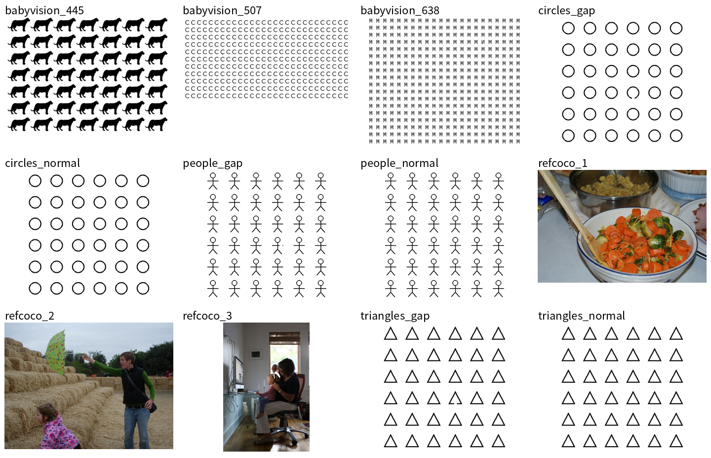
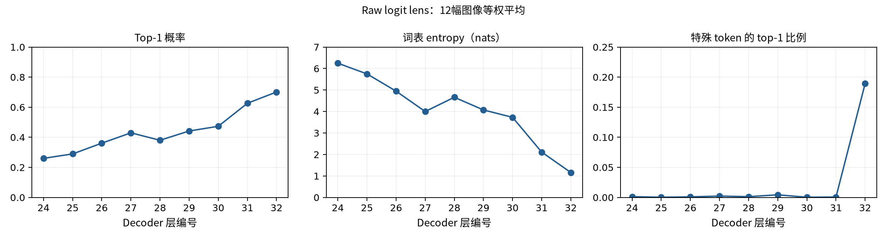
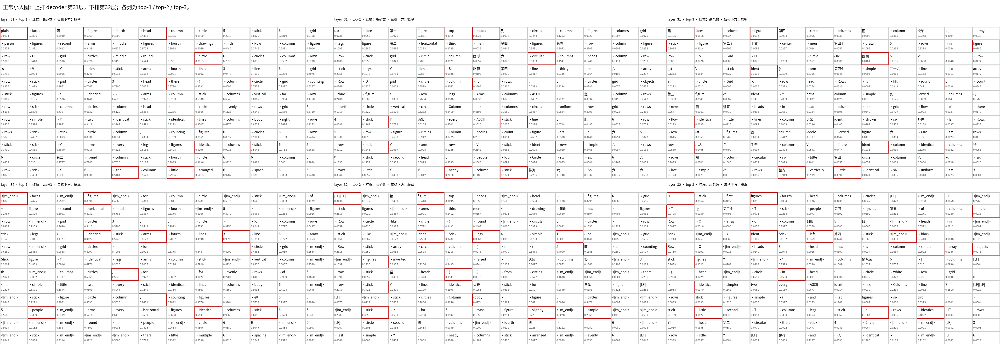
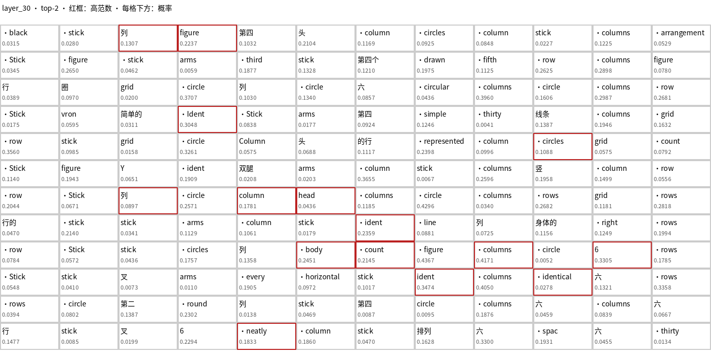

# Decoder 末端层的词汇读出

## 1. 研究问题与结论

本实验检验 Qwen3.5-9B 的倒数第二层与最后一层是否产生不同的 visual-token 词汇分布，并连续观察最后九个 decoder blocks。2026-09-30 的[初步实验](results_2026-09-30.md)发现最终层包含大量结束符，但每隔八层采样不能确定这种现象何时出现。本实验保持相同图像和读出方法，在第 24–32 层分别绘制 top-1、top-2 和 top-3 词图，检查词汇变化与概率变化。

本轮结果显示，**第 31 层与第 32 层存在明显差异**：12 幅图像中，特殊 tokens 成为 top-1 的比例均值从 0.07% 增至 18.93%，同时 top-1 概率增加、词表 entropy 减小。第 24–30 层保留大量中英文行列、形状和部件词；第 31 层也有明显的数字与布局词。当前证据支持连续比较末端层，尚未给出任何一层的局部语义准确率，不能据此宣布倒数第二层具有最佳语义解释效果。

实验于 **2026-10-01** 完成。所有 12 幅图像、10 个观测位置均成功读取，共生成 360 张独立词图；无样本被丢弃。下文的统计只针对连续的第 24–32 层，第 0 层用于保留 merger 输出对照。

## 2. 数据与输入

### 2.1 固定图像

样本沿用初步实验，在读取本次激活前已经确定，共包含以下三组：

1. **合成重复图形，共六幅。** 小人、圆形和三角形分别有完整图与局部缺口图；每幅为 6×6 个实例，缺口固定在第 4 行第 4 列。每幅图产生 12×12 个 merged visual tokens。
2. **BabyVision，共三幅。** 使用 sample445、sample507、sample638，对应重复图形和较复杂视觉模式。
3. **RefCOCO，共三幅。** 使用 validation 首个 parquet 文件中按图像 bytes 去重后的前三幅自然图像，COCO image IDs 为 580957、580905、580785。保留来源和图像 hash，不以读出结果选择图像。

图 1 展示全部输入图像。每个子图保留自身长宽比，展示尺寸不同于实际 processor 的输入尺寸。完整图像、processor 生成的 token 网格和图像 hash 位于逐图 `tokens.json` 中。

### 2.2 输入模板与输出

输入由 user role 下的一张图像和后续文本 `Describe the image.` 构成，thinking 关闭。模型仅执行 prefill，没有生成自然语言回答。实验输出是图像占位位置的词表分布，而非描述文本。

图像位置在 causal decoder 中无法读取后面的描述指令，因此本实验没有测量问题条件化的视觉读取。不同层的比较共享同一图像和前缀，避免同时改变输入内容。

## 3. 实验方法

### 3.1 提取与解码

设一幅图像包含 N 个 merged visual tokens，decoder hidden dimension 为 d，词表大小为 V。第 l 层输出的第 i 个 visual hidden state 记为 h，其形状为 d；LM head 权重矩阵的形状为 V×d。每个位置的词表概率向量形状为 V，计算如下：

$$
p_i^{(l)} = \operatorname{softmax}\left(W_U\operatorname{RMSNorm}_{\mathrm{final}}(h_i^{(l)})\right).
$$

RMSNorm 使用模型最终层的学习参数，目的是让所有观测位置使用一致的词表投影变换。操作顺序为：

1. 提取 decoder 第一层的输入，以及第 24、25、26、27、28、29、30、31、32 层的输出。所有输出均位于最终 RMSNorm 之前，第 31 层为倒数第二层。
2. 对每个选定 hidden state 应用一次最终 RMSNorm，再应用 LM head 和 softmax。每次处理 32 个 visual tokens，限制全词表计算的内存占用。
3. 保存概率最高的三个 token IDs、解码字符串与概率，并记录全词表 entropy 和原始 hidden-state 范数。
4. 将 visual tokens 按实际 merged grid 的逐行顺序绘制。每个词排名分别绘图，不把三个候选合并成一个不明确的标签。

统一使用末端投影有利于比较，但不保证各层的输出同样经过语义校准。词表排序变化与 hidden-state 差异幅度是不同测量。

### 3.2 统计与图示

三个主要统计量分别是：每个位置 top-1 的概率、全词表 entropy，以及 top-1 属于特殊 token 的比例。特殊 token 在本实验中按解码字符串以 `<|` 开头判定；结果主要由 `<|im_end|>` 贡献。每项先在单幅图像的所有 visual tokens 上取平均，再对 12 幅图像等权平均，避免大网格获得更高权重。

每幅图、每层内部按范数取最高 10% 的位置，以红框表示；数量向上取整。红框只标识范数分组。PNG 使用支持中文的 Noto Sans CJK SC 字体，词中的空格显示为中点 `·`，换行显示为 `[LF]`，制表符显示为 `[TAB]`；这些显示符号不计入模型输出。过长标签在 PNG 中缩略，HTML 与 JSON 保留完整字符串及 top-3 概率。

## 4. 实验结果

### 4.1 末端层的分布变化

图 2 的横轴为 decoder block 编号。三个纵轴分别为 top-1 概率、entropy 和特殊-token top-1 比例，均为图像等权平均。第 28 层出现概率下降和 entropy 回升，说明这些统计并非严格单调；第 32 层的特殊-token 比例则明显增加。

| Decoder 层 | Top-1 概率 | Entropy / nats | 特殊-token top-1 比例 |
| --- | ---: | ---: | ---: |
| 24 | 0.2599 | 6.249 | 0.13% |
| 25 | 0.2894 | 5.751 | 0.03% |
| 26 | 0.3610 | 4.949 | 0.10% |
| 27 | 0.4296 | 4.000 | 0.23% |
| 28 | 0.3802 | 4.663 | 0.13% |
| 29 | 0.4419 | 4.073 | 0.44% |
| 30 | 0.4730 | 3.729 | 0.03% |
| 31 | 0.6263 | 2.111 | 0.07% |
| 32 | 0.7011 | 1.161 | 18.93% |

第 32 层全部图像合计有 407 个 visual 位置的 top-1 为 `<|im_end|>`。该数字是位置计数；上表百分比按图像等权平均，二者的权重约定不同。末层具有更集中的词表分布，但集中到结束符不能被解释为局部物体类别更准确。

### 4.2 倒数第二层与最后一层的词图

图 3 使用不含异常实例的小人图。上排为第 31 层，下排为第 32 层；从左至右为 top-1、top-2、top-3。每格对应一个 merged visual token，下方数值为该候选概率。点击原图可查看完整分辨率。

第 31 层可见 `head`、`arms`、`stick`、`figures` 等部件或类别相关词，同时存在 `grid`、`row`、`columns`、数字和中文行列词。第 32 层部分位置转为结束符，但前一层的候选可能仍位于 top-2 或 top-3。这说明只画 top-1 容易把候选顺序变化当作内容消失。

一个具体例子是小人图第 0 行第 2 列 visual token：第 31 层的前三个候选为“**两**”“**第一**”“** column**”，第 32 层为“**<|im_end|>**”“**第一**”“** first**”。这里的行列号从 0 开始，对应 token 网格而非小人实例网格。该例用于展示候选分布如何变化，不把“第一”当作已经验证正确的视觉计数。

### 4.3 中文与多个候选的可视化

图 4 展示同一图像第 30 层的 top-2，能够直接看到“列”“头”“第四”“双腿”“排列”等模型实际输出。全部候选均从保存的 token IDs 解码得到，没有为可视化补写标签。候选概率常明显低于 top-1，因此这些词说明词表中存在相关方向，不能单独证明模型明确选择了对应概念。

## 5. 解释与后续实验

末层出现大量特殊 tokens 与 LM head 的语言生成目标相容，但本实验没有定位其形成机制。第 31 层减少了这一特定干扰，同时仍含布局词、数字和可能非局部的语义。判定哪一层更适合局部语义解释，需要在独立标注图像上测量类别词与目标区域的对应关系，而非根据词图的可读性选择层。

因此，下一步针对词汇读出的研究应先构造具有区域类别标注的验证集，固定层的候选集合与评价规则，再比较 raw lens 和经过独立数据校准的读出。与视觉表征差异实验联合时，需同时报告连续向量距离和词表分布变化，避免 top-1 排名翻转放大小幅特征变化。本轮没有将词图用作 grounding 优化或 register token 的因果证据。

## 6. 复现与记录

运行入口为 [token_lens_layers.sh](../../../scripts/analysis/token_lens_layers.sh)，参数集中在脚本顶部。模型为 Qwen3.5-9B，计算使用 bfloat16、SDPA，随机种子为 0。checkpoint、软件版本、输入图像 hash、推理代码 SHA256 与字体 SHA256 保存在 `summary.json` 中。图示生成使用保存的 `tokens.json`，不重新推理。

实验目录为 `WORK_DIR/analysis/token_semantics/2026-10-01_final_layers/`：

- `summary.json` 保存全局条件与逐图统计；每幅图像的 `tokens.json` 保存各层全部位置的前三个词和概率。
- 根目录 `index.html` 为完整可视化入口；各图像目录包含 30 张独立词图与 UTF-8 HTML。
- `figures/layer_metrics.json` 保存本文曲线与表格的数据，`figures/` 中的图版用于文档展示。
- 字体保存在 `WORK_DIR/analysis/assets/fonts/`，官方来源与文件 SHA256 记录在同目录 `metadata.json`；私有 `.env` 的 `TOKEN_MAP_FONT` 指向字体。字体来自 [Noto CJK 官方仓库](https://github.com/notofonts/noto-cjk)，不修改项目 Python 依赖。

可视化从保存的 token IDs、原始字符串与概率生成，空白字符显示规则只影响图示。四项单元测试覆盖范数组划分、无效范数、Unicode 字符保留及缺失字体明确报错。结果图已实际检查中文渲染。
