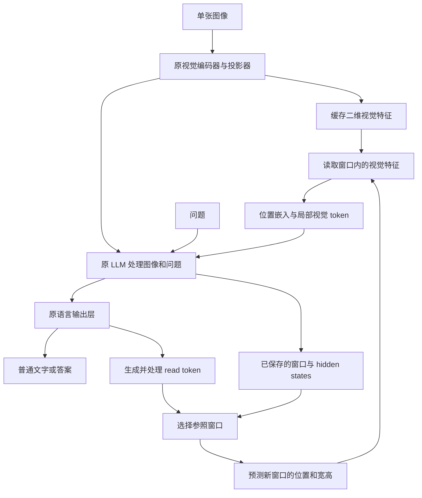

# 研究规划：面向复杂视觉任务的 VLM 空间信息处理与可解释推理

更新日期：2026-09-11。本文提出研究问题、可实现的候选方法与验证方案，尚未报告训练结果。

## 1. 研究主题与核心问题

本研究以 BabyVision 揭示的视觉困难为出发点，研究 **VLM 在多步推理中如何读取图像细节、保留图像位置，并根据已经获得的结果继续进行视觉计算**。当前方案限定为单张图像与一个问题；一张题图可以包含多个待比较区域。目标是改进通用 VLM 的表示或计算方式，使同一模型能够处理连续曲线追踪、迷宫、细节比较和空间变换等任务，而不是为各个题型分别训练一个求解器。

研究包含两个相互关联、也可以独立成立的方向：

1. **解释现有 latent visual reasoning 的过程。** 以 LVR 为主要对象，分析每个连续隐向量与原图哪些区域有关、向后续计算传递了什么、相邻步骤之间是否存在可识别的视觉操作。优先使用模型现有的输出层、视觉特征和注意力计算进行可视化，再通过干预检验解释。
2. **由原 LLM 选择需要继续处理的图像区域。** 将区域的位置、范围与读取到的内容分别保存；下一次读取既可以从整张图定位，也可以以先前区域为参照继续移动或重新检查。新增部分位于输入嵌入和输出预测处，主方案保持原 attention、位置编码和 decoder block 的计算不变，也不依赖 DeepStack。ViT 和 LLM 继续承担感知与决策。

主假设是：**在需要连续处理局部细节的任务中，仅保存“这一步得到的向量”可能不如同时保存“向量对应原图的哪个位置、局部特征如何排列、下一步从哪里读取”有效。** 这不是已确认的 LVR 缺陷，也不意味着普通 hidden state 不能编码位置。显式保留这些信息的效用需通过训练和对照实验评价；实际操作的几何记录直接构成过程解释，进一步的表示与干预研究用于分析内部机制。

本规划将认知理论用于提出计算问题，将真实 VLM 的实现用于约束方法。研究贡献应当体现为可复现的机制发现与可扩展的模型改动；训练损失、可视化图和 BabyVision 分数均不能单独代替这一贡献。

## 2. 研究背景与动机

### 2.1 BabyVision 所要求的视觉计算

BabyVision 包含 388 道题、22 个子类，分为细粒度辨别、视觉追踪、空间感知和图形规律四类。论文与博客显示，模型在自然语言知识要求很低、但视觉处理要求较高的题目中仍然频繁失败。[B1–B2]

| 任务 | 解题过程中必须处理的信息 | 对 VLM 的主要要求 |
| --- | --- | --- |
| 交错曲线连线 | 当前线段与前后线段的连接；交叉处的进入和离开方向 | 看清局部线条，并在多次转弯、交叉后仍沿起点对应的那条线前进 |
| 迷宫 | 通道与墙壁；已经探索的分支；返回分叉处的位置 | 将局部通行判断与多步搜索结合，避免把回溯位置记错 |
| 找不同 | 题图中两幅图案的对应区域；真实改动与位移、光照差异 | 对齐局部区域，保留足够细节，比较后继续检查其他区域 |
| 拼图与图案补全 | 边界方向、纹理、相邻块的兼容关系 | 对局部候选进行变换和比较，并同时满足整体布局 |
| 三视图、数方块 | 可见表面、遮挡、三维结构及投影方向 | 区分从图像估计结构与对结构执行几何操作 |
| 折纸与剪孔 | 折痕、纸层、折叠顺序、孔所在的面片 | 维护分步变换；展开后的孔必须对应真实穿透的纸层 |
| 旋转、镜像、叠加规律 | 同一图形在变换前后的对应；多个例子共享的规则 | 比较变换结果，归纳可组合的操作，而不是匹配某个模板 |

这些任务不能简单归结为“识别出图里有什么”。例如，“图中有几条交错黑线”可以正确描述两个不同题目，但两题的正确终点可能相反。自然语言可以表达坐标、连接和算法，却未必是承载细密连续几何的高效方式。研究应针对这种表示与计算成本，而不是主张语言在数学意义上无法描述曲线。

BabyVision-Gen 将其中 280 题改为圈选、绘制路径等视觉输出，说明生成内容可以作为解题媒介；但输出一张像路径的图，不等于准确保持了输入图中的连接。另一方面，VBVR-Pro 已提供规则评分、训练及中间视觉状态干预，因此也不能将生成推理概括为“无法验证”。本研究关心的是：**能否直接在已有视觉特征上执行需要的计算，减少重新生成像素带来的误差和成本。**[B1、M7]

### 2.2 从现有 VLM 的计算流程定位问题

以 Qwen3-VL 为例，图像首先经过 ViT，邻近的 $2\times2$ 特征经过 merger 压缩为一个 LLM 输入 token；DeepStack 另外提取 ViT 中间层的特征，经对应 merger 后，加到 LLM 前几个 decoder layer 的视觉位置。这里应称“较浅层视觉特征”或“低层视觉信息”，不宜称“低维特征”，因为层深和向量维度不是一回事。[A1–A2]

简化表示为：

$$
E^{(s)}=\operatorname{ViT}_{s}(I),\qquad
V=P(E^{(L_v)}),\qquad
H^{(0)}=[V;\operatorname{Embed}(Q)].
$$

其中 $I$ 是图像，$Q$ 是问题，$s$ 是 ViT 层号，$L_v$ 是 ViT 总层数，$P$ 是 merger。设视觉通道数为 $d_v$、LLM 宽度为 $d$、输入视觉 token 数为 $N$、问题 token 数为 $n_Q$，则 $E^{(s)}$ 是具有二维位置的 $d_v$ 维特征，$V\in\mathbb R^{N\times d}$，$H^{(0)}\in\mathbb R^{(N+n_Q)\times d}$；此处省略模板 token。DeepStack 在选定 LLM 层 $\ell$ 执行的操作可写为

$$
H^{(\ell)}_{\rm image}\leftarrow
H^{(\ell)}_{\rm image}+P_{\ell}(E^{(s_\ell)}).
$$

Qwen3-VL 同时采用 Interleaved MRoPE 和显式视频时间戳。前者调整时间、高度、宽度坐标在旋转频率中的分配；后者用文本时间戳标记视频帧组。它们是不同的改动。对本研究有价值的是这种设计思路：**改变视觉信息进入模型的方式，而不是在模型外增加一个专用解题系统。**[A1]

Qwen3-VL 在这里用于说明一种已知架构，并非本方法的必需基础。此次核查的 Qwen3.5 实现中，视觉编码经过最终 merger 后提供输入特征，没有 Qwen3-VL 式的多层 DeepStack 注入；语言部分还包含线性注意力与完整注意力的混合层。第 6 节因此只要求模型支持输入视觉嵌入和继续生成，不改变其注意力算子。对混合架构，后文的“生成缓存”同时包括 KV 与线性注意力的递推状态。[A15]

读取 Transformers `v4.57.1` 的实现可以确认：`Qwen3VLTextModel.forward` 构建 causal mask，`_deepstack_process` 在指定视觉位置进行残差相加。对于“图像在前、问题在后”的输入，图像位置在 decoder 中无法读取后面的问题；生成阶段也不会随着新 token 自动重算旧视觉位置的 hidden states。新 token 可以反复读取缓存中的图像信息，所以这不等于模型只能看图一次。[A2]

由此提出三个具体的研究问题：

- **信息精度。** 细线、接点和纹理的区分在 ViT、merger 或后续层中是否仍然存在？增加推理步数不能恢复已经不可区分的输入。
- **位置与内容的结合。** 同一局部图案多次出现时，后续计算是否能区分这些相似特征来自不同位置？生成一个接近某个视觉 token 的向量，并不自动给这个新 token 配上该位置的坐标。
- **跨步骤的视觉处理。** 模型是否只是在反复提取显著区域，还是会利用前一步的位置、局部方向或比较结果，决定下一步的视觉计算？

这三点分别涉及感知、表示与计算。它们可能同时存在，也可能只在特定架构或训练方式中出现，不能由 BabyVision 的失败案例直接判定。

## 3. 认知科学与神经科学依据

### 3.1 Ullman 的视觉程序：在图像表征上组合基本操作

Ullman 的 visual routines 理论讨论如何从早期视觉表征中计算“在内部”“相互连接”“沿某边界”等关系。其关键主张是：某些视觉问题适合通过若干基本操作的组合完成，而不需要为每一种整体图形训练一个专门识别器。作者在《High-Level Vision》第 9 章详细讨论了移动处理位置、有边界限制的区域激活、边界追踪和位置标记。[C1]

这对 BabyVision 的直接启发是：连线需要在局部轮廓上继续处理；迷宫还需要保存分叉位置；计数和找不同需要记录已经处理的位置。可以保留同一套视觉表征，只改变读取位置、读取顺序及所保存的结果。算法不必输出完整的语言描述，也不必重新画出整张图。

这一理论没有给出一个已经确定的、能解决所有视觉任务的基本操作集合。Ullman 自己也讨论了边界追踪的断裂、交叉、分支和分辨率困难。因此，不能把 `trace()`、`solve_maze()` 写成内部函数后就称为视觉程序的实现。对 VLM 的合理借鉴是**使计算位置与计算顺序成为可学习、可记录的变量**，复杂决策仍由模型完成。

### 3.2 Pylyshyn 的 FINST：指向具体目标与描述其属性不同

FINST 是视觉索引理论。其核心区别是：视觉系统可以持续指向某个具体目标，而不必每次都依靠“红色、圆形、位于左侧”等描述重新找出它。多目标追踪实验中，相似目标移动后，观察者仍能追踪最初选中的几个目标；这为不完全依赖外观描述的选择与持续引用提供了依据。[C2]

对算法而言，可以把“要继续处理哪一个目标”与“目标目前读出的特征”分开保存。以静态曲线为例，模型需要保留起点以及前几次读取的位置，才能在相似线段之间持续选择同一条曲线。同图比较则需要分别保存题图中两个待比较区域的位置。

这是计算上的类比，不是将 FINST 等同于像素坐标。理论中的索引指向随运动而保持连续的目标；固定图像坐标本身不能完成视频追踪。理论所讨论的人类容量限制也不是 VLM 必须使用四个或五个 slot 的依据。

### 3.3 特征整合理论与 object files：保留“哪些特征属于同一项”

Treisman 与 Gelade 的特征整合理论研究颜色、方向等特征如何结合为被注意的对象；Kahneman、Treisman 与 Gibbs 的 object-file 研究则讨论同一对象先后出现的信息如何被暂时整合。它们分别强调特征的结合和跨变化的信息关联。[C3–C4]

对重复纹理、相似方块和交错线条，仅有特征集合并不够：模型还需要知道某个方向、接点和颜色出现在同一局部区域。对应的架构问题是，压缩或池化之后，是否还保留了局部特征的排列，以及特征与所在位置的对应。

因此，方法中应比较“把多个位置加权平均成一个向量”和“保留若干有坐标的局部 token”。这一比较不是要求模型显式检测完整对象，也不要求把神经网络 attention 等同于心理学中的注意。

### 3.4 渐进分组与轮廓整合：局部信息需要进一步组合

Roelfsema 与 Houtkamp 的 incremental grouping 理论区分快速的前馈特征组合与需要更多处理时间的分组。后一过程通过横向和反馈作用，逐渐增强属于同一对象的图像成分。相关曲线追踪实验和理论说明，局部线段可见，不等于整条曲线已经被正确选出。[C5]

Field 等关于 association field 的实验进一步说明，相邻轮廓元素的方向和空间排列会影响整合。它为保持局部方向提供依据，但不能简化为“遇到交叉总走最直的方向”。[C6]

可借鉴的约束是：模型应能利用刚刚读取的局部结构决定下一处处理位置，必要时增加处理步骤；已获得的局部信息应能影响后续选择。我们不预先规定必须使用循环卷积。hGRU 已经实现过受横向连接启发的轮廓处理，简单复制这一结构并接到 VLM 上不构成本研究的主要贡献。[A8]

### 3.5 指示性编码、视觉工作记忆与变化检测

Ballard 等人的 deictic coding 研究强调，任务可以通过指向环境中的位置来组织信息获取，而不必始终在工作记忆中保存整幅场景。其行为研究涉及根据当前任务反复获取所需视觉信息。[C7]

Rensink 等人的变化检测实验则表明，观察者对场景的主观完整感并不意味着始终保有所有细节；定位注意会影响变化发现。[C8] 这不能证明人脑找不同总按固定栅格扫描，但支持将“已比较的区域”和“下一处需要核查的区域”分开考虑。

对 VLM 的启发是保留可重复访问的原图特征，并保存少量位置与比较记录。模型再次需要某处细节时，可以从原特征中读取，减少让单个 latent 向量长期记住全部纹理的负担。这里的读取发生在模型内部的张量上，是否需要重新编码高分辨率图像是另一个问题。

### 3.6 心理旋转与心理模拟：需要区分图像变换和结构推断

Shepard 与 Metzler 的心理旋转实验发现特定任务中反应时间随角度差变化。Kosslyn 等用 PET 与 rTMS 研究视觉想象时早期视觉区域的作用。Hegarty 关于机械推理的研究强调，心理模拟可以逐部件进行，不必是对一幅完整内部图片的被动观看。[C9–C11]

这些工作支持考虑空间排列、变换幅度和逐步更新，但没有证明人脑必须生成 RGB 图，也没有给出可直接照搬到 VLM 的三维表示。二维旋转、单视图三维恢复和折纸层叠是不同问题：前者可以执行明确的坐标变换，后两者还需要推断结构与遮挡。

因此，第一类方法可以研究图像特征的重排与对齐；真正的三维想象需要另外定义三维点、面或体素的表示，不能声称二维平移与裁剪已经解决它。

### 3.7 预测编码：用输入检验假设，而不是不断改写输入

Rao 与 Ballard 的预测编码模型把自上而下的预测与自下而上的误差区分开，用以解释部分视觉皮层效应。[C12] 对本研究有用的思想是：将模型提出的局部对应或变换，与实际视觉特征比较；差异可以促使模型修正选择。

这一启发适合找不同和拼图中的候选核查，但并不意味着加入重建损失就实现了预测编码，也不意味着必须建立完整生成模型。可检验的实现是保留观测特征不变，只对候选位置或几何变换求值。

以上理论提出的共同问题是**选择、持续引用、局部排列、按需读取与逐步操作**。它们提供候选设计原则，不构成对任何一种具体网络结构的生物学认证。

## 4. 相关机器学习工作与研究定位

### 4.1 连续隐向量与视觉中间表征

Coconut 将最后层 hidden state 作为下一步输入；LVR 在视觉问题中用区域内的视觉 token 监督连续隐向量；Mirage 和 DeepLatent 分别探索视觉中间嵌入及二维 latent 的构造。[M1–M4] 它们说明不经词表采样也能增加计算步骤，但“连续向量”本身没有规定其对应的图像位置或操作。

LVR 的 SFT 目标尤其需要准确理解：它选出标注区域内的一组视觉 token，以 MSE 训练连续隐向量重建这些 token，随后训练答案生成。因此，相邻 latent 可能首先对应区域内被序列化的 patch，而不是“向前追踪一步”。只有分析实际行为后，才能赋予步骤以操作含义。[M2]

Cosine Misleads、Beyond Visual Memory 已经研究过 latent 对齐、内容替换、标记和格式效应。Do multimodal models imagine electric sheep? 则在经过动作序列训练的 Qwen3.5-9B 上，使用视觉解码器恢复中间图像。[M5–M6、M8] 这些结果要求我们区分训练方式和读出接口，不能笼统断言 latent 有用或无用；MAE 类解码器迁移到 LVR 的具体方案见第 5.4 节。

Transfusion 统一离散文本与连续图像建模，并不要求所有视觉计算都先写成语言 CoT。[M9] Emergence of Superposition 对简化网络中的连续思考给出理论分析，可启发对多个候选的研究，但不能据此把真实 VLM 中的多峰热图解释成并行搜索。[M10]

### 4.2 显式视觉引用、注意力监督与位置处理

| 工作 | 与本研究直接相关的设计 | 本研究需要进一步回答的问题 |
| --- | --- | --- |
| v1 [A3] | 用 copy head 选择图像 patch，将其特征作为新 token 输入模型 | 连续引用时，局部排列、原图位置与生成位置分别如何参与计算？ |
| Composer [A4] | 为图像 token 配置显式 proxy-token，用于定位与推理轨迹 | 如何支持更细的连续几何，而不随整幅图像增添大量地址 token？ |
| PRCR [A5] | 保存原始视觉 KV 及坐标，重新配置位置后复用缓存 | 与重新输入局部特征相比，何时复用旧 KV 更有效；收益来自读取内容还是缓存计算？ |
| LaViT [A6] | 蒸馏视觉语义与注意力轨迹，配合视觉访问约束 | 对齐注意力是否保留了正确操作，还是只让热图更接近教师？ |
| RIS [A7] | 空间与语义监督、逐步 latent 内化和注意力限制 | 解释结果能否预测未见图像上的连续处理与局部修改效果？ |
| Qwen3-VL / DeepStack [A1] | 跨层补充已有视觉位置的特征，基本不增加序列长度 | 局部细节能否只在输入端提供，并在没有 DeepStack 的模型上取得收益？ |
| STN / Deformable DETR [A9–A10] | 可微空间取样及围绕参考点的特征读取 | 如何在通用 VLM 中复用这些明确的数值操作，并由原 LLM 控制连续步骤？ |

因此，“增加视觉指针”“把视觉特征复制回来”“保留坐标”“监督注意力”都已有直接先例。本研究的候选增量是：**发现复杂视觉任务中某种可重复的空间信息处理错误，针对该错误增加区域选择与局部特征读取模块，并使实际执行的视觉步骤具有可显示、可检验的几何含义。** 如果机制分析或公平比较不支持这一增量，应缩小结论，不能以新的方法名掩盖已有设计。

主动选择局部观察也已有 Recurrent Models of Visual Attention；可学习的存储访问与分步控制分别有 Neural Turing Machines 和 MAC 等先例。[A12–A14] 本研究保留原 VLM backbone，增加区域选择与局部特征读取模块；模块的收益需与普通注意力、特征复制及额外计算步骤比较。

### 4.3 可解释性工具

Reading Images Like Texts 对视觉表征作文本读出并分析位置结构；本次给出的 arXiv `2509.19191` 与此前引用的 ICLR 2026 论文是同一工作。[I1] VisLens 将可解释读出用于细粒度搜索。[I2] 对 LVR，可以首先利用这些方法检查语义内容，但精确几何还需要与原图对应的可视化。

Patchscopes 用模型自身把内部向量解释成文本，是比单个 top-1 token 更丰富的选项；Faithful-Patchscopes 则表明解释模型的语言先验可能压过隐向量中的实际信息。[I3–I4] Circuit Tracing 已有 LLM 和 VLM 实现，可以展示跨层计算关系，但替代模型误差与被固定的注意力模式必须纳入解释范围。[I5–I6]

本研究不把探针一概排除。区别在于用途：线性读出适合测量某项信息能否被提取；图像对应、计算分解与执行记录适合展示过程；干预适合检验某个解释是否真的影响结果。它们不是可以互相替代的评价标准。

## 5. 方向一：LVR 推理过程的解释与可视化

### 5.1 分析对象与可视化的基本单位

冻结训练好的 LVR，记录一次真实生成中的连续输入向量 $z_t\in\mathbb R^d$、各层 hidden state $h_t^{(\ell)}\in\mathbb R^d$、注意力的 Q/K/V，以及最后的答案分布。$d$ 是 LLM 宽度；$t=1,\ldots,T_{\mathrm{lat}}$ 表示 latent 的生成顺序，$\ell=1,\ldots,L$ 表示 decoder 层；二者不能混为“思考时间”。同时保存模型实际使用的原图特征 $V\in\mathbb R^{N\times d}$，其第 $i$ 个向量为 $v_i$，以及 patch 到原图坐标的映射。本文公式将单个向量视为列向量，成批存储时按行排列。

分析要分别回答三个问题：这一步可以读出什么内容；这一步的计算使用了哪些输入；改变这一步会使后续结果发生什么变化。三者使用同一张原图、同一 latent 序列对齐展示，避免拿语义热图代替实际的信息来源。

建议的基本展示是一组逐步图：左侧为原图上的区域标记，中间为该步与原图特征的匹配及文本读出，右侧为对后续答案有影响的注意力头或 MLP。每张图显示原始数值和未解释部分，不预先命名为“观察”“转弯”或“比较”。

### 5.2 文本读出：logit lens 与受控的自然语言解码

对于 LLM 内部向量，首先使用现有输出层：

$$
p_t^{(\ell)}=\operatorname{softmax}
\bigl(W_U\operatorname{Norm}(h_t^{(\ell)})\bigr).
$$

$W_U\in\mathbb R^{\lvert\mathrm{Vocab}\rvert\times d}$ 是模型的词表输出矩阵，$\operatorname{Norm}$ 是原输出层前的归一化，$p_t^{(\ell)}$ 是词表上的概率分布。对每一步显示若干高概率词及其随层数的变化。它可以提示某一步更接近颜色、对象名称、方向或答案标签，但不能将 top-1 词直接认定为该步的完整含义。

需要区分 Reading Images Like Texts 中的不同接口：其编码器分析让选定 ViT 层的输出经过 connector 和 LLM 后再读出；其高效 visual decoder 则经过训练。不能把“ViT 特征直接乘原 LLM 输出矩阵”当成在任意模型上成立的操作。对 LVR 中间层，同样应先检验归一化和层间分布差异；若使用学习得到的仿射校准，需明确它是训练过的 lens。[I1]

若单词不足以表达内容，可使用 Patchscopes：把 $h_t^{(\ell)}$ 放到另一次前向计算的固定位置，让同一模型续写一段简短说明。解码上下文只提供说明格式，不提供原题答案、真实轨迹或完整图像；分别使用原向量、其他样本向量和不进行替换三种条件。只有随被替换向量稳定改变的内容，才有依据认为与该向量有关。[I3–I4]

例如，可以检查它能否区分“两个红点之间的区域”和“右下方的黑线”，但不直接要求它续写一套完整解题步骤。解释模型可能依据语言先验补全，因此自然语言说明是**对状态内容的候选解释**。是否为原模型实际采用的计算，还要经过第 5.6 节的检验。

### 5.3 图像对应：使用原图特征解释连续隐向量

LVR 在 SFT 中让 $z_t$ 接近某个视觉 token，因此最直接的可视化是把生成向量与同一模型、同一图像的 $v_i$ 比较：

$$
D_{ti}=\|z_t-v_i\|_2^2,
\qquad
C_{ti}=\frac{z_t^\top v_i}{\|z_t\|\,\|v_i\|}.
$$

$D,C\in\mathbb R^{T_{\mathrm{lat}}\times N}$ 分别保存距离和相似度。先同时报告二者，避免把训练时的范数信息丢掉。展示每步最接近的多个原图 patch、距离差和原图位置；再画出“latent 步骤 × 原图 patch”的矩阵。若步骤依次对应同一矩形区域的行优先展开，它可能是在重建 ROI；若位置随问题改变并沿局部结构延续，才进一步考虑追踪解释。

对于单一 patch 无法解释的向量，可尝试受约束的特征分解：

$$
\hat a_t=\arg\min_{a\geq0,\;\mathbf1^\top a=1}
\|z_t-\sum_i a_i v_i\|_2^2.
$$

这里 $a\in\mathbb R^N$，每项非负且总和为 1。这一拟合只使用当前原图的特征，不训练一个会生成图像的 decoder。将权重画回原图，同时报告重建残差、权重对特征微扰的稳定性，以及使用无关图像特征时的结果。相似 patch 可能产生多个同样好的解；残差大时也可能是 latent 已发生变换，而非对应某片原图。两种情况都应保留“无法唯一定位”，不能强行挑一个位置。

若目标是显示图像，优先展示检索到的真实 patch 或它们在原图上的标记。由拟合权重混合出的图只能说明一种重建方式。对于需要生成不存在于原图中的中间状态的任务，可以使用受限图像 decoder，但必须与仅输入问题、初始图像特征、随机 latent 等对照比较，检验 decoder 是否自行完成了任务。[M8]

### 5.4 MAE 类视觉解码器：从 LVR 激活恢复可检查的图像

#### 5.4.1 参考论文的实验与可借鉴之处

Do multimodal models imagine electric sheep? 使用动作序列监督训练 Qwen3.5-9B，然后冻结模型，单独训练视觉解码器。解码器读取一个动作结束位置在全部 32 层的 hidden states；每层向量投影到 256 维，构成 32 个条件 token。一个基于 MAE 设计的四层、八头 transformer 预测 $16\times16$ 位置上的 FSQ 编码，再由冻结的 FSQ 解码器恢复图像。每个位置预测六个取五种值的分量，因此输出为 30 个 logits，而非直接回归 RGB。解码器不接收原图或完整动作文本。[M8, §3.2、附录 A]

需要区分该文的三项实验：冻结模型后读出图像；让图像监督反向传播以改善模型；在生成序列中加入离散视觉 token。只有第一项直接对应本节的后验分析。这里的“MAE 类”也不是把标准 MAE 权重直接接到 VLM：标准 MAE 根据可见 patch 重建缺失像素，该文改变了条件输入与预测目标。[M8、I7–I8]

对 LVR 的主要启发是，**单个生成位置在不同层保存的信息可以联合读出，未必需要额外给 decoder 提供原图**。但它仍是训练得到的非线性读出器。恢复出图像说明激活提供了有用信息，尚不能证明原模型已经以同样方式完成了图像变换。

#### 5.4.2 在 LVR 上实现视觉读出

先定义输入与输出，避免将 decoder 自行推断的部分误认为 LVR 的显式图像。沿用第 5.1 节的 $d,L,h_t^{(\ell)}$，记解码器宽度为 $d_{\mathrm{dec}}=256$。每层使用投影 $A_\ell\in\mathbb R^{d_{\mathrm{dec}}\times d}$，得到

$$
M_t[\ell]=A_\ell h_t^{(\ell)},\qquad
M_t\in\mathbb R^{L\times d_{\rm dec}}.
$$

$M_t$ 只包含当前 latent 位置的逐层激活。输出图像选用统一的 $256\times256$ 画布。设 FSQ 将其编码为 $K=16\times16=256$ 个位置，每个位置有 $D_f=6$ 个离散分量，每个分量取 $J_f=5$ 个值。解码器使用 $K$ 个带二维位置编码的查询向量 $Q_{\mathrm{dec}}\in\mathbb R^{K\times d_{\mathrm{dec}}}$，输出

$$
O_t=\mathcal D_\psi(Q_{\rm dec},M_t)
\in\mathbb R^{K\times D_f\times J_f},\qquad
\hat c_{t,k,a}=\arg\max_b O_{t,k,a,b},\qquad
\hat Y_t=G_{\rm FSQ}(\hat c_t).
$$

其中 $\mathcal D_\psi$ 是待训练的四层 decoder，包含输出查询之间的 self-attention 和对 $M_t$ 的 cross-attention；$G_{\mathrm{FSQ}}$ 是冻结的图像解码器。$k$ 是输出空间位置，$a$ 是 FSQ 分量，$b$ 是该分量的离散取值。这是拟采用的实现；具体模块顺序须与实际复现代码核对，不把未在论文中说明的细节当作原作者设置。

对具有明确目标图像 $Y_t$ 的样本，先用冻结编码器得到 $c_t=\operatorname{Enc}_{\mathrm{FSQ}}(Y_t)$，只训练 $A_\ell$ 和 $\mathcal D_\psi$：

$$
\mathcal L_{\rm decode}
=-\frac{1}{|\mathcal T|KD_f}
\sum_{t\in\mathcal T}\sum_{k=1}^{K}\sum_{a=1}^{D_f}
\log\operatorname{softmax}(O_{t,k,a,:})[c_{t,k,a}].
$$

$\mathcal T$ 是有合法图像标签的 latent 位置集合。梯度在 LVR 激活处停止；因此不会为了让图更清晰而改变被解释的模型。FSQ 自编码器若需重训，只使用解释训练划分中的图像；固定之后再拟合激活读出。首先检查 $G_{\mathrm{FSQ}}(\operatorname{Enc}_{\mathrm{FSQ}}(Y_t))$ 能否保留细线、接点和孔洞，否则 tokenizer 自身造成的丢失会被错归于 LVR。必要时增加编码分辨率或改用直接像素读出，并单独报告此变化。

至少比较三种输入：单个 $z_t$；最后层 $h_t^{(L)}$；同位置全部层 $M_t$。再加入单层扫描，判断信息是直到深层才出现，还是早期可读而后期不再容易恢复。投影采用匹配参数量的低秩或共享版本作对照，以区分“多层包含更多信息”和“读出器参数更多”。解码器看到整个 latent 前缀的版本另列，不与单位置版本混报。

#### 5.4.3 为静态 LVR 确定有效的图像标签

动作模型的中间画面来自实际动作的执行结果。原始 LVR 没有这样的动作边界，因此不能按 $t$ 的大小给它强行配上“沿线走到第 $t$ 段”的图像。本研究区分三种读出目标：

| 读出目标 | 图像标签如何取得 | 能回答的问题 | 不能据此推出的结论 |
| --- | --- | --- | --- |
| 原图或问题标注的 ROI | 使用原图和独立区域标注；没有逐步区域标签时，在整个 latent 段末端读出 ROI | 是否保存了足够的外观和局部布局信息 | 重建更好不等于执行了追踪或空间变换 |
| 标准 LVR 监督的 patch 序列 | 仅在训练格式确有 patch 对应时，按原监督索引取真实 patch；分别分析教师输入和自由生成 | 连续向量是否主要复现区域的序列化特征 | 教师索引不能冒充自由生成步骤的真实位置 |
| 经过变换的图像或中间布局 | 由独立给定的动作、几何变换或已验证的执行过程生成 | 激活能否恢复输入中未直接出现的视觉结构 | 若只知道最终变换结果，不能为每个 latent 指定中间角度或布局 |

对于第三种情况，一个可直接开展的实验是：给出图形和已知旋转要求，在原 LVR 自由生成的各位置分别解码最终应得到的图形。所有位置使用同一最终目标，这测量结果何时变得可读，不声称显示了真实的逐角度旋转。只有另行取得动作与位置之间的对应，才能研究中间图像；如果为此重新训练了 LVR，就应明确研究对象已成为新训练条件下的模型。

曲线追踪和静态迷宫的原图本身不会随思考而改变。把原图叠加“已走路径”作为标签，必须先有独立证据确定该路径是模型实际选择的；不能用专家最优路径训练 decoder，然后把其输出命名为模型的想象。没有这种证据时，应展示可读出的局部图像、原图位置匹配和最终答案，允许部分步骤没有图像解释。

#### 5.4.4 将图像读出转化为可检验的过程解释

输出图像按“latent 位置 × 所用层”排列，旁边显示第 5.3 节的原图匹配和解码误差。对于旋转题，重点检查方向、部件相对位置和遮挡；对于连线题，检查接点与局部延续，不仅比较整体像素误差。背景占比很高时，模糊或空白图也可能获得较小误差，因此同时报告前景、边缘以及任务相关几何的恢复情况。

对照输入包括：相同模型的初始问题位置、尚未进行 latent 计算的位置、同一图像不同问题的激活、不同图像同一问题的激活，以及打乱配对的激活。数据按物体结构、纹理来源和变换组合划分；解码器的层数和宽度进行容量消融。如果一个很强的 decoder 从初始状态就能恢复目标图，那么中间图像只能说明信息可供解题，不能证明 LVR 在这些步骤执行了相应操作。

随后使用已知局部差异的样本对，在原 LVR 中替换候选激活并重新生成，同时重新解码。一个有意义的结果应同时满足：解码图的相关部件按预先预测的方向改变；原模型的下一步或答案也发生相符改变；无关内容大体保持。若只有解码图片改变而答案不变，需进一步检查冗余信息路径，不能直接认定图片就是推理机制。相反，若改变答案但解码图无法显示相应变化，则这套读出尚未解释导致答案变化的信息。

这一方案把 MAE 类读出作为 LVR 的图像解释工具，与原图特征匹配、文本读出和激活干预相互核对。它不把“生成得像”作为充分证据，也不预先排除原 LVR 确实保存了可恢复的中间视觉结构。

### 5.5 从注意力可视化进一步追踪实际计算

注意力权重显示混合比例，不直接显示每个输入的最终影响。对一个注意力头，位置 $i$ 对当前步骤 $t$ 的输出贡献为

$$
c_{t\leftarrow i}^{(\ell,h)}
=\alpha_{ti}^{(\ell,h)}W_O^{(\ell,h)}v_i^{(\ell,h)}.
$$

这里上标 $h$ 表示注意力头；设该头的 value 宽度为 $d_h$，则 $v_i^{(\ell,h)}\in\mathbb R^{d_h}$，$W_O^{(\ell,h)}\in\mathbb R^{d\times d_h}$，$\alpha_{ti}^{(\ell,h)}$ 是标量，$c_{t\leftarrow i}^{(\ell,h)}\in\mathbb R^d$。该 value 向量不是第 5.3 节的输入视觉特征。各位置贡献相加得到该头的输出，但后续归一化、MLP 和其他头还会改变作用。因此，展示时区分注意力大小、输出贡献范数和对答案分数的影响，不把三者混成一个“重要性”热图。

选择两个候选答案的 logit 差作为可测结果，通过梯度近似筛选影响较大的头、位置与层，再做实际替换检验。对需要研究位置选择的案例，分别改变 Q/K 中影响注意力分配的部分，以及 V 中携带内容的部分。这能够区分“读错地方”和“读到正确地方后使用错误”。不能仅固定 attention 后分解 V，就声称解释了位置选择机制。

更细的结构分析可采用 transcoder 与 attribution graph：把选定 MLP 的输入输出用稀疏特征近似，画出图像位置、latent 位置、特征与答案之间的影响。已有 VLM 工作使用过这套方法，因此研究增量应是揭示 LVR 的特定计算过程。图上保留拟合误差；对关键结论回到原模型干预，不能只验证替代模型。[I5–I6]

### 5.6 对候选解释进行功能检验

以曲线问题为例，假设第 $t$ 步被解释为“读取这个交叉点的右侧延续部分”，可以进行以下实验：

1. 保持原图其他部分不变，只修改该处的合法连接。检查该步的匹配位置、相关注意力及后续终点是否随之改变。
2. 用同一图像、不同起点的运行作对照。若只替换被解释为起点选择或当前局部位置的向量，模型之后是否处理相应另一条曲线？
3. 保持相似局部外观，选择导向不同终点的两处位置。分别交换位置相关信息和视觉内容，测量哪一种改变导致后续换线。

所有干预均从被改动位置重新计算后续 hidden states 和 KV，避免旧缓存保留答案信息。范数匹配的随机替换、无关位置替换和相同答案的替换作为对照。仅“破坏后掉分”不足以确认解释；需要提前预测改变的方向，例如终点从 A 转为 B，而非任意错误。

如果模型从其他缓存或原图直接得到了答案，latent 内容可能不是必需的。应区分内容与 marker，并检查多条信息路径；但不能仅凭一次置零无效就排除冗余表示。上述诊断针对具体原模型，不通过预先增加强制瓶颈来制造结论。[M5–M6]

### 5.7 通过聚类识别视觉操作的可行范围

对 $z_t$ 直接做 t-SNE 或 UMAP，通常无法回答“模型执行了什么操作”：簇可能由物体类别、答案、样本长度或层数形成。若研究操作，应先构造与操作有关的可测变化，例如读取区域的位移、范围变化、对题图内两个区域的交替依赖，以及相关头的输出变化。

可将这些变化在当前读取区域的局部坐标系中表示，再做聚类。每个簇展示原图、前后区域、文本读出与典型失败例；在新任务、新渲染器上测试是否仍出现同类变化。只有跨内容稳定、并通过干预检验的簇，才可解释为重复出现的计算方式。

对平移、旋转等候选操作，还可以用少量参数拟合步骤间的空间变化，然后在留出的图像变换中测试预测。一个拟合良好的旋转轨迹也可能来自扫描顺序，因此还需要检查相应特征是否被重新排列并用于答案。对原模型没有稳定对应的步骤，应保留隐向量描述，不为获得整齐的“视觉 CoT”而补造操作。

这一方向最终要得到的结果是：某种 LVR 训练实际让模型重建了什么区域、哪些步骤影响了答案、哪类空间信息没有被有效使用，以及这些问题能否通过具体接口改动改善。图像和语言解释是承载这些发现的方式。

## 6. 方向二：单图条件下，由原 LLM 选择并重新读取局部特征

### 6.1 方法思想与执行流程

本节只考虑一张输入图像和一个问题。图中可以有交错曲线、迷宫，也可以包含左右并排的两个待比较图案；这些内容都在同一张输入图像的坐标系中。多图和视频暂不纳入算法定义。

方法保留两类不同的数据：**一次读取发生在哪个矩形窗口，以及原 LLM 处理这次读取后得到的 hidden state。** 窗口参数使程序能够准确回到旧位置，hidden state 为模型判断下一步提供信息。原图的视觉特征始终单独保存，需要某处细节时再从中读取。

以沿线追踪为例，模型在看过起点附近后，选择刚刚读取的窗口为参照，再预测“相对该窗口向右移动多少、向上移动多少”。这些数值决定下一次取样的位置，原 LLM 根据新读入的线条继续判断。到达交叉点时，可以减小移动距离、扩大观察范围或返回先前位置；程序本身不判断哪条线才是正确延续。

完整执行顺序如下：

1. 原视觉编码器处理图像，得到并缓存视觉特征；图像和问题按原模型模板进入 LLM。
2. 原语言输出层正常生成。若输出 `<read>`，则在该 token 的 hidden state 上预测本次要读取的窗口；无需先生成语言 CoT。
3. 模型先选一个参照窗口，再预测相对位移和宽高变化。初始整图也是一个可选窗口，因此随时可以重新定位。
4. 程序从缓存特征中读取新窗口内的一小组特征，加上位置嵌入后送入原 LLM。
5. 保存新窗口与这次处理结束时的 hidden state。原 LLM 继续决定读取、输出文字或完成答案。

新增网络均位于输入嵌入和输出预测处。原 attention、RoPE、causal mask 和 decoder block 的结构保持不变；新增读取也不依赖 DeepStack。



### 6.2 数据表示与符号命名

#### 6.2.1 窗口与 hidden state 是两种不同的数据

一个矩形窗口由中心坐标和宽高确定。记第 $t$ 次读取的窗口为

$$
\mathbf w_t=(c_{t,x},c_{t,y},s_{t,x},s_{t,y})^\top
\in\mathbb R^{d_{\mathrm{win}}},\qquad d_{\mathrm{win}}=4.
$$

$w$ 来自 window；$c$ 来自 center；$s_{t,x}$ 和 $s_{t,y}$ 分别是窗口沿横轴、纵轴的尺寸。这里的四维由矩形的四个参数决定，并非任意扩展出来的编码维数。窗口始终与图像坐标轴平行。

hidden state 则是一组由原神经网络计算得到的浮点数。若 LLM 宽度为 $d$，一个 token 的 hidden state 就是一个有 $d$ 个分量的数组，数学上称为 $d$ 维向量。这里的“向量”不表示图像中的移动方向，也不意味着每个分量对应可命名的属性。我们直接称其为 **LLM hidden state**，不再用“内容向量”笼统概括。

还应区分视觉编码器在某个位置输出的特征与 LLM 的 hidden state：前者由图像编码得到；后者经过原 LLM 对图像、问题及先前步骤的共同处理。即使维度同为 $d$，两者的来源和用途也不同。

#### 6.2.2 统一符号表

以下省略 batch 维。单个向量按列向量运算，存入矩阵时按行排列；公式取出矩阵某一行参与投影时，将其视为列向量。$t$ 只统计新增读取次数。参数矩阵使用 $P$ 表示 projection，$\mathbf e$ 表示 embedding，避免与存储窗口的 $\mathbf W^{\mathrm{win}}$ 混淆。

| 符号 | 形状或范围 | 含义与命名依据 |
| --- | --- | --- |
| $I$ | $H_I\times W_I\times 3$ | 单张输入图像，$H_I,W_I$ 是图像高、宽 |
| $\mathbf V$ | $H_V\times W_V\times d$ | 原视觉投影器的输出，按实际空间位置恢复为二维网格 |
| $\mathbf E$ | $H_E\times W_E\times d_v$ | 可选的 merger 前视觉特征；$d_v$ 是其通道数 |
| $\mathbf w_t$ | $d_{\mathrm{win}}$ 维 | 第 $t$ 次读取的 window 参数；$\mathbf w_0$ 表示整图 |
| $\mathbf h_t^{\mathrm{read}}$ | $d$ 维 | 第 $t$ 个 `<read>` token 在原 LLM 最后层的 hidden state |
| $\mathbf h_t^{\mathrm{end}}$ | $d$ 维 | 第 $t$ 次读取的 `<end_read>` 位置在原 LLM 最后层的 hidden state |
| $\mathbf W_t^{\mathrm{win}}$ | $(t+1)\times d_{\mathrm{win}}$ | 保存 $\mathbf w_0,\ldots,\mathbf w_t$；win 表示 window |
| $\mathbf H_t^{\mathrm{mem}}$ | $(t+1)\times d$ | 保存每次读取后的 hidden state；mem 表示 memory，即保存在数组中的值 |
| $r_t$ | $0,\ldots,t-1$ | 第 $t$ 次读取选中的 reference window 的编号 |
| $K$ | 正整数 | 每次输入的局部视觉 token 数；与窗口参数维数无关 |
| $T_{\max}$ | 正整数 | 一次回答允许的最多读取次数 |
| $\mathrm{cache}$ | 原模型的缓存结构 | 原 decoder 使用的 KV；混合架构还包括卷积与递推状态 |

以前的 $h_t^{\mathrm{ctrl}}$ 中 ctrl 是 control 的缩写，表示它用于预测读取动作，而不是另一种网络结构。现在改用 $\mathbf h_t^{\mathrm{read}}$，直接按产生它的 token 命名。上标 $\mathrm{read}$、$\mathrm{end}$ 是标签，不是乘方，也不表示不同的 decoder 层。

窗口表与 hidden-state 表采用相同行号。例如，编号为 $3$ 的窗口和 $\mathbf h_3^{\mathrm{end}}$ 来自同一次读取。编号不等于物体编号：同一条线可以被多次读取，一个位置也可以重复出现。选择结果 $r_t$ 可作为整数日志保存，用于展示引用了哪个旧窗口；它无需再编码成一个新的连续特征。

#### 6.2.3 坐标、初始化与旋转的取舍

原图横轴向右、纵轴向下。为了将像素值变为数值范围较小的坐标，两个轴都除以原图长边 $L_I=\max(H_I,W_I)$。归一化后的宽、高记为 $s_{I,x}=W_I/L_I$、$s_{I,y}=H_I/L_I$，所以图像范围是 $[0,s_{I,x}]\times[0,s_{I,y}]$。两轴使用同一个除数，长宽比例保持不变。

初始窗口覆盖整图：

$$
\mathbf w_0=(s_{I,x}/2,s_{I,y}/2,s_{I,x},s_{I,y})^\top.
$$

模型完成图像和问题的初始输入后，将最后一个输入 token 的最后层 hidden state 记为 $\mathbf h_0$。窗口表以 $\mathbf w_0$ 初始化，hidden-state 表以 $\mathbf h_0$ 初始化。$\mathbf h_0$ 已包含问题的影响；它只是整图候选所对应的初始网络状态，不是局部读取的结果。

**主方案不预测窗口旋转角。** 旧版 $\theta$ 表示取样网格相对图像横轴的旋转角；$\sin\theta$ 和 $\cos\theta$ 用于旋转矩阵，以计算转动后各取样点的位置。用正余弦保存角度还可避免 $-\pi$ 与 $\pi$ 数值不连续的问题。这些是旋转参数的编码方式，不是视觉推理必需的额外信息。

连线时沿斜线前进，只需同时改变横纵坐标，不要求窗口也倾斜。一个坐标点能说明“在哪里”，但不能说明“看多大范围”，所以主方案保留中心和宽高，去掉角度与正余弦。局部线条的方向仍在视觉特征中，前后位置之差也能提供移动方向；窗口没有旋转参数，不代表模型不能判断方向。

如果将来证明沿倾斜细长结构的读取效率确实受限，可以独立测试旋转窗口。旋转取样网格与在脑中旋转物体仍是不同运算，不能据此声称已经实现三维想象。

### 6.3 如何从已读位置确定下一窗口

#### 6.3.1 先选择参照窗口：减少重复定位

每次都从整图重新预测绝对坐标，虽然简单，却要求模型反复找回原位置。沿线处理时可以利用刚看过的区域，迷宫回溯时可以直接选择先前分叉的位置。因此，先让模型在整图窗口和已读窗口之间作一次选择，再相对所选窗口预测变化。

生成并处理 `<read>` 后，原 LLM 给出 $\mathbf h_t^{\mathrm{read}}$。选择头对每个候选窗口编号 $i\in\{0,\ldots,t-1\}$ 计算一个标量分数：

$$
z_{t,i}=\mathbf a_{\mathrm{sel}}^\top\operatorname{GELU}\left(
P_{\mathrm{cur}}\mathbf h_t^{\mathrm{read}}
+P_{\mathrm{mem}}\mathbf H_{t-1}^{\mathrm{mem}}[i]
+P_{\mathrm{win}}\mathbf w_i+\mathbf b_{\mathrm{sel}}\right).
$$

这个小网络的三个输入各有作用：当前 hidden state 提供问题和当前生成上下文；已保存的 hidden state 提供先前处理的信息；窗口参数明确提供那个位置及范围。若两个地方的图案相似，窗口参数至少使选择头有条件区分它们。是否真正使用这些信息，需要分别移除或打乱它们来验证。

sel 是 selection，cur 是 current。设选择头隐藏层宽度为 $d_{\mathrm{sel}}$，则 $P_{\mathrm{cur}},P_{\mathrm{mem}}\in\mathbb R^{d_{\mathrm{sel}}\times d}$，$P_{\mathrm{win}}\in\mathbb R^{d_{\mathrm{sel}}\times d_{\mathrm{win}}}$，$\mathbf a_{\mathrm{sel}},\mathbf b_{\mathrm{sel}}\in\mathbb R^{d_{\mathrm{sel}}}$。这些参数在所有读取步骤和候选窗口间共享；网络由线性映射和 GELU 构成，没有固定的多频率正余弦展开，也不修改原 attention。

将分数用 softmax 转成候选概率，再选概率最大的编号：

$$
p_t(i)=\frac{e^{z_{t,i}}}{\sum_{j=0}^{t-1}e^{z_{t,j}}},
\qquad r_t=\operatorname*{arg\,max}_{i}p_t(i).
$$

第一次读取只有整图候选，概率自然为一。之后选择 $r_t=0$ 表示重新从整图定位；选择 $r_t=t-1$ 表示接着上一次的位置处理；选择其他编号则引用更早的窗口。它们使用同一个选择头。

#### 6.3.2 再预测四个调整量：位置变化与范围变化分开

选定参照窗口后，模型需要判断新窗口向哪里移动、看多大范围。输入当前 hidden state、所选窗口对应的 hidden state，以及该窗口参数，用一个两层 MLP 输出四个实数：

$$
\mathbf a_t=\operatorname{MLP}_{\mathrm{win}}
\left([\mathbf h_t^{\mathrm{read}};
\mathbf H_{t-1}^{\mathrm{mem}}[r_t];\mathbf w_{r_t}]\right),
\qquad
\mathbf a_t=(a_{t,x},a_{t,y},a_{t,s_x},a_{t,s_y})^\top.
$$

这里 $\mathbf a_t$ 的 $a$ 来自 adjustment，表示调整量。前两个数控制中心位移，后两个数控制宽高。这个预测头之所以再次接收所选窗口的信息，是因为同样的“向右移动”应根据当前窗口的大小和已见图形决定距离。

该 MLP 具体为 $P_2\operatorname{GELU}(P_1\mathbf v+\mathbf b_1)+\mathbf b_2$，其中 $\mathbf v$ 是上式拼接的输入。若隐藏层宽度为 $d_{\mathrm{move}}$，则 $P_1\in\mathbb R^{d_{\mathrm{move}}\times(2d+d_{\mathrm{win}})}$、$P_2\in\mathbb R^{d_{\mathrm{win}}\times d_{\mathrm{move}}}$，偏置维度分别为 $d_{\mathrm{move}}$ 和 $d_{\mathrm{win}}$。没有为不同题型设置不同预测头。

下面分别说明怎样把这四个数变成窗口，避免将几种不同作用混在一组公式里。

**中心位置：用参照窗口的尺寸作为移动单位。** 记所选中心为 $\mathbf c_{r_t}=(c_{r_t,x},c_{r_t,y})^\top$，宽高为 $\mathbf s_{r_t}=(s_{r_t,x},s_{r_t,y})^\top$。先预测一个中心候选值：

$$
\widetilde{\mathbf c}_t=
\mathbf c_{r_t}+\mathbf s_{r_t}\odot
\tanh\bigl((a_{t,x},a_{t,y})^\top\bigr).
$$

$\odot$ 表示逐分量相乘，$\tanh$ 也逐分量计算。它将每个输出压到 $(-1,1)$，使单次移动不超过参照窗口在该轴上的尺寸；零输出表示不移动。采用相对尺寸，是为了让在大图案和小图案上执行相近的局部移动时，不必学习两套绝对像素距离。需要远距离定位时，可以选择整图窗口，因而局部移动范围不会把模型永久限制在旧窗口附近。

例如，参照中心为 $(0.20,0.75)$，宽高为 $(0.10,0.10)$，预测的相对位移为 $(0.6,-0.4)$，新中心候选就是 $(0.26,0.71)$。这里预测头的原始输出先经过 $\tanh$；上述 $0.6$ 和 $-0.4$ 是变换之后的数值。

**窗口大小：预测正的缩放比例。** 宽高不能为负，零调整时又应能保留原大小，因此使用

$$
\widetilde{\mathbf s}_t=
\mathbf s_{r_t}\odot 2\sigma\bigl((a_{t,s_x},a_{t,s_y})^\top\bigr),
\qquad \sigma(a)=\frac{1}{1+e^{-a}}.
$$

sigmoid 将输出变成 $(0,1)$ 内的数；乘以二之后，缩放比例在 $(0,2)$ 内，且原始输出为零时比例正好为一。负输出缩小窗口，正输出扩大窗口。选择整图作为参照可以直接得到很小的窗口；从局部窗口大幅扩大范围时，可以多次放大，也可以重新引用整图。这个范围是可测试的计算约束，不是有关视觉认知的理论结论。

**有效范围：只处理非空且位于图内的矩形。** 宽高下限取为最细缓存特征网格中一个单元的尺寸，记为 $\boldsymbol\epsilon=(\epsilon_x,\epsilon_y)^\top$；上限为整图宽高 $\mathbf s_I=(s_{I,x},s_{I,y})^\top$。先限制大小，再限制中心：

$$
\mathbf s_t=\operatorname{clip}(\widetilde{\mathbf s}_t;
\boldsymbol\epsilon,\mathbf s_I),
\qquad
\mathbf c_t=\operatorname{clip}(\widetilde{\mathbf c}_t;
\mathbf s_t/2,\mathbf s_I-\mathbf s_t/2).
$$

这里 $\operatorname{clip}(x;l,u)=\min(u,\max(l,x))$，对向量逐分量应用。限制宽高是为了避免空窗口和小于已有特征分辨率的无效缩小；限制中心是为了使整个矩形处于图内。例如宽度为 $0.2$ 时，横坐标至少为 $0.1$，窗口左边界才不会越界。代价是越界预测会被截断，边界处的梯度可能变弱，训练与评估需要检查这一点。

最终把中心和宽高组成 $\mathbf w_t$。如果模型引用某个合法旧窗口，并输出四个零，就会得到同一个窗口。**“返回旧位置”因此是可以精确执行的引用，不必让语言模型重新写出一串近似坐标。**

### 6.4 怎样把窗口转成原 LLM 可以使用的输入

#### 6.4.1 在窗口内保留多个位置

将整个窗口平均成一个特征虽然节省 token，却可能混合掉交叉处的线段排列。因此，每次保留 $K$ 个不同位置的特征，$K$ 是可以调整的计算预算；在说明性原型中可用 $3\times3$ 网格，即 $K=9$，但公式不依赖这个具体数值。

记网格第 $k$ 个点的局部坐标为 $\mathbf u_k=(u_{k,x},u_{k,y})^\top\in[-1/2,1/2]^2$。局部坐标的中心是零，左、右边界分别是 $-1/2$、$1/2$。将它放到预测窗口里，只需按宽高缩放并加上中心：

$$
\mathbf p_{t,k}=\mathbf c_t+\mathbf s_t\odot\mathbf u_k,
\qquad k=1,\ldots,K.
$$

$\mathbf p_{t,k}$ 是该取样点在原图中的归一化坐标。它同时决定取哪处特征和图上显示哪个位置。这里没有旋转矩阵；窗口向斜上方移动也只是中心的两个坐标同时变化。

#### 6.4.2 双线性取样的含义、计算与用途

视觉特征存放在离散网格上，但模型预测的坐标通常不是整数。例如，要读取特征网格中的 $(2.25,4.50)$，数组里只有整数行列的位置。最简单的做法是四舍五入，取最近的一项；但这样坐标轻微变化时，取出的特征完全不变，难以通过梯度学习精细的位置调整。

**双线性取样是在相邻四个网格位置之间作距离加权平均。** “双线性”表示先沿横轴作线性插值，再沿纵轴作线性插值。它是一个确定的数值运算，不是新的神经网络，也不执行识别或路径搜索。STN 使用了这类操作，PyTorch 提供 `grid_sample` 实现。[A9、A16]

首先换算坐标：原图中的一个位置，需要对应到视觉特征数组的哪一行、哪一列。若没有 padding，且特征网格均匀覆盖原图，则

$$
x_f=W_V\frac{p_x}{s_{I,x}}-\frac12,
\qquad y_f=H_V\frac{p_y}{s_{I,y}}-\frac12.
$$

其中 $\mathbf p=(p_x,p_y)^\top$。比例 $p_x/s_{I,x}$ 表示该点在原图宽度中的相对位置；乘以 $W_V$ 换成特征单元的尺度；减去 $1/2$ 是因为整数网格索引表示单元中心，而非单元左上角。有 padding 或其他重排时，依据实际预处理中的缩放、偏移和排列换算，不能直接套用无 padding 的公式。

随后，记左侧列号 $c=\lfloor x_f\rfloor$、上侧行号 $r=\lfloor y_f\rfloor$；$\lfloor\cdot\rfloor$ 表示向下取整。点相对左上角的水平、垂直距离为 $\alpha=x_f-c$、$\beta=y_f-r$。二者均在 $[0,1)$ 内。

$$
\begin{aligned}
\operatorname{Sample}(\mathbf V,\mathbf p)
={}&(1-\alpha)(1-\beta)\mathbf V[r,c]
+\alpha(1-\beta)\mathbf V[r,c+1]\\
&+(1-\alpha)\beta\mathbf V[r+1,c]
+\alpha\beta\mathbf V[r+1,c+1].
\end{aligned}
$$

四个权重非负且总和为一，距离哪个角近，那个角的特征权重就更大。上面的 $(2.25,4.50)$ 对应 $\alpha=0.25$、$\beta=0.50$，四个权重依次为 $0.375,0.125,0.375,0.125$。若数组中保存的是 $d$ 维视觉特征，就对所有通道使用相同权重，结果仍是 $d$ 维特征。

这个操作对坐标是分段可微的，答案损失因而可以通过取样结果影响窗口位置。它也有局限：邻近特征相同时梯度可能为零，插值会混合细线两侧的特征，而且无法恢复视觉编码器已经丢失的信息。应与最近邻取样、直接复制原 patch 等方式比较，而不是默认插值总更好。

实现时采用 `align_corners=False`，将上述横坐标转换为 $2(x_f+1/2)/W_V-1$，纵坐标同理，得到 `grid_sample` 要求的归一化坐标。原型采用 `padding_mode="border"`：越过特征网格边缘的邻点使用边缘值，避免图内边界附近因零填充而产生虚假的暗边。这里处理的是特征网格边缘，不能用边缘复制来假装获得图外信息。[A16]

#### 6.4.3 用普通线性层提供位置，而非手工展开频率

实际取出的视觉特征记为

$$
\mathbf f_{t,k}=\operatorname{Sample}(\mathbf V,\mathbf p_{t,k})
\in\mathbb R^d.
$$

仅输入 $\mathbf f_{t,k}$，可能难以区分两个外观近似但位置不同的区域。因此，为每个点增加位置投影和局部网格位置嵌入：

$$
\mathbf x_{t,k}=\mathbf f_{t,k}
+P_{\mathrm{pos}}\mathbf p_{t,k}+\mathbf e_k,
\qquad P_{\mathrm{pos}}\in\mathbb R^{d\times d_{\mathrm{pos}}},
\quad d_{\mathrm{pos}}=2.
$$

pos 表示 position；$d_{\mathrm{pos}}$ 为二，是因为输入位置只有横、纵坐标。$\mathbf e_k\in\mathbb R^d$ 是第 $k$ 个局部网格位置的可学习嵌入。坐标投影给出原图中的位置，$\mathbf e_k$ 给出该点在当前窗口内的排列。这些量通过普通线性层和加法接入；不再为每个数手工构造多组正余弦，也不改变原 RoPE。

线性位置投影是最简单的候选设计，不保证独立解决所有空间关系；原 LLM 仍需利用这些输入学习非线性判断。应与不提供坐标、打乱坐标，以及小型 MLP 位置投影比较，检验额外复杂性是否真的有用。

另外用一个 token 告知整个窗口的范围：

$$
\mathbf x_t^{\mathrm{win}}=P_{\mathrm{box}}\mathbf w_t+\mathbf e_{\mathrm{win}},
\qquad P_{\mathrm{box}}\in\mathbb R^{d\times d_{\mathrm{win}}}.
$$

这里 box 指矩形范围。该 token 与各点的坐标不同：它明确告诉 LLM 本次观察的中心和尺寸，不要求模型仅凭有限的取样点反推窗口。所有位置和范围都来自实际执行的参数，不能只是显示在模型外的可视化中。

#### 6.4.4 输入原 decoder，并明确保存哪个 hidden state

将窗口 token、局部视觉 token 和结束标记拼接为一个块：

$$
X_t=[\mathbf x_t^{\mathrm{win}};
\mathbf x_{t,1};\ldots;\mathbf x_{t,K};
\operatorname{Embed}(\texttt{<end\_read>})]
\in\mathbb R^{(K+2)\times d}.
$$

原 LLM 按已有生成顺序处理该块：

$$
(H_t^{\mathrm{new}},\mathrm{cache}')=
\operatorname{LLM}(X_t;\mathrm{cache}),
\qquad \mathbf h_t^{\mathrm{end}}=H_t^{\mathrm{new}}[-1].
$$

$H_t^{\mathrm{new}}$ 表示新增各位置的最后层输出，最后一行对应 `<end_read>`。选择它是因为，在原 causal mask 下，这个位置可以读取整块视觉特征，以及问题和先前上下文；前面的局部 token 则不能读取块内尚未出现的 token。主方案保留这一顺序，不另开双向注意力。

`<read>` 由原语言输出层预测；`<end_read>` 由程序在块末尾插入，正常文本生成时屏蔽它。加入特征块后，模型从 `<end_read>` 的输出继续生成。这里新增的是原模型的输入，不是一个独立求解网络的答案。

### 6.5 为什么分别保存窗口和处理结束时的 hidden state

窗口参数回答的是“这次读取在哪里、范围多大”，它们有确定几何含义。$\mathbf h_t^{\mathrm{end}}$ 则让选择头利用原 LLM 已做过的处理，决定是否继续、返回或重新定位。它可能同时包含问题、全图和先前步骤的信息，不能等同于这个窗口的纯局部特征，也不能默认其中已经正确记录了死路或比较结论。

两类数据分别追加保存：

$$
\mathbf W_t^{\mathrm{win}}=
\begin{bmatrix}\mathbf W_{t-1}^{\mathrm{win}}\\\mathbf w_t^\top\end{bmatrix},
\qquad
\mathbf H_t^{\mathrm{mem}}=
\begin{bmatrix}\mathbf H_{t-1}^{\mathrm{mem}}\\
(\mathbf h_t^{\mathrm{end}})^\top\end{bmatrix}.
$$

两个表都包含编号为零的初始项，完成 $t$ 次读取后各有 $t+1$ 行。窗口表的行用于精确计算下一窗口；hidden-state 表的行用于第 6.3 节的选择头与窗口预测头。旧行不由另一个网络更新。原始局部视觉特征不必另存一份，因为可以根据窗口参数从固定的 $\mathbf V$ 中再次取得。

例如，第 4 次读取位于迷宫分叉，第 8 次读取到达死路。第 9 次若选择 $r_9=4$ 并输出零调整，就能精确返回 $\mathbf w_4$，然后重新读取那里的图像特征。程序保证返回的是同一窗口；是否应返回、下一条分支选哪边，仍由模型判断。

这一区分也使实验更具体：如果改乱窗口坐标后返回错误，但保留坐标就能准确返回，可以分析位置保存的作用；如果位置正确而模型仍重复进入同一死路，应进一步分析 hidden states 是否保留了搜索结果。保存一个 hidden state 并不自动赋予它正确的记忆内容。

### 6.6 细节特征与模型适配

基本版本读取投影后的 $\mathbf V$。若实验发现 merger 前的特征仍能区分细线，而合并后的特征不能，则可在输入端补充 $\mathbf E$ 中的信息：

$$
\mathbf x_{t,k}\leftarrow\mathbf x_{t,k}
+g\,P_{\mathrm{up}}P_{\mathrm{down}}
\operatorname{LN}(\operatorname{Sample}(\mathbf E,\mathbf p_{t,k})).
$$

$P_{\mathrm{down}}\in\mathbb R^{d_f\times d_v}$ 先降维，$P_{\mathrm{up}}\in\mathbb R^{d\times d_f}$ 再投影到 LLM 宽度；$d_f$ 是可选的中间维度，$g$ 是零初始化的门控标量。这样设计是为了控制新增参数量；若低秩限制丢掉必要信息，应与直接线性投影比较。$\operatorname{LN}$ 是 LayerNorm，用于调整所取视觉特征的尺度。

两张特征网格 $\mathbf E$ 与 $\mathbf V$ 来自同一张原图。它们分别按各自的预处理映射读取原图点 $\mathbf p_{t,k}$，而不是在分辨率不同的数组里使用同一行列下标。

对于有 DeepStack 的模型，初始图像继续走原路径，新增读取块从 decoder 输入端接入；没有 DeepStack 时采用同样方式。层内额外注入不属于主方案。新增块沿用原模型支持的连续生成位置，原图坐标只通过上述输入嵌入提供；不重写旧 RoPE 或 KV。混合模型继续更新原有递推缓存。[A1–A2、A15]

推理程序需要支持在 `<read>` 后执行取样，再将嵌入块交给 decoder。attention 与 FlashAttention 算子可以保持不变，但批量调度、带缓存的多 token 输入和位置编号仍需实际验证。

缓存特征取样不等于放大像素后重新编码。若初始视觉编码已经丢掉细节，本方法不能靠反复读取恢复它。增加初始分辨率或重新编码局部图像，应列为独立的感知改动并与基线公平比较。

### 6.7 完整推理算法

伪代码中的变量使用与正文对应的英文名称。`GenerateOne` 生成并处理一个 token，返回其最后层 hidden state；`ForwardBlock` 用原 decoder 处理一个嵌入块。二者都维护原生成缓存。

```text
算法 1：单图条件下的区域读取
输入：一张图像 I、问题 Q、推理模式 mode、读取上限 T_max
输出：答案，以及实际执行的窗口和引用编号

1. 用原视觉编码器与投影器得到 V；可选缓存 merger 前特征 E。
2. 按原模板处理 I 和 Q，得到 cache 与最后一个输入位置的 hidden state h_0。
3. windows = [整图窗口 w_0]；hidden_memory = [h_0]；references = []；t = 0；phase = reasoning。
4. 重复：
   a. 按 mode 和 phase 约束可生成 token；t = T_max 时屏蔽 <read>；始终屏蔽 <end_read>。
   b. token, hidden, cache = GenerateOne(cache)。
   c. 若 token 是 finish 决策，令 phase = answer 并继续；答案阶段生成 EOS 后返回答案、windows、references。
   d. 若 token 不是 <read>，加入文本输出并继续。
   e. t = t + 1；h_read = hidden。
   f. 结合 h_read、windows 和 hidden_memory，为候选窗口评分；GRPO rollout 时按分类分布采样 reference。
   g. 预测四个调整量，GRPO rollout 时按策略采样；依次计算中心、宽高和有效范围，得到新窗口 window。
   h. 在 window 中生成 K 个取样点，从 V 取样；可选加入 E 的细节。
   i. 加入坐标与窗口嵌入，构造 [窗口 token；局部特征；<end_read>]。
   j. outputs, cache = ForwardBlock(该嵌入块, cache)；h_end = outputs 的最后一行。
   k. 将 window、h_end、reference 分别追加到三个数组，然后继续。
```

纯文本任务没有图像时，屏蔽新增控制 token，使用原文本生成流程。窗口操作只读取已编码特征，不执行模型生成的任意代码，也不调用曲线或迷宫求解器。它与工具调用在暂停生成、加入新输入的流程上有相似之处；研究价值需由特征使用、训练和成本结果支持，不能仅靠接口名称区分。

### 6.8 适用范围与操作完备性

本方案只定义位置选择和矩形区域读取。移动、改变范围、返回旧位置是同一操作的不同参数。它提供确定的视觉信息访问方式，比较、计数、连接判断和结构推断仍由原 LLM 执行。

对固定有限网格，如果允许足够多次读取，并能将窗口中心放到每个特征位置，就可以逐一取得全部原始网格特征。这个判断只说明读取接口有能力访问已有信息；它不保证模型在有限预算内能找到正确位置，也不保证读完后能推理正确。若初始编码已经丢失信息，再多读取也无济于事。

有限的操作类型与连续参数的取值数量是不同问题。计算机使用有限精度，具体可执行参数也受精度与预算限制。有限指令可以组合出多种计算，不等于已经证明视觉认知存在已知、最小且完备的操作集合。Ullman 的理论提供研究方向，不能替代本方法的适用性实验。[C1]

Captioning 和普通 VQA 可以继续使用原路径；局部识别、同图比较与连续追踪是区域读取较直接的应用。迷宫搜索、折纸和三维任务还需要更多计算，必须分别检验。主方案不为了覆盖每个题型增加专用操作，也不把多图和视频能力预先包含在结论中。

### 6.9 操作过程的可解释性与计算成本

本方法的视觉操作具有先天可解释性：将每一步实际选择的中心、范围、参照窗口和执行顺序显示在原图上，即可呈现连续观察、重新定位与返回的过程。可视化依据参与计算的真实操作记录，不依赖后验解释模型；记录与执行一致性通过重放检查。第 5 节对 hidden states 的机制分析属于独立研究，不是操作过程解释成立的前提。

一次读取增加 $K+3$ 个序列位置：`<read>`、一个窗口 token、$K$ 个视觉 token 和 `<end_read>`。若使用 $K=9$，16 次读取增加 192 个位置，普通文本另计。这些数值是成本示例，不写入一般网络维度的定义。

完成 $T$ 次读取后，窗口表占用 $O(Td_{\mathrm{win}})$、hidden-state 表占用 $O(Td)$，引用日志占用 $O(T)$；视觉缓存占用 $O(H_VW_Vd)$，可选 $\mathbf E$ 和原生成缓存另计。第 $t$ 次对 $t$ 个候选评分，所有读取累计比较 $T(T+1)/2$ 个候选，每次评分的成本取决于网络宽度。新增参数少不等于长过程的时间和显存成本不增长。

## 7. 训练目标与数据设计

完整训练流程以 [训练方案](visual_reasoning_training_plan.md) 为准，字段与执行记录以 [数据规范](visual_reasoning_data_format.md) 为准，公开来源及规模见 [数据调研](visual_reasoning_data_sources.md)。本节概述训练与第 6 节模型的关系。第 5.4 节冻结 LVR 的后验图像解码训练是独立实验，不将其重建目标加入本方法。

### 7.1 多任务监督微调

SFT 联合学习读取时机、参考区域、目标窗口和最终回答。训练新增模块与 VLM backbone 的可训练参数，视觉编码器和 merger 初始冻结。短暂的新增模块预热可作为 SFT 内部课程，随后联合优化。图像特征由当前模型产生，不以其他 checkpoint 的 hidden states 作为静态监督。

训练损失包含生成 token 的交叉熵、参考区域的分类交叉熵及窗口中心和范围的回归损失，具体定义见训练方案第 3 节。教师强制执行示范窗口，后续模型处理实际取得的视觉特征；固定插入的特征块与 `<end_read>` 不作为自由生成目标。保存的 hidden states 默认保留计算图，跨步骤梯度截断需单独说明。

窗口预测均值应初始化为可平移的局部范围，避免初始整图窗口经边界限制后使中心分支缺少有效梯度。一个目标窗口可具有多种合法参照；数据中保留不同示范，同一前缀按一致规则选取目标，避免回归不兼容窗口的均值。

常规 VQA、识别、定位、OCR、文档、图表、空间关系与连续任务共同训练。少量回溯和重新定位示范提供基本恢复能力，自主纠错策略在 GRPO 阶段继续优化。

### 7.2 纯视觉与视觉语言交替模式

纯视觉模式在问题与最终答案之间仅执行视觉读取及相应模型计算；交替模式允许自然语言参与规划、中间判断和反思。两种模式共用模型与几何操作格式，均需独立训练和评价。

执行器维护中间推理与最终回答两个阶段。`finish` 决策结束中间过程，随后按原文本生成方式输出答案；其 token 映射由模板定义。纯视觉模式在中间阶段只允许读取或结束决策，交替模式还允许语言 token。最终回答阶段不再执行读取。第 6.7 节循环应按该状态约束生成；读取上限触发后仍需保留最终作答能力。

示范中的语言与视觉事件按执行顺序保存，离线审核说明不进入上下文。两种模式的相关版本归入同一数据划分；缺少专家过程的记录不自动标记为直接回答。

### 7.3 GRPO 自主策略优化

SFT 后采用 GRPO，对同一问题与模式采样多条实际执行轨迹，以任务结果形成组内优势。读取决策、参照选择、四维连续窗口参数及生成文字都属于策略变量。第 6.3 节确定性预测在 rollout 时扩展为连续随机采样，概率计算依据原始采样量，执行几何仍由固定变换得到。

同一策略上下文下，记录读取决策概率、参照概率及四维参数的联合密度；不能将 argmax 选择或裁剪后的窗口假装成原始随机动作。训练重放采样的动作及文本，重算当前模型状态；固定的 SFT reference policy 与采样时的 old policy 分别记录。

奖励由执行有效性和任务输出质量构成，不对反思措辞或回溯次数单独加分。观察窗口可以跨墙；只有模型提交的行走路径需要满足通行条件。验证器检查提交结果，不从观察中心代为搜索路径。连续策略的概率、KL 约束和日志要求见训练方案第 4 节及数据规范第 7 节。

### 7.4 数据构造与划分

SFT 过程样本提供单张图像、问题、答案及完整事件序列，每次读取明确中心、范围和参考区域。公开区域、文字框、同图对应标注和程序生成结构用于构造合法示范。图结构、专家搜索状态和独立标签仅用于离线标注与验证，不进入模型推理前缀。RL 题目可不提供专家轨迹，但必须有可靠验证器，实际轨迹由 rollout 产生。

BabyVision 及其与 Gen 重叠的题不进入训练和参数选择。按图形结构、拓扑、渲染来源和变换组合留出数据，同一结构的不同渲染、问法、模式与恢复版本属于同一组。找不同和拼图使用一张包含多个子图的题图，多图和视频作为后续扩展。

## 8. 单图任务中的计算示例与剩余问题

### 8.1 小物体识别与 REC

输入一张图和“右下角桌上的小物体是什么”。模型可以直接回答，也可以输出 `<read>`，引用整图窗口，预测小物体附近的矩形。读取的视觉特征和位置嵌入进入原 LLM，模型随后给出类别。REC 则通过原输出格式生成目标框；读取窗口可能包含上下文，不自动等于物体边界。

对于 $512\times512$ 图像，中心 $(0.80,0.75)$、宽高 $(0.10,0.10)$ 对应约从 $(384,358)$ 到 $(435,410)$ 像素的窗口。程序能显示该范围，但输入实际来自缓存特征。如果这些特征无法识别物体，重复读取不会产生缺失的像素细节。

### 8.2 交错曲线：位置变化不要求窗口旋转

模型首先定位起点，随后引用刚刚读过的窗口，根据局部线条和先前位置预测下一中心。遇到斜线时同时改变横纵坐标；遇到交叉点时可以缩小位移、扩大范围或读取候选出口。所有步骤使用相同的选择头与窗口预测头。

中心的保存减少重新定位误差，但不会自动判断交叉点哪一段延续了起点所在的曲线。应分别检查第一次错误的参照选择、位移与局部连接判断。对于缺少可见连接规则的歧义图形，不用生成器隐藏的曲线编号作为唯一答案。

### 8.3 迷宫：准确返回与正确搜索分别评价

模型在分叉处保存窗口，探索到死路后选择旧窗口编号返回。编号直接取出已保存的坐标，因此无需重新估计分叉的位置。下一步走哪一支、哪些分支已经尝试，仍由原 LLM 判断。

保存的窗口与引用编号可以显示观察过程，但不天然构成行走路线。若题目要求画路径，模型另按任务输出格式提交路径点或线段，评估器只检查其连续性与合法性。观察可以跳跃，提交路线不能穿墙。

若位置返回准确，而模型仍重复走同一死路，说明需要分析搜索信息的保存与使用。不能把正确执行区域读取当作已解决全局搜索。[A11]

### 8.4 同图找不同与拼图

设输入是一张左右并排展示两个图案的题图。两侧都使用这张图的统一坐标。模型先读取左侧某一区域，再引用整图窗口或右侧已读窗口，定位对应部分。两个窗口的特征已进入生成上下文，原 LLM 比较后决定报告差异还是继续检查。

左右区域的坐标不同，模型必须根据图像内容找到对应关系，程序不执行自动配准或像素差分。如果右侧存在小幅位移，可以连续调整其窗口。被比较的两个矩形都能显示在原图上。

拼图同样读取缺口与候选块的边界，原 LLM 判断是否相容。主方案没有旋转特征网格；候选需要转动后比较时，是否能依靠原模型已有的变换理解能力完成，需要实际验证。局部边界相容也不能代替整体拼装一致性。

### 8.5 一般问答、计数与三维任务

| 任务 | 单图读取的用途 | 仍需模型完成的计算 |
| --- | --- | --- |
| Captioning、普通 VQA | 直接回答或核查少量细节 | 语义理解与语言组织 |
| 平面计数、重复图案计数 | 保存实际检查过的位置，重新查看易混淆区域 | 区分同一项与不同项；读取次数不是物体数量 |
| 数立方体、三视图 | 检查可见面、遮挡线与候选投影 | 推断三维结构、不可见部分和投影关系 |
| 折纸剪孔 | 检查题图中的折痕、孔位及步骤示意 | 处理纸层、穿透关系与展开顺序 |

三维与折纸任务中，读取接口能提供细节，却不会自动生成未观察的结构。第 5.4 节的图像读出可进一步检查原模型是否已经保存了可用的变换结果。对方法通用性的结论，以相同架构在各类单图任务中的实验证据为准。

## 9. 关键科学问题与验证方法

### 9.1 对每项设计分别验证

| 科学问题 | 控制实验 | 需要观察的结果 |
| --- | --- | --- |
| 原模型是否丢失视觉细节？ | merger 前后特征及初始分辨率对照 | 哪一级仍保留局部判断所需信息 |
| 窗口保存是否有用？ | 引用旧窗口与每步重新预测绝对坐标比较 | 返回误差、相似区域混淆是否减少 |
| 保存的 hidden state 是否有用？ | 仅用位置评分、仅用 hidden state 评分和两者结合 | 选择正确参照窗口与后续判断的变化 |
| 简单位置投影是否足够？ | 无位置、线性位置投影、小型 MLP 位置投影 | 空间任务收益与新增计算成本 |
| 多个局部位置是否必要？ | 相同 token 数下比较网格、重复均值、打乱排列 | 改善是否来自局部排列而非单纯增加步骤 |
| 双线性取样是否合适？ | 双线性、最近邻与原 patch 复制比较 | 位置学习效果、细线混合误差与最终准确率 |
| 读取是否实际参与计算？ | 分别改变窗口、取出的特征和提供的位置嵌入 | 下一窗口或答案是否按预期变化 |
| 收益是否来自监督数据？ | 相同模型与标签比较 crop/zoom、v1、LVR 和本方法 | 同训练信息下的架构收益 |

窗口和视觉特征干预应选用有明确含义的样本对，例如同图两处外观相似却连接不同的位置。大幅随机噪声导致掉分不能解释具体机制。修改某次输入后，从该处重新执行后续计算；混合模型同时重算 KV、卷积和递推状态，避免旧缓存保留被干预的信息。

LVR 的后验解码同时报告恢复图像、局部几何指标和对原模型输出的影响。解码器生成清晰图像，不单独证明原模型执行了对应操作。

### 9.2 单图能力与成本评价

BabyVision 用作外部测试，另评估 REC、小物体识别、OCR、文档、同图比较、自然图像问答、captioning 和独立来源技术图示；纯文本能力作为保留性检查。曲线报告首次换线，迷宫报告合法路线和重复探索，找不同报告检出与误报，不能只给整体平均分。

对照包括原模型、相同预算的文本 CoT、固定区域读取、单 token 复制、绝对坐标预测、带窗口引用的本方法，以及具有同等视觉信息的 crop/zoom。可选 merger 前特征向相应强基线同等开放。分辨率、过程标签和新增计算分别控制。

训练预算、推理 token、FLOPs、显存和端到端延迟分别报告；无法同时匹配的量明确列出。新增位置投影、取样、表查询和生成调度都计入成本，不以保持 attention 算子不变代替真实吞吐测量。

### 9.3 预期研究贡献

后验分析方向解释 LVR 何时保留局部内容、何时存在可恢复的视觉变化，以及这些信息怎样影响后续输出。方法方向检验显式窗口引用和重新读取能否减少定位错误，并使原 LLM 更可靠地进行连续追踪、比较和搜索中的局部判断。

区域引用、插值和额外视觉 token 都有先例。研究贡献应来自真实模型中的具体瓶颈、针对它的有效改动，以及不同单图任务上的收益；不以新的符号或认知理论类比作为创新依据。[A3–A5、A9–A10、A12–A14]


## 10. 参考文献与来源说明

### 10.1 基准

- **[B1] BabyVision: Visual Reasoning Beyond Language.** [论文](https://arxiv.org/abs/2601.06521)。读取 v2 的基准设计、评估、失败分析及 RL 实验；本文不引用历史模型分数作为当前能力上限。
- **[B2] BabyVision 官方博客.** [博客](https://unipat.ai/blog/BabyVision)。用于核查任务示例与研究动机。

### 10.2 认知科学与神经科学

- **[C1] Ullman (1984), Visual routines；Ullman (1996), Visual Cognition and Visual Routines.** [1984 论文](https://doi.org/10.1016/0010-0277(84)90023-4)；[作者原著第 9 章](https://courses.csail.mit.edu/6.803/pdf/ullman9.pdf)。本次取得并读取原著章节，重点为基本操作、边界追踪、标记和操作组合；1984 论文核对摘要及书目信息。
- **[C2] Pylyshyn (1989), The role of location indexes in spatial perception: A sketch of the FINST spatial-index model；Pylyshyn (2001), Visual indexes, preconceptual objects, and situated vision.** [1989 论文](https://doi.org/10.1016/0010-0277(89)90014-0)；[2001 论文](https://doi.org/10.1016/S0010-0277(00)00156-6)；[作者研究组的理论说明](https://ruccs.rutgers.edu/zenon-research?catid=23&id=231%3Athe-finst-visual-indexing-theory&view=article)。读取论文摘要、正文预览及作者说明；原网站 PDF 链接现返回 404，未声称读完该 PDF。
- **[C3] Treisman & Gelade (1980), A feature-integration theory of attention.** [原论文](https://doi.org/10.1016/0010-0285(80)90005-5)；[论文 PDF](https://cseweb.ucsd.edu/classes/fa09/cse258a/papers/treisman_gelade.pdf)。核查理论主张、摘要与引言，不将经典理论当作没有争议的完整注意模型。
- **[C4] Kahneman, Treisman & Gibbs (1992), The reviewing of object files: Object-specific integration of information.** [原论文](https://doi.org/10.1016/0010-0285(92)90007-O)。读取出版社摘要中的实验设计及 object-file 解释。
- **[C5] Roelfsema & Houtkamp (2011), Incremental grouping of image elements in vision.** [开放全文](https://link.springer.com/article/10.3758/s13414-011-0200-0)。重点读取神经机制与分组假设；相关早期证据为 [Roelfsema et al. (1998)](https://www.nature.com/articles/26475)，后者读取摘要与图注。
- **[C6] Field, Hayes & Hess (1993), Contour integration by the human visual system: Evidence for a local association field.** [原论文](https://doi.org/10.1016/0042-6989(93)90156-Q)。读取原文摘要记录，引用限于局部方向与排列对轮廓整合的作用。
- **[C7] Ballard, Hayhoe, Pook & Rao (1997), Deictic codes for the embodiment of cognition.** [作者提供的 PDF](https://homes.cs.washington.edu/~rao/deictic.pdf)。读取指示性引用、指针和工作记忆论述；不以人的眼动时间常数规定模型计算速度。
- **[C8] Rensink, O'Regan & Clark (1997), To See or Not to See: The Need for Attention to Perceive Changes in Scenes.** [原论文](https://doi.org/10.1111/j.1467-9280.1997.tb00427.x)；[作者论文版本](https://www.cs.ubc.ca/~rensink/publications/download/PsychSci.rr.pdf)。本次引用出版社摘要所述变化检测实验。
- **[C9] Shepard & Metzler (1971), Mental Rotation of Three-Dimensional Objects.** [原论文](https://doi.org/10.1126/science.171.3972.701)。读取摘要记录，引用限于该实验的反应时间与角度差关系。
- **[C10] Kosslyn et al. (1999), The Role of Area 17 in Visual Imagery: Convergent Evidence from PET and rTMS.** [论文 PDF](https://cogsci.ucsd.edu/~coulson/203/kosslyn2.pdf)。读取条纹比较任务、PET 和 rTMS 实验及其解释。
- **[C11] Hegarty (2004), Mechanical reasoning by mental simulation.** [原文记录与摘要](https://pubmed.ncbi.nlm.nih.gov/15165554/)。用于区分逐部件的心理模拟与整体图像观看，未宣称核验全部正文实验。
- **[C12] Rao & Ballard (1999), Predictive coding in the visual cortex: a functional interpretation of some extra-classical receptive-field effects.** [出版社页面](https://www.nature.com/articles/nn0199_79)。读取摘要及模型图说明；本文将其作为预测与观测分离的计算启发。

### 10.3 视觉推理与连续隐向量

- **[M1] Training Large Language Models to Reason in a Continuous Latent Space (Coconut).** [论文](https://arxiv.org/abs/2412.06769)。连续状态反馈及训练方法。
- **[M2] Latent Visual Reasoning.** [论文](https://arxiv.org/abs/2509.24251)。重点核查 §3.2 的 ROI 特征监督、latent 反馈与 RL；分析时需记录实际权重和代码版本。
- **[M3] Machine Mental Imagery: Empower Multimodal Reasoning with Latent Visual Tokens (Mirage).** [论文](https://arxiv.org/abs/2506.17218)。视觉中间特征与交错生成。
- **[M4] DeepLatent: Think with Images via Parallel Latent Visual Reasoning.** [论文](https://arxiv.org/abs/2606.00562)。二维 latent、原图特征读取与连续随机变量的策略训练。
- **[M5] Cosine Misleads: Auxiliary Losses Reshape Vision Language Models, Not Their Latents.** [论文](https://arxiv.org/abs/2606.05753)。读取对齐指标、probe 和内容损坏诊断；结果限于文中设置。
- **[M6] Beyond Visual Memory: Mechanistic Diagnostics of Latent Visual Reasoning.** [论文](https://arxiv.org/abs/2606.01287)。读取 v2 的 latent 内容、marker 和格式分解。
- **[M7] VBVR-Pro: A Scalable and Verifiable Suite for Native Visual Reasoning.** [论文](https://arxiv.org/abs/2608.26105)。读取任务、评分器、RL 与过程干预；300 类生成任务与 100 类基准评分器的覆盖范围分开理解。
- **[M8] Do multimodal models imagine electric sheep?** [论文 v1](https://arxiv.org/abs/2605.09693v1)；[正文与附录](https://arxiv.org/html/2605.09693v1)。此次重点读取 §3.2–3.5、§4.2、附录 A 和解码评价的讨论，核查 Qwen3.5-9B、动作结束位置的逐层输入、MAE 类预测头及 FSQ；第 5.4 节另行提出 LVR 实验，不冒称原文已分析 LVR。
- **[M9] Transfusion: Predict the Next Token and Diffuse Images with One Multi-Modal Model.** [论文](https://arxiv.org/abs/2408.11039)。统一离散文本与连续图像的训练目标。
- **[M10] Emergence of Superposition: Unveiling the Training Dynamics of Chain of Continuous Thought.** [论文](https://arxiv.org/abs/2509.23365)。读取简化模型设定和主要结论，未逐项复核完整证明，不用于直接解释现实 VLM。

### 10.4 架构、视觉引用与可微操作

- **[A1] Qwen3-VL Technical Report.** [报告](https://arxiv.org/abs/2511.21631)。核查架构、merger、DeepStack、Interleaved MRoPE 和视频时间戳；使用 v2 正文。
- **[A2] Qwen3-VL 官方 Transformers 实现，v4.57.1.** [源代码](https://github.com/huggingface/transformers/blob/v4.57.1/src/transformers/models/qwen3_vl/modeling_qwen3_vl.py)。核查 `create_causal_mask`、`_deepstack_process` 和视觉位置处理；固定版本用于说明，不声称是最新发布版。
- **[A3] v1: Learning to Point Visual Tokens for Multimodal Mathematical Grounded Reasoning.** [所读 v5](https://arxiv.org/html/2505.18842v5)。读取 copy head、patch 选择与回填流程；不同版本标题有所变化，以链接版本为准。
- **[A4] Faithful Grounded Visual Reasoning via Learned Proxy-Tokens (Composer).** [论文](https://arxiv.org/abs/2606.23354)。读取图像 token 与 proxy-token 一一对应的输入结构及定位评价。
- **[A5] Position Rebinding Cache Reuse: Replay-Free Visual Revisiting for Interleaved Multimodal Reasoning.** [论文](https://arxiv.org/abs/2606.26631)。读取原始 KV 保存、位置重新配置和缓存复用；是位置表示路线必须比较的工作。
- **[A6] LaViT: Aligning Latent Visual Thoughts for Multi-modal Reasoning.** [论文](https://arxiv.org/abs/2601.10129)。读取视觉语义及 attention trajectory 蒸馏。文中相关性结果不能直接视为注意力的完整因果解释。
- **[A7] Retrieve, Integrate, and Synthesize: Spatial-Semantic Grounded Latent Visual Reasoning.** [论文](https://arxiv.org/abs/2605.07106)。读取空间语义监督、latent 内化和注意力限制。补充相关先例：[Latent Implicit Visual Reasoning](https://arxiv.org/abs/2512.21218)，其方法明确屏蔽回答和问题位置的部分视觉访问。
- **[A8] Learning long-range spatial dependencies with horizontal gated recurrent units.** [论文](https://arxiv.org/abs/1805.08315)。读取 hGRU 与 Pathfinder 的设计，是循环轮廓处理的直接先例。
- **[A9] Spatial Transformer Networks.** [论文](https://arxiv.org/abs/1506.02025)。可微空间变换与取样的基础工作；本规划不将双线性取样作为新方法。
- **[A10] Deformable DETR: Deformable Transformers for End-to-End Object Detection.** [论文](https://arxiv.org/abs/2010.04159)。围绕参考位置选择少量取样点的已有设计。
- **[A11] Value Iteration Networks；Path Planning using Neural A* Search.** [VIN](https://arxiv.org/abs/1602.02867)；[Neural A* 官方页面](https://proceedings.mlr.press/v139/yonetani21a.html)。前者读取设计说明，后者本次核查官方摘要；用于界定内置规划与学习感知的比较。
- **[A12] Recurrent Models of Visual Attention.** [论文](https://arxiv.org/abs/1406.6247)。读取局部观察选择、循环状态与训练方法，明确主动观察不是新的概念。
- **[A13] Neural Turing Machines.** [论文](https://arxiv.org/abs/1410.5401)。本次核查其可学习读写和记忆访问的总体设计，作为一般方法背景。
- **[A14] Compositional Attention Networks for Machine Reasoning (MAC).** [论文](https://arxiv.org/abs/1803.03067)。本次核查分步控制与记忆结构的总体设计，不将组合式注意力当作尚无研究的方向。
- **[A15] Qwen3.5 的模型配置与 Transformers 实现.** [Qwen 发布的 9B 配置](https://huggingface.co/Qwen/Qwen3.5-9B/blob/main/config.json)；[Transformers 源代码](https://github.com/huggingface/transformers/blob/main/src/transformers/models/qwen3_5/modeling_qwen3_5.py)；[官方库文档](https://huggingface.co/docs/transformers/main/model_doc/qwen3_5)。2026-09-09 核查视觉编码器的最终 merger、输入嵌入接口与混合注意力；所指为此次查看的实现，不泛指所有未来 Qwen 模型。复现实验需固定代码提交和模型版本。

- **[A16] PyTorch `grid_sample` 文档.** [官方文档](https://docs.pytorch.org/docs/2.14/generated/torch.nn.functional.grid_sample.html)。核查双线性插值、输入网格、边缘填充和 `align_corners` 的定义；第 6.4 节将其解释为单图特征网格上的数值取样。

### 10.5 可解释性

- **[I1] Reading Images Like Texts: Sequential Image Understanding in Vision-Language Models.** [arXiv](https://arxiv.org/abs/2509.19191)；[ICLR 2026 原文](https://proceedings.iclr.cc/paper_files/paper/2026/file/d8c653706a0009f187a99bd4e7ea42b8-Paper-Conference.pdf)。重点读取编码器分析、logit lens、visual decoder 和位置表示。
- **[I2] VisLens: Single-Pass Interpretable Visual Search for Multimodal LLMs.** [论文](https://arxiv.org/abs/2608.30705)。读取 tuned lens 与查询相关区域选择；不将单图搜索直接等同于连续追踪。
- **[I3] Patchscopes: A Unifying Framework for Inspecting Hidden Representations of Language Models.** [论文](https://arxiv.org/abs/2401.06102)；[作者方法说明与交互示例](https://pair.withgoogle.com/explorables/patchscopes/)。读取用模型自身解码内部表征的框架。
- **[I4] Faithful-Patchscopes: Understanding and Mitigating Model Bias in Hidden Representations Explanation of Large Language Models.** [论文](https://arxiv.org/abs/2602.00300)。核查语言先验导致解释偏差的实验与校正思路。
- **[I5] Circuit Tracing: Revealing Computational Graphs in Language Models.** [作者方法论文](https://transformer-circuits.pub/2025/attribution-graphs/methods.html)。读取替代模型、attribution graph 与限制，尤其关注固定 attention 无法完整解释 QK 改变的问题。
- **[I6] Circuit Tracing in Vision–Language Models: Understanding the Internal Mechanisms of Multimodal Thinking.** [论文](https://arxiv.org/abs/2602.20330)。读取 VLM transcoder、图构建及误差处理；它是把 circuit tracing 用于 VLM 的已有先例。
- **[I7] Masked Autoencoders Are Scalable Vision Learners.** [原论文](https://arxiv.org/abs/2111.06377)。本次核对标准 MAE 的可见 patch 输入与缺失像素重建设计，以区分 [M8] 中改变条件输入和预测目标后的视觉解码器。
- **[I8] Finite Scalar Quantization: VQ-VAE Made Simple.** [原论文](https://arxiv.org/abs/2309.15505)。本次核对低维分量分别量化的定义；第 5.4 节的具体六分量、五级与网格配置来自 [M8]，并非所有 FSQ 模型的固定设置。

以上为本次核查的直接相关来源，不是穷尽性综述。认知文献中的实验事实、作者理论与本文的算法推断已分别表述；架构方案尚未经过训练验证。正式主张新颖性时，应以最终实现和机制发现为对象继续核对近邻方法，不能以“未在此表中列出”推断某项设计没有先例。
